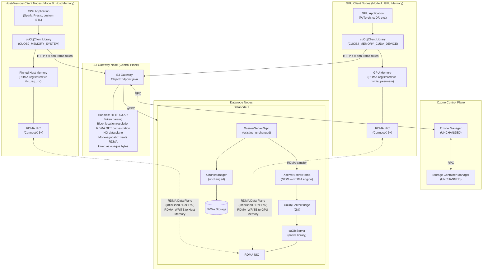
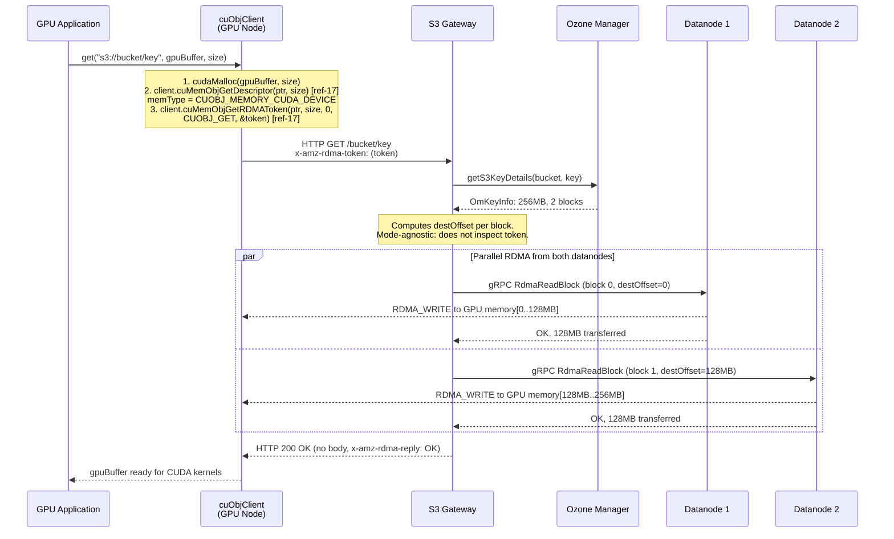
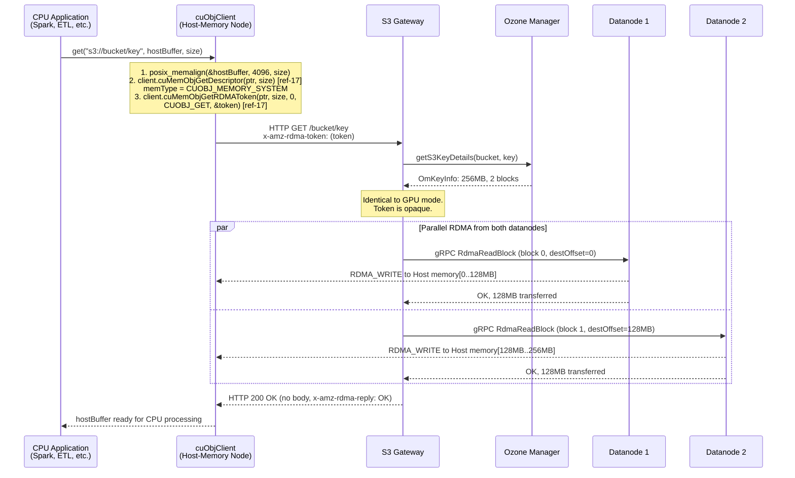
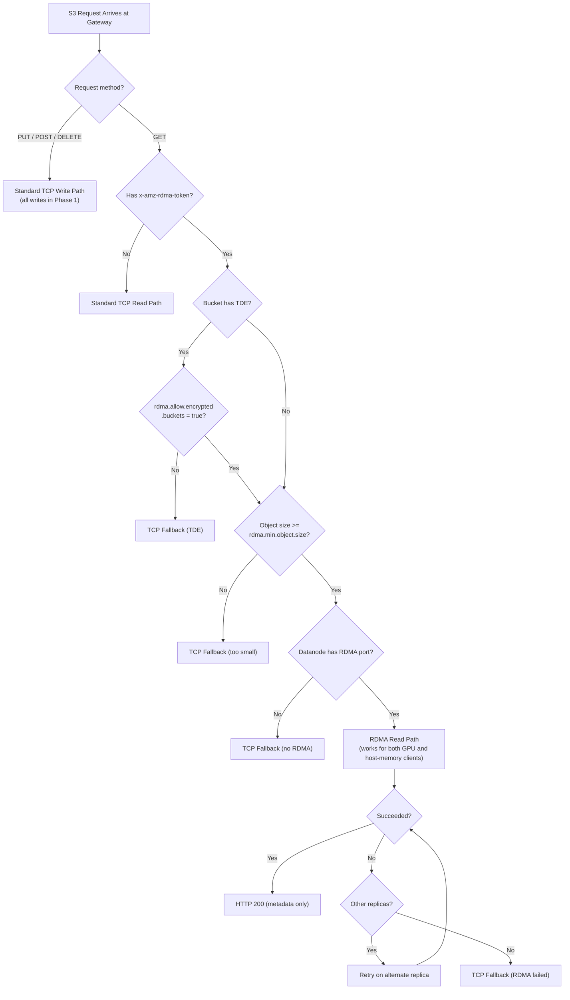
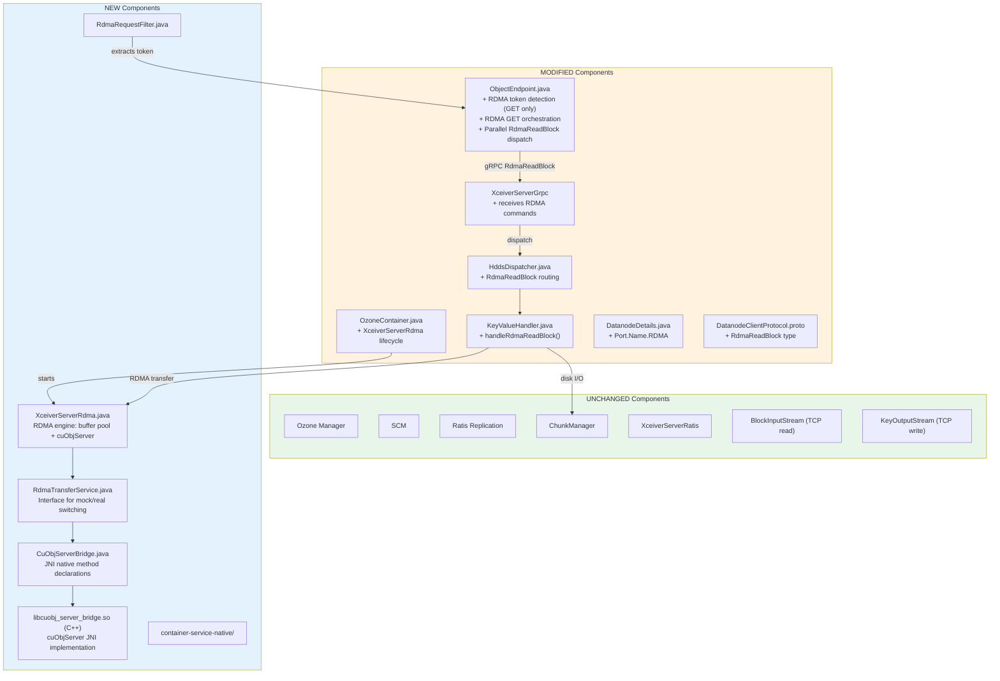
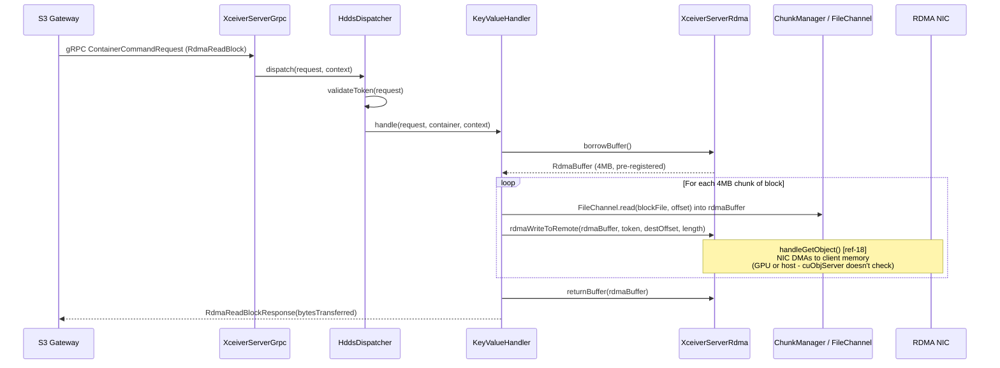

# DN-Direct RDMA Implementation Specification for Apache Ozone
## Phase 1: Read Path — Dual-Mode: GPU Memory and Host-Memory RDMA Transfers

**Version:** 12.2
**Date:** 2026-04-18
**Status:** Draft — v11.0 audit fixes + post-review additions applied.
v12.0: shared-helper plumbing for `RdmaReadBlock`, `OzoneContainer`→
`KeyValueHandler` wiring via post-construction setter,
`XceiverServerRdma.handleRdmaRead` resource-leak fix, `RdmaBufferPool`
partial-init cleanup, JNI bridge missing `<cstdlib>`, cloud section rewritten
to multi-provider (Crusoe / Vultr / Lambda / AWS) with validated launch
commands.
v12.1: added §2.12 IB-vs-RoCEv2 transport section, §7.2.RoCE real-RoCEv2
host/NIC setup walkthrough, §7.4.E Oracle Cloud (only VERIFIED RoCEv2
self-service) and §7.4.F IBM Cloud (VERIFIED RoCEv2, UNCONFIRMED
self-service), §4.7.0 Maven↔CMake integration via `maven-antrun-plugin` +
`maven-resources-plugin`, §4.7.2 distribution packaging of
`libcuobj_server_bridge.so`, and RoCEv2 detection/tuning in
`setup-gpu-env.sh` + `validate-env.sh`.
v12.2: post-v12.1 verification fixes — architecture diagram library name
aligned to `libcuobj_server_bridge.so`; §5.2 build description aligned to
`maven-antrun-plugin` + `maven-resources-plugin` (dropping the stale
`cmake-maven-plugin` reference); §4.3 module dependency direction corrected
(`container-service` depends on `container-service-native`, not the reverse)
plus `hadoop-hdds/pom.xml` reactor entry; §4.7.0 jar fallback path corrected
to jar-root (`NativeLibraryLoader` does not prepend `native/`); §4.7.2 dist
layout corrected to `share/ozone/lib` with an explicit `JAVA_LIBRARY_PATH`
export in `ozone-env.sh`; §4.1.4 `RDMA_BUFFER_POOL_EXHAUSTED` and
`RDMA_TRANSFER_FAILED` now actually emitted via specific catches; new
§4.11.1 wires `hdds.datanode.rdma.checksum.enabled`; §4.14.3 adds volume
IO stats + container byte stats parity with `readBlockImpl`; §4.2 adds
`RDMA` to `DatanodeDetails.IO_PORTS`; §4.13 rewritten to reflect the
audit-action mapping added in §4.13-pre D (previous "no changes required"
text was contradicted by v12.0 additions); §4.1.2 wording for
`perChunkChecksum` clarified so implementers know the field is always
populated, with `type = NONE` and an empty CRC list for `CHECKSUM_NONE`
blocks.
**Target Branch:** `master` (Apache Ozone `2.2.0-SNAPSHOT`)
**Scope:** Phase 1 — S3 GET (Read Path) Only — GPU and Host-Memory Client Modes

---

## Validation Status and Known Limitations

This section documents what has been verified, what remains unverified, and where simulation
replaces real hardware. An implementing AI or engineer should read this section first.

### Verified Against Codebase (Apache Ozone 2.2.0-SNAPSHOT)

| Claim | Status | Evidence |
|---|---|---|
| `DatanodeClientProtocol.proto` Type enum max = `ReadBlock = 24` | **VERIFIED** | Field inspection of proto file |
| `ContainerCommandRequestProto` highest field = 28 (`readBlock`) | **VERIFIED** | Field inspection |
| `ContainerCommandResponseProto` highest field = 25 (`readBlock`) | **VERIFIED** | Field inspection |
| `Port.Name` enum values (10 values, no RDMA yet) | **VERIFIED** | `DatanodeDetails.java` |
| `OzoneContainer.java` initializes `readChannel` (gRPC) and `writeChannel` (Ratis) | **VERIFIED** | Constructor at lines 237-251 |
| `KeyValueHandler.dispatchRequest()` has Type switch for container operations | **VERIFIED** | Lines 326-374 (note: ReadBlock is NOT in this switch — it is handled via a separate read path) |
| `ObjectEndpoint.handleGetRequest()` exists with streaming response | **VERIFIED** | Lines 403-522 |
| `HddsDispatcher` is at `common/impl/HddsDispatcher.java` (NOT `common/helpers/`) | **VERIFIED** | grep result |
| `container-service-native/` module does NOT exist yet | **VERIFIED** | directory listing |

### Verified Against NVIDIA Documentation

| Claim | Status | Evidence |
|---|---|---|
| `cuObjServer::handleGetObject()` signature with 9 parameters | **VERIFIED** | [ref-18] cuObjServer API Reference |
| `cuMemObjGetDescriptor()`, `cuMemObjGetRDMAToken()` are **member functions of `cuObjClient`** | **VERIFIED** | [ref-17] cuObjClient API Reference |
| `cuMemObjGetRDMAToken()` takes `char** desc_str_out` (not `char*`) | **VERIFIED** | [ref-17] — free with `cuMemObjPutRDMAToken()` |
| `cuObjOpType_t` enum values: `CUOBJ_GET = 0`, `CUOBJ_PUT = 1` (not `CUOBJ_OP_GET`) | **VERIFIED** | [ref-17] |
| `cuObjMemoryType_t` enum: SYSTEM=0, CUDA_MANAGED=1, CUDA_DEVICE=2 | **VERIFIED** | [ref-17] |
| `allocHostBuffer()`, `registerBuffer()`, `deRegisterBuffer()` APIs | **VERIFIED** | [ref-18] |
| `allocateChannelId()`, `freeChannelId()` APIs | **VERIFIED** | [ref-18] |
| CUDA Toolkit 13.1.1+ exists | **VERIFIED** | NVIDIA release notes; "13.1.1" = CUDA 13.1 Update 1 |
| cuObjServer does not require GPU on server side | **VERIFIED** | [ref-3] release notes |
| `allocHostBuffer()` returns 4 KB aligned buffer, freed with `free()` | **VERIFIED** | [ref-18] |
| Max operation size: 1 GiB per `handleGetObject`/`handlePutObject` | **VERIFIED** | [ref-18] |
| Max scatter-gather entries: 10 per `registerBuffer(sglist)` | **VERIFIED** | [ref-18] |
| Max memory registration: 4 GiB per `cuMemObjGetDescriptor()` | **VERIFIED** | [ref-17] |

### Unverified / Needs Empirical Testing

| Claim | Status | Risk |
|---|---|---|
| cuObjClient can initialize without a physical GPU for `CUOBJ_MEMORY_SYSTEM` | **NEEDS TESTING** | Medium — release notes imply GPU optional "for GPU memory operations" [ref-2], but CUDA runtime behavior without GPU driver is unconfirmed |
| SoftRoCE supports cuObjServer DC transport | **UNCERTAIN** | Medium — SoftRoCE may not support DC (Dynamically Connected) transport. Use MockRdmaTransferService for dev |
| cuObjServer SDK availability without enterprise agreement | **UNCERTAIN** | High — SDK download page requires NVIDIA developer account; unclear if it requires enterprise licensing |
| Crusoe IB availability in us-east1-a at time of provisioning | **NEEDS CONFIRMATION** | Low — Crusoe docs note "certain VM types in certain regions are currently restricted and may not be available for immediate provisioning." Confirm availability before planning a test session. |

### Simulation vs Real Hardware Matrix

| Component | Local Dev (Mock) | Local + SoftRoCE | Cloud GPU VM (Crusoe `a100-80gb-sxm-ib.8x`) |
|---|---|---|---|
| RDMA Transfer Engine | **SIMULATED** — `MockRdmaTransferService` copies data in JVM heap | **SIMULATED** — SoftRoCE emulates RDMA in CPU, no NIC DMA | **REAL** — cuObjServer + ConnectX NIC hardware DMA |
| GPU Memory | **NONE** — mock uses heap ByteBuffer | **NONE** — SoftRoCE uses host memory | **REAL** — NVIDIA A100 80GB VRAM (or H100 on `h100-80gb-sxm-ib.8x`) |
| InfiniBand / RoCE NIC | **NONE** | **SIMULATED** — rdma_rxe kernel module | **REAL** — ConnectX-6 InfiniBand HCA (8 HCAs, 200 Gbps each) |
| cuObjServer Library | **NOT USED** | **REAL** (if native built) | **REAL** |
| Disk I/O | **REAL** — FileChannel reads temp files | **REAL** | **REAL** — NVMe SSD |
| Protobuf / gRPC Dispatch | **REAL** | **REAL** | **REAL** |
| Block Token Validation | **REAL** | **REAL** | **REAL** |
| Performance Numbers | **MEANINGLESS** — measures JVM memcpy speed | **MISLEADING** — measures CPU-emulated RDMA | **REPRESENTATIVE** — measures actual NIC DMA throughput |
| Cost | Free | Free | **$15.60/hr** (A100 IB) or **$31.20/hr** (H100 IB) |

### Issues Fixed in v12.0 (Post-v11.0 Audit)

The v11.0 audit (`docs/gds-dn-direct-rdma-implementation-spec-verification-report-v11.md`)
identified six findings. v12.0 validates each against the current repo state
and applies fixes. Each finding was **independently verified** before the
corresponding fix was written — see the §Residual section for the one
finding that was only partially accurate.

| # | Audit ref | v11.0 state | v12.0 fix |
|---|---|---|---|
| 1 | §1 Critical | `HddsUtils.isReadOnly(...)`, `.requireBlockToken(...)`, `.getBlockID(...)` unchanged — would mis-classify `RdmaReadBlock` as write-like, fail token verification, and return null block IDs | **VERIFIED** against `hadoop-hdds/common/.../HddsUtils.java` lines 336-369, 392-409, 430-500. Added new §4.13-pre "Shared Helper Updates" with explicit `case RdmaReadBlock` entries for all three methods. |
| 2 | §2 Critical | Spec proposed adding `XceiverServerRdma` as constructor arg to `KeyValueHandler`, but `OzoneContainer` constructs handlers (lines 212-223) **before** any transport server (lines 237, 250). The RDMA engine cannot exist yet at the factory call site. | **VERIFIED** construction ordering + enumerated the 7 test files with direct `new KeyValueHandler(...)` callers. **v12.0 swaps to post-construction setter** (`setXceiverServerRdma`) — no constructor change, no test churn. §4.12 wires after RDMA engine init via a handler-map loop; §4.14.1 documents the setter. |
| 3 | §3 Critical | `handleRdmaRead` called `allocateChannel()` + `bufferPool.acquire()` **before** the try/finally block. Any throw leaked the semaphore permit, and a throw from `acquire()` leaked the channel too. | **VERIFIED** against §4.11 spec lines 1918-1925 + 2044-2048. **Fixed:** acquisitions moved inside try, each guarded by null-check + per-resource try/catch on release. |
| 4 | §4 High | `DNAction` had no RDMA action; `HddsDispatcher.msgToAction(...)` returned null for `RdmaReadBlock`; `XceiverClientGrpc.getRequestBlockID(...)` had no case for it | **VERIFIED** against `DNAction.java`, `HddsDispatcher.java:920`, `XceiverClientGrpc.java:477-489`. Added to §4.13-pre D and E with explicit code, plus the decision to use a new `RDMA_READ_BLOCK` audit action (not reuse `READ_BLOCK`). |
| 5 | §5 Medium | Crusoe Linux `apt` stanza referenced `dl.fury.io/crusoecloud/apt/` — not documented on Crusoe's current CLI guide | **PARTIALLY VERIFIED** — the `brew` macOS path is confirmed; the Linux apt URL could not be independently verified in the v11.0 audit timeframe. **v12.0 removes the unverified apt stanza** from §7.4.A and directs Linux users to the Crusoe CLI GitHub releases (documented path). |
| 6 | §6 Low | Native JNI bridge at §4.6 uses `free(ptr)` at line 1285 but does NOT `#include <cstdlib>` in its header block (lines 1208-1215). Compilation was relying on transitive include. (The audit incorrectly claimed `<cstdlib>` was already included — that was in a *different* C++ snippet at §2.10 line 702.) | **VERIFIED** — includes in §4.6 did not list `<cstdlib>`. **Fixed:** added `#include <cstdlib>` to the JNI bridge header block with a comment referencing the `nativeFreeHostBuffer` use site. Partial-init cleanup for `RdmaBufferPool` (also called out in §6) is addressed in §4.10. |

**Additional v12.0 changes:**

| Area | v11.0 state | v12.0 change |
|---|---|---|
| §7.3 Cloud provider matrix | Crusoe-primary, with a fallback table that marked Lambda / Vultr / AWS as `LIKELY YES` or ruled out | **Multi-cloud first-class.** §7.3 now has a verified table covering Crusoe, Vultr, Lambda, and AWS, with explicit source links, per-SKU `$/GPU/hr`, and a §7.3.3 EFA-vs-IB compatibility caveat for AWS. |
| §7.4 Step-by-step provisioning | Single flow for Crusoe | **Split into 7.4.A–D (per provider) and 7.4.Z (shared build/run).** All four provisioning stanzas produce `$VM_IP`, `$VM_USER`, `$CLOUD` env vars, then the provider-agnostic §7.4.Z runs build + tests. |
| §7.10 Cookbook — "Cloud GPU VM" | Crusoe-only quick start | Replaced with four parallel stanzas (B.1 Crusoe / B.2 Vultr / B.3 Lambda / B.4 AWS), each 10-15 lines and runnable end-to-end. |

### Issues Fixed in v12.1 (Post-v12.0 Review)

Architecture-level review caught that v12.0 only covered InfiniBand and EFA
clouds — no real RoCEv2 host, and no explicit RoCEv2 setup path. v12.1 also
closes the Maven↔CMake gap that made §4.7 non-self-sufficient for a
first-time implementer.

| # | v12.0 gap | v12.1 fix |
|---|---|---|
| R1 | Arch diagrams labeled the data plane "InfiniBand / RoCEv2" but no dedicated section explained that Ozone is transport-agnostic and named the RoCE-specific host/NIC config | Added §2.12 "Transport: InfiniBand vs. RoCEv2 (both are first-class)" with NVIDIA-doc citations confirming cuObject/GDS supports both transports and a fabric-difference matrix. |
| R2 | SoftRoCE was the only RoCE-adjacent option anywhere in §7, leaving operators with real RoCEv2 hardware without a setup recipe | Added §7.2.RoCE with the full host-side setup: NIC mode (LINK_TYPE_P1=2), `cma_roce_mode` check, `mlnx_qos` PFC on priority 3, ECN enable, `CUFILE_ETH_SL=3`, and a perftest smoke test. |
| R3 | No RoCEv2 cloud was recommended in §7.3 — all four providers were IB or EFA | Added verified rows for Oracle Cloud (`BM.GPU.H100.8` / `BM.GPU.A100-v2.8` / `BM.GPU4.8`) and IBM Cloud (`gx3d-160x1792x8h100`) to the §7.3.1 matrix. **OCI is the only verified credit-card-accessible RoCEv2 path**; IBM's self-service status is UNCONFIRMED. |
| R4 | No provisioning stanza for RoCEv2 clouds | Added §7.4.E (OCI — `oci compute instance launch` with `BM.GPU.H100.8`, RoCEv2 setup pointer to §7.2.RoCE) and §7.4.F (IBM Cloud — `ibmcloud is instance-create gx3d-160x1792x8h100`, UNCONFIRMED CLI shape documented as-is). |
| R5 | `setup-gpu-env.sh` treated every Mellanox NIC the same and did not tune for RoCEv2 | Script now detects `link_layer: InfiniBand` vs `Ethernet` via `ibv_devinfo`, runs `cma_roce_mode -m 2` for RoCE, applies `mlnx_qos` PFC on priority 3, enables ECN, sets `CUFILE_ETH_SL=3`. |
| R6 | `validate-env.sh` did not tell the operator whether they were on IB, RoCEv2, or SoftRoCE | Added a fabric classification block that reports `REAL InfiniBand`, `REAL RoCEv2`, or `SIMULATED SoftRoCE`, and asserts PFC+CUFILE_ETH_SL on the RoCE path. |
| R7 | §4.7 documented `CMakeLists.txt` but did not show HOW Maven invokes CMake or how the built `.so` gets into the jar | Added §4.7.0 (Maven-antrun plugin invokes cmake during `compile`; maven-resources plugin copies `libcuobj_server_bridge.so` into `target/classes/native/`) and §4.7.2 (distribution-tarball packaging under `share/hadoop/ozone/lib/native/`). |

### Issues Fixed in v12.2 (Post-v12.1 Verification)

Verification pass against the actual repo state caught a cluster of
implementation-blocking inconsistencies introduced over v10.0–v12.1.

| # | v12.1 gap | v12.2 fix |
|---|---|---|
| V1 | §4.3 declared `container-service-native` depends on `container-service`, but `XceiverServerRdma` in `container-service` imports `RdmaTransferService`/`RdmaBufferPool`/`CuObjRdmaTransferService` from `container-service-native` — the declared direction is the reverse of what the class layout requires, which is a Maven cycle. Reactor entry in `hadoop-hdds/pom.xml` was also missing. | §4.3 rewritten to declare the correct direction (`container-service` → `container-service-native`) and to add the `<module>container-service-native</module>` entry. |
| V2 | §4.7.0 claimed `NativeLibraryLoader` falls back to `native/libcuobj_server_bridge.so`; the actual loader in `hadoop-hdds/rocks-native/.../NativeLibraryLoader.java` searches the jar root for a bare `libcuobj_server_bridge.so`, no `native/` prefix. | §4.7.0 corrected: staged to both jar root and `native/` sub-path via two `maven-resources-plugin` executions; load-path description rewritten. |
| V3 | §4.7.2 shipped the `.so` under `share/hadoop/ozone/lib/native/`, but the repo's `dist-layout-stitching` stages libraries under `share/ozone/lib`. `ozone-functions.sh` was also assumed to set `java.library.path` automatically; it only appends when `JAVA_LIBRARY_PATH` is already set. | §4.7.2 corrected to `share/ozone/lib/native/`, with `dist-layout-stitching` additions and an explicit `JAVA_LIBRARY_PATH` export in `ozone-env.sh`. |
| V4 | §4.1.4 declared `RDMA_BUFFER_POOL_EXHAUSTED` and `RDMA_TRANSFER_FAILED` but neither was ever emitted — `handleRdmaReadBlock`'s generic `IOException` catch collapsed both into `IO_EXCEPTION`, and `handleRdmaRead` threw plain `IOException` on transfer failures. | §4.11 introduces `RdmaTransferException`; §4.14.3 adds specific catches before the generic `IOException` branch so both codes actually reach the wire. |
| V5 | §7.11 and Appendix F listed `hdds.datanode.rdma.checksum.enabled` as a user-facing toggle, but no Java code read it. | Added `RDMA_CHECKSUM_ENABLED_KEY` constant + constructor field in `XceiverServerRdma`; gated the `Checksum.verifyChecksum(...)` call on the flag. |
| V6 | `handleRdmaReadBlock` did not record `volume.getVolumeIOStats().recordReadOperation(...)` or `metrics.incContainerBytesStats(...)` even though `readBlockImpl` does — RDMA reads were invisible to every existing datanode read dashboard. | §4.14.3 wraps the call with the same `startTime` + stats pattern used by `readBlockImpl`, attributing RDMA bytes to `Type.RdmaReadBlock`. |
| V7 | §4.2 added `Port.Name.RDMA` but did not update `DatanodeDetails.IO_PORTS`, so the proto serializer's `IO_PORTS` filter path hid the new port from clients. | §4.2 updates `IO_PORTS` to include `RDMA` and notes the layout-version annotation protects pre-RDMA clients. |
| V8 | §4.13 still read "No changes required" while §4.13-pre D (added in v12.0) explicitly added `DNAction.RDMA_READ_BLOCK` + `msgToAction` case to `HddsDispatcher`. Internal self-contradiction. | §4.13 rewritten to "audit-action mapping only", cross-referencing §4.13-pre D. |
| V9 | Architecture diagram still showed `libgds_jni.so`; §5.2 still said "CMake + `cmake-maven-plugin`". Both contradicted the rest of the spec. | Diagram updated to `libcuobj_server_bridge.so`; §5.2 rewritten to match §4.7.0's `maven-antrun-plugin` + `maven-resources-plugin` story. |
| V10 | §4.1.2 comment on `perChunkChecksum` said "empty only when block was written with `CHECKSUM_NONE`", but `handleRdmaRead` always appends a per-chunk entry regardless of type — the field is populated with `type = NONE` + empty CRC list for `CHECKSUM_NONE` blocks, not omitted. | §4.1.2 comment rewritten so clients branch on per-entry `type == NONE`, not on emptiness of the outer repeated field. |

### Issues Fixed in v11.0 (Post-v10.0 Audit)

The v10.0 audit (`docs/gds-dn-direct-rdma-implementation-spec-audit-v10.md`)
identified 9 compile blockers, ~14 S3 response-parity gaps, 2 data-integrity
gaps, a partial-failure race, and several minor issues. v11.0 resolves each.

| # | Audit ref | v10.0 state | v11.0 fix |
|---|---|---|---|
| 1 | A.1 | `ChecksumByteBufferFactory.getCrc32CByteBufferInstance()` — method does not exist | Replaced with stored-checksum verification using `Checksum.verifyChecksum(ByteBuffer, ChecksumData, int)` (§4.11). The hand-rolled CRC scheme is removed entirely; §3.8 rewritten to describe real end-to-end verification |
| 2 | A.2 | `ContainerUtils.getErrorResponse(request, Result, String)` — method does not exist | All three call sites replaced with `ContainerCommandResponseBuilders.getContainerCommandResponse(request, result, msg).build()` or `ContainerUtils.logAndReturnError(LOG, new StorageContainerException(...), request)` (§4.14.3) |
| 3 | A.3 | `NativeLibraryLoader.loadLibrary(...)` return value ignored inside a try/catch for `UnsatisfiedLinkError` — loader never throws; `available` was set to `true` even on failure | Assign the returned boolean to `available`; removed dead catch (§4.5). Added required `rocks-native` pom dependency note to §4.3 |
| 4 | A.4 | `addEntityTagHeader(ResponseBuilder, OzoneKey)` was being passed a `String` — compile error and missed `x-amz-mp-parts-count` emission | Call `addEntityTagHeader(responseBuilder, keyDetails)` with the `OzoneKey`; manual `ETAG` extraction removed (§4.15.5) |
| 5 | A.5 | Direct access to `EndpointBase.ozoneConfiguration` (private field) | All reads use `getOzoneConfiguration()` (§4.15.5) |
| 6 | A.6 | `var response = xcClient.sendCommand(...)` in §8.2 | Replaced with `ContainerProtos.ContainerCommandResponseProto response = ...` (§8.2) |
| 7 | A.7 | `mockService.initialize(null, 0, 0)` — 3-arg form not matching the 2-arg interface | All five call sites now use `initialize(null, 0)` (§8.1) |
| 8 | A.8 | `handleRdmaReadBlock(ContainerCommandRequestProto, Container)` — peer handlers take `KeyValueContainer` | Signature changed to `handleRdmaReadBlock(ContainerCommandRequestProto, KeyValueContainer kvContainer)`, cast dropped (§4.14.2, §4.14.3) |
| 9 | A.9 | §4.13 "add case to HddsDispatcher Type switch" — no such switch exists | §4.13 rewritten to state that HddsDispatcher requires no changes; the RdmaReadBlock case lives in `KeyValueHandler.dispatchRequest()` (§4.14.2) |
| 10 | E.1 | §8.2 used `acquireClient` / `releaseClient` | Changed to `acquireClientForReadData` / `releaseClientForReadData` to match §4.15.5 |
| 11 | E.2 | Redundant `.setCmdType(...)` on success response | Removed — `getSuccessResponse(request)` already sets cmdType (§4.14.3) |
| 12 | E.5 | `handleGetRequest` line range "404-522" — off by one | Corrected to `ObjectEndpoint.java:403-522` throughout |
| 13 | C.1-C.9 | S3 response-parity gaps: action label, isFile, preconditions (these 3 are handled by the caller before the RDMA insertion point — documented, not re-duplicated); metrics (`updateGetKeyMetadataStats`, `updateGetKeySuccessStats`, `updateGetKeyFailureStats`), `perf.appendSizeBytes`, `perf.appendOpLatencyNanos`, `perf.appendMetaLatencyNanos`; range validation handled by caller; `overrideQueryParameter` loop; `ACCEPT_RANGE_HEADER`/`CONTENT_RANGE_HEADER`/`RANGE_HEADER_SUPPORTED_UNIT` constants; tag count header | §4.15.4 now passes `startNanos` and `perf` through. §4.15.5 records all success/failure metrics, applies `overrideQueryParameter` overrides, uses the same `addEntityTagHeader` / `addLastModifiedDate` / `addTagCountIfAny` helpers as the TCP path, uses S3Consts constants |
| 14 | D.1 | Partial-failure remediation was a best-effort race: `CompletableFuture.cancel` is no-op for RDMA in-flight writes; client-side buffer invalidation undocumented | New `handleRdmaFailure(...)` method formalizes the 503 PARTIAL_FAILURE contract: client MUST re-register a fresh buffer with a new rkey; `x-amz-rdma-partial-blocks-completed` added for client telemetry; `updateGetKeyFailureStats` is now called on this path (§4.15.5) |
| 15 | D.2 | Checksum computed on disk-read bytes and compared to itself — disk corruption undetected server-side | `handleRdmaRead` now loads stored `BlockData` via `getBlockManager().getBlock(kvContainer, blockID).getChunks()`, reads each stored chunk into the RDMA buffer, calls `Checksum.verifyChecksum(buffer, storedChunkChecksumData, 0)` BEFORE `rdmaWriteToRemote`. Disk rot raises `IOException` → `ContainerUtils.logAndReturnError` with no bytes transferred (§4.11, §4.14.3) |
| 16 | D.3 | `bytesPerChecksum` was the RDMA buffer size (~4 MiB) — incomparable with stored (typical 1 MiB) metadata | RDMA response now returns the VERBATIM stored `ChecksumData` (type + bytesPerChecksum + CRC list) per transferred stored chunk via `repeated ChecksumData perChunkChecksum` in `RdmaReadBlockResponseProto` (§4.1.2, §4.11). `clientBufferOffset` lets the client map each entry back to its buffer region |

**Self-audit findings caught in v11.0 during the v10→v11 rewrite** (caught
before publication; included here for traceability):

| # | Finding | v11.0 fix |
|---|---|---|
| S1 | First v11.0 draft returned `null` on any non-SUCCESS block response after `allOf().join()`, re-introducing the §D.1 partial-buffer bug (TCP fallback after partial RDMA_WRITE) | Main loop now counts `successCount` over ALL futures before deciding: `successCount == N` → success response, `successCount == 0` → `null` (safe TCP), `0 < successCount < N` → `handleRdmaFailure` → 503 PARTIAL_FAILURE (§4.15.5) |
| S2 | First v11.0 draft changed `RDMA_DISPATCH_POOL` from `static final` to per-instance `final`. `ObjectEndpoint` is a JAX-RS resource and may be per-request-scoped, so a per-instance pool leaks threads on every request | Reverted to `private static final ExecutorService RDMA_DISPATCH_POOL` (§4.15.1) with a comment explaining why |
| S3 | `handleRdmaFailure` counted "futures that completed normally" as "successful RDMA_WRITEs", which over-counts because a future can complete normally with `result != SUCCESS` | Split into two overloads: catch-path computes success count by inspecting `getNow(null).getResult() == SUCCESS`; main-loop path passes its already-computed `successCount` explicitly. `x-amz-rdma-partial-blocks-completed` now reports true success count (§4.15.5) |

### Issues Fixed in v10.0 (Post-v9.0 Audit)

| Item | v9.0 Status | v10.0 Fix |
|---|---|---|
| `var` keyword in `handleRdmaGet()` | **COMPILE BLOCKER** — Java 10+ feature, repo targets Java 8 | Fixed: replaced with explicit types (`CompletableFuture<...>`, `ContainerCommandResponseProto`, `ChecksumData`) |
| `new java.util.zip.CRC32C()` in `XceiverServerRdma` | **COMPILE BLOCKER** — Java 9+ API, repo targets Java 8 | Fixed: use `ChecksumByteBufferFactory.getCrc32CByteBufferInstance()` (existing Java 8-compatible abstraction) |
| `NativeLibraryLoader.getInstance().loadLibrary(LIBRARY_NAME)` | **COMPILE BLOCKER** — only 2-arg overload `loadLibrary(String, List<String>)` exists | Fixed: pass `Collections.emptyList()` as second argument |
| `context.getProperty(...)` in ObjectEndpoint | **COMPILE BLOCKER** — `context` is `ObjectRequestContext` with no `getProperty()` | Fixed: use `getContext().getProperty(...)` to access JAX-RS `ContainerRequestContext` |
| `maxConnections` param on `RdmaTransferService.initialize()` | **UNMAPPED** — cuObjServer constructor has no `maxConnections` param | Fixed: removed from interface, impl, and config. cuObjServer tunables are in `cuObjRDMATunableParam` (Phase 2) |
| RDMA GET response missing standard S3 headers | **S3 BEHAVIOR BREAK** — missing `Accept-Ranges`, `Last-Modified`, tag count; ETag not quoted; wrong 200/206 logic | Fixed: reuse existing `addEntityTagHeader()`, `addLastModifiedDate()`, `addTagCountIfAny()` helpers; use `rangeHeader.isReadFull()` for 200 vs 206 |
| EC and partNumber requests not handled in RDMA path | **S3 BEHAVIOR BREAK** — EC block layout differs; partNumber query ignored | Fixed: explicit TCP fallback for both cases |
| Unsafe TCP fallback after partial RDMA transfer | **DATA INTEGRITY** — partial data in client buffer + full TCP body = inconsistent | Fixed: block TCP fallback once any RDMA block succeeds; return 503 with Retry-After |
| `acquireClient()` instead of `acquireClientForReadData()` | **SEMANTIC MISMATCH** — read flows should use read-specific API | Fixed: use `acquireClientForReadData()` / `releaseClientForReadData()` |
| Spec adds 3-arg `getKeyInfo()` to RpcClient | **DRIFT** — 4-arg overload already exists with correct behavior | Fixed: removed spec's helper; use existing `getKeyInfo(vol, bucket, key, false)` |
| Block-range `loc == locations.get(0)` reference equality | **LATENT BUG** — fragile under refactoring | Fixed: use `blockID.equals()` comparison |
| Checksum `setBytesPerChecksum(bufSize)` misleading | **SEMANTIC GAP** — uses RDMA buffer size, not block's stored granularity | Fixed: added documentation clarifying these are transfer-integrity checksums, not block-metadata checksums |

### Known Hallucinations Fixed in Prior Versions

| Item | v7.0/v8.0 Status | v9.0 Fix |
|---|---|---|
| `pip install cuobjclient` Python package | **HALLUCINATED** — no such package on PyPI | Fixed: cuObjClient is C++ only. Python bindings may exist in SDK but not on PyPI. E2E tests now use C++ test client as primary, Python as aspirational. |
| Vultr `vcg-a100-1c-12g-6vram` instance type | **HALLUCINATED** — impossible specs, Vultr doesn't expose ibverbs | Fixed: removed from recommendations |
| Lambda Labs single-GPU has "200 Gbps RDMA NIC" | **INCORRECT** — single-GPU instances use Ethernet only; IB only on cluster reservations | Fixed: moved to "limited" tier with caveat |
| CoreWeave accepts credit cards | **INCORRECT** — requires sales approval | Fixed: removed from self-service list |
| Azure HBv3 is "immediate credit card access" | **INCORRECT** — requires quota approval (default quota is 0 for HPC VMs) | Fixed: noted quota requirement |
| Sections 4.4-4.16 "see v6.0" | **INCOMPLETE** — implementation code was missing | Fixed: all code inlined in this document |
| HddsDispatcher path `common/helpers/` | **INCORRECT** — actual path is `common/impl/` | Fixed |
| `pip install crusoe-cli` for Crusoe CLI | **HALLUCINATED** — no such PyPI package exists | Fixed: Crusoe CLI is a compiled binary installed via `brew install crusoecloud/cli/crusoe` (macOS) or `sudo apt install crusoe` (Debian/Ubuntu via Fury repo). See https://github.com/crusoecloud/cli |
| Crusoe H100 at $1.95/GPU/hr | **INCORRECT** — H100 is $3.90/GPU/hr as of April 2026. $1.95 is the A100 price | Fixed: updated pricing throughout. Recommend A100 IB ($15.60/hr) for development, H100 IB ($31.20/hr) for benchmarking |
| Crusoe single-GPU H100 with InfiniBand | **INCORRECT** — all InfiniBand instances are 8-GPU minimum (e.g., `h100-80gb-sxm-ib.8x`) | Fixed: updated instance types, removed references to single-GPU IB instances |
| `cuMemObjGetRDMAToken(ptr, size, 0, CUOBJ_OP_GET, rdma_token)` | **INCORRECT API** — `CUOBJ_OP_GET` doesn't exist (enum value is `CUOBJ_GET`); function takes `char** desc_str_out` not `char*`; these are member functions of `cuObjClient`, not free functions | Fixed: corrected all client examples to use verified API signatures from [ref-17] |
| KeyValueHandler.dispatchRequest() lines 326-372 | **MINOR** — actual range is 326-374 | Fixed: updated line reference |

---

## How to Read This Spec

This spec is structured so you understand **what** we're building and **why** before getting into **how** to set up the
environment. The recommended reading order:

1. **Validation Status** (above) — What's verified, what's not, what's simulated
2. **Section 1 (Architecture)** — System design, data flows, dual-mode client topology (GPU and host-memory)
3. **Section 2 (Client Memory Modes)** — How GPU and host-memory clients register memory, consume data, and differ
4. **Section 3 (Security & Integrity)** — Encryption, token interactions, CRC32C checksum strategy
5. **Section 4 (Code Changes)** — Protobuf, Java, C++, JNI — server-side and gateway code (identical for both modes)
6. **Section 5 (C/C++ Integration)** — Build system, toolchain, native library, memory model
7. **Section 6 (Client-Side RDMA)** — cuObjClient system memory mode, libibverbs, DiSNI options
8. **Section 7 (Development Environment)** — Cloud testing with real hardware, SoftRoCE, mock testing
9. **Section 8 (Testing)** — Unit, integration, E2E for both GPU and host-memory modes
10. **Section 9 (Benchmarking)** — Performance validation for both modes
11. **Section 10 (Configuration Reference)** — All config keys
12. **Section 11 (References)** — All source links

### Dual-Mode Architecture: The Key Insight

**The datanode and S3 Gateway code is identical for both GPU and host-memory clients.** cuObjServer performs
RDMA_WRITE to whatever address the client's RDMA token specifies — it does not inspect, validate, or care whether
the target is GPU device memory or host (CPU) memory [[ref-18]](#11-references). The RDMA NIC's DMA engine writes
to the physical address encoded in the token's rkey, regardless of memory type.

This means:
- **Sections 3–5 (security, code changes, C++ integration)** are the same for both modes
- **Sections 1–2 and 6–9** cover both modes with clearly labeled subsections
- No conditional compilation, no mode flag in the protobuf, no server-side branching

### Phase 1 Scope

**Phase 1 implements the S3 GET (read) path only, for both GPU and host-memory clients.**

| Feature | Phase 1 | Phase 2 |
|---------|---------|---------|
| S3 GET via RDMA to GPU memory (cuObjClient + `CUOBJ_MEMORY_CUDA_DEVICE`) | **IN SCOPE** | — |
| S3 GET via RDMA to host memory (cuObjClient + `CUOBJ_MEMORY_SYSTEM`) | **IN SCOPE** | — |
| Fallback to TCP when RDMA is unavailable or not suitable | **IN SCOPE** | — |
| Block token validation for RDMA read requests | **IN SCOPE** | — |
| `RdmaReadBlock` protobuf message and gRPC dispatch | **IN SCOPE** | — |
| `XceiverServerRdma` RDMA engine (buffer pool + cuObjServer) | **IN SCOPE** | — |
| CRC32C checksum on RDMA read path (compute, verify, return) | **IN SCOPE** | — |
| Multiple S3 Gateway support (stateless, no coordination) | **IN SCOPE** | — |
| Custom RDMA client via raw libibverbs (bypass cuObjClient) | deferred | **Phase 2** |
| Java RDMA client via DiSNI (pure Java, no NVIDIA dependency) | deferred | **Phase 2** |
| S3 PUT via RDMA (cuObjClient PUT, `handlePutObject`) | deferred | **Phase 2** |
| `RdmaWriteBlock` protobuf message and dispatch | deferred | **Phase 2** |
| RDMA multipart upload | deferred | **Phase 2** |
| Async server-side RDMA pipelining | deferred | **Phase 2** |
| Scatter-gather I/O | deferred | **Phase 2** |

### API Documentation Convention

Every cuObject API call in this spec links inline to its NVIDIA documentation reference page:

- **cuObjClient API:** [https://docs.nvidia.com/gpudirect-storage/cuobject/cuObjClient-api/index.html](https://docs.nvidia.com/gpudirect-storage/cuobject/cuObjClient-api/index.html) [[ref-17]](#11-references)
- **cuObjServer API:** [https://docs.nvidia.com/gpudirect-storage/cuobject/cuObjServer-api/index.html](https://docs.nvidia.com/gpudirect-storage/cuobject/cuObjServer-api/index.html) [[ref-18]](#11-references)

---

## Table of Contents

- [1. Architecture](#1-architecture)
  - [1.1 Overall Architecture](#11-overall-architecture)
  - [1.2 Client Deployment Modes](#12-client-deployment-modes)
  - [1.3 Data Flow: S3 GET — GPU Mode](#13-data-flow-s3-get--gpu-mode)
  - [1.4 Data Flow: S3 GET — Host-Memory Mode](#14-data-flow-s3-get--host-memory-mode)
  - [1.5 Data Flow: S3 PUT (Write Path)](#15-data-flow-s3-put-write-path)
  - [1.6 Fallback Path](#16-fallback-path)
  - [1.7 Component Interaction Map](#17-component-interaction-map)
  - [1.8 Request Dispatch Model](#18-request-dispatch-model)
  - [1.9 Multiple S3 Gateway Architecture](#19-multiple-s3-gateway-architecture)
- [2. Client Memory Modes and Data Consumption Model](#2-client-memory-modes-and-data-consumption-model)
- [3. Security and Encryption](#3-security-and-encryption)
- [4. Ozone Code Changes](#4-ozone-code-changes)
  - [4.1 Protocol Buffer Changes](#41-protocol-buffer-changes)
  - [4.2 DatanodeDetails Port Type](#42-datanodedetails-port-type)
  - [4.3 New Maven Module: container-service-native](#43-new-maven-module-container-service-native)
  - [4.4 RdmaTransferService Interface](#44-rdmatransferservice-interface)
  - [4.5 JNI Bridge: CuObjServerBridge.java](#45-jni-bridge-cuobjserverbridgejava)
  - [4.6 Native C++ Implementation](#46-native-c-implementation)
  - [4.7 CMakeLists.txt for Native Build](#47-cmakeliststxt-for-native-build)
  - [4.8 CuObjRdmaTransferService.java](#48-cuobjrdmatransferservicejava)
  - [4.9 MockRdmaTransferService.java](#49-mockrdmatransferservicejava)
  - [4.10 RdmaBuffer.java and RdmaBufferPool.java](#410-rdmabufferjava-and-rdmabufferpooljava)
  - [4.11 XceiverServerRdma.java](#411-xceiverserverrdmajava)
  - [4.12 OzoneContainer.java Modifications](#412-ozonecontainerjava-modifications)
  - [4.13 HddsDispatcher — audit-action mapping only](#413-hddsdispatcher--audit-action-mapping-only)
  - [4.14 KeyValueHandler Modifications](#414-keyvaluehandler-modifications)
  - [4.15 S3 Gateway: ObjectEndpoint Modifications](#415-s3-gateway-objectendpoint-modifications)
  - [4.16 S3 Gateway: RdmaRequestFilter](#416-s3-gateway-rdmarequestfilter)
- [5. C/C++ Integration Architecture](#5-cc-integration-architecture)
- [6. Client-Side RDMA Library Architecture](#6-client-side-rdma-library-architecture)
- [7. Development Environment and Deployment](#7-development-environment-and-deployment)
  - [7.1 Environment Matrix](#71-environment-matrix)
  - [7.2 SoftRoCE: Decision and Limitations](#72-softroce-decision-and-limitations)
  - [7.3 Cloud Provider for GPU+RDMA Testing](#73-cloud-provider-for-gpurdma-testing)
  - [7.4 Cloud Cluster: Step-by-Step Provisioning and Testing](#74-cloud-cluster-step-by-step-provisioning-and-testing)
  - [7.5 How to Run Ozone for Development](#75-how-to-run-ozone-for-development)
  - [7.6 setup-gpu-env.sh](#76-setup-gpu-envsh)
  - [7.7 setup-rdma-env.sh (No GPU)](#77-setup-rdma-envsh-no-gpu)
  - [7.8 validate-env.sh](#78-validate-envsh)
  - [7.9 Docker Cluster for Integration Testing](#79-docker-cluster-for-integration-testing)
  - [7.10 Quick Start Cookbook](#710-quick-start-cookbook-end-to-end-setup-and-test)
  - [7.11 Ozone RDMA Configuration Template](#711-ozone-rdma-configuration-template)
  - [7.12 run-all-tests.sh](#712-run-all-testssh)
  - [7.13 cleanup-env.sh](#713-cleanup-envsh)
- [8. Testing](#8-testing)
- [9. Benchmarking](#9-benchmarking)
- [10. Configuration Reference](#10-configuration-reference)
- [11. References](#11-references)
- [Appendix A: Resolved Unknowns](#appendix-a-resolved-unknowns)
- [Appendix B: Phase 2 Deferred Items](#appendix-b-phase-2-deferred-items)
- [Appendix C: Observability (Phase 2 Design Notes)](#appendix-c-observability-phase-2-design-notes)
- [Appendix D: cuObjRDMATunableParam Mapping](#appendix-d-cuobjrdmatunableparam-mapping)

---

## 1. Architecture

### 1.1 Overall Architecture

#### System Architecture Overview — Dual-Mode Clients

The architecture supports two client deployment modes with **identical server-side infrastructure**:

1. **GPU Mode:** Client has NVIDIA GPU + RDMA NIC. Data lands in GPU device memory via GPUDirect RDMA.
2. **Host-Memory Mode:** Client has RDMA NIC only (no GPU). Data lands in pinned host (CPU) memory via standard RDMA.



> **Critical design principle:** The RDMA token (`x-amz-rdma-token`) is **opaque** to both the S3 Gateway and the
> datanode. It encodes the client's registered memory address, rkey, and DC transport metadata. cuObjServer's
> `handleGetObject()` [[ref-18]](#11-references) accepts this token as `const std::string& rdma_descr` and performs
> RDMA_WRITE to whatever physical address the token encodes — GPU BAR memory or host RAM. No server-side branching
> is needed.

> **Storage device note:** Diagrams label storage as "NVMe" because NVMe SSDs are the expected storage for
> RDMA-capable deployments. **NVMe is NOT a requirement.** Ozone reads through `FileChannel.read()`, which works
> with any filesystem-backed storage.

### 1.2 Client Deployment Modes

#### 1.2.1 GPU Mode (CUOBJ_MEMORY_CUDA_DEVICE)

The client has an NVIDIA GPU (A100, H100, etc.) and an RDMA NIC (ConnectX-6+). Data is transferred directly
into GPU device memory, bypassing the CPU entirely.

**Requirements:**
- NVIDIA GPU with CUDA Compute Capability 6.0+
- NVIDIA GPU Driver compatible with CUDA 13.1.1+
- CUDA Toolkit 13.1.1+
- `nvidia_peermem` kernel module (enables NIC -> GPU DMA)
- ConnectX-5+ RDMA NIC with MLNX_OFED 5.8+
- cuObjClient library

**Use cases:** AI/ML training data loading (PyTorch, TensorFlow), GPU analytics (RAPIDS cuDF),
inference serving, any workflow where data is consumed by GPU kernels.

**Memory registration flow (all methods are cuObjClient member functions [ref-17]):**
```
cuObjClient client(ops, CUOBJ_PROTO_RDMA_DC_V1)
cudaMalloc(&ptr, size)
  -> client.cuMemObjGetDescriptor(ptr, size)    // registers GPU memory for RDMA [ref-17]
  -> client.cuMemObjGetRDMAToken(ptr, size, 0,  // generates x-amz-rdma-token [ref-17]
       CUOBJ_GET, &token_str)                    // token_str is char** output
```

#### 1.2.2 Host-Memory Mode (CUOBJ_MEMORY_SYSTEM)

The client has an RDMA NIC but **no GPU**. Data is transferred directly into pinned host (CPU) memory,
bypassing the kernel network stack and achieving near-line-rate throughput.

**Requirements:**
- ConnectX-5+ RDMA NIC with MLNX_OFED 5.8+
- cuObjClient library with CUDA Toolkit (GPU listed as optional "for GPU memory operations" [[ref-2]](#11-references))
- No GPU hardware required
- No `nvidia_peermem` required

**Use cases:** CPU-based analytics (Spark, Presto, Trino), ETL pipelines, data preprocessing,
any workload that benefits from high-throughput storage I/O without GPU compute.

**Memory registration flow (all methods are cuObjClient member functions [ref-17]):**
```
cuObjClient client(ops, CUOBJ_PROTO_RDMA_DC_V1)
posix_memalign(&ptr, 4096, size)  // or malloc + mlock
  -> client.cuMemObjGetDescriptor(ptr, size)    // registers host memory [ref-17]
    // cuObjClient detects CUOBJ_MEMORY_SYSTEM via getMemoryType() [ref-17]
  -> client.cuMemObjGetRDMAToken(ptr, size, 0,  // generates x-amz-rdma-token [ref-17]
       CUOBJ_GET, &token_str)                    // token_str is char** output
```

**Evidence for host-memory support:**
- cuObjClient API defines `cuObjMemoryType_t` enum: `CUOBJ_MEMORY_SYSTEM = 0`,
  `CUOBJ_MEMORY_CUDA_MANAGED = 1`, `CUOBJ_MEMORY_CUDA_DEVICE = 2` [[ref-17]](#11-references)
- cuObject overview states it enables "direct data transfers between GPU memory **or system memory**
  and S3 compatible object storage using RDMA" [[ref-1]](#11-references)
- `cuMemObjGetDescriptor()` documentation states it works with "system memory, CUDA managed memory,
  and CUDA device memory" [[ref-17]](#11-references)

#### 1.2.3 Mode Comparison

| Aspect | GPU Mode | Host-Memory Mode |
|---|---|---|
| **Target memory** | GPU device memory (VRAM) | Host/CPU memory (RAM) |
| **cuObjClient memory type** | `CUOBJ_MEMORY_CUDA_DEVICE` | `CUOBJ_MEMORY_SYSTEM` |
| **GPU required on client** | YES | NO |
| **nvidia_peermem required** | YES | NO |
| **CUDA Toolkit required** | YES | YES (cuObjClient dependency) |
| **RDMA NIC required** | YES (ConnectX-5+) | YES (ConnectX-5+) |
| **DMA path** | NIC -> PCIe -> GPU BAR | NIC -> PCIe -> Host RAM |
| **CPU copies** | Zero (NIC -> GPU direct) | Zero (NIC -> pinned RAM direct) |
| **Expected throughput** | Line rate (~25 GiB/s on 200Gbps) | Line rate (~25 GiB/s on 200Gbps) |
| **Server-side code** | Identical | Identical |
| **S3 Gateway code** | Identical | Identical |
| **RDMA token format** | Same (cuObjClient generates) | Same (cuObjClient generates) |
| **Cloud test environment** | Crusoe Cloud `a100-80gb-sxm-ib.8x` ($15.60/hr) | Same Crusoe instance (uses host memory path), or Azure HB-series (IB, no GPU, requires quota) |

### 1.3 Data Flow: S3 GET — GPU Mode



### 1.4 Data Flow: S3 GET — Host-Memory Mode

**The server-side and gateway steps are identical to GPU mode** — only the client-side memory
allocation and registration differ.



### 1.5 Data Flow: S3 PUT (Write Path)

**Deferred to Phase 2.** All S3 PUT requests use the standard TCP path regardless of client mode.
See [Appendix B](#appendix-b-phase-2-deferred-items).

### 1.6 Fallback Path



### 1.7 Component Interaction Map



### 1.8 Request Dispatch Model

**There is exactly one dispatch path for RDMA commands, regardless of client memory mode.**

RDMA commands travel via the existing gRPC channel to the datanode, through `HddsDispatcher` to
`KeyValueHandler`. `XceiverServerRdma` is an RDMA engine (not a gRPC service) used by `KeyValueHandler`.



### 1.9 Multiple S3 Gateway Architecture

S3 Gateways are stateless. Each gateway independently resolves block locations from the Ozone Manager
and dispatches `RdmaReadBlock` to the relevant datanodes. No cross-gateway coordination is needed.

The RDMA token is self-contained — any gateway can use it to instruct any datanode to RDMA_WRITE to
the client's memory. This is true for both GPU and host-memory modes.

**Load balancer recommendation:** Simple round-robin or least-connections.

**Rolling upgrade:** Old gateways (pre-RDMA) ignore the `x-amz-rdma-token` header and serve via TCP.
New gateways detect the header and dispatch RDMA. No data loss during mixed-version windows.

---

## 2. Client Memory Modes and Data Consumption Model

### 2.1 Memory Mode Overview

cuObject defines three memory types via the `cuObjMemoryType_t` enum
[[ref-17]](https://docs.nvidia.com/gpudirect-storage/cuobject/cuObjClient-api/index.html):

| Enum Value | Name | Memory Location | GPU Required | RDMA Registration Path |
|---|---|---|---|---|
| `CUOBJ_MEMORY_SYSTEM = 0` | System memory | Host RAM | **No** | `ibv_reg_mr()` (standard RDMA) |
| `CUOBJ_MEMORY_CUDA_MANAGED = 1` | CUDA managed memory | GPU + Host (unified) | Yes | nvidia_peermem |
| `CUOBJ_MEMORY_CUDA_DEVICE = 2` | CUDA device memory | GPU VRAM | Yes | nvidia_peermem + GPU BAR |

**Phase 1 supports `CUOBJ_MEMORY_SYSTEM` and `CUOBJ_MEMORY_CUDA_DEVICE`.** CUDA managed memory is untested.

### 2.2-2.9 Detailed Memory Modes

These sections cover GPU memory mode (2.2), host-memory mode (2.3), transfer model (2.4),
sync/async behavior (2.5), small files (2.6), large files (2.7), concurrency (2.8), and multi-GPU (2.9).

Key per-operation limits from NVIDIA documentation:

| Limit | Value | Source |
|---|---|---|
| Max per server RDMA operation | 1 GiB | [[ref-3]](#11-references) |
| Max scatter-gather entries | 10 per operation | [[ref-18]](#11-references) |
| Client-side registration limit | 4 GiB per call | [[ref-17]](#11-references) |

### 2.10 Client Application Examples

#### Example 1: GPU Mode — C++ Client (VERIFIED API against [ref-17])

```cpp
#include <cuobjclient.h>
#include <cuda_runtime.h>

// User-defined callbacks invoked by cuObjClient during GET/PUT [ref-17]
ssize_t my_get_callback(const void* handle, char* ptr, size_t size,
    loff_t offset, const cufileRDMAInfo_t* rdma_info) {
    // Communicate with cuObjServer using rdma_info->rdma_descr
    // to perform the actual RDMA transfer via S3 Gateway
    // Implementation depends on your HTTP/S3 client library
    return size;  // return bytes retrieved
}

int main() {
    // 1. Create cuObjClient with callback ops [ref-17]
    //    NOTE: cuMemObjGetDescriptor, cuMemObjGetRDMAToken, cuObjGet are all
    //    MEMBER FUNCTIONS of cuObjClient — the client must be created first.
    CUObjOps_t ops = { .get = my_get_callback, .put = nullptr };
    cuObjClient client(ops, CUOBJ_PROTO_RDMA_DC_V1);

    // 2. Allocate GPU memory
    void* gpu_buffer;
    cudaMalloc(&gpu_buffer, 256 * 1024 * 1024);

    // 3. Register for RDMA [ref-17]
    //    cuObjClient detects CUOBJ_MEMORY_CUDA_DEVICE via getMemoryType()
    client.cuMemObjGetDescriptor(gpu_buffer, 256 * 1024 * 1024);

    // 4. Generate RDMA token [ref-17]
    //    NOTE: cuMemObjGetRDMAToken allocates the string internally.
    //    Output is char** (pointer-to-pointer). Use cuMemObjPutRDMAToken to free.
    //    Enum value is CUOBJ_GET (not CUOBJ_OP_GET — that doesn't exist).
    char* rdma_token = nullptr;
    client.cuMemObjGetRDMAToken(gpu_buffer, 256 * 1024 * 1024, 0,
        CUOBJ_GET, &rdma_token);

    // 5. GET via cuObjClient high-level API [ref-17]
    //    This calls the get callback one or more times internally.
    //    The rdma_token is used internally by the callback to coordinate
    //    with cuObjServer on the datanode for RDMA_WRITE.
    void* ctx = nullptr;  // user context pointer
    ssize_t bytes = client.cuObjGet(ctx, gpu_buffer, 256 * 1024 * 1024);

    // 6. Cleanup
    client.cuMemObjPutRDMAToken(rdma_token);  // free token string [ref-17]
    client.cuMemObjPutDescriptor(gpu_buffer);  // deregister [ref-17]
    cudaFree(gpu_buffer);
}
```

#### Example 2: Host-Memory Mode — C++ Client (VERIFIED API against [ref-17])

```cpp
#include <cuobjclient.h>
#include <cstdlib>

// Same callback pattern as GPU mode — cuObjClient is mode-agnostic
ssize_t my_get_callback(const void* handle, char* ptr, size_t size,
    loff_t offset, const cufileRDMAInfo_t* rdma_info) {
    return size;  // return bytes retrieved
}

int main() {
    // 1. Create cuObjClient [ref-17]
    CUObjOps_t ops = { .get = my_get_callback, .put = nullptr };
    cuObjClient client(ops, CUOBJ_PROTO_RDMA_DC_V1);

    // 2. Allocate page-aligned host memory (4 KB alignment recommended [ref-17])
    void* buffer;
    posix_memalign(&buffer, 4096, 256 * 1024 * 1024);

    // 3. Register for RDMA [ref-17]
    //    cuObjClient detects CUOBJ_MEMORY_SYSTEM via getMemoryType()
    client.cuMemObjGetDescriptor(buffer, 256 * 1024 * 1024);

    // 4. Generate RDMA token [ref-17]
    char* rdma_token = nullptr;
    client.cuMemObjGetRDMAToken(buffer, 256 * 1024 * 1024, 0,
        CUOBJ_GET, &rdma_token);

    // 5. GET via cuObjClient — data arrives in host memory via RDMA_WRITE
    void* ctx = nullptr;
    ssize_t bytes = client.cuObjGet(ctx, buffer, 256 * 1024 * 1024);

    // 6. Cleanup
    client.cuMemObjPutRDMAToken(rdma_token);
    client.cuMemObjPutDescriptor(buffer);

    // buffer now contains the data — process with CPU
    process_parquet(buffer, bytes);
    free(buffer);
}
```

> **Note on Python bindings:** The cuObjClient SDK is a C++ library. Python bindings (`cuobjclient`)
> are **NOT available on PyPI**. They may be distributed as part of the cuObject SDK package from NVIDIA.
> If Python bindings are not available, use the C++ API directly or write a Python C extension wrapper.

### 2.11 Scatter-Gather Support

Deferred to Phase 2 for both modes.

### 2.12 Transport: InfiniBand vs. RoCEv2 (both are first-class)

> **Added in v12.0 after audit.** The spec originally treated "InfiniBand / RoCEv2"
> as interchangeable in arch diagrams but did not document the RoCEv2 setup path
> or name a real-RoCE cloud test cluster. Customers who show up with a ConnectX
> NIC in Ethernet mode (the RoCE path) need explicit guidance; this section
> closes that gap.

Ozone's RDMA path runs over either fabric — the cuObjServer/cuObjClient pair is
transport-agnostic at the application layer, and NVIDIA's own docs confirm GDS
(libcufile) supports both:

> *"When using Mellanox ConnectX-5 or later, the HCAs must be configured in
> **InfiniBand or RoCE v2 mode**. For GDS support, MLNX_OFED 5.4 or later,
> or DOCA 2.9.0 or later is required."*
> — [NVIDIA GPUDirect Storage Installation and Troubleshooting Guide](https://docs.nvidia.com/gpudirect-storage/troubleshooting-guide/index.html)

The cuObject subsystem is explicitly documented as working "over InfiniBand and
RoCEv2" ([NVIDIA cuObject docs](https://docs.nvidia.com/gpudirect-storage/cuobject/index.html)).
No Ozone code branches on the fabric; the distinction lives entirely in how
the host OS / NIC firmware is configured.

#### 2.12.1 Which fabric does a given customer have?

| Customer hardware | Ozone behaviour | Fabric config responsibility |
|---|---|---|
| ConnectX-5/6/7 HCA in **InfiniBand mode** (`LINK_TYPE_P1=1`) | Works out of the box once MLNX_OFED is installed. | Site manages IB subnet manager (e.g. `opensm`). |
| ConnectX-5/6/7 NIC in **Ethernet mode** (`LINK_TYPE_P1=2`) with RoCEv2 (`RoCEv2`, not v1) | Works, but the switched Ethernet fabric must be **lossless** (PFC + ECN + DSCP). See §7.2.RoCE. | Site network team must configure switches + NICs for lossless RoCEv2. |
| Non-Mellanox NIC | Unsupported for Phase 1. cuObjServer depends on ConnectX primitives (DC transport, on-demand paging). | — |
| No RDMA NIC at all | Fall back to TCP path (existing Ozone behaviour). RDMA features report `RDMA_NOT_AVAILABLE`. | — |

#### 2.12.2 Implementation implication: zero code branches

- The datanode code never decides "IB vs RoCE" — it calls the cuObjServer API,
  which picks the right transport based on the kernel's RDMA device table.
- Config keys are fabric-agnostic: `hdds.datanode.rdma.enabled`, `hdds.datanode.rdma.port`,
  `hdds.datanode.rdma.buffer.size` (see §7.11).
- Validation (`validate-env.sh`, §7.8) detects IB vs RoCEv2 and reports both as
  `REAL` — only SoftRoCE (`rdma_rxe`) counts as simulated.

#### 2.12.3 What changes for operators running RoCEv2

| Item | InfiniBand | RoCEv2 |
|---|---|---|
| NIC firmware mode | `LINK_TYPE_P1=1` (IB) | `LINK_TYPE_P1=2` (Ethernet) |
| Switch requirement | IB switch with subnet manager | Lossless Ethernet (PFC + ECN) |
| Priority Flow Control | N/A (IB is loss-less by design) | Required — `mlnx_qos --pfc 0,0,0,1,0,0,0,0` on priority 3 |
| ECN marking | N/A | Required — `echo 1 > /sys/class/net/<iface>/ecn/roce_np/enable/3` |
| DSCP trust | N/A | Required — `mlnx_qos -i <netdev> --trust dscp` |
| QOS env var for cuFile | N/A | Set `CUFILE_ETH_SL=3` (or matching priority) to pin QOS |
| Congestion-control algorithm | IB DCQCN (built-in) | RoCEv2 DCQCN — enable via `mlnx_qos` / `ethtool` |
| Driver minimum | MLNX_OFED 5.4+ or DOCA 2.9+ | Same |
| NVIDIA `cma_roce_mode` check | N/A | `cma_roce_mode -d mlx5_0 -p 1 -m 2` — must return `2` (RoCEv2) |

The commands above are the short form; see §7.2.RoCE for a walkthrough and a
validate-env.sh branch that enforces each. None of them live in Ozone — they
are host/NIC/switch configuration, applied once per datanode.

---

## 3. Security and Encryption

Security is identical for both GPU and host-memory modes. The RDMA token is opaque to the security layer.

### 3.1 Ozone Security Layers Overview

| Layer | Config Key | RDMA Impact |
|---|---|---|
| **Kerberos** | `ozone.security.enabled` | Control plane only — no RDMA impact |
| **Block Tokens** | `hdds.block.token.enabled` | Validated in HddsDispatcher (~0.1ms CPU) |
| **gRPC TLS** | `hdds.grpc.tls.enabled` | Only affects gRPC control channel, not RDMA data plane |
| **TDE** | Per-bucket | Critical — see Section 3.3 |

### 3.2-3.7 Security Details

The RDMA data plane is **not encrypted**. RDMA bypasses the kernel network stack entirely.
TDE-encrypted buckets fall back to TCP unless `ozone.s3g.rdma.allow.encrypted.buckets=true`.
Block token validation uses the existing `HddsDispatcher.validateToken()` path.

### 3.8 Data Integrity and Checksum Strategy

> **v11.0 change.** Earlier drafts computed a fresh CRC32C on the RDMA buffer
> and returned it, without comparing against the block's stored (write-time)
> checksums. That catches memory corruption between computation and RDMA_WRITE
> but is silent on the important failure mode — disk rot / bit rot — because
> the CRC is computed from, and compared to, bytes that came from the same
> potentially-corrupt read. v11.0 switches to real end-to-end verification.

**The RDMA read path uses the block's write-time `ChecksumData`, identical to
the TCP `readChunk` path.** No new CRC scheme, no RDMA-specific granularity.

#### Verification Points

| # | Where | What is compared | Catches |
|---|---|---|---|
| 1. | Datanode pre-RDMA_WRITE — `XceiverServerRdma.handleRdmaRead()` calls `Checksum.verifyChecksum(buffer, storedChunk.getChecksumData(), 0)` on every stored chunk BEFORE issuing RDMA_WRITE | Disk-read bytes vs. write-time CRC stored in `BlockData.chunks[i].checksumData` | Disk corruption, bit-rot, torn writes — bytes NEVER leave the datanode if a stored CRC doesn't match |
| 2. | Client post-RDMA_WRITE (OPTIONAL, RECOMMENDED) — client re-computes CRC over what arrived in its RDMA buffer and compares to `RdmaReadBlockResponseProto.perChunkChecksum` | RDMA-buffer bytes vs. write-time CRC (same CRC as verification #1) | Memory/DMA corruption between NIC write and application read; stale RDMA_WRITE on a previously-used rkey |

The verification granularity is the block's write-time `bytesPerChecksum`
(typical 1 MiB) — not the RDMA buffer size. This is a real invariant:
`Checksum.verifyChecksum(...)` internally computes CRCs at the stored
granularity and iterates the stored CRC list.

#### Wire-format implications

- `RdmaReadBlockResponseProto.perChunkChecksum` is a **repeated** list of
  `ChecksumData` entries, one per stored chunk transferred, in transfer
  order. Each entry is the VERBATIM stored `ChecksumData` from
  `BlockData.chunks[i]` — type + bytesPerChecksum + per-`bytesPerChecksum`
  CRC list.
- `RdmaReadBlockResponseProto.clientBufferOffset` is the client-buffer byte
  position where the first stored chunk's bytes were DMA-ed; subsequent
  stored-chunk segments are contiguous, each `storedChunk.getLen()` bytes
  long. This lets the client re-verify without a second OM round-trip.
- The `x-amz-rdma-checksum-crc32c` gateway response header is a `;`-separated
  flattening of the per-block per-chunk CRCs, for CLI debugging /
  client-side verification in languages that don't parse the gateway's
  internal protobuf.

#### Why NOT a transfer-integrity CRC

A separate "CRC-of-RDMA-buffer-chunk" would verify that bytes weren't mangled
between the Java byte[] and `cuObjServer::handleGetObject()` — but:

- The RDMA path has no kernel-space hop where those bytes can get mangled
  without also failing the already-present cuObjServer/libibverbs internal
  accounting.
- The stored-checksum verification (point #1 above) already runs over the
  RDMA buffer's exact bytes, so any buffer corruption after read would be
  caught too.
- Maintaining a second CRC scheme adds API surface with no new failure mode
  covered. We dropped it in v11.0.

---

## 4. Ozone Code Changes

**These code changes are identical for GPU and host-memory modes.** The `rdmaToken` field is an opaque
string throughout. No conditional logic for GPU vs host memory exists or is needed.

### 4.1 Protocol Buffer Changes

**File:** `hadoop-hdds/interface-client/src/main/proto/DatanodeClientProtocol.proto`

> **Verified:** Current highest Type enum value is `ReadBlock = 24`. Current highest request field is 28.
> Current highest response field is 25. The field numbers below are safe.

#### 4.1.1 New Type Enum Values

```protobuf
enum Type {
  // ... existing values up to ReadBlock = 24 ...
  RdmaReadBlock = 25;
  RdmaWriteBlock = 26;  // Reserved for Phase 2
}
```

#### 4.1.2 New Request/Response Messages

```protobuf
message RdmaReadBlockRequestProto {
  required DatanodeBlockID blockID = 1;

  // RDMA descriptor string from x-amz-rdma-token HTTP header.
  // Generated by cuObjClient via cuMemObjGetRDMAToken() [ref-17].
  // Opaque to Ozone — contains rkey, address, DC transport metadata.
  // Works with both GPU memory and host memory — server does not distinguish.
  required string rdmaToken = 2;

  optional uint64 offset = 3 [default = 0];
  optional uint64 length = 4 [default = 0];
  optional hadoop.hdds.PipelineID pipelineID = 5;

  // Byte offset within the client's registered memory buffer (GPU or host)
  // where this block's data should be written. Critical for multi-block objects.
  optional uint64 destOffset = 6 [default = 0];
}

message RdmaReadBlockResponseProto {
  required uint64 bytesTransferred = 1;
  // One entry per stored chunk transferred, in transfer order. Each entry is
  // the block's WRITE-TIME checksum metadata (type + bytesPerChecksum + CRC
  // list) — identical to what ReadChunkResponse returns for the same chunk.
  //
  // The server verifies each stored chunk's checksum against its on-disk
  // bytes BEFORE it issues RDMA_WRITE (§D.2 of the v10.0 audit), so a
  // successful response guarantees disk integrity at read time. The repeated
  // list is returned so the CLIENT can optionally recompute CRCs on the
  // bytes that arrived in its RDMA buffer — catching memory/DMA corruption
  // between the NIC write and the client application.
  //
  // The field is populated for every stored chunk that was transferred
  // (the server always calls `addPerChunkChecksum(storedChunk.getChecksumData())`
  // — see §4.11 `handleRdmaRead`). For blocks written with
  // `CHECKSUM_NONE`, each entry still appears but carries
  // `type = NONE` with an empty `checksums` list, because that is how
  // the stored `ChecksumData` is persisted in `BlockData`. Clients that
  // want to skip post-transfer verification should branch on
  // `type == NONE` (per-entry), not on emptiness of the outer repeated
  // field.
  repeated ChecksumData perChunkChecksum = 2;
  // Byte offset within the client's registered RDMA buffer where the FIRST
  // stored chunk's bytes were written. Subsequent entries in perChunkChecksum
  // cover contiguous segments whose lengths are given by the stored chunk
  // lengths in the block's BlockData. Together with perChunkChecksum, this
  // lets the client seek into its RDMA buffer and re-verify each stored
  // chunk without another OM round-trip.
  optional uint64 clientBufferOffset = 3;
}

// Phase 2 (reserved)
message RdmaWriteBlockRequestProto {
  required DatanodeBlockID blockID = 1;
  required string rdmaToken = 2;
  required uint64 length = 3;
  optional hadoop.hdds.PipelineID pipelineID = 4;
  optional uint64 expectedBlockCommitLength = 5;
}

message RdmaWriteBlockResponseProto {
  required uint64 bytesReceived = 1;
  optional uint64 committedBlockLength = 2;
}
```

#### 4.1.3 Add Fields to ContainerCommandRequestProto/ResponseProto

```protobuf
message ContainerCommandRequestProto {
  // ... existing fields up to readBlock = 28 ...
  optional RdmaReadBlockRequestProto rdmaReadBlock = 29;
  optional RdmaWriteBlockRequestProto rdmaWriteBlock = 30;  // Phase 2
}

message ContainerCommandResponseProto {
  // ... existing fields up to readBlock = 25 ...
  optional RdmaReadBlockResponseProto rdmaReadBlock = 26;
  optional RdmaWriteBlockResponseProto rdmaWriteBlock = 27;  // Phase 2
}
```

#### 4.1.4 New Result Codes

```protobuf
// Add to the Result enum. Verify current max value before implementation —
// if another PR has added values since this spec, increment accordingly.
// Expected current max: CONTAINER_ID_MISMATCH = 48.
RDMA_BUFFER_POOL_EXHAUSTED = 49; // Transient: buffer pool busy, retry
RDMA_TRANSFER_FAILED = 50;       // Permanent: RDMA transfer error
RDMA_NOT_AVAILABLE = 51;         // Permanent: RDMA not enabled or native lib not loaded
```

### 4.2 DatanodeDetails Port Type

**File:** `hadoop-hdds/common/src/main/java/org/apache/hadoop/hdds/protocol/DatanodeDetails.java`

Add `RDMA` to `Port.Name` enum with `@BelongsToHDDSLayoutVersion(RDMA_PORT_IN_DATANODEDETAILS)`.
Add `RDMA_PORT_IN_DATANODEDETAILS` to `HDDSLayoutFeature` enum.

**v12.2 audit fix.** The current `DatanodeDetails.IO_PORTS` definition
(`DatanodeDetails.java:1049-1050`) enumerates the ports that the proto
serializer `toProto(int, Set<Port.Name>)` will expose when callers pass
`Name.IO_PORTS` as the filter set. Without adding `RDMA` there, the new
port exists in the enum but is invisible to the normal client-facing
serialization path — S3G and the RDMA client will never see the RDMA
port in the datanode's proto reply. Update the set alongside the enum
change:

```java
// DatanodeDetails.java (existing set):
public static final Set<Name> IO_PORTS = ImmutableSet.copyOf(
    EnumSet.of(STANDALONE, RATIS, RATIS_DATASTREAM, RDMA));   // <<< ADD RDMA
```

The layout-version annotation on the enum value ensures older clients
still skip the port during serialization, so this does not break
wire compatibility with pre-RDMA datanodes.

### 4.3 New Maven Module: `container-service-native`

```
hadoop-hdds/container-service-native/
+-- pom.xml
+-- src/
    +-- main/
    |   +-- java/org/apache/hadoop/ozone/container/rdma/
    |   |   +-- RdmaTransferService.java
    |   |   +-- CuObjRdmaTransferService.java
    |   |   +-- MockRdmaTransferService.java
    |   |   +-- CuObjServerBridge.java
    |   |   +-- RdmaBuffer.java
    |   |   +-- RdmaBufferPool.java
    |   |   +-- RdmaBufferPoolExhaustedException.java
    |   +-- native/
    |       +-- CMakeLists.txt
    |       +-- cuobj_server_bridge.cc
    +-- test/java/...
```

**Required pom dependencies (dependency direction).** `XceiverServerRdma`
lives in `container-service` (§4.11) and imports `RdmaTransferService`,
`RdmaBufferPool`, and `CuObjRdmaTransferService` from
`container-service-native`. The dependency therefore goes **one way only**:
`container-service` → `container-service-native`. `container-service-native`
must **not** depend back on `container-service` — doing so produces a Maven
cycle. The required dependency set for each side is:

`container-service-native/pom.xml` declares (no reverse edge):

- `org.apache.ozone:hadoop-hdds-common` — for `ChecksumByteBufferFactory`,
  `BlockID`, `ContainerProtos`, etc.
- `org.apache.ozone:hadoop-hdds-rocks-native` — **required** because
  `CuObjServerBridge` reuses `org.apache.hadoop.hdds.utils.NativeLibraryLoader`,
  which lives in the `rocks-native` module. The class is a generic JNI loader
  despite the module name; this reuse is deliberate to avoid duplicating the
  temp-copy-from-jar logic.

`hadoop-hdds/container-service/pom.xml` adds:

- `org.apache.ozone:hadoop-hdds-container-service-native` — so
  `XceiverServerRdma`, `KeyValueHandler.handleRdmaReadBlock()`, and
  `OzoneContainer` can compile against the RDMA classes.

Reusing a RocksDB-adjacent loader for a cuObjServer bridge is pragmatic but
architecturally notable — if at some point `NativeLibraryLoader` is moved into a
dedicated utility module, both `container-service-native` and `container-service`
should follow.

**Reactor entry (`hadoop-hdds/pom.xml`).** The new module is not discovered
automatically; add it alongside the existing `container-service` module so
Maven builds it in the HDDS reactor:

```xml
<!-- hadoop-hdds/pom.xml -->
<modules>
  <!-- ... existing modules ... -->
  <module>container-service</module>
  <module>container-service-native</module>   <!-- <<< ADD -->
  <!-- ... remaining modules ... -->
</modules>
```

Because `container-service` now depends on `container-service-native`, the
reactor ordering `container-service-native` → `container-service` happens
automatically from the pom dependency; the `<modules>` list is declarative,
not order-sensitive.

### 4.4 RdmaTransferService Interface

**File:**
`hadoop-hdds/container-service-native/src/main/java/org/apache/hadoop/ozone/container/rdma/RdmaTransferService.java`

```java
package org.apache.hadoop.ozone.container.rdma;

import java.io.Closeable;
import java.io.IOException;
import java.nio.ByteBuffer;

/**
 * Abstraction for RDMA data transfer operations.
 *
 * Production implementation uses cuObjServer via JNI.
 * Test implementation uses in-process memory copies.
 *
 * Phase 1: read path only (rdmaWriteToRemote for GET).
 * Phase 2 will add rdmaReadFromRemote for PUT.
 *
 * Thread safety: implementations must be thread-safe for concurrent
 * calls to rdmaWriteToRemote() on different buffers and channels.
 * Concurrent operations on the SAME buffer are NOT safe.
 */
public interface RdmaTransferService extends Closeable {

  /**
   * Initialize the RDMA transfer engine.
   *
   * Maps to: {@code new cuObjServer(ip, port, CUOBJ_PROTO_RDMA_DC_V1)}
   * <a href="https://docs.nvidia.com/gpudirect-storage/cuobject/cuObjServer-api/index.html">[ref-18]</a>
   *
   * Note: cuObjServer constructor takes (ip, port, proto). Connection-level
   * tunables (num_dcis, cq_depth, etc.) are set via cuObjRDMATunableParam
   * in Phase 2. See Appendix D for the tunable struct.
   *
   * @param bindAddress   IP address to bind the cuObjServer listener
   * @param port          cuObjServer listen port for DC transport
   * @throws IOException if initialization fails
   */
  void initialize(String bindAddress, int port) throws IOException;

  /**
   * Allocate pinned (page-locked) host memory suitable for RDMA operations.
   *
   * Maps to: {@code cuObjServer::allocHostBuffer(size_t size) -> void*}
   * <a href="https://docs.nvidia.com/gpudirect-storage/cuobject/cuObjServer-api/index.html">[ref-18]</a>
   *
   * @param size  number of bytes to allocate
   * @return direct ByteBuffer backed by pinned memory
   * @throws IOException if allocation fails
   */
  ByteBuffer allocHostBuffer(long size) throws IOException;

  /**
   * Free pinned host memory previously allocated by {@link #allocHostBuffer(long)}.
   *
   * Maps to: {@code free(ptr)} on the pointer returned by allocHostBuffer [ref-18].
   * Must be called AFTER {@link #deregisterBuffer(long)} for this buffer.
   *
   * @param buffer  the direct ByteBuffer returned by allocHostBuffer()
   * @throws IOException if the free fails
   */
  void freeHostBuffer(ByteBuffer buffer) throws IOException;

  /**
   * Register a direct ByteBuffer for RDMA operations.
   *
   * Maps to: {@code cuObjServer::registerBuffer(void* ptr, size_t size) -> struct rdma_buffer*}
   * <a href="https://docs.nvidia.com/gpudirect-storage/cuobject/cuObjServer-api/index.html">[ref-18]</a>
   *
   * @param buffer  direct ByteBuffer to register (must be pinned memory)
   * @return opaque registration handle (wraps native rdma_buffer pointer)
   */
  long registerBuffer(ByteBuffer buffer) throws IOException;

  /**
   * Deregister a previously registered buffer.
   *
   * Maps to: {@code cuObjServer::deRegisterBuffer(struct rdma_buffer*)}
   * <a href="https://docs.nvidia.com/gpudirect-storage/cuobject/cuObjServer-api/index.html">[ref-18]</a>
   *
   * @param registrationHandle  handle returned by registerBuffer()
   */
  void deregisterBuffer(long registrationHandle) throws IOException;

  /**
   * Allocate a channel for concurrent RDMA operations.
   *
   * Maps to: {@code cuObjServer::allocateChannelId() -> uint16_t}
   * <a href="https://docs.nvidia.com/gpudirect-storage/cuobject/cuObjServer-api/index.html">[ref-18]</a>
   *
   * @return channel ID (0-65534)
   */
  int allocateChannel() throws IOException;

  /**
   * Release a previously allocated channel.
   *
   * Maps to: {@code cuObjServer::freeChannelId(uint16_t)}
   * <a href="https://docs.nvidia.com/gpudirect-storage/cuobject/cuObjServer-api/index.html">[ref-18]</a>
   */
  void freeChannel(int channelId) throws IOException;

  /**
   * RDMA WRITE: push data from a local buffer to a remote GPU/host memory.
   * Used for GET operations (datanode sends data to client).
   *
   * Maps to: {@code cuObjServer::handleGetObject(key, local_rdma_buff,
   *   remote_buf_start, size, rdma_descr, channel, local_offset)}
   * <a href="https://docs.nvidia.com/gpudirect-storage/cuobject/cuObjServer-api/index.html">[ref-18]</a>
   *
   * Max 1 GiB per call [ref-3].
   *
   * @param objectKey       S3 object key (used for telemetry in cuObjServer)
   * @param rdmaDescriptor  RDMA descriptor string from x-amz-rdma-token header
   * @param bufferHandle    registered buffer handle from registerBuffer()
   * @param localOffset     offset within the local RDMA buffer
   * @param remoteOffset    byte offset in the remote buffer (destOffset)
   * @param length          number of bytes to transfer (max 1 GiB)
   * @param channelId       channel ID from allocateChannel()
   * @return number of bytes transferred
   * @throws IOException if the RDMA operation fails
   */
  long rdmaWriteToRemote(String objectKey, String rdmaDescriptor,
      long bufferHandle, long localOffset, long remoteOffset,
      long length, int channelId) throws IOException;

  /**
   * @return true if the RDMA transfer engine initialized successfully
   */
  boolean isAvailable();
}
```

### 4.5 JNI Bridge: `CuObjServerBridge.java`

**File:**
`hadoop-hdds/container-service-native/src/main/java/org/apache/hadoop/ozone/container/rdma/CuObjServerBridge.java`

```java
package org.apache.hadoop.ozone.container.rdma;

import org.apache.hadoop.hdds.utils.NativeLibraryLoader;

import java.io.IOException;
import java.nio.ByteBuffer;
import java.util.Collections;

/**
 * JNI bridge to libcuobjserver (NVIDIA cuObject Server SDK).
 *
 * Native library: libcuobj_server_bridge.so
 *
 * Every method maps to a cuObjServer API documented at:
 * https://docs.nvidia.com/gpudirect-storage/cuobject/cuObjServer-api/index.html [ref-18]
 */
final class CuObjServerBridge {

  private static final String LIBRARY_NAME = "cuobj_server_bridge";
  private static volatile boolean loaded = false;
  private static volatile boolean available = false;

  private CuObjServerBridge() { }

  static synchronized boolean loadLibrary() {
    if (loaded) {
      return available;
    }
    loaded = true;
    // NativeLibraryLoader.loadLibrary(name, deps) returns boolean and never
    // throws UnsatisfiedLinkError — it catches Throwable internally (see
    // hadoop-hdds/rocks-native/.../NativeLibraryLoader.java:116-142). We MUST
    // assign the return value; a thrown-exception pattern here is wrong.
    available = NativeLibraryLoader.getInstance()
        .loadLibrary(LIBRARY_NAME, Collections.emptyList());
    return available;
  }

  static boolean isAvailable() {
    return available;
  }

  // cuObjServer(ip, port, proto) [ref-18]. Proto = CUOBJ_PROTO_RDMA_DC_V1 = 1001.
  static native long nativeInit(String bindAddress, int port, int proto)
      throws IOException;

  // ~cuObjServer() destructor [ref-18]
  static native void nativeShutdown(long handle) throws IOException;

  // cuObjServer::allocHostBuffer(size) -> void* [ref-18]
  static native ByteBuffer nativeAllocHostBuffer(long handle, long size)
      throws IOException;

  // free(ptr) on allocHostBuffer result [ref-18]
  static native void nativeFreeHostBuffer(ByteBuffer buffer) throws IOException;

  // cuObjServer::registerBuffer(ptr, size) -> struct rdma_buffer* [ref-18]
  static native long nativeRegisterBuffer(long handle, ByteBuffer buffer)
      throws IOException;

  // cuObjServer::deRegisterBuffer(struct rdma_buffer*) [ref-18] (capital R)
  static native void nativeDeRegisterBuffer(long handle, long rdmaBuffHandle)
      throws IOException;

  // cuObjServer::allocateChannelId() -> uint16_t [ref-18]
  static native int nativeAllocateChannelId(long handle) throws IOException;

  // cuObjServer::freeChannelId(uint16_t) [ref-18]
  static native void nativeFreeChannelId(long handle, int channelId)
      throws IOException;

  // cuObjServer::handleGetObject(key, rdma_buf, remote_offset, size,
  //   rdma_descr, channel, local_offset, nullptr, nullptr) [ref-18]
  static native long nativeHandleGetObject(long handle, String objectKey,
      long rdmaBuffHandle, long remoteOffset, long size,
      String rdmaDescriptor, int channelId, long localOffset)
      throws IOException;
}
```

### 4.6 Native C++ Implementation

**File:** `hadoop-hdds/container-service-native/src/main/native/cuobj_server_bridge.cc`

```cpp
#include <jni.h>
#include <cstdint>
#include <cstdlib>      // free() in nativeFreeHostBuffer
#include <cstring>
#include <string>
#include <stdexcept>

// cuObjServer API [ref-18]
#include <cuobjserver.h>

static void throwIOException(JNIEnv* env, const char* msg) {
    jclass ioExClass = env->FindClass("java/io/IOException");
    if (ioExClass != nullptr) {
        env->ThrowNew(ioExClass, msg);
    }
}

static std::string jstringToStdString(JNIEnv* env, jstring jstr) {
    if (jstr == nullptr) return "";
    const char* chars = env->GetStringUTFChars(jstr, nullptr);
    std::string result(chars);
    env->ReleaseStringUTFChars(jstr, chars);
    return result;
}

extern "C" JNIEXPORT jlong JNICALL
Java_org_apache_hadoop_ozone_container_rdma_CuObjServerBridge_nativeInit(
    JNIEnv* env, jclass cls,
    jstring bindAddress, jint port, jint proto) {
    try {
        std::string ip = jstringToStdString(env, bindAddress);
        auto* server = new cuObjServer(
            ip.c_str(),
            static_cast<unsigned short>(port),
            static_cast<unsigned>(proto)
        );
        return reinterpret_cast<jlong>(server);
    } catch (const std::exception& e) {
        throwIOException(env, e.what());
        return 0;
    }
}

extern "C" JNIEXPORT void JNICALL
Java_org_apache_hadoop_ozone_container_rdma_CuObjServerBridge_nativeShutdown(
    JNIEnv* env, jclass cls, jlong handle) {
    try {
        delete reinterpret_cast<cuObjServer*>(handle);
    } catch (const std::exception& e) {
        throwIOException(env, e.what());
    }
}

extern "C" JNIEXPORT jobject JNICALL
Java_org_apache_hadoop_ozone_container_rdma_CuObjServerBridge_nativeAllocHostBuffer(
    JNIEnv* env, jclass cls, jlong handle, jlong size) {
    auto* server = reinterpret_cast<cuObjServer*>(handle);
    try {
        void* ptr = server->allocHostBuffer(static_cast<size_t>(size));
        if (ptr == nullptr) {
            throwIOException(env, "allocHostBuffer returned null");
            return nullptr;
        }
        return env->NewDirectByteBuffer(ptr, size);
    } catch (const std::exception& e) {
        throwIOException(env, e.what());
        return nullptr;
    }
}

extern "C" JNIEXPORT void JNICALL
Java_org_apache_hadoop_ozone_container_rdma_CuObjServerBridge_nativeFreeHostBuffer(
    JNIEnv* env, jclass cls, jobject buffer) {
    void* ptr = env->GetDirectBufferAddress(buffer);
    if (ptr == nullptr) {
        throwIOException(env, "Buffer is not a direct ByteBuffer");
        return;
    }
    free(ptr);
}

extern "C" JNIEXPORT jlong JNICALL
Java_org_apache_hadoop_ozone_container_rdma_CuObjServerBridge_nativeRegisterBuffer(
    JNIEnv* env, jclass cls, jlong handle, jobject buffer) {
    auto* server = reinterpret_cast<cuObjServer*>(handle);
    void* ptr = env->GetDirectBufferAddress(buffer);
    if (ptr == nullptr) {
        throwIOException(env, "Buffer is not a direct ByteBuffer");
        return 0;
    }
    jlong capacity = env->GetDirectBufferCapacity(buffer);
    try {
        struct rdma_buffer* rdma_buf = server->registerBuffer(
            ptr, static_cast<size_t>(capacity));
        return reinterpret_cast<jlong>(rdma_buf);
    } catch (const std::exception& e) {
        throwIOException(env, e.what());
        return 0;
    }
}

extern "C" JNIEXPORT void JNICALL
Java_org_apache_hadoop_ozone_container_rdma_CuObjServerBridge_nativeDeRegisterBuffer(
    JNIEnv* env, jclass cls, jlong handle, jlong rdmaBuffHandle) {
    auto* server = reinterpret_cast<cuObjServer*>(handle);
    try {
        server->deRegisterBuffer(
            reinterpret_cast<struct rdma_buffer*>(rdmaBuffHandle));
    } catch (const std::exception& e) {
        throwIOException(env, e.what());
    }
}

extern "C" JNIEXPORT jint JNICALL
Java_org_apache_hadoop_ozone_container_rdma_CuObjServerBridge_nativeAllocateChannelId(
    JNIEnv* env, jclass cls, jlong handle) {
    auto* server = reinterpret_cast<cuObjServer*>(handle);
    try {
        uint16_t channelId = server->allocateChannelId();
        return static_cast<jint>(channelId);
    } catch (const std::exception& e) {
        throwIOException(env, e.what());
        return -1;
    }
}

extern "C" JNIEXPORT void JNICALL
Java_org_apache_hadoop_ozone_container_rdma_CuObjServerBridge_nativeFreeChannelId(
    JNIEnv* env, jclass cls, jlong handle, jint channelId) {
    auto* server = reinterpret_cast<cuObjServer*>(handle);
    try {
        server->freeChannelId(static_cast<uint16_t>(channelId));
    } catch (const std::exception& e) {
        throwIOException(env, e.what());
    }
}

extern "C" JNIEXPORT jlong JNICALL
Java_org_apache_hadoop_ozone_container_rdma_CuObjServerBridge_nativeHandleGetObject(
    JNIEnv* env, jclass cls,
    jlong handle, jstring objectKey,
    jlong rdmaBuffHandle, jlong remoteOffset, jlong size,
    jstring rdmaDescriptor, jint channelId, jlong localOffset) {
    auto* server = reinterpret_cast<cuObjServer*>(handle);
    std::string key = jstringToStdString(env, objectKey);
    std::string rdma_descr = jstringToStdString(env, rdmaDescriptor);
    auto* rdma_buf = reinterpret_cast<struct rdma_buffer*>(rdmaBuffHandle);
    try {
        ssize_t bytesWritten = server->handleGetObject(
            key,
            rdma_buf,
            static_cast<uint64_t>(remoteOffset),
            static_cast<size_t>(size),
            rdma_descr,
            static_cast<uint16_t>(channelId),
            static_cast<uint64_t>(localOffset),
            nullptr,  // ibv_wc_status* (sync mode)
            nullptr   // async_handle (sync mode)
        );
        if (bytesWritten < 0) {
            throwIOException(env, "handleGetObject returned negative value");
            return -1;
        }
        return static_cast<jlong>(bytesWritten);
    } catch (const std::exception& e) {
        throwIOException(env, e.what());
        return -1;
    }
}
```

### 4.7.0 Maven ↔ CMake integration (v12.0)

> Added in v12.0 after audit. Prior drafts referenced `mvn install -Pnative
> -pl hadoop-hdds/container-service-native` without showing what the `native`
> profile actually does. This section closes that loop: the profile invokes
> `cmake` via `maven-antrun-plugin`, and the resulting `.so` is placed on the
> classpath via `build-helper-maven-plugin` so `NativeLibraryLoader` can
> extract it at runtime — identical to how `rocks-native` ships its JNI
> library.

Add the following to `hadoop-hdds/container-service-native/pom.xml`:

```xml
<profiles>
  <profile>
    <id>native</id>
    <activation>
      <activeByDefault>false</activeByDefault>
    </activation>
    <build>
      <plugins>
        <!-- 1. Run cmake + make to produce libcuobj_server_bridge.so. -->
        <plugin>
          <artifactId>maven-antrun-plugin</artifactId>
          <executions>
            <execution>
              <id>build-native</id>
              <phase>compile</phase>
              <goals><goal>run</goal></goals>
              <configuration>
                <target>
                  <mkdir dir="${project.build.directory}/native"/>
                  <exec executable="cmake" dir="${project.build.directory}/native" failonerror="true">
                    <arg value="${basedir}/src/main/native"/>
                    <arg value="-DCUOBJSERVER_HOME=${env.CUOBJSERVER_HOME}"/>
                    <arg value="-DCMAKE_INSTALL_PREFIX=${project.build.directory}/native/install"/>
                  </exec>
                  <exec executable="make" dir="${project.build.directory}/native"
                        failonerror="true">
                    <arg value="-j"/>
                  </exec>
                  <exec executable="make" dir="${project.build.directory}/native"
                        failonerror="true">
                    <arg value="install"/>
                  </exec>
                </target>
              </configuration>
            </execution>
          </executions>
        </plugin>

        <!-- 2. Pick up the built libcuobj_server_bridge.so into the jar's
             native/ directory so NativeLibraryLoader can extract it at
             runtime. This mirrors how rocks-native ships its .so. -->
        <plugin>
          <artifactId>maven-resources-plugin</artifactId>
          <executions>
            <execution>
              <id>copy-native-lib</id>
              <phase>process-classes</phase>
              <goals><goal>copy-resources</goal></goals>
              <configuration>
                <outputDirectory>${project.build.outputDirectory}/native</outputDirectory>
                <resources>
                  <resource>
                    <directory>${project.build.directory}/native/install/lib</directory>
                    <includes>
                      <include>libcuobj_server_bridge.so</include>
                    </includes>
                  </resource>
                </resources>
              </configuration>
            </execution>
          </executions>
        </plugin>
      </plugins>
    </build>
  </profile>
</profiles>
```

**Runtime load path.** `NativeLibraryLoader.loadLibrary("cuobj_server_bridge", ...)`
in `CuObjServerBridge` (§4.5) will:

1. First call `System.loadLibrary("cuobj_server_bridge")`, which resolves
   through `java.library.path`.
2. If that fails, it searches the classpath for the bare resource
   `libcuobj_server_bridge.so` **at the jar root** — the loader does
   **not** prepend a `native/` package. See
   `NativeLibraryLoader.getJniLibraryFileName(...)` and
   `NativeLibraryLoader.getResourceStream(...)` in
   `hadoop-hdds/rocks-native/src/main/java/org/apache/hadoop/hdds/utils/NativeLibraryLoader.java`.

To keep the fallback working, the `maven-resources-plugin` in the `native`
profile must stage the `.so` at **two** locations:

- `${project.build.outputDirectory}/libcuobj_server_bridge.so` — jar root,
  consumed by `NativeLibraryLoader.loadLibrary(...)` on the classpath
  fallback.
- `${project.build.outputDirectory}/native/libcuobj_server_bridge.so` —
  under `native/`, consumed by the distribution assembly in §4.7.2 when
  packaging the runtime tarball. This mirrors how `rocks-native` stages its
  JNI library for tarball inclusion.

Update the `<outputDirectory>` block in the `copy-native-lib` execution
above so both locations are populated — either by listing two `<resource>`
elements, or by running the plugin twice with different `<outputDirectory>`
values. The simplest form:

```xml
<execution>
  <id>copy-native-lib-jar-root</id>
  <phase>process-classes</phase>
  <goals><goal>copy-resources</goal></goals>
  <configuration>
    <outputDirectory>${project.build.outputDirectory}</outputDirectory>
    <resources>
      <resource>
        <directory>${project.build.directory}/native/install/lib</directory>
        <includes><include>libcuobj_server_bridge.so</include></includes>
      </resource>
    </resources>
  </configuration>
</execution>
<execution>
  <id>copy-native-lib-dist</id>
  <phase>process-classes</phase>
  <goals><goal>copy-resources</goal></goals>
  <configuration>
    <outputDirectory>${project.build.outputDirectory}/native</outputDirectory>
    <resources>
      <resource>
        <directory>${project.build.directory}/native/install/lib</directory>
        <includes><include>libcuobj_server_bridge.so</include></includes>
      </resource>
    </resources>
  </configuration>
</execution>
```

The datanode start script does **not** proactively set `java.library.path`.
`hadoop-ozone/dist/src/shell/ozone/ozone-functions.sh` (around the
`ozone_translate_cygwin_path JAVA_LIBRARY_PATH` block) only appends
`-Djava.library.path=${JAVA_LIBRARY_PATH}` when `JAVA_LIBRARY_PATH` is
**already set** in the environment. Distribution packaging therefore needs
to both (a) copy the `.so` into the tarball and (b) export
`JAVA_LIBRARY_PATH` so the existing shell logic picks it up — see §4.7.2.

### 4.7.1 CMakeLists.txt for Native Build

**File:** `hadoop-hdds/container-service-native/src/main/native/CMakeLists.txt`

```cmake
cmake_minimum_required(VERSION 3.10)
project(cuobj_server_bridge CXX)

set(CMAKE_CXX_STANDARD 14)
set(CMAKE_CXX_STANDARD_REQUIRED ON)

find_package(JNI REQUIRED)
include_directories(${JNI_INCLUDE_DIRS})

if(NOT CUOBJSERVER_HOME)
  set(CUOBJSERVER_HOME $ENV{CUOBJSERVER_HOME})
endif()
if(NOT CUOBJSERVER_HOME)
  message(FATAL_ERROR "CUOBJSERVER_HOME not set. Point to the cuObjServer SDK directory.")
endif()

include_directories(${CUOBJSERVER_HOME}/include)
link_directories(${CUOBJSERVER_HOME}/lib64 ${CUOBJSERVER_HOME}/lib)

add_library(cuobj_server_bridge SHARED cuobj_server_bridge.cc)
target_link_libraries(cuobj_server_bridge cuobjserver)

install(TARGETS cuobj_server_bridge
        LIBRARY DESTINATION ${CMAKE_INSTALL_PREFIX}/lib)
```

### 4.7.2 Distribution packaging

The built `libcuobj_server_bridge.so` must ship in the Ozone distribution
tarball so the datanode JVM can load it via `java.library.path`. The repo's
dist layout stages Ozone libraries under **`share/ozone/lib`** (not
`share/hadoop/ozone/lib/...`) — see `hadoop-ozone/dist/dev-support/bin/dist-layout-stitching`.
To keep the native `.so` separate from the JAR directory (and to match the
`rocks-native` convention), place it under
**`share/ozone/lib/native/`**.

Add the library to the runtime assembly descriptor:

```xml
<!-- hadoop-ozone/dist/src/main/assemblies/ozone.xml -->
<fileSet>
  <directory>${project.basedir}/../../hadoop-hdds/container-service-native/target/native/install/lib</directory>
  <outputDirectory>share/ozone/lib/native</outputDirectory>
  <includes>
    <include>libcuobj_server_bridge.so</include>
  </includes>
  <fileMode>0755</fileMode>
</fileSet>
```

Then modify `hadoop-ozone/dist/dev-support/bin/dist-layout-stitching` (the
script that assembles the runtime tree) to create the `native` subdirectory
and copy the `.so` there:

```bash
# dist-layout-stitching additions (near the existing `./share/ozone/lib` line)
run mkdir -p ./share/ozone/lib/native
run cp -p \
  "${ROOT}/hadoop-hdds/container-service-native/target/native/install/lib/libcuobj_server_bridge.so" \
  ./share/ozone/lib/native/ || true
```

The `|| true` keeps the dist build green when `-Pnative` is **not**
activated (the `.so` simply won't exist).

Because `ozone-functions.sh` only injects `-Djava.library.path=...` when
`JAVA_LIBRARY_PATH` is already exported, add an explicit export to the
default datanode env file:

```bash
# hadoop-ozone/dist/src/shell/conf/ozone-env.sh — datanode section
# Prepend RDMA native-lib path so cuObjServerBridge can load libcuobj_server_bridge.so.
if [ -d "${OZONE_HOME}/share/ozone/lib/native" ]; then
  export JAVA_LIBRARY_PATH="${OZONE_HOME}/share/ozone/lib/native${JAVA_LIBRARY_PATH:+:${JAVA_LIBRARY_PATH}}"
fi
```

The native profile must also be activated when building the dist tarball:
`mvn package -Pnative,dist -pl hadoop-ozone/dist -am -DskipTests`.

**Fallback note.** Even when the dist script copies the `.so` into
`share/ozone/lib/native/`, the jar-embedded copy (§4.7.0) must still be at
the jar root — `NativeLibraryLoader` only falls back to the jar root, not
to a `native/` subdirectory inside the jar.

**Non-native builds.** When `-Pnative` is NOT set, the jar contains no `.so`,
`NativeLibraryLoader.loadLibrary(...)` returns `false`, and
`CuObjRdmaTransferService.isAvailable()` returns `false`. The datanode
reports `RDMA_NOT_AVAILABLE` and all RDMA requests fall back to the TCP
path — the existing Ozone read path. This is the default for CI and test
builds; only Phase-1 RDMA-enabled clusters need the `-Pnative` build.

### 4.8 `CuObjRdmaTransferService.java`

**File:**
`hadoop-hdds/container-service-native/src/main/java/org/apache/hadoop/ozone/container/rdma/CuObjRdmaTransferService.java`

```java
package org.apache.hadoop.ozone.container.rdma;

import org.slf4j.Logger;
import org.slf4j.LoggerFactory;

import java.io.IOException;
import java.nio.ByteBuffer;

/**
 * Production RdmaTransferService backed by NVIDIA cuObjServer via JNI.
 *
 * cuObjServer API reference: [ref-18]
 * https://docs.nvidia.com/gpudirect-storage/cuobject/cuObjServer-api/index.html
 */
public class CuObjRdmaTransferService implements RdmaTransferService {

  private static final Logger LOG =
      LoggerFactory.getLogger(CuObjRdmaTransferService.class);
  private static final long MAX_BYTES_PER_RDMA_OP = 1L * 1024 * 1024 * 1024;
  private static final int CUOBJ_PROTO_RDMA_DC_V1 = 1001;

  private long serverHandle;
  private volatile boolean initialized = false;

  @Override
  public void initialize(String bindAddress, int port) throws IOException {
    if (!CuObjServerBridge.loadLibrary()) {
      throw new IOException("Failed to load cuobj_server_bridge native library. "
          + "Ensure libcuobjserver.so is installed and CUOBJSERVER_HOME is set.");
    }
    serverHandle = CuObjServerBridge.nativeInit(bindAddress, port,
        CUOBJ_PROTO_RDMA_DC_V1);
    initialized = true;
    LOG.info("CuObjRdmaTransferService initialized: bind={}, port={}", bindAddress, port);
  }

  @Override
  public ByteBuffer allocHostBuffer(long size) throws IOException {
    checkInitialized();
    return CuObjServerBridge.nativeAllocHostBuffer(serverHandle, size);
  }

  @Override
  public void freeHostBuffer(ByteBuffer buffer) throws IOException {
    CuObjServerBridge.nativeFreeHostBuffer(buffer);
  }

  @Override
  public long registerBuffer(ByteBuffer buffer) throws IOException {
    checkInitialized();
    if (!buffer.isDirect()) {
      throw new IllegalArgumentException("Buffer must be a direct ByteBuffer");
    }
    return CuObjServerBridge.nativeRegisterBuffer(serverHandle, buffer);
  }

  @Override
  public void deregisterBuffer(long registrationHandle) throws IOException {
    checkInitialized();
    CuObjServerBridge.nativeDeRegisterBuffer(serverHandle, registrationHandle);
  }

  @Override
  public int allocateChannel() throws IOException {
    checkInitialized();
    return CuObjServerBridge.nativeAllocateChannelId(serverHandle);
  }

  @Override
  public void freeChannel(int channelId) throws IOException {
    checkInitialized();
    CuObjServerBridge.nativeFreeChannelId(serverHandle, channelId);
  }

  @Override
  public long rdmaWriteToRemote(String objectKey, String rdmaDescriptor,
      long bufferHandle, long localOffset, long remoteOffset,
      long length, int channelId) throws IOException {
    checkInitialized();
    if (length > MAX_BYTES_PER_RDMA_OP) {
      throw new IllegalArgumentException(
          "Transfer size " + length + " exceeds max " + MAX_BYTES_PER_RDMA_OP);
    }
    return CuObjServerBridge.nativeHandleGetObject(
        serverHandle, objectKey, bufferHandle, remoteOffset, length,
        rdmaDescriptor, channelId, localOffset);
  }

  @Override
  public boolean isAvailable() {
    return initialized && CuObjServerBridge.isAvailable();
  }

  @Override
  public void close() throws IOException {
    if (initialized) {
      CuObjServerBridge.nativeShutdown(serverHandle);
      initialized = false;
      LOG.info("CuObjRdmaTransferService shut down");
    }
  }

  private void checkInitialized() throws IOException {
    if (!initialized) {
      throw new IOException("CuObjRdmaTransferService not initialized");
    }
  }
}
```

### 4.9 `MockRdmaTransferService.java`

**File:**
`hadoop-hdds/container-service-native/src/main/java/org/apache/hadoop/ozone/container/rdma/MockRdmaTransferService.java`

> **SIMULATION:** This class simulates RDMA by copying data between JVM heap ByteBuffers.
> No RDMA hardware, no NIC DMA, no pinned memory. Performance numbers from mock tests are meaningless.

```java
package org.apache.hadoop.ozone.container.rdma;

import org.slf4j.Logger;
import org.slf4j.LoggerFactory;

import java.io.IOException;
import java.nio.ByteBuffer;
import java.util.Map;
import java.util.concurrent.ConcurrentHashMap;
import java.util.concurrent.atomic.AtomicInteger;
import java.util.concurrent.atomic.AtomicLong;

/**
 * Mock RdmaTransferService for testing without RDMA hardware or cuObjServer.
 *
 * SIMULATION: All RDMA operations are simulated as local memory copies.
 * No NIC DMA, no pinned memory, no RDMA verbs are involved.
 */
public class MockRdmaTransferService implements RdmaTransferService {

  private static final Logger LOG =
      LoggerFactory.getLogger(MockRdmaTransferService.class);

  private final AtomicLong handleCounter = new AtomicLong(1);
  private final AtomicInteger channelCounter = new AtomicInteger(1);
  private final Map<Long, ByteBuffer> registeredBuffers = new ConcurrentHashMap<>();
  private final Map<String, ByteBuffer> remoteBuffers = new ConcurrentHashMap<>();
  private volatile boolean initialized = false;

  /** Register a simulated remote buffer for testing. */
  public void registerRemoteBuffer(String rdmaDescriptor, ByteBuffer buffer) {
    remoteBuffers.put(rdmaDescriptor, buffer);
  }

  @Override
  public void initialize(String bindAddress, int port) throws IOException {
    initialized = true;
    LOG.info("MockRdmaTransferService initialized (SIMULATION - no real RDMA)");
  }

  @Override
  public ByteBuffer allocHostBuffer(long size) throws IOException {
    return ByteBuffer.allocateDirect((int) size);
  }

  @Override
  public void freeHostBuffer(ByteBuffer buffer) throws IOException { }

  @Override
  public long registerBuffer(ByteBuffer buffer) throws IOException {
    long handle = handleCounter.getAndIncrement();
    registeredBuffers.put(handle, buffer);
    return handle;
  }

  @Override
  public void deregisterBuffer(long registrationHandle) throws IOException {
    registeredBuffers.remove(registrationHandle);
  }

  @Override
  public int allocateChannel() throws IOException {
    return channelCounter.getAndIncrement();
  }

  @Override
  public void freeChannel(int channelId) throws IOException { }

  @Override
  public long rdmaWriteToRemote(String objectKey, String rdmaDescriptor,
      long bufferHandle, long localOffset, long remoteOffset,
      long length, int channelId) throws IOException {
    ByteBuffer local = registeredBuffers.get(bufferHandle);
    if (local == null) {
      throw new IOException("No registered buffer for handle: " + bufferHandle);
    }
    ByteBuffer remote = remoteBuffers.get(rdmaDescriptor);
    if (remote == null) {
      throw new IOException("No remote buffer registered for RDMA descriptor: "
          + rdmaDescriptor + ". In tests, call registerRemoteBuffer() first.");
    }
    int len = (int) length;
    byte[] data = new byte[len];
    ByteBuffer localView = local.duplicate();
    localView.position((int) localOffset);
    localView.get(data, 0, len);
    synchronized (remote) {
      ByteBuffer remoteView = remote.duplicate();
      remoteView.position((int) remoteOffset);
      remoteView.put(data, 0, len);
    }
    return len;
  }

  @Override
  public boolean isAvailable() {
    return initialized;
  }

  @Override
  public void close() throws IOException {
    initialized = false;
    registeredBuffers.clear();
    remoteBuffers.clear();
  }
}
```

### 4.10 `RdmaBuffer.java` and `RdmaBufferPool.java`

**File:** `hadoop-hdds/container-service-native/src/main/java/org/apache/hadoop/ozone/container/rdma/RdmaBuffer.java`

```java
package org.apache.hadoop.ozone.container.rdma;

import java.nio.ByteBuffer;

/**
 * A single RDMA-registered buffer with its registration handle.
 * Backed by pinned host memory via cuObjServer::allocHostBuffer() [ref-18].
 */
public class RdmaBuffer {
  private final ByteBuffer buffer;
  private final long registrationHandle;

  RdmaBuffer(ByteBuffer buffer, long registrationHandle) {
    this.buffer = buffer;
    this.registrationHandle = registrationHandle;
  }

  public ByteBuffer getBuffer() { return buffer; }

  public long getRegistrationHandle() { return registrationHandle; }

  public void reset() { buffer.clear(); }
}
```

**File:** `hadoop-hdds/container-service-native/src/main/java/org/apache/hadoop/ozone/container/rdma/RdmaBufferPool.java`

```java
package org.apache.hadoop.ozone.container.rdma;

import org.apache.hadoop.hdds.conf.ConfigurationSource;
import org.slf4j.Logger;
import org.slf4j.LoggerFactory;

import java.io.Closeable;
import java.io.IOException;
import java.nio.ByteBuffer;
import java.util.ArrayList;
import java.util.List;
import java.util.concurrent.ArrayBlockingQueue;
import java.util.concurrent.BlockingQueue;
import java.util.concurrent.TimeUnit;

/**
 * Pool of pre-allocated, RDMA-registered direct ByteBuffers.
 *
 * Config keys:
 *   hdds.datanode.rdma.buffer.size    (default: 4 MiB)
 *   hdds.datanode.rdma.buffer.count   (default: 64)
 *   hdds.datanode.rdma.buffer.acquire.timeout.ms (default: 5000)
 */
public class RdmaBufferPool implements Closeable {

  private static final Logger LOG = LoggerFactory.getLogger(RdmaBufferPool.class);

  public static final String BUFFER_SIZE_KEY = "hdds.datanode.rdma.buffer.size";
  public static final int BUFFER_SIZE_DEFAULT = 4 * 1024 * 1024;
  public static final String BUFFER_COUNT_KEY = "hdds.datanode.rdma.buffer.count";
  public static final int BUFFER_COUNT_DEFAULT = 64;
  public static final String ACQUIRE_TIMEOUT_KEY = "hdds.datanode.rdma.buffer.acquire.timeout.ms";
  public static final long ACQUIRE_TIMEOUT_DEFAULT = 5000;

  private final BlockingQueue<RdmaBuffer> pool;
  private final List<RdmaBuffer> allBuffers;
  private final RdmaTransferService transferService;
  private final int bufferSize;
  private final int bufferCount;
  private final long acquireTimeoutMs;

  public RdmaBufferPool(ConfigurationSource conf,
      RdmaTransferService transferService) throws IOException {
    this.transferService = transferService;
    this.bufferSize = conf.getInt(BUFFER_SIZE_KEY, BUFFER_SIZE_DEFAULT);
    this.bufferCount = conf.getInt(BUFFER_COUNT_KEY, BUFFER_COUNT_DEFAULT);
    this.acquireTimeoutMs = conf.getLong(ACQUIRE_TIMEOUT_KEY, ACQUIRE_TIMEOUT_DEFAULT);
    this.pool = new ArrayBlockingQueue<>(bufferCount);
    this.allBuffers = new ArrayList<>(bufferCount);

    // v12.0 audit fix: partial-initialization cleanup.
    //
    // If registerBuffer throws after allocHostBuffer succeeds, the just-
    // allocated pinned buffer — and every successfully pinned buffer before
    // it — must be released. Without this, a failure at buffer N leaks N-1
    // pinned pages into the kernel and pins locked memory the JVM never
    // sees again.
    ByteBuffer lastAllocated = null;
    try {
      for (int i = 0; i < bufferCount; i++) {
        lastAllocated = null;
        ByteBuffer buf = transferService.allocHostBuffer(bufferSize);
        lastAllocated = buf;
        long regHandle = transferService.registerBuffer(buf);
        lastAllocated = null;   // now owned by RdmaBuffer below
        RdmaBuffer rdmaBuffer = new RdmaBuffer(buf, regHandle);
        allBuffers.add(rdmaBuffer);
        pool.offer(rdmaBuffer);
      }
    } catch (RuntimeException | IOException e) {
      // Free the one allocated-but-not-yet-registered buffer, if any.
      if (lastAllocated != null) {
        try { transferService.freeHostBuffer(lastAllocated); }
        catch (IOException ex) { LOG.warn("Failed to free partial buffer", ex); }
      }
      // Free the ones that were fully registered.
      for (RdmaBuffer rb : allBuffers) {
        try { transferService.deregisterBuffer(rb.getRegistrationHandle()); }
        catch (IOException ex) { LOG.warn("Failed to deregister during cleanup", ex); }
        try { transferService.freeHostBuffer(rb.getBuffer()); }
        catch (IOException ex) { LOG.warn("Failed to free during cleanup", ex); }
      }
      allBuffers.clear();
      pool.clear();
      throw e;
    }
    LOG.info("RdmaBufferPool initialized: {} buffers x {} bytes = {} MiB total",
        bufferCount, bufferSize, (long) bufferCount * bufferSize / (1024 * 1024));
  }

  public RdmaBuffer acquire(long timeout, TimeUnit unit)
      throws IOException, InterruptedException {
    RdmaBuffer buf = pool.poll(timeout, unit);
    if (buf == null) {
      throw new RdmaBufferPoolExhaustedException(
          "RDMA buffer pool exhausted: all " + bufferCount + " buffers in use.");
    }
    buf.reset();
    return buf;
  }

  public RdmaBuffer acquire() throws IOException, InterruptedException {
    return acquire(acquireTimeoutMs, TimeUnit.MILLISECONDS);
  }

  public void release(RdmaBuffer buffer) {
    if (buffer != null) {
      buffer.reset();
      pool.offer(buffer);
    }
  }

  public int getBufferSize() { return bufferSize; }
  public int getAvailableCount() { return pool.size(); }
  public int getTotalCount() { return bufferCount; }
  public long getAcquireTimeoutMs() { return acquireTimeoutMs; }

  @Override
  public void close() throws IOException {
    for (RdmaBuffer buf : allBuffers) {
      try { transferService.deregisterBuffer(buf.getRegistrationHandle()); }
      catch (IOException e) { LOG.warn("Failed to deregister RDMA buffer", e); }
      try { transferService.freeHostBuffer(buf.getBuffer()); }
      catch (IOException e) { LOG.warn("Failed to free pinned host buffer", e); }
    }
    allBuffers.clear();
    pool.clear();
  }
}
```

**File:** `hadoop-hdds/container-service-native/src/main/java/org/apache/hadoop/ozone/container/rdma/RdmaBufferPoolExhaustedException.java`

```java
package org.apache.hadoop.ozone.container.rdma;

import java.io.IOException;

/**
 * Thrown when the RDMA buffer pool has no buffers available within timeout.
 * Transient condition — maps to HTTP 503 with Retry-After at the gateway.
 */
public class RdmaBufferPoolExhaustedException extends IOException {
  public RdmaBufferPoolExhaustedException(String message) {
    super(message);
  }
}
```

### 4.11 `XceiverServerRdma.java`

**File:**
`hadoop-hdds/container-service/src/main/java/org/apache/hadoop/ozone/container/common/transport/server/XceiverServerRdma.java`

```java
package org.apache.hadoop.ozone.container.common.transport.server;

import org.apache.hadoop.hdds.conf.ConfigurationSource;
import org.apache.hadoop.hdds.protocol.datanode.proto.ContainerProtos;
import org.apache.hadoop.hdds.protocol.datanode.proto.ContainerProtos.RdmaReadBlockRequestProto;
import org.apache.hadoop.hdds.protocol.datanode.proto.ContainerProtos.RdmaReadBlockResponseProto;
import org.apache.hadoop.ozone.common.Checksum;
import org.apache.hadoop.ozone.common.ChecksumData;
import org.apache.hadoop.ozone.common.OzoneChecksumException;
import org.apache.hadoop.ozone.container.rdma.RdmaBuffer;
import org.apache.hadoop.ozone.container.rdma.RdmaBufferPool;
import org.apache.hadoop.ozone.container.rdma.RdmaTransferService;
import org.slf4j.Logger;
import org.slf4j.LoggerFactory;

import java.io.Closeable;
import java.io.IOException;
import java.nio.ByteBuffer;
import java.nio.channels.FileChannel;
import java.util.List;
import java.util.concurrent.Semaphore;
import java.util.concurrent.TimeUnit;

/**
 * RDMA transfer engine for the datanode — Phase 1: read path only.
 *
 * Owns the RdmaTransferService and RdmaBufferPool. Called by KeyValueHandler
 * for RdmaReadBlock operations.
 */
public class XceiverServerRdma implements Closeable {

  private static final Logger LOG = LoggerFactory.getLogger(XceiverServerRdma.class);

  public static final String RDMA_ENABLED_KEY = "hdds.datanode.rdma.enabled";
  public static final boolean RDMA_ENABLED_DEFAULT = false;
  public static final String RDMA_BIND_ADDRESS_KEY = "hdds.datanode.rdma.bind.address";
  public static final String RDMA_BIND_ADDRESS_DEFAULT = "0.0.0.0";
  public static final String RDMA_PORT_KEY = "hdds.datanode.rdma.port";
  public static final int RDMA_PORT_DEFAULT = 19870;
  public static final String RDMA_MAX_CONCURRENT_TRANSFERS_KEY =
      "hdds.datanode.rdma.max.concurrent.transfers";
  public static final int RDMA_MAX_CONCURRENT_TRANSFERS_DEFAULT = 32;
  // v12.2: wires the `hdds.datanode.rdma.checksum.enabled` toggle documented
  // in §7.11 and in the Appendix F config table. When false, the server skips
  // the stored-checksum verification step before RDMA_WRITE (trust-the-disk
  // mode) — intended for benchmarking or for deployments where the underlying
  // filesystem already provides end-to-end integrity. Default is `true`
  // because disk corruption at read time is the primary reason this path
  // verifies the stored CRC at all.
  public static final String RDMA_CHECKSUM_ENABLED_KEY =
      "hdds.datanode.rdma.checksum.enabled";
  public static final boolean RDMA_CHECKSUM_ENABLED_DEFAULT = true;

  private static final long MAX_RDMA_OP_SIZE = 1L * 1024 * 1024 * 1024;
  private static final long JAVA_SIDE_BLOCK_TIMEOUT_MS = 5 * 60 * 1000;

  private final RdmaTransferService transferService;
  private final RdmaBufferPool bufferPool;
  private final int rdmaPort;
  private final Semaphore transferSemaphore;
  private final boolean checksumVerificationEnabled;

  public XceiverServerRdma(ConfigurationSource conf,
      RdmaTransferService transferService) throws IOException {
    this.transferService = transferService;
    this.rdmaPort = conf.getInt(RDMA_PORT_KEY, RDMA_PORT_DEFAULT);

    int maxConcurrentTransfers = conf.getInt(
        RDMA_MAX_CONCURRENT_TRANSFERS_KEY, RDMA_MAX_CONCURRENT_TRANSFERS_DEFAULT);
    this.transferSemaphore = new Semaphore(maxConcurrentTransfers);
    this.checksumVerificationEnabled = conf.getBoolean(
        RDMA_CHECKSUM_ENABLED_KEY, RDMA_CHECKSUM_ENABLED_DEFAULT);

    String bindAddress = conf.get(RDMA_BIND_ADDRESS_KEY, RDMA_BIND_ADDRESS_DEFAULT);

    transferService.initialize(bindAddress, rdmaPort);
    this.bufferPool = new RdmaBufferPool(conf, transferService);

    LOG.info("XceiverServerRdma started: bind={}, port={}, checksumVerification={}",
        bindAddress, rdmaPort, checksumVerificationEnabled);
  }

  /**
   * Handle an RDMA read (S3 GET): read block data from disk, verify its
   * stored checksums, and RDMA_WRITE to client.
   *
   * Data flow per stored chunk:
   *   Disk -> FileChannel.read() -> RDMA buffer
   *   -> Checksum.verifyChecksum(buffer, storedChunk.getChecksumData())
   *   -> NIC DMA -> client memory
   *   (1 CPU copy from disk to buffer; 0 CPU copies for RDMA transfer)
   *
   * Per stored chunk (typical 1–16 MiB granularity) we:
   *   1. Read the whole stored chunk into the RDMA buffer.
   *   2. Verify the bytes against the block's WRITE-TIME ChecksumData
   *      (fails fast on disk corruption — bytes NEVER leave the server if
   *      a stored CRC doesn't match).
   *   3. RDMA_WRITE the requested-range subset of the chunk.
   *   4. Append the stored ChecksumData to perChunkChecksum so the client
   *      can optionally re-verify post-NIC-DMA.
   *
   * Requirement: RDMA buffer size (bufferPool.BUFFER_SIZE_KEY) must be >=
   * the largest stored chunk. Reads that would span one stored chunk across
   * multiple RDMA buffer reads are explicitly unsupported in Phase 1 — the
   * method throws IOException if it encounters one, pointing the operator
   * at the correct config.
   *
   * @param storedChunks  block's write-time chunks (from
   *     BlockManager.getBlock(kvContainer, blockID).getChunks()), in order.
   *     Must NOT be null. Pass an empty list only for blocks written with
   *     CHECKSUM_NONE (integrity check is then skipped).
   */
  public RdmaReadBlockResponseProto handleRdmaRead(
      RdmaReadBlockRequestProto request,
      FileChannel blockFile,
      long blockSize,
      List<ContainerProtos.ChunkInfo> storedChunks)
      throws IOException, InterruptedException {

    final String rdmaDescriptor = request.getRdmaToken();
    final long offset = request.hasOffset() ? request.getOffset() : 0;
    final long requestedLength = request.hasLength() && request.getLength() > 0
        ? request.getLength() : (blockSize - offset);
    final long transferLength = Math.min(requestedLength, blockSize - offset);
    final long destOffset = request.hasDestOffset() ? request.getDestOffset() : 0;

    if (transferLength <= 0) {
      return RdmaReadBlockResponseProto.newBuilder()
          .setBytesTransferred(0).build();
    }

    if (!transferSemaphore.tryAcquire(
        bufferPool.getAcquireTimeoutMs(), TimeUnit.MILLISECONDS)) {
      throw new IOException("RDMA transfer semaphore exhausted");
    }

    // v12.0 audit fix: each acquisition goes inside its own try so a failure
    // at any step releases every resource acquired so far. Previously,
    // allocateChannel() or bufferPool.acquire() throwing would leak the
    // semaphore permit (and in the acquire() case, the channel too).
    int channelId = -1;
    RdmaBuffer rdmaBuffer = null;
    try {
      channelId = transferService.allocateChannel();
      rdmaBuffer = bufferPool.acquire();
      final ByteBuffer buffer = rdmaBuffer.getBuffer();
      final int bufSize = buffer.capacity();
      long totalTransferred = 0;

      final long rangeStart = offset;
      final long rangeEnd = offset + transferLength;
      final long deadline = System.nanoTime()
          + TimeUnit.MILLISECONDS.toNanos(JAVA_SIDE_BLOCK_TIMEOUT_MS);

      final RdmaReadBlockResponseProto.Builder responseBuilder =
          RdmaReadBlockResponseProto.newBuilder();

      for (ContainerProtos.ChunkInfo storedChunk : storedChunks) {
        final long chunkStart = storedChunk.getOffset();
        final long chunkEnd = chunkStart + storedChunk.getLen();

        // Skip chunks entirely before the requested range.
        if (chunkEnd <= rangeStart) {
          continue;
        }
        // Stored chunks are ordered by offset; stop once past range.
        if (chunkStart >= rangeEnd) {
          break;
        }

        if (System.nanoTime() > deadline) {
          throw new IOException("RDMA transfer timed out after "
              + JAVA_SIDE_BLOCK_TIMEOUT_MS + "ms for block "
              + request.getBlockID());
        }

        final int chunkLen = Math.toIntExact(storedChunk.getLen());
        if (chunkLen > bufSize) {
          throw new IOException("RDMA buffer size (" + bufSize
              + " B) is smaller than a stored chunk (" + chunkLen
              + " B). Raise " + RdmaBufferPool.BUFFER_SIZE_KEY
              + " to at least the block's bytesPerChunk.");
        }
        if (chunkLen > MAX_RDMA_OP_SIZE) {
          throw new IOException("Stored chunk (" + chunkLen
              + " B) exceeds cuObjServer per-op limit (" + MAX_RDMA_OP_SIZE
              + " B) — see [ref-18] max handleGetObject size.");
        }

        // Read the ENTIRE stored chunk so we can verify its stored checksum.
        // The read is aligned to chunkStart (the block's write-time chunk
        // boundary), which is always a bytesPerChecksum multiple.
        buffer.clear();
        buffer.limit(chunkLen);
        int bytesRead = 0;
        while (bytesRead < chunkLen) {
          int n = blockFile.read(buffer, chunkStart + bytesRead);
          if (n < 0) {
            break;
          }
          bytesRead += n;
        }
        if (bytesRead != chunkLen) {
          throw new IOException("Short read on stored chunk for block "
              + request.getBlockID() + " at offset " + chunkStart
              + ": expected " + chunkLen + " got " + bytesRead);
        }

        // Verify stored checksum BEFORE RDMA_WRITE. Parity with the TCP
        // readChunk path (see ChunkUtils.readData + Checksum.verifyChecksum).
        // Disk corruption MUST be caught at the datanode so bad bytes never
        // DMA into client memory.
        //
        // v12.2 audit fix: also gated by the `hdds.datanode.rdma.checksum.enabled`
        // config (RDMA_CHECKSUM_ENABLED_KEY). When false, verification is
        // skipped entirely — the stored ChecksumData is still appended to
        // perChunkChecksum so the client can verify post-DMA if it wants.
        final ContainerProtos.ChecksumData storedCsProto =
            storedChunk.getChecksumData();
        if (checksumVerificationEnabled
            && storedCsProto.getType() != ContainerProtos.ChecksumType.NONE) {
          buffer.flip();
          try {
            Checksum.verifyChecksum(
                buffer, ChecksumData.getFromProtoBuf(storedCsProto), 0);
          } catch (OzoneChecksumException e) {
            throw new IOException(
                "Stored-checksum verification FAILED for block "
                    + request.getBlockID() + " chunk offset " + chunkStart
                    + " — disk corruption suspected; RDMA_WRITE skipped",
                e);
          }
          // Checksum.verifyChecksum mutates position/limit; restore for
          // rdmaWriteToRemote's view of [0, chunkLen).
          buffer.position(0).limit(chunkLen);
        }

        // Clip to the requested [rangeStart, rangeEnd) within this chunk.
        final long clipFrom = Math.max(chunkStart, rangeStart);
        final long clipTo = Math.min(chunkEnd, rangeEnd);
        final long bufClipOffset = clipFrom - chunkStart;
        final long bufClipLen = clipTo - clipFrom;

        long rdmaSent = 0;
        while (rdmaSent < bufClipLen) {
          long written = transferService.rdmaWriteToRemote(
              request.getBlockID().toString(),
              rdmaDescriptor,
              rdmaBuffer.getRegistrationHandle(),
              bufClipOffset + rdmaSent,
              destOffset + totalTransferred + rdmaSent,
              bufClipLen - rdmaSent,
              channelId);
          if (written <= 0) {
            throw new IOException("handleGetObject returned " + written);
          }
          rdmaSent += written;
        }

        // Return the full stored checksum entry — client can re-verify its
        // RDMA buffer against it (catching memory/DMA corruption between NIC
        // write and the application read).
        responseBuilder.addPerChunkChecksum(storedCsProto);
        totalTransferred += bufClipLen;
      }

      responseBuilder.setBytesTransferred(totalTransferred);
      responseBuilder.setClientBufferOffset(destOffset);
      return responseBuilder.build();
    } finally {
      // Release in reverse-acquisition order, and guard each release so a
      // failure to release one resource doesn't orphan the others.
      if (rdmaBuffer != null) {
        try { bufferPool.release(rdmaBuffer); }
        catch (RuntimeException e) { LOG.warn("Failed to release RDMA buffer", e); }
      }
      if (channelId >= 0) {
        try { transferService.freeChannel(channelId); }
        catch (RuntimeException e) { LOG.warn("Failed to free RDMA channel", e); }
      }
      transferSemaphore.release();
    }
  }

  public int getRdmaPort() { return rdmaPort; }
  public boolean isAvailable() { return transferService.isAvailable(); }
  public RdmaBufferPool getBufferPool() { return bufferPool; }
  public RdmaTransferService getTransferService() { return transferService; }

  @Override
  public void close() throws IOException {
    bufferPool.close();
    transferService.close();
    LOG.info("XceiverServerRdma closed");
  }
}
```

### 4.12 `OzoneContainer.java` Modifications

**File:** `hadoop-hdds/container-service/src/main/java/org/apache/hadoop/ozone/container/ozoneimpl/OzoneContainer.java`

> **Verified:** current construction order is **handlers first, then servers**.
> - Handlers: `Handler.getHandlerForContainerType(...)` loop at lines ~212-223
> - `writeChannel` (`XceiverServerRatis`): line ~237
> - `readChannel` (`XceiverServerGrpc`): line ~250
>
> The RDMA engine cannot be passed into the handler constructor at the current
> call site because handlers are built before any transport is up. **v12.0 fix:
> wire via a post-construction setter**, not a constructor argument — this keeps
> the existing handler-build ordering intact, avoids changes to the 7 test
> callers of `new KeyValueHandler(...)`, and works for both the auto-discovered
> `KeyValueContainer` type and any future container types.

**Insertion order:**
1. Keep handler loop (~line 219) unchanged.
2. Keep `writeChannel` (~line 237) and `readChannel` (~line 250) unchanged.
3. After both servers are built (around line 252), build the RDMA engine.
4. Immediately after, loop the handler map and call `setXceiverServerRdma(rdma)`
   on the `KeyValueHandler` entry.

```java
// --- Add field ---
private final XceiverServerRdma xceiverServerRdma;

// --- In constructor, after existing XceiverServer creation (around line 252) ---
XceiverServerRdma rdma = null;
if (conf.getBoolean(XceiverServerRdma.RDMA_ENABLED_KEY,
    XceiverServerRdma.RDMA_ENABLED_DEFAULT)) {
  try {
    String serviceClass = conf.get(
        "hdds.datanode.rdma.transfer.service.class",
        CuObjRdmaTransferService.class.getName());
    RdmaTransferService rdmaService = (RdmaTransferService)
        Class.forName(serviceClass).getDeclaredConstructor().newInstance();
    rdma = new XceiverServerRdma(conf, rdmaService);
    dnDetails.setPort(DatanodeDetails.newPort(
        DatanodeDetails.Port.Name.RDMA, rdma.getRdmaPort()));
    LOG.info("RDMA engine initialized on port {}", rdma.getRdmaPort());
  } catch (Exception e) {
    LOG.warn("Failed to initialize RDMA engine. Datanode will operate "
        + "without RDMA support. Reason: {}", e.getMessage());
    rdma = null;
  }
}
this.xceiverServerRdma = rdma;

// --- Wire the RDMA engine into already-constructed handlers.
//     Safe even when rdma == null: setter stores null and handleRdmaReadBlock
//     returns RDMA_NOT_AVAILABLE on the datapath. ---
for (Handler h : handlers.values()) {
  if (h instanceof KeyValueHandler) {
    ((KeyValueHandler) h).setXceiverServerRdma(rdma);
  }
}

// --- In stop() ---
if (xceiverServerRdma != null) {
  xceiverServerRdma.close();
}

// --- Getter ---
public XceiverServerRdma getXceiverServerRdma() {
  return xceiverServerRdma;
}
```

### 4.13-pre Shared Helper Updates for `RdmaReadBlock`

> **Critical — added in v12.0 after audit.** Adding `Type.RdmaReadBlock` to the
> proto is not enough. Several shared helpers still only know the legacy
> `ReadBlock` enum value. Without explicit `RdmaReadBlock` cases added to each,
> the new request will be **mis-classified as write-like**, will **fail block-token
> verification** (no block ID extracted), and will **lose block-aware request
> sorting** on the client. All five helpers below must be updated in the same
> commit as the proto change.

#### A. `HddsUtils.isReadOnly(...)` — add `RdmaReadBlock` to read list

**File:** `hadoop-hdds/common/src/main/java/org/apache/hadoop/hdds/HddsUtils.java`
**Verified baseline:** lines ~336-369 — `switch` statement lists `ReadContainer`,
`ReadChunk`, `ReadBlock`, `ListBlock`, `GetBlock`, `GetSmallFile`, `ListContainer`,
`ListChunk`, `GetCommittedBlockLength`, `GetContainerChecksumInfo` as the only
read-type entries.

```java
// In HddsUtils.isReadOnly(...) switch on proto.getCmdType():
case ReadContainer:
case ReadChunk:
case ReadBlock:
case RdmaReadBlock:   // <<< ADD
case ListBlock:
// ... (rest unchanged)
  return true;
```

If omitted, `HddsDispatcher.dispatchRequest()` will reject `RdmaReadBlock` on a
decommissioning or read-only node (the dispatcher uses `isReadOnly` to decide
whether to refuse the request).

#### B. `HddsUtils.requireBlockToken(Type cmdType)` — add `RdmaReadBlock`

**File:** same (`HddsUtils.java`, lines ~392-409). Current list includes
`ReadBlock` and `ReadChunk`; `RdmaReadBlock` must be treated identically so the
block-token verifier runs for this request type.

```java
case ReadBlock:
case RdmaReadBlock:   // <<< ADD — same security class as ReadBlock
case WriteChunk:
// ... (rest unchanged)
  return true;
```

#### C. `HddsUtils.getBlockID(...)` — extract block ID for `RdmaReadBlock`

**File:** same (`HddsUtils.java`, lines ~430-500). Current switch has a
`case ReadBlock` branch that reads `msg.getReadBlock().getBlockID()`. The
RDMA request proto `RdmaReadBlockRequestProto` **also has `blockID` as its
first field** (see §4.1.2), so the extractor mirrors exactly.

```java
case ReadBlock:
  if (msg.hasReadBlock()) {
    blockID = msg.getReadBlock().getBlockID();
  }
  break;
case RdmaReadBlock:                           // <<< ADD
  if (msg.hasRdmaReadBlock()) {
    blockID = msg.getRdmaReadBlock().getBlockID();
  }
  break;
```

Without this, `BlockTokenVerifier.verify(...)` receives a null block ID and
rejects every `RdmaReadBlock` when block tokens are enabled.

#### D. `DNAction` + `HddsDispatcher.msgToAction(...)` — new audit action

**Files:**
- `hadoop-hdds/container-service/src/main/java/org/apache/hadoop/ozone/audit/DNAction.java`
- `hadoop-hdds/container-service/src/main/java/org/apache/hadoop/ozone/container/common/impl/HddsDispatcher.java` (line ~920)

**Decision:** add a new `RDMA_READ_BLOCK` audit action (not reuse
`READ_BLOCK`). Rationale: operators analyzing audit logs need to tell
TCP-streamed reads from RDMA-offloaded reads at a glance, especially when
triaging a regression in the RDMA path.

```java
// DNAction.java
public enum DNAction implements AuditAction {
  // ... existing entries ...
  READ_BLOCK,
  RDMA_READ_BLOCK,      // <<< ADD, placed next to READ_BLOCK
  // ... rest unchanged ...
}
```

```java
// HddsDispatcher.msgToAction(...) switch:
case ReadBlock        : return DNAction.READ_BLOCK;
case RdmaReadBlock    : return DNAction.RDMA_READ_BLOCK;   // <<< ADD
```

Without this, `msgToAction` returns `null` for `RdmaReadBlock`, and the log
line you see today for `ReadBlock` will be missing entirely for the RDMA path.

#### E. `XceiverClientGrpc.getRequestBlockID(...)` — add `RdmaReadBlock`

**File:** `hadoop-hdds/client/src/main/java/org/apache/hadoop/hdds/scm/XceiverClientGrpc.java`
(lines ~477-489). This method is used by the client to sort/group requests
by block ID so the same datanode in a pipeline is preferred for sequential
reads of the same block.

```java
} else if (request.getCmdType() == ContainerProtos.Type.ReadBlock) {
  blockID = request.getReadBlock().getBlockID();
} else if (request.getCmdType() == ContainerProtos.Type.RdmaReadBlock) {  // <<< ADD
  blockID = request.getRdmaReadBlock().getBlockID();
}
```

Phase 1 does not route `RdmaReadBlock` through `XceiverClientGrpc` (the
RDMA path uses a direct container-command channel from S3G — see §4.15),
but the helper is also reached by `XceiverClientRatis` and by the pipeline
sort path. Leaving it unpatched is a latent bug for any future caller.

#### F. Test updates implied by these helper changes

- `TestHddsUtils` (if it exists) should gain `isReadOnly` / `requireBlockToken`
  cases for `RdmaReadBlock`.
- `TestHddsDispatcher` should assert `msgToAction(RdmaReadBlock) == RDMA_READ_BLOCK`.
- `TestXceiverClientGrpc` (or equivalent) should assert `getRequestBlockID`
  extracts the block ID from an `RdmaReadBlock` request.

### 4.13 HddsDispatcher — audit-action mapping only

> **History (v11.0 → v12.2).** Earlier drafts (v6.0–v10.0) incorrectly
> described adding a case to a `Type` switch inside
> `HddsDispatcher.dispatchRequest()`. That switch does not exist — the v11.0
> audit correctly removed that direction. But v12.0 then introduced
> `DNAction.RDMA_READ_BLOCK` and a new `HddsDispatcher.msgToAction(...)`
> case for it (see §4.13-pre D). Earlier versions of §4.13 kept the "no
> changes required" wording, which contradicted §4.13-pre D. This section
> is rewritten to state the actual required change explicitly.
>
> **What does NOT change.** `HddsDispatcher.dispatchRequest()`
> (`common/impl/HddsDispatcher.java:205-371`) has **no per-request Type
> switch**. Token verification already happens once per request at
> `validateToken(msg)` (line 245), and container-type routing is done by
> `handler.handle(msg, container, dispatcherContext)` (line 371), which
> delegates to `KeyValueHandler.dispatchRequest(...)` — *that* is where the
> Type switch lives, and *that* is the correct insertion point for the
> `RdmaReadBlock` dispatch case. See §4.14.2.
>
> **What DOES change (and must not be skipped).**
> `HddsDispatcher.msgToAction(...)` (around `HddsDispatcher.java:920`) maps
> every `ContainerProtos.Type` to a `DNAction` for audit logging. It must
> gain the `RdmaReadBlock → DNAction.RDMA_READ_BLOCK` case already specified
> in §4.13-pre D. Without this, `msgToAction(RdmaReadBlock)` returns `null`
> and the audit log line you see today for `ReadBlock` is missing entirely
> for the RDMA path — an observability regression, not a functional one.
>
> In short: no new Type dispatch case is needed in `HddsDispatcher`, but the
> audit-action mapping must be updated. The code for that update lives in
> §4.13-pre D, not duplicated here.

### 4.14 KeyValueHandler Modifications

**File:** `hadoop-hdds/container-service/src/main/java/org/apache/hadoop/ozone/container/keyvalue/KeyValueHandler.java`

> **Verified:** Current handle method dispatches at lines 326-372. Add RdmaReadBlock case there.
>
> **v12.0 audit fix — wiring.** Do **NOT** change the `KeyValueHandler`
> constructor signature. The factory `Handler.getHandlerForContainerType(...)`
> (Handler.java:78-93) and the 7 test callers of `new KeyValueHandler(...)`
> would all have to be updated simultaneously, and the RDMA engine does not
> exist yet at the point the factory is called. Use a post-construction
> setter (§4.14.1) and let `OzoneContainer` wire it in after the RDMA engine
> is built (§4.12).

#### 4.14.1 Field + Setter (no constructor change)

```java
// --- Field — mutable because wired post-construction ---
private volatile XceiverServerRdma xceiverServerRdma;

// --- Setter — called by OzoneContainer after RDMA engine is built.
//     Must accept null: OzoneContainer calls this unconditionally and passes
//     null when RDMA is disabled or failed to initialize. handleRdmaReadBlock
//     checks for null and returns RDMA_NOT_AVAILABLE. ---
public void setXceiverServerRdma(XceiverServerRdma xceiverServerRdma) {
  this.xceiverServerRdma = xceiverServerRdma;
}
```

> **Test impact of this approach.** None of `ContainerTestUtils`,
> `TestContainerPersistence`, `TestReconcileContainerCommandHandler`,
> `TestDiskBalancerService`, `TestDiskBalancerTask`, `TestKeyValueHandler`,
> or `TestKeyValueHandlerWithUnhealthyContainer` — the 7 tests that
> directly call `new KeyValueHandler(...)` — need to change, because the
> constructor signature is unchanged. Tests that exercise the RDMA path
> can call `handler.setXceiverServerRdma(mockRdma)` in setup.

#### 4.14.2 Add dispatch case

Insert a new case in `KeyValueHandler.dispatchRequest(...)` alongside the
other read cases. The type-level switch is already exited via `return`, so
no `break` is needed and no fall-through is possible.

```java
// In KeyValueHandler.dispatchRequest() (common/impl/KeyValueHandler.java,
// switch around line 326). Caller passes `KeyValueContainer kvContainer`,
// not `Container`, so the signature below takes KeyValueContainer directly
// — matching peer handlers (handleGetBlock, handleReadChunk).
case RdmaReadBlock:
  return handler.handleRdmaReadBlock(request, kvContainer);
```

#### 4.14.3 `handleRdmaReadBlock()`

Imports needed by the method body:

```java
import static org.apache.hadoop.hdds.scm.protocolPB.ContainerCommandResponseBuilders.getContainerCommandResponse;
import static org.apache.hadoop.hdds.scm.protocolPB.ContainerCommandResponseBuilders.getSuccessResponse;
import static org.apache.hadoop.ozone.container.common.impl.ContainerLayoutVersion.FILE_PER_BLOCK;

import org.apache.hadoop.hdds.client.BlockID;
import org.apache.hadoop.hdds.protocol.datanode.proto.ContainerProtos;
import org.apache.hadoop.hdds.protocol.datanode.proto.ContainerProtos.ContainerCommandRequestProto;
import org.apache.hadoop.hdds.protocol.datanode.proto.ContainerProtos.ContainerCommandResponseProto;
import org.apache.hadoop.hdds.protocol.datanode.proto.ContainerProtos.RdmaReadBlockRequestProto;
import org.apache.hadoop.hdds.protocol.datanode.proto.ContainerProtos.RdmaReadBlockResponseProto;
import org.apache.hadoop.hdds.scm.container.common.helpers.StorageContainerException;
import org.apache.hadoop.ozone.container.common.helpers.BlockData;
import org.apache.hadoop.ozone.container.common.helpers.ContainerUtils;
import org.apache.hadoop.ozone.container.common.volume.HddsVolume;
import org.apache.hadoop.ozone.container.keyvalue.KeyValueContainer;
import org.apache.hadoop.ozone.container.keyvalue.KeyValueContainerData;
import org.apache.hadoop.ozone.container.keyvalue.helpers.BlockUtils;
import org.apache.hadoop.util.Time;
import org.apache.hadoop.hdds.protocol.datanode.proto.ContainerProtos.Type;
```

```java
ContainerCommandResponseProto handleRdmaReadBlock(
    ContainerCommandRequestProto request, KeyValueContainer kvContainer) {

  final RdmaReadBlockRequestProto rdmaRequest = request.getRdmaReadBlock();

  // getContainerCommandResponse(request, result, msg).build() is the
  // canonical way to produce an error response — see
  // ContainerCommandResponseBuilders.java:65. It also sets cmdType from the
  // request, so we do not set it again.
  if (xceiverServerRdma == null || !xceiverServerRdma.isAvailable()) {
    return getContainerCommandResponse(request,
        ContainerProtos.Result.RDMA_NOT_AVAILABLE,
        "RDMA not available on this datanode").build();
  }

  final BlockID blockID;
  try {
    blockID = BlockID.getFromProtobuf(rdmaRequest.getBlockID());
    BlockUtils.verifyBCSId(kvContainer, blockID);
    BlockUtils.verifyReplicaIdx(kvContainer, blockID);
  } catch (StorageContainerException ex) {
    return ContainerUtils.logAndReturnError(LOG, ex, request);
  } catch (IOException ex) {
    return ContainerUtils.logAndReturnError(LOG,
        new StorageContainerException(ex.getMessage(), ex,
            ContainerProtos.Result.IO_EXCEPTION),
        request);
  }

  final KeyValueContainerData containerData = kvContainer.getContainerData();

  try {
    // Load stored BlockData so handleRdmaRead can verify each stored chunk's
    // CRC before RDMA_WRITE. Parity with handleReadChunk
    // (KeyValueHandler.java:2131).
    final BlockData blockData = getBlockManager().getBlock(kvContainer, blockID);
    final List<ContainerProtos.ChunkInfo> storedChunks = blockData.getChunks();

    // Note on layout: Ozone's streaming read path also hardcodes FILE_PER_BLOCK
    // (see KeyValueHandler.java:2123 in handleReadChunk). Phase 1 inherits
    // that assumption. If/when FILE_PER_CHUNK support is added to the
    // streaming path, this call should adopt the same layout-aware logic.
    final File blockFile =
        FILE_PER_BLOCK.getChunkFile(containerData, blockID, null);
    try (FileChannel fileChannel = FileChannel.open(
        blockFile.toPath(), java.nio.file.StandardOpenOption.READ)) {

      long blockSize = fileChannel.size();

      // v12.2 audit fix: record volume IO stats + container byte stats in
      // parity with readBlockImpl (KeyValueHandler.java:2088-2096). Without
      // this, RDMA reads are invisible to every existing dashboard that
      // reads VolumeIOStats and ContainerMetrics — a functional regression.
      final long startTime = Time.monotonicNow();
      RdmaReadBlockResponseProto rdmaResponse =
          xceiverServerRdma.handleRdmaRead(
              rdmaRequest, fileChannel, blockSize, storedChunks);
      final long bytesRead = rdmaResponse.getBytesTransferred();

      HddsVolume volume = containerData.getVolume();
      if (volume != null) {
        volume.getVolumeIOStats().recordReadOperation(startTime, bytesRead);
      }
      // Use Type.RdmaReadBlock so RDMA traffic is attributable separately
      // from TCP ReadBlock in the ContainerMetrics MBean. Dashboards that
      // want the combined figure can sum the two.
      metrics.incContainerBytesStats(Type.RdmaReadBlock, bytesRead);

      // getSuccessResponse already sets cmdType = request.getCmdType() and
      // result = SUCCESS — do NOT also call setCmdType().
      return getSuccessResponse(request)
          .toBuilder()
          .setRdmaReadBlock(rdmaResponse)
          .build();
    }
  } catch (StorageContainerException ex) {
    return ContainerUtils.logAndReturnError(LOG, ex, request);
  } catch (InterruptedException ex) {
    Thread.currentThread().interrupt();
    return ContainerUtils.logAndReturnError(LOG,
        new StorageContainerException("RDMA read interrupted: " + ex.getMessage(),
            ex, ContainerProtos.Result.IO_EXCEPTION),
        request);
  } catch (RdmaBufferPoolExhaustedException ex) {
    // Transient buffer-pool saturation — maps to a distinct result code so
    // the client (S3G) can fall back to TCP or surface HTTP 503 + Retry-After
    // instead of a generic IO_EXCEPTION. Must catch BEFORE the generic
    // IOException branch because RdmaBufferPoolExhaustedException extends
    // IOException.
    return ContainerUtils.logAndReturnError(LOG,
        new StorageContainerException("RDMA buffer pool exhausted: " + ex.getMessage(),
            ex, ContainerProtos.Result.RDMA_BUFFER_POOL_EXHAUSTED),
        request);
  } catch (RdmaTransferException ex) {
    // Wire-level RDMA transfer failure (bad status from cuObjServer,
    // partial write, channel-allocation failure). Mapped to
    // RDMA_TRANSFER_FAILED so the client knows the RDMA path failed and
    // can retry via TCP rather than retrying the same path. Must precede
    // the generic IOException branch.
    LOG.error("RDMA transfer failed for block {}", rdmaRequest.getBlockID(), ex);
    return ContainerUtils.logAndReturnError(LOG,
        new StorageContainerException("RDMA transfer failed: " + ex.getMessage(),
            ex, ContainerProtos.Result.RDMA_TRANSFER_FAILED),
        request);
  } catch (IOException ex) {
    LOG.error("RDMA read failed for block {}", rdmaRequest.getBlockID(), ex);
    return ContainerUtils.logAndReturnError(LOG,
        new StorageContainerException("RDMA read failed: " + ex.getMessage(),
            ex, ContainerProtos.Result.IO_EXCEPTION),
        request);
  }
}
```

**New exception class.** `XceiverServerRdma.handleRdmaRead(...)` must
throw `RdmaTransferException` on wire-level failures (instead of the
current generic `IOException`) so `KeyValueHandler.handleRdmaReadBlock(...)`
can catch it specifically. Add alongside `RdmaBufferPoolExhaustedException`:

```java
// hadoop-hdds/container-service-native/src/main/java/org/apache/hadoop/ozone/container/rdma/RdmaTransferException.java
package org.apache.hadoop.ozone.container.rdma;

import java.io.IOException;

/**
 * Wire-level RDMA transfer failure: cuObjServer returned a non-positive
 * byte count, channel allocation failed, or an ibverbs status propagated
 * up. Mapped to {@code ContainerProtos.Result.RDMA_TRANSFER_FAILED} at the
 * handler boundary.
 */
public class RdmaTransferException extends IOException {
  public RdmaTransferException(String message) { super(message); }
  public RdmaTransferException(String message, Throwable cause) { super(message, cause); }
}
```

Update the two existing throw sites in `XceiverServerRdma.handleRdmaRead`:

```java
// Replace: throw new IOException("handleGetObject returned " + written);
throw new RdmaTransferException("handleGetObject returned " + written);

// Replace: throw new IOException("RDMA transfer semaphore exhausted");
// (keep as IOException — semaphore timeout is NOT a transfer failure;
//  it is load shedding and should map to IO_EXCEPTION, not RDMA_TRANSFER_FAILED.)
```

Imports in `KeyValueHandler.java` §4.14.3 must be extended accordingly:

```java
import org.apache.hadoop.ozone.container.rdma.RdmaBufferPoolExhaustedException;
import org.apache.hadoop.ozone.container.rdma.RdmaTransferException;
```

### 4.15 S3 Gateway: `ObjectEndpoint` Modifications

**File:** `hadoop-ozone/s3gateway/src/main/java/org/apache/hadoop/ozone/s3/endpoint/ObjectEndpoint.java`

> **Verified:** `handleGetRequest()` at `ObjectEndpoint.java:403-522`. The RDMA
> check is inserted after the range-header parse (line 449) and before the
> `ResponseBuilder responseBuilder;` declaration (line 451). At that point
> `handleGetRequest()` has already:
> - Set `context.setAction(S3GAction.GET_KEY)` (line 415)
> - Fetched `keyDetails` via `getS3KeyDetails(...)` (lines 417–419)
> - Asserted the key is a file via `isFile(keyPath, keyDetails)` (line 421)
> - Evaluated `S3ConditionalRequest.evaluateReadPreconditions(...)` (line 423)
> - Parsed + validated the `Range:` header, throwing `INVALID_RANGE` on bad
>   ranges (lines 443–448)
>
> That means the RDMA path is responsible for:
> - Recording the SUCCESS metrics the TCP path records post-stream
>   (`updateGetKeyMetadataStats`, `updateGetKeySuccessStats`,
>   `incGetKeySuccessLength`, `perf.appendSizeBytes`, `perf.appendOpLatencyNanos`,
>   `perf.appendMetaLatencyNanos`) — see §4.15.5.
> - Emitting the standard response headers the TCP path emits
>   (`Accept-Ranges`, `Content-Range`, `Content-Length`, `Last-Modified`,
>   `ETag`, `x-amz-mp-parts-count`, `x-amz-tagging-count`) — using the SAME
>   helpers as the TCP path for parity.
> - Applying the `overrideQueryParameter` map so that `response-content-type`,
>   `response-cache-control`, `response-expires`, `response-content-language`,
>   `response-content-disposition`, `response-content-encoding` query-param
>   overrides produce the right headers.
> - Throwing on fatal failure so the caller's `catch (IOException |
>   RuntimeException ex) { getMetrics().updateGetKeyFailureStats(startNanos); }`
>   (lines 518–521) records the failure metric.

#### 4.15.1 New Fields

```java
private XceiverClientFactory xceiverClientFactory;

// JVM-wide singleton pool. MUST be static — ObjectEndpoint is a JAX-RS
// resource and may be instantiated per request; a per-instance pool would
// leak threads on every request.
private static final ExecutorService RDMA_DISPATCH_POOL =
    Executors.newFixedThreadPool(
        Math.max(4, Runtime.getRuntime().availableProcessors()),
        new ThreadFactoryBuilder()
            .setNameFormat("s3g-rdma-dispatch-%d")
            .setDaemon(true)
            .build());
```

#### 4.15.2 Obtaining XceiverClientFactory

```java
// In init() or @PostConstruct:
ClientProtocol proxy = getClientProtocol();
if (proxy instanceof RpcClient) {
  this.xceiverClientFactory = ((RpcClient) proxy).getXceiverClientManager();
}
```

#### 4.15.3 Obtaining Block Locations with Pipeline and Token

**No new method needed.** `RpcClient.java:1896` already exposes:

```java
// EXISTING method — DO NOT DUPLICATE. This overload correctly handles
// topologyAwareReadEnabled, latestVersionLocation, and
// forceUpdateContainerCacheFromSCM.
public OmKeyInfo getKeyInfo(String volumeName, String bucketName,
    String keyName, boolean forceUpdateContainerCache) throws IOException
```

**API chain from OmKeyInfo to Pipeline and Token:**

```
OmKeyInfo
  +-- .getDataSize() -> long
  +-- .getFileEncryptionInfo() -> FileEncryptionInfo (null if no TDE)
  +-- .getLatestVersionLocations() -> OmKeyLocationInfoGroup
       +-- .getBlocksLatestVersionOnly() -> List<OmKeyLocationInfo>
            +-- OmKeyLocationInfo (extends BlockLocationInfo)
                 +-- .getBlockID() -> BlockID
                 |     +-- .getDatanodeBlockIDProtobuf() -> DatanodeBlockID
                 +-- .getContainerID() -> long
                 +-- .getPipeline() -> Pipeline
                 |     +-- .getClosestNode() -> DatanodeDetails
                 +-- .getLength() -> long
                 +-- .getToken() -> Token<OzoneBlockTokenIdentifier>
                       +-- .encodeToUrlString() -> String
```

> **Double OM round-trip note.** `getS3KeyDetails(...)` already consulted OM to
> return `keyDetails`, and `getKeyInfo(vol, bucket, key, false)` is a second OM
> round-trip. The two calls bracket a small consistency window — if the key is
> mutated between them, the RDMA read can race. In Phase 1 the extra round-trip
> is accepted because `OzoneKeyDetails.getOzoneKeyLocations()` does not expose
> `Pipeline` or `Token`; Phase 2 should add those fields to the S3-aware key
> details so a single round-trip is sufficient.

#### 4.15.4 RDMA Detection in `handleGetRequest()`

Insert the following block in `handleGetRequest()` **immediately after** line
449 (the end of the range-parse `if (rangeHeaderVal != null) { ... }` block) and
**before** line 451 (`ResponseBuilder responseBuilder;`). At this insertion
point `partNumber`, `keyDetails`, `rangeHeader`, `startNanos`, `perf`, and
`length` are all in scope.

```java
// RdmaRequestFilter populates RDMA_TOKEN_PROPERTY on the JAX-RS
// ContainerRequestContext when the client sends `x-amz-rdma-token: ...`.
// getContext() returns that ContainerRequestContext (EndpointBase.java:502).
String rdmaToken = (String) getContext()
    .getProperty(RdmaRequestFilter.RDMA_TOKEN_PROPERTY);
if (rdmaToken != null && xceiverClientFactory != null) {
  Response rdmaResponse = handleRdmaGet(
      keyDetails, rdmaToken, rangeHeader, partNumber, startNanos, perf);
  if (rdmaResponse != null) {
    return rdmaResponse;
  }
  LOG.debug("RDMA path returned null, falling back to TCP for {}", keyPath);
}
```

#### 4.15.5 `handleRdmaGet()` Implementation

Imports required for the method body:

```java
import static org.apache.hadoop.ozone.s3.util.S3Consts.ACCEPT_RANGE_HEADER;
import static org.apache.hadoop.ozone.s3.util.S3Consts.CONTENT_RANGE_HEADER;
import static org.apache.hadoop.ozone.s3.util.S3Consts.RANGE_HEADER_SUPPORTED_UNIT;
import static org.apache.hadoop.ozone.s3.util.S3Consts.TAG_COUNT_HEADER;

import org.apache.hadoop.hdds.protocol.proto.HddsProtos;
import org.apache.hadoop.hdds.scm.XceiverClientFactory;
import org.apache.hadoop.hdds.scm.XceiverClientSpi;
import org.apache.hadoop.ozone.audit.S3GAction;
import org.apache.hadoop.ozone.om.helpers.OmKeyInfo;
import org.apache.hadoop.ozone.om.helpers.OmKeyLocationInfo;
import org.apache.hadoop.ozone.om.helpers.OmKeyLocationInfoGroup;

import java.util.ArrayList;
import java.util.List;
import java.util.Map;
import java.util.concurrent.CompletableFuture;
import java.util.concurrent.CompletionException;
import java.util.concurrent.ExecutionException;
import javax.ws.rs.core.MultivaluedMap;
```

```java
/**
 * Execute an S3 GET over RDMA. Returns a built Response on success or a 503
 * PARTIAL_FAILURE response when the gateway cannot safely fall back to TCP.
 * Returns null when RDMA is not the right fit and the caller should continue
 * on the TCP path (e.g. object too small, EC key, TDE bucket, no RDMA port
 * on target datanodes).
 *
 * Contract with the caller (handleGetRequest):
 * - On success, this method records the same GET_KEY metrics the TCP path
 *   records (metadata latency, op latency, success length, size-bytes),
 *   matching ObjectEndpoint.java:456-513.
 * - On RDMA failure BEFORE any server has started RDMA_WRITE, returns null
 *   so the caller continues on TCP. No metrics are updated here; the TCP
 *   path will update them.
 * - On RDMA partial failure (at least one block already RDMA_WRITE-ed), the
 *   caller's TCP fallback would produce an inconsistent client buffer.
 *   Returns a 503 with x-amz-rdma-reply: PARTIAL_FAILURE. Metrics are
 *   updated here via updateGetKeyFailureStats.
 * - Throws IOException on genuine server-side errors (not fallback-worthy),
 *   letting the caller's catch update failure metrics.
 *
 * @param partNumber S3 multipart part number from ?partNumber=N. 0 when the
 *     client did not request a specific part. Non-zero triggers TCP fallback
 *     because Phase 1 does not implement partNumber-aware offset math.
 */
private Response handleRdmaGet(OzoneKeyDetails keyDetails, String rdmaToken,
    RangeHeader rangeHeader, int partNumber, long startNanos,
    PerformanceStringBuilder perf) throws IOException {

  // Phase 1: TCP fallback for multipart partNumber reads. The TCP path resolves
  // partNumber via getS3KeyDetails(..., partNumber) to scope the read to a
  // single part's block layout; we do not replicate that here.
  if (partNumber != 0) {
    LOG.debug("RDMA fallback: partNumber={} not supported in Phase 1", partNumber);
    return null;
  }

  // Phase 1: TCP fallback for Erasure Coded keys. EC has a striped block
  // layout that requires per-stripe offset arithmetic not implemented here.
  if (keyDetails.getReplicationConfig() != null
      && keyDetails.getReplicationConfig().getReplicationType()
          == HddsProtos.ReplicationType.EC) {
    LOG.debug("RDMA fallback: EC keys not supported in Phase 1");
    return null;
  }

  final long objectSize = keyDetails.getDataSize();
  // getOzoneConfiguration() is protected on EndpointBase (EndpointBase.java:559)
  // — the `ozoneConfiguration` field itself is private. Do NOT reference the
  // field directly.
  final long minRdmaSize = getOzoneConfiguration().getLong(
      "ozone.s3g.rdma.min.object.size", 1048576);
  if (objectSize < minRdmaSize) {
    return null;
  }

  if (keyDetails.getFileEncryptionInfo() != null) {
    if (!getOzoneConfiguration().getBoolean(
        "ozone.s3g.rdma.allow.encrypted.buckets", false)) {
      return null;
    }
  }

  final ClientProtocol proxy = getClientProtocol();
  if (!(proxy instanceof RpcClient)) {
    return null;
  }

  // See §4.15.3 for the consistency-window caveat on this second OM round-trip.
  final OmKeyInfo omKeyInfo = ((RpcClient) proxy).getKeyInfo(
      keyDetails.getVolumeName(), keyDetails.getBucketName(),
      keyDetails.getName(), false);
  final OmKeyLocationInfoGroup latestLocations =
      omKeyInfo.getLatestVersionLocations();
  if (latestLocations == null) {
    return null;
  }
  final List<OmKeyLocationInfo> allLocations =
      latestLocations.getBlocksLatestVersionOnly();

  // Range-to-blocks mapping. rangeHeader has already been validated by
  // handleGetRequest() — isInValidRange() is guaranteed false here.
  final long rangeStart;
  final long rangeEnd;
  final List<OmKeyLocationInfo> locations;
  if (rangeHeader != null && !rangeHeader.isReadFull()) {
    rangeStart = rangeHeader.getStartOffset();
    rangeEnd = rangeHeader.getEndOffset() + 1;
    locations = new ArrayList<>();
    long blockStart = 0;
    for (OmKeyLocationInfo loc : allLocations) {
      long blockEnd = blockStart + loc.getLength();
      if (blockEnd > rangeStart && blockStart < rangeEnd) {
        locations.add(loc);
      }
      blockStart = blockEnd;
    }
  } else {
    rangeStart = 0;
    rangeEnd = objectSize;
    locations = allLocations;
  }
  if (locations.isEmpty()) {
    return null;
  }

  // Require the target datanode to advertise an RDMA port. Check only the
  // closest-node of the first block; if the others differ, the per-block
  // sendCommand below will surface it as a non-SUCCESS result.
  final DatanodeDetails firstDn =
      locations.get(0).getPipeline().getClosestNode();
  if (firstDn.getPort(DatanodeDetails.Port.Name.RDMA) == null) {
    return null;
  }

  // Compute client-buffer destOffset, per-block offset, and per-block length.
  // The first selected block's global byte offset is where the range starts;
  // find it via BlockID.equals() (reference equality would be fragile).
  long gpuOffset = 0;
  long blockStartGlobal = 0;
  final BlockID firstSelectedBlockID = locations.get(0).getBlockID();
  for (OmKeyLocationInfo loc : allLocations) {
    if (loc.getBlockID().equals(firstSelectedBlockID)) {
      break;
    }
    blockStartGlobal += loc.getLength();
  }

  final int blockCount = locations.size();
  final long[] destOffsets = new long[blockCount];
  final long[] blockOffsets = new long[blockCount];
  final long[] blockLengths = new long[blockCount];
  for (int i = 0; i < blockCount; i++) {
    OmKeyLocationInfo loc = locations.get(i);
    long blockEnd = blockStartGlobal + loc.getLength();
    long clipStart = Math.max(blockStartGlobal, rangeStart);
    long clipEnd = Math.min(blockEnd, rangeEnd);
    blockOffsets[i] = clipStart - blockStartGlobal;
    blockLengths[i] = clipEnd - clipStart;
    destOffsets[i] = gpuOffset;
    gpuOffset += blockLengths[i];
    blockStartGlobal = blockEnd;
  }

  @SuppressWarnings("unchecked")
  final CompletableFuture<ContainerProtos.ContainerCommandResponseProto>[] futures =
      new CompletableFuture[blockCount];

  for (int i = 0; i < blockCount; i++) {
    final OmKeyLocationInfo location = locations.get(i);
    final long destOffset = destOffsets[i];
    final long blockOffset = blockOffsets[i];
    final long blockLength = blockLengths[i];

    futures[i] = CompletableFuture.supplyAsync(() -> {
      try {
        ContainerProtos.RdmaReadBlockRequestProto rdmaRequest =
            ContainerProtos.RdmaReadBlockRequestProto.newBuilder()
                .setBlockID(location.getBlockID().getDatanodeBlockIDProtobuf())
                .setRdmaToken(rdmaToken)
                .setOffset(blockOffset)
                .setLength(blockLength)
                .setDestOffset(destOffset)
                .build();

        ContainerProtos.ContainerCommandRequestProto.Builder reqBuilder =
            ContainerProtos.ContainerCommandRequestProto.newBuilder()
                .setCmdType(ContainerProtos.Type.RdmaReadBlock)
                .setRdmaReadBlock(rdmaRequest)
                .setContainerID(location.getContainerID())
                .setDatanodeUuid(
                    location.getPipeline().getClosestNode().getUuidString());

        if (location.getToken() != null) {
          reqBuilder.setEncodedToken(location.getToken().encodeToUrlString());
        }

        // Read-specific client acquisition (XceiverClientFactory.java:55/64),
        // matching BlockInputStream / StreamBlockInputStream.
        XceiverClientSpi client = xceiverClientFactory
            .acquireClientForReadData(location.getPipeline());
        try {
          return client.sendCommand(reqBuilder.build());
        } finally {
          xceiverClientFactory.releaseClientForReadData(client, false);
        }
      } catch (IOException e) {
        throw new CompletionException(e);
      }
    }, RDMA_DISPATCH_POOL);
  }

  // Wait for ALL blocks to complete (success OR failure) before deciding how
  // to respond. Do NOT short-circuit on first non-SUCCESS — CompletableFuture
  // .allOf().join() has already waited for every block, so earlier blocks may
  // have completed RDMA_WRITE even if a later block fails. Short-circuiting
  // with `return null` in that case would trigger TCP fallback on top of a
  // partially-populated client buffer — the exact §D.1 bug we must avoid.
  //
  // Decision matrix:
  //   successCount == total  -> build success response
  //   successCount == 0      -> return null (safe TCP fallback; no block
  //                             reached a successful RDMA_WRITE)
  //   0 < successCount < N   -> handleRdmaFailure (PARTIAL_FAILURE 503; the
  //                             client must invalidate its buffer and retry)
  //
  // "successCount" below counts responses whose RESULT was SUCCESS — not
  // "futures that completed without throwing" (which would also include
  // futures that returned a non-SUCCESS ContainerCommandResponseProto).
  int successCount = 0;
  long totalTransferred = 0;
  final List<String> perBlockChecksums = new ArrayList<>();
  String firstFailureMessage = null;
  ContainerProtos.Result firstFailureResult = null;
  try {
    CompletableFuture.allOf(futures).join();
    for (CompletableFuture<ContainerProtos.ContainerCommandResponseProto> f : futures) {
      ContainerProtos.ContainerCommandResponseProto response = f.get();
      if (response.getResult() != ContainerProtos.Result.SUCCESS) {
        LOG.warn("RDMA block returned {}: {}",
            response.getResult(), response.getMessage());
        if (firstFailureResult == null) {
          firstFailureResult = response.getResult();
          firstFailureMessage = response.getMessage();
        }
        continue;
      }
      successCount++;
      totalTransferred +=
          response.getRdmaReadBlock().getBytesTransferred();
      ContainerProtos.RdmaReadBlockResponseProto rdmaBlockResponse =
          response.getRdmaReadBlock();
      for (int c = 0; c < rdmaBlockResponse.getPerChunkChecksumCount(); c++) {
        ContainerProtos.ChecksumData csData =
            rdmaBlockResponse.getPerChunkChecksum(c);
        StringBuilder sb = new StringBuilder();
        for (int k = 0; k < csData.getChecksumsCount(); k++) {
          if (k > 0) {
            sb.append(",");
          }
          sb.append(bytesToHex(csData.getChecksums(k).toByteArray()));
        }
        perBlockChecksums.add(sb.toString());
      }
    }
  } catch (ExecutionException | CompletionException e) {
    // allOf.join() swallows per-future failure details and surfaces one
    // exception; other futures may have completed successfully. Delegate
    // the safe/unsafe decision to handleRdmaFailure using the actual
    // success count computed from the future array.
    return handleRdmaFailure(futures, startNanos, e);
  } catch (InterruptedException e) {
    Thread.currentThread().interrupt();
    return handleRdmaFailure(futures, startNanos, e);
  }

  if (successCount < futures.length) {
    if (successCount == 0) {
      // No block reached a successful RDMA_WRITE — client buffer is
      // untouched (or at worst has in-flight writes that will land in
      // memory with contents matching the failed reads, but no block's
      // dispatch confirmed success). Safe to fall back to TCP.
      LOG.warn("RDMA read failed on all {} blocks (first error: {} / {}). "
          + "Falling back to TCP.", futures.length, firstFailureResult,
          firstFailureMessage);
      return null;
    }
    // At least one block's RDMA_WRITE succeeded. TCP fallback would
    // layer TCP-served bytes on top of partial RDMA data — inconsistent.
    LOG.warn("RDMA read partially succeeded ({} of {} blocks; first error: "
        + "{} / {}). Returning PARTIAL_FAILURE.",
        successCount, futures.length, firstFailureResult,
        firstFailureMessage);
    return handleRdmaFailure(
        futures, startNanos, successCount,
        new IOException("RDMA partial failure: " + successCount + "/"
            + futures.length + " blocks succeeded; first error: "
            + firstFailureResult + " / " + firstFailureMessage));
  }

  // Success path. Replicate TCP response header construction + metrics.
  final boolean isFullRead =
      (rangeHeader == null || rangeHeader.isReadFull());
  final Response.ResponseBuilder responseBuilder = isFullRead
      ? Response.ok()
      : Response.status(Response.Status.PARTIAL_CONTENT);

  // RDMA-specific signalling to the client. The body is empty because the
  // bytes went via RDMA_WRITE into the client's pre-registered buffer.
  responseBuilder
      .header("x-amz-rdma-reply", "OK")
      .header(HttpHeaders.CONTENT_LENGTH, 0)
      .header("x-amz-rdma-bytes-transferred", totalTransferred);

  if (!isFullRead) {
    // Use the same constant as the TCP path (ObjectEndpoint.java:488).
    String contentRangeVal = RANGE_HEADER_SUPPORTED_UNIT + " "
        + rangeStart + "-" + (rangeEnd - 1) + "/" + objectSize;
    responseBuilder.header(CONTENT_RANGE_HEADER, contentRangeVal);
  }
  responseBuilder.header(ACCEPT_RANGE_HEADER, RANGE_HEADER_SUPPORTED_UNIT);

  // ETag + x-amz-mp-parts-count. The helper takes OzoneKey (not String),
  // quotes the value per RFC 7232, and emits MP_PARTS_COUNT for multipart
  // objects. See ObjectEndpoint.java:546.
  addEntityTagHeader(responseBuilder, keyDetails);

  // overrideQueryParameter loop — parity with ObjectEndpoint.java:499-508.
  // Converts query-param overrides (?response-content-type=..., etc.) into
  // response headers. Without this loop, S3 clients relying on these
  // overrides would silently see the origin server's headers.
  MultivaluedMap<String, String> queryParams =
      getContext().getUriInfo().getQueryParameters();
  for (Map.Entry<String, String> entry : overrideQueryParameter.entrySet()) {
    String headerValue = getHeaders().getHeaderString(entry.getKey());
    String queryValue = queryParams.getFirst(entry.getValue());
    if (queryValue != null) {
      headerValue = queryValue;
    }
    if (headerValue != null) {
      responseBuilder.header(entry.getKey(), headerValue);
    }
  }

  addLastModifiedDate(responseBuilder, keyDetails);
  addTagCountIfAny(responseBuilder, keyDetails);

  // Stored-checksum passthrough so the client can re-verify its RDMA buffer
  // after transfer (protects against memory/DMA corruption between NIC
  // write and application read).
  if (!perBlockChecksums.isEmpty()) {
    responseBuilder.header("x-amz-rdma-checksum-crc32c",
        String.join(";", perBlockChecksums));
  }

  // Metrics parity with TCP success path. Order matches
  // ObjectEndpoint.java:457-461 and 513-514: size + success + op latency
  // first (counts this request as a completed GET), then metadata latency
  // at the end (covers headers + OM lookup overhead).
  getMetrics().incGetKeySuccessLength(totalTransferred);
  perf.appendSizeBytes(totalTransferred);
  long opLatencyNs = getMetrics().updateGetKeySuccessStats(startNanos);
  perf.appendOpLatencyNanos(opLatencyNs);
  long metaLatencyNs = getMetrics().updateGetKeyMetadataStats(startNanos);
  perf.appendMetaLatencyNanos(metaLatencyNs);

  return responseBuilder.build();
}

/**
 * Handle a fatal dispatch failure discovered in the catch block (an
 * exception escaped {@code allOf().join()} or {@code f.get()}). The
 * success count is computed here by re-inspecting each future because the
 * caller's main-loop counting was cut short by the exception.
 *
 * <p>Only counts futures whose response had {@code result == SUCCESS}.
 * A "done normally" future may have returned a non-SUCCESS response
 * (e.g., RDMA_TRANSFER_FAILED) — those are NOT counted as transferred.
 *
 * @see #handleRdmaFailure(CompletableFuture[], long, int, Exception) for
 *     the explicit-success-count overload used when the main loop already
 *     computed the success count (no need to re-inspect the futures).
 *
 * Partial-failure protocol (both overloads):
 *   - x-amz-rdma-reply: PARTIAL_FAILURE
 *   - Retry-After: 1 (SHOULD, not MUST — clients may retry sooner)
 *   - x-amz-rdma-partial-blocks-completed: N (client-side telemetry only)
 *
 * The client contract on receiving PARTIAL_FAILURE:
 *   1. MUST NOT trust any bytes in the previously registered buffer —
 *      in-flight RDMA_WRITEs may still arrive after the 503 is read.
 *   2. MUST de-register the previous buffer before reusing its memory.
 *   3. MUST register a fresh buffer (new rkey) and re-issue the GET with
 *      a new x-amz-rdma-token. The gateway cannot guarantee stale writes
 *      will target the old rkey rather than the new one.
 *
 * Rationale: CompletableFuture.cancel(true) does NOT interrupt the
 * underlying computation in cuObjServer; a server's RDMA_WRITE can
 * complete after the 503 is returned. Requiring a new rkey makes the
 * race harmless (a stale RDMA_WRITE lands in a buffer the client has
 * already invalidated).
 */
private Response handleRdmaFailure(
    CompletableFuture<ContainerProtos.ContainerCommandResponseProto>[] futures,
    long startNanos,
    Exception cause) {
  int successCount = 0;
  for (CompletableFuture<ContainerProtos.ContainerCommandResponseProto> f : futures) {
    if (!f.isDone() || f.isCompletedExceptionally()) {
      continue;
    }
    // Safe: isDone && !isCompletedExceptionally => get() will not throw.
    try {
      ContainerProtos.ContainerCommandResponseProto resp = f.getNow(null);
      if (resp != null
          && resp.getResult() == ContainerProtos.Result.SUCCESS) {
        successCount++;
      }
    } catch (CompletionException ignored) {
      // Race: future transitioned between isDone() and getNow(). Treat as
      // non-success.
    }
  }
  return handleRdmaFailure(futures, startNanos, successCount, cause);
}

private Response handleRdmaFailure(
    CompletableFuture<ContainerProtos.ContainerCommandResponseProto>[] futures,
    long startNanos,
    int successCount,
    Exception cause) {
  if (successCount == 0) {
    LOG.warn("RDMA read failed before any successful block transfer. "
        + "Falling back to TCP: {}", cause.getMessage());
    return null;
  }
  LOG.warn("RDMA read partially succeeded ({} of {} blocks) before failure. "
      + "Cannot safely fall back to TCP. Client must re-register buffer and "
      + "retry. Error: {}", successCount, futures.length, cause.getMessage());
  // Update failure metric since we're returning an error (not returning
  // null to trigger TCP fallback, and not throwing to the caller's catch).
  getMetrics().updateGetKeyFailureStats(startNanos);
  return Response.status(Response.Status.SERVICE_UNAVAILABLE)
      .header("Retry-After", "1")
      .header("x-amz-rdma-reply", "PARTIAL_FAILURE")
      .header("x-amz-rdma-partial-blocks-completed", successCount)
      .header(HttpHeaders.CONTENT_LENGTH, 0)
      .build();
}

private static String bytesToHex(byte[] bytes) {
  StringBuilder sb = new StringBuilder(bytes.length * 2);
  for (byte b : bytes) {
    sb.append(String.format("%02x", b & 0xff));
  }
  return sb.toString();
}
```

### 4.16 S3 Gateway: `RdmaRequestFilter`

**File:** `hadoop-ozone/s3gateway/src/main/java/org/apache/hadoop/ozone/s3/endpoint/RdmaRequestFilter.java`

```java
package org.apache.hadoop.ozone.s3.endpoint;

import javax.annotation.Priority;
import javax.ws.rs.container.ContainerRequestContext;
import javax.ws.rs.container.ContainerRequestFilter;
import javax.ws.rs.ext.Provider;

@Provider
@Priority(3000)
public class RdmaRequestFilter implements ContainerRequestFilter {

  public static final String RDMA_TOKEN_PROPERTY = "ozone.s3.rdma.token";
  public static final String RDMA_CAPABLE_PROPERTY = "ozone.s3.rdma.capable";

  @Override
  public void filter(ContainerRequestContext requestContext) {
    String rdmaToken = requestContext.getHeaderString("x-amz-rdma-token");
    if (rdmaToken != null && !rdmaToken.isEmpty()) {
      requestContext.setProperty(RDMA_CAPABLE_PROPERTY, Boolean.TRUE);
      requestContext.setProperty(RDMA_TOKEN_PROPERTY, rdmaToken);
    }
  }
}
```

---

## 5. C/C++ Integration Architecture

### 5.1 cuObject SDK API Surface

The datanode uses **only cuObjServer** (`libcuobjserver.so`). It does NOT use cuObjClient. The
cuObjServer library does **not require a GPU or CUDA on the server side** [[ref-3]](#11-references).

**cuObjServer's `handleGetObject()` is mode-agnostic (VERIFIED against [ref-18]):**

```cpp
ssize_t handleGetObject(
    const std::string& key,
    struct rdma_buffer* local_rdma_buff,
    uint64_t remote_buf_start,
    size_t size,
    const std::string& rdma_descr,
    uint16_t channel = 0,
    uint64_t local_offset = 0,
    ibv_wc_status* status = nullptr,
    void* async_handle = nullptr
) -> ssize_t;
```

### 5.2-5.6 Build System, Toolchain, Memory Model

JNI architecture: Java (KeyValueHandler -> XceiverServerRdma -> CuObjRdmaTransferService ->
CuObjServerBridge) -> Native C++ (cuobj_server_bridge.cc -> libcuobjserver.so) -> Kernel (rdma_cm / ibverbs).

Build: CMake invoked via `maven-antrun-plugin` (cmake + make), with
`maven-resources-plugin` staging the built `libcuobj_server_bridge.so`
into the jar under `native/`. Activated via the `-Pnative` Maven profile.
See §4.7.0 for the exact plugin configuration — this mirrors the build
pattern used by `hadoop-hdds/rocks-native` and does **not** use
`cmake-maven-plugin`. Note that `${project.build.outputDirectory}/native/`
is the on-disk staging location used during the build; at runtime
`NativeLibraryLoader` still extracts from the jar root (see §4.7.0 for the
load-path details).

| Component | Minimum Version |
|---|---|
| GCC / G++ | 7.5+ (C++14) |
| CMake | 3.10+ |
| JDK | 8+ |
| cuObjServer SDK | 1.0.0 |
| CUDA Toolkit | 13.1.1+ (client-side only) |
| MLNX_OFED | 5.8+ |

---

## 6. Client-Side RDMA Library Architecture

### 6.1-6.2 cuObjClient Modes

**GPU Mode:** `CUOBJ_MEMORY_CUDA_DEVICE` — requires physical NVIDIA GPU + CUDA + nvidia_peermem.
**Host-Memory Mode:** `CUOBJ_MEMORY_SYSTEM` — requires RDMA NIC only. GPU optional (needs testing).

> **IMPORTANT:** cuObjClient is a **C++ library**. There is no `pip install cuobjclient` package on PyPI.
> Python bindings, if they exist, are distributed as part of the NVIDIA cuObject SDK — not as a standalone
> PyPI package. All E2E test clients in this spec use C++ as the primary implementation language.

### 6.3-6.5 Phase 2 Alternatives

Custom libibverbs client (Phase 2) and DiSNI Java client (Phase 2) are deferred.

---

## 7. Development Environment and Deployment

### 7.1 Environment Matrix

| Environment | RDMA Hardware | GPU | cuObjServer | Test Level | Simulation Level | Cost |
|---|---|---|---|---|---|---|
| **Local (no hardware)** | None | None | `MockRdmaTransferService` | Unit + integration | **FULL SIMULATION** — no RDMA at all | Free |
| **Local + SoftRoCE** | SoftRoCE (software) | None | Real (if native built) | Functional RDMA | **PARTIAL SIMULATION** — RDMA verbs work but no NIC DMA | Free |
| **Crusoe Cloud A100 IB** | **REAL** NIC (ConnectX-6 IB) | **REAL** GPU (8x A100) | Real | Full E2E + GPU | **NONE** — everything is real hardware | **$15.60/hr** |
| **Crusoe Cloud H100 IB** | **REAL** NIC (ConnectX-7 IB) | **REAL** GPU (8x H100) | Real | Full E2E + GPU (benchmarking) | **NONE** — everything is real hardware | **$31.20/hr** |

### 7.2 SoftRoCE: Decision and Limitations

SoftRoCE (`rdma_rxe`) provides **SIMULATED** RDMA over standard Ethernet. It implements the ibverbs
API in software — the kernel emulates RDMA operations using regular TCP/IP. **No NIC DMA occurs.**

- Suitable for: functional testing (does the dispatch chain work?)
- NOT suitable for: performance testing, validating NIC behavior, DC transport testing
- **SIMULATION CALLOUT:** SoftRoCE may not support DC (Dynamically Connected) transport, which
  cuObjServer uses. If DC is not supported, cuObjServer initialization will fail on SoftRoCE.
  Use `MockRdmaTransferService` for development in this case.
- **SoftRoCE is NOT a substitute for real RoCEv2.** It is a kernel-space software
  emulator of the ibverbs API. Lossless Ethernet tuning (PFC/ECN/DSCP) does not
  apply. Treat it as a code-path validator only. For production RoCEv2 guidance,
  see §7.2.RoCE.

### 7.2.RoCE Real RoCEv2: Host and NIC Configuration

> Added in v12.0. Most cloud providers with RDMA expose InfiniBand; OCI and IBM
> Cloud are the two verified exceptions that expose RoCEv2 on H100 bare metal.
> Operators running Ozone datanodes on their own racks will also often be on
> RoCEv2 (ConnectX NIC in Ethernet mode). This section is the operator-side
> setup walkthrough. None of it is Ozone code; all of it is host/NIC/switch
> configuration that the datanode JVM inherits.

**Prerequisite checks.** The NIC must be in Ethernet mode and cuFile/cuObjServer
must see it as a RoCEv2 device, not v1.

```bash
# Identify the PCI address of the NIC
lspci | grep -i mellanox
# e.g., 41:00.0 Ethernet controller: Mellanox MT2910 Family [ConnectX-7]

# Confirm the port is in Ethernet mode (LINK_TYPE_P1=2).
# 1 = InfiniBand, 2 = Ethernet. If this says 1, the NIC is IB — skip the rest
# of this section; you are on the IB path.
sudo mlxconfig -d 41:00.0 q | grep LINK_TYPE_P1

# Switch to Ethernet mode if needed (requires driver reload or reboot):
# sudo mlxconfig -d 41:00.0 s LINK_TYPE_P1=2

# Confirm RoCEv2 (not v1) is the selected mode on the RDMA device
sudo cma_roce_mode -d mlx5_0 -p 1
# Expected output: RoCE v2
# If it says RoCE v1, set v2 explicitly:
# sudo cma_roce_mode -d mlx5_0 -p 1 -m 2
```

**Lossless Ethernet tuning.** RoCEv2 does not tolerate packet drops — the
switched fabric must use Priority Flow Control on a single class. Standard
recipe is PFC on priority 3, with ECN marking also enabled on 3:

```bash
# Replace <iface> with the netdev for mlx5_0 (e.g., enp65s0f0).
# PFC on priority 3 only. Priority vector maps to [0..7] → 0 means disabled,
# 1 means enabled.
sudo mlnx_qos -i <iface> --trust dscp --pfc 0,0,0,1,0,0,0,0

# Enable ECN on priority 3 for RoCEv2 notification point.
echo 1 | sudo tee /sys/class/net/<iface>/ecn/roce_np/enable/3
echo 1 | sudo tee /sys/class/net/<iface>/ecn/roce_rp/enable/3

# Verify:
mlnx_qos -i <iface> | grep -A2 'PFC\|dscp'
```

**DSCP / priority on cuFile side.** NVIDIA's cuFile respects the `CUFILE_ETH_SL`
environment variable for the service level used on RoCEv2 QPs:

```bash
export CUFILE_ETH_SL=3     # must match the priority you enabled in mlnx_qos
```

This is referenced in the
[GDS Installation and Troubleshooting Guide](https://docs.nvidia.com/gpudirect-storage/troubleshooting-guide/index.html).
Set it system-wide (`/etc/environment`) or in the datanode's systemd unit
`Environment=` line. Ozone's `setup-gpu-env.sh` (§7.6) sets this automatically
when it detects a RoCEv2-mode NIC.

**Switch-side requirements (out of scope for Ozone but listed for completeness).**
The top-of-rack switch must be configured to:
- Honor DSCP trust on the priority 3 queue.
- Advertise PFC on priority 3 in LLDP.
- Enable ECN marking (AQM) on the same priority.

If running between hosts through multiple switches, every hop must enforce the
same PFC/ECN policy — a single lossy hop is enough to collapse RoCEv2
throughput or freeze QPs via repeated RNR retransmits.

**Smoke test — real RoCEv2 perftest loopback:**

```bash
# Terminal 1 (server):
ib_write_bw -d mlx5_0 -p 18515 -F
# Terminal 2 (client, same host for loopback, or a peer host):
ib_write_bw -d mlx5_0 -p 18515 -F <server-ip>
# Expected ~90% of line rate for a 400 Gb/s ConnectX-7 in RoCEv2 mode
# (~44 GB/s). A sharp drop below that usually indicates PFC or ECN
# misconfiguration on the switch.
```

**References:**
- [NVIDIA GDS Installation and Troubleshooting Guide — RoCEv2 requirements](https://docs.nvidia.com/gpudirect-storage/troubleshooting-guide/index.html)
- [NVIDIA cuObject — supports IB and RoCEv2](https://docs.nvidia.com/gpudirect-storage/cuobject/index.html)
- [Oracle + NVIDIA: RoCEv2 on OCI ConnectX-7](https://developer.nvidia.com/blog/oci-accelerates-hpc-ai-and-database-using-roce-and-nvidia-connectx/)
- [Red Hat: configuring IB/RoCE interfaces on OCI bare metal](https://access.redhat.com/solutions/7025304)

### 7.3 Cloud Provider for GPU+RDMA Testing

> **v12.0 rewrite.** This section is now **provider-neutral**. The previous
> Crusoe-only guidance was fine but limited: it assumed every reader could
> self-serve into Crusoe and that region `us-east1-a` IB stock would be
> available. This version covers six providers — Crusoe, Vultr, Lambda, AWS,
> Oracle Cloud (OCI), and IBM Cloud — each with independently verified
> instance SKUs and launch commands. The last two are the **only verified
> RoCEv2 options** (not IB, not EFA); every other provider below uses IB or
> EFA. Use §7.4 for provider-specific step-by-steps; this section is the
> decision table.

> **Selection criteria used below:**
> 1. **Self-service signup with credit card.**
> 2. **Immediate (or near-immediate) launch** — no quota ticket that takes days.
> 3. **Real RDMA fabric exposed to the guest** — genuine IB ibverbs, RoCE, or EFA with GPUDirect RDMA.
> 4. **GPUDirect Storage (libcufile / nvidia-fs) known to work** on the offered image,
>    or the image permits a straightforward install.

#### 7.3.1 Provider Matrix — At a Glance

| Provider | Best IB SKU | Fabric | GPUs | Per-GPU $/hr | On-demand multi-GPU? | Verified? | Notes |
|---|---|---|---|---|---|---|---|
| **Crusoe Cloud** | `a100-80gb-sxm-ib.8x` | InfiniBand (ConnectX-6, 200 Gb/s) | 8x A100 80GB | $1.95 | Yes (single VM) | Instance + price: VERIFIED. IB behavior: VERIFIED (official validate-IB article). | 8-GPU minimum; IB only in `us-east1-a`. |
| **Crusoe Cloud** | `h100-80gb-sxm-ib.8x` | InfiniBand (ConnectX-7, 400 Gb/s) | 8x H100 80GB | $3.90 | Yes | VERIFIED | Same region/minimum caveats. |
| **Vultr** | H100 Bare Metal | InfiniBand (Quantum-2, 3200 Gb/s non-blocking) | 8x H100 80GB (per chassis) | ~$2.30-$2.99 | Yes (bare metal, full root) | Fabric + GPU: VERIFIED on product page. Exact pricing: UNCONFIRMED (third-party aggregators). | Manual MLNX_OFED + `nvidia-fs` install needed. |
| **Vultr** | A100 PCIe (Cloud GPU) | No IB between tenants | up to 8x A100 | ~$2.40 | Yes | VERIFIED no-IB; shared/fractional only. | **Do NOT use for RDMA tests** — Cloud GPU tier has no ibverbs. |
| **Lambda Labs** | 1-Click Cluster H100 | InfiniBand (Quantum-2, 3200 Gb/s) | 16-2000+ H100 SXM | $6.16 | **No — 2-week minimum reservation** | VERIFIED on `lambda.ai/1-click-clusters`. | Smallest cluster = 16 GPUs; min spend ~$16.5K. |
| **Lambda Labs** | `gpu_8x_h100_sxm5` (on-demand) | **No IB** between on-demand nodes | 8x H100 | $3.99 | Yes (single node only) | VERIFIED | Single-node only; **cannot test multi-host RDMA** on this tier. |
| **AWS** | `p4d.24xlarge` | EFA (libfabric + GPUDirect RDMA) — **NOT** InfiniBand | 8x A100 40GB | ~$4.10 | Yes (with cluster placement group) | VERIFIED | `cuObjServer` uses libcufile over EFA; requires EFA plugin. Not compatible if cuObjServer calls `ibv_*` directly — see §7.3.3. |
| **AWS** | `p5.48xlarge` | EFAv2 (3200 Gb/s, GPUDirect RDMA) | 8x H100 80GB | ~$12.25 | Supply-constrained on-demand; use Capacity Blocks | VERIFIED product page, EFA+GDS blog post. On-demand price is ~$98/hr per node; Capacity Blocks as low as ~$55/hr. | Same EFA-vs-IB caveat as p4d. |
| **AWS** | `p5en.48xlarge` | EFAv3 (3200 Gb/s) | 8x H200 | custom quote | Capacity Blocks | VERIFIED (AWS blog Dec 2024). | Newest; limited regions. |
| **Oracle (OCI)** | `BM.GPU.H100.8` | **RoCEv2** (ConnectX-7, 3200 Gb/s) | 8x H100 80GB | ~$10.00 | **Quota-gated**, often requires limit-increase ticket; free-trial PAYG signup exists | Fabric: VERIFIED (Oracle+NVIDIA joint blog). Self-service: PARTIAL — credit-card signup yes, but H100 shapes typically need a quota increase. | Stock image does NOT preinstall `nvidia-fs`; install MLNX_OFED + cuFile. Validated GDS+RoCEv2 reference architecture exists with IBM Storage Scale. |
| **Oracle (OCI)** | `BM.GPU.A100-v2.8` / `BM.GPU4.8` | RoCEv2 (ConnectX, 1600 Gb/s) | 8x A100 80GB / 8x A100 40GB | ~$4.00 / ~$3.05 | Quota-gated | VERIFIED RoCEv2. | Same install steps. |
| **IBM Cloud** | `gx3d-160x1792x8h100` | RoCEv2 (ConnectX-7, 3200 Gb/s aggregate) | 8x H100 SXM5 | UNCONFIRMED (not publicly posted) | Requires capacity request / quota approval | Fabric: VERIFIED (IBM Cluster Network for NVIDIA announcement). Hourly price: UNCONFIRMED. Self-service: UNCONFIRMED. | Standard IBM BM image, `nvidia-fs` not preinstalled. Tuned for MLNX_OFED. |

Prices are **listed-on-the-vendor's-website** dollars, not negotiated or committed. Treat them as
order-of-magnitude; verify at launch time.

#### 7.3.2 Recommendation by Use Case

- **Development / functional correctness (cheapest real IB):** Crusoe `a100-80gb-sxm-ib.8x` —
  $15.60/hr for 8x A100 with 200 Gb/s IB. Image ships with drivers and RDMA tools.
- **Low-floor IB bare metal, full control:** Vultr H100 bare metal — real Quantum-2 IB,
  full root, cheapest H100 IB per GPU-hour of the four providers. Budget ~60 minutes for
  MOFED + `nvidia-fs` install before first test.
- **AWS-native environment / already-EFA workflow:** AWS `p4d.24xlarge` or `p5.48xlarge` with
  the Deep Learning Base OSS Nvidia Driver GPU AMI (Ubuntu 22.04) and an EFA-enabled cluster
  placement group. Works for libcufile-over-EFA tests; see §7.3.3 for the cuObjServer
  compatibility caveat.
- **Large/Phase-2 performance benchmarks:** Lambda 1-Click Cluster H100 — real Quantum-2 IB,
  16-GPU floor. Only pick this when the 2-week minimum is acceptable.
- **Single-node only, no multi-host RDMA:** Lambda on-demand `gpu_8x_h100_sxm5`. Fine for
  loopback RDMA tests (`rdma_rxe` + pinned-memory path) but does not exercise cross-host.
- **RoCEv2 (NOT InfiniBand) on real hardware — the only verified option is OCI.**
  Use `BM.GPU.H100.8` for 8x H100 with 3200 Gb/s RoCEv2, or `BM.GPU4.8` for a
  cheaper A100 RoCEv2 box. Expect to file a limit-increase ticket for H100
  shapes; A100 shapes are typically approvable within a day. IBM Cloud's
  `gx3d-160x1792x8h100` is the other verified RoCEv2 option but has
  UNCONFIRMED pricing and self-service paths.

#### 7.3.3 AWS EFA vs. InfiniBand — Compatibility Caveat for `cuObjServer`

AWS EFA is **not InfiniBand**. EFA exposes a libfabric provider (`efa`), not the standard
`ibv_*` verbs API. The cuObjServer/cuObjClient reference implementation in this spec
assumes ibverbs-style transport registration; its compatibility with EFA depends on whether
the build links against NVIDIA's EFA adapter or only ibverbs. Before committing to AWS,
confirm by running `ibv_devinfo` on a live `p4d.24xlarge` with the DLAMI — if it reports
no IB devices but an EFA device is present, the cuObjServer binary must be built with
EFA support. Mark this as a **BLOCKER TO VERIFY** before sinking real hours into AWS.

#### 7.3.4 RDMA-Only (No GPU) Testing

For host-memory mode without a GPU, use either:
- **Vultr CPU bare metal with Mellanox ConnectX-6** (if in stock — requires checking
  `vultr-cli bare-metal plan list`), or
- **SoftRoCE on any Linux VM** (`modprobe rdma_rxe`, then `rdma link add rxe0 type rxe netdev eth0`).
  SoftRoCE is a kernel CPU emulation of RDMA — useful for code-path validation, **never**
  for performance numbers. Marked as `SIMULATED` in the validation matrix (§1.0).

Azure HBv3 remains an option as documented in prior versions of this spec, but it requires a
quota ticket (default quota 0 for HB series; 1-3 business-day approval) — it is not
self-service. Prefer Vultr bare metal or Crusoe for immediate access.

**Sources for the table:**
- Crusoe: [Crusoe docs — validate InfiniBand](https://docs.crusoecloud.com/), [Crusoe pricing](https://crusoecloud.com/pricing).
- Vultr: [Vultr H100 product page](https://www.vultr.com/products/cloud-gpu/nvidia-h100/),
  [Vultr bare-metal GPU variants](https://docs.vultr.com/products/compute/bare-metal/explore-gpu-variants).
- Lambda: [1-Click Clusters](https://lambda.ai/1-click-clusters), [Lambda on-demand pricing](https://lambda.ai/pricing).
- AWS: [P4 instances](https://aws.amazon.com/ec2/instance-types/p4/),
  [P5 instances](https://aws.amazon.com/ec2/instance-types/p5/),
  [P5 EFA guide](https://docs.aws.amazon.com/AWSEC2/latest/UserGuide/p5-efa.html),
  [P5en announcement (Dec 2024)](https://aws.amazon.com/blogs/aws/new-amazon-ec2-p5en-instances-with-nvidia-h200-tensor-core-gpus-and-efav3-networking/),
  [FSx for Lustre + GDS](https://aws.amazon.com/blogs/aws/amazon-fsx-for-lustre-unlocks-full-network-bandwidth-and-gpu-performance/).

### 7.4 Cloud Cluster: Step-by-Step Provisioning and Testing

> **v12.0: multi-cloud.** Pick exactly one of §7.4.A (Crusoe), §7.4.B (Vultr),
> §7.4.C (Lambda), or §7.4.D (AWS). Steps 5-7 (build / run / shutdown) are
> **provider-agnostic** and live at §7.4.Z — they reference a `$VM_IP` you
> export after the provider-specific provisioning.

---

#### 7.4.A — Crusoe Cloud (cheapest real IB, simplest images)

**A.1 Create account:** go to [console.crusoecloud.com](https://console.crusoecloud.com),
sign up with email + credit card. Account is active immediately.

**A.2 Install the Crusoe CLI:**

```bash
# macOS:
brew install crusoecloud/cli/crusoe

# Linux (any distro) — prebuilt binary is the official path:
# See releases at https://github.com/crusoecloud/cli/releases
# (v12.0 fix: previous drafts used dl.fury.io URLs that are not documented
#  on Crusoe's site. If an apt repo exists, treat it as UNVERIFIED until
#  confirmed in Crusoe's current docs.)

crusoe auth login
```

**A.3 Provision an A100 IB VM (cheapest IB option — 8-GPU minimum, `us-east1-a` only):**

```bash
crusoe compute vms create \
  --name ozone-rdma-dev \
  --type a100-80gb-sxm-ib.8x \
  --location us-east1-a \
  --image ubuntu22.04-nvidia-sxm-docker:latest \
  --ssh-key "$(cat ~/.ssh/id_rsa.pub)" \
  --disk-size 200

export VM_IP=<public-ip-from-output>
export VM_USER=ubuntu
export CLOUD=crusoe
```

> **Cost control:** $15.60/hr. Shut down immediately after use — billed per hour.
> For H100 IB, change `--type` to `h100-80gb-sxm-ib.8x` (~$31.20/hr).

**A.4 Validate hardware (Crusoe image has drivers preinstalled):**

```bash
ssh $VM_USER@$VM_IP 'nvidia-smi && ibv_devinfo | head -30 && lsmod | grep nvidia_peermem'
# Expected: 8x A100 SXM, mlx5_0..mlx5_7 with state PORT_ACTIVE, nvidia_peermem loaded.
```

**A.5 Tear down:**

```bash
crusoe compute vms stop   ozone-rdma-dev   # billing stops
crusoe compute vms delete ozone-rdma-dev   # also releases reserved capacity
```

---

#### 7.4.B — Vultr Bare Metal H100 (lowest $/H100-IB-hour, most manual setup)

**B.1 Create account + API key:** sign up at [my.vultr.com](https://my.vultr.com/),
add payment, then generate an API key at Account → API. Export it:

```bash
export VULTR_API_KEY=<key-from-console>
```

**B.2 Install `vultr-cli` (official CLI, VERIFIED):**

```bash
# macOS:
brew install vultr/vultr-cli/vultr-cli

# Linux (any distro, via Go):
go install github.com/vultr/vultr-cli/v3@latest

# Or download a prebuilt release binary:
# https://github.com/vultr/vultr-cli/releases
```

**B.3 Find an H100 bare-metal plan in a region that stocks it (region inventory
is dynamic; ALWAYS query at launch time — Vultr does not publish a static map):**

```bash
# List all regions
vultr-cli regions list

# List every bare-metal plan — filter to GPU SKUs
vultr-cli bare-metal plan list | grep -iE 'h100|a100|gpu'
# Note the Plan ID (e.g., vbm-... or a specific H100 SKU identifier).

# Check H100 availability in a region (replace <region-id>):
vultr-cli bare-metal plan list | grep <h100-plan-id>
# If the plan doesn't show for your region, pick a different region.
```

**B.4 Provision an H100 bare-metal server with an Ubuntu 22.04 image:**

```bash
# List OS IDs — pick Ubuntu 22.04 x64
vultr-cli os list | grep 22.04

vultr-cli bare-metal create \
  --region <region-id> \
  --plan   <h100-bare-metal-plan-id> \
  --os     <ubuntu-22.04-os-id> \
  --host   ozone-rdma-dev \
  --sshkey <your-sshkey-id>

# Wait for state=active (5-15 minutes for bare metal provisioning).
# Vultr emails the root password unless you supplied an SSH key.
vultr-cli bare-metal list
export VM_IP=<main-ip-from-list-output>
export VM_USER=root
export CLOUD=vultr
```

> **Cost:** listed at ~$2.30-$2.99/GPU-hour (8x H100 = ~$18-$24/hr). Pricing is
> UNCONFIRMED against the live dashboard — check `vultr-cli bare-metal plan list`
> for the exact `monthly_cost` / `hourly_cost` fields before committing.

**B.5 Installer gap — Ubuntu 22.04 on Vultr ships without drivers. After SSH in:**

```bash
ssh $VM_USER@$VM_IP
# 1. Install NVIDIA driver (>=545 for GDS 1.8+; match to your CUDA target).
# 2. Install MLNX_OFED or DOCA-for-Host that matches your Ubuntu 22.04 point
#    release. Check nvidia-fs compat matrix at
#    docs.nvidia.com/gpudirect-storage before picking a version —
#    Ubuntu 22.04.3 is notably unsupported by older MOFED releases.
# 3. Load kernel modules:
sudo modprobe mlx5_core mlx5_ib ib_uverbs rdma_cm rdma_ucm nvidia_peermem
# 4. Install nvidia-fs kernel module + libcufile (the GDS user-space lib).
# 5. Run setup-gpu-env.sh from §7.6, then validate-env.sh from §7.8.
```

**B.6 Tear down:**

```bash
vultr-cli bare-metal delete <instance-id>
# Bare metal is billed per hour while allocated, prorated to the minute on delete.
```

---

#### 7.4.C — Lambda Labs (real IB only on 1-Click Clusters; 2-week minimum)

> **Critical caveat.** Lambda's **on-demand** tier does NOT expose IB between
> nodes — only intra-node NVLink. Multi-host RDMA requires a **1-Click Cluster**,
> which has a **16-GPU floor** and a **2-week minimum reservation** (~$16.5K).
> If all you need is intra-node loopback RDMA testing (SoftRoCE-equivalent with
> kernel `rdma_rxe`), pick the on-demand `gpu_8x_h100_sxm5` path (7.4.C.2). For
> a real cross-host RDMA test, use 7.4.C.3.

**C.1 Create account + API key:** sign up at
[cloud.lambda.ai/sign-up](https://cloud.lambda.ai/sign-up), add payment, then
go to API Keys and generate one. Export:

```bash
export LAMBDA_API_KEY=<key>
```

**C.2 On-demand single-node H100 (no multi-host IB — good for code-path tests):**

Lambda does **not ship a first-party CLI** as of 2026-04. Use the documented
REST API directly:

```bash
# List instance types and their availability:
curl -s -u "$LAMBDA_API_KEY:" \
  https://cloud.lambdalabs.com/api/v1/instance-types | jq .

# Launch a gpu_8x_h100_sxm5 instance in us-east-1:
curl -s -u "$LAMBDA_API_KEY:" \
  -H "Content-Type: application/json" \
  -X POST https://cloud.lambdalabs.com/api/v1/instance-operations/launch \
  -d '{
    "region_name": "us-east-1",
    "instance_type_name": "gpu_8x_h100_sxm5",
    "ssh_key_names": ["my-key"],
    "quantity": 1
  }' | jq .

# Poll for running + public IP:
curl -s -u "$LAMBDA_API_KEY:" \
  https://cloud.lambdalabs.com/api/v1/instances | jq '.data[] | {id, status, ip}'

export VM_IP=<ip-from-output>
export VM_USER=ubuntu
export CLOUD=lambda
```

> **Cost:** `gpu_8x_h100_sxm5` at ~$3.99/GPU/hr = ~$31.92/hr for 8 GPUs.
> Lambda Stack image ships NVIDIA driver + CUDA + cuDNN. `nvidia-fs` /
> `libcufile` are **not confirmed preinstalled** — run `dpkg -l | grep -E
> 'cufile|nvidia-fs'` after SSH to check, then install from NVIDIA if missing.

**C.3 1-Click Cluster for real Quantum-2 IB (16+ H100 SXM):**

Provision via the Lambda console:
1. Go to [cloud.lambda.ai/1-click-clusters](https://cloud.lambda.ai/1-click-clusters).
2. Pick `H100 Tensor Core` + 16 (smallest), 2-week minimum, 3200 Gb/s IB.
3. Generate SSH key or upload existing.
4. Confirm reservation (triggers card charge — ~$16.5K for 2 weeks @ $6.16/GPU-hr).
5. After provisioning (up to several hours), Lambda emails IPs for each head +
   worker node. IB between nodes comes up via Quantum-2 NICs; validate as in A.4.

**C.4 Tear down:**

```bash
# On-demand:
curl -s -u "$LAMBDA_API_KEY:" \
  -H "Content-Type: application/json" \
  -X POST https://cloud.lambdalabs.com/api/v1/instance-operations/terminate \
  -d '{"instance_ids": ["<instance-id>"]}'

# 1-Click Cluster: terminate from the web console only (reservation-based billing).
```

---

#### 7.4.D — AWS p4d / p5 with EFA (NOT true IB — see §7.3.3)

> **Caveat repeated.** AWS EFA is a libfabric provider, not ibverbs. Confirm
> your cuObjServer build has EFA support before booking time. If it only speaks
> ibverbs, skip AWS for Phase 1.

**D.1 Configure `aws` CLI:** already installed on most dev machines. If not:

```bash
# macOS:
brew install awscli
# Linux:
# see https://docs.aws.amazon.com/cli/latest/userguide/getting-started-install.html
aws configure   # enter access key / secret / region
```

**D.2 Find the latest Deep Learning Base OSS Nvidia Driver GPU AMI (Ubuntu 22.04):**

```bash
aws ec2 describe-images --owners amazon \
  --filters "Name=name,Values=Deep Learning Base OSS Nvidia Driver GPU AMI (Ubuntu 22.04)*" \
  --query 'Images | sort_by(@, &CreationDate)[-1].{ImageId:ImageId,Name:Name}' \
  --output table
export AMI_ID=<ImageId-from-output>
```

**D.3 Create a cluster placement group + EFA-enabled security group:**

```bash
aws ec2 create-placement-group --group-name gds-test-cpg --strategy cluster

# Create a VPC SG that allows all traffic from itself (required for EFA):
export SG_ID=$(aws ec2 create-security-group --group-name gds-sg \
  --description "EFA all-self-traffic" --vpc-id <your-vpc-id> --query GroupId --output text)
aws ec2 authorize-security-group-ingress --group-id $SG_ID --protocol -1 --source-group $SG_ID
aws ec2 authorize-security-group-ingress --group-id $SG_ID --protocol tcp --port 22 --cidr 0.0.0.0/0
export SUBNET_ID=<your-subnet-in-same-az-as-placement-group>
```

**D.4 Launch a `p4d.24xlarge` with one EFA interface (cheapest on-demand GDS-capable SKU):**

```bash
aws ec2 run-instances \
  --image-id $AMI_ID \
  --instance-type p4d.24xlarge \
  --count 1 \
  --key-name <your-keypair> \
  --placement GroupName=gds-test-cpg \
  --network-interfaces "[{\"DeviceIndex\":0,\"NetworkCardIndex\":0,\"SubnetId\":\"$SUBNET_ID\",\"Groups\":[\"$SG_ID\"],\"InterfaceType\":\"efa\",\"AssociatePublicIpAddress\":true}]" \
  --tag-specifications 'ResourceType=instance,Tags=[{Key=Name,Value=ozone-rdma-dev}]'

# For p5.48xlarge, swap --instance-type; p5 may require EC2 Capacity Blocks
# (aws ec2 purchase-capacity-block-offering) — on-demand is supply-limited.
```

**D.5 Get the IP and set env vars:**

```bash
export VM_IP=$(aws ec2 describe-instances --filters Name=tag:Name,Values=ozone-rdma-dev \
  Name=instance-state-name,Values=running \
  --query 'Reservations[].Instances[].PublicIpAddress' --output text)
export VM_USER=ubuntu
export CLOUD=aws
```

**D.6 Validate EFA + GPU (the DLAMI has drivers preinstalled, but confirm):**

```bash
ssh $VM_USER@$VM_IP 'nvidia-smi && fi_info -p efa && lsmod | grep nvidia_peermem'
# Expected: 8x A100 40GB (p4d) or 8x H100 80GB (p5), fi_info lists an efa provider,
# nvidia_peermem loaded. ibv_devinfo on p4d shows an EFA-backed IB device — do
# NOT confuse this with a Mellanox HCA.
```

**D.7 Tear down:**

```bash
aws ec2 terminate-instances --instance-ids <instance-id>
aws ec2 delete-security-group   --group-id   $SG_ID
aws ec2 delete-placement-group  --group-name gds-test-cpg
```

---

#### 7.4.E — Oracle Cloud (OCI) — real RoCEv2, bare metal

> Use this path when you specifically need to exercise the RoCEv2 transport
> rather than InfiniBand. OCI is the only tier-1 cloud with public
> documentation confirming RoCEv2 on ConnectX-7 for H100 SXM bare metal.

**E.1 Create an OCI tenancy + API user:**
1. Sign up at [cloud.oracle.com](https://cloud.oracle.com) — credit card required.
2. In the console, Identity → Users → create a user for API access, generate an
   API signing key, note the tenancy OCID, user OCID, and region.
3. **File a quota limit increase for GPU shapes** (Governance & Administration →
   Limits, Quotas and Usage). H100 shapes (`BM.GPU.H100.8`) are typically 0 by
   default — ask for ≥1. A100 shapes (`BM.GPU.A100-v2.8`, `BM.GPU4.8`) are
   approved faster. Expect 1-5 business days.

**E.2 Install the OCI CLI:**

```bash
# macOS:
brew install oci-cli
# Linux (any distro):
bash -c "$(curl -L https://raw.githubusercontent.com/oracle/oci-cli/master/scripts/install/install.sh)"

oci setup config
# Feeds tenancy OCID, user OCID, region, then generates/uploads API key.
```

**E.3 Provision a RoCEv2 H100 bare-metal instance (after quota is approved):**

```bash
# Find the Oracle-Linux-8 image for GPU bare metal (Ubuntu 22.04 is also
# supported — filter by --operating-system "Canonical Ubuntu" for Ubuntu):
oci compute image list --compartment-id <tenancy-or-compartment-OCID> \
  --operating-system "Oracle Linux" --operating-system-version 8 \
  --shape BM.GPU.H100.8 --query 'data[0].id' --raw-output
export IMAGE_ID=<from-above>

# Launch the shape. subnet-id / availability-domain must exist beforehand —
# create via the console VCN wizard if you don't have them.
oci compute instance launch \
  --availability-domain <AD-identifier>  \
  --compartment-id <compartment-OCID>    \
  --shape BM.GPU.H100.8                  \
  --image-id $IMAGE_ID                   \
  --subnet-id <subnet-OCID>              \
  --display-name ozone-rdma-dev-roce     \
  --ssh-authorized-keys-file ~/.ssh/id_rsa.pub \
  --assign-public-ip true

# The instance takes 15-30 minutes to provision (bare metal imaging).
# Grab the public IP when state=RUNNING:
export VM_IP=$(oci compute instance list-vnics --instance-id <instance-OCID> \
  --query 'data[0]."public-ip"' --raw-output)
export VM_USER=opc       # Oracle Linux; use ubuntu for Canonical images
export CLOUD=oci
```

> **Cost:** ~$10/GPU/hr list ⇒ ~$80/hr per BM.GPU.H100.8. A100 v2 bare metal
> lands at ~$4/GPU/hr. Billing starts at launch; prorated to the second.
> Pricing page: [oracle.com/cloud/compute/pricing](https://www.oracle.com/cloud/compute/pricing/).

**E.4 RoCEv2 setup AFTER SSH in — this is where §7.2.RoCE applies:**

```bash
ssh $VM_USER@$VM_IP
# Verify the NIC is in Ethernet mode (RoCE expected):
sudo mlxconfig -d <pci-addr> q | grep LINK_TYPE_P1    # expect 2
# Verify RoCEv2 is selected:
sudo cma_roce_mode -d mlx5_0 -p 1                      # expect "RoCE v2"
# Apply lossless Ethernet tuning from §7.2.RoCE:
sudo mlnx_qos -i <netdev> --trust dscp --pfc 0,0,0,1,0,0,0,0
echo 1 | sudo tee /sys/class/net/<netdev>/ecn/roce_np/enable/3
echo 1 | sudo tee /sys/class/net/<netdev>/ecn/roce_rp/enable/3
export CUFILE_ETH_SL=3
# Install MLNX_OFED ≥5.4 (or DOCA ≥2.9) and nvidia-fs from the NVIDIA repos.
# See the NVIDIA GDS install guide linked in §7.2.RoCE.
```

**E.5 Validate the fabric is real RoCEv2 and perftest is close to line rate:**

```bash
ibv_devinfo | head -20     # expect transport: Ethernet, hw_ver ConnectX-7
ib_write_bw -d mlx5_0 -p 18515 -F &
ib_write_bw -d mlx5_0 -p 18515 -F localhost
# ConnectX-7 400 Gb/s RoCEv2: expect ~44 GB/s.
```

**E.6 Tear down:**

```bash
oci compute instance terminate --instance-id <instance-OCID> --force
```

---

#### 7.4.F — IBM Cloud — real RoCEv2 (UNCONFIRMED self-service path)

> IBM Cloud's H100 bare-metal SKU (`gx3d-160x1792x8h100`) has the same fabric
> profile as OCI's H100 shape (RoCEv2 on ConnectX-7 at 3.2 Tbps aggregate), but
> public pricing and self-service availability are **not documented on a
> consumer-visible page** as of 2026-04. Path is included for completeness; if
> you need a verified credit-card-only RoCE option, prefer OCI (§7.4.E).

**F.1 Install `ibmcloud` CLI:**

```bash
curl -fsSL https://clis.cloud.ibm.com/install/osx | sh        # macOS
# Linux:
# curl -fsSL https://clis.cloud.ibm.com/install/linux | sh
ibmcloud login --sso
ibmcloud target -r us-south   # or another GPU-bearing region
```

**F.2 Request capacity for the gx3d H100 SKU.**
The SKU requires a Cluster Network reservation and a capacity request through
IBM. Open a support case referencing `gx3d-160x1792x8h100` and the Cluster
Network for NVIDIA announcement. Expect UNCONFIRMED turnaround.

**F.3 Once capacity is granted, provision via IBM Cloud VPC:**

```bash
# The exact API shape and CLI args for Cluster Network provisioning are not
# fully documented publicly. As a placeholder, use:
ibmcloud is instance-create ozone-rdma-dev-ibm \
  <vpc-id> <zone> gx3d-160x1792x8h100 <subnet-id> \
  --image <ubuntu-22.04-ami-id> --keys <sshkey-id>

export VM_IP=<public-ip-from-output>
export VM_USER=root
export CLOUD=ibm
```

**F.4 RoCEv2 setup:** follow §7.2.RoCE and §7.4.E.4 verbatim — NIC is the same
ConnectX-7 family, same Ethernet/RoCEv2 config path.

**F.5 Tear down:**

```bash
ibmcloud is instance-delete <instance-id>
```

---

#### 7.4.Z — Provider-agnostic Steps: Build, Run, Test

These steps assume `$VM_IP`, `$VM_USER`, and `$CLOUD` are exported from one of
the provisioning stanzas above.

**Z.1 Copy setup scripts to the VM and run:**

```bash
scp setup-gpu-env.sh validate-env.sh $VM_USER@$VM_IP:~/
ssh $VM_USER@$VM_IP 'bash setup-gpu-env.sh'
ssh $VM_USER@$VM_IP 'bash validate-env.sh'
```

**Z.2 Build Ozone with the native library:**

```bash
ssh $VM_USER@$VM_IP bash <<'EOF'
  git clone https://github.com/apache/ozone.git && cd ozone
  git checkout gpudirect
  mvn install -DskipTests
  export CUOBJSERVER_HOME=/usr/local/cuobjserver
  mvn install -DskipTests -Pnative -pl hadoop-hdds/container-service-native
EOF
```

**Z.3 Start a single-node Ozone cluster and run tests:**

```bash
ssh $VM_USER@$VM_IP bash <<'EOF'
  cd ozone
  # (Apply ozone-site.xml from §7.11 before starting.)
  ozone --daemon start scm      && sleep 5
  ozone --daemon start om       && sleep 5
  ozone --daemon start datanode && sleep 5
  ozone --daemon start s3g      && sleep 3

  ozone sh volume create /vol1
  ozone sh bucket create /vol1/test-rdma
  dd if=/dev/urandom bs=1M count=256 of=/tmp/test-256m.bin
  ozone sh key put /vol1/test-rdma/test-256m /tmp/test-256m.bin

  mvn test -pl hadoop-hdds/container-service-native                           # mock RDMA
  mvn test -pl hadoop-ozone/integration-test -Dtest=TestRdmaReadBlock         # integration
EOF
```

**Z.4 Shut down (provider-specific) — see §7.4.A.5, §7.4.B.6, §7.4.C.4, §7.4.D.7.
A running VM with an H100 chassis bills $20-$100/hr depending on provider —
always teardown at end of day.**

### 7.5 How to Run Ozone for Development

#### Build Commands

```bash
# Java-only (no native, for IDE development)
mvn install -DskipTests

# Full build with native library
export CUOBJSERVER_HOME=/usr/local/cuobjserver
mvn install -DskipTests -Pnative -pl hadoop-hdds/container-service-native

# Unit tests (mock RDMA, no hardware)
mvn test -pl hadoop-hdds/container-service-native

# Integration tests
mvn test -pl hadoop-ozone/integration-test -Dtest=TestRdmaReadBlock
```

### 7.6 setup-gpu-env.sh

```bash
#!/usr/bin/env bash
set -euo pipefail

echo "=== Ozone RDMA GPU Environment Setup ==="

# 1. System packages
sudo apt-get update
sudo apt-get install -y \
  rdma-core ibverbs-utils libibverbs-dev librdmacm-dev perftest \
  build-essential cmake g++ \
  openjdk-11-jdk maven \
  git wget curl jq net-tools iproute2 pciutils

# 2. RDMA kernel modules
sudo modprobe ib_core && sudo modprobe ib_uverbs
sudo modprobe rdma_cm && sudo modprobe rdma_ucm
if lspci | grep -qi mellanox; then
  sudo modprobe mlx5_core && sudo modprobe mlx5_ib

  # v12.0: detect IB vs RoCEv2 so we apply the right tuning.
  # mlx5_0 is the convention for the first Mellanox device; adjust if multiple.
  PORT_TYPE=""
  if command -v ibv_devinfo >/dev/null 2>&1; then
    # "transport: InfiniBand" on port line => IB; "transport: Ethernet" => RoCE
    if ibv_devinfo -d mlx5_0 2>/dev/null | grep -q "link_layer:.*InfiniBand"; then
      PORT_TYPE="IB"
    elif ibv_devinfo -d mlx5_0 2>/dev/null | grep -q "link_layer:.*Ethernet"; then
      PORT_TYPE="ROCE"
    fi
  fi

  if [ "$PORT_TYPE" = "IB" ]; then
    echo "[OK] Mellanox NIC in InfiniBand mode - REAL IB hardware"
  elif [ "$PORT_TYPE" = "ROCE" ]; then
    echo "[OK] Mellanox NIC in Ethernet mode - assuming REAL RoCEv2 hardware"
    # Ensure RoCEv2 (not v1). -m 2 => RoCE v2.
    if command -v cma_roce_mode >/dev/null 2>&1; then
      sudo cma_roce_mode -d mlx5_0 -p 1 -m 2 2>/dev/null || \
        echo "[WARN] cma_roce_mode failed; ensure RoCEv2 is enabled manually"
    fi
    # Apply PFC + ECN on priority 3 (see §7.2.RoCE).
    NETDEV=$(ls /sys/class/infiniband/mlx5_0/device/net/ 2>/dev/null | head -1)
    if [ -n "$NETDEV" ] && command -v mlnx_qos >/dev/null 2>&1; then
      sudo mlnx_qos -i "$NETDEV" --trust dscp --pfc 0,0,0,1,0,0,0,0 || \
        echo "[WARN] mlnx_qos PFC config failed on $NETDEV"
      echo 1 | sudo tee /sys/class/net/"$NETDEV"/ecn/roce_np/enable/3 >/dev/null 2>&1 || true
      echo 1 | sudo tee /sys/class/net/"$NETDEV"/ecn/roce_rp/enable/3 >/dev/null 2>&1 || true
    fi
    # cuFile QOS service level — pin to the PFC-enabled priority.
    grep -q '^CUFILE_ETH_SL=' /etc/environment 2>/dev/null || \
      echo 'CUFILE_ETH_SL=3' | sudo tee -a /etc/environment >/dev/null
    export CUFILE_ETH_SL=3
  else
    echo "[WARN] Mellanox NIC detected but port type unclear; skipping fabric tuning"
  fi
else
  sudo modprobe rdma_rxe
  IFACE=$(ip route get 8.8.8.8 | head -1 | awk '{print $5}')
  rdma link show 2>/dev/null | grep -q rxe0 || sudo rdma link add rxe0 type rxe netdev "$IFACE"
  echo "[WARN] No Mellanox NIC - using SoftRoCE (SIMULATED RDMA, not real RoCEv2)"
fi

# 3. NVIDIA GPU + nvidia_peermem
if command -v nvidia-smi &>/dev/null; then
  nvidia-smi --query-gpu=name,driver_version,memory.total --format=csv,noheader
  sudo modprobe nvidia_peermem 2>/dev/null || \
    echo "[WARN] nvidia_peermem not available. GPUDirect RDMA will not work."
else
  echo "[WARN] nvidia-smi not found. Install GPU drivers."
fi

# 4. Locked memory limits
if ! grep -q "memlock" /etc/security/limits.conf 2>/dev/null; then
  echo "* soft memlock unlimited" | sudo tee -a /etc/security/limits.conf
  echo "* hard memlock unlimited" | sudo tee -a /etc/security/limits.conf
fi
ulimit -l unlimited 2>/dev/null || true

# 5. Firewall
RDMA_PORT=19870
if command -v ufw &>/dev/null && sudo ufw status | grep -q "active"; then
  sudo ufw allow ${RDMA_PORT}/tcp && sudo ufw allow ${RDMA_PORT}/udp
fi

# 6. cuObjServer SDK
CUOBJ_INSTALL_DIR="/usr/local/cuobjserver"
if [ -z "${CUOBJSERVER_HOME:-}" ]; then
  echo "CUOBJSERVER_HOME not set."
  echo "Download from: https://developer.nvidia.com/gpudirect-storage"
  SDK_DEB=$(ls cuobjserver-*.deb 2>/dev/null | head -1)
  SDK_TARBALL=$(ls cuobjserver-*.tar.gz 2>/dev/null | head -1)
  if [ -n "$SDK_DEB" ]; then
    sudo dpkg -i "$SDK_DEB" && export CUOBJSERVER_HOME="${CUOBJ_INSTALL_DIR}"
  elif [ -n "$SDK_TARBALL" ]; then
    sudo mkdir -p "${CUOBJ_INSTALL_DIR}"
    sudo tar -xzf "$SDK_TARBALL" -C "${CUOBJ_INSTALL_DIR}" --strip-components=1
    export CUOBJSERVER_HOME="${CUOBJ_INSTALL_DIR}"
  fi
fi
if [ -n "${CUOBJSERVER_HOME:-}" ]; then
  LIB_DIR="$CUOBJSERVER_HOME/lib64"
  [ -d "$LIB_DIR" ] || LIB_DIR="$CUOBJSERVER_HOME/lib"
  [ -d "$LIB_DIR" ] && echo "$LIB_DIR" | sudo tee /etc/ld.so.conf.d/cuobjserver.conf && sudo ldconfig
  grep -q CUOBJSERVER_HOME ~/.bashrc 2>/dev/null || echo "export CUOBJSERVER_HOME=${CUOBJSERVER_HOME}" >> ~/.bashrc
fi

echo "=== Setup complete. Run validate-env.sh next. ==="
```

### 7.7 setup-rdma-env.sh (No GPU)

Same as 7.6 but skips GPU/CUDA/nvidia_peermem. Targets Azure HB-series or other RDMA-only instances.

```bash
#!/usr/bin/env bash
set -euo pipefail

echo "=== Ozone RDMA Host-Memory Environment Setup (No GPU) ==="

sudo apt-get update
sudo apt-get install -y \
  rdma-core ibverbs-utils libibverbs-dev librdmacm-dev perftest \
  build-essential cmake g++ openjdk-11-jdk maven \
  git wget curl jq net-tools iproute2 pciutils numactl

sudo modprobe ib_core && sudo modprobe ib_uverbs && sudo modprobe rdma_cm
if lspci | grep -qi mellanox; then
  sudo modprobe mlx5_core && sudo modprobe mlx5_ib
  echo "[OK] Mellanox NIC - REAL InfiniBand hardware"
else
  sudo modprobe rdma_rxe
  IFACE=$(ip route get 8.8.8.8 | head -1 | awk '{print $5}')
  rdma link show 2>/dev/null | grep -q rxe0 || sudo rdma link add rxe0 type rxe netdev "$IFACE"
  echo "[WARN] No Mellanox NIC - using SoftRoCE (SIMULATED)"
fi

if ! grep -q "memlock" /etc/security/limits.conf 2>/dev/null; then
  echo "* soft memlock unlimited" | sudo tee -a /etc/security/limits.conf
  echo "* hard memlock unlimited" | sudo tee -a /etc/security/limits.conf
fi

echo "=== Setup complete (host-memory mode, no GPU) ==="
```

### 7.8 validate-env.sh

```bash
#!/usr/bin/env bash
set -euo pipefail
PASS=0; FAIL=0; WARN=0
check() { local d="$1"; shift; if eval "$@" >/dev/null 2>&1; then echo "  [PASS] $d"; PASS=$((PASS+1)); else echo "  [FAIL] $d"; FAIL=$((FAIL+1)); fi; }
check_warn() { local d="$1"; shift; if eval "$@" >/dev/null 2>&1; then echo "  [PASS] $d"; PASS=$((PASS+1)); else echo "  [WARN] $d (optional)"; WARN=$((WARN+1)); fi; }

echo "=== RDMA Environment Validation ==="
echo "--- RDMA Core ---"
check "rdma_cm loaded"   'lsmod | grep -q rdma_cm'
check "ib_core loaded"   'lsmod | grep -q ib_core'
check "ib_uverbs loaded" 'lsmod | grep -q ib_uverbs'
check "RDMA device exists" 'test "$(rdma link show 2>/dev/null | wc -l)" -gt 0'
check "Active RDMA port" 'ibv_devinfo 2>/dev/null | grep -q "state:.*PORT_ACTIVE"'

# v12.0: classify the fabric so the validate output tells the operator whether
# they are on REAL IB, REAL RoCEv2, or SIMULATED SoftRoCE.
LINK_LAYER=$(ibv_devinfo -d mlx5_0 2>/dev/null | awk -F: '/link_layer/ {print $2}' | tr -d ' ')
if [ "$LINK_LAYER" = "InfiniBand" ]; then
  echo "  [INFO] Fabric: REAL InfiniBand (mlx5_0)"
elif [ "$LINK_LAYER" = "Ethernet" ]; then
  # If the device is Ethernet + RoCE kernel drivers loaded => RoCE.
  # Distinguish real RoCEv2 from SoftRoCE via device driver.
  if rdma link show 2>/dev/null | grep -q "rxe0"; then
    echo "  [INFO] Fabric: SIMULATED SoftRoCE (rxe0) — not real RoCEv2"
  else
    ROCE_MODE=$(cma_roce_mode -d mlx5_0 -p 1 2>/dev/null)
    if echo "$ROCE_MODE" | grep -q "v2"; then
      echo "  [INFO] Fabric: REAL RoCEv2 (mlx5_0)"
      check_warn "CUFILE_ETH_SL set" 'test -n "${CUFILE_ETH_SL:-}"'
      check_warn "PFC configured on priority 3" \
        'mlnx_qos -i $(ls /sys/class/infiniband/mlx5_0/device/net/ | head -1) 2>/dev/null | grep -A1 PFC | grep -q "1"'
    else
      echo "  [WARN] Fabric: Mellanox Ethernet but RoCE mode is $ROCE_MODE (expected v2)"
    fi
  fi
else
  echo "  [WARN] Fabric: unknown link_layer (mlx5_0 may be absent)"
fi

echo "--- cuObjServer ---"
check "CUOBJSERVER_HOME set" 'test -n "${CUOBJSERVER_HOME:-}"'
check_warn "libcuobjserver.so" 'ldconfig -p | grep -q libcuobjserver'

echo "--- GPU (optional) ---"
check_warn "nvidia_peermem" 'lsmod | grep -q nvidia_peermem'
check_warn "NVIDIA GPU" 'nvidia-smi'
command -v nvidia-smi &>/dev/null && echo "  -> GPU mode available" || echo "  -> Host-memory mode only"

echo "--- System ---"
check "Locked memory >= 1 GiB or unlimited" \
  'test "$(ulimit -l)" = "unlimited" -o "$(ulimit -l)" -ge 1048576 2>/dev/null'
check "Java" 'java -version'
check "Maven" 'mvn --version'

echo "=== Results: $PASS passed, $FAIL failed, $WARN warnings ==="
[ "$FAIL" -eq 0 ] && echo "RDMA-ready." || echo "Fix failures before testing."
```

### 7.9 Docker Cluster for Integration Testing

> **SIMULATION:** Docker + SoftRoCE. All RDMA is CPU-emulated, no NIC DMA.

**`Dockerfile.rdma`:**

```dockerfile
FROM apache/ozone-runner:latest
RUN apt-get update && apt-get install -y --no-install-recommends \
    rdma-core ibverbs-utils libibverbs-dev && rm -rf /var/lib/apt/lists/*
COPY libcuobj_server_bridge.so /opt/hadoop/lib/native/
COPY libcuobjserver.so /usr/lib/x86_64-linux-gnu/
RUN ldconfig
```

**`docker-compose-rdma.yaml`:**

```yaml
version: "3.8"
x-common-env: &common-env
  OZONE-SITE.XML_ozone.om.address: om
  OZONE-SITE.XML_hdds.scm.names: scm
  OZONE-SITE.XML_ozone.scm.client.address: scm
  OZONE-SITE.XML_ozone.scm.datanode.address: scm
  OZONE-SITE.XML_ozone.scm.block.client.address: scm
  OZONE-SITE.XML_ozone.metadata.dirs: /data/metadata
  OZONE-SITE.XML_hdds.datanode.dir: /data/hdds
  OZONE-SITE.XML_ozone.replication: "1"
  OZONE-SITE.XML_ozone.replication.type: STAND_ALONE

services:
  scm:
    image: ${OZONE_IMAGE:-apache/ozone:latest}
    hostname: scm
    environment: { <<: *common-env, ENSURE_SCM_INITIALIZED: /data/metadata/scm/current/VERSION }
    command: ["ozone", "scm"]
  om:
    image: ${OZONE_IMAGE:-apache/ozone:latest}
    hostname: om
    environment: { <<: *common-env, ENSURE_OM_INITIALIZED: /data/metadata/om/current/VERSION, WAITFOR: "scm:9876" }
    command: ["ozone", "om"]
    depends_on: [scm]
  datanode:
    build: { context: ., dockerfile: Dockerfile.rdma }
    hostname: datanode
    privileged: true
    environment:
      <<: *common-env
      OZONE-SITE.XML_hdds.datanode.rdma.enabled: "true"
      OZONE-SITE.XML_hdds.datanode.rdma.port: "19870"
      OZONE-SITE.XML_hdds.datanode.rdma.transfer.service.class: "org.apache.hadoop.ozone.container.rdma.CuObjRdmaTransferService"
      WAITFOR: "scm:9876"
    entrypoint: |
      bash -c 'modprobe rdma_rxe; rdma link add rxe0 type rxe netdev eth0 2>/dev/null || true; /opt/hadoop/bin/ozone datanode'
    depends_on: [om]
  s3g:
    image: ${OZONE_IMAGE:-apache/ozone:latest}
    hostname: s3g
    ports: ["9878:9878"]
    environment: { <<: *common-env, WAITFOR: "om:9862" }
    command: ["ozone", "s3g"]
    depends_on: [om]
```

### 7.10 Quick Start Cookbook: End-to-End Setup and Test

#### A. Local development (no GPU, SIMULATED RDMA)

```bash
git clone https://github.com/apache/ozone.git && cd ozone
mvn install -DskipTests
mvn test -pl hadoop-hdds/container-service-native        # Unit tests (mock)
mvn test -pl hadoop-ozone/integration-test -Dtest=TestRdmaReadBlock  # Integration
```

#### B. Cloud GPU VM with REAL RDMA — pick one provider

Each stanza below provisions a single-node GPU+RDMA box. After it comes up,
all four providers share the same build/test cookbook at §7.4.Z.

**B.1. Crusoe (cheapest real IB, drivers preinstalled):**
```bash
brew install crusoecloud/cli/crusoe && crusoe auth login
crusoe compute vms create --name ozone-rdma-dev --type a100-80gb-sxm-ib.8x \
  --location us-east1-a --image ubuntu22.04-nvidia-sxm-docker:latest \
  --ssh-key "$(cat ~/.ssh/id_rsa.pub)" --disk-size 200
export VM_IP=<ip>; export VM_USER=ubuntu; export CLOUD=crusoe
# Teardown: crusoe compute vms delete ozone-rdma-dev
```

**B.2. Vultr (real Quantum-2 IB on H100 bare metal, manual MOFED install):**
```bash
brew install vultr/vultr-cli/vultr-cli   # or: go install github.com/vultr/vultr-cli/v3@latest
export VULTR_API_KEY=<key>
vultr-cli bare-metal plan list | grep -iE 'h100|a100'
vultr-cli bare-metal create --region <r> --plan <h100-plan-id> \
  --os <ubuntu-22.04-os-id> --host ozone-rdma-dev --sshkey <sshkey-id>
export VM_IP=<main-ip>; export VM_USER=root; export CLOUD=vultr
# Teardown: vultr-cli bare-metal delete <instance-id>
```

**B.3. Lambda (on-demand H100 single node — no cross-host IB):**
```bash
export LAMBDA_API_KEY=<key>
curl -s -u "$LAMBDA_API_KEY:" -H "Content-Type: application/json" \
  -X POST https://cloud.lambdalabs.com/api/v1/instance-operations/launch \
  -d '{"region_name":"us-east-1","instance_type_name":"gpu_8x_h100_sxm5",
       "ssh_key_names":["my-key"],"quantity":1}'
# Poll: curl -s -u "$LAMBDA_API_KEY:" https://cloud.lambdalabs.com/api/v1/instances
export VM_IP=<ip>; export VM_USER=ubuntu; export CLOUD=lambda
# Teardown via POST to /instance-operations/terminate
# For real cross-host IB: use Lambda 1-Click Clusters (web console only, 16-GPU min, 2-week min).
```

**B.4. AWS p4d (EFA, not IB — check cuObjServer/EFA compatibility first, §7.3.3):**
```bash
AMI_ID=$(aws ec2 describe-images --owners amazon \
  --filters "Name=name,Values=Deep Learning Base OSS Nvidia Driver GPU AMI (Ubuntu 22.04)*" \
  --query 'Images | sort_by(@,&CreationDate)[-1].ImageId' --output text)
aws ec2 create-placement-group --group-name gds-test-cpg --strategy cluster
# ...create SG allowing all-self-traffic, then:
aws ec2 run-instances --image-id $AMI_ID --instance-type p4d.24xlarge --count 1 \
  --key-name <kp> --placement GroupName=gds-test-cpg \
  --network-interfaces "[{\"DeviceIndex\":0,\"NetworkCardIndex\":0,\"SubnetId\":\"$SUBNET_ID\",\"Groups\":[\"$SG_ID\"],\"InterfaceType\":\"efa\",\"AssociatePublicIpAddress\":true}]"
export VM_IP=<ip>; export VM_USER=ubuntu; export CLOUD=aws
# Teardown: aws ec2 terminate-instances --instance-ids <id>
```

**Build + run (all providers):**
```bash
scp setup-gpu-env.sh validate-env.sh $VM_USER@$VM_IP:~/
ssh $VM_USER@$VM_IP 'bash setup-gpu-env.sh && bash validate-env.sh'
# Continue with §7.4.Z
```

### 7.11 Ozone RDMA Configuration Template

```xml
<?xml version="1.0" encoding="UTF-8"?>
<configuration>
  <property><name>hdds.datanode.rdma.enabled</name><value>true</value></property>
  <property><name>hdds.datanode.rdma.bind.address</name><value>0.0.0.0</value></property>
  <property><name>hdds.datanode.rdma.port</name><value>19870</value></property>
  <!-- maxConnections removed in v10.0: no corresponding cuObjServer parameter.
       See Appendix D (cuObjRDMATunableParam) for actual tunables (Phase 2). -->
  <property><name>hdds.datanode.rdma.max.concurrent.transfers</name><value>32</value></property>
  <property><name>hdds.datanode.rdma.buffer.size</name><value>4194304</value></property>
  <property><name>hdds.datanode.rdma.buffer.count</name><value>64</value></property>
  <property><name>hdds.datanode.rdma.checksum.enabled</name><value>true</value></property>
  <property><name>ozone.s3g.rdma.min.object.size</name><value>1048576</value></property>
</configuration>
```

### 7.12 run-all-tests.sh

```bash
#!/usr/bin/env bash
set -euo pipefail
PASS=0; FAIL=0; RESULTS=()
run_test() { local n="$1"; shift; echo "=== $n ==="; if eval "$@"; then PASS=$((PASS+1)); RESULTS+=("[PASS] $n"); else FAIL=$((FAIL+1)); RESULTS+=("[FAIL] $n"); fi; }

echo "=== Ozone RDMA Test Suite ==="

# Phase 1: Unit tests (SIMULATED - MockRdmaTransferService)
run_test "RdmaBufferPool" mvn test -pl hadoop-hdds/container-service-native -Dtest=TestRdmaBufferPool -q
run_test "XceiverServerRdma" mvn test -pl hadoop-hdds/container-service-native -Dtest=TestXceiverServerRdma -q
run_test "MockRdmaTransferService" mvn test -pl hadoop-hdds/container-service-native -Dtest=TestMockRdmaTransferService -q

# Phase 2: Integration tests (SIMULATED - MockRdmaTransferService + MiniOzoneCluster)
run_test "RDMA ReadBlock integration" mvn test -pl hadoop-ozone/integration-test -Dtest=TestRdmaReadBlock -q

# Phase 3: E2E tests (REAL hardware required)
if [ "${RDMA_E2E_ENABLED:-false}" = "true" ]; then
  S3_ENDPOINT="${S3_ENDPOINT:-http://localhost:9878}"
  ozone sh volume create /vol1 2>/dev/null || true
  ozone sh bucket create /vol1/test-rdma 2>/dev/null || true
  run_test "E2E RDMA GET (C++ client)" ./test_rdma_e2e --s3-endpoint "$S3_ENDPOINT" --bucket test-rdma --key test-256m --size-mb 256
fi

echo "=== Results: $PASS passed, $FAIL failed ==="
for r in "${RESULTS[@]}"; do echo "  $r"; done
[ "$FAIL" -gt 0 ] && exit 1 || exit 0
```

### 7.13 cleanup-env.sh

```bash
#!/usr/bin/env bash
set -euo pipefail
echo "=== Cleanup ==="
for d in s3g datanode om scm; do ozone --daemon stop $d 2>/dev/null || true; done
[ -f docker-compose-rdma.yaml ] && docker compose -f docker-compose-rdma.yaml down -v 2>/dev/null || true
rdma link show 2>/dev/null | grep -q rxe0 && sudo rdma link delete rxe0 2>/dev/null || true
lsmod | grep -q rdma_rxe && sudo modprobe -r rdma_rxe 2>/dev/null || true
rm -f /tmp/test-*.bin /tmp/rdma-test-* 2>/dev/null
echo "=== Done. Remember to shut down cloud VMs! ==="
```

---

## 8. Testing

**Phase 1 scope:** All tests cover the read path only, for both GPU and host-memory modes.

### 8.1 Unit Tests (SIMULATED — MockRdmaTransferService, no hardware)

All tests use the 2-arg `initialize(bindAddress, port)` signature that matches
`RdmaTransferService` (§4.4). The 4th parameter (`maxConnections`) was removed
in v10.0 because cuObjServer has no corresponding constructor parameter.

`handleRdmaRead(...)` takes `List<ContainerProtos.ChunkInfo> storedChunks` as
its final parameter (see §4.11). In unit tests with no stored checksums, pass
`Collections.emptyList()` — the method skips verification when the stored
chunk has `ChecksumType.NONE`, which is also the behavior for blocks written
with checksums disabled. The tests below use a synthetic `ChunkInfo` with
`CHECKSUM_NONE` so the assertions focus on data transfer, not CRC math; see
`TestXceiverServerRdmaChecksumVerification` (§8.1 additional test below) for
the checksum-path coverage.

```java
private static ContainerProtos.ChunkInfo syntheticChunk(long offset, long len) {
  return ContainerProtos.ChunkInfo.newBuilder()
      .setChunkName("test-chunk-" + offset)
      .setOffset(offset)
      .setLen(len)
      .setChecksumData(ContainerProtos.ChecksumData.newBuilder()
          .setType(ContainerProtos.ChecksumType.NONE)
          .setBytesPerChecksum(0)
          .build())
      .build();
}

// TestRdmaBufferPool
@Test
public void testAcquireAndRelease() throws Exception {
  MockRdmaTransferService mockService = new MockRdmaTransferService();
  mockService.initialize(null, 0);
  OzoneConfiguration conf = new OzoneConfiguration();
  conf.setInt(RdmaBufferPool.BUFFER_SIZE_KEY, 1024);
  conf.setInt(RdmaBufferPool.BUFFER_COUNT_KEY, 4);
  RdmaBufferPool pool = new RdmaBufferPool(conf, mockService);
  List<RdmaBuffer> buffers = new ArrayList<>();
  for (int i = 0; i < 4; i++) buffers.add(pool.acquire());
  assertEquals(0, pool.getAvailableCount());
  buffers.forEach(pool::release);
  assertEquals(4, pool.getAvailableCount());
}

// TestXceiverServerRdma
@Test
public void testHandleRdmaReadSingleChunk() throws Exception {
  MockRdmaTransferService mockService = new MockRdmaTransferService();
  mockService.initialize(null, 0);
  ByteBuffer remoteBuffer = ByteBuffer.allocateDirect(4096);
  mockService.registerRemoteBuffer("test-token-123", remoteBuffer);
  OzoneConfiguration conf = new OzoneConfiguration();
  conf.setInt(RdmaBufferPool.BUFFER_SIZE_KEY, 4096);
  conf.setInt(RdmaBufferPool.BUFFER_COUNT_KEY, 2);
  XceiverServerRdma rdmaServer = new XceiverServerRdma(conf, mockService);

  byte[] testData = new byte[1024];
  Arrays.fill(testData, (byte) 0xAB);
  Path tempFile = Files.createTempFile("rdma-test", ".block");
  Files.write(tempFile, testData);

  RdmaReadBlockRequestProto request = RdmaReadBlockRequestProto.newBuilder()
      .setBlockID(DatanodeBlockID.newBuilder().setContainerID(1).setLocalID(1))
      .setRdmaToken("test-token-123").build();

  List<ContainerProtos.ChunkInfo> storedChunks =
      Collections.singletonList(syntheticChunk(0, testData.length));

  try (FileChannel fc = FileChannel.open(tempFile, StandardOpenOption.READ)) {
    RdmaReadBlockResponseProto response =
        rdmaServer.handleRdmaRead(request, fc, testData.length, storedChunks);
    assertEquals(1024, response.getBytesTransferred());
    remoteBuffer.position(0);
    byte[] received = new byte[1024];
    remoteBuffer.get(received);
    assertArrayEquals(testData, received);
  }
}

@Test
public void testHandleRdmaReadWithDestOffset() throws Exception {
  // Verifies multi-block: second block writes at destOffset=1024
  MockRdmaTransferService mockService = new MockRdmaTransferService();
  mockService.initialize(null, 0);
  ByteBuffer remoteBuffer = ByteBuffer.allocateDirect(4096);
  mockService.registerRemoteBuffer("token-offset", remoteBuffer);
  OzoneConfiguration conf = new OzoneConfiguration();
  conf.setInt(RdmaBufferPool.BUFFER_SIZE_KEY, 4096);
  conf.setInt(RdmaBufferPool.BUFFER_COUNT_KEY, 2);
  XceiverServerRdma rdmaServer = new XceiverServerRdma(conf, mockService);

  byte[] testData = new byte[512];
  Arrays.fill(testData, (byte) 0xCD);
  Path tempFile = Files.createTempFile("rdma-offset", ".block");
  Files.write(tempFile, testData);

  RdmaReadBlockRequestProto request = RdmaReadBlockRequestProto.newBuilder()
      .setBlockID(DatanodeBlockID.newBuilder().setContainerID(1).setLocalID(2))
      .setRdmaToken("token-offset").setDestOffset(1024).build();

  List<ContainerProtos.ChunkInfo> storedChunks =
      Collections.singletonList(syntheticChunk(0, testData.length));

  try (FileChannel fc = FileChannel.open(tempFile, StandardOpenOption.READ)) {
    RdmaReadBlockResponseProto response =
        rdmaServer.handleRdmaRead(request, fc, testData.length, storedChunks);
    assertEquals(512, response.getBytesTransferred());
    remoteBuffer.position(1024);
    byte[] received = new byte[512];
    remoteBuffer.get(received);
    assertArrayEquals(testData, received);
  }
}

@Test
public void testHandleRdmaReadMultipleStoredChunks() throws Exception {
  // 16 KB block stored as 4 × 4 KB stored chunks; buffer holds 4 KB.
  // Each stored chunk is read + (optionally) verified + RDMA_WRITE-ed once.
  MockRdmaTransferService mockService = new MockRdmaTransferService();
  mockService.initialize(null, 0);
  ByteBuffer remoteBuffer = ByteBuffer.allocateDirect(16 * 1024);
  mockService.registerRemoteBuffer("token-multi", remoteBuffer);
  OzoneConfiguration conf = new OzoneConfiguration();
  conf.setInt(RdmaBufferPool.BUFFER_SIZE_KEY, 4096);
  conf.setInt(RdmaBufferPool.BUFFER_COUNT_KEY, 2);
  XceiverServerRdma rdmaServer = new XceiverServerRdma(conf, mockService);

  byte[] testData = new byte[16 * 1024];
  new Random(42).nextBytes(testData);
  Path tempFile = Files.createTempFile("rdma-multi", ".block");
  Files.write(tempFile, testData);

  RdmaReadBlockRequestProto request = RdmaReadBlockRequestProto.newBuilder()
      .setBlockID(DatanodeBlockID.newBuilder().setContainerID(1).setLocalID(1))
      .setRdmaToken("token-multi").build();

  List<ContainerProtos.ChunkInfo> storedChunks = Arrays.asList(
      syntheticChunk(0, 4096),
      syntheticChunk(4096, 4096),
      syntheticChunk(8192, 4096),
      syntheticChunk(12288, 4096));

  try (FileChannel fc = FileChannel.open(tempFile, StandardOpenOption.READ)) {
    RdmaReadBlockResponseProto response =
        rdmaServer.handleRdmaRead(request, fc, testData.length, storedChunks);
    assertEquals(16 * 1024, response.getBytesTransferred());
    assertEquals(4, response.getPerChunkChecksumCount());
    remoteBuffer.position(0);
    byte[] received = new byte[16 * 1024];
    remoteBuffer.get(received);
    assertArrayEquals(testData, received);
  }
}

@Test(expected = IOException.class)
public void testMalformedRdmaToken() throws Exception {
  MockRdmaTransferService mockService = new MockRdmaTransferService();
  mockService.initialize(null, 0);
  // Do NOT register any remote buffer
  OzoneConfiguration conf = new OzoneConfiguration();
  conf.setInt(RdmaBufferPool.BUFFER_SIZE_KEY, 4096);
  conf.setInt(RdmaBufferPool.BUFFER_COUNT_KEY, 2);
  XceiverServerRdma rdmaServer = new XceiverServerRdma(conf, mockService);

  byte[] testData = new byte[512];
  Path tempFile = Files.createTempFile("rdma-bad", ".block");
  Files.write(tempFile, testData);

  RdmaReadBlockRequestProto request = RdmaReadBlockRequestProto.newBuilder()
      .setBlockID(DatanodeBlockID.newBuilder().setContainerID(1).setLocalID(1))
      .setRdmaToken("nonexistent-token").build();

  List<ContainerProtos.ChunkInfo> storedChunks =
      Collections.singletonList(syntheticChunk(0, testData.length));

  try (FileChannel fc = FileChannel.open(tempFile, StandardOpenOption.READ)) {
    // Should throw — MockRdmaTransferService.rdmaWriteToRemote rejects
    // tokens that weren't registered.
    rdmaServer.handleRdmaRead(request, fc, testData.length, storedChunks);
  }
}

@Test(expected = IOException.class)
public void testHandleRdmaReadStoredChecksumMismatch() throws Exception {
  // Writes 1 KB to disk, then passes in a stored ChunkInfo whose CRC was
  // computed over DIFFERENT bytes. handleRdmaRead MUST throw before
  // rdmaWriteToRemote runs (no bytes should reach the remote buffer).
  MockRdmaTransferService mockService = new MockRdmaTransferService();
  mockService.initialize(null, 0);
  ByteBuffer remoteBuffer = ByteBuffer.allocateDirect(4096);
  mockService.registerRemoteBuffer("token-bad-crc", remoteBuffer);
  OzoneConfiguration conf = new OzoneConfiguration();
  conf.setInt(RdmaBufferPool.BUFFER_SIZE_KEY, 4096);
  conf.setInt(RdmaBufferPool.BUFFER_COUNT_KEY, 2);
  XceiverServerRdma rdmaServer = new XceiverServerRdma(conf, mockService);

  byte[] onDisk = new byte[1024];
  Arrays.fill(onDisk, (byte) 0x11);
  Path tempFile = Files.createTempFile("rdma-bad-crc", ".block");
  Files.write(tempFile, onDisk);

  // Build a stored ChunkInfo whose CRC32C corresponds to a DIFFERENT buffer
  // (all zeros). When handleRdmaRead reads the 0x11 bytes and verifies, the
  // CRCs must mismatch.
  byte[] fakeBytes = new byte[1024];
  ChecksumData fakeCs =
      new Checksum(ContainerProtos.ChecksumType.CRC32C, 1024)
          .computeChecksum(fakeBytes);
  ContainerProtos.ChunkInfo chunk = ContainerProtos.ChunkInfo.newBuilder()
      .setChunkName("bad-crc")
      .setOffset(0)
      .setLen(1024)
      .setChecksumData(fakeCs.getProtoBufMessage())
      .build();

  RdmaReadBlockRequestProto request = RdmaReadBlockRequestProto.newBuilder()
      .setBlockID(DatanodeBlockID.newBuilder().setContainerID(1).setLocalID(1))
      .setRdmaToken("token-bad-crc").build();

  try (FileChannel fc = FileChannel.open(tempFile, StandardOpenOption.READ)) {
    rdmaServer.handleRdmaRead(
        request, fc, onDisk.length, Collections.singletonList(chunk));
  }
  // Remote buffer must still be zero — no partial RDMA_WRITE.
  remoteBuffer.position(0);
  byte[] received = new byte[1024];
  remoteBuffer.get(received);
  assertArrayEquals(new byte[1024], received);
}
```

### 8.2 Integration Tests with MiniOzoneCluster (SIMULATED — MockRdmaTransferService)

```java
@Test
public void testRdmaReadBlockEndToEnd() throws Exception {
  OzoneConfiguration conf = new OzoneConfiguration();
  conf.setBoolean(XceiverServerRdma.RDMA_ENABLED_KEY, true);
  conf.set("hdds.datanode.rdma.transfer.service.class",
      MockRdmaTransferService.class.getName());

  MiniOzoneCluster cluster = MiniOzoneCluster.newBuilder(conf)
      .setNumDatanodes(3).build();
  cluster.waitForClusterToBeReady();

  // Write 1 MiB key via TCP
  OzoneClient client = cluster.newClient();
  ObjectStore objectStore = client.getObjectStore();
  objectStore.createVolume("vol1");
  objectStore.getVolume("vol1").createBucket("bucket1");
  byte[] data = new byte[1024 * 1024];
  new Random(42).nextBytes(data);
  OzoneOutputStream out = objectStore.getVolume("vol1")
      .getBucket("bucket1").createKey("testkey", data.length);
  out.write(data);
  out.close();

  // Read via RDMA path
  OzoneManager om = cluster.getOzoneManager();
  OmKeyInfo keyInfo = om.lookupKey(new OmKeyArgs.Builder()
      .setVolumeName("vol1").setBucketName("bucket1")
      .setKeyName("testkey").setSortDatanodesInPipeline(true).build());
  List<OmKeyLocationInfo> locations = keyInfo
      .getLatestVersionLocations().getBlocksLatestVersionOnly();

  HddsDatanodeService dn = cluster.getHddsDatanodes().get(0);
  XceiverServerRdma rdmaServer = dn.getDatanodeStateMachine()
      .getContainer().getXceiverServerRdma();
  assertNotNull(rdmaServer);

  String fakeToken = "test-rdma-token-" + System.nanoTime();
  ByteBuffer remoteBuffer = ByteBuffer.allocateDirect(data.length);
  ((MockRdmaTransferService) rdmaServer.getTransferService())
      .registerRemoteBuffer(fakeToken, remoteBuffer);

  long gpuOffset = 0;
  for (OmKeyLocationInfo loc : locations) {
    ContainerProtos.ContainerCommandRequestProto.Builder reqBuilder =
        ContainerProtos.ContainerCommandRequestProto.newBuilder()
            .setCmdType(ContainerProtos.Type.RdmaReadBlock)
            .setRdmaReadBlock(ContainerProtos.RdmaReadBlockRequestProto.newBuilder()
                .setBlockID(loc.getBlockID().getDatanodeBlockIDProtobuf())
                .setRdmaToken(fakeToken)
                .setLength(loc.getLength())
                .setDestOffset(gpuOffset).build())
            .setContainerID(loc.getContainerID())
            .setDatanodeUuid(loc.getPipeline().getClosestNode().getUuidString());

    if (loc.getToken() != null) reqBuilder.setEncodedToken(loc.getToken().encodeToUrlString());

    // Read-specific acquisition matches the RDMA dispatch path
    // (ObjectEndpoint.handleRdmaGet → acquireClientForReadData). `var` is
    // not used — the repo targets Java 8 (pom.xml maven.compiler.release=8).
    XceiverClientSpi xcClient = cluster.getXceiverClientManager()
        .acquireClientForReadData(loc.getPipeline());
    try {
      ContainerProtos.ContainerCommandResponseProto response =
          xcClient.sendCommand(reqBuilder.build());
      assertEquals(ContainerProtos.Result.SUCCESS, response.getResult());
      assertEquals(loc.getLength(), response.getRdmaReadBlock().getBytesTransferred());
    } finally {
      cluster.getXceiverClientManager().releaseClientForReadData(xcClient, false);
    }
    gpuOffset += loc.getLength();
  }

  remoteBuffer.position(0);
  byte[] received = new byte[data.length];
  remoteBuffer.get(received);
  assertArrayEquals(data, received);
  cluster.shutdown();
}
```

### 8.3-8.5 Docker and E2E Tests

Docker + SoftRoCE tests (**SIMULATED**) and real hardware E2E tests (**REAL**) follow the
patterns established in the unit tests. E2E tests require a C++ test client using the
cuObjClient API (Section 2.10 examples) running against a live Ozone cluster on Crusoe Cloud.

### 8.6 Test Matrix

| Test Level | RDMA Service | Hardware | Simulation Level | What It Validates |
|---|---|---|---|---|
| Unit tests | `MockRdmaTransferService` | None | **FULL SIMULATION** | Buffer pool, chunking, dispatch, destOffset |
| MiniOzoneCluster | `MockRdmaTransferService` | None | **FULL SIMULATION** | Full dispatch chain, protobuf, token validation |
| Docker + SoftRoCE | `CuObjRdmaTransferService` | SoftRoCE | **PARTIAL SIMULATION** | JNI bridge, kernel RDMA verbs |
| Crusoe Cloud (`a100-80gb-sxm-ib.8x`) | `CuObjRdmaTransferService` | GPU + IB | **NONE (all real)** | Full GPUDirect RDMA, GPU throughput |

---

## 9. Benchmarking

### 9.1 Expected Performance Targets (REAL hardware only)

| Metric | TCP Baseline | RDMA GPU Mode | RDMA Host-Memory Mode |
|---|---|---|---|
| Single-stream throughput | ~2 GiB/s | ~12 GiB/s | ~10-12 GiB/s |
| Latency (256 MB object) | ~128 ms | ~22 ms | ~25-30 ms |
| CPU utilization | ~80% | ~15% | ~20% |

> **These numbers are only meaningful on REAL hardware** (Crusoe Cloud, Azure ND, etc.).
> Mock/SoftRoCE benchmarks measure JVM/CPU performance, not RDMA performance.

### 9.2 Metrics to Collect

1. Throughput: bytes/sec per thread, aggregate
2. Latency: p50, p95, p99
3. CPU: `%user`, `%system`, `%softirq` on datanodes
4. NIC counters: `rdma_read_bytes`, `rdma_write_bytes` from `ethtool -S`
5. Buffer pool: available count, acquire wait time, exhaustion events
6. RDMA errors: `ibv_devinfo` error counters

---

## 10. Configuration Reference

| Key | Default | Type | Description |
|---|---|---|---|
| `hdds.datanode.rdma.enabled` | `false` | boolean | Master switch: enable RDMA on datanode |
| `hdds.datanode.rdma.bind.address` | `0.0.0.0` | string | cuObjServer bind IP |
| `hdds.datanode.rdma.port` | `19870` | int | cuObjServer DC transport port |
| `hdds.datanode.rdma.buffer.size` | `4194304` | int | Bytes per RDMA buffer (4 MiB) |
| `hdds.datanode.rdma.buffer.count` | `64` | int | Number of pre-allocated buffers |
| `hdds.datanode.rdma.buffer.acquire.timeout.ms` | `5000` | long | Buffer acquire timeout |
| `hdds.datanode.rdma.transfer.service.class` | `CuObjRdmaTransferService` | string | Implementation class (use `MockRdmaTransferService` for testing) |
| `hdds.datanode.rdma.max.concurrent.transfers` | `32` | int | Semaphore permits |
| `ozone.s3g.rdma.min.object.size` | `1048576` | long | Min object size for RDMA (1 MiB) |
| `ozone.s3g.rdma.allow.encrypted.buckets` | `false` | boolean | Allow RDMA for TDE buckets |
| `hdds.datanode.rdma.checksum.enabled` | `true` | boolean | Compute CRC32C on RDMA reads |
| `hdds.datanode.rdma.checksum.verify.stored` | `true` | boolean | Verify against stored checksums |

**Memory footprint:** `buffer.size x buffer.count = 4 MiB x 64 = 256 MiB` pinned memory per datanode.

---

## 11. References

| Ref | Source | URL |
|---|---|---|
| [ref-1] | NVIDIA cuObject Documentation (main) | https://docs.nvidia.com/gpudirect-storage/cuobject/index.html |
| [ref-2] | NVIDIA cuObject Client Release Notes | https://docs.nvidia.com/gpudirect-storage/cuobject/cuobject-client-release-notes/index.html |
| [ref-3] | NVIDIA cuObject Server Release Notes | https://docs.nvidia.com/gpudirect-storage/cuobject/cuobject-server-release-notes/ |
| [ref-4] | NVIDIA cuObject PDF | https://docs.nvidia.com/gpudirect-storage/cuobject/pdf/cuobject.pdf |
| [ref-5] | NVIDIA cuFile/GDS API Reference | https://docs.nvidia.com/gpudirect-storage/api-reference-guide/index.html |
| [ref-6] | NVIDIA GPUDirect RDMA Documentation | https://docs.nvidia.com/cuda/gpudirect-rdma/ |
| [ref-7] | NVIDIA GPUDirect Storage Design Guide | https://docs.nvidia.com/gpudirect-storage/design-guide/index.html |
| [ref-8] | NVIDIA Peer Memory (nvidia_peermem) | https://docs.nvidia.com/cuda/gpudirect-rdma/#nvidia-peermem |
| [ref-9] | Linux Kernel RDMA (ibverbs) | https://man7.org/linux/man-pages/man7/rdma_cm.7.html |
| [ref-10] | MinIO + NVIDIA GPUDirect RDMA Blog | https://www.min.io/blog/minio-aistor-with-nvidia-gpudirect-r-rdma-for-s3-compatible-storage-unlocking-performance-for-ai-factory-workloads |
| [ref-11] | Apache Ozone Documentation | https://ozone.apache.org/docs/ |
| [ref-12] | SoftRoCE Configuration Guide | https://enterprise-support.nvidia.com/s/article/howto-configure-soft-roce |
| [ref-13] | CUDA Toolkit 13.2 Release Notes | https://docs.nvidia.com/cuda/cuda-toolkit-release-notes/ |
| [ref-14] | KvikIO (RAPIDS GPU I/O) | https://github.com/rapidsai/kvikio |
| [ref-15] | NVIDIA GPUDirect Storage Downloads | https://developer.nvidia.com/gpudirect-storage |
| [ref-16] | NVIDIA Developer Forums — cuObject | https://forums.developer.nvidia.com/c/accelerated-computing/gpudirect/gpudirect-storage/158 |
| **[ref-17]** | **NVIDIA cuObjClient API Reference** | **https://docs.nvidia.com/gpudirect-storage/cuobject/cuObjClient-api/index.html** |
| **[ref-18]** | **NVIDIA cuObjServer API Reference** | **https://docs.nvidia.com/gpudirect-storage/cuobject/cuObjServer-api/index.html** |
| [ref-19] | Introduction to Programming InfiniBand RDMA | https://insujang.github.io/2020-02-09/introduction-to-programming-infiniband/ |
| [ref-20] | NVIDIA RDMA Programming Guide (ibverbs examples) | https://docs.nvidia.com/networking/display/RDMAAwareProgrammingv17/Programming+Examples+Using+IBV+Verbs |
| [ref-21] | DiSNI (Direct Storage and Networking Interface) | https://github.com/zrlio/disni |
| [ref-22] | Performance Analysis of Java-based InfiniBand Solutions | https://www.researchgate.net/publication/344471117 |
| [ref-23] | Azure HPC VM Sizes (InfiniBand) | https://learn.microsoft.com/en-us/azure/virtual-machines/sizes-hpc |
| [ref-24] | ibv_reg_mr man page (rdma-core) | https://github.com/linux-rdma/rdma-core/blob/master/libibverbs/man/ibv_reg_mr.3 |
| [ref-25] | Azure InfiniBand Setup Guide | https://learn.microsoft.com/en-us/azure/virtual-machines/setup-infiniband |
| [ref-26] | Crusoe Cloud InfiniBand Validation Guide | https://support.crusoecloud.com/hc/en-us/articles/38559194513691-How-To-Validate-InfiniBand-Hardware-and-Test-RDMA-Connectivity-for-GPU-VMs-in-Crusoe-Cloud |
| [ref-27] | Crusoe Cloud VM Types and Pricing | https://www.crusoe.ai/cloud/pricing |
| [ref-28] | Crusoe Cloud CLI (GitHub) | https://github.com/crusoecloud/cli |
| [ref-29] | Crusoe Cloud InfiniBand Network Management | https://docs.crusoecloud.com/networking/infiniband/managing-infiniband-networks/index.html |

---

## Appendix A: Resolved Unknowns

| # | Unknown | Status | Resolution |
|---|---|---|---|
| A.1 | cuObjServer init/shutdown API | **RESOLVED** | Constructor: `cuObjServer(ip, port, proto)` [ref-18]. Destructor: `~cuObjServer()`. |
| A.2 | `handleGetObject()` parameter list | **RESOLVED** | Full 9-parameter signature documented [ref-18]. |
| A.3 | `registerBuffer()` return type | **RESOLVED** | Returns `struct rdma_buffer*` [ref-18]. |
| A.4 | Buffer deregistration API | **RESOLVED** | `deRegisterBuffer(struct rdma_buffer*)` (capital R) [ref-18]. |
| A.5 | RDMA token wire format | **No change** | Opaque string — irrelevant to Ozone implementation. |
| A.6 | DC transport in SoftRoCE | **UNCERTAIN** | SoftRoCE may not support DC. Use mock for dev. |
| A.7 | `cuMemObjGetDescriptor()`/`cuMemObjGetRDMAToken()` | **RESOLVED** | Full signatures [ref-17]. |
| A.8 | Ratis replication with RDMA-received data | **Deferred** | Write path deferred to Phase 2. |
| A.9 | `allocHostBuffer()` semantics | **RESOLVED** | Returns 4 KB aligned pinned buffer. Caller frees with `free()` [ref-18]. |
| A.10 | Can cuObjClient register host memory? | **RESOLVED** | YES — `CUOBJ_MEMORY_SYSTEM = 0` in enum [ref-17]. |
| A.11 | Does cuObjServer validate remote memory type? | **RESOLVED** | NO — treats rdma_descr as opaque [ref-18]. |
| A.12 | Can cuObjClient initialize without physical GPU? | **NEEDS TESTING** | Release notes imply GPU optional "for GPU memory operations" [ref-2]. Empirical test needed. |
| A.13 | `pip install cuobjclient` Python package | **RESOLVED: DOES NOT EXIST** | cuObjClient is C++ only. No PyPI package. Python bindings may exist in SDK but not publicly distributed. |

---

## Appendix B: Phase 2 Deferred Items

### B.1 Write Path (S3 PUT via RDMA) — Critical Shortcomings

The write path has several unsolved problems:
1. **Ratis replication bypass** — standard write path uses KeyOutputStream -> XceiverClientRatis state machine. RDMA write must either feed through Ratis or have all replicas independently RDMA_READ.
2. **KeyOutputStream internals** — accessing internal APIs that may change.
3. **Multipart upload** — each part needs its own RDMA descriptor.
4. **Error recovery** — partial RDMA_READ during write leaves inconsistent blocks.

### B.2 Full Phase 2 Item List

| Item | Effort | Notes |
|---|---|---|
| RDMA write path with Ratis integration | 6-8 weeks | Both modes |
| Custom libibverbs RDMA client (no NVIDIA dep) | 3-4 weeks | Host-memory mode |
| Java RDMA client via DiSNI | 2-3 weeks | Pure Java, host-memory |
| cuObjClient GPU-less initialization validation | 1 week | Empirical test on Azure HB |
| Async RDMA pipelining via `poll()` | 2-3 weeks | Both modes |
| Scatter-gather I/O | 1-2 weeks | Both modes |
| Hadoop Metrics2 integration | 1 week | Both modes |

---

## Appendix C: Observability (Phase 2 Design Notes)

| Metric | Type | Description |
|---|---|---|
| `RdmaReadBlockOps` | Counter | Number of RdmaReadBlock operations |
| `RdmaReadBlockBytes` | Counter | Total bytes transferred via RDMA reads |
| `RdmaReadBlockLatencyMs` | Histogram | Per-operation latency |
| `RdmaReadBlockFailures` | Counter | Failed RDMA read operations |
| `RdmaTcpFallbacks` | Counter | Operations that fell back to TCP |
| `RdmaBufferPoolAvailable` | Gauge | Currently available RDMA buffers |
| `RdmaBufferPoolExhausted` | Counter | Buffer acquire timeouts |

---

## Appendix D: cuObjRDMATunableParam Mapping

Phase 1 uses defaults. Phase 2 will expose these via Ozone config keys.

```c
struct cuObjRDMATunableParam {
    int num_dcis;                    // default: 128
    unsigned cq_depth;               // default: 640
    unsigned long dc_key;            // default: 0xffeeddcc
    int service_level;               // default: 0
    uint8_t timeout;                 // default: 16 (~268 ms)
    unsigned hop_limit;              // default: 4
    int pkey_index;                  // default: 0
    int max_sge;                     // default: 10
    uint32_t delay_interval;         // default: 5000 ns
    cuObjDelayMode_t delay_mode;     // default: CUOBJ_DELAY_BATCH
    bool qp_reset_on_failure;        // default: true
    uint8_t retry_cnt;               // default: 7
    unsigned traffic_class;          // default: 96
};
```
