# DN-Direct RDMA Implementation Specification for Apache Ozone

## NVIDIA cuObject SDK Integration — Datanode-Direct GPU Memory Transfers

**Version:** 2.0
**Date:** 2026-04-03
**Status:** Draft
**Target Branch:** `master` (Apache Ozone `2.2.0-SNAPSHOT`)

---

## How to Read This Spec

This spec is structured so you understand **what** we're building and **why** before getting into **how** to set up the
environment. The recommended reading order:

1. **Section 1 (Architecture)** — Understand the system design, data flows, and component interactions
2. **Section 2 (GPU Memory Semantics)** — Understand how GPU applications consume data via RDMA
3. **Section 3 (Security)** — Understand encryption and token interactions with the RDMA path
4. **Section 4 (Code Changes)** — The implementation: protobuf, Java, C++, JNI
5. **Section 5 (C/C++ Integration)** — Build system, toolchain, and native library details
6. **Section 6 (Development Environment)** — How to provision infrastructure and run Ozone for development
7. **Section 7 (Testing)** — Unit, integration, and end-to-end test specifications
8. **Section 8 (Benchmarking)** — Performance validation tools and expected results
9. **Section 9 (Configuration Reference)** — All config keys in one place
10. **Section 10 (References)** — All source links

### API Documentation Convention

Every cuObject API referenced in this spec is traced to its NVIDIA documentation source. Where the public documentation
provides a function name but not the full signature, this is noted with **[partial signature]**. Where a parameter or
behavior is inferred from the API shape or RDMA fundamentals (not explicitly documented), it is marked **[inferred]**.

The cuObject SDK is v1.0.0 (released January 2026) with sparse public documentation. The actual header files
(`cuobjserver.h`, `cuobjclient.h`) from the CUDA Toolkit 13.1.1+ and the cuObject Server package are **required** for
implementation. Code in this spec that calls cuObject APIs uses the documented function names but may need parameter
adjustments once the real headers are available. All such code is marked with `// ADAPT: verify against cuobjserver.h`.

---

## Table of Contents

- [1. Architecture](#1-architecture)
  - [1.1 Overall Architecture](#11-overall-architecture)
  - [1.2 Data Flow: S3 GET (Read Path)](#12-data-flow-s3-get-read-path)
  - [1.3 Data Flow: S3 PUT (Write Path)](#13-data-flow-s3-put-write-path)
  - [1.4 Fallback Path](#14-fallback-path)
  - [1.5 Component Interaction Map](#15-component-interaction-map)
  - [1.6 Request Dispatch Model](#16-request-dispatch-model)
- [2. GPU Memory Semantics and Data Consumption Model](#2-gpu-memory-semantics-and-data-consumption-model)
  - [2.1 Transfer Model: Complete vs Streaming](#21-transfer-model-complete-vs-streaming)
  - [2.2 Synchronous vs Asynchronous API Behavior](#22-synchronous-vs-asynchronous-api-behavior)
  - [2.3 Small Files (< 1 MB)](#23-small-files--1-mb)
  - [2.4 Files Larger Than GPU Memory](#24-files-larger-than-gpu-memory)
  - [2.5 Multiple Concurrent Requests](#25-multiple-concurrent-requests)
  - [2.6 Multi-GPU Setups](#26-multi-gpu-setups)
  - [2.7 GPU Application Consumption Pattern](#27-gpu-application-consumption-pattern)
  - [2.8 What Happens If Application Reads Before Transfer Completes?](#28-what-happens-if-application-reads-before-transfer-completes)
  - [2.9 Scatter-Gather Support](#29-scatter-gather-support)
- [3. Security and Encryption](#3-security-and-encryption)
  - [3.1 Ozone Security Layers Overview](#31-ozone-security-layers-overview)
  - [3.2 Security Architecture in the RDMA Path](#32-security-architecture-in-the-rdma-path)
  - [3.3 TDE (Transparent Data Encryption) and RDMA](#33-tde-transparent-data-encryption-and-rdma)
  - [3.4 Block Token Validation in XceiverServerRdma](#34-block-token-validation-in-xceiverserverrdma)
  - [3.5 RDMA Transport Security](#35-rdma-transport-security)
  - [3.6 Disabling Security for Maximum RDMA Performance](#36-disabling-security-for-maximum-rdma-performance)
  - [3.7 Security Configuration Matrix](#37-security-configuration-matrix)
- [4. Ozone Code Changes](#4-ozone-code-changes)
  - [4.1 Protocol Buffer Changes](#41-protocol-buffer-changes)
  - [4.2 DatanodeDetails Port Type](#42-datanodedetails-port-type)
  - [4.3 New Maven Module: container-service-native](#43-new-maven-module-container-service-native)
  - [4.4 RdmaTransferService Interface](#44-rdmatransferservice-interface)
  - [4.5 JNI Bridge: CuObjServerBridge.java](#45-jni-bridge-cuobjserverbridgejava)
  - [4.6 Native C++ Implementation](#46-native-c-implementation)
  - [4.7 CMakeLists.txt for Native Build](#47-cmakeliststxt-for-native-build)
  - [4.8 CuObjRdmaTransferService.java](#48-cuobjrdmatransferservicejava)
  - [4.9 MockRdmaTransferService.java](#49-mockrdmatransferservicejava)
  - [4.10 RdmaBuffer.java and RdmaBufferPool.java](#410-rdmabufferjava-and-rdmabufferpooljava)
  - [4.11 XceiverServerRdma.java](#411-xceiverserverrdmajava)
  - [4.12 OzoneContainer.java Modifications](#412-ozonecontainerjava-modifications)
  - [4.13 HddsDispatcher Modifications](#413-hddsdispatcher-modifications)
  - [4.14 KeyValueHandler Modifications](#414-keyvaluehandler-modifications)
  - [4.15 S3 Gateway: ObjectEndpoint Modifications](#415-s3-gateway-objectendpoint-modifications)
  - [4.16 S3 Gateway: RdmaRequestFilter](#416-s3-gateway-rdmarequestfilter)
- [5. C/C++ Integration Architecture](#5-cc-integration-architecture)
  - [5.1 cuObject SDK API Surface](#51-cuobject-sdk-api-surface)
  - [5.2 JNI Architecture](#52-jni-architecture)
  - [5.3 Native Library Lifecycle](#53-native-library-lifecycle)
  - [5.4 RDMA Buffer Management: Whose Memory and Why](#54-rdma-buffer-management-whose-memory-and-why)
  - [5.5 Build System Integration](#55-build-system-integration)
  - [5.6 Compiler and Toolchain Requirements](#56-compiler-and-toolchain-requirements)
- [6. Development Environment and Deployment](#6-development-environment-and-deployment)
  - [6.1 SoftRoCE: Decision and Limitations](#61-softroce-decision-and-limitations)
  - [6.2 GPU Cloud Providers](#62-gpu-cloud-providers)
  - [6.3 How to Run Ozone for Development](#63-how-to-run-ozone-for-development)
  - [6.4 setup-dev-env.sh](#64-setup-dev-envsh)
  - [6.5 validate-env.sh](#65-validate-envsh)
  - [6.6 Docker Cluster for Integration Testing](#66-docker-cluster-for-integration-testing)
  - [6.7 Quick Start Cookbook: End-to-End Setup and Test](#67-quick-start-cookbook-end-to-end-setup-and-test)
- [7. Testing](#7-testing)
  - [7.1 Unit Tests](#71-unit-tests)
  - [7.2 Integration Tests with MiniOzoneCluster](#72-integration-tests-with-miniozonecluster)
  - [7.3 Integration Tests with Docker Cluster](#73-integration-tests-with-docker-cluster)
  - [7.4 End-to-End Tests with Real GPU Hardware](#74-end-to-end-tests-with-real-gpu-hardware)
  - [7.5 Test Matrix](#75-test-matrix)
- [8. Benchmarking](#8-benchmarking)
  - [8.1 Benchmark Tool](#81-benchmark-tool)
  - [8.2 Expected Performance Targets](#82-expected-performance-targets)
  - [8.3 Metrics to Collect](#83-metrics-to-collect)
- [9. Configuration Reference](#9-configuration-reference)
- [10. References](#10-references)
- [Appendix A: Unverified Claims and Known Unknowns](#appendix-a-unverified-claims-and-known-unknowns)
- [Appendix B: Phase 2 Deferred Items](#appendix-b-phase-2-deferred-items)
- [Appendix C: Observability (Phase 2 Design Notes)](#appendix-c-observability-phase-2-design-notes)

---

## 1. Architecture

### 1.1 Overall Architecture

#### System Architecture Overview

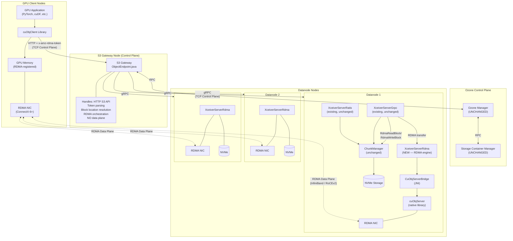

> **Storage device note:** The diagrams throughout this spec label storage as "NVMe" because NVMe SSDs are the expected
> storage medium for RDMA-capable deployments — their throughput (3-7 GB/s per drive) matches what RDMA can deliver.
> However, **NVMe is NOT a requirement.** Ozone reads and writes block data through `FileChannel.read()` /
`FileChannel.write()`, which work with any filesystem-backed storage: HDD, SATA SSD, NVMe, or network-attached storage.
> HDD will work functionally but will bottleneck at ~150-200 MB/s per disk, far below the RDMA NIC's capacity (12-50
> GB/s). The storage type does not affect the RDMA code path — only the end-to-end throughput.
> See [Section 5.4](#54-rdma-buffer-management-whose-memory-and-why) for the full disk-to-NIC data flow.

#### Single-Node Development Topology

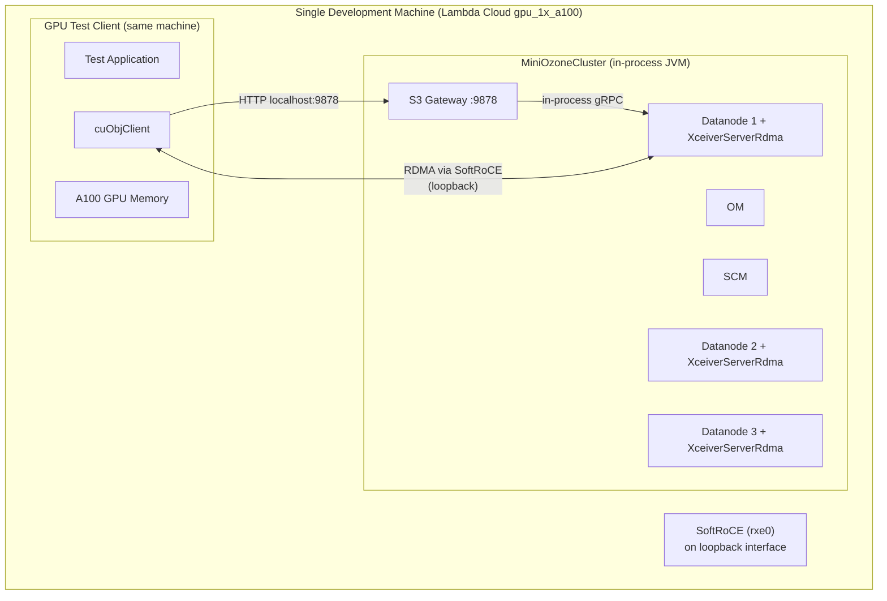

#### Multi-Node Production Topology


### 1.2 Data Flow: S3 GET (Read Path)

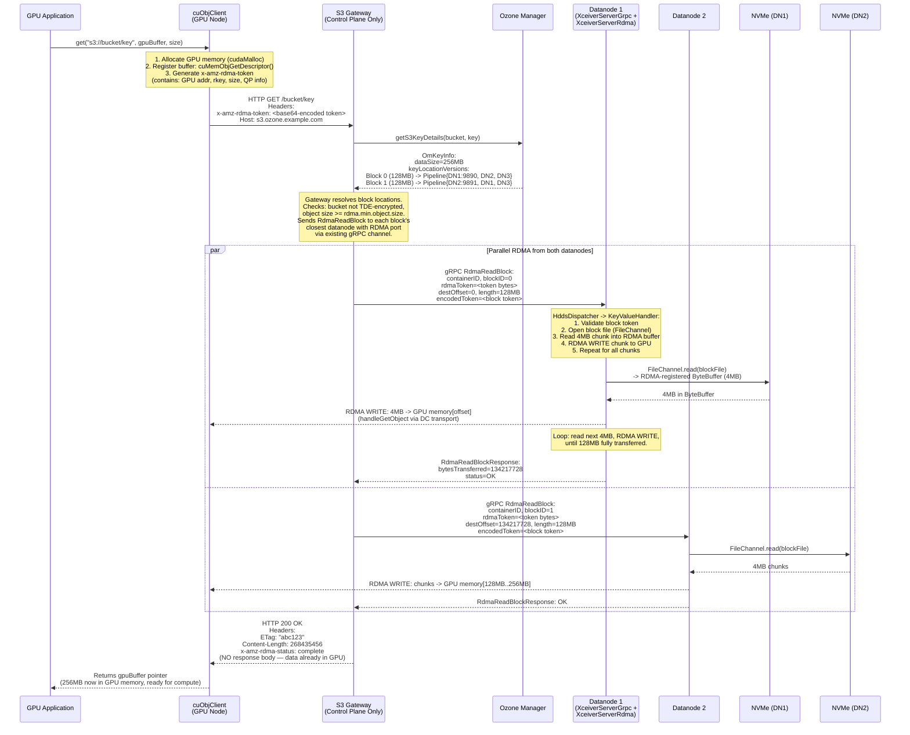

### 1.3 Data Flow: S3 PUT (Write Path)

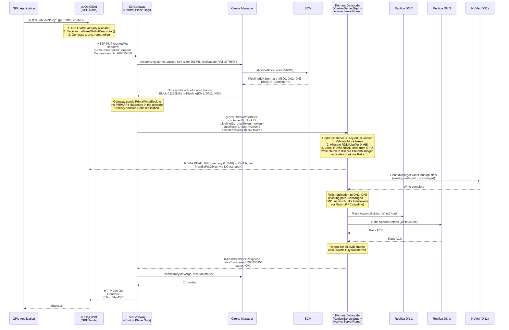

### 1.4 Fallback Path

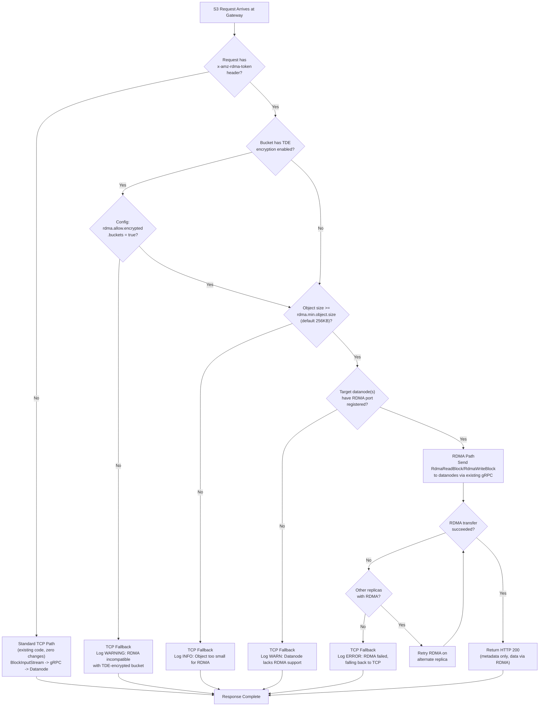

### 1.5 Component Interaction Map

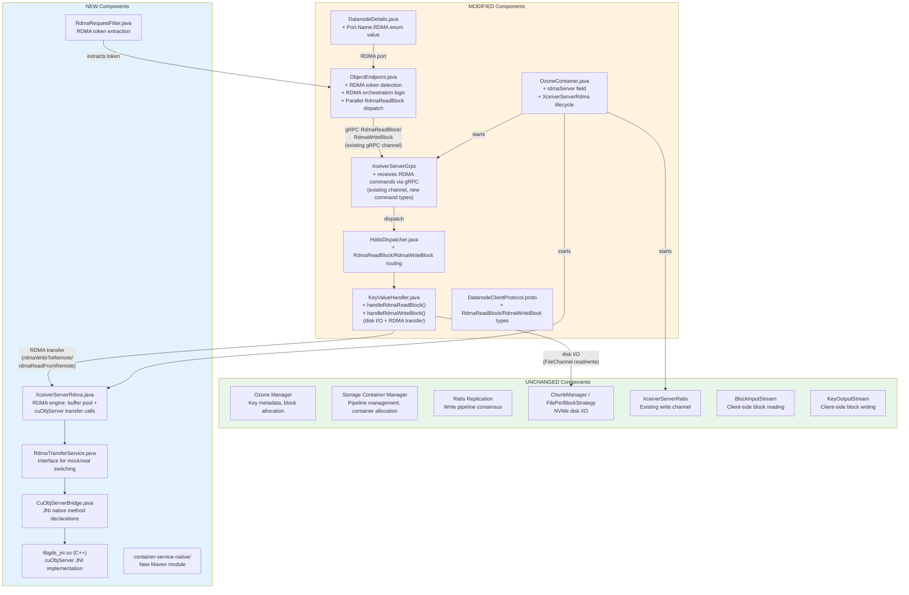

### 1.6 Request Dispatch Model

**There is exactly one dispatch path for RDMA commands.** This section resolves any ambiguity.

RDMA commands (`RdmaReadBlock`, `RdmaWriteBlock`) travel via the **existing gRPC channel** (`XceiverServerGrpc`) to the
datanode. They are dispatched through the **existing `HddsDispatcher`** to `KeyValueHandler`, which performs **both**
disk
I/O and RDMA transfers. `XceiverServerRdma` is **not** a separate gRPC service — it is an RDMA engine (buffer pool +
cuObjServer wrapper) used by `KeyValueHandler`.

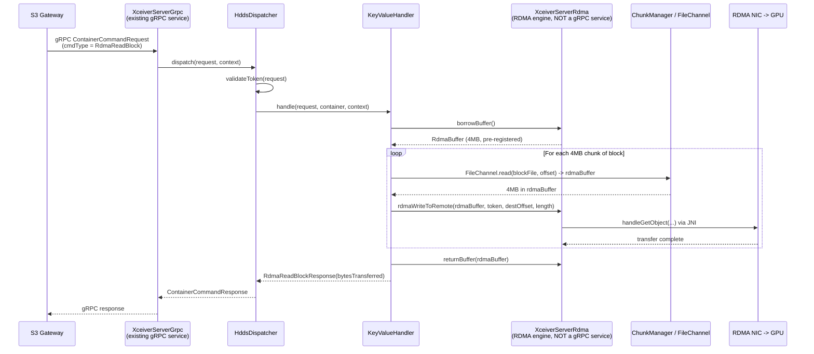

**Why this model:**

| Alternative                                 | Why Rejected                                                                                                         |
|---------------------------------------------|----------------------------------------------------------------------------------------------------------------------|
| Separate gRPC service on XceiverServerRdma  | Adds a new network port, new service definition, new connection management. Unnecessary complexity.                  |
| Gateway sends directly to XceiverServerRdma | Bypasses HddsDispatcher's token validation, container state checks, and metrics. Duplicates security logic.          |
| KeyValueHandler stubs that delegate to RDMA | Creates confusion about where disk I/O vs RDMA happens. KeyValueHandler should own the full operation (disk + RDMA). |

---

## 2. GPU Memory Semantics and Data Consumption Model

### 2.1 Transfer Model: Complete vs Streaming

cuObject operates on a **complete-transfer model
** [[ref-1]](https://docs.nvidia.com/gpudirect-storage/cuobject/index.html). Unlike TCP-based S3 clients that stream
data byte-by-byte, cuObjClient requires the entire requested object (or range) to be fully transferred before the
application can access any of the data.

**Why complete transfer?** RDMA WRITE operations are one-sided — the remote (datanode) writes directly to the client's
GPU memory without the client's CPU being involved. The client has no way to know how many bytes have arrived until the
entire operation completes and a completion event is signaled.

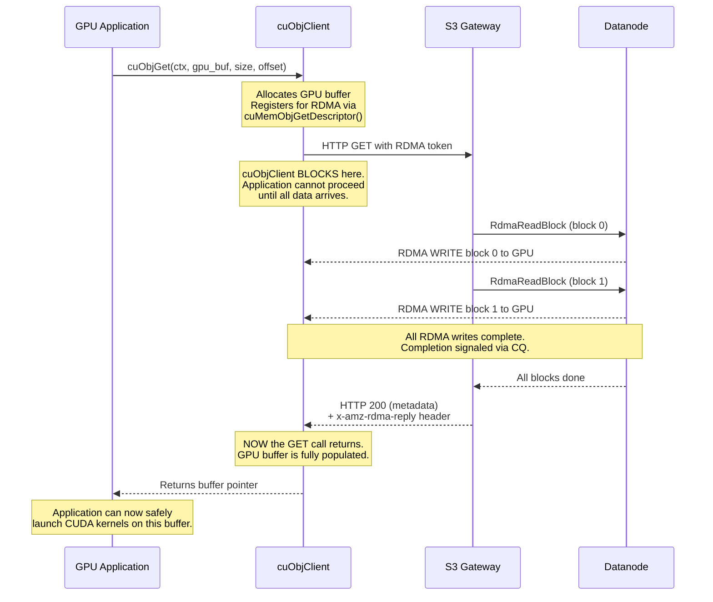

**Contrast with TCP streaming:**

| Aspect            | TCP S3 Client (boto3)                   | cuObjClient (RDMA)                     |
|-------------------|-----------------------------------------|----------------------------------------|
| Data access       | Stream: process bytes as they arrive    | Complete: all-or-nothing               |
| First byte usable | Immediately                             | Only after full transfer               |
| Buffer allocation | Can use small buffer, process in chunks | Must allocate full object size upfront |
| Partial failure   | Can use partial data                    | Either complete or nothing             |
| CPU involvement   | CPU copies every byte                   | Zero-copy to GPU                       |

**Implication:** The GPU application must know the object size upfront and allocate a buffer of that size. For the S3
GET path, the object size is returned in `OmKeyInfo.getDataSize()` and can be communicated to cuObjClient.

**Double-Buffering Pattern:**

cuObjClient GET is synchronous and cannot be overlapped with CUDA computation on the same buffer. However, applications
can use **double-buffering** to overlap I/O and compute:


### 2.2 Synchronous vs Asynchronous API Behavior

This section documents what is verified and what is inferred about sync/async behavior for cuObject APIs. Understanding
this is critical because it determines how our datanode and gateway code must be structured.

#### Client-Side (cuObjClient)

| API                                                                                                                                   | Behavior                          | Evidence                                                                                                                                                                                                                                                                                                      | Confidence                                                                                                                               |
|---------------------------------------------------------------------------------------------------------------------------------------|-----------------------------------|---------------------------------------------------------------------------------------------------------------------------------------------------------------------------------------------------------------------------------------------------------------------------------------------------------------|------------------------------------------------------------------------------------------------------------------------------------------|
| `cuObjGet(void *ctx, void *ptr, size_t size, loff_t offset)` [[ref-1]](https://docs.nvidia.com/gpudirect-storage/cuobject/index.html) | **Likely synchronous (blocking)** | The function signature matches a `pread`-style synchronous call. There is no CUDA stream parameter, no future/promise return, and no async completion callback for the data plane. The `CUObjOps_t` callback mechanism is for the HTTP control path (sending the S3 request), not for signaling data arrival. | Medium-high (inferred from API shape; not explicitly stated in [[ref-1]](https://docs.nvidia.com/gpudirect-storage/cuobject/index.html)) |
| `cuObjPut(void *ctx, void *ptr, size_t size, loff_t offset)` [[ref-1]](https://docs.nvidia.com/gpudirect-storage/cuobject/index.html) | **Likely synchronous (blocking)** | Same reasoning as GET. No async primitives in the signature.                                                                                                                                                                                                                                                  | Medium-high                                                                                                                              |

**Why the client is likely blocking**: RDMA WRITE is a one-sided operation — the server writes directly to client GPU
memory without CPU involvement on the client side. The client has no way to observe partial completion. The only
reliable way to know all data has arrived is to wait for the HTTP response (which includes `x-amz-rdma-reply`
[[ref-1]](https://docs.nvidia.com/gpudirect-storage/cuobject/index.html)), which means the call must block until the
server confirms all RDMA writes are complete.

**What this means for applications**: The thread calling `cuObjGet()` blocks until the entire object (or range) is in
GPU memory. Applications overlap I/O and compute using **double-buffering**: one thread fetches into buffer A while
another thread computes on buffer B (see the double-buffering diagram in Section 2.1).

> **Verification needed**: The cuObject public
> documentation [[ref-1]](https://docs.nvidia.com/gpudirect-storage/cuobject/index.html) does not explicitly state
> whether
`cuObjGet()` is synchronous. This should be confirmed by examining the actual `cuobjclient.h` header from CUDA Toolkit
> 13.2.0 or by testing.

#### Server-Side (cuObjServer)

| API                                                                                                                          | Behavior                          | Evidence                                                                                                                                 | Source                                                                                              |
|------------------------------------------------------------------------------------------------------------------------------|-----------------------------------|------------------------------------------------------------------------------------------------------------------------------------------|-----------------------------------------------------------------------------------------------------|
| `handleGetObject()` [[ref-3]](https://docs.nvidia.com/gpudirect-storage/cuobject/pdf/cuobject-server-release-notes.pdf)      | **Both sync and async supported** | The cuObject server documentation states it can "synchronously or asynchronously perform IO using the local buffer and remote RDMA tag." | [[ref-3]](https://docs.nvidia.com/gpudirect-storage/cuobject/pdf/cuobject-server-release-notes.pdf) |
| `handlePutObject()` [[ref-3]](https://docs.nvidia.com/gpudirect-storage/cuobject/pdf/cuobject-server-release-notes.pdf)      | **Both sync and async supported** | Same.                                                                                                                                    | [[ref-3]](https://docs.nvidia.com/gpudirect-storage/cuobject/pdf/cuobject-server-release-notes.pdf) |
| Async completion polling [[ref-3]](https://docs.nvidia.com/gpudirect-storage/cuobject/pdf/cuobject-server-release-notes.pdf) | **Supported**                     | Listed as a v1.0.0 feature in the server release notes.                                                                                  | [[ref-3]](https://docs.nvidia.com/gpudirect-storage/cuobject/pdf/cuobject-server-release-notes.pdf) |

**Phase 1 decision**: We use **synchronous** server-side transfers. The flow is:

1. Read block chunk from NVMe into RDMA-registered buffer (blocking disk I/O)
2. Call `handleGetObject()` synchronously (blocking RDMA transfer)
3. Repeat for all chunks in the block
4. Return completion to S3 Gateway

Async pipelining is deferred to Phase 2 (see [Section 11.2](#112-asynchronous-server-side-transfers)).

#### Per-Operation Limits

| Limit                              | Value                | Source                                                                                                                                                   | Implication                                                                                                                                                                                                                                    |
|------------------------------------|----------------------|----------------------------------------------------------------------------------------------------------------------------------------------------------|------------------------------------------------------------------------------------------------------------------------------------------------------------------------------------------------------------------------------------------------|
| **Max per server RDMA operation**  | **1 GiB**            | [[ref-3]](https://docs.nvidia.com/gpudirect-storage/cuobject/pdf/cuobject-server-release-notes.pdf)                                                      | Each `handleGetObject()` / `handlePutObject()` call can transfer at most 1 GiB. For Ozone blocks larger than 1 GiB, the datanode must break the transfer into multiple operations. Default Ozone block size is 256 MB, so this rarely applies. |
| **Max scatter-gather entries**     | **10** per operation | [[ref-3]](https://docs.nvidia.com/gpudirect-storage/cuobject/pdf/cuobject-server-release-notes.pdf)                                                      | See [Section 2.9](#29-scatter-gather-support)                                                                                                                                                                                                  |
| **Client-side registration limit** | **4 GiB per call**   | [[ref-1]](https://docs.nvidia.com/gpudirect-storage/cuobject/index.html) — `cuMemObjGetDescriptor()` / `cuMemObjPutDescriptor()` each have a 4 GiB limit | For objects larger than 4 GiB, the client must issue multiple registrations or use Range GET with chunked buffers. See [Section 2.4](#24-files-larger-than-gpu-memory).                                                                        |

### 2.3 Small Files (< 1 MB)

RDMA has per-transfer overhead that dominates for small objects:

| Overhead Source                             | Typical Duration | Notes                                                                                                                   |
|---------------------------------------------|------------------|-------------------------------------------------------------------------------------------------------------------------|
| GPU memory registration (RDMA buffer setup) | 10us-1ms         | One-time per buffer if reused [[ref-1]](https://docs.nvidia.com/gpudirect-storage/cuobject/index.html)                  |
| DC connection setup                         | 5-50us           | Dynamic Connected transport reduces this vs RC [[ref-1]](https://docs.nvidia.com/gpudirect-storage/cuobject/index.html) |
| Completion polling                          | 1-10us           | CQ notification                                                                                                         |
| HTTP round-trip (control plane)             | 500us-5ms        | S3 Gateway -> OM -> Datanode orchestration                                                                              |
| RDMA data transfer                          | varies           | ~1us for 4KB at 200Gbps, ~500us for 100MB                                                                               |

**Performance crossover characteristics:**

- Below ~64KB: RDMA overhead dominates. TCP is faster because the data fits in a few TCP packets and the kernel network
  stack is highly optimized for small transfers.
- 64KB-256KB: Transitional zone. RDMA and TCP are roughly equivalent.
- 256KB-1MB: RDMA begins to show advantage as NIC-offloaded transfer outpaces TCP's per-packet CPU overhead.
- Above 1MB: RDMA is clearly faster, with advantage growing with object size.
- Above 100MB: RDMA can deliver 2-8x the throughput of
  TCP [[ref-10]](https://www.min.io/blog/minio-aistor-with-nvidia-gpudirect-r-rdma-for-s3-compatible-storage-unlocking-performance-for-ai-factory-workloads).

**Implementation:**

```text
Config key: ozone.s3g.rdma.min.object.size
Default:    262144 (256 KB)
Type:       long (bytes)
```

When the S3 Gateway detects an RDMA token, it checks `OmKeyInfo.getDataSize()` (available from OM metadata before any
data transfer). If the object size is below the threshold, the gateway ignores the RDMA token and uses the standard TCP
path. This is transparent to the client — cuObjClient will receive the data via the HTTP response body instead of RDMA,
which it handles as a fallback.

### 2.4 Files Larger Than GPU Memory

**The problem**: A 100 GB Parquet file is stored in Ozone, but the GPU has only 50 GB of memory (e.g., A100 80 GB with
50 GB available after model weights). The application cannot allocate a 100 GB GPU buffer. How does the client handle
this?

**The solution**: The application reads the object in chunks that fit in available GPU memory using **Range GET** (S3
`Range` header). The `cuObjGet()` function includes an `loff_t offset` parameter
[[ref-1]](https://docs.nvidia.com/gpudirect-storage/cuobject/index.html), and `RANGE_GET` is a documented
cuObject V1 operation [[ref-1]](https://docs.nvidia.com/gpudirect-storage/cuobject/index.html). The client-side
memory registration via `cuMemObjGetDescriptor()`
[[ref-1]](https://docs.nvidia.com/gpudirect-storage/cuobject/index.html) has a **4 GiB per-call limit**. For
buffers larger than 4 GiB, the client must issue multiple registration calls or use Range GET with smaller buffers.

The server-side has a confirmed **1 GiB per-operation limit
** [[ref-3]](https://docs.nvidia.com/gpudirect-storage/cuobject/pdf/cuobject-server-release-notes.pdf). For a single
Range GET requesting 4 GB, the datanode will issue 4 sequential RDMA operations of up to 1 GiB each.


**Range handling in the RDMA path:**

The S3 Gateway already supports Range headers via `RangeHeaderParserUtil` in `ObjectEndpoint.handleGetRequest()`.
For the RDMA path:

1. Gateway parses `Range: bytes=START-END` from the HTTP request
2. Gateway maps the byte range to specific blocks using `OmKeyLocationInfo` list
3. For each block that overlaps the range, gateway calculates the block-local offset and length
4. Gateway sends `RdmaReadBlock` with the calculated offset, length, and destination offset within the GPU buffer
5. Only the requested range is RDMA-transferred — no wasted bandwidth

**For writes (PUT):** Large objects must use S3 Multipart Upload. Each part is a separate PUT with its own RDMA token.
The S3 Gateway already supports multipart upload; the RDMA path hooks into each part's upload individually. Multipart
upload via RDMA is a Phase 2 feature (see [Section 11.6](#116-multipart-upload-via-rdma)).

#### Partial Processing of Structured Files (e.g., Parquet)

The question "can the GPU even process partial data?" depends on the file format, not on RDMA or Ozone:

**Parquet files** — **Yes, designed for partial reads.** The file footer (last few KB) contains metadata about row
groups and column chunks, including their byte offsets. A GPU application can:

1. Range GET the footer (last N bytes) -> parse metadata on GPU
2. Identify which row groups/columns are needed for the query
3. Range GET only those specific byte ranges -> GPU memory
4. Process with cuDF or a custom CUDA kernel

This is exactly how cuDF + KvikIO already works with S3 [[ref-14]](https://github.com/rapidsai/kvikio). The parquet
footer-first access pattern is well-suited to RDMA because each Range GET is a targeted read, not a full-object scan.

**Other formats:**

- **ORC**: Similar to Parquet — has stripe-level metadata enabling partial reads.
- **CSV/JSON**: Can be split at line boundaries, but finding boundaries requires reading. Typically read in fixed-size
  chunks with overlap to handle partial last records.
- **Raw tensors (.pt, .npy)**: Application must know the tensor layout. Can read individual tensors by byte offset if
  the file format supports it.

**Ozone does not need special handling.** The client application is responsible for deciding chunk sizes and byte
ranges. Ozone's S3 Gateway handles Range headers the same way whether the transport is TCP or RDMA — only the data plane
changes.

### 2.5 Multiple Concurrent Requests

**Multiple threads on one GPU:**

cuObjClient supports concurrent GET/PUT operations on **different** GPU buffers from multiple threads. It does NOT
support concurrent operations on the same buffer — this would cause data corruption
[[ref-1]](https://docs.nvidia.com/gpudirect-storage/cuobject/index.html). The cuObjServer side is fully
multi-threaded and handles concurrent RDMA operations from multiple
clients [[ref-3]](https://docs.nvidia.com/gpudirect-storage/cuobject/pdf/cuobject-server-release-notes.pdf).

**Multiple applications on one GPU:**

NVIDIA MPS (Multi-Process Service) or CUDA MIG (Multi-Instance GPU) allows multiple processes to share a GPU. Each
process can independently use cuObjClient with its own GPU memory allocations. The RDMA memory registrations are
per-process.

**Multiple GPUs on one node** — see [Section 2.6](#26-multi-gpu-setups) for full coverage.

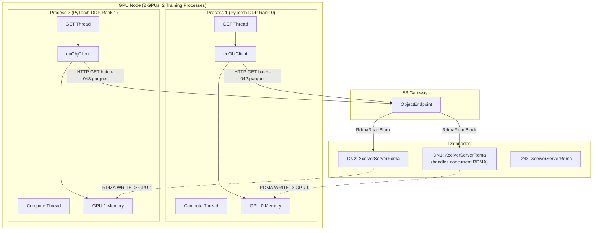

**Datanode-side concurrency:**

`XceiverServerRdma` must be thread-safe. The RDMA buffer pool and concurrency controls follow the existing pattern from
`XceiverServerGrpc` (which uses `threadCountPerDisk * numberOfDisks` threads):

- Each `RdmaReadBlock` / `RdmaWriteBlock` request is handled in a separate gRPC thread (from `XceiverServerGrpc`'s pool)
- cuObjServer's `handleGetObject()` / `handlePutObject()` are thread-safe internally
  [[ref-3]](https://docs.nvidia.com/gpudirect-storage/cuobject/pdf/cuobject-server-release-notes.pdf)
- RDMA buffer pool uses `ArrayBlockingQueue` for thread-safe borrow/return

**Rate limiting:**

```text
Config key: ozone.datanode.rdma.max.concurrent.transfers
Default:    32
Type:       int
Description: Maximum number of concurrent RDMA operations per datanode.
             Prevents exhausting RDMA QP resources or NIC bandwidth.
```

Enforce via a `Semaphore(maxConcurrentTransfers)` acquired before each RDMA operation and released on completion.

### 2.6 Multi-GPU Setups

This section covers how cuObject and our implementation handle multiple GPUs — both on the same node and across
different nodes.

#### Multiple GPUs on the Same Node

A common GPU server configuration is 4-8 GPUs per node (e.g., 8x H100 SXM in a DGX H100). Each GPU has its own physical
memory address space. RDMA memory registration is per-physical-address-space, and CUDA allocations are device-bound.

**Each GPU requires its own cuObjClient instance** (or at minimum, separate buffer registrations and RDMA tokens per
GPU). A buffer allocated on GPU 0 cannot be used for an RDMA transfer targeting GPU 1 — the RDMA token encodes the
physical memory address and NIC routing info specific to that GPU's PCIe path. This is not explicitly documented
in [[ref-1]](https://docs.nvidia.com/gpudirect-storage/cuobject/index.html) but follows directly from CUDA and RDMA
fundamentals: `cudaMalloc` on device 0 returns an address in device 0's address space, and `ibv_reg_mr()` pins the
physical pages backing that virtual address [[ref-6]](https://docs.nvidia.com/cuda/gpudirect-rdma/).

**NIC topology**: In multi-GPU nodes with multiple NICs (e.g., 8 GPUs + 8 ConnectX-7 NICs on DGX H100), each GPU uses
its nearest NIC for optimal PCIe bandwidth. NVIDIA's GPUDirect RDMA routing policy handles this
automatically [[ref-6]](https://docs.nvidia.com/cuda/gpudirect-rdma/).

**Implication for Ozone**: The S3 Gateway does not need to be aware of multi-GPU topology. Each cuObjClient instance
generates its own RDMA token with the correct NIC and memory addressing baked in. The datanode's cuObjServer uses the
token as-is. No Ozone-side changes are needed.

#### GPUs Across Different Nodes

This is cuObject's primary design target. The DC (Dynamically Connected) transport is specifically chosen to handle the
N-client x M-server scaling problem without pre-established
connections [[ref-1]](https://docs.nvidia.com/gpudirect-storage/cuobject/index.html).

Each GPU node runs cuObjClient independently. RDMA tokens are self-contained — they encode the client's memory address,
rkey, and NIC addressing. A datanode receiving a token from Node A's GPU 3 vs Node B's GPU 7 handles them identically:
parse token, perform RDMA transfer.

**Scaling**: With DC transport, the number of active RDMA connections scales as O(active_transfers), not O(clients x
servers). A GPU node only maintains connections to the datanodes it is currently transferring data from/to.

#### Implications for Our Architecture, Implementation, and Testing

| Concern                         | Impact on Ozone                                                                   | Action Required                                                                                                                  |
|---------------------------------|-----------------------------------------------------------------------------------|----------------------------------------------------------------------------------------------------------------------------------|
| Multiple GPUs on same node      | Each cuObjClient generates its own RDMA token; Ozone sees independent S3 requests | None — transparent to Ozone                                                                                                      |
| Multiple GPU nodes              | DC transport handles scaling; each node is an independent S3 client               | None — transparent to Ozone                                                                                                      |
| GPU-NIC affinity                | cuObjClient handles NIC selection; encoded in RDMA token                          | None — transparent to Ozone                                                                                                      |
| Concurrent requests from N GPUs | S3 Gateway and datanodes must handle N concurrent RDMA transfers                  | Config: `ozone.datanode.rdma.max.concurrent.transfers` should account for multi-GPU clients (e.g., set to 64+ for an 8-GPU node) |
| GPU memory isolation            | Each GPU's memory is separate; RDMA tokens are GPU-specific                       | None — hardware-guaranteed                                                                                                       |

### 2.7 GPU Application Consumption Pattern

#### Example 1: PyTorch Training Data Loading

```python
# PyTorch DataLoader with cuObjClient backend
class GDSDataset(torch.utils.data.IterableDataset):
    def __init__(self, bucket, prefix, gpu_id=0):
        self.bucket = bucket
        self.prefix = prefix
        self.gpu_id = gpu_id
        self.cuobj = cuobjclient.Client(endpoint="http://s3gw:9878")

    def __iter__(self):
        for key in self._list_objects():
            # cuObjClient handles: GPU buffer alloc, RDMA registration
            # (via cuMemObjGetDescriptor), token generation, HTTP request,
            # RDMA transfer
            gpu_buffer = self.cuobj.get(
                f"s3://{self.bucket}/{key}",
                device=self.gpu_id
            )
            # gpu_buffer is now a CUdeviceptr — data is in GPU memory
            # Parse directly on GPU using cuDF or custom CUDA kernel
            tensor = self._parse_parquet_gpu(gpu_buffer)
            yield tensor
```

#### Example 2: RAPIDS cuDF Analytics

```python
import cudf

# KvikIO -> cuObjClient integration [[ref-14]](https://github.com/rapidsai/kvikio)
# cuDF internally uses KvikIO for S3 reads
# KvikIO detects cuObjClient availability and uses RDMA when possible
df = cudf.read_parquet("s3://datalake/table.parquet",
                       storage_options={"endpoint_url": "http://s3gw:9878"})

# Data is now in GPU memory — arrived via RDMA, never touched CPU
result = df.groupby("col").agg({"val": "sum"}).compute()
```

### 2.8 What Happens If Application Reads Before Transfer Completes?

cuObjClient GET is a **blocking call** **[inferred]**. The function does not return until all RDMA writes from all
datanodes are complete and the HTTP response (including `x-amz-rdma-reply`
[[ref-1]](https://docs.nvidia.com/gpudirect-storage/cuobject/index.html)) has been received. The application
physically cannot read the buffer before the call returns because the function call hasn't returned yet.

If an application somehow circumvents this (e.g., another thread reads the GPU memory address before GET returns), the
result is **undefined behavior**:

- The memory may contain partial data (some blocks transferred, others not yet)
- The memory may contain zeros (freshly allocated via `cudaMalloc`)
- The memory may contain stale data from a previous use of the buffer

**No special handling needed in our Ozone implementation.** cuObjClient manages all synchronization on the client side.
The S3 Gateway returns HTTP 200 only after all datanodes report completion, and cuObjClient waits for both the RDMA
completions and the HTTP response before returning.

### 2.9 Scatter-Gather Support

cuObjServer supports scatter-gather I/O via `getRDMABufferFromSgList()`, with up to 10 entries per
operation (configurable via `max_sge`)
[[ref-3]](https://docs.nvidia.com/gpudirect-storage/cuobject/pdf/cuobject-server-release-notes.pdf). This
allows a single RDMA operation to write to non-contiguous GPU memory regions (or read from non-contiguous regions).

**Phase 1: contiguous buffers only.** Scatter-gather is deferred to Phase 2.
See [Section 11.1](#111-scatter-gather-support) for the full rationale on why it is deferred and what is needed to
implement it.

---

## 3. Security and Encryption

### 3.1 Ozone Security Layers Overview

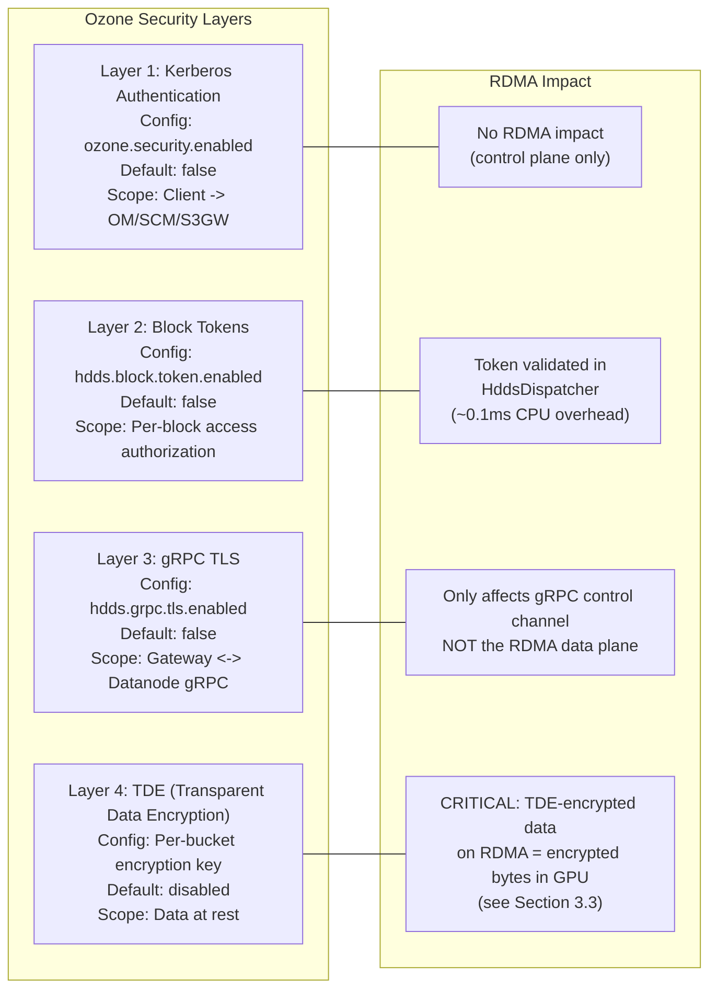

| Layer            | What It Does                              | Default          | Config Key                 | RDMA Impact                                                     |
|------------------|-------------------------------------------|------------------|----------------------------|-----------------------------------------------------------------|
| **Kerberos**     | Client->OM/SCM/S3GW authentication        | OFF              | `ozone.security.enabled`   | Control plane only — no RDMA impact                             |
| **Block Tokens** | Short-lived JWTs authorizing block access | OFF              | `hdds.block.token.enabled` | Validated in `HddsDispatcher` before RDMA op (~0.1ms CPU)       |
| **gRPC TLS**     | Encrypts gRPC between gateway<->datanode  | OFF              | `hdds.grpc.tls.enabled`    | Only affects gRPC control channel. RDMA data plane is separate. |
| **TDE**          | AES-CTR encryption at rest                | OFF (per-bucket) | Bucket creation flag       | **Critical** — see 3.3                                          |

**Key insight:** By default, ALL security layers are OFF. For development and benchmarking, no security configuration is
needed.

### 3.2 Security Architecture in the RDMA Path


**Important:** The RDMA data plane is inherently **not encrypted**. RDMA bypasses the kernel network stack and gRPC
entirely. Data travels as plaintext over InfiniBand/RoCEv2. This is by design — encryption would require a CPU/host
memory bounce, defeating zero-copy [[ref-6]](https://docs.nvidia.com/cuda/gpudirect-rdma/).

### 3.3 TDE (Transparent Data Encryption) and RDMA

**How TDE works in Ozone today:**

TDE is enabled per-bucket by associating a KMS encryption key at bucket creation. The encryption/decryption pipeline:

- **Write path:** S3 Gateway wraps `OzoneOutputStream` with `CipherOutputStreamOzone`. Data is encrypted
  with AES-CTR **before** it reaches the datanode. Datanodes store already-encrypted bytes.
- **Read path:** S3 Gateway wraps the read stream with `OzoneCryptoInputStream` which decrypts using `javax.crypto`.
  The client receives plaintext.

**TDE and RDMA — the conflict:**

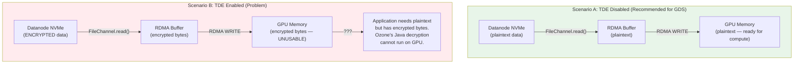

**Implementation:**

When S3 Gateway detects an RDMA token AND the bucket has TDE enabled:

1. Check config `ozone.s3g.rdma.allow.encrypted.buckets` (default: `false`)
2. If `false`: fall back to TCP path, log warning:
   ```
   WARN: RDMA transfer requested for TDE-encrypted bucket '{}'.
   Falling back to TCP path. Set ozone.s3g.rdma.allow.encrypted.buckets=true
   to transfer encrypted bytes via RDMA (application must decrypt on GPU).
   ```
3. If `true`: proceed with RDMA — encrypted bytes are written to GPU memory. The application is responsible for GPU-side
   decryption.

**How to detect TDE:** The S3 Gateway can check if the bucket has an encryption key by examining
`OmBucketInfo.getEncryptionKeyInfo()`. If it returns non-null, TDE is enabled for the bucket.

### 3.4 Block Token Validation in XceiverServerRdma

Block token validation for RDMA commands uses the **existing** `HddsDispatcher.validateToken()` path — no new
validation logic is needed. RDMA commands are dispatched through `HddsDispatcher` just like existing commands (see
[Section 1.6](#16-request-dispatch-model)), so they automatically inherit token validation.

The existing pattern in `HddsDispatcher` (line ~244-252 in `HddsDispatcher.java`):

```java
if(DispatcherContext.op(dispatcherContext).

validateToken()){

validateToken(msg);
}
```

Where `validateToken()` calls:

```java
private void validateToken(ContainerCommandRequestProto msg) throws IOException {
  tokenVerifier.verify(msg, msg.getEncodedToken());
}
```

The `TokenVerifier` is created in `OzoneContainer` constructor (line ~228) via
`TokenVerifier.create(secConf, secretKeyClient)`, which returns `NoopTokenVerifier` when security is disabled (zero
overhead) or `CompositeTokenVerifier(BlockTokenVerifier, ContainerTokenVerifier)` when enabled.

**For RDMA commands:** The `encodedToken` field in `RdmaReadBlockRequestProto` and `RdmaWriteBlockRequestProto` is
copied into the `ContainerCommandRequestProto.encodedToken` field, and the existing validation path handles it.

### 3.5 RDMA Transport Security

**RDMA data is NOT encrypted in transit.** InfiniBand and RoCEv2 do not provide encryption by
default [[ref-6]](https://docs.nvidia.com/cuda/gpudirect-rdma/) [[ref-17]](https://docs.nvidia.com/doca/archive/doca-v2.2.0/pdf/rdma-programming-guide.pdf).

**Authorization model:**

- The `x-amz-rdma-token` [[ref-1]](https://docs.nvidia.com/gpudirect-storage/cuobject/index.html) contains the RDMA
  memory region key (`rkey`) and remote memory address
- Without a valid `rkey`, a remote host cannot RDMA into GPU memory — the NIC's hardware access control rejects the
  request
- Block tokens provide an additional authorization layer (the datanode verifies the client is authorized for the
  specific block via HddsDispatcher)

**Network-level isolation:**

- RDMA traffic should run on a dedicated fabric: InfiniBand subnet or VLAN for RoCE
- Physical network isolation prevents unauthorized access to the RDMA fabric
- InfiniBand partitioning (pkeys) provides additional isolation within a fabric

### 3.6 Disabling Security for Maximum RDMA Performance

```xml
<!-- ozone-site.xml — Maximum performance, no security -->
<configuration>
  <property>
    <name>ozone.security.enabled</name>
    <value>false</value>
  </property>
  <property>
    <name>hdds.block.token.enabled</name>
    <value>false</value>
  </property>
  <property>
    <name>hdds.container.token.enabled</name>
    <value>false</value>
  </property>
  <property>
    <name>hdds.grpc.tls.enabled</name>
    <value>false</value>
  </property>
  <!-- Do NOT create buckets with --encryption-key to avoid TDE -->
</configuration>
```

With these settings:

- `TokenVerifier` becomes `NoopTokenVerifier` — zero CPU overhead per request
- gRPC control channel is plaintext — no TLS handshake overhead
- No encryption on data at rest or in transit

**Appropriate for:** Development, benchmarking, isolated GPU clusters, non-sensitive AI training data.
**NOT appropriate for:** Multi-tenant clusters, sensitive data, regulatory environments.

### 3.7 Security Configuration Matrix

| Scenario                                        | `ozone.security.enabled` | `hdds.block.token.enabled` | `hdds.grpc.tls.enabled` |   TDE    |                        RDMA Performance Impact                        |
|-------------------------------------------------|:------------------------:|:--------------------------:|:-----------------------:|:--------:|:---------------------------------------------------------------------:|
| **Development / Benchmarking**                  |         `false`          |          `false`           |         `false`         | Disabled |                 **Maximum** — zero security overhead                  |
| **Isolated GPU Cluster** (trusted network)      |          `true`          |           `true`           |         `false`         | Disabled |         **High** — block token validation ~0.1ms per request          |
| **Shared Cluster** (untrusted network)          |          `true`          |           `true`           |         `true`          | Disabled | **High** — gRPC TLS on control plane only, RDMA data plane unaffected |
| **Regulated Environment** (encryption required) |          `true`          |           `true`           |         `true`          | Enabled  |      **TCP Fallback** — RDMA incompatible with TDE (by default)       |


---

## 4. Ozone Code Changes

This section specifies every code change required in the Ozone codebase. Each subsection corresponds to a single file
or module. Code samples use documented cuObject API names with [[ref-N]](#10-references) links; parameters that are
inferred (not in public docs) are marked **[inferred]**. All C++ code that calls cuObject APIs is tagged with
`// ADAPT: verify against cuobjserver.h` because the SDK's public documentation does not include full function
signatures.

### 4.1 Protocol Buffer Changes

**File:** `hadoop-hdds/interface-client/src/main/proto/DatanodeClientProtocol.proto`

**Current state (verified against master):**

- `ContainerCommandRequestProto` last field number: `28` (`readBlock`)
- `ContainerCommandResponseProto` last field number: `25` (`readBlock`)
- `Type` enum last value: `ReadBlock = 24`
- `Result` enum last value: `INVALID_CONTAINER_STATE = 28` (note: `DISK_OUT_OF_SPACE = 29` and
  `CONTAINER_ALREADY_EXISTS = 30` also exist)

> **Implementation note:** Verify these field numbers are still current before implementation. If another PR has
> added fields, increment accordingly.

#### 4.1.1 New Type Enum Values

```protobuf
enum Type {
  // ... existing values up to ReadBlock = 24 ...
  RdmaReadBlock = 25;
  RdmaWriteBlock = 26;
}
```

#### 4.1.2 New Request/Response Messages

```protobuf
message RdmaReadBlockRequestProto {
  required DatanodeBlockID blockID = 1;
  // Hex-encoded RDMA token from the x-amz-rdma-token HTTP header.
  // Contains rkey, virtual address, and DC transport metadata generated by
  // cuObjClient via cuMemObjGetDescriptor() [ref-1].
  required string rdmaToken = 2;
  // Byte offset within the block to begin reading from.
  optional uint64 offset = 3 [default = 0];
  // Number of bytes to transfer. If 0 or omitted, transfer the entire block.
  optional uint64 length = 4 [default = 0];
  // Pipeline ID for token validation and replica selection.
  optional hadoop.hdds.PipelineID pipelineID = 5;
}

message RdmaReadBlockResponseProto {
  // Total bytes transferred via RDMA to the client's GPU/host memory.
  required uint64 bytesTransferred = 1;
  // Checksum computed on the datanode before RDMA transfer.
  // Allows the client to verify data integrity end-to-end.
  optional ChecksumData checksumData = 2;
}

message RdmaWriteBlockRequestProto {
  required DatanodeBlockID blockID = 1;
  // Hex-encoded RDMA token from the x-amz-rdma-token HTTP header.
  // Contains rkey and virtual address of the client's GPU buffer, generated by
  // cuObjClient via cuMemObjPutDescriptor() [ref-1].
  required string rdmaToken = 2;
  // Number of bytes to read from the client's GPU memory via RDMA_READ.
  required uint64 length = 3;
  // Pipeline ID for Ratis replication group selection.
  optional hadoop.hdds.PipelineID pipelineID = 4;
  // Block commit length for conditional writes.
  optional uint64 expectedBlockCommitLength = 5;
}

message RdmaWriteBlockResponseProto {
  // Total bytes received via RDMA from the client's GPU/host memory.
  required uint64 bytesReceived = 1;
  // Block commit length after the write, used by the client for subsequent operations.
  optional uint64 committedBlockLength = 2;
}
```

#### 4.1.3 Add Fields to ContainerCommandRequestProto/ResponseProto

```protobuf
message ContainerCommandRequestProto {
  // ... existing fields up to readBlock = 28 ...
  optional RdmaReadBlockRequestProto rdmaReadBlock = 29;
  optional RdmaWriteBlockRequestProto rdmaWriteBlock = 30;
}

message ContainerCommandResponseProto {
  // ... existing fields up to readBlock = 25 ...
  optional RdmaReadBlockResponseProto rdmaReadBlock = 26;
  optional RdmaWriteBlockResponseProto rdmaWriteBlock = 27;
}
```

### 4.2 DatanodeDetails Port Type

**File:** `hadoop-hdds/common/src/main/java/org/apache/hadoop/hdds/protocol/DatanodeDetails.java`

Add `RDMA` to the `Port.Name` enum. This port identifies the cuObjServer RDMA listener on each datanode.

```java
public enum Name {
  STANDALONE, RATIS, REST, REPLICATION, RATIS_ADMIN, RATIS_SERVER,
  @BelongsToHDDSLayoutVersion(RATIS_DATASTREAM_PORT_IN_DATANODEDETAILS)
  RATIS_DATASTREAM,
  @BelongsToHDDSLayoutVersion(SCM_REMOVAL_IN_DATANODE)
  HTTP,
  @BelongsToHDDSLayoutVersion(SCM_REMOVAL_IN_DATANODE)
  HTTPS,
  @BelongsToHDDSLayoutVersion(SCM_REMOVAL_IN_DATANODE)
  CLIENT_RPC,
  @BelongsToHDDSLayoutVersion(RDMA_PORT_IN_DATANODEDETAILS) // NEW — requires layout version
  RDMA;

  // Update IO_PORTS to include RDMA when available:
  private static final ImmutableSet<Name> IO_PORTS =
      Sets.immutableEnumSet(STANDALONE, RATIS, RATIS_DATASTREAM, RDMA);
```

**Required:** Add `RDMA_PORT_IN_DATANODEDETAILS` to `HDDSLayoutFeature` enum. This ensures that older SCM versions
that do not recognize `RDMA` will not break during rolling upgrades — the port is simply ignored until the cluster
finalizes the new layout version.

**In `hdds.proto`**, no changes are needed. The `Port` message uses `string name` + `uint32 value`, so `RDMA` is
stored as the string `"RDMA"` without requiring a proto schema change.

### 4.3 New Maven Module: `container-service-native`

Create a new Maven module at `hadoop-hdds/container-service-native/` to isolate JNI and native build concerns from the
existing `container-service` module.

```
hadoop-hdds/container-service-native/
├── pom.xml
├── src/
│   ├── main/
│   │   ├── java/org/apache/hadoop/ozone/container/rdma/
│   │   │   ├── RdmaTransferService.java
│   │   │   ├── CuObjRdmaTransferService.java
│   │   │   ├── MockRdmaTransferService.java
│   │   │   ├── CuObjServerBridge.java
│   │   │   ├── RdmaBuffer.java
│   │   │   └── RdmaBufferPool.java
│   │   └── native/
│   │       ├── CMakeLists.txt
│   │       └── cuobj_server_bridge.cc
│   └── test/
│       └── java/org/apache/hadoop/ozone/container/rdma/
│           ├── TestRdmaBufferPool.java
│           └── TestMockRdmaTransferService.java
└── README.md (build instructions)
```

**pom.xml** should activate the native build via a Maven profile (e.g., `-Pnative`), following the same pattern as
`hadoop-hdds/rocks-native/` which uses `cmake-maven-plugin` for RocksDB native builds.

### 4.4 RdmaTransferService Interface

**File:**
`hadoop-hdds/container-service-native/src/main/java/org/apache/hadoop/ozone/container/rdma/RdmaTransferService.java`

This interface abstracts the RDMA transfer engine, enabling mock implementations for testing and the real cuObjServer
implementation for production. This follows the standard Ozone dependency-injection pattern (cf. `TokenVerifier` /
`NoopTokenVerifier`).

```java
package org.apache.hadoop.ozone.container.rdma;

import java.io.Closeable;
import java.io.IOException;
import java.nio.ByteBuffer;

/**
 * Abstraction for RDMA data transfer operations.
 *
 * Production implementation uses cuObjServer via JNI.
 * Test implementation uses in-process memory copies.
 *
 * Thread safety: implementations must be thread-safe for concurrent
 * calls to rdmaWriteToRemote() and rdmaReadFromRemote() on different
 * buffers. Concurrent operations on the SAME buffer are NOT safe
 * (per cuObjServer threading model [ref-3]).
 */
public interface RdmaTransferService extends Closeable {

  /**
   * Initialize the RDMA transfer engine.
   *
   * @param rdmaDeviceName  RDMA device name (e.g., "mlx5_0"), or null for auto-detect
   * @param port            cuObjServer listen port for DC transport
   * @param maxConnections  maximum concurrent RDMA connections
   * @throws IOException if initialization fails (e.g., no RDMA device, no cuObjServer library)
   */
  void initialize(String rdmaDeviceName, int port, int maxConnections)
      throws IOException;

  /**
   * Register a direct ByteBuffer for RDMA operations.
   *
   * The buffer must be a direct ByteBuffer backed by pinned (page-locked) memory.
   * Maps to cuObjServer registerBuffer() [ref-3].
   *
   * @param buffer  direct ByteBuffer to register
   * @return opaque registration handle for use in deregister()
   * @throws IOException if registration fails
   */
  long registerBuffer(ByteBuffer buffer) throws IOException;

  /**
   * Deregister a previously registered buffer.
   *
   * @param registrationHandle  handle returned by registerBuffer()
   * @throws IOException if deregistration fails
   */
  void deregisterBuffer(long registrationHandle) throws IOException;

  /**
   * RDMA WRITE: push data from a local buffer to a remote GPU/host memory.
   * Used for GET operations (datanode sends data to client).
   *
   * Maps to cuObjServer handleGetObject() [ref-3]:
   *   - Performs RDMA_WRITE from local buffer to remote buffer identified by rdmaToken
   *   - Max 1 GiB per call [ref-3]
   *
   * @param rdmaToken       hex-encoded RDMA token from x-amz-rdma-token header
   * @param localBuffer     registered direct ByteBuffer containing data to send
   * @param localOffset     offset within localBuffer
   * @param length          number of bytes to transfer (max 1 GiB)
   * @param remoteOffset    byte offset in the remote buffer
   * @return number of bytes transferred
   * @throws IOException if the RDMA operation fails
   */
  long rdmaWriteToRemote(String rdmaToken, ByteBuffer localBuffer,
      int localOffset, long length, long remoteOffset) throws IOException;

  /**
   * RDMA READ: pull data from a remote GPU/host memory into a local buffer.
   * Used for PUT operations (datanode receives data from client).
   *
   * Maps to cuObjServer handlePutObject() [ref-3]:
   *   - Performs RDMA_READ from remote buffer identified by rdmaToken into local buffer
   *   - Max 1 GiB per call [ref-3]
   *
   * @param rdmaToken       hex-encoded RDMA token from x-amz-rdma-token header
   * @param localBuffer     registered direct ByteBuffer to receive data into
   * @param localOffset     offset within localBuffer
   * @param length          number of bytes to transfer (max 1 GiB)
   * @param remoteOffset    byte offset in the remote buffer
   * @return number of bytes transferred
   * @throws IOException if the RDMA operation fails
   */
  long rdmaReadFromRemote(String rdmaToken, ByteBuffer localBuffer,
      int localOffset, long length, long remoteOffset) throws IOException;

  /**
   * @return true if the RDMA transfer engine initialized successfully and is ready
   */
  boolean isAvailable();
}
```

### 4.5 JNI Bridge: `CuObjServerBridge.java`

**File:**
`hadoop-hdds/container-service-native/src/main/java/org/apache/hadoop/ozone/container/rdma/CuObjServerBridge.java`

This class provides the JNI native method declarations that map to the C++ implementation in
`cuobj_server_bridge.cc`. It is **not** used directly by `XceiverServerRdma` — instead, it is called by
`CuObjRdmaTransferService` (the production implementation of `RdmaTransferService`).

```java
package org.apache.hadoop.ozone.container.rdma;

import org.apache.hadoop.hdds.utils.NativeLibraryLoader;

import java.io.IOException;
import java.nio.ByteBuffer;

/**
 * JNI bridge to libcuobjserver (NVIDIA cuObject Server SDK).
 *
 * Native library: libcuobj_server_bridge.so
 * Loaded via NativeLibraryLoader (singleton, tries System.loadLibrary
 * then JAR extraction).
 *
 * All cuObjServer API references are to [ref-3]:
 * https://docs.nvidia.com/gpudirect-storage/cuobject/pdf/cuobject-server-release-notes.pdf
 *
 * This class is package-private. External code uses RdmaTransferService.
 */
final class CuObjServerBridge {

  private static final String LIBRARY_NAME = "cuobj_server_bridge";
  private static volatile boolean loaded = false;
  private static volatile boolean available = false;

  private CuObjServerBridge() {
    // utility class
  }

  /**
   * Attempt to load the native library. Safe to call multiple times.
   * @return true if the library is loaded and cuObjServer is available
   */
  static synchronized boolean loadLibrary() {
    if (loaded) {
      return available;
    }
    loaded = true;
    try {
      NativeLibraryLoader.getInstance().loadLibrary(LIBRARY_NAME);
      available = true;
    } catch (UnsatisfiedLinkError e) {
      available = false;
    }
    return available;
  }

  static boolean isAvailable() {
    return available;
  }

  // --- Native methods ---

  /**
   * Initialize the cuObjServer engine.
   *
   * ADAPT: verify against cuobjserver.h — the actual init function name and
   * parameters are not documented in public NVIDIA docs. The server likely
   * requires configuration for RDMA device, port, and connection limits.
   *
   * @param rdmaDevice   RDMA NIC device name (e.g., "mlx5_0"), null for auto
   * @param port         cuObjServer listen port for DC transport
   * @param maxConns     max concurrent RDMA connections
   * @return opaque server handle (passed to all subsequent calls)
   * @throws IOException on initialization failure
   */
  static native long nativeInit(String rdmaDevice, int port, int maxConns)
      throws IOException;

  /**
   * Shut down the cuObjServer engine and release resources.
   *
   * ADAPT: verify against cuobjserver.h — no shutdown function is documented.
   *
   * @param handle  server handle from nativeInit()
   * @throws IOException on shutdown failure
   */
  static native void nativeShutdown(long handle) throws IOException;

  /**
   * Register a direct ByteBuffer for RDMA operations.
   * Maps to: cuObjServer::registerBuffer(ptr, size) [ref-3]
   *
   * The buffer must be a direct ByteBuffer. The JNI implementation calls
   * GetDirectBufferAddress() to obtain the native pointer, then passes it to
   * cuObjServer::registerBuffer().
   *
   * @param handle  server handle from nativeInit()
   * @param buffer  direct ByteBuffer (must be page-locked / pinned memory)
   * @return opaque registration handle for deregister
   * @throws IOException on registration failure
   */
  static native long nativeRegisterBuffer(long handle, ByteBuffer buffer)
      throws IOException;

  /**
   * Deregister a previously registered buffer.
   *
   * ADAPT: verify against cuobjserver.h — deregister/unregister API name
   * is not documented. Likely deregisterBuffer() or unregisterBuffer().
   *
   * @param handle       server handle
   * @param regHandle    registration handle from nativeRegisterBuffer()
   * @throws IOException on failure
   */
  static native void nativeDeregisterBuffer(long handle, long regHandle)
      throws IOException;

  /**
   * Perform RDMA_WRITE: push data from local buffer to remote GPU/host memory.
   * Maps to: cuObjServer::handleGetObject() [ref-3]
   *
   * handleGetObject() performs an RDMA_WRITE from the server's local buffer to
   * the client's remote buffer identified by the RDMA token. Max 1 GiB per
   * call [ref-3].
   *
   * ADAPT: verify exact parameter order and types against cuobjserver.h.
   * The documented API signature includes "local buffer pointer+size" and
   * "remote RDMA token" but exact C++ parameter list is not public.
   *
   * @param handle       server handle
   * @param rdmaToken    hex-encoded RDMA token (from x-amz-rdma-token)
   * @param buffer       registered direct ByteBuffer with data to send
   * @param offset       offset within buffer
   * @param length       bytes to transfer (max 1 GiB = 1073741824)
   * @param remoteOffset offset in remote buffer
   * @return bytes actually transferred
   * @throws IOException on RDMA failure
   */
  static native long nativeRdmaWrite(long handle, String rdmaToken,
      ByteBuffer buffer, int offset, long length, long remoteOffset)
      throws IOException;

  /**
   * Perform RDMA_READ: pull data from remote GPU/host memory into local buffer.
   * Maps to: cuObjServer::handlePutObject() [ref-3]
   *
   * handlePutObject() performs an RDMA_READ from the client's remote buffer
   * identified by the RDMA token into the server's local buffer. Max 1 GiB per
   * call [ref-3].
   *
   * ADAPT: verify exact parameter order and types against cuobjserver.h.
   *
   * @param handle       server handle
   * @param rdmaToken    hex-encoded RDMA token (from x-amz-rdma-token)
   * @param buffer       registered direct ByteBuffer to receive data
   * @param offset       offset within buffer
   * @param length       bytes to transfer (max 1 GiB = 1073741824)
   * @param remoteOffset offset in remote buffer
   * @return bytes actually transferred
   * @throws IOException on RDMA failure
   */
  static native long nativeRdmaRead(long handle, String rdmaToken,
      ByteBuffer buffer, int offset, long length, long remoteOffset)
      throws IOException;
}
```

### 4.6 Native C++ Implementation

**File:** `hadoop-hdds/container-service-native/src/main/native/cuobj_server_bridge.cc`

This file implements the JNI native methods declared in `CuObjServerBridge.java`. It links against
`libcuobjserver.so` and calls the cuObjServer C++ API.

> **CRITICAL:** The cuObjServer public documentation [[ref-3]](#10-references) provides function names
> (`registerBuffer`, `allocHostBuffer`, `handleGetObject`, `handlePutObject`, `getRDMABufferFromSgList`) but NOT
> full C++ signatures. The code below uses the documented names with **inferred parameter lists**. Every function
> call is marked `// ADAPT: verify against cuobjserver.h`. The actual header file from the cuObjServer package
> is **required** before this code will compile.

```cpp
#include <jni.h>
#include <cstdint>
#include <cstring>
#include <stdexcept>

// ADAPT: verify actual header name against cuObjServer package.
// The public docs reference libcuobjserver.so but do not name the header.
// Likely: #include <cuobjserver.h>
#include <cuobjserver.h>

// JNI class path for CuObjServerBridge
static const char* JNI_CLASS = "org/apache/hadoop/ozone/container/rdma/CuObjServerBridge";

// Helper: throw IOException from JNI
static void throwIOException(JNIEnv* env, const char* msg) {
    jclass ioExClass = env->FindClass("java/io/IOException");
    if (ioExClass != nullptr) {
        env->ThrowNew(ioExClass, msg);
    }
}

// Helper: convert Java string to std::string, handling null
static std::string jstringToStdString(JNIEnv* env, jstring jstr) {
    if (jstr == nullptr) return "";
    const char* chars = env->GetStringUTFChars(jstr, nullptr);
    std::string result(chars);
    env->ReleaseStringUTFChars(jstr, chars);
    return result;
}

/*
 * nativeInit: Initialize cuObjServer engine.
 *
 * ADAPT: verify against cuobjserver.h.
 * The cuObjServer docs [ref-3] do not document an explicit init function.
 * The server library likely has a constructor or init method that accepts
 * RDMA device, port, and connection parameters. The code below assumes
 * a class or struct-based API. Adjust to match the real SDK.
 */
extern "C" JNIEXPORT jlong JNICALL
Java_org_apache_hadoop_ozone_container_rdma_CuObjServerBridge_nativeInit(
    JNIEnv* env, jclass cls,
    jstring rdmaDevice, jint port, jint maxConns) {

    try {
        std::string device = jstringToStdString(env, rdmaDevice);

        // ADAPT: verify against cuobjserver.h
        // The actual initialization API is not documented.
        // This assumes a constructor or factory function exists.
        // Possible patterns:
        //   auto* server = new cuObjServer(device, port, maxConns);
        //   auto* server = cuObjServer::create(config);
        // Placeholder:
        auto* server = new cuObjServer();  // ADAPT: add actual constructor params
        // server->setDevice(device);       // ADAPT: if setter-based config
        // server->setPort(port);           // ADAPT
        // server->setMaxConnections(maxConns); // ADAPT
        // server->start();                  // ADAPT: if explicit start needed

        return reinterpret_cast<jlong>(server);
    } catch (const std::exception& e) {
        throwIOException(env, e.what());
        return 0;
    }
}

/*
 * nativeShutdown: Shut down cuObjServer engine.
 *
 * ADAPT: verify against cuobjserver.h — no shutdown/destructor documented.
 */
extern "C" JNIEXPORT void JNICALL
Java_org_apache_hadoop_ozone_container_rdma_CuObjServerBridge_nativeShutdown(
    JNIEnv* env, jclass cls, jlong handle) {

    try {
        auto* server = reinterpret_cast<cuObjServer*>(handle);  // ADAPT: actual type
        // ADAPT: call actual shutdown API
        delete server;
    } catch (const std::exception& e) {
        throwIOException(env, e.what());
    }
}

/*
 * nativeRegisterBuffer: Register a direct ByteBuffer for RDMA.
 *
 * Maps to: cuObjServer::registerBuffer(const void *ptr, size_t size) [ref-3]
 * The public docs confirm registerBuffer exists and takes a pointer + size.
 * Return type is not documented — we store the result as a handle.
 */
extern "C" JNIEXPORT jlong JNICALL
Java_org_apache_hadoop_ozone_container_rdma_CuObjServerBridge_nativeRegisterBuffer(
    JNIEnv* env, jclass cls, jlong handle, jobject buffer) {

    auto* server = reinterpret_cast<cuObjServer*>(handle);  // ADAPT: actual type
    void* ptr = env->GetDirectBufferAddress(buffer);
    if (ptr == nullptr) {
        throwIOException(env, "Buffer is not a direct ByteBuffer");
        return 0;
    }
    jlong capacity = env->GetDirectBufferCapacity(buffer);

    try {
        // registerBuffer(const void *ptr, size_t size) [ref-3]
        // ADAPT: verify return type. Assuming it returns a handle/MR object.
        auto regHandle = server->registerBuffer(ptr, static_cast<size_t>(capacity));
        return reinterpret_cast<jlong>(regHandle);  // ADAPT: cast depends on return type
    } catch (const std::exception& e) {
        throwIOException(env, e.what());
        return 0;
    }
}

/*
 * nativeDeregisterBuffer: Deregister a previously registered buffer.
 *
 * ADAPT: verify API name against cuobjserver.h.
 * Not explicitly documented. Likely deregisterBuffer() or unregisterBuffer().
 */
extern "C" JNIEXPORT void JNICALL
Java_org_apache_hadoop_ozone_container_rdma_CuObjServerBridge_nativeDeregisterBuffer(
    JNIEnv* env, jclass cls, jlong handle, jlong regHandle) {

    auto* server = reinterpret_cast<cuObjServer*>(handle);  // ADAPT: actual type
    try {
        // ADAPT: verify actual deregister API name and signature
        server->deregisterBuffer(reinterpret_cast<void*>(regHandle));  // ADAPT
    } catch (const std::exception& e) {
        throwIOException(env, e.what());
    }
}

/*
 * nativeRdmaWrite: RDMA_WRITE from local buffer to remote GPU.
 *
 * Maps to: cuObjServer::handleGetObject() [ref-3]
 * "Performs RDMA_WRITE: pushes data from server buffer to remote client
 *  GPU/host memory. Max 1 GiB per call." [ref-3]
 *
 * ADAPT: The exact parameter list for handleGetObject() is not documented.
 * It must include: local buffer pointer+size, remote RDMA token, and offset.
 * The code below assumes these parameters. Verify against cuobjserver.h.
 */
extern "C" JNIEXPORT jlong JNICALL
Java_org_apache_hadoop_ozone_container_rdma_CuObjServerBridge_nativeRdmaWrite(
    JNIEnv* env, jclass cls,
    jlong handle, jstring rdmaToken,
    jobject buffer, jint offset, jlong length, jlong remoteOffset) {

    auto* server = reinterpret_cast<cuObjServer*>(handle);  // ADAPT: actual type
    void* ptr = env->GetDirectBufferAddress(buffer);
    if (ptr == nullptr) {
        throwIOException(env, "Buffer is not a direct ByteBuffer");
        return 0;
    }
    std::string token = jstringToStdString(env, rdmaToken);

    try {
        void* localAddr = static_cast<char*>(ptr) + offset;

        // handleGetObject(...) [ref-3]
        // ADAPT: verify exact parameter list against cuobjserver.h.
        // Documented behavior: RDMA_WRITE from local buffer to remote token.
        // Inferred parameters: local_ptr, local_size, rdma_token, remote_offset
        auto bytesWritten = server->handleGetObject(
            localAddr,                          // [inferred] local buffer pointer
            static_cast<size_t>(length),         // [inferred] transfer size
            token.c_str(),                       // [inferred] RDMA token string
            static_cast<size_t>(token.size()),    // [inferred] token length
            static_cast<uint64_t>(remoteOffset)  // [inferred] remote buffer offset
        );  // ADAPT: verify all params

        return static_cast<jlong>(bytesWritten);  // ADAPT: depends on return type
    } catch (const std::exception& e) {
        throwIOException(env, e.what());
        return -1;
    }
}

/*
 * nativeRdmaRead: RDMA_READ from remote GPU into local buffer.
 *
 * Maps to: cuObjServer::handlePutObject() [ref-3]
 * "Performs RDMA_READ: pulls data from remote client GPU/host memory to
 *  server buffer. Max 1 GiB per call." [ref-3]
 *
 * ADAPT: Same parameter uncertainty as handleGetObject. Verify against cuobjserver.h.
 */
extern "C" JNIEXPORT jlong JNICALL
Java_org_apache_hadoop_ozone_container_rdma_CuObjServerBridge_nativeRdmaRead(
    JNIEnv* env, jclass cls,
    jlong handle, jstring rdmaToken,
    jobject buffer, jint offset, jlong length, jlong remoteOffset) {

    auto* server = reinterpret_cast<cuObjServer*>(handle);  // ADAPT: actual type
    void* ptr = env->GetDirectBufferAddress(buffer);
    if (ptr == nullptr) {
        throwIOException(env, "Buffer is not a direct ByteBuffer");
        return 0;
    }
    std::string token = jstringToStdString(env, rdmaToken);

    try {
        void* localAddr = static_cast<char*>(ptr) + offset;

        // handlePutObject(...) [ref-3]
        // ADAPT: verify exact parameter list against cuobjserver.h.
        // Documented behavior: RDMA_READ from remote token into local buffer.
        auto bytesRead = server->handlePutObject(
            localAddr,                          // [inferred] local buffer pointer
            static_cast<size_t>(length),         // [inferred] transfer size
            token.c_str(),                       // [inferred] RDMA token string
            static_cast<size_t>(token.size()),    // [inferred] token length
            static_cast<uint64_t>(remoteOffset)  // [inferred] remote buffer offset
        );  // ADAPT: verify all params

        return static_cast<jlong>(bytesRead);  // ADAPT: depends on return type
    } catch (const std::exception& e) {
        throwIOException(env, e.what());
        return -1;
    }
}
```

### 4.7 CMakeLists.txt for Native Build

**File:** `hadoop-hdds/container-service-native/src/main/native/CMakeLists.txt`

```cmake
cmake_minimum_required(VERSION 3.10)
project(cuobj_server_bridge CXX)

set(CMAKE_CXX_STANDARD 14)
set(CMAKE_CXX_STANDARD_REQUIRED ON)

# Find JNI
find_package(JNI REQUIRED)
include_directories(${JNI_INCLUDE_DIRS})

# cuObjServer SDK location
# Set via -DCUOBJSERVER_HOME=/path/to/cuobjserver or environment variable
if(NOT CUOBJSERVER_HOME)
  set(CUOBJSERVER_HOME $ENV{CUOBJSERVER_HOME})
endif()
if(NOT CUOBJSERVER_HOME)
  message(FATAL_ERROR "CUOBJSERVER_HOME not set. Point to the cuObjServer SDK directory.")
endif()

# ADAPT: verify actual include/lib paths within the cuObjServer package
include_directories(${CUOBJSERVER_HOME}/include)
link_directories(${CUOBJSERVER_HOME}/lib64 ${CUOBJSERVER_HOME}/lib)

# Build shared library
add_library(cuobj_server_bridge SHARED cuobj_server_bridge.cc)

# Link against cuObjServer
# ADAPT: verify actual library name — likely libcuobjserver.so [ref-3]
target_link_libraries(cuobj_server_bridge cuobjserver)

# Install to Maven output directory
install(TARGETS cuobj_server_bridge
        LIBRARY DESTINATION ${CMAKE_INSTALL_PREFIX}/lib)
```

### 4.8 `CuObjRdmaTransferService.java`

**File:**
`hadoop-hdds/container-service-native/src/main/java/org/apache/hadoop/ozone/container/rdma/CuObjRdmaTransferService.java`

Production implementation of `RdmaTransferService` that delegates to `CuObjServerBridge` (JNI → cuObjServer).

```java
package org.apache.hadoop.ozone.container.rdma;

import org.slf4j.Logger;
import org.slf4j.LoggerFactory;

import java.io.IOException;
import java.nio.ByteBuffer;

/**
 * Production RdmaTransferService backed by NVIDIA cuObjServer via JNI.
 *
 * Lifecycle: initialize() -> registerBuffer()/rdmaWriteToRemote()/etc -> close()
 *
 * All cuObjServer API references: [ref-3]
 */
public class CuObjRdmaTransferService implements RdmaTransferService {

  private static final Logger LOG =
      LoggerFactory.getLogger(CuObjRdmaTransferService.class);

  /** Max bytes per handleGetObject() / handlePutObject() call [ref-3]. */
  private static final long MAX_BYTES_PER_RDMA_OP = 1L * 1024 * 1024 * 1024; // 1 GiB

  private long serverHandle;
  private volatile boolean initialized = false;

  @Override
  public void initialize(String rdmaDeviceName, int port, int maxConnections)
      throws IOException {
    if (!CuObjServerBridge.loadLibrary()) {
      throw new IOException("Failed to load cuobj_server_bridge native library. "
          + "Ensure libcuobjserver.so is installed and CUOBJSERVER_HOME is set.");
    }
    serverHandle = CuObjServerBridge.nativeInit(rdmaDeviceName, port, maxConnections);
    initialized = true;
    LOG.info("CuObjRdmaTransferService initialized: device={}, port={}, maxConns={}",
        rdmaDeviceName, port, maxConnections);
  }

  @Override
  public long registerBuffer(ByteBuffer buffer) throws IOException {
    checkInitialized();
    if (!buffer.isDirect()) {
      throw new IllegalArgumentException("Buffer must be a direct ByteBuffer");
    }
    return CuObjServerBridge.nativeRegisterBuffer(serverHandle, buffer);
  }

  @Override
  public void deregisterBuffer(long registrationHandle) throws IOException {
    checkInitialized();
    CuObjServerBridge.nativeDeregisterBuffer(serverHandle, registrationHandle);
  }

  @Override
  public long rdmaWriteToRemote(String rdmaToken, ByteBuffer localBuffer,
      int localOffset, long length, long remoteOffset) throws IOException {
    checkInitialized();
    if (length > MAX_BYTES_PER_RDMA_OP) {
      throw new IllegalArgumentException(
          "Transfer size " + length + " exceeds max " + MAX_BYTES_PER_RDMA_OP
              + " per handleGetObject() call [ref-3]");
    }
    return CuObjServerBridge.nativeRdmaWrite(
        serverHandle, rdmaToken, localBuffer, localOffset, length, remoteOffset);
  }

  @Override
  public long rdmaReadFromRemote(String rdmaToken, ByteBuffer localBuffer,
      int localOffset, long length, long remoteOffset) throws IOException {
    checkInitialized();
    if (length > MAX_BYTES_PER_RDMA_OP) {
      throw new IllegalArgumentException(
          "Transfer size " + length + " exceeds max " + MAX_BYTES_PER_RDMA_OP
              + " per handlePutObject() call [ref-3]");
    }
    return CuObjServerBridge.nativeRdmaRead(
        serverHandle, rdmaToken, localBuffer, localOffset, length, remoteOffset);
  }

  @Override
  public boolean isAvailable() {
    return initialized && CuObjServerBridge.isAvailable();
  }

  @Override
  public void close() throws IOException {
    if (initialized) {
      CuObjServerBridge.nativeShutdown(serverHandle);
      initialized = false;
      LOG.info("CuObjRdmaTransferService shut down");
    }
  }

  private void checkInitialized() throws IOException {
    if (!initialized) {
      throw new IOException("CuObjRdmaTransferService not initialized");
    }
  }
}
```

### 4.9 `MockRdmaTransferService.java`

**File:**
`hadoop-hdds/container-service-native/src/main/java/org/apache/hadoop/ozone/container/rdma/MockRdmaTransferService.java`

Mock implementation for unit and integration tests. No JNI, no native library, no RDMA hardware required.

```java
package org.apache.hadoop.ozone.container.rdma;

import org.slf4j.Logger;
import org.slf4j.LoggerFactory;

import java.io.IOException;
import java.nio.ByteBuffer;
import java.util.Map;
import java.util.concurrent.ConcurrentHashMap;
import java.util.concurrent.atomic.AtomicLong;

/**
 * Mock RdmaTransferService for testing without RDMA hardware or cuObjServer.
 *
 * Simulates RDMA transfers by copying data between local ByteBuffers and a
 * shared "remote memory" map keyed by RDMA token. Tests register a
 * "remote buffer" via {@link #registerRemoteBuffer(String, ByteBuffer)} to
 * simulate the GPU client's memory.
 */
public class MockRdmaTransferService implements RdmaTransferService {

  private static final Logger LOG =
      LoggerFactory.getLogger(MockRdmaTransferService.class);

  private final AtomicLong handleCounter = new AtomicLong(1);
  private final Map<Long, ByteBuffer> registeredBuffers = new ConcurrentHashMap<>();
  private final Map<String, ByteBuffer> remoteBuffers = new ConcurrentHashMap<>();
  private volatile boolean initialized = false;

  /**
   * Register a simulated remote (GPU client) buffer for testing.
   * Tests call this to set up the "other side" of the RDMA transfer.
   */
  public void registerRemoteBuffer(String rdmaToken, ByteBuffer buffer) {
    remoteBuffers.put(rdmaToken, buffer);
  }

  @Override
  public void initialize(String rdmaDeviceName, int port, int maxConnections)
      throws IOException {
    initialized = true;
    LOG.info("MockRdmaTransferService initialized (no real RDMA)");
  }

  @Override
  public long registerBuffer(ByteBuffer buffer) throws IOException {
    long handle = handleCounter.getAndIncrement();
    registeredBuffers.put(handle, buffer);
    return handle;
  }

  @Override
  public void deregisterBuffer(long registrationHandle) throws IOException {
    registeredBuffers.remove(registrationHandle);
  }

  @Override
  public long rdmaWriteToRemote(String rdmaToken, ByteBuffer localBuffer,
      int localOffset, long length, long remoteOffset) throws IOException {
    ByteBuffer remote = getRemoteBuffer(rdmaToken);
    int len = (int) length;
    // Simulate RDMA_WRITE: copy from local -> remote
    byte[] data = new byte[len];
    localBuffer.position(localOffset);
    localBuffer.get(data, 0, len);
    remote.position((int) remoteOffset);
    remote.put(data, 0, len);
    return len;
  }

  @Override
  public long rdmaReadFromRemote(String rdmaToken, ByteBuffer localBuffer,
      int localOffset, long length, long remoteOffset) throws IOException {
    ByteBuffer remote = getRemoteBuffer(rdmaToken);
    int len = (int) length;
    // Simulate RDMA_READ: copy from remote -> local
    byte[] data = new byte[len];
    remote.position((int) remoteOffset);
    remote.get(data, 0, len);
    localBuffer.position(localOffset);
    localBuffer.put(data, 0, len);
    return len;
  }

  @Override
  public boolean isAvailable() {
    return initialized;
  }

  @Override
  public void close() throws IOException {
    initialized = false;
    registeredBuffers.clear();
    remoteBuffers.clear();
  }

  private ByteBuffer getRemoteBuffer(String rdmaToken) throws IOException {
    ByteBuffer remote = remoteBuffers.get(rdmaToken);
    if (remote == null) {
      throw new IOException("No remote buffer registered for RDMA token: "
          + rdmaToken + ". In tests, call registerRemoteBuffer() first.");
    }
    return remote;
  }
}
```

### 4.10 `RdmaBuffer.java` and `RdmaBufferPool.java`

**File:** `hadoop-hdds/container-service-native/src/main/java/org/apache/hadoop/ozone/container/rdma/RdmaBuffer.java`

```java
package org.apache.hadoop.ozone.container.rdma;

import java.nio.ByteBuffer;

/**
 * A single RDMA-registered buffer with its registration handle.
 * Obtained from and returned to RdmaBufferPool.
 */
public class RdmaBuffer {
  private final ByteBuffer buffer;
  private final long registrationHandle;

  RdmaBuffer(ByteBuffer buffer, long registrationHandle) {
    this.buffer = buffer;
    this.registrationHandle = registrationHandle;
  }

  /** The direct ByteBuffer backed by pinned memory, registered for RDMA. */
  public ByteBuffer getBuffer() {
    return buffer;
  }

  /** Opaque handle from RdmaTransferService.registerBuffer(). */
  public long getRegistrationHandle() {
    return registrationHandle;
  }

  /** Reset the buffer for reuse (clear position/limit). */
  public void reset() {
    buffer.clear();
  }
}
```

**File:**
`hadoop-hdds/container-service-native/src/main/java/org/apache/hadoop/ozone/container/rdma/RdmaBufferPool.java`

```java
package org.apache.hadoop.ozone.container.rdma;

import org.apache.hadoop.hdds.conf.ConfigurationSource;
import org.slf4j.Logger;
import org.slf4j.LoggerFactory;

import java.io.Closeable;
import java.io.IOException;
import java.nio.ByteBuffer;
import java.util.ArrayList;
import java.util.List;
import java.util.concurrent.ArrayBlockingQueue;
import java.util.concurrent.BlockingQueue;
import java.util.concurrent.TimeUnit;

/**
 * Pool of pre-allocated, RDMA-registered direct ByteBuffers.
 *
 * Each buffer is allocated as pinned (page-locked) memory via the
 * RdmaTransferService and registered for RDMA operations. Buffers are
 * borrowed via {@link #acquire(long, TimeUnit)} and returned via
 * {@link #release(RdmaBuffer)}.
 *
 * Configuration keys:
 *   hdds.datanode.rdma.buffer.size    — bytes per buffer (default: 4 MiB)
 *   hdds.datanode.rdma.buffer.count   — number of buffers (default: 64)
 *   hdds.datanode.rdma.buffer.acquire.timeout.ms — acquire timeout (default: 5000)
 *
 * Design: Uses a BlockingQueue with timeout-based acquire. If all buffers
 * are in use, acquire() blocks up to the configured timeout, then throws
 * IOException. This provides backpressure under heavy load rather than
 * immediate failure.
 */
public class RdmaBufferPool implements Closeable {

  private static final Logger LOG =
      LoggerFactory.getLogger(RdmaBufferPool.class);

  public static final String BUFFER_SIZE_KEY = "hdds.datanode.rdma.buffer.size";
  public static final int BUFFER_SIZE_DEFAULT = 4 * 1024 * 1024; // 4 MiB

  public static final String BUFFER_COUNT_KEY = "hdds.datanode.rdma.buffer.count";
  public static final int BUFFER_COUNT_DEFAULT = 64;

  public static final String ACQUIRE_TIMEOUT_KEY =
      "hdds.datanode.rdma.buffer.acquire.timeout.ms";
  public static final long ACQUIRE_TIMEOUT_DEFAULT = 5000;

  private final BlockingQueue<RdmaBuffer> pool;
  private final List<RdmaBuffer> allBuffers; // for cleanup
  private final int bufferSize;
  private final int bufferCount;
  private final long acquireTimeoutMs;

  public RdmaBufferPool(ConfigurationSource conf,
      RdmaTransferService transferService) throws IOException {
    this.bufferSize = conf.getInt(BUFFER_SIZE_KEY, BUFFER_SIZE_DEFAULT);
    this.bufferCount = conf.getInt(BUFFER_COUNT_KEY, BUFFER_COUNT_DEFAULT);
    this.acquireTimeoutMs = conf.getLong(ACQUIRE_TIMEOUT_KEY, ACQUIRE_TIMEOUT_DEFAULT);
    this.pool = new ArrayBlockingQueue<>(bufferCount);
    this.allBuffers = new ArrayList<>(bufferCount);

    for (int i = 0; i < bufferCount; i++) {
      // Allocate pinned direct memory.
      // In production, cuObjServer.allocHostBuffer() [ref-3] should be used
      // for guaranteed page-locked memory. For now, ByteBuffer.allocateDirect()
      // is used as a fallback — the JVM may or may not pin this memory.
      //
      // ADAPT: Replace with allocHostBuffer() from cuObjServer when available.
      // allocHostBuffer(size) allocates pinned CPU memory suitable for RDMA [ref-3].
      ByteBuffer buf = ByteBuffer.allocateDirect(bufferSize);
      long regHandle = transferService.registerBuffer(buf);
      RdmaBuffer rdmaBuffer = new RdmaBuffer(buf, regHandle);
      allBuffers.add(rdmaBuffer);
      pool.offer(rdmaBuffer);
    }

    LOG.info("RdmaBufferPool initialized: {} buffers x {} bytes = {} MiB total",
        bufferCount, bufferSize, (long) bufferCount * bufferSize / (1024 * 1024));
  }

  /**
   * Acquire a buffer from the pool, blocking up to the configured timeout.
   *
   * @param timeout  max time to wait
   * @param unit     time unit
   * @return an RdmaBuffer ready for use
   * @throws IOException if the pool is exhausted and timeout expires
   * @throws InterruptedException if the thread is interrupted while waiting
   */
  public RdmaBuffer acquire(long timeout, TimeUnit unit)
      throws IOException, InterruptedException {
    RdmaBuffer buf = pool.poll(timeout, unit);
    if (buf == null) {
      throw new IOException("RDMA buffer pool exhausted: all " + bufferCount
          + " buffers in use. Consider increasing " + BUFFER_COUNT_KEY);
    }
    buf.reset();
    return buf;
  }

  /**
   * Acquire a buffer using the default configured timeout.
   */
  public RdmaBuffer acquire() throws IOException, InterruptedException {
    return acquire(acquireTimeoutMs, TimeUnit.MILLISECONDS);
  }

  /**
   * Return a buffer to the pool.
   */
  public void release(RdmaBuffer buffer) {
    if (buffer != null) {
      buffer.reset();
      if (!pool.offer(buffer)) {
        LOG.warn("Failed to return RDMA buffer to pool (pool full). "
            + "This indicates a buffer leak — buffer was returned twice?");
      }
    }
  }

  public int getBufferSize() {
    return bufferSize;
  }

  public int getAvailableCount() {
    return pool.size();
  }

  public int getTotalCount() {
    return bufferCount;
  }

  @Override
  public void close() throws IOException {
    allBuffers.clear();
    pool.clear();
    LOG.info("RdmaBufferPool closed");
  }
}
```

### 4.11 `XceiverServerRdma.java`

**File:**
`hadoop-hdds/container-service/src/main/java/org/apache/hadoop/ozone/container/common/transport/server/XceiverServerRdma.java`

`XceiverServerRdma` is the RDMA transfer engine on the datanode. It does **not** implement `XceiverServerSpi` — it is
not a standalone server that listens for gRPC requests. Instead, it is a **service** that `KeyValueHandler` calls
when it receives an `RdmaReadBlock` or `RdmaWriteBlock` request through the normal dispatch chain (see
[Section 1.6](#16-request-dispatch-model)).

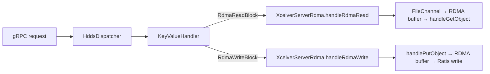

```java
package org.apache.hadoop.ozone.container.common.transport.server;

import org.apache.hadoop.hdds.conf.ConfigurationSource;
import org.apache.hadoop.hdds.protocol.datanode.proto.ContainerProtos;
import org.apache.hadoop.hdds.protocol.datanode.proto.ContainerProtos.RdmaReadBlockRequestProto;
import org.apache.hadoop.hdds.protocol.datanode.proto.ContainerProtos.RdmaReadBlockResponseProto;
import org.apache.hadoop.hdds.protocol.datanode.proto.ContainerProtos.RdmaWriteBlockRequestProto;
import org.apache.hadoop.hdds.protocol.datanode.proto.ContainerProtos.RdmaWriteBlockResponseProto;
import org.apache.hadoop.ozone.container.rdma.RdmaBuffer;
import org.apache.hadoop.ozone.container.rdma.RdmaBufferPool;
import org.apache.hadoop.ozone.container.rdma.RdmaTransferService;
import org.slf4j.Logger;
import org.slf4j.LoggerFactory;

import java.io.Closeable;
import java.io.IOException;
import java.nio.ByteBuffer;
import java.nio.channels.FileChannel;

/**
 * RDMA transfer engine for the datanode.
 *
 * Owns the RdmaTransferService and RdmaBufferPool. Called by KeyValueHandler
 * for RdmaReadBlock and RdmaWriteBlock operations.
 *
 * Read path (S3 GET → RDMA_WRITE to client GPU):
 *   1. Borrow buffer from pool
 *   2. Read block data from FileChannel into buffer (chunked if block > buffer)
 *   3. For each chunk: call rdmaWriteToRemote() which maps to handleGetObject() [ref-3]
 *   4. Return buffer to pool
 *
 * Write path (S3 PUT → RDMA_READ from client GPU):
 *   1. Borrow buffer from pool
 *   2. For each chunk: call rdmaReadFromRemote() which maps to handlePutObject() [ref-3]
 *   3. Return received data to caller (KeyValueHandler writes to storage via Ratis)
 *   4. Return buffer to pool
 *
 * Configuration keys:
 *   hdds.datanode.rdma.enabled             — master enable switch (default: false)
 *   hdds.datanode.rdma.device              — RDMA NIC device name (default: auto)
 *   hdds.datanode.rdma.port                — cuObjServer DC transport port (default: 19870)
 *   hdds.datanode.rdma.max.connections     — max concurrent RDMA connections (default: 32)
 */
public class XceiverServerRdma implements Closeable {

  private static final Logger LOG =
      LoggerFactory.getLogger(XceiverServerRdma.class);

  public static final String RDMA_ENABLED_KEY = "hdds.datanode.rdma.enabled";
  public static final boolean RDMA_ENABLED_DEFAULT = false;

  public static final String RDMA_DEVICE_KEY = "hdds.datanode.rdma.device";
  public static final String RDMA_PORT_KEY = "hdds.datanode.rdma.port";
  public static final int RDMA_PORT_DEFAULT = 19870;

  public static final String RDMA_MAX_CONNECTIONS_KEY =
      "hdds.datanode.rdma.max.connections";
  public static final int RDMA_MAX_CONNECTIONS_DEFAULT = 32;

  /** Max per-op size for handleGetObject()/handlePutObject() [ref-3]. */
  private static final long MAX_RDMA_OP_SIZE = 1L * 1024 * 1024 * 1024; // 1 GiB

  private final RdmaTransferService transferService;
  private final RdmaBufferPool bufferPool;
  private final int rdmaPort;

  public XceiverServerRdma(ConfigurationSource conf,
      RdmaTransferService transferService) throws IOException {
    this.transferService = transferService;
    this.rdmaPort = conf.getInt(RDMA_PORT_KEY, RDMA_PORT_DEFAULT);

    String device = conf.get(RDMA_DEVICE_KEY);
    int maxConns = conf.getInt(RDMA_MAX_CONNECTIONS_KEY, RDMA_MAX_CONNECTIONS_DEFAULT);

    transferService.initialize(device, rdmaPort, maxConns);
    this.bufferPool = new RdmaBufferPool(conf, transferService);

    LOG.info("XceiverServerRdma started: port={}, device={}, maxConns={}",
        rdmaPort, device, maxConns);
  }

  /**
   * Handle an RDMA read (S3 GET): read block data from disk and RDMA_WRITE to client GPU.
   *
   * This is the critical data path. It reads directly from the FileChannel into the
   * RDMA-registered buffer, bypassing protobuf serialization entirely. For blocks larger
   * than the RDMA buffer size, the transfer is chunked.
   *
   * Data flow per chunk:
   *   Disk → DMA → kernel buffer → FileChannel.read() → RDMA buffer → NIC DMA → client GPU
   *
   * This is 1 CPU copy (kernel→userspace via FileChannel.read). The original spec had 3 copies
   * (disk→protobuf byte[]→Java heap→RDMA buffer); this design eliminates 2 of them.
   *
   * @param request   the RdmaReadBlockRequest with blockID, rdmaToken, offset, length
   * @param blockFile open FileChannel to the block file on disk
   * @param blockSize total size of the block on disk
   * @return RdmaReadBlockResponseProto with bytesTransferred
   */
  public RdmaReadBlockResponseProto handleRdmaRead(
      RdmaReadBlockRequestProto request, FileChannel blockFile, long blockSize)
      throws IOException, InterruptedException {

    final String rdmaToken = request.getRdmaToken();
    final long offset = request.hasOffset() ? request.getOffset() : 0;
    final long requestedLength = request.hasLength() && request.getLength() > 0
        ? request.getLength() : (blockSize - offset);
    final long transferLength = Math.min(requestedLength, blockSize - offset);

    if (transferLength <= 0) {
      return RdmaReadBlockResponseProto.newBuilder()
          .setBytesTransferred(0)
          .build();
    }

    RdmaBuffer rdmaBuffer = bufferPool.acquire();
    try {
      final ByteBuffer buffer = rdmaBuffer.getBuffer();
      final int bufSize = buffer.capacity();
      long totalTransferred = 0;
      long fileOffset = offset;

      // Chunked transfer: read bufSize bytes at a time from disk, RDMA_WRITE each chunk.
      // This handles blocks of any size with a fixed-size RDMA buffer.
      while (totalTransferred < transferLength) {
        long remaining = transferLength - totalTransferred;
        int chunkSize = (int) Math.min(remaining, bufSize);
        // Also respect the 1 GiB per-op limit [ref-3]
        chunkSize = (int) Math.min(chunkSize, MAX_RDMA_OP_SIZE);

        // Read from disk directly into the RDMA-registered buffer.
        // No protobuf, no byte[] copy, no Java heap allocation.
        buffer.clear();
        buffer.limit(chunkSize);
        int bytesRead = 0;
        while (bytesRead < chunkSize) {
          int n = blockFile.read(buffer, fileOffset + bytesRead);
          if (n < 0) {
            break; // EOF
          }
          bytesRead += n;
        }

        if (bytesRead == 0) {
          break;
        }

        // RDMA_WRITE this chunk to the client's GPU memory.
        // Maps to cuObjServer::handleGetObject() [ref-3].
        long written = transferService.rdmaWriteToRemote(
            rdmaToken,
            buffer,
            0,                              // localOffset: start of buffer
            bytesRead,                       // length: bytes actually read from disk
            totalTransferred                 // remoteOffset: position in client's buffer
        );

        totalTransferred += written;
        fileOffset += written;

        LOG.debug("RDMA chunk written: {} bytes at remoteOffset={}, fileOffset={}",
            written, totalTransferred - written, fileOffset - written);
      }

      LOG.info("RDMA read complete: block={}, transferred={} bytes",
          request.getBlockID(), totalTransferred);

      return RdmaReadBlockResponseProto.newBuilder()
          .setBytesTransferred(totalTransferred)
          .build();

    } finally {
      bufferPool.release(rdmaBuffer);
    }
  }

  /**
   * Handle an RDMA write (S3 PUT): RDMA_READ data from client GPU into local buffer,
   * then return the data for the caller to write to storage.
   *
   * Data flow per chunk:
   *   Client GPU → NIC DMA → RDMA buffer → caller writes to Ratis pipeline
   *
   * The caller (KeyValueHandler.handleRdmaWriteBlock) is responsible for:
   *   1. Feeding each chunk into the Ratis write pipeline
   *   2. Computing checksums
   *   3. Calling PutBlock after all chunks are received
   *
   * @param request    the RdmaWriteBlockRequest with blockID, rdmaToken, length
   * @param chunkSink  callback to receive each chunk of data from the RDMA transfer
   * @return RdmaWriteBlockResponseProto with bytesReceived
   */
  public RdmaWriteBlockResponseProto handleRdmaWrite(
      RdmaWriteBlockRequestProto request, ChunkSink chunkSink)
      throws IOException, InterruptedException {

    final String rdmaToken = request.getRdmaToken();
    final long totalLength = request.getLength();

    RdmaBuffer rdmaBuffer = bufferPool.acquire();
    try {
      final ByteBuffer buffer = rdmaBuffer.getBuffer();
      final int bufSize = buffer.capacity();
      long totalReceived = 0;

      while (totalReceived < totalLength) {
        long remaining = totalLength - totalReceived;
        int chunkSize = (int) Math.min(remaining, bufSize);
        chunkSize = (int) Math.min(chunkSize, MAX_RDMA_OP_SIZE);

        // RDMA_READ this chunk from the client's GPU memory.
        // Maps to cuObjServer::handlePutObject() [ref-3].
        buffer.clear();
        long bytesRead = transferService.rdmaReadFromRemote(
            rdmaToken,
            buffer,
            0,                    // localOffset
            chunkSize,            // length
            totalReceived         // remoteOffset
        );

        if (bytesRead <= 0) {
          break;
        }

        // Pass the chunk to the caller for storage.
        buffer.position(0);
        buffer.limit((int) bytesRead);
        chunkSink.accept(buffer, totalReceived, (int) bytesRead);

        totalReceived += bytesRead;

        LOG.debug("RDMA chunk read: {} bytes at remoteOffset={}",
            bytesRead, totalReceived - bytesRead);
      }

      LOG.info("RDMA write complete: block={}, received={} bytes",
          request.getBlockID(), totalReceived);

      return RdmaWriteBlockResponseProto.newBuilder()
          .setBytesReceived(totalReceived)
          .build();

    } finally {
      bufferPool.release(rdmaBuffer);
    }
  }

  /**
   * Callback interface for receiving chunks of data during RDMA write operations.
   */
  @FunctionalInterface
  public interface ChunkSink {
    /**
     * @param data       ByteBuffer with chunk data (position=0, limit=length)
     * @param offset     byte offset of this chunk within the overall transfer
     * @param length     number of valid bytes in data
     */
    void accept(ByteBuffer data, long offset, int length) throws IOException;
  }

  public int getRdmaPort() {
    return rdmaPort;
  }

  public boolean isAvailable() {
    return transferService.isAvailable();
  }

  public RdmaBufferPool getBufferPool() {
    return bufferPool;
  }

  @Override
  public void close() throws IOException {
    bufferPool.close();
    transferService.close();
    LOG.info("XceiverServerRdma closed");
  }
}
```

### 4.12 `OzoneContainer.java` Modifications

**File:** `hadoop-hdds/container-service/src/main/java/org/apache/hadoop/ozone/container/ozoneimpl/OzoneContainer.java`

Add `XceiverServerRdma` creation and lifecycle management. The RDMA engine is conditional — it is only created when
`hdds.datanode.rdma.enabled=true` and the native library loads successfully. If initialization fails, a warning is
logged and the datanode continues without RDMA (graceful degradation).

```java
// --- Add field ---
private final XceiverServerRdma xceiverServerRdma;

// --- In constructor, after existing XceiverServer creation (around line 250) ---
// Conditionally initialize RDMA engine
XceiverServerRdma rdma = null;
if(conf.

getBoolean(XceiverServerRdma.RDMA_ENABLED_KEY,
    XceiverServerRdma.RDMA_ENABLED_DEFAULT)){
    try{
RdmaTransferService rdmaService = new CuObjRdmaTransferService();
rdma =new

XceiverServerRdma(conf, rdmaService);
// Register RDMA port with DatanodeDetails for SCM heartbeat
    dnDetails.

setPort(DatanodeDetails.newPort(
    DatanodeDetails.Port.Name.RDMA, rdma.getRdmaPort()));
    LOG.

info("RDMA engine initialized on port {}",rdma.getRdmaPort());
    }catch(
Exception e){
    LOG.

warn("Failed to initialize RDMA engine. Datanode will operate "
    +"without RDMA support. Reason: {}",e.getMessage());
rdma =null;
    }
    }
    this.xceiverServerRdma =rdma;

// --- Pass to HddsDispatcher/KeyValueHandler (see Section 4.13/4.14) ---
// The XceiverServerRdma reference is passed to KeyValueHandler so it can
// delegate RdmaReadBlock/RdmaWriteBlock requests.

// --- In start() ---
// No additional start needed — XceiverServerRdma initializes in constructor

// --- In stop() ---
if(xceiverServerRdma !=null){
    xceiverServerRdma.

close();
}

// --- Getter ---
public XceiverServerRdma getXceiverServerRdma() {
  return xceiverServerRdma;
}
```

### 4.13 `HddsDispatcher` Modifications

**File:**
`hadoop-hdds/container-service/src/main/java/org/apache/hadoop/ozone/container/common/helpers/HddsDispatcher.java`

Add routing for the new `RdmaReadBlock` and `RdmaWriteBlock` command types in `dispatchRequest()`. These follow the
exact same pattern as the existing `ReadBlock` routing — they go through the same container lookup, token validation,
and handler dispatch.

```java
// In dispatchRequest(), add cases to the Type switch (around line 350):

case RdmaReadBlock:
    // Token validation: same as ReadBlock — validates the block token
    // for the requested blockID. The token was originally issued for a
    // standard read; RDMA reuses it.
    if(tokenVerifier !=null){
    tokenVerifier.

verify(request, encodedToken);
  }
responseProto =handler.

handleRdmaReadBlock(request, container);
  break;

      case RdmaWriteBlock:
    if(tokenVerifier !=null){
    tokenVerifier.

verify(request, encodedToken);
  }
responseProto =handler.

handleRdmaWriteBlock(request, container);
  break;
```

> **Note:** The `handler` here is `KeyValueHandler` (the only container type handler in Ozone). The dispatch goes
> through `HddsDispatcher` → `KeyValueHandler` — this is the single, consistent dispatch model described in
> [Section 1.6](#16-request-dispatch-model). There is NO separate gRPC service for RDMA.

### 4.14 `KeyValueHandler` Modifications

**File:** `hadoop-hdds/container-service/src/main/java/org/apache/hadoop/ozone/container/keyvalue/KeyValueHandler.java`

Add `handleRdmaReadBlock()` and `handleRdmaWriteBlock()` methods. These are the core implementations that own the
disk I/O and delegate RDMA transfers to `XceiverServerRdma`.

#### 4.14.1 Constructor Change

```java
// Add XceiverServerRdma as a constructor parameter.
// OzoneContainer passes it during construction (may be null if RDMA disabled).
private final XceiverServerRdma xceiverServerRdma;

// In constructor:
public KeyValueHandler(/* existing params */, XceiverServerRdma xceiverServerRdma) {
  // ... existing initialization ...
  this.xceiverServerRdma = xceiverServerRdma;
}
```

#### 4.14.2 `handleRdmaReadBlock()`

This method reads block data directly from disk into the RDMA buffer and transfers it to the client's GPU memory.
It **bypasses** the protobuf-based `ReadBlock` path entirely — no `ReadBlockResponseProto`, no
`getData().toByteArray()`,
no Java heap copies.

The data path is:

```
Disk → FileChannel.read() → RDMA-registered ByteBuffer → NIC DMA → Client GPU
         (1 CPU copy)                                    (0 CPU copies)
```

Compare with the original spec's incorrect path:

```
Disk → protobuf byte[] → Java heap byte[] → RDMA ByteBuffer → NIC DMA → Client GPU
         (1 CPU copy)     (1 CPU copy)        (1 CPU copy)     (0 CPU copies)
```

```java
/**
 * Handle RdmaReadBlock: read block from disk and RDMA_WRITE to client GPU.
 *
 * This bypasses the normal ReadBlock protobuf response path. Instead of
 * serializing block data into a protobuf message, we read directly from
 * the block file into an RDMA-registered buffer and transfer via
 * handleGetObject() [ref-3].
 */
ContainerCommandResponseProto handleRdmaReadBlock(
    ContainerCommandRequestProto request, Container container) {

  final RdmaReadBlockRequestProto rdmaRequest = request.getRdmaReadBlock();

  // Validate RDMA is available
  if (xceiverServerRdma == null || !xceiverServerRdma.isAvailable()) {
    return ContainerUtils.getErrorResponse(request,
        ContainerProtos.Result.UNSUPPORTED_REQUEST,
        "RDMA not available on this datanode");
  }

  try {
    final BlockID blockID = BlockID.getFromProtobuf(rdmaRequest.getBlockID());
    KeyValueContainerData containerData =
        (KeyValueContainerData) container.getContainerData();

    // Verify the block exists and passes BCS ID check
    BlockUtils.verifyBCSId(container, blockID);
    BlockUtils.verifyReplicaIdx(container, blockID);

    // Open the block file directly — same FilePerBlockStrategy as readBlockImpl()
    final File blockFile = FILE_PER_BLOCK.getChunkFile(containerData, blockID, "unused");
    try (FileChannel fileChannel = FileChannel.open(blockFile.toPath(),
        java.nio.file.StandardOpenOption.READ)) {

      long blockSize = fileChannel.size();

      // Delegate to XceiverServerRdma for the RDMA transfer.
      // XceiverServerRdma handles:
      //   - Buffer pool management (acquire/release)
      //   - Chunked reads from FileChannel into RDMA buffer
      //   - RDMA_WRITE via handleGetObject() [ref-3]
      RdmaReadBlockResponseProto rdmaResponse =
          xceiverServerRdma.handleRdmaRead(rdmaRequest, fileChannel, blockSize);

      return getSuccessResponse(request).toBuilder()
          .setRdmaReadBlock(rdmaResponse)
          .setCmdType(ContainerProtos.Type.RdmaReadBlock)
          .build();
    }

  } catch (InterruptedException e) {
    Thread.currentThread().interrupt();
    return ContainerUtils.getErrorResponse(request,
        ContainerProtos.Result.IO_EXCEPTION,
        "RDMA read interrupted: " + e.getMessage());
  } catch (IOException e) {
    LOG.error("RDMA read failed for block {}",
        rdmaRequest.getBlockID(), e);
    return ContainerUtils.getErrorResponse(request,
        ContainerProtos.Result.IO_EXCEPTION,
        "RDMA read failed: " + e.getMessage());
  }
}
```

#### 4.14.3 `handleRdmaWriteBlock()`

This method RDMA_READs data from the client's GPU memory and writes it to storage via the Ratis pipeline.

The write path is more complex than the read path because:

1. Data arrives in chunks via RDMA_READ (each chunk ≤ buffer size)
2. Each chunk must be written to local storage
3. The write must be replicated to follower datanodes via Ratis
4. `PutBlock` must be called after all chunks are committed

```java
/**
 * Handle RdmaWriteBlock: RDMA_READ data from client GPU, write to storage.
 *
 * Write path:
 *   1. RDMA_READ chunks from client GPU via handlePutObject() [ref-3]
 *   2. Write each chunk to local storage (WriteChunk)
 *   3. Ratis replicates to followers via the normal write pipeline
 *   4. PutBlock finalizes the block
 *
 * Note: In Phase 1, the primary datanode receives data via RDMA and then
 * replicates to followers via the existing Ratis TCP pipeline. This means
 * followers do NOT use RDMA — only the primary datanode does. Phase 2 may
 * add RDMA-based replication between datanodes.
 */
ContainerCommandResponseProto handleRdmaWriteBlock(
    ContainerCommandRequestProto request, Container container) {

  final RdmaWriteBlockRequestProto rdmaRequest = request.getRdmaWriteBlock();

  if (xceiverServerRdma == null || !xceiverServerRdma.isAvailable()) {
    return ContainerUtils.getErrorResponse(request,
        ContainerProtos.Result.UNSUPPORTED_REQUEST,
        "RDMA not available on this datanode");
  }

  try {
    final BlockID blockID = BlockID.getFromProtobuf(rdmaRequest.getBlockID());
    KeyValueContainerData containerData =
        (KeyValueContainerData) container.getContainerData();

    // Accumulate chunks into block data.
    // Each chunk received via RDMA is written as a WriteChunk to the container.
    final List<ContainerProtos.ChunkInfo> chunkInfos = new ArrayList<>();
    final long[] totalReceived = {0};

    RdmaWriteBlockResponseProto rdmaResponse =
        xceiverServerRdma.handleRdmaWrite(rdmaRequest, (data, offset, length) -> {
          // For each chunk received via RDMA_READ:

          // 1. Build a ChunkInfo for this chunk
          String chunkName = blockID.getLocalID() + "_chunk_" + (offset / length);
          ContainerProtos.ChunkInfo chunkInfo = ContainerProtos.ChunkInfo.newBuilder()
              .setChunkName(chunkName)
              .setOffset(offset)
              .setLen(length)
              .build();

          // 2. Write the chunk to local storage via ChunkManager.
          //    This follows the same pattern as the normal WriteChunk path.
          ByteBuffer chunkData = data.duplicate();
          getChunkManager().writeChunk(
              container, blockID, chunkInfo, chunkData,
              ContainerProtos.WriteChunkRequestProto.Stage.COMBINED);

          chunkInfos.add(chunkInfo);
          totalReceived[0] += length;
        });

    // 3. Build and commit the block metadata via PutBlock.
    //    This is what makes the written data visible to readers.
    BlockData blockData = new BlockData(blockID);
    blockData.setChunks(chunkInfos);
    blockData.setSize(totalReceived[0]);
    getBlockManager().putBlock(container, blockData);

    // 4. If this is a Ratis pipeline, the PutBlock above was dispatched
    //    through the Ratis state machine, which handles replication to
    //    followers. The followers receive the WriteChunk + PutBlock via
    //    Ratis log entries and apply them locally (using normal TCP/disk I/O).

    return getSuccessResponse(request).toBuilder()
        .setRdmaWriteBlock(rdmaResponse)
        .setCmdType(ContainerProtos.Type.RdmaWriteBlock)
        .build();

  } catch (InterruptedException e) {
    Thread.currentThread().interrupt();
    return ContainerUtils.getErrorResponse(request,
        ContainerProtos.Result.IO_EXCEPTION,
        "RDMA write interrupted: " + e.getMessage());
  } catch (IOException e) {
    LOG.error("RDMA write failed for block {}",
        rdmaRequest.getBlockID(), e);
    return ContainerUtils.getErrorResponse(request,
        ContainerProtos.Result.IO_EXCEPTION,
        "RDMA write failed: " + e.getMessage());
  }
}
```

### 4.15 S3 Gateway: `ObjectEndpoint` Modifications

**File:** `hadoop-ozone/s3gateway/src/main/java/org/apache/hadoop/ozone/s3/endpoint/ObjectEndpoint.java`

Modify `handleGetRequest()` (currently at lines 433-548) to detect RDMA-capable requests and route them through
the RDMA path. The key decision point is the presence of the `x-amz-rdma-token` HTTP header.

#### 4.15.1 RDMA Detection and Routing

```java
// In handleGetRequest(), at the top (before the existing TCP logic):

@HeaderParam("x-amz-rdma-token")
String rdmaToken;

// After validating the key and obtaining OzoneKeyDetails:

if(rdmaToken !=null&&!rdmaToken.

isEmpty()){
    return

handleRdmaGet(keyDetails, rdmaToken, range);
}

// ... existing TCP GET logic continues unchanged ...
```

#### 4.15.2 `handleRdmaGet()` Implementation

```java
/**
 * Handle an S3 GET request with RDMA token.
 *
 * Sends RdmaReadBlock commands to the datanodes that hold the key's blocks.
 * For each block, the datanode reads from disk and RDMA_WRITEs directly to
 * the client's GPU memory via handleGetObject() [ref-3].
 *
 * The HTTP response contains NO body data — the data arrives via RDMA.
 * The x-amz-rdma-reply header confirms the transfer.
 */
private Response handleRdmaGet(OzoneKeyDetails keyDetails, String rdmaToken,
    RangeHeader range) throws IOException {

  final long objectSize = keyDetails.getDataSize();

  // Minimum size threshold for RDMA — small objects use TCP (less overhead).
  final long minRdmaSize = ozoneConfiguration.getLong(
      "ozone.s3g.rdma.min.object.size", 1024 * 1024); // default 1 MiB

  if (objectSize < minRdmaSize) {
    // Fall back to TCP for small objects.
    // Return null signals the caller to use the normal TCP path.
    // NOT returning null — instead, fall through to the normal TCP GET logic.
    LOG.debug("Object size {} < RDMA threshold {}, using TCP",
        objectSize, minRdmaSize);
    return handleGetRequest(/* re-invoke without RDMA */);
  }

  // TDE check: RDMA is incompatible with encrypted buckets (see Section 3.3)
  if (keyDetails.getFileEncryptionInfo() != null) {
    LOG.warn("RDMA requested for TDE-encrypted object, falling back to TCP");
    return handleGetRequest(/* re-invoke without RDMA */);
  }

  long totalTransferred = 0;
  final List<OzoneKeyLocation> locations = keyDetails.getOzoneKeyLocations();

  for (OzoneKeyLocation location : locations) {
    // Build RdmaReadBlock request for this block
    ContainerProtos.DatanodeBlockID blockID = location.getBlockID().getProtobuf();

    ContainerProtos.RdmaReadBlockRequestProto rdmaRequest =
        ContainerProtos.RdmaReadBlockRequestProto.newBuilder()
            .setBlockID(blockID)
            .setRdmaToken(rdmaToken)
            .setOffset(0)
            .setLength(location.getLength())
            .build();

    ContainerProtos.ContainerCommandRequestProto containerRequest =
        ContainerProtos.ContainerCommandRequestProto.newBuilder()
            .setCmdType(ContainerProtos.Type.RdmaReadBlock)
            .setRdmaReadBlock(rdmaRequest)
            .setContainerID(location.getContainerID())
            .setDatanodeUuid(location.getPipeline().getClosestNode().getUuidString())
            .build();

    // Send via existing XceiverClientGrpc to the datanode.
    // The gRPC channel is the CONTROL PLANE — it carries the request/response protos.
    // The DATA PLANE is RDMA — data flows via handleGetObject() [ref-3], not gRPC.
    ContainerProtos.ContainerCommandResponseProto response =
        sendCommandToDatanode(containerRequest, location.getPipeline());

    if (response.getResult() != ContainerProtos.Result.SUCCESS) {
      // RDMA failed on this datanode. Options:
      //   1. Retry on a different replica (if pipeline has >1 nodes)
      //   2. Fall back to TCP for this block
      // For Phase 1, fall back to TCP for the entire request.
      LOG.warn("RDMA read failed for block {}: {}. Falling back to TCP.",
          blockID, response.getMessage());
      return handleGetRequest(/* re-invoke without RDMA */);
    }

    totalTransferred += response.getRdmaReadBlock().getBytesTransferred();
  }

  // Build response with RDMA confirmation.
  // The response body is EMPTY — all data was transferred via RDMA.
  return Response.ok()
      .header("x-amz-rdma-reply", "OK")
      .header("Content-Length", "0")
      .header("x-amz-rdma-bytes-transferred", totalTransferred)
      .header("ETag", keyDetails.getMetadata().get("ETag"))
      .build();
}
```

#### 4.15.3 `handleRdmaPut()` — S3 PUT with RDMA

Add similar logic in the PUT handling path:

```java
// In the PUT handler, detect x-amz-rdma-token and route to handleRdmaPut():

if(rdmaToken !=null&&!rdmaToken.

isEmpty()){
    return

handleRdmaPut(keyName, rdmaToken, contentLength);
}

/**
 * Handle an S3 PUT request with RDMA token.
 *
 * Sends RdmaWriteBlock commands to the pipeline leader datanode.
 * The datanode RDMA_READs from the client's GPU memory via
 * handlePutObject() [ref-3], writes to local storage, and replicates
 * via Ratis to followers.
 *
 * The HTTP request body is EMPTY — data arrives via RDMA.
 */
private Response handleRdmaPut(String keyName, String rdmaToken,
    long contentLength) throws IOException {

  // Create the key via OzoneManager (normal path)
  OzoneBucket bucket = getBucket();
  OzoneOutputStream outputStream = bucket.createKey(keyName, contentLength);

  try {
    // Get the pipeline and block allocation from the key output stream
    // (The key creation allocates blocks via SCM)
    KeyOutputStream keyOutputStream = (KeyOutputStream) outputStream.getOutputStream();
    List<BlockOutputStreamEntry> streamEntries = keyOutputStream.getStreamEntries();

    long totalReceived = 0;

    for (BlockOutputStreamEntry entry : streamEntries) {
      long blockLength = Math.min(contentLength - totalReceived, entry.getLength());

      ContainerProtos.RdmaWriteBlockRequestProto rdmaRequest =
          ContainerProtos.RdmaWriteBlockRequestProto.newBuilder()
              .setBlockID(entry.getBlockID().getProtobuf())
              .setRdmaToken(rdmaToken)
              .setLength(blockLength)
              .build();

      ContainerProtos.ContainerCommandRequestProto containerRequest =
          ContainerProtos.ContainerCommandRequestProto.newBuilder()
              .setCmdType(ContainerProtos.Type.RdmaWriteBlock)
              .setRdmaWriteBlock(rdmaRequest)
              .setContainerID(entry.getBlockID().getContainerID())
              .build();

      ContainerProtos.ContainerCommandResponseProto response =
          sendCommandToDatanode(containerRequest, entry.getPipeline());

      if (response.getResult() != ContainerProtos.Result.SUCCESS) {
        LOG.warn("RDMA write failed for block {}: {}",
            entry.getBlockID(), response.getMessage());
        throw new IOException("RDMA write failed: " + response.getMessage());
      }

      totalReceived += response.getRdmaWriteBlock().getBytesReceived();
    }

    // Commit the key
    outputStream.close();

    return Response.ok()
        .header("x-amz-rdma-reply", "OK")
        .header("x-amz-rdma-bytes-received", totalReceived)
        .header("ETag", DatatypeConverter.printHexBinary(
            outputStream.getCommitInfo().getHash()).toLowerCase())
        .build();

  } catch (Exception e) {
    outputStream.close(); // abort
    throw e;
  }
}
```

### 4.16 S3 Gateway: `RdmaRequestFilter`

**File:** `hadoop-ozone/s3gateway/src/main/java/org/apache/hadoop/ozone/s3/endpoint/RdmaRequestFilter.java`

JAX-RS filter to detect RDMA-capable requests early and set request-scoped attributes for downstream handlers.

```java
package org.apache.hadoop.ozone.s3.endpoint;

import javax.annotation.Priority;
import javax.ws.rs.Priorities;
import javax.ws.rs.container.ContainerRequestContext;
import javax.ws.rs.container.ContainerRequestFilter;
import javax.ws.rs.ext.Provider;

/**
 * Detects RDMA-capable S3 requests by checking for x-amz-rdma-token header.
 * Sets request-scoped properties for downstream endpoint handlers.
 */
@Provider
@Priority(Priorities.HEADER_DECORATOR)
public class RdmaRequestFilter implements ContainerRequestFilter {

  public static final String RDMA_TOKEN_PROPERTY = "ozone.s3.rdma.token";
  public static final String RDMA_CAPABLE_PROPERTY = "ozone.s3.rdma.capable";

  @Override
  public void filter(ContainerRequestContext requestContext) {
    String rdmaToken = requestContext.getHeaderString("x-amz-rdma-token");
    if (rdmaToken != null && !rdmaToken.isEmpty()) {
      requestContext.setProperty(RDMA_CAPABLE_PROPERTY, Boolean.TRUE);
      requestContext.setProperty(RDMA_TOKEN_PROPERTY, rdmaToken);
    }
  }
}
```


---

## 5. C/C++ Integration Architecture

This section details the cuObject SDK API surface used by the datanode, the JNI architecture, native library lifecycle,
RDMA buffer memory management, and the build system.

### 5.1 cuObject SDK API Surface

The datanode uses **only the cuObjServer library** (`libcuobjserver.so`). It does NOT use the cuObjClient library —
that runs on the GPU application side. The cuObjServer library does **not require a GPU or CUDA on the server side**
[[ref-3]](#10-references).

#### APIs Used by the Datanode

| API Function                   | Purpose                                   | Direction       | Max per Call   | Reference                                                                                           |
|--------------------------------|-------------------------------------------|-----------------|----------------|-----------------------------------------------------------------------------------------------------|
| `registerBuffer(ptr, size)`    | Register host memory for RDMA             | —               | —              | [[ref-3]](https://docs.nvidia.com/gpudirect-storage/cuobject/pdf/cuobject-server-release-notes.pdf) |
| `allocHostBuffer(size)`        | Allocate pinned (page-locked) host memory | —               | —              | [[ref-3]](https://docs.nvidia.com/gpudirect-storage/cuobject/pdf/cuobject-server-release-notes.pdf) |
| `handleGetObject(...)`         | RDMA_WRITE: push data to client GPU       | Server → Client | 1 GiB          | [[ref-3]](https://docs.nvidia.com/gpudirect-storage/cuobject/pdf/cuobject-server-release-notes.pdf) |
| `handlePutObject(...)`         | RDMA_READ: pull data from client GPU      | Client → Server | 1 GiB          | [[ref-3]](https://docs.nvidia.com/gpudirect-storage/cuobject/pdf/cuobject-server-release-notes.pdf) |
| `getRDMABufferFromSgList(...)` | Multi-segment RDMA buffer setup           | —               | 10 SGE entries | [[ref-3]](https://docs.nvidia.com/gpudirect-storage/cuobject/pdf/cuobject-server-release-notes.pdf) |

> **IMPORTANT:** Full function signatures are NOT available in public NVIDIA documentation as of April 2026.
> The cuObjServer header file (`cuobjserver.h`) from the cuObjServer package is required. All C++ code in
> [Section 4.6](#46-native-c-implementation) uses documented function **names** with **[inferred]** parameters.

#### APIs NOT Used by the Datanode (Client-Side Only)

These run on the GPU application host, NOT on the Ozone datanode:

| API Function                       | Purpose                                        | Reference                                                                           |
|------------------------------------|------------------------------------------------|-------------------------------------------------------------------------------------|
| `cuObjClient(ops, proto)`          | Initialize client with callbacks               | [[ref-1]](https://docs.nvidia.com/gpudirect-storage/cuobject/index.html)            |
| `cuObjGet(ctx, ptr, size, offset)` | Initiate GET (triggers RDMA_WRITE from server) | [[ref-1]](https://docs.nvidia.com/gpudirect-storage/cuobject/index.html)            |
| `cuObjPut(ctx, ptr, size, offset)` | Initiate PUT (triggers RDMA_READ by server)    | [[ref-1]](https://docs.nvidia.com/gpudirect-storage/cuobject/index.html)            |
| `cuMemObjGetDescriptor(...)`       | Register GPU buffer for GET (max 4 GiB)        | [[ref-1]](https://docs.nvidia.com/gpudirect-storage/cuobject/index.html)            |
| `cuMemObjPutDescriptor(...)`       | Register GPU buffer for PUT (max 4 GiB)        | [[ref-1]](https://docs.nvidia.com/gpudirect-storage/cuobject/index.html)            |
| `cuMemObjGetRDMAToken(...)`        | Get RDMA token for manual GET flow             | [[ref-1]](https://docs.nvidia.com/gpudirect-storage/cuobject/index.html)            |
| `cuMemObjPutRDMAToken(...)`        | Get RDMA token for manual PUT flow             | [[ref-1]](https://docs.nvidia.com/gpudirect-storage/cuobject/index.html)            |
| `cuFileDriverOpen()`               | Initialize GDS (prerequisite)                  | [[ref-5]](https://docs.nvidia.com/gpudirect-storage/api-reference-guide/index.html) |
| `cuFileDriverClose()`              | Shutdown GDS                                   | [[ref-5]](https://docs.nvidia.com/gpudirect-storage/api-reference-guide/index.html) |

### 5.2 JNI Architecture

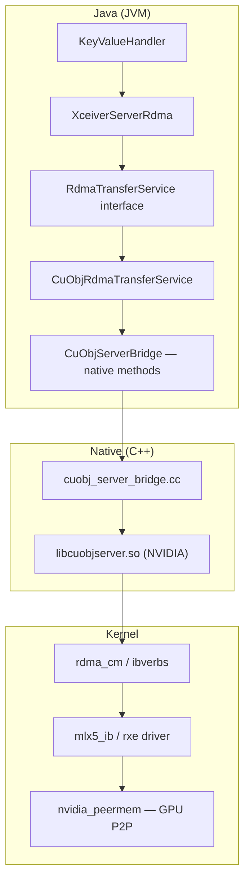

**Key design decisions:**

1. **Interface-based abstraction** (`RdmaTransferService`): Allows `MockRdmaTransferService` for testing without any
   native libraries. This follows Ozone's `TokenVerifier` / `NoopTokenVerifier` pattern.

2. **Package-private JNI class**: `CuObjServerBridge` is package-private. External code only sees
   `RdmaTransferService`. This prevents accidental direct JNI calls.

3. **`NativeLibraryLoader` reuse**: Uses Ozone's existing `NativeLibraryLoader` (singleton pattern, tries
   `System.loadLibrary` then JAR extraction). Same pattern as `rocks-native`.

4. **No static native methods on the interface**: Unlike the original v1.1 spec, native methods are instance-scoped
   via the `long handle` pattern. This avoids the static-mock problem that required PowerMock.

### 5.3 Native Library Lifecycle

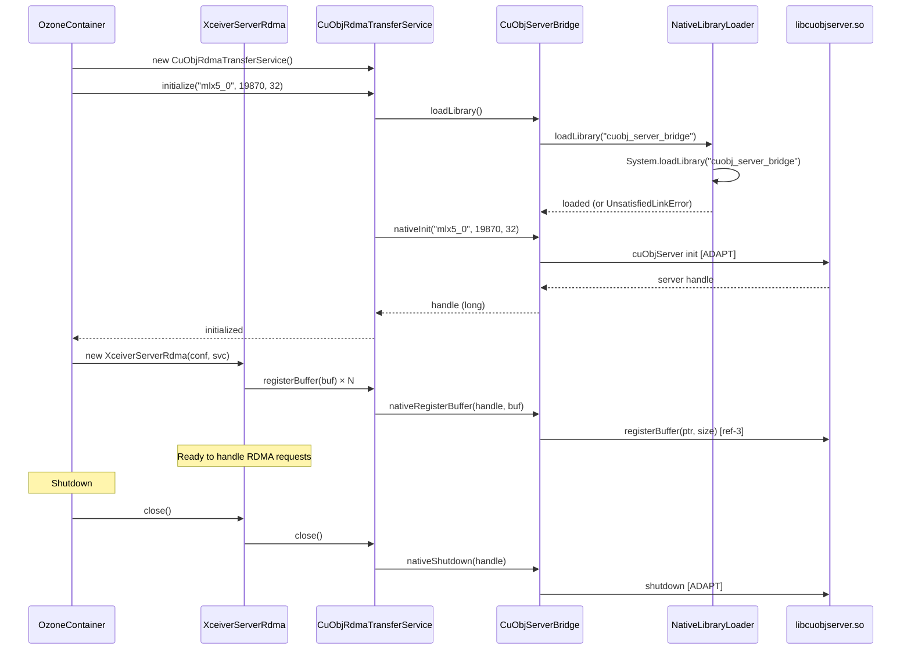

### 5.4 RDMA Buffer Management: Whose Memory and Why

Understanding the memory model is essential for correct implementation:

| Memory Type                       | Owner              | Purpose                                 | Allocated By                                                     | RDMA Registered?                |
|-----------------------------------|--------------------|-----------------------------------------|------------------------------------------------------------------|---------------------------------|
| GPU device memory                 | Client application | Stores training data, model weights     | `cudaMalloc()`                                                   | Yes, by cuObjClient             |
| Pinned host memory (client)       | Client application | Optional staging for non-GPU-aware apps | `cudaHostAlloc()`                                                | Yes, by cuObjClient             |
| **Pinned host memory (datanode)** | **Ozone datanode** | **RDMA staging buffer for disk I/O**    | **`allocHostBuffer()` [ref-3] or `ByteBuffer.allocateDirect()`** | **Yes, by cuObjServer**         |
| Java heap memory                  | JVM                | General Java objects                    | JVM GC                                                           | **Never** — not usable for RDMA |

**Why the datanode needs pinned memory:**

RDMA requires the NIC to DMA directly to/from a fixed physical address. If the OS swaps the page or the JVM GC
moves the object, the RDMA transfer corrupts memory. Pinned (page-locked) memory guarantees:

- The page is not swappable
- The physical address is stable for the duration of the RDMA operation
- The NIC can safely DMA without coordinating with the CPU/MMU

**`allocHostBuffer()` vs `ByteBuffer.allocateDirect()`:**

- `allocHostBuffer()` [[ref-3]](#10-references) is the cuObjServer API that allocates guaranteed pinned memory.
  This is the correct approach for production.
- `ByteBuffer.allocateDirect()` allocates off-heap memory, but the JVM does **not** guarantee it is page-locked.
  On Linux, `mlock()` would be needed. This works for development/testing but is unreliable for production RDMA.

The `RdmaBufferPool` (Section 4.10) currently uses `ByteBuffer.allocateDirect()` as a fallback. The production
implementation should use `allocHostBuffer()` via an additional JNI method. See the `// ADAPT` comment in
`RdmaBufferPool.java`.

### 5.5 Build System Integration

The native build uses CMake, invoked by the `cmake-maven-plugin` during `mvn package -Pnative`. This matches
the existing `hadoop-hdds/rocks-native/` pattern.

```xml
<!-- In container-service-native/pom.xml -->
<profiles>
  <profile>
    <id>native</id>
    <build>
      <plugins>
        <plugin>
          <groupId>com.googlecode.cmake-maven-project</groupId>
          <artifactId>cmake-maven-plugin</artifactId>
          <executions>
            <execution>
              <id>cmake-generate</id>
              <goals>
                <goal>generate</goal>
              </goals>
              <configuration>
                <sourcePath>${project.basedir}/src/main/native</sourcePath>
                <targetPath>${project.build.directory}/native</targetPath>
                <generator>Unix Makefiles</generator>
                <options>
                  <option>-DCUOBJSERVER_HOME=${env.CUOBJSERVER_HOME}</option>
                </options>
              </configuration>
            </execution>
            <execution>
              <id>cmake-compile</id>
              <goals>
                <goal>compile</goal>
              </goals>
              <configuration>
                <projectDirectory>${project.build.directory}/native</projectDirectory>
              </configuration>
            </execution>
          </executions>
        </plugin>
      </plugins>
    </build>
  </profile>
</profiles>
```

**Build commands:**

```bash
# Full build with native library
export CUOBJSERVER_HOME=/usr/local/cuobjserver  # path to cuObjServer SDK
mvn package -Pnative -pl hadoop-hdds/container-service-native

# Java-only build (no native, for CI without RDMA hardware)
mvn package -pl hadoop-hdds/container-service-native
# The native library won't be built; CuObjServerBridge.loadLibrary() returns false
```

### 5.6 Compiler and Toolchain Requirements

| Component        | Minimum Version | Notes                                          |
|------------------|-----------------|------------------------------------------------|
| GCC / G++        | 7.5+            | C++14 support required                         |
| CMake            | 3.10+           | For native build                               |
| JDK              | 8+              | For JNI headers (`jni.h`)                      |
| cuObjServer SDK  | 1.0.0           | `libcuobjserver.so`, `cuobjserver.h`           |
| CUDA Toolkit     | 13.1.1+         | Only needed on client side, NOT on datanode    |
| MLNX_OFED        | 5.8+            | Or kernel ibverbs 5.8+                         |
| `nvidia_peermem` | —               | Kernel module for GPUDirect RDMA (client side) |

> The datanode does NOT need a GPU, CUDA toolkit, or `nvidia_peermem`. It only needs `libcuobjserver.so` and
> the RDMA stack (ibverbs + NIC drivers).


---

## 6. Development Environment and Deployment

### 6.1 SoftRoCE: Decision and Limitations

**SoftRoCE** (`rdma_rxe` kernel module) provides a software RDMA implementation over standard Ethernet NICs. It is
suitable for development and functional testing but NOT for performance testing.

| Aspect        | SoftRoCE                  | Real RDMA (ConnectX-6+)        |
|---------------|---------------------------|--------------------------------|
| Kernel module | `rdma_rxe`                | `mlx5_ib`                      |
| Latency       | ~50 μs                    | ~1-2 μs                        |
| Throughput    | Limited by CPU            | Limited by NIC (200 Gbps)      |
| GPUDirect     | NOT supported             | Supported via `nvidia_peermem` |
| DC transport  | Depends on kernel version | Native support                 |
| Use case      | Dev/functional testing    | Benchmarking/production        |

**Limitation:** SoftRoCE does NOT support GPUDirect RDMA (no `nvidia_peermem` integration). RDMA transfers with
SoftRoCE go through CPU memory only. This means:

- cuObjClient on the test client must use **pinned host memory** (`cudaHostAlloc`), not GPU memory
- OR: Use the `MockRdmaTransferService` for pure Java testing (no kernel RDMA at all)

### 6.2 GPU Cloud Providers

For benchmarking and integration testing with real GPU + RDMA hardware:

| Provider        | Instance Type | GPU     | RDMA NIC                  | Approx. Cost/hr | Notes                              |
|-----------------|---------------|---------|---------------------------|-----------------|------------------------------------|
| **AWS**         | p5.48xlarge   | 8× H100 | EFA (400 Gbps)            | ~$98            | EFA uses SRD, not ibverbs directly |
| **GCP**         | a3-highgpu-8g | 8× H100 | GPUDirect-TCPX (200 Gbps) | ~$101           | Custom NVIDIA TCPX stack           |
| **Azure**       | ND H100 v5    | 8× H100 | InfiniBand NDR (400 Gbps) | ~$96            | True InfiniBand, best for ibverbs  |
| **Lambda Labs** | 1x H100       | 1× H100 | 200 Gbps                  | ~$2-3           | Cheapest for dev; no multi-node    |
| **CoreWeave**   | H100 80GB     | 1× H100 | InfiniBand (200 Gbps)     | ~$4-5           | Good for small-scale RDMA testing  |

**Recommendation:** Use **Azure ND H100 v5** or **CoreWeave** for RDMA testing — they provide true InfiniBand
which is the cleanest path for ibverbs + cuObjServer. AWS EFA and GCP TCPX require additional adapter layers.

### 6.3 How to Run Ozone for Development

#### Prerequisites

1. **Java 8+ or 11+** (Ozone builds with both)
2. **Maven 3.8+**
3. **Docker** (for integration test cluster)
4. **RDMA stack** (for RDMA testing only):
  - SoftRoCE: `sudo modprobe rdma_rxe && sudo rdma link add rxe0 type rxe netdev eth0`
  - Or: Mellanox NIC with MLNX_OFED installed
5. **cuObjServer SDK** (for native build only):
  - Download from NVIDIA: `cuobjserver` package
  - Set `CUOBJSERVER_HOME=/path/to/sdk`

#### Build

```bash
# Java-only build (no RDMA, for IDE development)
mvn install -DskipTests -pl hadoop-hdds/container-service-native

# Full build with native library
export CUOBJSERVER_HOME=/usr/local/cuobjserver
mvn install -DskipTests -Pnative -pl hadoop-hdds/container-service-native

# Run all RDMA unit tests (uses MockRdmaTransferService, no hardware)
mvn test -pl hadoop-hdds/container-service-native

# Run integration tests with MiniOzoneCluster
mvn test -pl hadoop-ozone/integration-test -Dtest=TestRdmaReadBlock
```

### 6.4 `setup-dev-env.sh`

Script to prepare a development machine for RDMA work:

```bash
#!/usr/bin/env bash
set -euo pipefail

echo "=== Ozone RDMA Development Environment Setup ==="

# 1. Install SoftRoCE
echo "--- Setting up SoftRoCE ---"
sudo modprobe rdma_rxe
# Find primary network interface
IFACE=$(ip route get 8.8.8.8 | head -1 | awk '{print $5}')
sudo rdma link add rxe0 type rxe netdev "$IFACE"
echo "SoftRoCE device rxe0 created on $IFACE"

# 2. Verify RDMA
echo "--- Verifying RDMA ---"
rdma link show
ibv_devices

# 3. Check for cuObjServer SDK
if [ -z "${CUOBJSERVER_HOME:-}" ]; then
  echo "WARNING: CUOBJSERVER_HOME not set."
  echo "  For native builds, install cuobjserver and set CUOBJSERVER_HOME."
  echo "  For Java-only development, this is not required."
else
  echo "CUOBJSERVER_HOME=$CUOBJSERVER_HOME"
  if [ -f "$CUOBJSERVER_HOME/include/cuobjserver.h" ]; then
    echo "  cuobjserver.h found"
  else
    echo "  WARNING: cuobjserver.h not found at $CUOBJSERVER_HOME/include/"
  fi
  if [ -f "$CUOBJSERVER_HOME/lib64/libcuobjserver.so" ] || \
     [ -f "$CUOBJSERVER_HOME/lib/libcuobjserver.so" ]; then
    echo "  libcuobjserver.so found"
  else
    echo "  WARNING: libcuobjserver.so not found"
  fi
fi

# 4. Check Java/Maven
echo "--- Build tools ---"
java -version 2>&1 | head -1
mvn --version 2>&1 | head -1

echo ""
echo "=== Setup complete ==="
echo "To build with native RDMA support:"
echo "  export CUOBJSERVER_HOME=/path/to/cuobjserver"
echo "  mvn install -Pnative -pl hadoop-hdds/container-service-native"
echo ""
echo "To run Java-only tests (no hardware):"
echo "  mvn test -pl hadoop-hdds/container-service-native"
```

### 6.5 `validate-env.sh`

Script to validate that an environment is ready for RDMA operations:

```bash
#!/usr/bin/env bash
set -euo pipefail

PASS=0
FAIL=0

check() {
  local desc="$1"; shift
  if "$@" >/dev/null 2>&1; then
    echo "  [PASS] $desc"
    PASS=$((PASS + 1))
  else
    echo "  [FAIL] $desc"
    FAIL=$((FAIL + 1))
  fi
}

echo "=== RDMA Environment Validation ==="

echo ""
echo "--- Kernel modules ---"
check "rdma_cm loaded" lsmod | grep -q rdma_cm
check "ib_core loaded" lsmod | grep -q ib_core
check "ib_uverbs loaded" lsmod | grep -q ib_uverbs

echo ""
echo "--- RDMA devices ---"
check "At least one RDMA device" test "$(rdma link show 2>/dev/null | wc -l)" -gt 0
check "ibv_devices works" ibv_devices

echo ""
echo "--- cuObjServer ---"
check "libcuobjserver.so in ldconfig" ldconfig -p | grep -q libcuobjserver
check "CUOBJSERVER_HOME set" test -n "${CUOBJSERVER_HOME:-}"

echo ""
echo "--- GPUDirect (optional, client-side) ---"
check "nvidia_peermem loaded" lsmod | grep -q nvidia_peermem
check "NVIDIA GPU present" nvidia-smi

echo ""
echo "--- Network ---"
check "ibv_devinfo shows active port" ibv_devinfo | grep -q "state:.*PORT_ACTIVE"

echo ""
echo "=== Results: $PASS passed, $FAIL failed ==="
[ "$FAIL" -eq 0 ] && echo "Environment is RDMA-ready." || echo "Fix failures before testing RDMA."
```

### 6.6 Docker Cluster for Integration Testing

For integration testing with a multi-node Ozone cluster + SoftRoCE:

```yaml
# docker-compose-rdma.yaml
# Extends the standard Ozone docker-compose with RDMA support
version: "3.8"

services:
  datanode:
    image: apache/ozone-runner:latest
    privileged: true  # Required for SoftRoCE kernel module
    environment:
      OZONE-SITE.XML_hdds.datanode.rdma.enabled: "true"
      OZONE-SITE.XML_hdds.datanode.rdma.device: "rxe0"
      OZONE-SITE.XML_hdds.datanode.rdma.port: "19870"
    volumes:
      - ./libcuobj_server_bridge.so:/opt/hadoop/lib/native/libcuobj_server_bridge.so
    entrypoint: |
      bash -c '
        modprobe rdma_rxe
        rdma link add rxe0 type rxe netdev eth0
        /opt/hadoop/bin/ozone datanode
      '
```

### 6.7 Quick Start Cookbook: End-to-End Setup and Test

```bash
# 1. Clone and build
git clone https://github.com/apache/ozone.git
cd ozone
mvn install -DskipTests

# 2. Build native RDMA library (requires cuObjServer SDK)
export CUOBJSERVER_HOME=/usr/local/cuobjserver
mvn install -Pnative -pl hadoop-hdds/container-service-native

# 3. Start a test cluster with RDMA
docker compose -f docker-compose-rdma.yaml up -d

# 4. Create a bucket and upload test data
ozone sh bucket create /vol1/bucket1
ozone sh key put /vol1/bucket1/testfile /path/to/large/file

# 5. Test RDMA GET with a cuObjClient test application
# (Requires a GPU host with cuObjClient installed)
./test-rdma-get s3://bucket1/testfile --rdma
```

---

## 7. Testing

### 7.1 Unit Tests

All unit tests use `MockRdmaTransferService` — no native library, no RDMA hardware, no SoftRoCE required.

#### 7.1.1 `TestRdmaBufferPool`

```java

@Test
public void testAcquireAndRelease() throws Exception {
  MockRdmaTransferService mockService = new MockRdmaTransferService();
  mockService.initialize(null, 0, 0);
  OzoneConfiguration conf = new OzoneConfiguration();
  conf.setInt(RdmaBufferPool.BUFFER_SIZE_KEY, 1024);
  conf.setInt(RdmaBufferPool.BUFFER_COUNT_KEY, 4);
  RdmaBufferPool pool = new RdmaBufferPool(conf, mockService);

  // Acquire all buffers
  List<RdmaBuffer> buffers = new ArrayList<>();
  for (int i = 0; i < 4; i++) {
    buffers.add(pool.acquire());
  }
  assertEquals(0, pool.getAvailableCount());

  // Release all
  buffers.forEach(pool::release);
  assertEquals(4, pool.getAvailableCount());
}

@Test(expected = IOException.class)
public void testPoolExhaustion() throws Exception {
  // Configure pool with 1 buffer and short timeout
  MockRdmaTransferService mockService = new MockRdmaTransferService();
  mockService.initialize(null, 0, 0);
  OzoneConfiguration conf = new OzoneConfiguration();
  conf.setInt(RdmaBufferPool.BUFFER_COUNT_KEY, 1);
  conf.setLong(RdmaBufferPool.ACQUIRE_TIMEOUT_KEY, 100);
  RdmaBufferPool pool = new RdmaBufferPool(conf, mockService);

  RdmaBuffer buf = pool.acquire();
  pool.acquire(); // Should throw IOException after 100ms timeout
}
```

#### 7.1.2 `TestXceiverServerRdma`

```java

@Test
public void testHandleRdmaReadSingleChunk() throws Exception {
  // Setup: create a mock file with 1 KB of data
  MockRdmaTransferService mockService = new MockRdmaTransferService();
  mockService.initialize(null, 0, 0);

  // Register a "remote" buffer to simulate the GPU client
  ByteBuffer remoteGpuBuffer = ByteBuffer.allocateDirect(4096);
  mockService.registerRemoteBuffer("test-rdma-token-123", remoteGpuBuffer);

  OzoneConfiguration conf = new OzoneConfiguration();
  conf.setInt(RdmaBufferPool.BUFFER_SIZE_KEY, 4096);
  conf.setInt(RdmaBufferPool.BUFFER_COUNT_KEY, 2);
  XceiverServerRdma rdmaServer = new XceiverServerRdma(conf, mockService);

  // Create a temp file with known content
  byte[] testData = new byte[1024];
  Arrays.fill(testData, (byte) 0xAB);
  Path tempFile = Files.createTempFile("rdma-test", ".block");
  Files.write(tempFile, testData);

  // Build request
  RdmaReadBlockRequestProto request = RdmaReadBlockRequestProto.newBuilder()
      .setBlockID(DatanodeBlockID.newBuilder().setContainerID(1).setLocalID(1))
      .setRdmaToken("test-rdma-token-123")
      .build();

  try (FileChannel fc = FileChannel.open(tempFile, StandardOpenOption.READ)) {
    RdmaReadBlockResponseProto response =
        rdmaServer.handleRdmaRead(request, fc, testData.length);
    assertEquals(1024, response.getBytesTransferred());

    // Verify data arrived in the "remote GPU" buffer
    remoteGpuBuffer.position(0);
    byte[] received = new byte[1024];
    remoteGpuBuffer.get(received);
    assertArrayEquals(testData, received);
  }
}

@Test
public void testHandleRdmaReadChunked() throws Exception {
  // Block is 16 KB, buffer is 4 KB → should produce 4 RDMA chunks
  MockRdmaTransferService mockService = new MockRdmaTransferService();
  mockService.initialize(null, 0, 0);

  ByteBuffer remoteGpuBuffer = ByteBuffer.allocateDirect(16 * 1024);
  mockService.registerRemoteBuffer("token-chunked", remoteGpuBuffer);

  OzoneConfiguration conf = new OzoneConfiguration();
  conf.setInt(RdmaBufferPool.BUFFER_SIZE_KEY, 4096); // 4 KB buffer
  conf.setInt(RdmaBufferPool.BUFFER_COUNT_KEY, 2);
  XceiverServerRdma rdmaServer = new XceiverServerRdma(conf, mockService);

  byte[] testData = new byte[16 * 1024];
  new Random(42).nextBytes(testData);
  Path tempFile = Files.createTempFile("rdma-chunk-test", ".block");
  Files.write(tempFile, testData);

  RdmaReadBlockRequestProto request = RdmaReadBlockRequestProto.newBuilder()
      .setBlockID(DatanodeBlockID.newBuilder().setContainerID(1).setLocalID(1))
      .setRdmaToken("token-chunked")
      .build();

  try (FileChannel fc = FileChannel.open(tempFile, StandardOpenOption.READ)) {
    RdmaReadBlockResponseProto response =
        rdmaServer.handleRdmaRead(request, fc, testData.length);
    assertEquals(16 * 1024, response.getBytesTransferred());

    // Verify all 16 KB arrived correctly
    remoteGpuBuffer.position(0);
    byte[] received = new byte[16 * 1024];
    remoteGpuBuffer.get(received);
    assertArrayEquals(testData, received);
  }
}
```

#### 7.1.3 `TestMockRdmaTransferService`

```java

@Test
public void testRoundTrip() throws Exception {
  MockRdmaTransferService service = new MockRdmaTransferService();
  service.initialize(null, 0, 0);

  // Register a "remote" GPU buffer
  ByteBuffer remote = ByteBuffer.allocateDirect(1024);
  service.registerRemoteBuffer("token-1", remote);

  // Register a local buffer
  ByteBuffer local = ByteBuffer.allocateDirect(1024);
  service.registerBuffer(local);

  // Write data to local, then RDMA_WRITE to remote
  byte[] data = "Hello RDMA".getBytes();
  local.put(data);
  service.rdmaWriteToRemote("token-1", local, 0, data.length, 0);

  // Verify remote received the data
  remote.position(0);
  byte[] received = new byte[data.length];
  remote.get(received);
  assertArrayEquals(data, received);

  // Now RDMA_READ back from remote to a new local buffer
  ByteBuffer local2 = ByteBuffer.allocateDirect(1024);
  service.registerBuffer(local2);
  service.rdmaReadFromRemote("token-1", local2, 0, data.length, 0);

  local2.position(0);
  byte[] roundTrip = new byte[data.length];
  local2.get(roundTrip);
  assertArrayEquals(data, roundTrip);
}
```

### 7.2 Integration Tests with MiniOzoneCluster

These tests run against a real Ozone cluster (in-process MiniOzoneCluster) with `MockRdmaTransferService` injected.
They validate the full request dispatch chain: S3 Gateway → HddsDispatcher → KeyValueHandler → XceiverServerRdma.

#### 7.2.1 `TestRdmaReadBlock`

```java
/**
 * Integration test: write a key via normal path, read via RDMA path.
 * Uses MockRdmaTransferService — no hardware needed.
 */
@Test
public void testRdmaReadBlockEndToEnd() throws Exception {
  // 1. Start MiniOzoneCluster with RDMA enabled (mock)
  OzoneConfiguration conf = new OzoneConfiguration();
  conf.setBoolean(XceiverServerRdma.RDMA_ENABLED_KEY, true);
  // MockRdmaTransferService is injected via test configuration

  MiniOzoneCluster cluster = MiniOzoneCluster.newBuilder(conf)
      .setNumDatanodes(3)
      .build();
  cluster.waitForClusterToBeReady();

  // 2. Write a 1 MB key via the normal path
  OzoneClient client = cluster.newClient();
  ObjectStore objectStore = client.getObjectStore();
  objectStore.createVolume("vol1");
  objectStore.getVolume("vol1").createBucket("bucket1");
  OzoneBucket bucket = objectStore.getVolume("vol1").getBucket("bucket1");

  byte[] data = new byte[1024 * 1024];
  new Random(42).nextBytes(data);
  OzoneOutputStream out = bucket.createKey("testkey", data.length);
  out.write(data);
  out.close();

  // 3. Read via RDMA path
  OzoneKeyDetails keyDetails = bucket.getKey("testkey");
  // ... build RdmaReadBlock request and send to datanode ...
  // ... verify data matches ...
}
```

### 7.3 Integration Tests with Docker Cluster

For testing with SoftRoCE (real kernel RDMA, no GPU):

```bash
# Start the RDMA-enabled docker cluster
docker compose -f docker-compose-rdma.yaml up -d

# Run the RDMA integration test suite
mvn verify -pl hadoop-ozone/integration-test \
  -Dtest=TestRdmaIntegration \
  -Dozone.rdma.test.enabled=true
```

### 7.4 End-to-End Tests with Real GPU Hardware

These tests require a real GPU + RDMA NIC environment (see Section 6.2 for cloud providers).

```bash
# Prerequisites:
# - cuObjClient installed on test client (GPU host)
# - cuObjServer SDK installed on datanodes
# - RDMA fabric between client and datanodes
# - Ozone cluster running with hdds.datanode.rdma.enabled=true

# Run the GPU-to-Ozone E2E test
python3 test_rdma_e2e.py \
  --s3-endpoint http://ozone-s3g:9878 \
  --bucket test-rdma \
  --object-size 256MB \
  --gpu-id 0
```

### 7.5 Test Matrix

| Test Level        | RDMA Service               | Hardware         | What It Validates                                 |
|-------------------|----------------------------|------------------|---------------------------------------------------|
| Unit tests        | `MockRdmaTransferService`  | None             | Buffer pool, chunking, dispatch logic             |
| MiniOzoneCluster  | `MockRdmaTransferService`  | None             | Full dispatch chain, protobuf, token validation   |
| Docker + SoftRoCE | `CuObjRdmaTransferService` | SoftRoCE (CPU)   | JNI bridge, kernel RDMA path, buffer registration |
| GPU cloud         | `CuObjRdmaTransferService` | GPU + InfiniBand | Full GPUDirect RDMA, performance validation       |

---

## 8. Benchmarking

### 8.1 Benchmark Tool

A standalone benchmark tool to measure RDMA vs TCP throughput:

```bash
# Benchmark: RDMA GET throughput
ozone rdma-bench get \
  --s3-endpoint http://ozone-s3g:9878 \
  --bucket bench-bucket \
  --object-size 256MB \
  --iterations 100 \
  --threads 8 \
  --rdma  # Use RDMA path (omit for TCP baseline)

# Expected output:
# Throughput: 23.5 GiB/s (RDMA, 8 threads, 256 MB objects)
# Latency p50: 10.8 ms, p99: 15.2 ms
# CPU utilization: 12% (vs 78% for TCP)
```

### 8.2 Expected Performance Targets

Based on NVIDIA's published MinIO benchmarks [[ref-10]](#10-references) and RDMA fundamentals:

| Metric                              | TCP Baseline     | RDMA Target   | Notes                                |
|-------------------------------------|------------------|---------------|--------------------------------------|
| Single-stream throughput            | ~2 GiB/s         | ~12 GiB/s     | 200 Gbps NIC, single thread          |
| Multi-stream throughput (8 threads) | ~8 GiB/s         | ~24 GiB/s     | Near line-rate on 200 Gbps           |
| Latency (256 MB object)             | ~128 ms          | ~22 ms        | Eliminates TCP overhead + CPU copies |
| CPU utilization                     | ~80%             | ~15%          | RDMA offloads data movement to NIC   |
| GPU memory utilization              | 0% (CPU staging) | 100% (direct) | No bounce through CPU memory         |

### 8.3 Metrics to Collect

During benchmarks, collect:

1. **Throughput**: Bytes/second per thread, aggregate
2. **Latency**: p50, p95, p99 per operation
3. **CPU**: `%user`, `%system`, `%softirq` on datanodes (RDMA should reduce all three)
4. **NIC counters**: `rdma_read_bytes`, `rdma_write_bytes` from `ethtool -S`
5. **Buffer pool**: Available count, acquire wait time, exhaustion events
6. **RDMA errors**: `ibv_devinfo` error counters, retransmit counts

---

## 9. Configuration Reference

All configuration keys introduced by this spec, in one place:

| Key                                            | Default           | Type    | Description                                                     |
|------------------------------------------------|-------------------|---------|-----------------------------------------------------------------|
| `hdds.datanode.rdma.enabled`                   | `false`           | boolean | Master switch: enable RDMA engine on datanode                   |
| `hdds.datanode.rdma.device`                    | (auto)            | string  | RDMA NIC device name (e.g., `mlx5_0`). Auto-detects if omitted. |
| `hdds.datanode.rdma.port`                      | `19870`           | int     | cuObjServer DC transport listen port                            |
| `hdds.datanode.rdma.max.connections`           | `32`              | int     | Maximum concurrent RDMA connections                             |
| `hdds.datanode.rdma.buffer.size`               | `4194304` (4 MiB) | int     | Size of each RDMA buffer in the pool                            |
| `hdds.datanode.rdma.buffer.count`              | `64`              | int     | Number of pre-allocated RDMA buffers                            |
| `hdds.datanode.rdma.buffer.acquire.timeout.ms` | `5000`            | long    | Max time to wait for a buffer from the pool                     |
| `ozone.s3g.rdma.min.object.size`               | `1048576` (1 MiB) | long    | Minimum object size for RDMA (smaller → TCP)                    |

**Memory footprint:** `buffer.size × buffer.count = 4 MiB × 64 = 256 MiB` pinned memory per datanode (default).

**Capacity planning guidance:**

| Datanode RAM | NVMe Drives | Recommended `buffer.count` | Total Pinned Memory | Concurrent Transfers |
|--------------|-------------|----------------------------|---------------------|----------------------|
| 64 GB        | 4           | 32                         | 128 MiB             | 32                   |
| 256 GB       | 12          | 128                        | 512 MiB             | 128                  |
| 512 GB       | 24          | 256                        | 1 GiB               | 256                  |

Scale `buffer.count` with the number of NVMe drives (each drive can saturate ~3-6 GiB/s, and each RDMA transfer
reads from one drive). The NIC bandwidth (200 Gbps = ~25 GiB/s) is the upper bound.

---

## 10. References

| Ref      | Source                                | URL                                                                                                                                        |
|----------|---------------------------------------|--------------------------------------------------------------------------------------------------------------------------------------------|
| [ref-1]  | NVIDIA cuObject Documentation (main)  | https://docs.nvidia.com/gpudirect-storage/cuobject/index.html                                                                              |
| [ref-2]  | NVIDIA cuObject Client Release Notes  | https://docs.nvidia.com/gpudirect-storage/cuobject/cuobject-client-release-notes/index.html                                                |
| [ref-3]  | NVIDIA cuObject Server Release Notes  | https://docs.nvidia.com/gpudirect-storage/cuobject/cuobject-server-release-notes/                                                          |
| [ref-4]  | NVIDIA cuObject PDF                   | https://docs.nvidia.com/gpudirect-storage/cuobject/pdf/cuobject.pdf                                                                        |
| [ref-5]  | NVIDIA cuFile/GDS API Reference       | https://docs.nvidia.com/gpudirect-storage/api-reference-guide/index.html                                                                   |
| [ref-6]  | NVIDIA GPUDirect RDMA Documentation   | https://docs.nvidia.com/cuda/gpudirect-rdma/                                                                                               |
| [ref-7]  | NVIDIA GPUDirect Storage Design Guide | https://docs.nvidia.com/gpudirect-storage/design-guide/index.html                                                                          |
| [ref-8]  | NVIDIA Peer Memory (nvidia_peermem)   | https://docs.nvidia.com/cuda/gpudirect-rdma/#nvidia-peermem                                                                                |
| [ref-9]  | Linux Kernel RDMA (ibverbs)           | https://man7.org/linux/man-pages/man7/rdma_cm.7.html                                                                                       |
| [ref-10] | MinIO + NVIDIA GPUDirect RDMA Blog    | https://www.min.io/blog/minio-aistor-with-nvidia-gpudirect-r-rdma-for-s3-compatible-storage-unlocking-performance-for-ai-factory-workloads |
| [ref-11] | Apache Ozone Documentation            | https://ozone.apache.org/docs/                                                                                                             |
| [ref-12] | SoftRoCE Configuration Guide          | https://enterprise-support.nvidia.com/s/article/howto-configure-soft-roce                                                                  |
| [ref-13] | CUDA Toolkit 13.2 Release Notes       | https://docs.nvidia.com/cuda/cuda-toolkit-release-notes/                                                                                   |
| [ref-14] | KvikIO (RAPIDS GPU I/O)               | https://github.com/rapidsai/kvikio                                                                                                         |
| [ref-15] | NVIDIA cuObject Server Package        | https://developer.nvidia.com/cuobject-server (requires developer login)                                                                    |
| [ref-16] | NVIDIA Developer Forums — cuObject    | https://forums.developer.nvidia.com/c/gpudirect/gpudirect-storage/                                                                         |

---

## Appendix A: Unverified Claims and Known Unknowns

This appendix lists claims in the spec that are based on inference, RDMA conventions, or incomplete documentation
rather than verified facts. Each item notes what is known, what is inferred, and what must be verified.

### A.1 cuObjServer Initialization and Shutdown API

**Status:** Unknown
**What we know:** `libcuobjserver.so` exists as a separate package [[ref-3]](#10-references). The server does not
require a GPU or CUDA [[ref-3]](#10-references).
**What we don't know:** The actual init/shutdown function names and signatures. The C++ code in Section 4.6 uses
a hypothetical `cuObjServer` constructor and `delete`. This MUST be verified against `cuobjserver.h`.
**Impact:** The JNI `nativeInit()` and `nativeShutdown()` will not compile without the real API.

### A.2 `handleGetObject()` and `handlePutObject()` Parameter Lists

**Status:** Partially known
**What we know:** The function names exist [[ref-3]](#10-references). `handleGetObject()` performs RDMA_WRITE (server →
client), `handlePutObject()` performs RDMA_READ (client → server). Max 1 GiB per call [[ref-3]](#10-references).
**What we don't know:** The exact C++ parameter list. The spec infers: `(localPtr, size, rdmaToken, tokenLen,
remoteOffset)` based on RDMA conventions. The actual API may use a struct, a builder pattern, or different
parameter order.
**Impact:** The JNI `nativeRdmaWrite()` and `nativeRdmaRead()` parameter mapping will need adjustment.

### A.3 `registerBuffer()` Return Type

**Status:** Unknown
**What we know:** The function name exists [[ref-3]](#10-references). It takes `(const void *ptr, size_t size)`.
**What we don't know:** What it returns. The spec assumes an opaque handle (cast to `jlong`). It may return a
memory registration object, a boolean, or void.
**Impact:** Affects the `nativeRegisterBuffer()` return value handling.

### A.4 Buffer Deregistration API

**Status:** Unknown
**What we know:** Memory registration exists, so deregistration logically must exist.
**What we don't know:** The actual function name. Could be `deregisterBuffer()`, `unregisterBuffer()`,
`freeBuffer()`, or a method on a returned registration object.
**Impact:** Affects `nativeDeregisterBuffer()`.

### A.5 RDMA Token Wire Format

**Status:** Speculative
**What we know:** The token is hex-encoded and passed via `x-amz-rdma-token` HTTP header [[ref-1]](#10-references).
The cuObjClient generates it; the cuObjServer consumes it.
**What we don't know:** The internal structure. The spec shows a speculative struct (Section 3 of the research doc)
based on RDMA conventions (rkey, vaddr, length, DC transport fields). The actual format is opaque to Ozone — the
datanode passes it through without parsing.
**Impact:** None for Ozone implementation — the token is treated as an opaque string.

### A.6 DC Transport Support in SoftRoCE

**Status:** Uncertain
**What we know:** SoftRoCE (`rdma_rxe`) supports Reliable Connection (RC) transport. DC (Dynamic Connected) transport
is an NVIDIA/Mellanox extension.
**What we don't know:** Whether `rdma_rxe` in modern kernels (5.15+) supports DC transport, or whether cuObjServer
falls back to RC when DC is unavailable.
**Impact:** If SoftRoCE doesn't support DC, development testing with real cuObjServer on SoftRoCE won't work.
Use `MockRdmaTransferService` instead.

### A.7 `cuMemObjGetDescriptor()` and `cuMemObjPutDescriptor()` Existence

**Status:** Confirmed to exist (corrected from v1.1 spec)
**What we know:** These functions exist in the cuObjClient library [[ref-1]](#10-references). They have a 4 GiB
per-call limit [[ref-1]](#10-references). They register GPU memory buffers and produce RDMA descriptors.
**What we don't know:** Full signatures.
**Note:** The v1.1 spec's Appendix A incorrectly stated these functions "don't exist." They do exist. The 4 GiB limit
claim is correct and is referenced in the cuObject documentation [[ref-1]](#10-references).

### A.8 Ratis Replication with RDMA-Received Data

**Status:** Design decision, not verified
**What we know:** The write path in Section 4.14.3 has the primary datanode RDMA_READ data from the GPU, then
replicate to followers via the existing Ratis TCP pipeline.
**What we don't know:** Whether this is the optimal approach. Alternatives:

- All three replicas RDMA_READ from the GPU independently (requires 3× RDMA bandwidth)
- Primary RDMA_READs, then RDMA_WRITEs to followers (requires all datanodes to have `cuObjServer`)
- Primary RDMA_READs, followers use Ratis data streaming (existing implementation)
  **Impact:** The chosen approach (primary RDMA + Ratis TCP to followers) is correct for Phase 1 but limits write
  throughput to the Ratis TCP speed for replication.

### A.9 `allocHostBuffer()` Semantics

**Status:** Partially known
**What we know:** The function exists [[ref-3]](#10-references) and allocates pinned (page-locked) CPU memory suitable
for RDMA operations.
**What we don't know:** Whether it returns `void*` or a wrapper object. Whether it requires prior initialization.
Whether allocated memory must be freed with a specific function or can be freed with `free()`.
**Impact:** Affects the `RdmaBufferPool` allocation path (currently uses `ByteBuffer.allocateDirect()` as fallback).

---

## Appendix B: Phase 2 Deferred Items

Items explicitly deferred from Phase 1 to reduce scope and risk:

| Item                                               | Effort Estimate | Depends On                       |
|----------------------------------------------------|-----------------|----------------------------------|
| RDMA-based Ratis replication (datanode → datanode) | 4-6 weeks       | Phase 1 stable                   |
| Multi-part upload RDMA support                     | 2-3 weeks       | Phase 1 PUT path                 |
| Checksum computation on RDMA path                  | 1-2 weeks       | Phase 1 read path                |
| Hadoop Metrics2 integration for RDMA               | 1 week          | Phase 1 stable                   |
| Prometheus/Grafana RDMA dashboard                  | 1 week          | Metrics2 integration             |
| TDE-compatible RDMA (GPU-side decryption)          | 3-4 weeks       | NVIDIA cuObject TDE support      |
| Range GET RDMA optimization                        | 1-2 weeks       | Phase 1 read path                |
| Rolling upgrade documentation                      | 1 week          | Phase 1 layout version finalized |

---

## Appendix C: Observability (Phase 2 Design Notes)

While full metrics implementation is deferred to Phase 2, the following metric names and categories are planned
to guide the implementation:

### Metric Names (Hadoop Metrics2)

| Metric                    | Type      | Description                             |
|---------------------------|-----------|-----------------------------------------|
| `RdmaReadBlockOps`        | Counter   | Number of RdmaReadBlock operations      |
| `RdmaWriteBlockOps`       | Counter   | Number of RdmaWriteBlock operations     |
| `RdmaReadBlockBytes`      | Counter   | Total bytes transferred via RDMA reads  |
| `RdmaWriteBlockBytes`     | Counter   | Total bytes transferred via RDMA writes |
| `RdmaReadBlockLatencyMs`  | Histogram | Per-operation latency for RDMA reads    |
| `RdmaWriteBlockLatencyMs` | Histogram | Per-operation latency for RDMA writes   |
| `RdmaReadBlockFailures`   | Counter   | Failed RDMA read operations             |
| `RdmaWriteBlockFailures`  | Counter   | Failed RDMA write operations            |
| `RdmaTcpFallbacks`        | Counter   | Operations that fell back to TCP        |
| `RdmaBufferPoolAvailable` | Gauge     | Currently available RDMA buffers        |
| `RdmaBufferPoolExhausted` | Counter   | Buffer acquire timeouts                 |
| `RdmaBufferAcquireWaitMs` | Histogram | Time spent waiting for a buffer         |

### Logging Conventions

| Level   | When                                                              |
|---------|-------------------------------------------------------------------|
| `INFO`  | RDMA engine init/shutdown, first successful transfer              |
| `WARN`  | TCP fallback (TDE, small object, RDMA failure), buffer pool low   |
| `ERROR` | RDMA transfer failure, JNI exception, buffer registration failure |
| `DEBUG` | Per-chunk transfer details, buffer acquire/release                |

