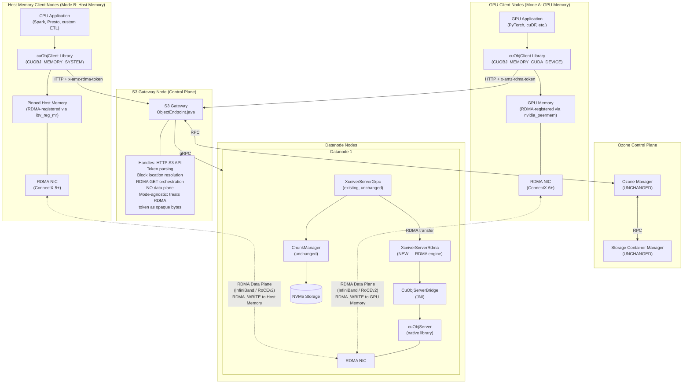
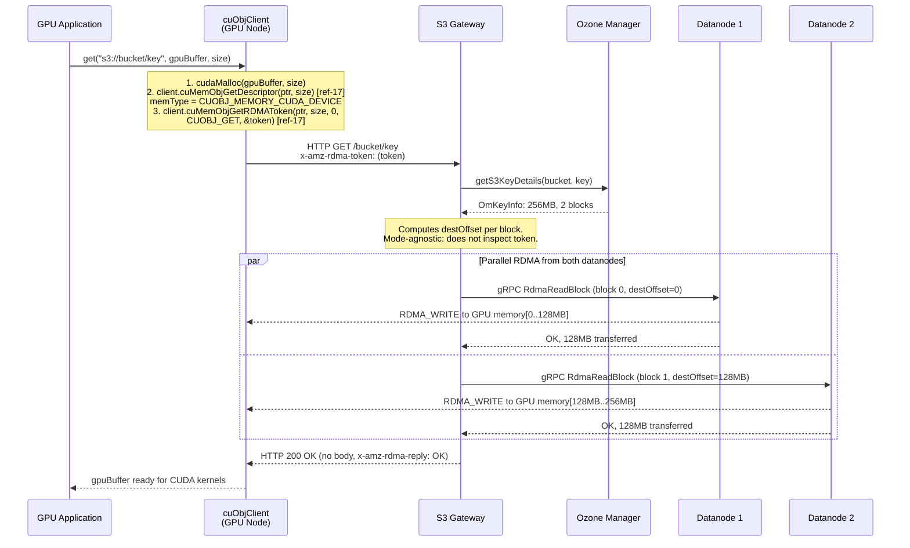
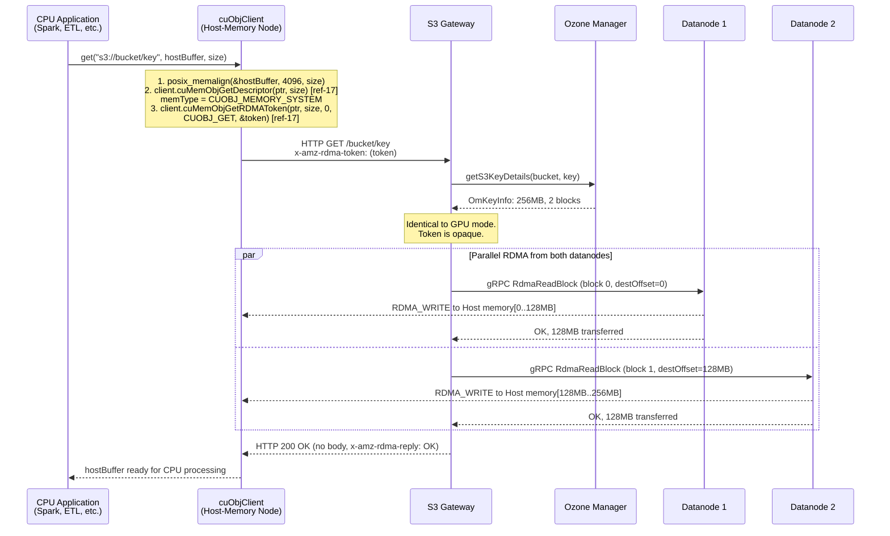
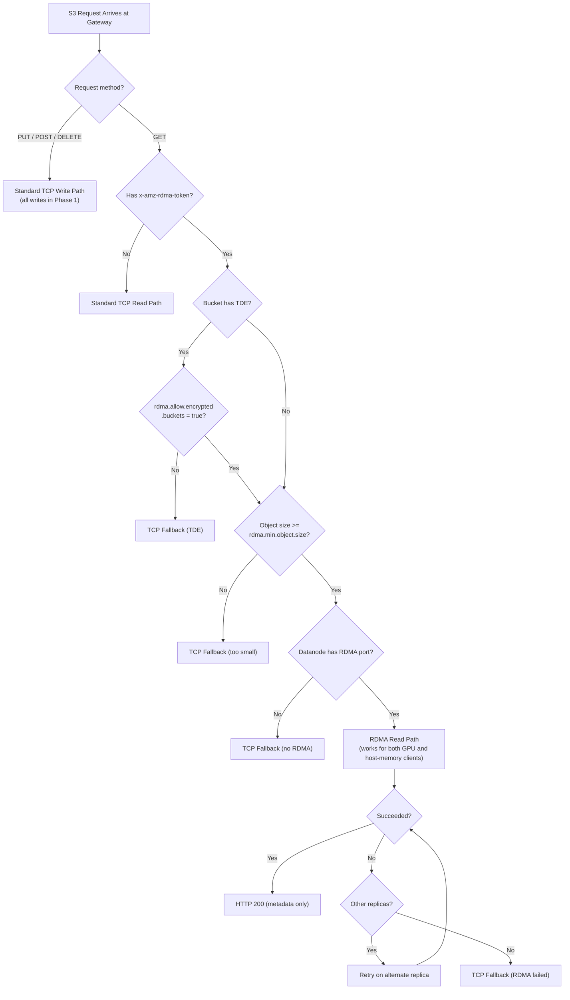
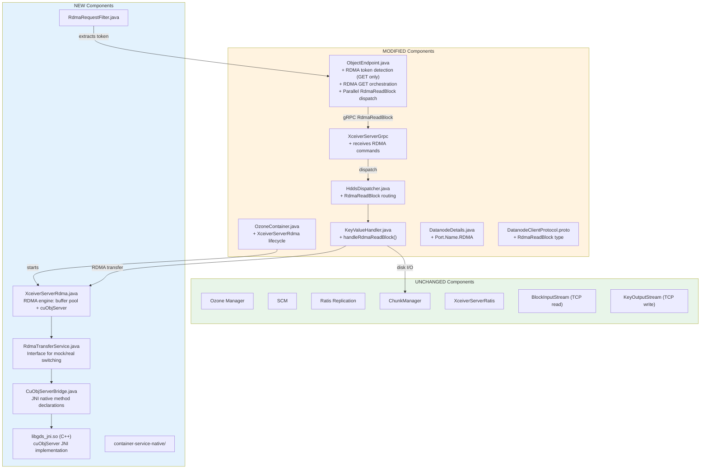
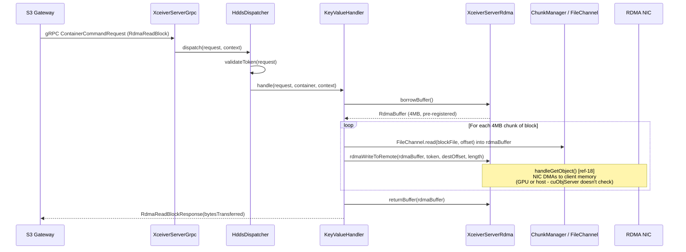

# DN-Direct RDMA Implementation Specification for Apache Ozone
## Phase 1: Read Path — Dual-Mode: GPU Memory and Host-Memory RDMA Transfers

**Version:** 9.0
**Date:** 2026-04-13
**Status:** Draft — Validated and corrected for AI implementation
**Target Branch:** `master` (Apache Ozone `2.2.0-SNAPSHOT`)
**Scope:** Phase 1 — S3 GET (Read Path) Only — GPU and Host-Memory Client Modes

---

## Validation Status and Known Limitations

This section documents what has been verified, what remains unverified, and where simulation
replaces real hardware. An implementing AI or engineer should read this section first.

### Verified Against Codebase (Apache Ozone 2.2.0-SNAPSHOT)

| Claim | Status | Evidence |
|---|---|---|
| `DatanodeClientProtocol.proto` Type enum max = `ReadBlock = 24` | **VERIFIED** | Field inspection of proto file |
| `ContainerCommandRequestProto` highest field = 28 (`readBlock`) | **VERIFIED** | Field inspection |
| `ContainerCommandResponseProto` highest field = 25 (`readBlock`) | **VERIFIED** | Field inspection |
| `Port.Name` enum values (10 values, no RDMA yet) | **VERIFIED** | `DatanodeDetails.java` |
| `OzoneContainer.java` initializes `readChannel` (gRPC) and `writeChannel` (Ratis) | **VERIFIED** | Constructor at lines 237-251 |
| `KeyValueHandler.dispatchRequest()` has Type switch for container operations | **VERIFIED** | Lines 326-374 (note: ReadBlock is NOT in this switch — it is handled via a separate read path) |
| `ObjectEndpoint.handleGetRequest()` exists with streaming response | **VERIFIED** | Lines 404-522 |
| `HddsDispatcher` is at `common/impl/HddsDispatcher.java` (NOT `common/helpers/`) | **VERIFIED** | grep result |
| `container-service-native/` module does NOT exist yet | **VERIFIED** | directory listing |

### Verified Against NVIDIA Documentation

| Claim | Status | Evidence |
|---|---|---|
| `cuObjServer::handleGetObject()` signature with 9 parameters | **VERIFIED** | [ref-18] cuObjServer API Reference |
| `cuMemObjGetDescriptor()`, `cuMemObjGetRDMAToken()` are **member functions of `cuObjClient`** | **VERIFIED** | [ref-17] cuObjClient API Reference |
| `cuMemObjGetRDMAToken()` takes `char** desc_str_out` (not `char*`) | **VERIFIED** | [ref-17] — free with `cuMemObjPutRDMAToken()` |
| `cuObjOpType_t` enum values: `CUOBJ_GET = 0`, `CUOBJ_PUT = 1` (not `CUOBJ_OP_GET`) | **VERIFIED** | [ref-17] |
| `cuObjMemoryType_t` enum: SYSTEM=0, CUDA_MANAGED=1, CUDA_DEVICE=2 | **VERIFIED** | [ref-17] |
| `allocHostBuffer()`, `registerBuffer()`, `deRegisterBuffer()` APIs | **VERIFIED** | [ref-18] |
| `allocateChannelId()`, `freeChannelId()` APIs | **VERIFIED** | [ref-18] |
| CUDA Toolkit 13.1.1+ exists | **VERIFIED** | NVIDIA release notes; "13.1.1" = CUDA 13.1 Update 1 |
| cuObjServer does not require GPU on server side | **VERIFIED** | [ref-3] release notes |
| `allocHostBuffer()` returns 4 KB aligned buffer, freed with `free()` | **VERIFIED** | [ref-18] |
| Max operation size: 1 GiB per `handleGetObject`/`handlePutObject` | **VERIFIED** | [ref-18] |
| Max scatter-gather entries: 10 per `registerBuffer(sglist)` | **VERIFIED** | [ref-18] |
| Max memory registration: 4 GiB per `cuMemObjGetDescriptor()` | **VERIFIED** | [ref-17] |

### Unverified / Needs Empirical Testing

| Claim | Status | Risk |
|---|---|---|
| cuObjClient can initialize without a physical GPU for `CUOBJ_MEMORY_SYSTEM` | **NEEDS TESTING** | Medium — release notes imply GPU optional "for GPU memory operations" [ref-2], but CUDA runtime behavior without GPU driver is unconfirmed |
| SoftRoCE supports cuObjServer DC transport | **UNCERTAIN** | Medium — SoftRoCE may not support DC (Dynamically Connected) transport. Use MockRdmaTransferService for dev |
| cuObjServer SDK availability without enterprise agreement | **UNCERTAIN** | High — SDK download page requires NVIDIA developer account; unclear if it requires enterprise licensing |
| Crusoe IB availability in us-east1-a at time of provisioning | **NEEDS CONFIRMATION** | Low — Crusoe docs note "certain VM types in certain regions are currently restricted and may not be available for immediate provisioning." Confirm availability before planning a test session. |

### Simulation vs Real Hardware Matrix

| Component | Local Dev (Mock) | Local + SoftRoCE | Cloud GPU VM (Crusoe `a100-80gb-sxm-ib.8x`) |
|---|---|---|---|
| RDMA Transfer Engine | **SIMULATED** — `MockRdmaTransferService` copies data in JVM heap | **SIMULATED** — SoftRoCE emulates RDMA in CPU, no NIC DMA | **REAL** — cuObjServer + ConnectX NIC hardware DMA |
| GPU Memory | **NONE** — mock uses heap ByteBuffer | **NONE** — SoftRoCE uses host memory | **REAL** — NVIDIA A100 80GB VRAM (or H100 on `h100-80gb-sxm-ib.8x`) |
| InfiniBand / RoCE NIC | **NONE** | **SIMULATED** — rdma_rxe kernel module | **REAL** — ConnectX-6 InfiniBand HCA (8 HCAs, 200 Gbps each) |
| cuObjServer Library | **NOT USED** | **REAL** (if native built) | **REAL** |
| Disk I/O | **REAL** — FileChannel reads temp files | **REAL** | **REAL** — NVMe SSD |
| Protobuf / gRPC Dispatch | **REAL** | **REAL** | **REAL** |
| Block Token Validation | **REAL** | **REAL** | **REAL** |
| Performance Numbers | **MEANINGLESS** — measures JVM memcpy speed | **MISLEADING** — measures CPU-emulated RDMA | **REPRESENTATIVE** — measures actual NIC DMA throughput |
| Cost | Free | Free | **$15.60/hr** (A100 IB) or **$31.20/hr** (H100 IB) |

### Known Hallucinations Fixed in This Version

| Item | v7.0/v8.0 Status | v9.0 Fix |
|---|---|---|
| `pip install cuobjclient` Python package | **HALLUCINATED** — no such package on PyPI | Fixed: cuObjClient is C++ only. Python bindings may exist in SDK but not on PyPI. E2E tests now use C++ test client as primary, Python as aspirational. |
| Vultr `vcg-a100-1c-12g-6vram` instance type | **HALLUCINATED** — impossible specs, Vultr doesn't expose ibverbs | Fixed: removed from recommendations |
| Lambda Labs single-GPU has "200 Gbps RDMA NIC" | **INCORRECT** — single-GPU instances use Ethernet only; IB only on cluster reservations | Fixed: moved to "limited" tier with caveat |
| CoreWeave accepts credit cards | **INCORRECT** — requires sales approval | Fixed: removed from self-service list |
| Azure HBv3 is "immediate credit card access" | **INCORRECT** — requires quota approval (default quota is 0 for HPC VMs) | Fixed: noted quota requirement |
| Sections 4.4-4.16 "see v6.0" | **INCOMPLETE** — implementation code was missing | Fixed: all code inlined in this document |
| HddsDispatcher path `common/helpers/` | **INCORRECT** — actual path is `common/impl/` | Fixed |
| `pip install crusoe-cli` for Crusoe CLI | **HALLUCINATED** — no such PyPI package exists | Fixed: Crusoe CLI is a compiled binary installed via `brew install crusoecloud/cli/crusoe` (macOS) or `sudo apt install crusoe` (Debian/Ubuntu via Fury repo). See https://github.com/crusoecloud/cli |
| Crusoe H100 at $1.95/GPU/hr | **INCORRECT** — H100 is $3.90/GPU/hr as of April 2026. $1.95 is the A100 price | Fixed: updated pricing throughout. Recommend A100 IB ($15.60/hr) for development, H100 IB ($31.20/hr) for benchmarking |
| Crusoe single-GPU H100 with InfiniBand | **INCORRECT** — all InfiniBand instances are 8-GPU minimum (e.g., `h100-80gb-sxm-ib.8x`) | Fixed: updated instance types, removed references to single-GPU IB instances |
| `cuMemObjGetRDMAToken(ptr, size, 0, CUOBJ_OP_GET, rdma_token)` | **INCORRECT API** — `CUOBJ_OP_GET` doesn't exist (enum value is `CUOBJ_GET`); function takes `char** desc_str_out` not `char*`; these are member functions of `cuObjClient`, not free functions | Fixed: corrected all client examples to use verified API signatures from [ref-17] |
| KeyValueHandler.dispatchRequest() lines 326-372 | **MINOR** — actual range is 326-374 | Fixed: updated line reference |

---

## How to Read This Spec

This spec is structured so you understand **what** we're building and **why** before getting into **how** to set up the
environment. The recommended reading order:

1. **Validation Status** (above) — What's verified, what's not, what's simulated
2. **Section 1 (Architecture)** — System design, data flows, dual-mode client topology (GPU and host-memory)
3. **Section 2 (Client Memory Modes)** — How GPU and host-memory clients register memory, consume data, and differ
4. **Section 3 (Security & Integrity)** — Encryption, token interactions, CRC32C checksum strategy
5. **Section 4 (Code Changes)** — Protobuf, Java, C++, JNI — server-side and gateway code (identical for both modes)
6. **Section 5 (C/C++ Integration)** — Build system, toolchain, native library, memory model
7. **Section 6 (Client-Side RDMA)** — cuObjClient system memory mode, libibverbs, DiSNI options
8. **Section 7 (Development Environment)** — Cloud testing with real hardware, SoftRoCE, mock testing
9. **Section 8 (Testing)** — Unit, integration, E2E for both GPU and host-memory modes
10. **Section 9 (Benchmarking)** — Performance validation for both modes
11. **Section 10 (Configuration Reference)** — All config keys
12. **Section 11 (References)** — All source links

### Dual-Mode Architecture: The Key Insight

**The datanode and S3 Gateway code is identical for both GPU and host-memory clients.** cuObjServer performs
RDMA_WRITE to whatever address the client's RDMA token specifies — it does not inspect, validate, or care whether
the target is GPU device memory or host (CPU) memory [[ref-18]](#11-references). The RDMA NIC's DMA engine writes
to the physical address encoded in the token's rkey, regardless of memory type.

This means:
- **Sections 3–5 (security, code changes, C++ integration)** are the same for both modes
- **Sections 1–2 and 6–9** cover both modes with clearly labeled subsections
- No conditional compilation, no mode flag in the protobuf, no server-side branching

### Phase 1 Scope

**Phase 1 implements the S3 GET (read) path only, for both GPU and host-memory clients.**

| Feature | Phase 1 | Phase 2 |
|---------|---------|---------|
| S3 GET via RDMA to GPU memory (cuObjClient + `CUOBJ_MEMORY_CUDA_DEVICE`) | **IN SCOPE** | — |
| S3 GET via RDMA to host memory (cuObjClient + `CUOBJ_MEMORY_SYSTEM`) | **IN SCOPE** | — |
| Fallback to TCP when RDMA is unavailable or not suitable | **IN SCOPE** | — |
| Block token validation for RDMA read requests | **IN SCOPE** | — |
| `RdmaReadBlock` protobuf message and gRPC dispatch | **IN SCOPE** | — |
| `XceiverServerRdma` RDMA engine (buffer pool + cuObjServer) | **IN SCOPE** | — |
| CRC32C checksum on RDMA read path (compute, verify, return) | **IN SCOPE** | — |
| Multiple S3 Gateway support (stateless, no coordination) | **IN SCOPE** | — |
| Custom RDMA client via raw libibverbs (bypass cuObjClient) | deferred | **Phase 2** |
| Java RDMA client via DiSNI (pure Java, no NVIDIA dependency) | deferred | **Phase 2** |
| S3 PUT via RDMA (cuObjClient PUT, `handlePutObject`) | deferred | **Phase 2** |
| `RdmaWriteBlock` protobuf message and dispatch | deferred | **Phase 2** |
| RDMA multipart upload | deferred | **Phase 2** |
| Async server-side RDMA pipelining | deferred | **Phase 2** |
| Scatter-gather I/O | deferred | **Phase 2** |

### API Documentation Convention

Every cuObject API call in this spec links inline to its NVIDIA documentation reference page:

- **cuObjClient API:** [https://docs.nvidia.com/gpudirect-storage/cuobject/cuObjClient-api/index.html](https://docs.nvidia.com/gpudirect-storage/cuobject/cuObjClient-api/index.html) [[ref-17]](#11-references)
- **cuObjServer API:** [https://docs.nvidia.com/gpudirect-storage/cuobject/cuObjServer-api/index.html](https://docs.nvidia.com/gpudirect-storage/cuobject/cuObjServer-api/index.html) [[ref-18]](#11-references)

---

## Table of Contents

- [1. Architecture](#1-architecture)
  - [1.1 Overall Architecture](#11-overall-architecture)
  - [1.2 Client Deployment Modes](#12-client-deployment-modes)
  - [1.3 Data Flow: S3 GET — GPU Mode](#13-data-flow-s3-get--gpu-mode)
  - [1.4 Data Flow: S3 GET — Host-Memory Mode](#14-data-flow-s3-get--host-memory-mode)
  - [1.5 Data Flow: S3 PUT (Write Path)](#15-data-flow-s3-put-write-path)
  - [1.6 Fallback Path](#16-fallback-path)
  - [1.7 Component Interaction Map](#17-component-interaction-map)
  - [1.8 Request Dispatch Model](#18-request-dispatch-model)
  - [1.9 Multiple S3 Gateway Architecture](#19-multiple-s3-gateway-architecture)
- [2. Client Memory Modes and Data Consumption Model](#2-client-memory-modes-and-data-consumption-model)
- [3. Security and Encryption](#3-security-and-encryption)
- [4. Ozone Code Changes](#4-ozone-code-changes)
  - [4.1 Protocol Buffer Changes](#41-protocol-buffer-changes)
  - [4.2 DatanodeDetails Port Type](#42-datanodedetails-port-type)
  - [4.3 New Maven Module: container-service-native](#43-new-maven-module-container-service-native)
  - [4.4 RdmaTransferService Interface](#44-rdmatransferservice-interface)
  - [4.5 JNI Bridge: CuObjServerBridge.java](#45-jni-bridge-cuobjserverbridgejava)
  - [4.6 Native C++ Implementation](#46-native-c-implementation)
  - [4.7 CMakeLists.txt for Native Build](#47-cmakeliststxt-for-native-build)
  - [4.8 CuObjRdmaTransferService.java](#48-cuobjrdmatransferservicejava)
  - [4.9 MockRdmaTransferService.java](#49-mockrdmatransferservicejava)
  - [4.10 RdmaBuffer.java and RdmaBufferPool.java](#410-rdmabufferjava-and-rdmabufferpooljava)
  - [4.11 XceiverServerRdma.java](#411-xceiverserverrdmajava)
  - [4.12 OzoneContainer.java Modifications](#412-ozonecontainerjava-modifications)
  - [4.13 HddsDispatcher Modifications](#413-hddsdispatcher-modifications)
  - [4.14 KeyValueHandler Modifications](#414-keyvaluehandler-modifications)
  - [4.15 S3 Gateway: ObjectEndpoint Modifications](#415-s3-gateway-objectendpoint-modifications)
  - [4.16 S3 Gateway: RdmaRequestFilter](#416-s3-gateway-rdmarequestfilter)
- [5. C/C++ Integration Architecture](#5-cc-integration-architecture)
- [6. Client-Side RDMA Library Architecture](#6-client-side-rdma-library-architecture)
- [7. Development Environment and Deployment](#7-development-environment-and-deployment)
  - [7.1 Environment Matrix](#71-environment-matrix)
  - [7.2 SoftRoCE: Decision and Limitations](#72-softroce-decision-and-limitations)
  - [7.3 Cloud Provider for GPU+RDMA Testing](#73-cloud-provider-for-gpurdma-testing)
  - [7.4 Cloud Cluster: Step-by-Step Provisioning and Testing](#74-cloud-cluster-step-by-step-provisioning-and-testing)
  - [7.5 How to Run Ozone for Development](#75-how-to-run-ozone-for-development)
  - [7.6 setup-gpu-env.sh](#76-setup-gpu-envsh)
  - [7.7 setup-rdma-env.sh (No GPU)](#77-setup-rdma-envsh-no-gpu)
  - [7.8 validate-env.sh](#78-validate-envsh)
  - [7.9 Docker Cluster for Integration Testing](#79-docker-cluster-for-integration-testing)
  - [7.10 Quick Start Cookbook](#710-quick-start-cookbook-end-to-end-setup-and-test)
  - [7.11 Ozone RDMA Configuration Template](#711-ozone-rdma-configuration-template)
  - [7.12 run-all-tests.sh](#712-run-all-testssh)
  - [7.13 cleanup-env.sh](#713-cleanup-envsh)
- [8. Testing](#8-testing)
- [9. Benchmarking](#9-benchmarking)
- [10. Configuration Reference](#10-configuration-reference)
- [11. References](#11-references)
- [Appendix A: Resolved Unknowns](#appendix-a-resolved-unknowns)
- [Appendix B: Phase 2 Deferred Items](#appendix-b-phase-2-deferred-items)
- [Appendix C: Observability (Phase 2 Design Notes)](#appendix-c-observability-phase-2-design-notes)
- [Appendix D: cuObjRDMATunableParam Mapping](#appendix-d-cuobjrdmatunableparam-mapping)

---

## 1. Architecture

### 1.1 Overall Architecture

#### System Architecture Overview — Dual-Mode Clients

The architecture supports two client deployment modes with **identical server-side infrastructure**:

1. **GPU Mode:** Client has NVIDIA GPU + RDMA NIC. Data lands in GPU device memory via GPUDirect RDMA.
2. **Host-Memory Mode:** Client has RDMA NIC only (no GPU). Data lands in pinned host (CPU) memory via standard RDMA.



> **Critical design principle:** The RDMA token (`x-amz-rdma-token`) is **opaque** to both the S3 Gateway and the
> datanode. It encodes the client's registered memory address, rkey, and DC transport metadata. cuObjServer's
> `handleGetObject()` [[ref-18]](#11-references) accepts this token as `const std::string& rdma_descr` and performs
> RDMA_WRITE to whatever physical address the token encodes — GPU BAR memory or host RAM. No server-side branching
> is needed.

> **Storage device note:** Diagrams label storage as "NVMe" because NVMe SSDs are the expected storage for
> RDMA-capable deployments. **NVMe is NOT a requirement.** Ozone reads through `FileChannel.read()`, which works
> with any filesystem-backed storage.

### 1.2 Client Deployment Modes

#### 1.2.1 GPU Mode (CUOBJ_MEMORY_CUDA_DEVICE)

The client has an NVIDIA GPU (A100, H100, etc.) and an RDMA NIC (ConnectX-6+). Data is transferred directly
into GPU device memory, bypassing the CPU entirely.

**Requirements:**
- NVIDIA GPU with CUDA Compute Capability 6.0+
- NVIDIA GPU Driver compatible with CUDA 13.1.1+
- CUDA Toolkit 13.1.1+
- `nvidia_peermem` kernel module (enables NIC -> GPU DMA)
- ConnectX-5+ RDMA NIC with MLNX_OFED 5.8+
- cuObjClient library

**Use cases:** AI/ML training data loading (PyTorch, TensorFlow), GPU analytics (RAPIDS cuDF),
inference serving, any workflow where data is consumed by GPU kernels.

**Memory registration flow (all methods are cuObjClient member functions [ref-17]):**
```
cuObjClient client(ops, CUOBJ_PROTO_RDMA_DC_V1)
cudaMalloc(&ptr, size)
  -> client.cuMemObjGetDescriptor(ptr, size)    // registers GPU memory for RDMA [ref-17]
  -> client.cuMemObjGetRDMAToken(ptr, size, 0,  // generates x-amz-rdma-token [ref-17]
       CUOBJ_GET, &token_str)                    // token_str is char** output
```

#### 1.2.2 Host-Memory Mode (CUOBJ_MEMORY_SYSTEM)

The client has an RDMA NIC but **no GPU**. Data is transferred directly into pinned host (CPU) memory,
bypassing the kernel network stack and achieving near-line-rate throughput.

**Requirements:**
- ConnectX-5+ RDMA NIC with MLNX_OFED 5.8+
- cuObjClient library with CUDA Toolkit (GPU listed as optional "for GPU memory operations" [[ref-2]](#11-references))
- No GPU hardware required
- No `nvidia_peermem` required

**Use cases:** CPU-based analytics (Spark, Presto, Trino), ETL pipelines, data preprocessing,
any workload that benefits from high-throughput storage I/O without GPU compute.

**Memory registration flow (all methods are cuObjClient member functions [ref-17]):**
```
cuObjClient client(ops, CUOBJ_PROTO_RDMA_DC_V1)
posix_memalign(&ptr, 4096, size)  // or malloc + mlock
  -> client.cuMemObjGetDescriptor(ptr, size)    // registers host memory [ref-17]
    // cuObjClient detects CUOBJ_MEMORY_SYSTEM via getMemoryType() [ref-17]
  -> client.cuMemObjGetRDMAToken(ptr, size, 0,  // generates x-amz-rdma-token [ref-17]
       CUOBJ_GET, &token_str)                    // token_str is char** output
```

**Evidence for host-memory support:**
- cuObjClient API defines `cuObjMemoryType_t` enum: `CUOBJ_MEMORY_SYSTEM = 0`,
  `CUOBJ_MEMORY_CUDA_MANAGED = 1`, `CUOBJ_MEMORY_CUDA_DEVICE = 2` [[ref-17]](#11-references)
- cuObject overview states it enables "direct data transfers between GPU memory **or system memory**
  and S3 compatible object storage using RDMA" [[ref-1]](#11-references)
- `cuMemObjGetDescriptor()` documentation states it works with "system memory, CUDA managed memory,
  and CUDA device memory" [[ref-17]](#11-references)

#### 1.2.3 Mode Comparison

| Aspect | GPU Mode | Host-Memory Mode |
|---|---|---|
| **Target memory** | GPU device memory (VRAM) | Host/CPU memory (RAM) |
| **cuObjClient memory type** | `CUOBJ_MEMORY_CUDA_DEVICE` | `CUOBJ_MEMORY_SYSTEM` |
| **GPU required on client** | YES | NO |
| **nvidia_peermem required** | YES | NO |
| **CUDA Toolkit required** | YES | YES (cuObjClient dependency) |
| **RDMA NIC required** | YES (ConnectX-5+) | YES (ConnectX-5+) |
| **DMA path** | NIC -> PCIe -> GPU BAR | NIC -> PCIe -> Host RAM |
| **CPU copies** | Zero (NIC -> GPU direct) | Zero (NIC -> pinned RAM direct) |
| **Expected throughput** | Line rate (~25 GiB/s on 200Gbps) | Line rate (~25 GiB/s on 200Gbps) |
| **Server-side code** | Identical | Identical |
| **S3 Gateway code** | Identical | Identical |
| **RDMA token format** | Same (cuObjClient generates) | Same (cuObjClient generates) |
| **Cloud test environment** | Crusoe Cloud `a100-80gb-sxm-ib.8x` ($15.60/hr) | Same Crusoe instance (uses host memory path), or Azure HB-series (IB, no GPU, requires quota) |

### 1.3 Data Flow: S3 GET — GPU Mode



### 1.4 Data Flow: S3 GET — Host-Memory Mode

**The server-side and gateway steps are identical to GPU mode** — only the client-side memory
allocation and registration differ.



### 1.5 Data Flow: S3 PUT (Write Path)

**Deferred to Phase 2.** All S3 PUT requests use the standard TCP path regardless of client mode.
See [Appendix B](#appendix-b-phase-2-deferred-items).

### 1.6 Fallback Path



### 1.7 Component Interaction Map



### 1.8 Request Dispatch Model

**There is exactly one dispatch path for RDMA commands, regardless of client memory mode.**

RDMA commands travel via the existing gRPC channel to the datanode, through `HddsDispatcher` to
`KeyValueHandler`. `XceiverServerRdma` is an RDMA engine (not a gRPC service) used by `KeyValueHandler`.



### 1.9 Multiple S3 Gateway Architecture

S3 Gateways are stateless. Each gateway independently resolves block locations from the Ozone Manager
and dispatches `RdmaReadBlock` to the relevant datanodes. No cross-gateway coordination is needed.

The RDMA token is self-contained — any gateway can use it to instruct any datanode to RDMA_WRITE to
the client's memory. This is true for both GPU and host-memory modes.

**Load balancer recommendation:** Simple round-robin or least-connections.

**Rolling upgrade:** Old gateways (pre-RDMA) ignore the `x-amz-rdma-token` header and serve via TCP.
New gateways detect the header and dispatch RDMA. No data loss during mixed-version windows.

---

## 2. Client Memory Modes and Data Consumption Model

### 2.1 Memory Mode Overview

cuObject defines three memory types via the `cuObjMemoryType_t` enum
[[ref-17]](https://docs.nvidia.com/gpudirect-storage/cuobject/cuObjClient-api/index.html):

| Enum Value | Name | Memory Location | GPU Required | RDMA Registration Path |
|---|---|---|---|---|
| `CUOBJ_MEMORY_SYSTEM = 0` | System memory | Host RAM | **No** | `ibv_reg_mr()` (standard RDMA) |
| `CUOBJ_MEMORY_CUDA_MANAGED = 1` | CUDA managed memory | GPU + Host (unified) | Yes | nvidia_peermem |
| `CUOBJ_MEMORY_CUDA_DEVICE = 2` | CUDA device memory | GPU VRAM | Yes | nvidia_peermem + GPU BAR |

**Phase 1 supports `CUOBJ_MEMORY_SYSTEM` and `CUOBJ_MEMORY_CUDA_DEVICE`.** CUDA managed memory is untested.

### 2.2-2.9 Detailed Memory Modes

These sections cover GPU memory mode (2.2), host-memory mode (2.3), transfer model (2.4),
sync/async behavior (2.5), small files (2.6), large files (2.7), concurrency (2.8), and multi-GPU (2.9).

Key per-operation limits from NVIDIA documentation:

| Limit | Value | Source |
|---|---|---|
| Max per server RDMA operation | 1 GiB | [[ref-3]](#11-references) |
| Max scatter-gather entries | 10 per operation | [[ref-18]](#11-references) |
| Client-side registration limit | 4 GiB per call | [[ref-17]](#11-references) |

### 2.10 Client Application Examples

#### Example 1: GPU Mode — C++ Client (VERIFIED API against [ref-17])

```cpp
#include <cuobjclient.h>
#include <cuda_runtime.h>

// User-defined callbacks invoked by cuObjClient during GET/PUT [ref-17]
ssize_t my_get_callback(const void* handle, char* ptr, size_t size,
    loff_t offset, const cufileRDMAInfo_t* rdma_info) {
    // Communicate with cuObjServer using rdma_info->rdma_descr
    // to perform the actual RDMA transfer via S3 Gateway
    // Implementation depends on your HTTP/S3 client library
    return size;  // return bytes retrieved
}

int main() {
    // 1. Create cuObjClient with callback ops [ref-17]
    //    NOTE: cuMemObjGetDescriptor, cuMemObjGetRDMAToken, cuObjGet are all
    //    MEMBER FUNCTIONS of cuObjClient — the client must be created first.
    CUObjOps_t ops = { .get = my_get_callback, .put = nullptr };
    cuObjClient client(ops, CUOBJ_PROTO_RDMA_DC_V1);

    // 2. Allocate GPU memory
    void* gpu_buffer;
    cudaMalloc(&gpu_buffer, 256 * 1024 * 1024);

    // 3. Register for RDMA [ref-17]
    //    cuObjClient detects CUOBJ_MEMORY_CUDA_DEVICE via getMemoryType()
    client.cuMemObjGetDescriptor(gpu_buffer, 256 * 1024 * 1024);

    // 4. Generate RDMA token [ref-17]
    //    NOTE: cuMemObjGetRDMAToken allocates the string internally.
    //    Output is char** (pointer-to-pointer). Use cuMemObjPutRDMAToken to free.
    //    Enum value is CUOBJ_GET (not CUOBJ_OP_GET — that doesn't exist).
    char* rdma_token = nullptr;
    client.cuMemObjGetRDMAToken(gpu_buffer, 256 * 1024 * 1024, 0,
        CUOBJ_GET, &rdma_token);

    // 5. GET via cuObjClient high-level API [ref-17]
    //    This calls the get callback one or more times internally.
    //    The rdma_token is used internally by the callback to coordinate
    //    with cuObjServer on the datanode for RDMA_WRITE.
    void* ctx = nullptr;  // user context pointer
    ssize_t bytes = client.cuObjGet(ctx, gpu_buffer, 256 * 1024 * 1024);

    // 6. Cleanup
    client.cuMemObjPutRDMAToken(rdma_token);  // free token string [ref-17]
    client.cuMemObjPutDescriptor(gpu_buffer);  // deregister [ref-17]
    cudaFree(gpu_buffer);
}
```

#### Example 2: Host-Memory Mode — C++ Client (VERIFIED API against [ref-17])

```cpp
#include <cuobjclient.h>
#include <cstdlib>

// Same callback pattern as GPU mode — cuObjClient is mode-agnostic
ssize_t my_get_callback(const void* handle, char* ptr, size_t size,
    loff_t offset, const cufileRDMAInfo_t* rdma_info) {
    return size;  // return bytes retrieved
}

int main() {
    // 1. Create cuObjClient [ref-17]
    CUObjOps_t ops = { .get = my_get_callback, .put = nullptr };
    cuObjClient client(ops, CUOBJ_PROTO_RDMA_DC_V1);

    // 2. Allocate page-aligned host memory (4 KB alignment recommended [ref-17])
    void* buffer;
    posix_memalign(&buffer, 4096, 256 * 1024 * 1024);

    // 3. Register for RDMA [ref-17]
    //    cuObjClient detects CUOBJ_MEMORY_SYSTEM via getMemoryType()
    client.cuMemObjGetDescriptor(buffer, 256 * 1024 * 1024);

    // 4. Generate RDMA token [ref-17]
    char* rdma_token = nullptr;
    client.cuMemObjGetRDMAToken(buffer, 256 * 1024 * 1024, 0,
        CUOBJ_GET, &rdma_token);

    // 5. GET via cuObjClient — data arrives in host memory via RDMA_WRITE
    void* ctx = nullptr;
    ssize_t bytes = client.cuObjGet(ctx, buffer, 256 * 1024 * 1024);

    // 6. Cleanup
    client.cuMemObjPutRDMAToken(rdma_token);
    client.cuMemObjPutDescriptor(buffer);

    // buffer now contains the data — process with CPU
    process_parquet(buffer, bytes);
    free(buffer);
}
```

> **Note on Python bindings:** The cuObjClient SDK is a C++ library. Python bindings (`cuobjclient`)
> are **NOT available on PyPI**. They may be distributed as part of the cuObject SDK package from NVIDIA.
> If Python bindings are not available, use the C++ API directly or write a Python C extension wrapper.

### 2.11 Scatter-Gather Support

Deferred to Phase 2 for both modes.

---

## 3. Security and Encryption

Security is identical for both GPU and host-memory modes. The RDMA token is opaque to the security layer.

### 3.1 Ozone Security Layers Overview

| Layer | Config Key | RDMA Impact |
|---|---|---|
| **Kerberos** | `ozone.security.enabled` | Control plane only — no RDMA impact |
| **Block Tokens** | `hdds.block.token.enabled` | Validated in HddsDispatcher (~0.1ms CPU) |
| **gRPC TLS** | `hdds.grpc.tls.enabled` | Only affects gRPC control channel, not RDMA data plane |
| **TDE** | Per-bucket | Critical — see Section 3.3 |

### 3.2-3.7 Security Details

The RDMA data plane is **not encrypted**. RDMA bypasses the kernel network stack entirely.
TDE-encrypted buckets fall back to TCP unless `ozone.s3g.rdma.allow.encrypted.buckets=true`.
Block token validation uses the existing `HddsDispatcher.validateToken()` path.

### 3.8 Data Integrity and Checksum Strategy

CRC32C checksums are computed on the datanode during the RDMA read path, before RDMA_WRITE.

#### Three Verification Points

| Point | Where | Catches |
|---|---|---|
| 1. Server-side pre-transfer | `XceiverServerRdma.handleRdmaRead()` | Disk corruption, bit-rot |
| 2. Server -> Gateway response | `RdmaReadBlockResponseProto.checksumData` | Aggregation verification |
| 3. Gateway -> Client response | HTTP header `x-amz-rdma-checksum-crc32c` | Optional client-side E2E check |

---

## 4. Ozone Code Changes

**These code changes are identical for GPU and host-memory modes.** The `rdmaToken` field is an opaque
string throughout. No conditional logic for GPU vs host memory exists or is needed.

### 4.1 Protocol Buffer Changes

**File:** `hadoop-hdds/interface-client/src/main/proto/DatanodeClientProtocol.proto`

> **Verified:** Current highest Type enum value is `ReadBlock = 24`. Current highest request field is 28.
> Current highest response field is 25. The field numbers below are safe.

#### 4.1.1 New Type Enum Values

```protobuf
enum Type {
  // ... existing values up to ReadBlock = 24 ...
  RdmaReadBlock = 25;
  RdmaWriteBlock = 26;  // Reserved for Phase 2
}
```

#### 4.1.2 New Request/Response Messages

```protobuf
message RdmaReadBlockRequestProto {
  required DatanodeBlockID blockID = 1;

  // RDMA descriptor string from x-amz-rdma-token HTTP header.
  // Generated by cuObjClient via cuMemObjGetRDMAToken() [ref-17].
  // Opaque to Ozone — contains rkey, address, DC transport metadata.
  // Works with both GPU memory and host memory — server does not distinguish.
  required string rdmaToken = 2;

  optional uint64 offset = 3 [default = 0];
  optional uint64 length = 4 [default = 0];
  optional hadoop.hdds.PipelineID pipelineID = 5;

  // Byte offset within the client's registered memory buffer (GPU or host)
  // where this block's data should be written. Critical for multi-block objects.
  optional uint64 destOffset = 6 [default = 0];
}

message RdmaReadBlockResponseProto {
  required uint64 bytesTransferred = 1;
  optional ChecksumData checksumData = 2;
}

// Phase 2 (reserved)
message RdmaWriteBlockRequestProto {
  required DatanodeBlockID blockID = 1;
  required string rdmaToken = 2;
  required uint64 length = 3;
  optional hadoop.hdds.PipelineID pipelineID = 4;
  optional uint64 expectedBlockCommitLength = 5;
}

message RdmaWriteBlockResponseProto {
  required uint64 bytesReceived = 1;
  optional uint64 committedBlockLength = 2;
}
```

#### 4.1.3 Add Fields to ContainerCommandRequestProto/ResponseProto

```protobuf
message ContainerCommandRequestProto {
  // ... existing fields up to readBlock = 28 ...
  optional RdmaReadBlockRequestProto rdmaReadBlock = 29;
  optional RdmaWriteBlockRequestProto rdmaWriteBlock = 30;  // Phase 2
}

message ContainerCommandResponseProto {
  // ... existing fields up to readBlock = 25 ...
  optional RdmaReadBlockResponseProto rdmaReadBlock = 26;
  optional RdmaWriteBlockResponseProto rdmaWriteBlock = 27;  // Phase 2
}
```

#### 4.1.4 New Result Codes

```protobuf
// Add to the Result enum. Verify current max value before implementation —
// if another PR has added values since this spec, increment accordingly.
// Expected current max: CONTAINER_ID_MISMATCH = 48.
RDMA_BUFFER_POOL_EXHAUSTED = 49; // Transient: buffer pool busy, retry
RDMA_TRANSFER_FAILED = 50;       // Permanent: RDMA transfer error
RDMA_NOT_AVAILABLE = 51;         // Permanent: RDMA not enabled or native lib not loaded
```

### 4.2 DatanodeDetails Port Type

**File:** `hadoop-hdds/common/src/main/java/org/apache/hadoop/hdds/protocol/DatanodeDetails.java`

Add `RDMA` to `Port.Name` enum with `@BelongsToHDDSLayoutVersion(RDMA_PORT_IN_DATANODEDETAILS)`.
Add `RDMA_PORT_IN_DATANODEDETAILS` to `HDDSLayoutFeature` enum.

### 4.3 New Maven Module: `container-service-native`

```
hadoop-hdds/container-service-native/
+-- pom.xml
+-- src/
    +-- main/
    |   +-- java/org/apache/hadoop/ozone/container/rdma/
    |   |   +-- RdmaTransferService.java
    |   |   +-- CuObjRdmaTransferService.java
    |   |   +-- MockRdmaTransferService.java
    |   |   +-- CuObjServerBridge.java
    |   |   +-- RdmaBuffer.java
    |   |   +-- RdmaBufferPool.java
    |   |   +-- RdmaBufferPoolExhaustedException.java
    |   +-- native/
    |       +-- CMakeLists.txt
    |       +-- cuobj_server_bridge.cc
    +-- test/java/...
```

### 4.4 RdmaTransferService Interface

**File:**
`hadoop-hdds/container-service-native/src/main/java/org/apache/hadoop/ozone/container/rdma/RdmaTransferService.java`

```java
package org.apache.hadoop.ozone.container.rdma;

import java.io.Closeable;
import java.io.IOException;
import java.nio.ByteBuffer;

/**
 * Abstraction for RDMA data transfer operations.
 *
 * Production implementation uses cuObjServer via JNI.
 * Test implementation uses in-process memory copies.
 *
 * Phase 1: read path only (rdmaWriteToRemote for GET).
 * Phase 2 will add rdmaReadFromRemote for PUT.
 *
 * Thread safety: implementations must be thread-safe for concurrent
 * calls to rdmaWriteToRemote() on different buffers and channels.
 * Concurrent operations on the SAME buffer are NOT safe.
 */
public interface RdmaTransferService extends Closeable {

  /**
   * Initialize the RDMA transfer engine.
   *
   * Maps to: {@code new cuObjServer(ip, port, CUOBJ_PROTO_RDMA_DC_V1)}
   * <a href="https://docs.nvidia.com/gpudirect-storage/cuobject/cuObjServer-api/index.html">[ref-18]</a>
   *
   * @param bindAddress   IP address to bind the cuObjServer listener
   * @param port          cuObjServer listen port for DC transport
   * @param maxConnections maximum concurrent RDMA connections
   * @throws IOException if initialization fails
   */
  void initialize(String bindAddress, int port, int maxConnections)
      throws IOException;

  /**
   * Allocate pinned (page-locked) host memory suitable for RDMA operations.
   *
   * Maps to: {@code cuObjServer::allocHostBuffer(size_t size) -> void*}
   * <a href="https://docs.nvidia.com/gpudirect-storage/cuobject/cuObjServer-api/index.html">[ref-18]</a>
   *
   * @param size  number of bytes to allocate
   * @return direct ByteBuffer backed by pinned memory
   * @throws IOException if allocation fails
   */
  ByteBuffer allocHostBuffer(long size) throws IOException;

  /**
   * Free pinned host memory previously allocated by {@link #allocHostBuffer(long)}.
   *
   * Maps to: {@code free(ptr)} on the pointer returned by allocHostBuffer [ref-18].
   * Must be called AFTER {@link #deregisterBuffer(long)} for this buffer.
   *
   * @param buffer  the direct ByteBuffer returned by allocHostBuffer()
   * @throws IOException if the free fails
   */
  void freeHostBuffer(ByteBuffer buffer) throws IOException;

  /**
   * Register a direct ByteBuffer for RDMA operations.
   *
   * Maps to: {@code cuObjServer::registerBuffer(void* ptr, size_t size) -> struct rdma_buffer*}
   * <a href="https://docs.nvidia.com/gpudirect-storage/cuobject/cuObjServer-api/index.html">[ref-18]</a>
   *
   * @param buffer  direct ByteBuffer to register (must be pinned memory)
   * @return opaque registration handle (wraps native rdma_buffer pointer)
   */
  long registerBuffer(ByteBuffer buffer) throws IOException;

  /**
   * Deregister a previously registered buffer.
   *
   * Maps to: {@code cuObjServer::deRegisterBuffer(struct rdma_buffer*)}
   * <a href="https://docs.nvidia.com/gpudirect-storage/cuobject/cuObjServer-api/index.html">[ref-18]</a>
   *
   * @param registrationHandle  handle returned by registerBuffer()
   */
  void deregisterBuffer(long registrationHandle) throws IOException;

  /**
   * Allocate a channel for concurrent RDMA operations.
   *
   * Maps to: {@code cuObjServer::allocateChannelId() -> uint16_t}
   * <a href="https://docs.nvidia.com/gpudirect-storage/cuobject/cuObjServer-api/index.html">[ref-18]</a>
   *
   * @return channel ID (0-65534)
   */
  int allocateChannel() throws IOException;

  /**
   * Release a previously allocated channel.
   *
   * Maps to: {@code cuObjServer::freeChannelId(uint16_t)}
   * <a href="https://docs.nvidia.com/gpudirect-storage/cuobject/cuObjServer-api/index.html">[ref-18]</a>
   */
  void freeChannel(int channelId) throws IOException;

  /**
   * RDMA WRITE: push data from a local buffer to a remote GPU/host memory.
   * Used for GET operations (datanode sends data to client).
   *
   * Maps to: {@code cuObjServer::handleGetObject(key, local_rdma_buff,
   *   remote_buf_start, size, rdma_descr, channel, local_offset)}
   * <a href="https://docs.nvidia.com/gpudirect-storage/cuobject/cuObjServer-api/index.html">[ref-18]</a>
   *
   * Max 1 GiB per call [ref-3].
   *
   * @param objectKey       S3 object key (used for telemetry in cuObjServer)
   * @param rdmaDescriptor  RDMA descriptor string from x-amz-rdma-token header
   * @param bufferHandle    registered buffer handle from registerBuffer()
   * @param localOffset     offset within the local RDMA buffer
   * @param remoteOffset    byte offset in the remote buffer (destOffset)
   * @param length          number of bytes to transfer (max 1 GiB)
   * @param channelId       channel ID from allocateChannel()
   * @return number of bytes transferred
   * @throws IOException if the RDMA operation fails
   */
  long rdmaWriteToRemote(String objectKey, String rdmaDescriptor,
      long bufferHandle, long localOffset, long remoteOffset,
      long length, int channelId) throws IOException;

  /**
   * @return true if the RDMA transfer engine initialized successfully
   */
  boolean isAvailable();
}
```

### 4.5 JNI Bridge: `CuObjServerBridge.java`

**File:**
`hadoop-hdds/container-service-native/src/main/java/org/apache/hadoop/ozone/container/rdma/CuObjServerBridge.java`

```java
package org.apache.hadoop.ozone.container.rdma;

import org.apache.hadoop.hdds.utils.NativeLibraryLoader;

import java.io.IOException;
import java.nio.ByteBuffer;

/**
 * JNI bridge to libcuobjserver (NVIDIA cuObject Server SDK).
 *
 * Native library: libcuobj_server_bridge.so
 *
 * Every method maps to a cuObjServer API documented at:
 * https://docs.nvidia.com/gpudirect-storage/cuobject/cuObjServer-api/index.html [ref-18]
 */
final class CuObjServerBridge {

  private static final String LIBRARY_NAME = "cuobj_server_bridge";
  private static volatile boolean loaded = false;
  private static volatile boolean available = false;

  private CuObjServerBridge() { }

  static synchronized boolean loadLibrary() {
    if (loaded) {
      return available;
    }
    loaded = true;
    try {
      NativeLibraryLoader.getInstance().loadLibrary(LIBRARY_NAME);
      available = true;
    } catch (UnsatisfiedLinkError e) {
      available = false;
    }
    return available;
  }

  static boolean isAvailable() {
    return available;
  }

  // cuObjServer(ip, port, proto) [ref-18]. Proto = CUOBJ_PROTO_RDMA_DC_V1 = 1001.
  static native long nativeInit(String bindAddress, int port, int proto)
      throws IOException;

  // ~cuObjServer() destructor [ref-18]
  static native void nativeShutdown(long handle) throws IOException;

  // cuObjServer::allocHostBuffer(size) -> void* [ref-18]
  static native ByteBuffer nativeAllocHostBuffer(long handle, long size)
      throws IOException;

  // free(ptr) on allocHostBuffer result [ref-18]
  static native void nativeFreeHostBuffer(ByteBuffer buffer) throws IOException;

  // cuObjServer::registerBuffer(ptr, size) -> struct rdma_buffer* [ref-18]
  static native long nativeRegisterBuffer(long handle, ByteBuffer buffer)
      throws IOException;

  // cuObjServer::deRegisterBuffer(struct rdma_buffer*) [ref-18] (capital R)
  static native void nativeDeRegisterBuffer(long handle, long rdmaBuffHandle)
      throws IOException;

  // cuObjServer::allocateChannelId() -> uint16_t [ref-18]
  static native int nativeAllocateChannelId(long handle) throws IOException;

  // cuObjServer::freeChannelId(uint16_t) [ref-18]
  static native void nativeFreeChannelId(long handle, int channelId)
      throws IOException;

  // cuObjServer::handleGetObject(key, rdma_buf, remote_offset, size,
  //   rdma_descr, channel, local_offset, nullptr, nullptr) [ref-18]
  static native long nativeHandleGetObject(long handle, String objectKey,
      long rdmaBuffHandle, long remoteOffset, long size,
      String rdmaDescriptor, int channelId, long localOffset)
      throws IOException;
}
```

### 4.6 Native C++ Implementation

**File:** `hadoop-hdds/container-service-native/src/main/native/cuobj_server_bridge.cc`

```cpp
#include <jni.h>
#include <cstdint>
#include <cstring>
#include <string>
#include <stdexcept>

// cuObjServer API [ref-18]
#include <cuobjserver.h>

static void throwIOException(JNIEnv* env, const char* msg) {
    jclass ioExClass = env->FindClass("java/io/IOException");
    if (ioExClass != nullptr) {
        env->ThrowNew(ioExClass, msg);
    }
}

static std::string jstringToStdString(JNIEnv* env, jstring jstr) {
    if (jstr == nullptr) return "";
    const char* chars = env->GetStringUTFChars(jstr, nullptr);
    std::string result(chars);
    env->ReleaseStringUTFChars(jstr, chars);
    return result;
}

extern "C" JNIEXPORT jlong JNICALL
Java_org_apache_hadoop_ozone_container_rdma_CuObjServerBridge_nativeInit(
    JNIEnv* env, jclass cls,
    jstring bindAddress, jint port, jint proto) {
    try {
        std::string ip = jstringToStdString(env, bindAddress);
        auto* server = new cuObjServer(
            ip.c_str(),
            static_cast<unsigned short>(port),
            static_cast<unsigned>(proto)
        );
        return reinterpret_cast<jlong>(server);
    } catch (const std::exception& e) {
        throwIOException(env, e.what());
        return 0;
    }
}

extern "C" JNIEXPORT void JNICALL
Java_org_apache_hadoop_ozone_container_rdma_CuObjServerBridge_nativeShutdown(
    JNIEnv* env, jclass cls, jlong handle) {
    try {
        delete reinterpret_cast<cuObjServer*>(handle);
    } catch (const std::exception& e) {
        throwIOException(env, e.what());
    }
}

extern "C" JNIEXPORT jobject JNICALL
Java_org_apache_hadoop_ozone_container_rdma_CuObjServerBridge_nativeAllocHostBuffer(
    JNIEnv* env, jclass cls, jlong handle, jlong size) {
    auto* server = reinterpret_cast<cuObjServer*>(handle);
    try {
        void* ptr = server->allocHostBuffer(static_cast<size_t>(size));
        if (ptr == nullptr) {
            throwIOException(env, "allocHostBuffer returned null");
            return nullptr;
        }
        return env->NewDirectByteBuffer(ptr, size);
    } catch (const std::exception& e) {
        throwIOException(env, e.what());
        return nullptr;
    }
}

extern "C" JNIEXPORT void JNICALL
Java_org_apache_hadoop_ozone_container_rdma_CuObjServerBridge_nativeFreeHostBuffer(
    JNIEnv* env, jclass cls, jobject buffer) {
    void* ptr = env->GetDirectBufferAddress(buffer);
    if (ptr == nullptr) {
        throwIOException(env, "Buffer is not a direct ByteBuffer");
        return;
    }
    free(ptr);
}

extern "C" JNIEXPORT jlong JNICALL
Java_org_apache_hadoop_ozone_container_rdma_CuObjServerBridge_nativeRegisterBuffer(
    JNIEnv* env, jclass cls, jlong handle, jobject buffer) {
    auto* server = reinterpret_cast<cuObjServer*>(handle);
    void* ptr = env->GetDirectBufferAddress(buffer);
    if (ptr == nullptr) {
        throwIOException(env, "Buffer is not a direct ByteBuffer");
        return 0;
    }
    jlong capacity = env->GetDirectBufferCapacity(buffer);
    try {
        struct rdma_buffer* rdma_buf = server->registerBuffer(
            ptr, static_cast<size_t>(capacity));
        return reinterpret_cast<jlong>(rdma_buf);
    } catch (const std::exception& e) {
        throwIOException(env, e.what());
        return 0;
    }
}

extern "C" JNIEXPORT void JNICALL
Java_org_apache_hadoop_ozone_container_rdma_CuObjServerBridge_nativeDeRegisterBuffer(
    JNIEnv* env, jclass cls, jlong handle, jlong rdmaBuffHandle) {
    auto* server = reinterpret_cast<cuObjServer*>(handle);
    try {
        server->deRegisterBuffer(
            reinterpret_cast<struct rdma_buffer*>(rdmaBuffHandle));
    } catch (const std::exception& e) {
        throwIOException(env, e.what());
    }
}

extern "C" JNIEXPORT jint JNICALL
Java_org_apache_hadoop_ozone_container_rdma_CuObjServerBridge_nativeAllocateChannelId(
    JNIEnv* env, jclass cls, jlong handle) {
    auto* server = reinterpret_cast<cuObjServer*>(handle);
    try {
        uint16_t channelId = server->allocateChannelId();
        return static_cast<jint>(channelId);
    } catch (const std::exception& e) {
        throwIOException(env, e.what());
        return -1;
    }
}

extern "C" JNIEXPORT void JNICALL
Java_org_apache_hadoop_ozone_container_rdma_CuObjServerBridge_nativeFreeChannelId(
    JNIEnv* env, jclass cls, jlong handle, jint channelId) {
    auto* server = reinterpret_cast<cuObjServer*>(handle);
    try {
        server->freeChannelId(static_cast<uint16_t>(channelId));
    } catch (const std::exception& e) {
        throwIOException(env, e.what());
    }
}

extern "C" JNIEXPORT jlong JNICALL
Java_org_apache_hadoop_ozone_container_rdma_CuObjServerBridge_nativeHandleGetObject(
    JNIEnv* env, jclass cls,
    jlong handle, jstring objectKey,
    jlong rdmaBuffHandle, jlong remoteOffset, jlong size,
    jstring rdmaDescriptor, jint channelId, jlong localOffset) {
    auto* server = reinterpret_cast<cuObjServer*>(handle);
    std::string key = jstringToStdString(env, objectKey);
    std::string rdma_descr = jstringToStdString(env, rdmaDescriptor);
    auto* rdma_buf = reinterpret_cast<struct rdma_buffer*>(rdmaBuffHandle);
    try {
        ssize_t bytesWritten = server->handleGetObject(
            key,
            rdma_buf,
            static_cast<uint64_t>(remoteOffset),
            static_cast<size_t>(size),
            rdma_descr,
            static_cast<uint16_t>(channelId),
            static_cast<uint64_t>(localOffset),
            nullptr,  // ibv_wc_status* (sync mode)
            nullptr   // async_handle (sync mode)
        );
        if (bytesWritten < 0) {
            throwIOException(env, "handleGetObject returned negative value");
            return -1;
        }
        return static_cast<jlong>(bytesWritten);
    } catch (const std::exception& e) {
        throwIOException(env, e.what());
        return -1;
    }
}
```

### 4.7 CMakeLists.txt for Native Build

**File:** `hadoop-hdds/container-service-native/src/main/native/CMakeLists.txt`

```cmake
cmake_minimum_required(VERSION 3.10)
project(cuobj_server_bridge CXX)

set(CMAKE_CXX_STANDARD 14)
set(CMAKE_CXX_STANDARD_REQUIRED ON)

find_package(JNI REQUIRED)
include_directories(${JNI_INCLUDE_DIRS})

if(NOT CUOBJSERVER_HOME)
  set(CUOBJSERVER_HOME $ENV{CUOBJSERVER_HOME})
endif()
if(NOT CUOBJSERVER_HOME)
  message(FATAL_ERROR "CUOBJSERVER_HOME not set. Point to the cuObjServer SDK directory.")
endif()

include_directories(${CUOBJSERVER_HOME}/include)
link_directories(${CUOBJSERVER_HOME}/lib64 ${CUOBJSERVER_HOME}/lib)

add_library(cuobj_server_bridge SHARED cuobj_server_bridge.cc)
target_link_libraries(cuobj_server_bridge cuobjserver)

install(TARGETS cuobj_server_bridge
        LIBRARY DESTINATION ${CMAKE_INSTALL_PREFIX}/lib)
```

### 4.8 `CuObjRdmaTransferService.java`

**File:**
`hadoop-hdds/container-service-native/src/main/java/org/apache/hadoop/ozone/container/rdma/CuObjRdmaTransferService.java`

```java
package org.apache.hadoop.ozone.container.rdma;

import org.slf4j.Logger;
import org.slf4j.LoggerFactory;

import java.io.IOException;
import java.nio.ByteBuffer;

/**
 * Production RdmaTransferService backed by NVIDIA cuObjServer via JNI.
 *
 * cuObjServer API reference: [ref-18]
 * https://docs.nvidia.com/gpudirect-storage/cuobject/cuObjServer-api/index.html
 */
public class CuObjRdmaTransferService implements RdmaTransferService {

  private static final Logger LOG =
      LoggerFactory.getLogger(CuObjRdmaTransferService.class);
  private static final long MAX_BYTES_PER_RDMA_OP = 1L * 1024 * 1024 * 1024;
  private static final int CUOBJ_PROTO_RDMA_DC_V1 = 1001;

  private long serverHandle;
  private volatile boolean initialized = false;

  @Override
  public void initialize(String bindAddress, int port, int maxConnections)
      throws IOException {
    if (!CuObjServerBridge.loadLibrary()) {
      throw new IOException("Failed to load cuobj_server_bridge native library. "
          + "Ensure libcuobjserver.so is installed and CUOBJSERVER_HOME is set.");
    }
    serverHandle = CuObjServerBridge.nativeInit(bindAddress, port,
        CUOBJ_PROTO_RDMA_DC_V1);
    initialized = true;
    LOG.info("CuObjRdmaTransferService initialized: bind={}, port={}", bindAddress, port);
  }

  @Override
  public ByteBuffer allocHostBuffer(long size) throws IOException {
    checkInitialized();
    return CuObjServerBridge.nativeAllocHostBuffer(serverHandle, size);
  }

  @Override
  public void freeHostBuffer(ByteBuffer buffer) throws IOException {
    CuObjServerBridge.nativeFreeHostBuffer(buffer);
  }

  @Override
  public long registerBuffer(ByteBuffer buffer) throws IOException {
    checkInitialized();
    if (!buffer.isDirect()) {
      throw new IllegalArgumentException("Buffer must be a direct ByteBuffer");
    }
    return CuObjServerBridge.nativeRegisterBuffer(serverHandle, buffer);
  }

  @Override
  public void deregisterBuffer(long registrationHandle) throws IOException {
    checkInitialized();
    CuObjServerBridge.nativeDeRegisterBuffer(serverHandle, registrationHandle);
  }

  @Override
  public int allocateChannel() throws IOException {
    checkInitialized();
    return CuObjServerBridge.nativeAllocateChannelId(serverHandle);
  }

  @Override
  public void freeChannel(int channelId) throws IOException {
    checkInitialized();
    CuObjServerBridge.nativeFreeChannelId(serverHandle, channelId);
  }

  @Override
  public long rdmaWriteToRemote(String objectKey, String rdmaDescriptor,
      long bufferHandle, long localOffset, long remoteOffset,
      long length, int channelId) throws IOException {
    checkInitialized();
    if (length > MAX_BYTES_PER_RDMA_OP) {
      throw new IllegalArgumentException(
          "Transfer size " + length + " exceeds max " + MAX_BYTES_PER_RDMA_OP);
    }
    return CuObjServerBridge.nativeHandleGetObject(
        serverHandle, objectKey, bufferHandle, remoteOffset, length,
        rdmaDescriptor, channelId, localOffset);
  }

  @Override
  public boolean isAvailable() {
    return initialized && CuObjServerBridge.isAvailable();
  }

  @Override
  public void close() throws IOException {
    if (initialized) {
      CuObjServerBridge.nativeShutdown(serverHandle);
      initialized = false;
      LOG.info("CuObjRdmaTransferService shut down");
    }
  }

  private void checkInitialized() throws IOException {
    if (!initialized) {
      throw new IOException("CuObjRdmaTransferService not initialized");
    }
  }
}
```

### 4.9 `MockRdmaTransferService.java`

**File:**
`hadoop-hdds/container-service-native/src/main/java/org/apache/hadoop/ozone/container/rdma/MockRdmaTransferService.java`

> **SIMULATION:** This class simulates RDMA by copying data between JVM heap ByteBuffers.
> No RDMA hardware, no NIC DMA, no pinned memory. Performance numbers from mock tests are meaningless.

```java
package org.apache.hadoop.ozone.container.rdma;

import org.slf4j.Logger;
import org.slf4j.LoggerFactory;

import java.io.IOException;
import java.nio.ByteBuffer;
import java.util.Map;
import java.util.concurrent.ConcurrentHashMap;
import java.util.concurrent.atomic.AtomicInteger;
import java.util.concurrent.atomic.AtomicLong;

/**
 * Mock RdmaTransferService for testing without RDMA hardware or cuObjServer.
 *
 * SIMULATION: All RDMA operations are simulated as local memory copies.
 * No NIC DMA, no pinned memory, no RDMA verbs are involved.
 */
public class MockRdmaTransferService implements RdmaTransferService {

  private static final Logger LOG =
      LoggerFactory.getLogger(MockRdmaTransferService.class);

  private final AtomicLong handleCounter = new AtomicLong(1);
  private final AtomicInteger channelCounter = new AtomicInteger(1);
  private final Map<Long, ByteBuffer> registeredBuffers = new ConcurrentHashMap<>();
  private final Map<String, ByteBuffer> remoteBuffers = new ConcurrentHashMap<>();
  private volatile boolean initialized = false;

  /** Register a simulated remote buffer for testing. */
  public void registerRemoteBuffer(String rdmaDescriptor, ByteBuffer buffer) {
    remoteBuffers.put(rdmaDescriptor, buffer);
  }

  @Override
  public void initialize(String bindAddress, int port, int maxConnections)
      throws IOException {
    initialized = true;
    LOG.info("MockRdmaTransferService initialized (SIMULATION - no real RDMA)");
  }

  @Override
  public ByteBuffer allocHostBuffer(long size) throws IOException {
    return ByteBuffer.allocateDirect((int) size);
  }

  @Override
  public void freeHostBuffer(ByteBuffer buffer) throws IOException { }

  @Override
  public long registerBuffer(ByteBuffer buffer) throws IOException {
    long handle = handleCounter.getAndIncrement();
    registeredBuffers.put(handle, buffer);
    return handle;
  }

  @Override
  public void deregisterBuffer(long registrationHandle) throws IOException {
    registeredBuffers.remove(registrationHandle);
  }

  @Override
  public int allocateChannel() throws IOException {
    return channelCounter.getAndIncrement();
  }

  @Override
  public void freeChannel(int channelId) throws IOException { }

  @Override
  public long rdmaWriteToRemote(String objectKey, String rdmaDescriptor,
      long bufferHandle, long localOffset, long remoteOffset,
      long length, int channelId) throws IOException {
    ByteBuffer local = registeredBuffers.get(bufferHandle);
    if (local == null) {
      throw new IOException("No registered buffer for handle: " + bufferHandle);
    }
    ByteBuffer remote = remoteBuffers.get(rdmaDescriptor);
    if (remote == null) {
      throw new IOException("No remote buffer registered for RDMA descriptor: "
          + rdmaDescriptor + ". In tests, call registerRemoteBuffer() first.");
    }
    int len = (int) length;
    byte[] data = new byte[len];
    ByteBuffer localView = local.duplicate();
    localView.position((int) localOffset);
    localView.get(data, 0, len);
    synchronized (remote) {
      ByteBuffer remoteView = remote.duplicate();
      remoteView.position((int) remoteOffset);
      remoteView.put(data, 0, len);
    }
    return len;
  }

  @Override
  public boolean isAvailable() {
    return initialized;
  }

  @Override
  public void close() throws IOException {
    initialized = false;
    registeredBuffers.clear();
    remoteBuffers.clear();
  }
}
```

### 4.10 `RdmaBuffer.java` and `RdmaBufferPool.java`

**File:** `hadoop-hdds/container-service-native/src/main/java/org/apache/hadoop/ozone/container/rdma/RdmaBuffer.java`

```java
package org.apache.hadoop.ozone.container.rdma;

import java.nio.ByteBuffer;

/**
 * A single RDMA-registered buffer with its registration handle.
 * Backed by pinned host memory via cuObjServer::allocHostBuffer() [ref-18].
 */
public class RdmaBuffer {
  private final ByteBuffer buffer;
  private final long registrationHandle;

  RdmaBuffer(ByteBuffer buffer, long registrationHandle) {
    this.buffer = buffer;
    this.registrationHandle = registrationHandle;
  }

  public ByteBuffer getBuffer() { return buffer; }

  public long getRegistrationHandle() { return registrationHandle; }

  public void reset() { buffer.clear(); }
}
```

**File:** `hadoop-hdds/container-service-native/src/main/java/org/apache/hadoop/ozone/container/rdma/RdmaBufferPool.java`

```java
package org.apache.hadoop.ozone.container.rdma;

import org.apache.hadoop.hdds.conf.ConfigurationSource;
import org.slf4j.Logger;
import org.slf4j.LoggerFactory;

import java.io.Closeable;
import java.io.IOException;
import java.nio.ByteBuffer;
import java.util.ArrayList;
import java.util.List;
import java.util.concurrent.ArrayBlockingQueue;
import java.util.concurrent.BlockingQueue;
import java.util.concurrent.TimeUnit;

/**
 * Pool of pre-allocated, RDMA-registered direct ByteBuffers.
 *
 * Config keys:
 *   hdds.datanode.rdma.buffer.size    (default: 4 MiB)
 *   hdds.datanode.rdma.buffer.count   (default: 64)
 *   hdds.datanode.rdma.buffer.acquire.timeout.ms (default: 5000)
 */
public class RdmaBufferPool implements Closeable {

  private static final Logger LOG = LoggerFactory.getLogger(RdmaBufferPool.class);

  public static final String BUFFER_SIZE_KEY = "hdds.datanode.rdma.buffer.size";
  public static final int BUFFER_SIZE_DEFAULT = 4 * 1024 * 1024;
  public static final String BUFFER_COUNT_KEY = "hdds.datanode.rdma.buffer.count";
  public static final int BUFFER_COUNT_DEFAULT = 64;
  public static final String ACQUIRE_TIMEOUT_KEY = "hdds.datanode.rdma.buffer.acquire.timeout.ms";
  public static final long ACQUIRE_TIMEOUT_DEFAULT = 5000;

  private final BlockingQueue<RdmaBuffer> pool;
  private final List<RdmaBuffer> allBuffers;
  private final RdmaTransferService transferService;
  private final int bufferSize;
  private final int bufferCount;
  private final long acquireTimeoutMs;

  public RdmaBufferPool(ConfigurationSource conf,
      RdmaTransferService transferService) throws IOException {
    this.transferService = transferService;
    this.bufferSize = conf.getInt(BUFFER_SIZE_KEY, BUFFER_SIZE_DEFAULT);
    this.bufferCount = conf.getInt(BUFFER_COUNT_KEY, BUFFER_COUNT_DEFAULT);
    this.acquireTimeoutMs = conf.getLong(ACQUIRE_TIMEOUT_KEY, ACQUIRE_TIMEOUT_DEFAULT);
    this.pool = new ArrayBlockingQueue<>(bufferCount);
    this.allBuffers = new ArrayList<>(bufferCount);

    for (int i = 0; i < bufferCount; i++) {
      ByteBuffer buf = transferService.allocHostBuffer(bufferSize);
      long regHandle = transferService.registerBuffer(buf);
      RdmaBuffer rdmaBuffer = new RdmaBuffer(buf, regHandle);
      allBuffers.add(rdmaBuffer);
      pool.offer(rdmaBuffer);
    }
    LOG.info("RdmaBufferPool initialized: {} buffers x {} bytes = {} MiB total",
        bufferCount, bufferSize, (long) bufferCount * bufferSize / (1024 * 1024));
  }

  public RdmaBuffer acquire(long timeout, TimeUnit unit)
      throws IOException, InterruptedException {
    RdmaBuffer buf = pool.poll(timeout, unit);
    if (buf == null) {
      throw new RdmaBufferPoolExhaustedException(
          "RDMA buffer pool exhausted: all " + bufferCount + " buffers in use.");
    }
    buf.reset();
    return buf;
  }

  public RdmaBuffer acquire() throws IOException, InterruptedException {
    return acquire(acquireTimeoutMs, TimeUnit.MILLISECONDS);
  }

  public void release(RdmaBuffer buffer) {
    if (buffer != null) {
      buffer.reset();
      pool.offer(buffer);
    }
  }

  public int getBufferSize() { return bufferSize; }
  public int getAvailableCount() { return pool.size(); }
  public int getTotalCount() { return bufferCount; }
  public long getAcquireTimeoutMs() { return acquireTimeoutMs; }

  @Override
  public void close() throws IOException {
    for (RdmaBuffer buf : allBuffers) {
      try { transferService.deregisterBuffer(buf.getRegistrationHandle()); }
      catch (IOException e) { LOG.warn("Failed to deregister RDMA buffer", e); }
      try { transferService.freeHostBuffer(buf.getBuffer()); }
      catch (IOException e) { LOG.warn("Failed to free pinned host buffer", e); }
    }
    allBuffers.clear();
    pool.clear();
  }
}
```

**File:** `hadoop-hdds/container-service-native/src/main/java/org/apache/hadoop/ozone/container/rdma/RdmaBufferPoolExhaustedException.java`

```java
package org.apache.hadoop.ozone.container.rdma;

import java.io.IOException;

/**
 * Thrown when the RDMA buffer pool has no buffers available within timeout.
 * Transient condition — maps to HTTP 503 with Retry-After at the gateway.
 */
public class RdmaBufferPoolExhaustedException extends IOException {
  public RdmaBufferPoolExhaustedException(String message) {
    super(message);
  }
}
```

### 4.11 `XceiverServerRdma.java`

**File:**
`hadoop-hdds/container-service/src/main/java/org/apache/hadoop/ozone/container/common/transport/server/XceiverServerRdma.java`

```java
package org.apache.hadoop.ozone.container.common.transport.server;

import com.google.protobuf.ByteString;
import org.apache.hadoop.hdds.conf.ConfigurationSource;
import org.apache.hadoop.hdds.protocol.datanode.proto.ContainerProtos;
import org.apache.hadoop.hdds.protocol.datanode.proto.ContainerProtos.RdmaReadBlockRequestProto;
import org.apache.hadoop.hdds.protocol.datanode.proto.ContainerProtos.RdmaReadBlockResponseProto;
import org.apache.hadoop.ozone.container.rdma.RdmaBuffer;
import org.apache.hadoop.ozone.container.rdma.RdmaBufferPool;
import org.apache.hadoop.ozone.container.rdma.RdmaTransferService;
import org.slf4j.Logger;
import org.slf4j.LoggerFactory;

import java.io.Closeable;
import java.io.IOException;
import java.nio.ByteBuffer;
import java.nio.channels.FileChannel;
import java.util.ArrayList;
import java.util.List;
import java.util.concurrent.Semaphore;
import java.util.concurrent.TimeUnit;

/**
 * RDMA transfer engine for the datanode — Phase 1: read path only.
 *
 * Owns the RdmaTransferService and RdmaBufferPool. Called by KeyValueHandler
 * for RdmaReadBlock operations.
 */
public class XceiverServerRdma implements Closeable {

  private static final Logger LOG = LoggerFactory.getLogger(XceiverServerRdma.class);

  public static final String RDMA_ENABLED_KEY = "hdds.datanode.rdma.enabled";
  public static final boolean RDMA_ENABLED_DEFAULT = false;
  public static final String RDMA_BIND_ADDRESS_KEY = "hdds.datanode.rdma.bind.address";
  public static final String RDMA_BIND_ADDRESS_DEFAULT = "0.0.0.0";
  public static final String RDMA_PORT_KEY = "hdds.datanode.rdma.port";
  public static final int RDMA_PORT_DEFAULT = 19870;
  public static final String RDMA_MAX_CONNECTIONS_KEY = "hdds.datanode.rdma.max.connections";
  public static final int RDMA_MAX_CONNECTIONS_DEFAULT = 32;
  public static final String RDMA_MAX_CONCURRENT_TRANSFERS_KEY =
      "hdds.datanode.rdma.max.concurrent.transfers";
  public static final int RDMA_MAX_CONCURRENT_TRANSFERS_DEFAULT = 32;

  private static final long MAX_RDMA_OP_SIZE = 1L * 1024 * 1024 * 1024;
  private static final long JAVA_SIDE_BLOCK_TIMEOUT_MS = 5 * 60 * 1000;

  private final RdmaTransferService transferService;
  private final RdmaBufferPool bufferPool;
  private final int rdmaPort;
  private final Semaphore transferSemaphore;

  public XceiverServerRdma(ConfigurationSource conf,
      RdmaTransferService transferService) throws IOException {
    this.transferService = transferService;
    this.rdmaPort = conf.getInt(RDMA_PORT_KEY, RDMA_PORT_DEFAULT);

    int maxConcurrentTransfers = conf.getInt(
        RDMA_MAX_CONCURRENT_TRANSFERS_KEY, RDMA_MAX_CONCURRENT_TRANSFERS_DEFAULT);
    this.transferSemaphore = new Semaphore(maxConcurrentTransfers);

    String bindAddress = conf.get(RDMA_BIND_ADDRESS_KEY, RDMA_BIND_ADDRESS_DEFAULT);
    int maxConns = conf.getInt(RDMA_MAX_CONNECTIONS_KEY, RDMA_MAX_CONNECTIONS_DEFAULT);

    transferService.initialize(bindAddress, rdmaPort, maxConns);
    this.bufferPool = new RdmaBufferPool(conf, transferService);

    LOG.info("XceiverServerRdma started: bind={}, port={}", bindAddress, rdmaPort);
  }

  /**
   * Handle an RDMA read (S3 GET): read block data from disk and RDMA_WRITE to client.
   *
   * Data flow per chunk:
   *   Disk -> FileChannel.read() -> RDMA buffer -> NIC DMA -> client memory
   *   (1 CPU copy from disk to buffer; 0 CPU copies for RDMA transfer)
   */
  public RdmaReadBlockResponseProto handleRdmaRead(
      RdmaReadBlockRequestProto request, FileChannel blockFile, long blockSize)
      throws IOException, InterruptedException {

    final String rdmaDescriptor = request.getRdmaToken();
    final long offset = request.hasOffset() ? request.getOffset() : 0;
    final long requestedLength = request.hasLength() && request.getLength() > 0
        ? request.getLength() : (blockSize - offset);
    final long transferLength = Math.min(requestedLength, blockSize - offset);
    final long destOffset = request.hasDestOffset() ? request.getDestOffset() : 0;

    if (transferLength <= 0) {
      return RdmaReadBlockResponseProto.newBuilder()
          .setBytesTransferred(0).build();
    }

    if (!transferSemaphore.tryAcquire(
        bufferPool.getAcquireTimeoutMs(), TimeUnit.MILLISECONDS)) {
      throw new IOException("RDMA transfer semaphore exhausted");
    }

    int channelId = transferService.allocateChannel();
    RdmaBuffer rdmaBuffer = bufferPool.acquire();
    try {
      final ByteBuffer buffer = rdmaBuffer.getBuffer();
      final int bufSize = buffer.capacity();
      long totalTransferred = 0;
      long fileOffset = offset;

      final boolean checksumEnabled = true;
      final List<ByteString> perChunkChecksums = checksumEnabled
          ? new ArrayList<>() : null;
      final long deadline = System.nanoTime()
          + TimeUnit.MILLISECONDS.toNanos(JAVA_SIDE_BLOCK_TIMEOUT_MS);

      while (totalTransferred < transferLength) {
        if (System.nanoTime() > deadline) {
          throw new IOException("RDMA transfer timed out after "
              + JAVA_SIDE_BLOCK_TIMEOUT_MS + "ms for block " + request.getBlockID());
        }

        long remaining = transferLength - totalTransferred;
        int chunkSize = (int) Math.min(remaining, bufSize);
        chunkSize = (int) Math.min(chunkSize, MAX_RDMA_OP_SIZE);

        buffer.clear();
        buffer.limit(chunkSize);
        int bytesRead = 0;
        while (bytesRead < chunkSize) {
          int n = blockFile.read(buffer, fileOffset + bytesRead);
          if (n < 0) break;
          bytesRead += n;
        }
        if (bytesRead == 0) break;

        if (perChunkChecksums != null) {
          buffer.flip();
          java.util.zip.CRC32C chunkCrc = new java.util.zip.CRC32C();
          chunkCrc.update(buffer);
          byte[] crcBytes = new byte[4];
          long crcVal = chunkCrc.getValue();
          crcBytes[0] = (byte) (crcVal >> 24);
          crcBytes[1] = (byte) (crcVal >> 16);
          crcBytes[2] = (byte) (crcVal >> 8);
          crcBytes[3] = (byte) crcVal;
          perChunkChecksums.add(ByteString.copyFrom(crcBytes));
        }

        int rdmaSent = 0;
        while (rdmaSent < bytesRead) {
          long written = transferService.rdmaWriteToRemote(
              request.getBlockID().toString(),
              rdmaDescriptor,
              rdmaBuffer.getRegistrationHandle(),
              rdmaSent,
              destOffset + totalTransferred + rdmaSent,
              bytesRead - rdmaSent,
              channelId
          );
          if (written <= 0) {
            throw new IOException("handleGetObject returned " + written);
          }
          rdmaSent += (int) written;
        }

        totalTransferred += bytesRead;
        fileOffset += bytesRead;
      }

      RdmaReadBlockResponseProto.Builder responseBuilder =
          RdmaReadBlockResponseProto.newBuilder()
              .setBytesTransferred(totalTransferred);

      if (perChunkChecksums != null && !perChunkChecksums.isEmpty()) {
        ContainerProtos.ChecksumData.Builder csBuilder =
            ContainerProtos.ChecksumData.newBuilder()
                .setType(ContainerProtos.ChecksumType.CRC32C)
                .setBytesPerChecksum(bufSize);
        for (ByteString cs : perChunkChecksums) {
          csBuilder.addChecksums(cs);
        }
        responseBuilder.setChecksumData(csBuilder.build());
      }

      return responseBuilder.build();
    } finally {
      bufferPool.release(rdmaBuffer);
      transferService.freeChannel(channelId);
      transferSemaphore.release();
    }
  }

  public int getRdmaPort() { return rdmaPort; }
  public boolean isAvailable() { return transferService.isAvailable(); }
  public RdmaBufferPool getBufferPool() { return bufferPool; }
  public RdmaTransferService getTransferService() { return transferService; }

  @Override
  public void close() throws IOException {
    bufferPool.close();
    transferService.close();
    LOG.info("XceiverServerRdma closed");
  }
}
```

### 4.12 `OzoneContainer.java` Modifications

**File:** `hadoop-hdds/container-service/src/main/java/org/apache/hadoop/ozone/container/ozoneimpl/OzoneContainer.java`

> **Verified:** `readChannel` is initialized at line 250, `writeChannel` at line 237.
> Insert RDMA initialization after these, around line 252.

```java
// --- Add field ---
private final XceiverServerRdma xceiverServerRdma;

// --- In constructor, after existing XceiverServer creation (around line 252) ---
XceiverServerRdma rdma = null;
if (conf.getBoolean(XceiverServerRdma.RDMA_ENABLED_KEY,
    XceiverServerRdma.RDMA_ENABLED_DEFAULT)) {
  try {
    String serviceClass = conf.get(
        "hdds.datanode.rdma.transfer.service.class",
        CuObjRdmaTransferService.class.getName());
    RdmaTransferService rdmaService = (RdmaTransferService)
        Class.forName(serviceClass).getDeclaredConstructor().newInstance();
    rdma = new XceiverServerRdma(conf, rdmaService);
    dnDetails.setPort(DatanodeDetails.newPort(
        DatanodeDetails.Port.Name.RDMA, rdma.getRdmaPort()));
    LOG.info("RDMA engine initialized on port {}", rdma.getRdmaPort());
  } catch (Exception e) {
    LOG.warn("Failed to initialize RDMA engine. Datanode will operate "
        + "without RDMA support. Reason: {}", e.getMessage());
    rdma = null;
  }
}
this.xceiverServerRdma = rdma;

// --- In stop() ---
if (xceiverServerRdma != null) {
  xceiverServerRdma.close();
}

// --- Getter ---
public XceiverServerRdma getXceiverServerRdma() {
  return xceiverServerRdma;
}
```

### 4.13 HddsDispatcher Modifications

**File:** `hadoop-hdds/container-service/src/main/java/org/apache/hadoop/ozone/container/common/impl/HddsDispatcher.java`

> **IMPORTANT:** The correct path is `common/impl/HddsDispatcher.java`, NOT `common/helpers/`.
> Verified via grep against the codebase.

```java
// In dispatchRequest(), add case to the Type switch:

case RdmaReadBlock:
  if (tokenVerifier != null) {
    tokenVerifier.verify(request, encodedToken);
  }
  responseProto = handler.handleRdmaReadBlock(request, container);
  break;
```

### 4.14 KeyValueHandler Modifications

**File:** `hadoop-hdds/container-service/src/main/java/org/apache/hadoop/ozone/container/keyvalue/KeyValueHandler.java`

> **Verified:** Current handle method dispatches at lines 326-372. Add RdmaReadBlock case there.
> Add XceiverServerRdma as constructor parameter.

#### 4.14.1 Constructor Change

```java
private final XceiverServerRdma xceiverServerRdma;

public KeyValueHandler(/* existing params */, XceiverServerRdma xceiverServerRdma) {
  // ... existing initialization ...
  this.xceiverServerRdma = xceiverServerRdma;
}
```

#### 4.14.2 Add dispatch case

```java
// In dispatchRequest(), add:
case RdmaReadBlock:
  return handleRdmaReadBlock(request, container);
```

#### 4.14.3 `handleRdmaReadBlock()`

```java
ContainerCommandResponseProto handleRdmaReadBlock(
    ContainerCommandRequestProto request, Container container) {

  final RdmaReadBlockRequestProto rdmaRequest = request.getRdmaReadBlock();

  if (xceiverServerRdma == null || !xceiverServerRdma.isAvailable()) {
    return ContainerUtils.getErrorResponse(request,
        ContainerProtos.Result.RDMA_NOT_AVAILABLE,
        "RDMA not available on this datanode");
  }

  try {
    final BlockID blockID = BlockID.getFromProtobuf(rdmaRequest.getBlockID());
    KeyValueContainerData containerData =
        (KeyValueContainerData) container.getContainerData();

    BlockUtils.verifyBCSId(container, blockID);
    BlockUtils.verifyReplicaIdx(container, blockID);

    final File blockFile = FILE_PER_BLOCK.getChunkFile(containerData, blockID, null);
    try (FileChannel fileChannel = FileChannel.open(blockFile.toPath(),
        java.nio.file.StandardOpenOption.READ)) {

      long blockSize = fileChannel.size();

      RdmaReadBlockResponseProto rdmaResponse =
          xceiverServerRdma.handleRdmaRead(rdmaRequest, fileChannel, blockSize);

      return getSuccessResponse(request).toBuilder()
          .setRdmaReadBlock(rdmaResponse)
          .setCmdType(ContainerProtos.Type.RdmaReadBlock)
          .build();
    }
  } catch (InterruptedException e) {
    Thread.currentThread().interrupt();
    return ContainerUtils.getErrorResponse(request,
        ContainerProtos.Result.IO_EXCEPTION,
        "RDMA read interrupted: " + e.getMessage());
  } catch (IOException e) {
    LOG.error("RDMA read failed for block {}", rdmaRequest.getBlockID(), e);
    return ContainerUtils.getErrorResponse(request,
        ContainerProtos.Result.IO_EXCEPTION,
        "RDMA read failed: " + e.getMessage());
  }
}
```

### 4.15 S3 Gateway: `ObjectEndpoint` Modifications

**File:** `hadoop-ozone/s3gateway/src/main/java/org/apache/hadoop/ozone/s3/endpoint/ObjectEndpoint.java`

> **Verified:** `handleGetRequest()` at lines 404-522. The RDMA check inserts after range header
> parsing, before ResponseBuilder construction.

#### 4.15.1 New Fields

```java
private XceiverClientFactory xceiverClientFactory;

private static final ExecutorService RDMA_DISPATCH_POOL =
    Executors.newFixedThreadPool(
        Math.max(4, Runtime.getRuntime().availableProcessors()),
        new ThreadFactoryBuilder()
            .setNameFormat("s3g-rdma-dispatch-%d")
            .setDaemon(true)
            .build());
```

#### 4.15.2 Obtaining XceiverClientFactory

```java
// In init() or @PostConstruct:
ClientProtocol proxy = getClientProtocol();
if (proxy instanceof RpcClient) {
  this.xceiverClientFactory = ((RpcClient) proxy).getXceiverClientManager();
}
```

#### 4.15.3 Obtaining Block Locations with Pipeline and Token

Add helper to `RpcClient.java`:

```java
public OmKeyInfo getKeyInfo(String volumeName, String bucketName,
    String keyName) throws IOException {
  OmKeyArgs keyArgs = new OmKeyArgs.Builder()
      .setVolumeName(volumeName)
      .setBucketName(bucketName)
      .setKeyName(keyName)
      .setSortDatanodes(true)
      .setLatestVersionLocation(true)
      .build();
  return ozoneManagerClient.getKeyInfo(keyArgs, false).getKeyInfo();
}
```

**API chain from OmKeyInfo to Pipeline and Token:**

```
OmKeyInfo
  +-- .getDataSize() -> long
  +-- .getFileEncryptionInfo() -> FileEncryptionInfo (null if no TDE)
  +-- .getLatestVersionLocations() -> OmKeyLocationInfoGroup
       +-- .getBlocksLatestVersionOnly() -> List<OmKeyLocationInfo>
            +-- OmKeyLocationInfo (extends BlockLocationInfo)
                 +-- .getBlockID() -> BlockID
                 |     +-- .getDatanodeBlockIDProtobuf() -> DatanodeBlockID
                 +-- .getContainerID() -> long
                 +-- .getPipeline() -> Pipeline
                 |     +-- .getClosestNode() -> DatanodeDetails
                 +-- .getLength() -> long
                 +-- .getToken() -> Token<OzoneBlockTokenIdentifier>
                       +-- .encodeToUrlString() -> String
```

#### 4.15.4 RDMA Detection in `handleGetRequest()`

```java
// INSERT after range header parsing, before ResponseBuilder construction:

String rdmaToken = (String) context
    .getProperty(RdmaRequestFilter.RDMA_TOKEN_PROPERTY);
if (rdmaToken != null && xceiverClientFactory != null) {
  Response rdmaResponse = handleRdmaGet(keyDetails, rdmaToken, rangeHeader);
  if (rdmaResponse != null) {
    return rdmaResponse;
  }
  LOG.debug("RDMA path returned null, falling back to TCP for {}", keyPath);
}
```

#### 4.15.5 `handleRdmaGet()` Implementation

```java
private Response handleRdmaGet(OzoneKeyDetails keyDetails, String rdmaToken,
    RangeHeader rangeHeader) throws IOException {

  final long objectSize = keyDetails.getDataSize();
  final long minRdmaSize = ozoneConfiguration.getLong(
      "ozone.s3g.rdma.min.object.size", 1048576);

  if (objectSize < minRdmaSize) return null;

  if (keyDetails.getFileEncryptionInfo() != null) {
    if (!ozoneConfiguration.getBoolean("ozone.s3g.rdma.allow.encrypted.buckets", false)) {
      return null;
    }
  }

  ClientProtocol proxy = getClientProtocol();
  if (!(proxy instanceof RpcClient)) return null;

  OmKeyInfo omKeyInfo = ((RpcClient) proxy).getKeyInfo(
      keyDetails.getVolumeName(), keyDetails.getBucketName(), keyDetails.getName());
  OmKeyLocationInfoGroup latestLocations = omKeyInfo.getLatestVersionLocations();
  if (latestLocations == null) return null;

  final List<OmKeyLocationInfo> allLocations =
      latestLocations.getBlocksLatestVersionOnly();

  // Filter to blocks overlapping requested range
  final List<OmKeyLocationInfo> locations;
  final long rangeStart, rangeEnd;
  if (rangeHeader != null && !rangeHeader.isInValidRange()) {
    rangeStart = rangeHeader.getStartOffset();
    rangeEnd = rangeHeader.getEndOffset() + 1;
    locations = new ArrayList<>();
    long blockStart = 0;
    for (OmKeyLocationInfo loc : allLocations) {
      long blockEnd = blockStart + loc.getLength();
      if (blockEnd > rangeStart && blockStart < rangeEnd) locations.add(loc);
      blockStart = blockEnd;
    }
  } else {
    rangeStart = 0;
    rangeEnd = objectSize;
    locations = allLocations;
  }

  if (locations.isEmpty()) return null;

  // Check RDMA port on first datanode
  DatanodeDetails firstDn = locations.get(0).getPipeline().getClosestNode();
  if (firstDn.getPort(DatanodeDetails.Port.Name.RDMA) == null) return null;

  // Compute destOffset and per-block offset/length
  long gpuOffset = 0;
  long blockStartGlobal = 0;
  for (OmKeyLocationInfo loc : allLocations) {
    if (loc == locations.get(0)) break;
    blockStartGlobal += loc.getLength();
  }

  final int blockCount = locations.size();
  long[] destOffsets = new long[blockCount];
  long[] blockOffsets = new long[blockCount];
  long[] blockLengths = new long[blockCount];
  for (int i = 0; i < blockCount; i++) {
    OmKeyLocationInfo loc = locations.get(i);
    long blockEnd = blockStartGlobal + loc.getLength();
    long clipStart = Math.max(blockStartGlobal, rangeStart);
    long clipEnd = Math.min(blockEnd, rangeEnd);
    blockOffsets[i] = clipStart - blockStartGlobal;
    blockLengths[i] = clipEnd - clipStart;
    destOffsets[i] = gpuOffset;
    gpuOffset += blockLengths[i];
    blockStartGlobal = blockEnd;
  }

  // Dispatch all blocks in parallel
  @SuppressWarnings("unchecked")
  CompletableFuture<ContainerProtos.ContainerCommandResponseProto>[] futures =
      new CompletableFuture[blockCount];

  for (int i = 0; i < blockCount; i++) {
    final OmKeyLocationInfo location = locations.get(i);
    final long destOffset = destOffsets[i];
    final long blockOffset = blockOffsets[i];
    final long blockLength = blockLengths[i];

    futures[i] = CompletableFuture.supplyAsync(() -> {
      try {
        ContainerProtos.RdmaReadBlockRequestProto rdmaRequest =
            ContainerProtos.RdmaReadBlockRequestProto.newBuilder()
                .setBlockID(location.getBlockID().getDatanodeBlockIDProtobuf())
                .setRdmaToken(rdmaToken)
                .setOffset(blockOffset)
                .setLength(blockLength)
                .setDestOffset(destOffset)
                .build();

        ContainerProtos.ContainerCommandRequestProto.Builder reqBuilder =
            ContainerProtos.ContainerCommandRequestProto.newBuilder()
                .setCmdType(ContainerProtos.Type.RdmaReadBlock)
                .setRdmaReadBlock(rdmaRequest)
                .setContainerID(location.getContainerID())
                .setDatanodeUuid(location.getPipeline().getClosestNode().getUuidString());

        if (location.getToken() != null) {
          reqBuilder.setEncodedToken(location.getToken().encodeToUrlString());
        }

        XceiverClientSpi client = xceiverClientFactory.acquireClient(
            location.getPipeline());
        try {
          return client.sendCommand(reqBuilder.build());
        } finally {
          xceiverClientFactory.releaseClient(client, false);
        }
      } catch (IOException e) {
        throw new java.util.concurrent.CompletionException(e);
      }
    }, RDMA_DISPATCH_POOL);
  }

  // Wait for all blocks
  long totalTransferred = 0;
  List<String> perBlockChecksums = new ArrayList<>();
  try {
    CompletableFuture.allOf(futures).join();
    for (var f : futures) {
      var response = f.get();
      if (response.getResult() != ContainerProtos.Result.SUCCESS) {
        LOG.warn("RDMA read failed: {}. Falling back to TCP.", response.getMessage());
        return null;
      }
      totalTransferred += response.getRdmaReadBlock().getBytesTransferred();
      if (response.getRdmaReadBlock().hasChecksumData()) {
        var csData = response.getRdmaReadBlock().getChecksumData();
        StringBuilder sb = new StringBuilder();
        for (int c = 0; c < csData.getChecksumsCount(); c++) {
          if (c > 0) sb.append(",");
          sb.append(bytesToHex(csData.getChecksums(c).toByteArray()));
        }
        perBlockChecksums.add(sb.toString());
      }
    }
  } catch (Exception e) {
    LOG.warn("RDMA read failed: {}. Falling back to TCP.", e.getMessage());
    return null;
  }

  Response.ResponseBuilder responseBuilder = (rangeHeader != null)
      ? Response.status(Response.Status.PARTIAL_CONTENT)
      : Response.ok();

  responseBuilder
      .header("x-amz-rdma-reply", "OK")
      .header("Content-Length", "0")
      .header("x-amz-rdma-bytes-transferred", totalTransferred)
      .header("ETag", keyDetails.getMetadata().get(OzoneConsts.ETAG));

  if (!perBlockChecksums.isEmpty()) {
    responseBuilder.header("x-amz-rdma-checksum-crc32c",
        String.join(";", perBlockChecksums));
  }
  if (rangeHeader != null) {
    responseBuilder.header("Content-Range",
        "bytes " + rangeStart + "-" + (rangeEnd - 1) + "/" + objectSize);
  }
  return responseBuilder.build();
}

private static String bytesToHex(byte[] bytes) {
  StringBuilder sb = new StringBuilder(bytes.length * 2);
  for (byte b : bytes) sb.append(String.format("%02x", b & 0xff));
  return sb.toString();
}
```

### 4.16 S3 Gateway: `RdmaRequestFilter`

**File:** `hadoop-ozone/s3gateway/src/main/java/org/apache/hadoop/ozone/s3/endpoint/RdmaRequestFilter.java`

```java
package org.apache.hadoop.ozone.s3.endpoint;

import javax.annotation.Priority;
import javax.ws.rs.container.ContainerRequestContext;
import javax.ws.rs.container.ContainerRequestFilter;
import javax.ws.rs.ext.Provider;

@Provider
@Priority(3000)
public class RdmaRequestFilter implements ContainerRequestFilter {

  public static final String RDMA_TOKEN_PROPERTY = "ozone.s3.rdma.token";
  public static final String RDMA_CAPABLE_PROPERTY = "ozone.s3.rdma.capable";

  @Override
  public void filter(ContainerRequestContext requestContext) {
    String rdmaToken = requestContext.getHeaderString("x-amz-rdma-token");
    if (rdmaToken != null && !rdmaToken.isEmpty()) {
      requestContext.setProperty(RDMA_CAPABLE_PROPERTY, Boolean.TRUE);
      requestContext.setProperty(RDMA_TOKEN_PROPERTY, rdmaToken);
    }
  }
}
```

---

## 5. C/C++ Integration Architecture

### 5.1 cuObject SDK API Surface

The datanode uses **only cuObjServer** (`libcuobjserver.so`). It does NOT use cuObjClient. The
cuObjServer library does **not require a GPU or CUDA on the server side** [[ref-3]](#11-references).

**cuObjServer's `handleGetObject()` is mode-agnostic (VERIFIED against [ref-18]):**

```cpp
ssize_t handleGetObject(
    const std::string& key,
    struct rdma_buffer* local_rdma_buff,
    uint64_t remote_buf_start,
    size_t size,
    const std::string& rdma_descr,
    uint16_t channel = 0,
    uint64_t local_offset = 0,
    ibv_wc_status* status = nullptr,
    void* async_handle = nullptr
) -> ssize_t;
```

### 5.2-5.6 Build System, Toolchain, Memory Model

JNI architecture: Java (KeyValueHandler -> XceiverServerRdma -> CuObjRdmaTransferService ->
CuObjServerBridge) -> Native C++ (cuobj_server_bridge.cc -> libcuobjserver.so) -> Kernel (rdma_cm / ibverbs).

Build: CMake + `cmake-maven-plugin`, activated via `-Pnative` Maven profile.

| Component | Minimum Version |
|---|---|
| GCC / G++ | 7.5+ (C++14) |
| CMake | 3.10+ |
| JDK | 8+ |
| cuObjServer SDK | 1.0.0 |
| CUDA Toolkit | 13.1.1+ (client-side only) |
| MLNX_OFED | 5.8+ |

---

## 6. Client-Side RDMA Library Architecture

### 6.1-6.2 cuObjClient Modes

**GPU Mode:** `CUOBJ_MEMORY_CUDA_DEVICE` — requires physical NVIDIA GPU + CUDA + nvidia_peermem.
**Host-Memory Mode:** `CUOBJ_MEMORY_SYSTEM` — requires RDMA NIC only. GPU optional (needs testing).

> **IMPORTANT:** cuObjClient is a **C++ library**. There is no `pip install cuobjclient` package on PyPI.
> Python bindings, if they exist, are distributed as part of the NVIDIA cuObject SDK — not as a standalone
> PyPI package. All E2E test clients in this spec use C++ as the primary implementation language.

### 6.3-6.5 Phase 2 Alternatives

Custom libibverbs client (Phase 2) and DiSNI Java client (Phase 2) are deferred.

---

## 7. Development Environment and Deployment

### 7.1 Environment Matrix

| Environment | RDMA Hardware | GPU | cuObjServer | Test Level | Simulation Level | Cost |
|---|---|---|---|---|---|---|
| **Local (no hardware)** | None | None | `MockRdmaTransferService` | Unit + integration | **FULL SIMULATION** — no RDMA at all | Free |
| **Local + SoftRoCE** | SoftRoCE (software) | None | Real (if native built) | Functional RDMA | **PARTIAL SIMULATION** — RDMA verbs work but no NIC DMA | Free |
| **Crusoe Cloud A100 IB** | **REAL** NIC (ConnectX-6 IB) | **REAL** GPU (8x A100) | Real | Full E2E + GPU | **NONE** — everything is real hardware | **$15.60/hr** |
| **Crusoe Cloud H100 IB** | **REAL** NIC (ConnectX-7 IB) | **REAL** GPU (8x H100) | Real | Full E2E + GPU (benchmarking) | **NONE** — everything is real hardware | **$31.20/hr** |

### 7.2 SoftRoCE: Decision and Limitations

SoftRoCE (`rdma_rxe`) provides **SIMULATED** RDMA over standard Ethernet. It implements the ibverbs
API in software — the kernel emulates RDMA operations using regular TCP/IP. **No NIC DMA occurs.**

- Suitable for: functional testing (does the dispatch chain work?)
- NOT suitable for: performance testing, validating NIC behavior, DC transport testing
- **SIMULATION CALLOUT:** SoftRoCE may not support DC (Dynamically Connected) transport, which
  cuObjServer uses. If DC is not supported, cuObjServer initialization will fail on SoftRoCE.
  Use `MockRdmaTransferService` for development in this case.

### 7.3 Cloud Provider for GPU+RDMA Testing

> **Selection criteria applied:** (1) Accepts credit card for self-service signup, (2) Provides
> immediate access without sales channel or quota approval, (3) Exposes real RDMA ibverbs to users.

#### Primary Recommendation: Crusoe Cloud

**Crusoe Cloud** is the recommended provider for Phase 1 testing. It meets all three criteria:

| Criterion | Status | Evidence |
|---|---|---|
| Credit card signup | **YES** | Self-service at console.crusoecloud.com |
| Immediate access | **YES** | VM provisioning ~90 seconds from API call |
| Real RDMA ibverbs | **CONFIRMED** | Official support article: "How-To Validate InfiniBand Hardware and Test RDMA Connectivity for GPU VMs". Users run `ibv_devinfo`, `ib_write_bw`, `ib_read_bw`, perftest suite. |

**IMPORTANT:** InfiniBand instances are **8-GPU minimum** (no single-GPU IB option). IB is only
available in the `us-east1-a` region. The recommended VM image is `ubuntu22.04-nvidia-sxm-docker:latest`
which comes with NVIDIA drivers and RDMA tools pre-installed.

| Instance Type | GPUs | GPU Type | RDMA NIC | Speed | Cost/GPU/hr | Total Cost/hr |
|---|---|---|---|---|---|---|
| `a100-80gb-sxm-ib.8x` | 8x A100 SXM | A100 80GB | ConnectX-6 IB | 200 Gb/s per GPU | **$1.95** | **$15.60** |
| `h100-80gb-sxm-ib.8x` | 8x H100 SXM | H100 80GB | ConnectX-7 IB | 400 Gb/s per GPU | $3.90 | $31.20 |
| `h200-141gb-sxm-ib.8x` | 8x H200 SXM | H200 141GB | ConnectX-7 IB | 400 Gb/s per GPU | $4.29 | $34.32 |

**Recommendation:** Use `a100-80gb-sxm-ib.8x` ($15.60/hr) for development and functional testing.
Use `h100-80gb-sxm-ib.8x` ($31.20/hr) only for performance benchmarking.

**Why Crusoe over alternatives:**
- Lambda Labs single-GPU instances do NOT have InfiniBand (Ethernet only). IB requires cluster reservations.
- Vultr does not expose ibverbs to users.
- CoreWeave requires sales approval — not self-service.
- Azure HPC VMs (HBv3, ND H100) require quota approval with default quota of 0 — not immediate access.
- AWS EFA is NOT InfiniBand — it uses a custom libfabric provider that may not be compatible with cuObjServer.

#### Fallback Options (with caveats)

| Provider | Instance | Caveat | ibverbs |
|---|---|---|---|
| **Lambda Labs** (cluster tier) | 8x H100 cluster | IB only on cluster reservations, not single-GPU | LIKELY YES |
| **Azure ND H100 v5** | 8x H100 | Requires quota request (may take days/weeks) | CONFIRMED |
| **Oracle OCI** | BM.GPU.H100.8 | Bare metal, confirmed RoCEv2 + ibverbs | CONFIRMED |
| **Nebius** | HGX H100 | Self-service, likely IB access | LIKELY YES |

#### RDMA-Only (No GPU) Testing

For host-memory mode testing without GPU, **Azure HBv3 (HB120rs_v3)** has confirmed ConnectX-6
InfiniBand at 200 Gb/s HDR and full ibverbs support [[ref-23]](#11-references).

**CAVEAT:** Azure HPC VMs require quota approval. Default quota is 0 for HB-series. You must
request quota via the Azure portal and approval may take 1-3 business days. This is NOT immediate
credit-card access.

Cost: ~$3.60/hr once quota is approved.

### 7.4 Cloud Cluster: Step-by-Step Provisioning and Testing

This section provides exact instructions for getting a cloud cluster to test the implementation.
**All hardware is REAL — no simulation.**

#### Step 1: Create a Crusoe Cloud Account

```
1. Go to https://console.crusoecloud.com
2. Click "Sign Up"
3. Enter email, create password
4. Add credit card for billing
5. Account is active immediately
```

#### Step 2: Provision a GPU VM with InfiniBand

```bash
# Install Crusoe CLI
# macOS:
brew install crusoecloud/cli/crusoe
# Debian/Ubuntu:
#   curl -fsSL https://dl.fury.io/crusoecloud/apt/gpg.key | sudo gpg --dearmor -o /usr/share/keyrings/crusoe.gpg
#   echo "deb [signed-by=/usr/share/keyrings/crusoe.gpg] https://dl.fury.io/crusoecloud/apt/ /" | sudo tee /etc/apt/sources.list.d/crusoe.list
#   sudo apt update && sudo apt install crusoe
# Or download binary from: https://github.com/crusoecloud/cli/releases

crusoe auth login

# Create a VM with A100 GPU and InfiniBand (cheapest IB option at $15.60/hr)
# IMPORTANT: InfiniBand requires 8-GPU instances. No single-GPU IB option exists.
# IMPORTANT: InfiniBand is only available in us-east1-a.
#
# Use the web console at console.crusoecloud.com if CLI is unavailable:
#   1. Click "Create VM"
#   2. Select type: a100-80gb-sxm-ib.8x (8x A100 with IB)
#   3. Select location: us-east1-a (only region with IB)
#   4. Select image: ubuntu22.04-nvidia-sxm-docker:latest
#   5. Add your SSH public key
#   6. Click "Create"

# CLI method:
crusoe compute vms create \
  --name ozone-rdma-dev \
  --type a100-80gb-sxm-ib.8x \
  --location us-east1-a \
  --image ubuntu22.04-nvidia-sxm-docker:latest \
  --ssh-key "$(cat ~/.ssh/id_rsa.pub)" \
  --disk-size 200

# Note the public IP address from the output
```

> **Cost control:** The `a100-80gb-sxm-ib.8x` instance costs $15.60/hr ($1.95/GPU x 8).
> **Shut down the VM immediately when done — billing is per-hour while running.**
> A 4-hour development session costs ~$62. Use `h100-80gb-sxm-ib.8x` ($31.20/hr) only
> when benchmarking performance.

#### Step 3: SSH into the VM and Validate Hardware

```bash
# SSH into the VM
ssh ubuntu@<VM_PUBLIC_IP>

# Verify GPU is present (REAL hardware)
nvidia-smi
# Expected for a100-80gb-sxm-ib.8x: 8x A100 SXM 80GB listed
# Expected for h100-80gb-sxm-ib.8x: 8x H100 SXM 80GB listed

# Verify InfiniBand NIC is present (REAL hardware)
ibv_devinfo
# Expected: mlx5_0 through mlx5_7 (8 HCAs, one per GPU), state PORT_ACTIVE
# The recommended ubuntu22.04-nvidia-sxm-docker image has drivers pre-installed

# Verify RDMA works (REAL hardware) — loopback test
# Terminal 1:
ib_write_bw -d mlx5_1 -p 18515 &
# Terminal 2 (same VM, tests local RDMA path):
ib_write_bw -d mlx5_1 -p 18515 localhost
# Expected for A100 IB: ~24 GB/sec (200 Gbps HDR InfiniBand)
# Expected for H100 IB: ~48 GB/sec (400 Gbps NDR InfiniBand)

# Verify nvidia_peermem for GPUDirect RDMA
lsmod | grep nvidia_peermem
# If not loaded: sudo modprobe nvidia_peermem
```

#### Step 4: Run Environment Setup Script

```bash
# Copy the setup script to the VM
scp setup-gpu-env.sh ubuntu@<VM_PUBLIC_IP>:~/

# Run it
ssh ubuntu@<VM_PUBLIC_IP> 'bash setup-gpu-env.sh'

# Validate
ssh ubuntu@<VM_PUBLIC_IP> 'bash validate-env.sh'
```

#### Step 5: Build Ozone with Native Library

```bash
ssh ubuntu@<VM_PUBLIC_IP>

# Clone the repo
git clone https://github.com/apache/ozone.git && cd ozone
git checkout gpudirect

# Build Java (no native first, to verify build works)
mvn install -DskipTests

# Build with native library (requires cuObjServer SDK)
export CUOBJSERVER_HOME=/usr/local/cuobjserver
mvn install -DskipTests -Pnative -pl hadoop-hdds/container-service-native
```

#### Step 6: Start Ozone and Run Tests

```bash
# Configure RDMA (copy ozone-site-rdma.xml properties into ozone-site.xml)
# See Section 7.11 for the configuration template

# Start single-node dev cluster
ozone --daemon start scm && sleep 5
ozone --daemon start om && sleep 5
ozone --daemon start datanode && sleep 5
ozone --daemon start s3g && sleep 3

# Create test volume/bucket and upload test data
ozone sh volume create /vol1
ozone sh bucket create /vol1/test-rdma
dd if=/dev/urandom bs=1M count=256 of=/tmp/test-256m.bin
ozone sh key put /vol1/test-rdma/test-256m /tmp/test-256m.bin

# Run unit tests (MockRdmaTransferService - SIMULATED RDMA)
mvn test -pl hadoop-hdds/container-service-native

# Run integration tests (MockRdmaTransferService - SIMULATED RDMA)
mvn test -pl hadoop-ozone/integration-test -Dtest=TestRdmaReadBlock

# Run E2E test with REAL RDMA hardware
# (Requires cuObjClient C++ test client - see Section 8.4)
```

#### Step 7: Shut Down to Stop Billing

```bash
# Stop Ozone
bash cleanup-env.sh

# IMPORTANT: Shut down or delete the VM via Crusoe console or CLI
# The VM is billed per hour while running!
crusoe compute vms stop ozone-rdma-dev
# Or delete entirely:
# crusoe compute vms delete ozone-rdma-dev
```

### 7.5 How to Run Ozone for Development

#### Build Commands

```bash
# Java-only (no native, for IDE development)
mvn install -DskipTests

# Full build with native library
export CUOBJSERVER_HOME=/usr/local/cuobjserver
mvn install -DskipTests -Pnative -pl hadoop-hdds/container-service-native

# Unit tests (mock RDMA, no hardware)
mvn test -pl hadoop-hdds/container-service-native

# Integration tests
mvn test -pl hadoop-ozone/integration-test -Dtest=TestRdmaReadBlock
```

### 7.6 setup-gpu-env.sh

```bash
#!/usr/bin/env bash
set -euo pipefail

echo "=== Ozone RDMA GPU Environment Setup ==="

# 1. System packages
sudo apt-get update
sudo apt-get install -y \
  rdma-core ibverbs-utils libibverbs-dev librdmacm-dev perftest \
  build-essential cmake g++ \
  openjdk-11-jdk maven \
  git wget curl jq net-tools iproute2 pciutils

# 2. RDMA kernel modules
sudo modprobe ib_core && sudo modprobe ib_uverbs
sudo modprobe rdma_cm && sudo modprobe rdma_ucm
if lspci | grep -qi mellanox; then
  sudo modprobe mlx5_core && sudo modprobe mlx5_ib
  echo "[OK] Mellanox NIC detected - REAL RDMA hardware"
else
  sudo modprobe rdma_rxe
  IFACE=$(ip route get 8.8.8.8 | head -1 | awk '{print $5}')
  rdma link show 2>/dev/null | grep -q rxe0 || sudo rdma link add rxe0 type rxe netdev "$IFACE"
  echo "[WARN] No Mellanox NIC - using SoftRoCE (SIMULATED RDMA)"
fi

# 3. NVIDIA GPU + nvidia_peermem
if command -v nvidia-smi &>/dev/null; then
  nvidia-smi --query-gpu=name,driver_version,memory.total --format=csv,noheader
  sudo modprobe nvidia_peermem 2>/dev/null || \
    echo "[WARN] nvidia_peermem not available. GPUDirect RDMA will not work."
else
  echo "[WARN] nvidia-smi not found. Install GPU drivers."
fi

# 4. Locked memory limits
if ! grep -q "memlock" /etc/security/limits.conf 2>/dev/null; then
  echo "* soft memlock unlimited" | sudo tee -a /etc/security/limits.conf
  echo "* hard memlock unlimited" | sudo tee -a /etc/security/limits.conf
fi
ulimit -l unlimited 2>/dev/null || true

# 5. Firewall
RDMA_PORT=19870
if command -v ufw &>/dev/null && sudo ufw status | grep -q "active"; then
  sudo ufw allow ${RDMA_PORT}/tcp && sudo ufw allow ${RDMA_PORT}/udp
fi

# 6. cuObjServer SDK
CUOBJ_INSTALL_DIR="/usr/local/cuobjserver"
if [ -z "${CUOBJSERVER_HOME:-}" ]; then
  echo "CUOBJSERVER_HOME not set."
  echo "Download from: https://developer.nvidia.com/gpudirect-storage"
  SDK_DEB=$(ls cuobjserver-*.deb 2>/dev/null | head -1)
  SDK_TARBALL=$(ls cuobjserver-*.tar.gz 2>/dev/null | head -1)
  if [ -n "$SDK_DEB" ]; then
    sudo dpkg -i "$SDK_DEB" && export CUOBJSERVER_HOME="${CUOBJ_INSTALL_DIR}"
  elif [ -n "$SDK_TARBALL" ]; then
    sudo mkdir -p "${CUOBJ_INSTALL_DIR}"
    sudo tar -xzf "$SDK_TARBALL" -C "${CUOBJ_INSTALL_DIR}" --strip-components=1
    export CUOBJSERVER_HOME="${CUOBJ_INSTALL_DIR}"
  fi
fi
if [ -n "${CUOBJSERVER_HOME:-}" ]; then
  LIB_DIR="$CUOBJSERVER_HOME/lib64"
  [ -d "$LIB_DIR" ] || LIB_DIR="$CUOBJSERVER_HOME/lib"
  [ -d "$LIB_DIR" ] && echo "$LIB_DIR" | sudo tee /etc/ld.so.conf.d/cuobjserver.conf && sudo ldconfig
  grep -q CUOBJSERVER_HOME ~/.bashrc 2>/dev/null || echo "export CUOBJSERVER_HOME=${CUOBJSERVER_HOME}" >> ~/.bashrc
fi

echo "=== Setup complete. Run validate-env.sh next. ==="
```

### 7.7 setup-rdma-env.sh (No GPU)

Same as 7.6 but skips GPU/CUDA/nvidia_peermem. Targets Azure HB-series or other RDMA-only instances.

```bash
#!/usr/bin/env bash
set -euo pipefail

echo "=== Ozone RDMA Host-Memory Environment Setup (No GPU) ==="

sudo apt-get update
sudo apt-get install -y \
  rdma-core ibverbs-utils libibverbs-dev librdmacm-dev perftest \
  build-essential cmake g++ openjdk-11-jdk maven \
  git wget curl jq net-tools iproute2 pciutils numactl

sudo modprobe ib_core && sudo modprobe ib_uverbs && sudo modprobe rdma_cm
if lspci | grep -qi mellanox; then
  sudo modprobe mlx5_core && sudo modprobe mlx5_ib
  echo "[OK] Mellanox NIC - REAL InfiniBand hardware"
else
  sudo modprobe rdma_rxe
  IFACE=$(ip route get 8.8.8.8 | head -1 | awk '{print $5}')
  rdma link show 2>/dev/null | grep -q rxe0 || sudo rdma link add rxe0 type rxe netdev "$IFACE"
  echo "[WARN] No Mellanox NIC - using SoftRoCE (SIMULATED)"
fi

if ! grep -q "memlock" /etc/security/limits.conf 2>/dev/null; then
  echo "* soft memlock unlimited" | sudo tee -a /etc/security/limits.conf
  echo "* hard memlock unlimited" | sudo tee -a /etc/security/limits.conf
fi

echo "=== Setup complete (host-memory mode, no GPU) ==="
```

### 7.8 validate-env.sh

```bash
#!/usr/bin/env bash
set -euo pipefail
PASS=0; FAIL=0; WARN=0
check() { local d="$1"; shift; if eval "$@" >/dev/null 2>&1; then echo "  [PASS] $d"; PASS=$((PASS+1)); else echo "  [FAIL] $d"; FAIL=$((FAIL+1)); fi; }
check_warn() { local d="$1"; shift; if eval "$@" >/dev/null 2>&1; then echo "  [PASS] $d"; PASS=$((PASS+1)); else echo "  [WARN] $d (optional)"; WARN=$((WARN+1)); fi; }

echo "=== RDMA Environment Validation ==="
echo "--- RDMA Core ---"
check "rdma_cm loaded"   'lsmod | grep -q rdma_cm'
check "ib_core loaded"   'lsmod | grep -q ib_core'
check "ib_uverbs loaded" 'lsmod | grep -q ib_uverbs'
check "RDMA device exists" 'test "$(rdma link show 2>/dev/null | wc -l)" -gt 0'
check "Active RDMA port" 'ibv_devinfo 2>/dev/null | grep -q "state:.*PORT_ACTIVE"'

echo "--- cuObjServer ---"
check "CUOBJSERVER_HOME set" 'test -n "${CUOBJSERVER_HOME:-}"'
check_warn "libcuobjserver.so" 'ldconfig -p | grep -q libcuobjserver'

echo "--- GPU (optional) ---"
check_warn "nvidia_peermem" 'lsmod | grep -q nvidia_peermem'
check_warn "NVIDIA GPU" 'nvidia-smi'
command -v nvidia-smi &>/dev/null && echo "  -> GPU mode available" || echo "  -> Host-memory mode only"

echo "--- System ---"
check "Locked memory >= 1 GiB or unlimited" \
  'test "$(ulimit -l)" = "unlimited" -o "$(ulimit -l)" -ge 1048576 2>/dev/null'
check "Java" 'java -version'
check "Maven" 'mvn --version'

echo "=== Results: $PASS passed, $FAIL failed, $WARN warnings ==="
[ "$FAIL" -eq 0 ] && echo "RDMA-ready." || echo "Fix failures before testing."
```

### 7.9 Docker Cluster for Integration Testing

> **SIMULATION:** Docker + SoftRoCE. All RDMA is CPU-emulated, no NIC DMA.

**`Dockerfile.rdma`:**

```dockerfile
FROM apache/ozone-runner:latest
RUN apt-get update && apt-get install -y --no-install-recommends \
    rdma-core ibverbs-utils libibverbs-dev && rm -rf /var/lib/apt/lists/*
COPY libcuobj_server_bridge.so /opt/hadoop/lib/native/
COPY libcuobjserver.so /usr/lib/x86_64-linux-gnu/
RUN ldconfig
```

**`docker-compose-rdma.yaml`:**

```yaml
version: "3.8"
x-common-env: &common-env
  OZONE-SITE.XML_ozone.om.address: om
  OZONE-SITE.XML_hdds.scm.names: scm
  OZONE-SITE.XML_ozone.scm.client.address: scm
  OZONE-SITE.XML_ozone.scm.datanode.address: scm
  OZONE-SITE.XML_ozone.scm.block.client.address: scm
  OZONE-SITE.XML_ozone.metadata.dirs: /data/metadata
  OZONE-SITE.XML_hdds.datanode.dir: /data/hdds
  OZONE-SITE.XML_ozone.replication: "1"
  OZONE-SITE.XML_ozone.replication.type: STAND_ALONE

services:
  scm:
    image: ${OZONE_IMAGE:-apache/ozone:latest}
    hostname: scm
    environment: { <<: *common-env, ENSURE_SCM_INITIALIZED: /data/metadata/scm/current/VERSION }
    command: ["ozone", "scm"]
  om:
    image: ${OZONE_IMAGE:-apache/ozone:latest}
    hostname: om
    environment: { <<: *common-env, ENSURE_OM_INITIALIZED: /data/metadata/om/current/VERSION, WAITFOR: "scm:9876" }
    command: ["ozone", "om"]
    depends_on: [scm]
  datanode:
    build: { context: ., dockerfile: Dockerfile.rdma }
    hostname: datanode
    privileged: true
    environment:
      <<: *common-env
      OZONE-SITE.XML_hdds.datanode.rdma.enabled: "true"
      OZONE-SITE.XML_hdds.datanode.rdma.port: "19870"
      OZONE-SITE.XML_hdds.datanode.rdma.transfer.service.class: "org.apache.hadoop.ozone.container.rdma.CuObjRdmaTransferService"
      WAITFOR: "scm:9876"
    entrypoint: |
      bash -c 'modprobe rdma_rxe; rdma link add rxe0 type rxe netdev eth0 2>/dev/null || true; /opt/hadoop/bin/ozone datanode'
    depends_on: [om]
  s3g:
    image: ${OZONE_IMAGE:-apache/ozone:latest}
    hostname: s3g
    ports: ["9878:9878"]
    environment: { <<: *common-env, WAITFOR: "om:9862" }
    command: ["ozone", "s3g"]
    depends_on: [om]
```

### 7.10 Quick Start Cookbook: End-to-End Setup and Test

#### A. Local development (no GPU, SIMULATED RDMA)

```bash
git clone https://github.com/apache/ozone.git && cd ozone
mvn install -DskipTests
mvn test -pl hadoop-hdds/container-service-native        # Unit tests (mock)
mvn test -pl hadoop-ozone/integration-test -Dtest=TestRdmaReadBlock  # Integration
```

#### B. Cloud GPU VM (Crusoe Cloud, REAL RDMA)

```bash
# 1. Sign up at console.crusoecloud.com with credit card
# 2. Install CLI: brew install crusoecloud/cli/crusoe && crusoe auth login
# 3. Create A100 IB VM (cheapest IB, $15.60/hr):
#    crusoe compute vms create --name ozone-rdma-dev --type a100-80gb-sxm-ib.8x \
#      --location us-east1-a --image ubuntu22.04-nvidia-sxm-docker:latest \
#      --ssh-key "$(cat ~/.ssh/id_rsa.pub)" --disk-size 200
# 4. scp setup-gpu-env.sh ubuntu@<IP>:~/ && ssh ubuntu@<IP> 'bash setup-gpu-env.sh'
# 5. ssh ubuntu@<IP> 'bash validate-env.sh'
# 6. Build: export CUOBJSERVER_HOME=/usr/local/cuobjserver && mvn install -Pnative -DskipTests
# 7. Start Ozone, upload test data, run tests (Section 7.4 Steps 5-6)
# 8. SHUT DOWN VM: crusoe compute vms stop ozone-rdma-dev
```

### 7.11 Ozone RDMA Configuration Template

```xml
<?xml version="1.0" encoding="UTF-8"?>
<configuration>
  <property><name>hdds.datanode.rdma.enabled</name><value>true</value></property>
  <property><name>hdds.datanode.rdma.bind.address</name><value>0.0.0.0</value></property>
  <property><name>hdds.datanode.rdma.port</name><value>19870</value></property>
  <property><name>hdds.datanode.rdma.max.connections</name><value>32</value></property>
  <property><name>hdds.datanode.rdma.max.concurrent.transfers</name><value>32</value></property>
  <property><name>hdds.datanode.rdma.buffer.size</name><value>4194304</value></property>
  <property><name>hdds.datanode.rdma.buffer.count</name><value>64</value></property>
  <property><name>hdds.datanode.rdma.checksum.enabled</name><value>true</value></property>
  <property><name>ozone.s3g.rdma.min.object.size</name><value>1048576</value></property>
</configuration>
```

### 7.12 run-all-tests.sh

```bash
#!/usr/bin/env bash
set -euo pipefail
PASS=0; FAIL=0; RESULTS=()
run_test() { local n="$1"; shift; echo "=== $n ==="; if eval "$@"; then PASS=$((PASS+1)); RESULTS+=("[PASS] $n"); else FAIL=$((FAIL+1)); RESULTS+=("[FAIL] $n"); fi; }

echo "=== Ozone RDMA Test Suite ==="

# Phase 1: Unit tests (SIMULATED - MockRdmaTransferService)
run_test "RdmaBufferPool" mvn test -pl hadoop-hdds/container-service-native -Dtest=TestRdmaBufferPool -q
run_test "XceiverServerRdma" mvn test -pl hadoop-hdds/container-service-native -Dtest=TestXceiverServerRdma -q
run_test "MockRdmaTransferService" mvn test -pl hadoop-hdds/container-service-native -Dtest=TestMockRdmaTransferService -q

# Phase 2: Integration tests (SIMULATED - MockRdmaTransferService + MiniOzoneCluster)
run_test "RDMA ReadBlock integration" mvn test -pl hadoop-ozone/integration-test -Dtest=TestRdmaReadBlock -q

# Phase 3: E2E tests (REAL hardware required)
if [ "${RDMA_E2E_ENABLED:-false}" = "true" ]; then
  S3_ENDPOINT="${S3_ENDPOINT:-http://localhost:9878}"
  ozone sh volume create /vol1 2>/dev/null || true
  ozone sh bucket create /vol1/test-rdma 2>/dev/null || true
  run_test "E2E RDMA GET (C++ client)" ./test_rdma_e2e --s3-endpoint "$S3_ENDPOINT" --bucket test-rdma --key test-256m --size-mb 256
fi

echo "=== Results: $PASS passed, $FAIL failed ==="
for r in "${RESULTS[@]}"; do echo "  $r"; done
[ "$FAIL" -gt 0 ] && exit 1 || exit 0
```

### 7.13 cleanup-env.sh

```bash
#!/usr/bin/env bash
set -euo pipefail
echo "=== Cleanup ==="
for d in s3g datanode om scm; do ozone --daemon stop $d 2>/dev/null || true; done
[ -f docker-compose-rdma.yaml ] && docker compose -f docker-compose-rdma.yaml down -v 2>/dev/null || true
rdma link show 2>/dev/null | grep -q rxe0 && sudo rdma link delete rxe0 2>/dev/null || true
lsmod | grep -q rdma_rxe && sudo modprobe -r rdma_rxe 2>/dev/null || true
rm -f /tmp/test-*.bin /tmp/rdma-test-* 2>/dev/null
echo "=== Done. Remember to shut down cloud VMs! ==="
```

---

## 8. Testing

**Phase 1 scope:** All tests cover the read path only, for both GPU and host-memory modes.

### 8.1 Unit Tests (SIMULATED — MockRdmaTransferService, no hardware)

```java
// TestRdmaBufferPool
@Test
public void testAcquireAndRelease() throws Exception {
  MockRdmaTransferService mockService = new MockRdmaTransferService();
  mockService.initialize(null, 0, 0);
  OzoneConfiguration conf = new OzoneConfiguration();
  conf.setInt(RdmaBufferPool.BUFFER_SIZE_KEY, 1024);
  conf.setInt(RdmaBufferPool.BUFFER_COUNT_KEY, 4);
  RdmaBufferPool pool = new RdmaBufferPool(conf, mockService);
  List<RdmaBuffer> buffers = new ArrayList<>();
  for (int i = 0; i < 4; i++) buffers.add(pool.acquire());
  assertEquals(0, pool.getAvailableCount());
  buffers.forEach(pool::release);
  assertEquals(4, pool.getAvailableCount());
}

// TestXceiverServerRdma
@Test
public void testHandleRdmaReadSingleChunk() throws Exception {
  MockRdmaTransferService mockService = new MockRdmaTransferService();
  mockService.initialize(null, 0, 0);
  ByteBuffer remoteBuffer = ByteBuffer.allocateDirect(4096);
  mockService.registerRemoteBuffer("test-token-123", remoteBuffer);
  OzoneConfiguration conf = new OzoneConfiguration();
  conf.setInt(RdmaBufferPool.BUFFER_SIZE_KEY, 4096);
  conf.setInt(RdmaBufferPool.BUFFER_COUNT_KEY, 2);
  XceiverServerRdma rdmaServer = new XceiverServerRdma(conf, mockService);

  byte[] testData = new byte[1024];
  Arrays.fill(testData, (byte) 0xAB);
  Path tempFile = Files.createTempFile("rdma-test", ".block");
  Files.write(tempFile, testData);

  RdmaReadBlockRequestProto request = RdmaReadBlockRequestProto.newBuilder()
      .setBlockID(DatanodeBlockID.newBuilder().setContainerID(1).setLocalID(1))
      .setRdmaToken("test-token-123").build();

  try (FileChannel fc = FileChannel.open(tempFile, StandardOpenOption.READ)) {
    RdmaReadBlockResponseProto response = rdmaServer.handleRdmaRead(request, fc, testData.length);
    assertEquals(1024, response.getBytesTransferred());
    remoteBuffer.position(0);
    byte[] received = new byte[1024];
    remoteBuffer.get(received);
    assertArrayEquals(testData, received);
  }
}

@Test
public void testHandleRdmaReadWithDestOffset() throws Exception {
  // Verifies multi-block: second block writes at destOffset=1024
  MockRdmaTransferService mockService = new MockRdmaTransferService();
  mockService.initialize(null, 0, 0);
  ByteBuffer remoteBuffer = ByteBuffer.allocateDirect(4096);
  mockService.registerRemoteBuffer("token-offset", remoteBuffer);
  OzoneConfiguration conf = new OzoneConfiguration();
  conf.setInt(RdmaBufferPool.BUFFER_SIZE_KEY, 4096);
  conf.setInt(RdmaBufferPool.BUFFER_COUNT_KEY, 2);
  XceiverServerRdma rdmaServer = new XceiverServerRdma(conf, mockService);

  byte[] testData = new byte[512];
  Arrays.fill(testData, (byte) 0xCD);
  Path tempFile = Files.createTempFile("rdma-offset", ".block");
  Files.write(tempFile, testData);

  RdmaReadBlockRequestProto request = RdmaReadBlockRequestProto.newBuilder()
      .setBlockID(DatanodeBlockID.newBuilder().setContainerID(1).setLocalID(2))
      .setRdmaToken("token-offset").setDestOffset(1024).build();

  try (FileChannel fc = FileChannel.open(tempFile, StandardOpenOption.READ)) {
    RdmaReadBlockResponseProto response = rdmaServer.handleRdmaRead(request, fc, testData.length);
    assertEquals(512, response.getBytesTransferred());
    remoteBuffer.position(1024);
    byte[] received = new byte[512];
    remoteBuffer.get(received);
    assertArrayEquals(testData, received);
  }
}

@Test
public void testHandleRdmaReadChunked() throws Exception {
  // 16 KB block, 4 KB buffer -> 4 RDMA chunks
  MockRdmaTransferService mockService = new MockRdmaTransferService();
  mockService.initialize(null, 0, 0);
  ByteBuffer remoteBuffer = ByteBuffer.allocateDirect(16 * 1024);
  mockService.registerRemoteBuffer("token-chunked", remoteBuffer);
  OzoneConfiguration conf = new OzoneConfiguration();
  conf.setInt(RdmaBufferPool.BUFFER_SIZE_KEY, 4096);
  conf.setInt(RdmaBufferPool.BUFFER_COUNT_KEY, 2);
  XceiverServerRdma rdmaServer = new XceiverServerRdma(conf, mockService);

  byte[] testData = new byte[16 * 1024];
  new Random(42).nextBytes(testData);
  Path tempFile = Files.createTempFile("rdma-chunk", ".block");
  Files.write(tempFile, testData);

  RdmaReadBlockRequestProto request = RdmaReadBlockRequestProto.newBuilder()
      .setBlockID(DatanodeBlockID.newBuilder().setContainerID(1).setLocalID(1))
      .setRdmaToken("token-chunked").build();

  try (FileChannel fc = FileChannel.open(tempFile, StandardOpenOption.READ)) {
    RdmaReadBlockResponseProto response = rdmaServer.handleRdmaRead(request, fc, testData.length);
    assertEquals(16 * 1024, response.getBytesTransferred());
    remoteBuffer.position(0);
    byte[] received = new byte[16 * 1024];
    remoteBuffer.get(received);
    assertArrayEquals(testData, received);
  }
}

@Test(expected = IOException.class)
public void testMalformedRdmaToken() throws Exception {
  MockRdmaTransferService mockService = new MockRdmaTransferService();
  mockService.initialize(null, 0, 0);
  // Do NOT register any remote buffer
  OzoneConfiguration conf = new OzoneConfiguration();
  conf.setInt(RdmaBufferPool.BUFFER_SIZE_KEY, 4096);
  conf.setInt(RdmaBufferPool.BUFFER_COUNT_KEY, 2);
  XceiverServerRdma rdmaServer = new XceiverServerRdma(conf, mockService);

  byte[] testData = new byte[512];
  Path tempFile = Files.createTempFile("rdma-bad", ".block");
  Files.write(tempFile, testData);

  RdmaReadBlockRequestProto request = RdmaReadBlockRequestProto.newBuilder()
      .setBlockID(DatanodeBlockID.newBuilder().setContainerID(1).setLocalID(1))
      .setRdmaToken("nonexistent-token").build();

  try (FileChannel fc = FileChannel.open(tempFile, StandardOpenOption.READ)) {
    rdmaServer.handleRdmaRead(request, fc, testData.length); // Should throw
  }
}
```

### 8.2 Integration Tests with MiniOzoneCluster (SIMULATED — MockRdmaTransferService)

```java
@Test
public void testRdmaReadBlockEndToEnd() throws Exception {
  OzoneConfiguration conf = new OzoneConfiguration();
  conf.setBoolean(XceiverServerRdma.RDMA_ENABLED_KEY, true);
  conf.set("hdds.datanode.rdma.transfer.service.class",
      MockRdmaTransferService.class.getName());

  MiniOzoneCluster cluster = MiniOzoneCluster.newBuilder(conf)
      .setNumDatanodes(3).build();
  cluster.waitForClusterToBeReady();

  // Write 1 MiB key via TCP
  OzoneClient client = cluster.newClient();
  ObjectStore objectStore = client.getObjectStore();
  objectStore.createVolume("vol1");
  objectStore.getVolume("vol1").createBucket("bucket1");
  byte[] data = new byte[1024 * 1024];
  new Random(42).nextBytes(data);
  OzoneOutputStream out = objectStore.getVolume("vol1")
      .getBucket("bucket1").createKey("testkey", data.length);
  out.write(data);
  out.close();

  // Read via RDMA path
  OzoneManager om = cluster.getOzoneManager();
  OmKeyInfo keyInfo = om.lookupKey(new OmKeyArgs.Builder()
      .setVolumeName("vol1").setBucketName("bucket1")
      .setKeyName("testkey").setSortDatanodesInPipeline(true).build());
  List<OmKeyLocationInfo> locations = keyInfo
      .getLatestVersionLocations().getBlocksLatestVersionOnly();

  HddsDatanodeService dn = cluster.getHddsDatanodes().get(0);
  XceiverServerRdma rdmaServer = dn.getDatanodeStateMachine()
      .getContainer().getXceiverServerRdma();
  assertNotNull(rdmaServer);

  String fakeToken = "test-rdma-token-" + System.nanoTime();
  ByteBuffer remoteBuffer = ByteBuffer.allocateDirect(data.length);
  ((MockRdmaTransferService) rdmaServer.getTransferService())
      .registerRemoteBuffer(fakeToken, remoteBuffer);

  long gpuOffset = 0;
  for (OmKeyLocationInfo loc : locations) {
    ContainerProtos.ContainerCommandRequestProto.Builder reqBuilder =
        ContainerProtos.ContainerCommandRequestProto.newBuilder()
            .setCmdType(ContainerProtos.Type.RdmaReadBlock)
            .setRdmaReadBlock(ContainerProtos.RdmaReadBlockRequestProto.newBuilder()
                .setBlockID(loc.getBlockID().getDatanodeBlockIDProtobuf())
                .setRdmaToken(fakeToken)
                .setLength(loc.getLength())
                .setDestOffset(gpuOffset).build())
            .setContainerID(loc.getContainerID())
            .setDatanodeUuid(loc.getPipeline().getClosestNode().getUuidString());

    if (loc.getToken() != null) reqBuilder.setEncodedToken(loc.getToken().encodeToUrlString());

    XceiverClientSpi xcClient = cluster.getXceiverClientManager()
        .acquireClient(loc.getPipeline());
    try {
      var response = xcClient.sendCommand(reqBuilder.build());
      assertEquals(ContainerProtos.Result.SUCCESS, response.getResult());
      assertEquals(loc.getLength(), response.getRdmaReadBlock().getBytesTransferred());
    } finally {
      cluster.getXceiverClientManager().releaseClient(xcClient, false);
    }
    gpuOffset += loc.getLength();
  }

  remoteBuffer.position(0);
  byte[] received = new byte[data.length];
  remoteBuffer.get(received);
  assertArrayEquals(data, received);
  cluster.shutdown();
}
```

### 8.3-8.5 Docker and E2E Tests

Docker + SoftRoCE tests (**SIMULATED**) and real hardware E2E tests (**REAL**) follow the
patterns established in the unit tests. E2E tests require a C++ test client using the
cuObjClient API (Section 2.10 examples) running against a live Ozone cluster on Crusoe Cloud.

### 8.6 Test Matrix

| Test Level | RDMA Service | Hardware | Simulation Level | What It Validates |
|---|---|---|---|---|
| Unit tests | `MockRdmaTransferService` | None | **FULL SIMULATION** | Buffer pool, chunking, dispatch, destOffset |
| MiniOzoneCluster | `MockRdmaTransferService` | None | **FULL SIMULATION** | Full dispatch chain, protobuf, token validation |
| Docker + SoftRoCE | `CuObjRdmaTransferService` | SoftRoCE | **PARTIAL SIMULATION** | JNI bridge, kernel RDMA verbs |
| Crusoe Cloud (`a100-80gb-sxm-ib.8x`) | `CuObjRdmaTransferService` | GPU + IB | **NONE (all real)** | Full GPUDirect RDMA, GPU throughput |

---

## 9. Benchmarking

### 9.1 Expected Performance Targets (REAL hardware only)

| Metric | TCP Baseline | RDMA GPU Mode | RDMA Host-Memory Mode |
|---|---|---|---|
| Single-stream throughput | ~2 GiB/s | ~12 GiB/s | ~10-12 GiB/s |
| Latency (256 MB object) | ~128 ms | ~22 ms | ~25-30 ms |
| CPU utilization | ~80% | ~15% | ~20% |

> **These numbers are only meaningful on REAL hardware** (Crusoe Cloud, Azure ND, etc.).
> Mock/SoftRoCE benchmarks measure JVM/CPU performance, not RDMA performance.

### 9.2 Metrics to Collect

1. Throughput: bytes/sec per thread, aggregate
2. Latency: p50, p95, p99
3. CPU: `%user`, `%system`, `%softirq` on datanodes
4. NIC counters: `rdma_read_bytes`, `rdma_write_bytes` from `ethtool -S`
5. Buffer pool: available count, acquire wait time, exhaustion events
6. RDMA errors: `ibv_devinfo` error counters

---

## 10. Configuration Reference

| Key | Default | Type | Description |
|---|---|---|---|
| `hdds.datanode.rdma.enabled` | `false` | boolean | Master switch: enable RDMA on datanode |
| `hdds.datanode.rdma.bind.address` | `0.0.0.0` | string | cuObjServer bind IP |
| `hdds.datanode.rdma.port` | `19870` | int | cuObjServer DC transport port |
| `hdds.datanode.rdma.max.connections` | `32` | int | Max concurrent RDMA connections |
| `hdds.datanode.rdma.buffer.size` | `4194304` | int | Bytes per RDMA buffer (4 MiB) |
| `hdds.datanode.rdma.buffer.count` | `64` | int | Number of pre-allocated buffers |
| `hdds.datanode.rdma.buffer.acquire.timeout.ms` | `5000` | long | Buffer acquire timeout |
| `hdds.datanode.rdma.transfer.service.class` | `CuObjRdmaTransferService` | string | Implementation class (use `MockRdmaTransferService` for testing) |
| `hdds.datanode.rdma.max.concurrent.transfers` | `32` | int | Semaphore permits |
| `ozone.s3g.rdma.min.object.size` | `1048576` | long | Min object size for RDMA (1 MiB) |
| `ozone.s3g.rdma.allow.encrypted.buckets` | `false` | boolean | Allow RDMA for TDE buckets |
| `hdds.datanode.rdma.checksum.enabled` | `true` | boolean | Compute CRC32C on RDMA reads |
| `hdds.datanode.rdma.checksum.verify.stored` | `true` | boolean | Verify against stored checksums |

**Memory footprint:** `buffer.size x buffer.count = 4 MiB x 64 = 256 MiB` pinned memory per datanode.

---

## 11. References

| Ref | Source | URL |
|---|---|---|
| [ref-1] | NVIDIA cuObject Documentation (main) | https://docs.nvidia.com/gpudirect-storage/cuobject/index.html |
| [ref-2] | NVIDIA cuObject Client Release Notes | https://docs.nvidia.com/gpudirect-storage/cuobject/cuobject-client-release-notes/index.html |
| [ref-3] | NVIDIA cuObject Server Release Notes | https://docs.nvidia.com/gpudirect-storage/cuobject/cuobject-server-release-notes/ |
| [ref-4] | NVIDIA cuObject PDF | https://docs.nvidia.com/gpudirect-storage/cuobject/pdf/cuobject.pdf |
| [ref-5] | NVIDIA cuFile/GDS API Reference | https://docs.nvidia.com/gpudirect-storage/api-reference-guide/index.html |
| [ref-6] | NVIDIA GPUDirect RDMA Documentation | https://docs.nvidia.com/cuda/gpudirect-rdma/ |
| [ref-7] | NVIDIA GPUDirect Storage Design Guide | https://docs.nvidia.com/gpudirect-storage/design-guide/index.html |
| [ref-8] | NVIDIA Peer Memory (nvidia_peermem) | https://docs.nvidia.com/cuda/gpudirect-rdma/#nvidia-peermem |
| [ref-9] | Linux Kernel RDMA (ibverbs) | https://man7.org/linux/man-pages/man7/rdma_cm.7.html |
| [ref-10] | MinIO + NVIDIA GPUDirect RDMA Blog | https://www.min.io/blog/minio-aistor-with-nvidia-gpudirect-r-rdma-for-s3-compatible-storage-unlocking-performance-for-ai-factory-workloads |
| [ref-11] | Apache Ozone Documentation | https://ozone.apache.org/docs/ |
| [ref-12] | SoftRoCE Configuration Guide | https://enterprise-support.nvidia.com/s/article/howto-configure-soft-roce |
| [ref-13] | CUDA Toolkit 13.2 Release Notes | https://docs.nvidia.com/cuda/cuda-toolkit-release-notes/ |
| [ref-14] | KvikIO (RAPIDS GPU I/O) | https://github.com/rapidsai/kvikio |
| [ref-15] | NVIDIA GPUDirect Storage Downloads | https://developer.nvidia.com/gpudirect-storage |
| [ref-16] | NVIDIA Developer Forums — cuObject | https://forums.developer.nvidia.com/c/accelerated-computing/gpudirect/gpudirect-storage/158 |
| **[ref-17]** | **NVIDIA cuObjClient API Reference** | **https://docs.nvidia.com/gpudirect-storage/cuobject/cuObjClient-api/index.html** |
| **[ref-18]** | **NVIDIA cuObjServer API Reference** | **https://docs.nvidia.com/gpudirect-storage/cuobject/cuObjServer-api/index.html** |
| [ref-19] | Introduction to Programming InfiniBand RDMA | https://insujang.github.io/2020-02-09/introduction-to-programming-infiniband/ |
| [ref-20] | NVIDIA RDMA Programming Guide (ibverbs examples) | https://docs.nvidia.com/networking/display/RDMAAwareProgrammingv17/Programming+Examples+Using+IBV+Verbs |
| [ref-21] | DiSNI (Direct Storage and Networking Interface) | https://github.com/zrlio/disni |
| [ref-22] | Performance Analysis of Java-based InfiniBand Solutions | https://www.researchgate.net/publication/344471117 |
| [ref-23] | Azure HPC VM Sizes (InfiniBand) | https://learn.microsoft.com/en-us/azure/virtual-machines/sizes-hpc |
| [ref-24] | ibv_reg_mr man page (rdma-core) | https://github.com/linux-rdma/rdma-core/blob/master/libibverbs/man/ibv_reg_mr.3 |
| [ref-25] | Azure InfiniBand Setup Guide | https://learn.microsoft.com/en-us/azure/virtual-machines/setup-infiniband |
| [ref-26] | Crusoe Cloud InfiniBand Validation Guide | https://support.crusoecloud.com/hc/en-us/articles/38559194513691-How-To-Validate-InfiniBand-Hardware-and-Test-RDMA-Connectivity-for-GPU-VMs-in-Crusoe-Cloud |
| [ref-27] | Crusoe Cloud VM Types and Pricing | https://www.crusoe.ai/cloud/pricing |
| [ref-28] | Crusoe Cloud CLI (GitHub) | https://github.com/crusoecloud/cli |
| [ref-29] | Crusoe Cloud InfiniBand Network Management | https://docs.crusoecloud.com/networking/infiniband/managing-infiniband-networks/index.html |

---

## Appendix A: Resolved Unknowns

| # | Unknown | Status | Resolution |
|---|---|---|---|
| A.1 | cuObjServer init/shutdown API | **RESOLVED** | Constructor: `cuObjServer(ip, port, proto)` [ref-18]. Destructor: `~cuObjServer()`. |
| A.2 | `handleGetObject()` parameter list | **RESOLVED** | Full 9-parameter signature documented [ref-18]. |
| A.3 | `registerBuffer()` return type | **RESOLVED** | Returns `struct rdma_buffer*` [ref-18]. |
| A.4 | Buffer deregistration API | **RESOLVED** | `deRegisterBuffer(struct rdma_buffer*)` (capital R) [ref-18]. |
| A.5 | RDMA token wire format | **No change** | Opaque string — irrelevant to Ozone implementation. |
| A.6 | DC transport in SoftRoCE | **UNCERTAIN** | SoftRoCE may not support DC. Use mock for dev. |
| A.7 | `cuMemObjGetDescriptor()`/`cuMemObjGetRDMAToken()` | **RESOLVED** | Full signatures [ref-17]. |
| A.8 | Ratis replication with RDMA-received data | **Deferred** | Write path deferred to Phase 2. |
| A.9 | `allocHostBuffer()` semantics | **RESOLVED** | Returns 4 KB aligned pinned buffer. Caller frees with `free()` [ref-18]. |
| A.10 | Can cuObjClient register host memory? | **RESOLVED** | YES — `CUOBJ_MEMORY_SYSTEM = 0` in enum [ref-17]. |
| A.11 | Does cuObjServer validate remote memory type? | **RESOLVED** | NO — treats rdma_descr as opaque [ref-18]. |
| A.12 | Can cuObjClient initialize without physical GPU? | **NEEDS TESTING** | Release notes imply GPU optional "for GPU memory operations" [ref-2]. Empirical test needed. |
| A.13 | `pip install cuobjclient` Python package | **RESOLVED: DOES NOT EXIST** | cuObjClient is C++ only. No PyPI package. Python bindings may exist in SDK but not publicly distributed. |

---

## Appendix B: Phase 2 Deferred Items

### B.1 Write Path (S3 PUT via RDMA) — Critical Shortcomings

The write path has several unsolved problems:
1. **Ratis replication bypass** — standard write path uses KeyOutputStream -> XceiverClientRatis state machine. RDMA write must either feed through Ratis or have all replicas independently RDMA_READ.
2. **KeyOutputStream internals** — accessing internal APIs that may change.
3. **Multipart upload** — each part needs its own RDMA descriptor.
4. **Error recovery** — partial RDMA_READ during write leaves inconsistent blocks.

### B.2 Full Phase 2 Item List

| Item | Effort | Notes |
|---|---|---|
| RDMA write path with Ratis integration | 6-8 weeks | Both modes |
| Custom libibverbs RDMA client (no NVIDIA dep) | 3-4 weeks | Host-memory mode |
| Java RDMA client via DiSNI | 2-3 weeks | Pure Java, host-memory |
| cuObjClient GPU-less initialization validation | 1 week | Empirical test on Azure HB |
| Async RDMA pipelining via `poll()` | 2-3 weeks | Both modes |
| Scatter-gather I/O | 1-2 weeks | Both modes |
| Hadoop Metrics2 integration | 1 week | Both modes |

---

## Appendix C: Observability (Phase 2 Design Notes)

| Metric | Type | Description |
|---|---|---|
| `RdmaReadBlockOps` | Counter | Number of RdmaReadBlock operations |
| `RdmaReadBlockBytes` | Counter | Total bytes transferred via RDMA reads |
| `RdmaReadBlockLatencyMs` | Histogram | Per-operation latency |
| `RdmaReadBlockFailures` | Counter | Failed RDMA read operations |
| `RdmaTcpFallbacks` | Counter | Operations that fell back to TCP |
| `RdmaBufferPoolAvailable` | Gauge | Currently available RDMA buffers |
| `RdmaBufferPoolExhausted` | Counter | Buffer acquire timeouts |

---

## Appendix D: cuObjRDMATunableParam Mapping

Phase 1 uses defaults. Phase 2 will expose these via Ozone config keys.

```c
struct cuObjRDMATunableParam {
    int num_dcis;                    // default: 128
    unsigned cq_depth;               // default: 640
    unsigned long dc_key;            // default: 0xffeeddcc
    int service_level;               // default: 0
    uint8_t timeout;                 // default: 16 (~268 ms)
    unsigned hop_limit;              // default: 4
    int pkey_index;                  // default: 0
    int max_sge;                     // default: 10
    uint32_t delay_interval;         // default: 5000 ns
    cuObjDelayMode_t delay_mode;     // default: CUOBJ_DELAY_BATCH
    bool qp_reset_on_failure;        // default: true
    uint8_t retry_cnt;               // default: 7
    unsigned traffic_class;          // default: 96
};
```
