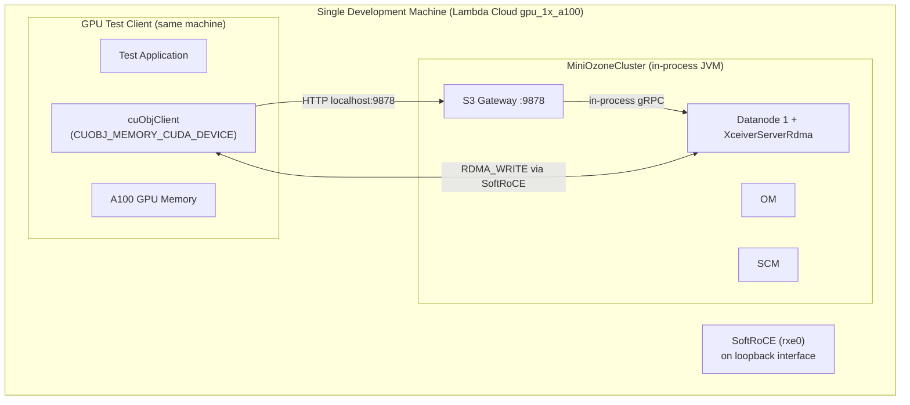
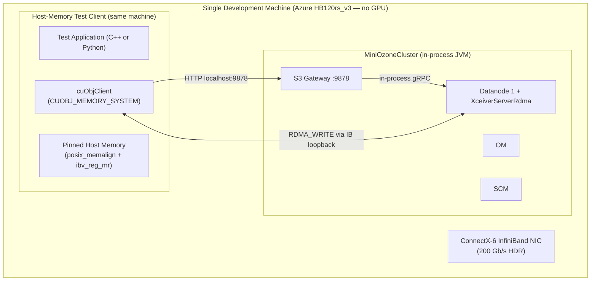
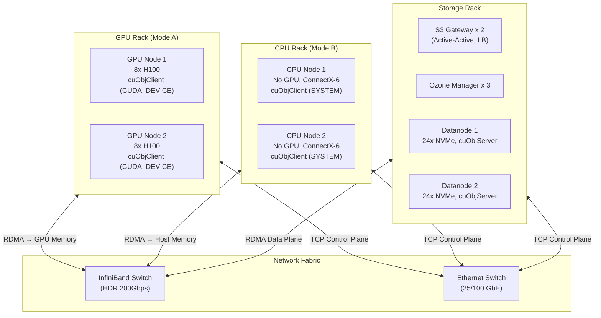
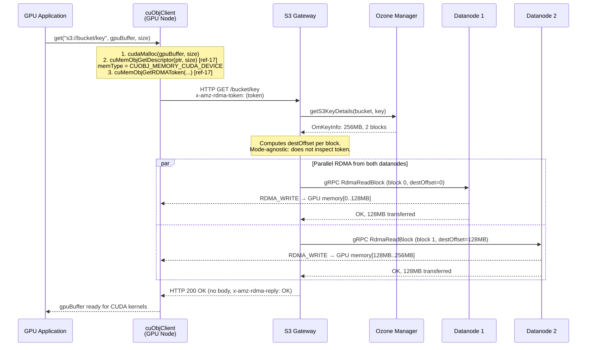
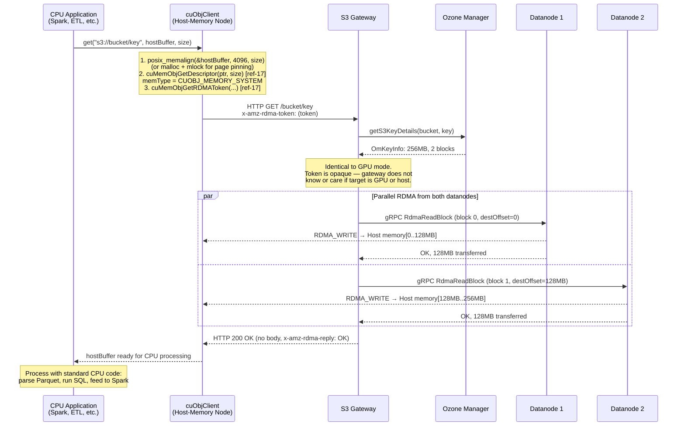
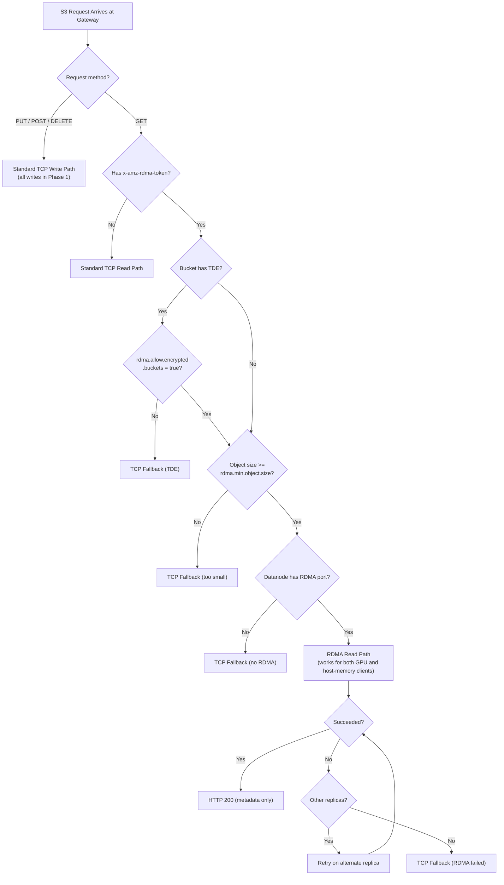
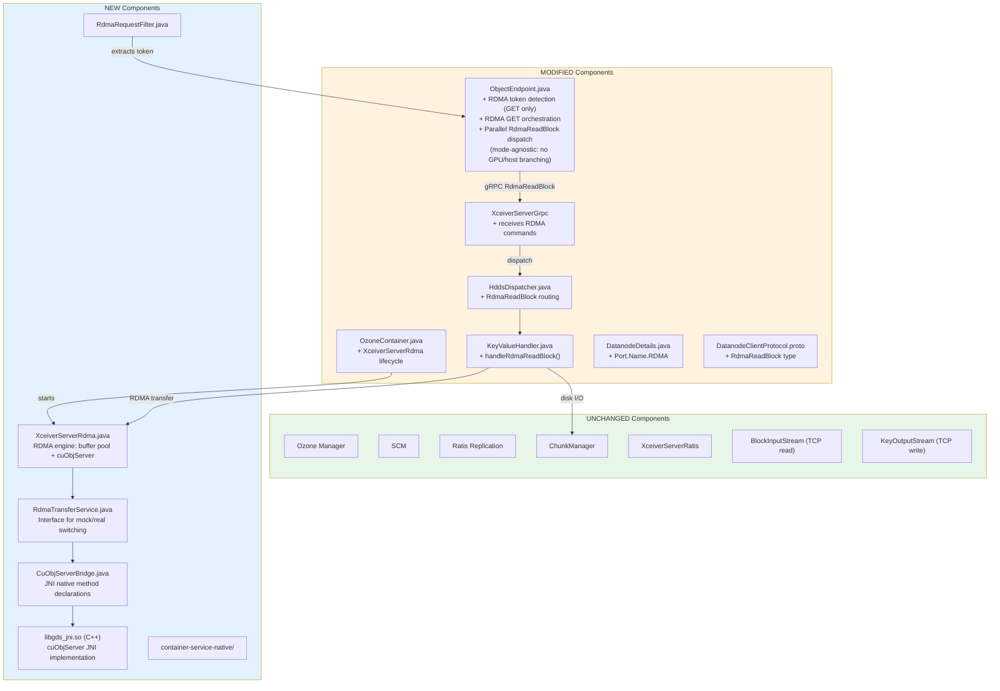
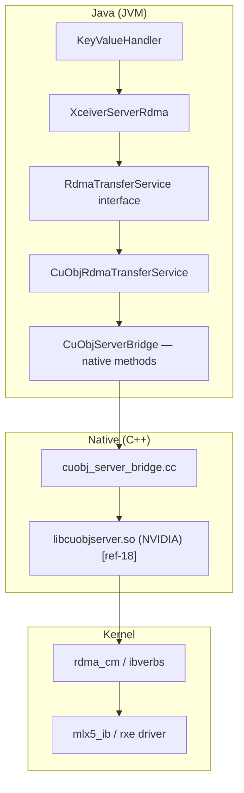

# DN-Direct RDMA Implementation Specification for Apache Ozone
## Phase 1: Read Path — Dual-Mode: GPU Memory and Host-Memory RDMA Transfers

**Version:** 7.0
**Date:** 2026-04-13
**Status:** Draft
**Target Branch:** `master` (Apache Ozone `2.2.0-SNAPSHOT`)
**Scope:** Phase 1 — S3 GET (Read Path) Only — GPU and Host-Memory Client Modes

---

## How to Read This Spec

This spec is structured so you understand **what** we're building and **why** before getting into **how** to set up the
environment. The recommended reading order:

1. **Section 1 (Architecture)** — System design, data flows, dual-mode client topology (GPU and host-memory)
2. **Section 2 (Client Memory Modes)** — How GPU and host-memory clients register memory, consume data, and differ
3. **Section 3 (Security & Integrity)** — Encryption, token interactions, CRC32C checksum strategy
4. **Section 4 (Code Changes)** — Protobuf, Java, C++, JNI — server-side and gateway code (identical for both modes)
5. **Section 5 (C/C++ Integration)** — Build system, toolchain, native library, memory model
6. **Section 6 (Client-Side RDMA)** — cuObjClient system memory mode, libibverbs, DiSNI options
7. **Section 7 (Development Environment)** — GPU cloud, RDMA-only cloud, SoftRoCE, mock testing
8. **Section 8 (Testing)** — Unit, integration, E2E for both GPU and host-memory modes
9. **Section 9 (Benchmarking)** — Performance validation for both modes
10. **Section 10 (Configuration Reference)** — All config keys
11. **Section 11 (References)** — All source links

### Dual-Mode Architecture: The Key Insight

**The datanode and S3 Gateway code is identical for both GPU and host-memory clients.** cuObjServer performs
RDMA_WRITE to whatever address the client's RDMA token specifies — it does not inspect, validate, or care whether
the target is GPU device memory or host (CPU) memory [[ref-18]](#11-references). The RDMA NIC's DMA engine writes
to the physical address encoded in the token's rkey, regardless of memory type.

This means:
- **Sections 3–5 (security, code changes, C++ integration)** are the same for both modes
- **Sections 1–2 and 6–9** cover both modes with clearly labeled subsections
- No conditional compilation, no mode flag in the protobuf, no server-side branching

### Phase 1 Scope

**Phase 1 implements the S3 GET (read) path only, for both GPU and host-memory clients.**

| Feature | Phase 1 | Phase 2 |
|---------|---------|---------|
| S3 GET via RDMA to GPU memory (cuObjClient + `CUOBJ_MEMORY_CUDA_DEVICE`) | **IN SCOPE** | — |
| S3 GET via RDMA to host memory (cuObjClient + `CUOBJ_MEMORY_SYSTEM`) | **IN SCOPE** | — |
| Fallback to TCP when RDMA is unavailable or not suitable | **IN SCOPE** | — |
| Block token validation for RDMA read requests | **IN SCOPE** | — |
| `RdmaReadBlock` protobuf message and gRPC dispatch | **IN SCOPE** | — |
| `XceiverServerRdma` RDMA engine (buffer pool + cuObjServer) | **IN SCOPE** | — |
| CRC32C checksum on RDMA read path (compute, verify, return) | **IN SCOPE** | — |
| Multiple S3 Gateway support (stateless, no coordination) | **IN SCOPE** | — |
| Custom RDMA client via raw libibverbs (bypass cuObjClient) | deferred | **Phase 2** |
| Java RDMA client via DiSNI (pure Java, no NVIDIA dependency) | deferred | **Phase 2** |
| S3 PUT via RDMA (cuObjClient PUT, `handlePutObject`) | deferred | **Phase 2** |
| `RdmaWriteBlock` protobuf message and dispatch | deferred | **Phase 2** |
| RDMA multipart upload | deferred | **Phase 2** |
| Async server-side RDMA pipelining | deferred | **Phase 2** |
| Scatter-gather I/O | deferred | **Phase 2** |

**All write operations (S3 PUT via RDMA) are deferred to Phase 2.** See
[Appendix B](#appendix-b-phase-2-deferred-items) for write path design and deferred client integration options.

### API Documentation Convention

Every cuObject API call in this spec links inline to its NVIDIA documentation reference page:

- **cuObjClient API:** [https://docs.nvidia.com/gpudirect-storage/cuobject/cuObjClient-api/index.html](https://docs.nvidia.com/gpudirect-storage/cuobject/cuObjClient-api/index.html) [[ref-17]](#11-references)
- **cuObjServer API:** [https://docs.nvidia.com/gpudirect-storage/cuobject/cuObjServer-api/index.html](https://docs.nvidia.com/gpudirect-storage/cuobject/cuObjServer-api/index.html) [[ref-18]](#11-references)

---

## Table of Contents

- [1. Architecture](#1-architecture)
  - [1.1 Overall Architecture](#11-overall-architecture)
  - [1.2 Client Deployment Modes](#12-client-deployment-modes)
  - [1.3 Data Flow: S3 GET — GPU Mode](#13-data-flow-s3-get--gpu-mode)
  - [1.4 Data Flow: S3 GET — Host-Memory Mode](#14-data-flow-s3-get--host-memory-mode)
  - [1.5 Data Flow: S3 PUT (Write Path)](#15-data-flow-s3-put-write-path)
  - [1.6 Fallback Path](#16-fallback-path)
  - [1.7 Component Interaction Map](#17-component-interaction-map)
  - [1.8 Request Dispatch Model](#18-request-dispatch-model)
  - [1.9 Multiple S3 Gateway Architecture](#19-multiple-s3-gateway-architecture)
- [2. Client Memory Modes and Data Consumption Model](#2-client-memory-modes-and-data-consumption-model)
  - [2.1 Memory Mode Overview](#21-memory-mode-overview)
  - [2.2 GPU Memory Mode](#22-gpu-memory-mode)
  - [2.3 Host-Memory Mode](#23-host-memory-mode)
  - [2.4 Transfer Model: Complete vs Streaming](#24-transfer-model-complete-vs-streaming)
  - [2.5 Synchronous vs Asynchronous API Behavior](#25-synchronous-vs-asynchronous-api-behavior)
  - [2.6 Small Files (< 1 MiB)](#26-small-files--1-mib)
  - [2.7 Files Larger Than Available Memory](#27-files-larger-than-available-memory)
  - [2.8 Multiple Concurrent Requests](#28-multiple-concurrent-requests)
  - [2.9 Multi-GPU Setups](#29-multi-gpu-setups)
  - [2.10 Client Application Examples](#210-client-application-examples)
  - [2.11 Scatter-Gather Support](#211-scatter-gather-support)
- [3. Security and Encryption](#3-security-and-encryption)
  - [3.1 Ozone Security Layers Overview](#31-ozone-security-layers-overview)
  - [3.2 Security Architecture in the RDMA Path](#32-security-architecture-in-the-rdma-path)
  - [3.3 TDE and RDMA](#33-tde-transparent-data-encryption-and-rdma)
  - [3.4 Block Token Validation in XceiverServerRdma](#34-block-token-validation-in-xceiverserverrdma)
  - [3.5 RDMA Transport Security](#35-rdma-transport-security)
  - [3.6 Disabling Security for Maximum Performance](#36-disabling-security-for-maximum-rdma-performance)
  - [3.7 Security Configuration Matrix](#37-security-configuration-matrix)
  - [3.8 Data Integrity and Checksum Strategy](#38-data-integrity-and-checksum-strategy)
- [4. Ozone Code Changes](#4-ozone-code-changes)
  - [4.1 Protocol Buffer Changes](#41-protocol-buffer-changes)
  - [4.2 DatanodeDetails Port Type](#42-datanodedetails-port-type)
  - [4.3 New Maven Module: container-service-native](#43-new-maven-module-container-service-native)
  - [4.4 RdmaTransferService Interface](#44-rdmatransferservice-interface)
  - [4.5 JNI Bridge: CuObjServerBridge.java](#45-jni-bridge-cuobjserverbridgejava)
  - [4.6 Native C++ Implementation](#46-native-c-implementation)
  - [4.7 CMakeLists.txt for Native Build](#47-cmakeliststxt-for-native-build)
  - [4.8 CuObjRdmaTransferService.java](#48-cuobjrdmatransferservicejava)
  - [4.9 MockRdmaTransferService.java](#49-mockrdmatransferservicejava)
  - [4.10 RdmaBuffer.java and RdmaBufferPool.java](#410-rdmabufferjava-and-rdmabufferpooljava)
  - [4.11 XceiverServerRdma.java](#411-xceiverserverrdmajava)
  - [4.12 OzoneContainer.java Modifications](#412-ozonecontainerjava-modifications)
  - [4.13 HddsDispatcher Modifications](#413-hddsdispatcher-modifications)
  - [4.14 KeyValueHandler Modifications](#414-keyvaluehandler-modifications)
  - [4.15 S3 Gateway: ObjectEndpoint Modifications](#415-s3-gateway-objectendpoint-modifications)
  - [4.16 S3 Gateway: RdmaRequestFilter](#416-s3-gateway-rdmarequestfilter)
- [5. C/C++ Integration Architecture](#5-cc-integration-architecture)
  - [5.1 cuObject SDK API Surface](#51-cuobject-sdk-api-surface)
  - [5.2 JNI Architecture](#52-jni-architecture)
  - [5.3 Native Library Lifecycle](#53-native-library-lifecycle)
  - [5.4 RDMA Buffer Management: Whose Memory and Why](#54-rdma-buffer-management-whose-memory-and-why)
  - [5.5 Build System Integration](#55-build-system-integration)
  - [5.6 Compiler and Toolchain Requirements](#56-compiler-and-toolchain-requirements)
- [6. Client-Side RDMA Library Architecture](#6-client-side-rdma-library-architecture)
  - [6.1 cuObjClient with GPU Memory (CUOBJ_MEMORY_CUDA_DEVICE)](#61-cuobjclient-with-gpu-memory-cuobj_memory_cuda_device)
  - [6.2 cuObjClient with Host Memory (CUOBJ_MEMORY_SYSTEM)](#62-cuobjclient-with-host-memory-cuobj_memory_system)
  - [6.3 Alternative: Custom RDMA Client via libibverbs (Phase 2)](#63-alternative-custom-rdma-client-via-libibverbs-phase-2)
  - [6.4 Alternative: Java RDMA via DiSNI (Phase 2)](#64-alternative-java-rdma-via-disni-phase-2)
  - [6.5 Client Mode Decision Matrix](#65-client-mode-decision-matrix)
- [7. Development Environment and Deployment](#7-development-environment-and-deployment)
  - [7.1 Environment Matrix](#71-environment-matrix)
  - [7.2 SoftRoCE: Decision and Limitations](#72-softroce-decision-and-limitations)
  - [7.3 GPU Cloud Providers](#73-gpu-cloud-providers)
  - [7.4 RDMA-Only Cloud Providers (No GPU)](#74-rdma-only-cloud-providers-no-gpu)
  - [7.5 How to Run Ozone for Development](#75-how-to-run-ozone-for-development)
  - [7.6 setup-gpu-env.sh](#76-setup-gpu-envsh)
  - [7.7 setup-rdma-env.sh (No GPU)](#77-setup-rdma-envsh-no-gpu)
  - [7.8 validate-env.sh](#78-validate-envsh)
  - [7.9 Docker Cluster for Integration Testing](#79-docker-cluster-for-integration-testing)
  - [7.10 Quick Start Cookbook](#710-quick-start-cookbook-end-to-end-setup-and-test)
  - [7.11 Ozone RDMA Configuration Template](#711-ozone-rdma-configuration-template)
  - [7.12 run-all-tests.sh](#712-run-all-testssh)
  - [7.13 cleanup-env.sh](#713-cleanup-envsh)
- [8. Testing](#8-testing)
  - [8.1 Unit Tests](#81-unit-tests)
  - [8.2 Integration Tests with MiniOzoneCluster](#82-integration-tests-with-miniozonecluster)
  - [8.3 Integration Tests with Docker Cluster](#83-integration-tests-with-docker-cluster)
  - [8.4 End-to-End Tests with Real GPU Hardware](#84-end-to-end-tests-with-real-gpu-hardware)
  - [8.5 End-to-End Tests with Host-Memory RDMA (No GPU)](#85-end-to-end-tests-with-host-memory-rdma-no-gpu)
  - [8.6 Test Matrix](#86-test-matrix)
- [9. Benchmarking](#9-benchmarking)
  - [9.1 GPU RDMA Benchmark Tool](#91-gpu-rdma-benchmark-tool)
  - [9.2 Host-Memory RDMA Benchmark Tool](#92-host-memory-rdma-benchmark-tool)
  - [9.3 Expected Performance Targets](#93-expected-performance-targets)
  - [9.4 Metrics to Collect](#94-metrics-to-collect)
- [10. Configuration Reference](#10-configuration-reference)
- [11. References](#11-references)
- [Appendix A: Resolved Unknowns](#appendix-a-resolved-unknowns)
- [Appendix B: Phase 2 Deferred Items](#appendix-b-phase-2-deferred-items)
- [Appendix C: Observability (Phase 2 Design Notes)](#appendix-c-observability-phase-2-design-notes)
- [Appendix D: cuObjRDMATunableParam Mapping](#appendix-d-cuobjrdmatunableparam-mapping)

---

## 1. Architecture

### 1.1 Overall Architecture

#### System Architecture Overview — Dual-Mode Clients

The architecture supports two client deployment modes with **identical server-side infrastructure**:

1. **GPU Mode:** Client has NVIDIA GPU + RDMA NIC. Data lands in GPU device memory via GPUDirect RDMA.
2. **Host-Memory Mode:** Client has RDMA NIC only (no GPU). Data lands in pinned host (CPU) memory via standard RDMA.


> **Critical design principle:** The RDMA token (`x-amz-rdma-token`) is **opaque** to both the S3 Gateway and the
> datanode. It encodes the client's registered memory address, rkey, and DC transport metadata. cuObjServer's
> `handleGetObject()` [[ref-18]](#11-references) accepts this token as `const std::string& rdma_descr` and performs
> RDMA_WRITE to whatever physical address the token encodes — GPU BAR memory or host RAM. No server-side branching
> is needed.

> **Storage device note:** Diagrams label storage as "NVMe" because NVMe SSDs are the expected storage for
> RDMA-capable deployments. **NVMe is NOT a requirement.** Ozone reads through `FileChannel.read()`, which works
> with any filesystem-backed storage.

### 1.2 Client Deployment Modes

#### 1.2.1 GPU Mode (CUOBJ_MEMORY_CUDA_DEVICE)

The client has an NVIDIA GPU (A100, H100, etc.) and an RDMA NIC (ConnectX-6+). Data is transferred directly
into GPU device memory, bypassing the CPU entirely.

**Requirements:**
- NVIDIA GPU with CUDA Compute Capability 6.0+
- NVIDIA GPU Driver compatible with CUDA 13.1.1+
- CUDA Toolkit 13.1.1+
- `nvidia_peermem` kernel module (enables NIC → GPU DMA)
- ConnectX-5+ RDMA NIC with MLNX_OFED 5.8+
- cuObjClient library

**Use cases:** AI/ML training data loading (PyTorch, TensorFlow), GPU analytics (RAPIDS cuDF),
inference serving, any workflow where data is consumed by GPU kernels.

**Memory registration flow:**
```
cudaMalloc(ptr, size)
  → cuMemObjGetDescriptor(ptr, size)  // registers GPU memory for RDMA [ref-17]
  → cuMemObjGetRDMAToken(ptr, ..., &token)  // generates x-amz-rdma-token [ref-17]
```

#### 1.2.2 Host-Memory Mode (CUOBJ_MEMORY_SYSTEM)

The client has an RDMA NIC but **no GPU**. Data is transferred directly into pinned host (CPU) memory,
bypassing the kernel network stack and achieving near-line-rate throughput.

**Requirements:**
- ConnectX-5+ RDMA NIC with MLNX_OFED 5.8+
- cuObjClient library with CUDA Toolkit (GPU listed as optional "for GPU memory operations" [[ref-2]](#11-references))
- No GPU hardware required
- No `nvidia_peermem` required

**Use cases:** CPU-based analytics (Spark, Presto, Trino), ETL pipelines, data preprocessing,
any workload that benefits from high-throughput storage I/O without GPU compute,
RDMA-capable HPC clusters without GPUs.

**Memory registration flow:**
```
posix_memalign(ptr, 4096, size)  // or malloc + mlock
  → cuMemObjGetDescriptor(ptr, size)  // registers host memory [ref-17]
    // cuObjClient detects CUOBJ_MEMORY_SYSTEM via getMemoryType() [ref-17]
  → cuMemObjGetRDMAToken(ptr, ..., &token)  // generates x-amz-rdma-token [ref-17]
```

**Evidence for host-memory support:**
- cuObjClient API defines `cuObjMemoryType_t` enum: `CUOBJ_MEMORY_SYSTEM = 0`,
  `CUOBJ_MEMORY_CUDA_MANAGED = 1`, `CUOBJ_MEMORY_CUDA_DEVICE = 2` [[ref-17]](#11-references)
- cuObject overview states it enables "direct data transfers between GPU memory **or system memory**
  and S3 compatible object storage using RDMA" [[ref-1]](#11-references)
- `cuMemObjGetDescriptor()` documentation states it works with "system memory, CUDA managed memory,
  and CUDA device memory" [[ref-17]](#11-references)
- cuObjClient v1.0.0 release notes list GPU as: "NVIDIA GPU with CUDA Compute Capability 6.0
  or higher **(for GPU memory operations)**" — implying system memory operations do not require
  a GPU [[ref-2]](#11-references)

#### 1.2.3 Mode Comparison

| Aspect | GPU Mode | Host-Memory Mode |
|---|---|---|
| **Target memory** | GPU device memory (VRAM) | Host/CPU memory (RAM) |
| **cuObjClient memory type** | `CUOBJ_MEMORY_CUDA_DEVICE` | `CUOBJ_MEMORY_SYSTEM` |
| **GPU required on client** | YES | NO |
| **nvidia_peermem required** | YES | NO |
| **CUDA Toolkit required** | YES | YES (cuObjClient dependency) |
| **RDMA NIC required** | YES (ConnectX-5+) | YES (ConnectX-5+) |
| **DMA path** | NIC → PCIe → GPU BAR | NIC → PCIe → Host RAM |
| **CPU copies** | Zero (NIC → GPU direct) | Zero (NIC → pinned RAM direct) |
| **Expected throughput** | Line rate (~25 GiB/s on 200Gbps) | Line rate (~25 GiB/s on 200Gbps) |
| **Latency advantage vs TCP** | 5-8x for large objects | 3-5x for large objects |
| **Server-side code** | Identical | Identical |
| **S3 Gateway code** | Identical | Identical |
| **RDMA token format** | Same (cuObjClient generates) | Same (cuObjClient generates) |
| **Cloud test environment** | Lambda Labs, Vultr (GPU VMs) | Azure HB-series, AWS hpc6a (no GPU) |

> **Why host-memory mode has lower latency improvement than GPU mode:** In GPU mode, TCP requires data to
> traverse: NIC → kernel → userspace → `cudaMemcpy()` → GPU (3+ copies). RDMA eliminates all copies. In
> host-memory mode, TCP requires: NIC → kernel → userspace (1-2 copies). RDMA eliminates the kernel copy
> but the advantage is smaller since there's no GPU copy to eliminate.

#### Single-Node Development Topology (GPU Mode)



#### Single-Node Development Topology (Host-Memory Mode)



#### Multi-Node Production Topology (Mixed Clients)



### 1.3 Data Flow: S3 GET — GPU Mode

The GPU-mode GET path. The flow is identical for host-memory mode except the client registers host
memory instead of GPU memory (see [Section 1.4](#14-data-flow-s3-get--host-memory-mode)).

1. `cuObjClient` allocates GPU memory (`cudaMalloc`) and registers it via
   [`cuMemObjGetDescriptor()`](https://docs.nvidia.com/gpudirect-storage/cuobject/cuObjClient-api/index.html) [[ref-17]](#11-references)
   with memory type `CUOBJ_MEMORY_CUDA_DEVICE`
2. Client sends HTTP GET with `x-amz-rdma-token` header to the S3 Gateway
3. Gateway resolves block locations via Ozone Manager
4. Gateway dispatches one `RdmaReadBlock` gRPC command per block, each carrying: the RDMA token, block coordinates,
   the `destOffset`, and the block authorization token
5. Each datanode reads block data from disk into a pre-registered RDMA buffer, then calls
   [`handleGetObject()`](https://docs.nvidia.com/gpudirect-storage/cuobject/cuObjServer-api/index.html) [[ref-18]](#11-references)
   to RDMA_WRITE the data directly into the client's GPU memory at the specified `destOffset`
6. Gateway waits for all datanodes to report completion, returns HTTP 200 with metadata only



### 1.4 Data Flow: S3 GET — Host-Memory Mode

The host-memory mode flow. **The server-side and gateway steps are identical to GPU mode** — only the
client-side memory allocation and registration differ.



**Why the server doesn't know or care:**

| Component | What it sees | Memory type awareness |
|---|---|---|
| S3 Gateway | `x-amz-rdma-token` (opaque string) | None — passes token through |
| HddsDispatcher | `RdmaReadBlock.rdmaToken` (opaque string) | None — validates block token only |
| KeyValueHandler | `rdmaToken` → `XceiverServerRdma` | None — delegates to cuObjServer |
| cuObjServer | `rdma_descr` string → `handleGetObject()` | None — extracts rkey+addr, does RDMA_WRITE |
| RDMA NIC | rkey → physical address → DMA write | Hardware DMA — writes to whatever physical address rkey resolves to |

### 1.5 Data Flow: S3 PUT (Write Path)

**Deferred to Phase 2.** All S3 PUT requests use the standard TCP path regardless of client mode.
See [Appendix B](#appendix-b-phase-2-deferred-items).

### 1.6 Fallback Path

The fallback logic is identical for both client modes. It runs entirely in the S3 Gateway before any
datanode communication.



> **No mode-specific fallback logic.** The fallback path does not distinguish between GPU and host-memory
> clients. If RDMA fails for any reason, the client receives the data via the HTTP response body (TCP).
> cuObjClient handles this fallback transparently.

### 1.7 Component Interaction Map



### 1.8 Request Dispatch Model

**There is exactly one dispatch path for RDMA commands, regardless of client memory mode.**

RDMA commands travel via the existing gRPC channel to the datanode, through `HddsDispatcher` to
`KeyValueHandler`. `XceiverServerRdma` is an RDMA engine (not a gRPC service) used by `KeyValueHandler`.


### 1.9 Multiple S3 Gateway Architecture

S3 Gateways are stateless. Each gateway independently resolves block locations from the Ozone Manager
and dispatches `RdmaReadBlock` to the relevant datanodes. No cross-gateway coordination is needed.

The RDMA token is self-contained — any gateway can use it to instruct any datanode to RDMA_WRITE to
the client's memory. This is true for both GPU and host-memory modes because the token format is
identical.

**Load balancer recommendation:** Simple round-robin or least-connections. No RDMA-specific or
mode-specific configuration needed.

**Rolling upgrade:** Old gateways (pre-RDMA) ignore the `x-amz-rdma-token` header and serve via TCP.
New gateways detect the header and dispatch RDMA. No data loss during mixed-version windows.

---

## 2. Client Memory Modes and Data Consumption Model

### 2.1 Memory Mode Overview

cuObject defines three memory types via the `cuObjMemoryType_t` enum
[[ref-17]](https://docs.nvidia.com/gpudirect-storage/cuobject/cuObjClient-api/index.html):

| Enum Value | Name | Memory Location | GPU Required | RDMA Registration Path |
|---|---|---|---|---|
| `CUOBJ_MEMORY_SYSTEM = 0` | System memory | Host RAM | **No** | `ibv_reg_mr()` (standard RDMA) |
| `CUOBJ_MEMORY_CUDA_MANAGED = 1` | CUDA managed memory | GPU + Host (unified) | Yes | nvidia_peermem |
| `CUOBJ_MEMORY_CUDA_DEVICE = 2` | CUDA device memory | GPU VRAM | Yes | nvidia_peermem + GPU BAR |

**Phase 1 supports `CUOBJ_MEMORY_SYSTEM` and `CUOBJ_MEMORY_CUDA_DEVICE`.** CUDA managed memory
(`CUOBJ_MEMORY_CUDA_MANAGED`) is untested and not officially supported in Phase 1.

The `getMemoryType()` static method [[ref-17]](#11-references) returns the memory type for a given pointer,
allowing cuObjClient to automatically choose the correct registration path.

### 2.2 GPU Memory Mode

When the client allocates GPU device memory (`cudaMalloc`), cuObjClient registers it via the
GPUDirect RDMA path:

1. `cudaMalloc()` allocates memory in GPU VRAM
2. `cuMemObjGetDescriptor(ptr, size)` [[ref-17]](#11-references) detects `CUOBJ_MEMORY_CUDA_DEVICE`
3. Internally: `nvidia_p2p_get_pages()` pins GPU pages, `ibv_reg_mr()` with peer memory registers
   the GPU BAR region for NIC access [[ref-6]](#11-references)
4. `cuMemObjGetRDMAToken()` [[ref-17]](#11-references) encodes the GPU memory address, rkey, and
   DC transport metadata into the RDMA token

**Data arrives in GPU memory via NIC → PCIe → GPU BAR DMA, with zero CPU copies.**

### 2.3 Host-Memory Mode

When the client allocates host memory (`malloc`, `posix_memalign`, or `mmap`), cuObjClient registers
it via the standard RDMA path:

1. `posix_memalign(&ptr, 4096, size)` allocates page-aligned host memory
2. `cuMemObjGetDescriptor(ptr, size)` [[ref-17]](#11-references) detects `CUOBJ_MEMORY_SYSTEM`
3. Internally: `ibv_reg_mr(pd, ptr, size, IBV_ACCESS_REMOTE_WRITE | IBV_ACCESS_LOCAL_WRITE)`
   pins and registers host memory for RDMA [[ref-9]](#11-references)
4. `cuMemObjGetRDMAToken()` [[ref-17]](#11-references) encodes the host memory address, rkey, and
   DC transport metadata into the RDMA token

**Data arrives in host memory via NIC → PCIe → host RAM DMA, with zero CPU copies.**

This is the **original and most fundamental RDMA use case** — RDMA was designed for host-to-host
memory transfers long before GPU memory support existed. GPU memory support (GPUDirect RDMA) is an
extension of the base RDMA functionality via the `nvidia_peermem` kernel module
[[ref-6]](#11-references), [[ref-8]](#11-references).

**Evidence from RDMA fundamentals:**
- `ibv_reg_mr()` registers standard `malloc`/`mmap` host memory
  [[ref-9]](https://man7.org/linux/man-pages/man7/rdma_cm.7.html)
- RDMA_WRITE posts a send request with `IBV_WR_RDMA_WRITE` targeting a remote memory region's
  address and rkey — the remote CPU is not involved at all
  [[ref-19]](https://insujang.github.io/2020-02-09/introduction-to-programming-infiniband/)
- NVIDIA RDMA programming guides use host memory for all examples
  [[ref-20]](https://docs.nvidia.com/networking/display/RDMAAwareProgrammingv17/Programming+Examples+Using+IBV+Verbs)

### 2.4 Transfer Model: Complete vs Streaming

cuObject operates on a **complete-transfer model** for both GPU and host-memory modes
[[ref-1]](https://docs.nvidia.com/gpudirect-storage/cuobject/index.html). The client must allocate
the full object size upfront and wait for the transfer to complete before accessing the data.

**Why complete transfer?** RDMA_WRITE is one-sided — the server writes directly to the client's
memory without the client's CPU being involved. The client has no way to know how many bytes have
arrived until the entire operation completes and a completion event is signaled.

| Aspect | TCP S3 Client (boto3) | cuObjClient RDMA (both modes) |
|---|---|---|
| Data access | Stream: process bytes as they arrive | Complete: all-or-nothing |
| Buffer allocation | Can use small buffer | Must allocate full object size |
| CPU involvement | CPU copies every byte | Zero-copy (NIC DMA) |
| First byte usable | Immediately | Only after full transfer |

**Double-buffering** can overlap I/O and compute for both modes: one thread fills buffer A via RDMA
while another thread processes buffer B (GPU kernel or CPU computation).

### 2.5 Synchronous vs Asynchronous API Behavior

#### Client-Side (cuObjClient) [[ref-17]](#11-references)

| API | Behavior | Notes |
|---|---|---|
| `cuObjGet(ctx, ptr, size, offset, buf_offset)` | **Synchronous (blocking)** | Same for both GPU and host memory modes |
| `cuObjPut(ctx, ptr, size, offset, buf_offset)` | **Synchronous (blocking)** | Phase 2. Same signature pattern. |

#### Server-Side (cuObjServer) [[ref-18]](#11-references)

| API | Behavior | Notes |
|---|---|---|
| `handleGetObject(key, local_rdma_buff, remote_buf_start, size, rdma_descr, channel, local_offset, status, async_handle)` | **Sync or async** | Phase 1: sync (`async_handle = nullptr`) |
| `handlePutObject(...)` | **Sync or async** | Phase 2 |

#### Per-Operation Limits

| Limit | Value | Source |
|---|---|---|
| Max per server RDMA operation | 1 GiB | [[ref-3]](#11-references) |
| Max scatter-gather entries | 10 per operation | [[ref-18]](#11-references) |
| Client-side registration limit | 4 GiB per call | [[ref-17]](#11-references) |

### 2.6 Small Files (< 1 MiB)

RDMA has per-transfer overhead that dominates for small objects. Objects below
`ozone.s3g.rdma.min.object.size` (default 1 MiB) use TCP regardless of client mode.

This applies equally to GPU and host-memory modes — the overhead sources (DC connection setup,
completion polling, HTTP round-trip) are the same.

### 2.7 Files Larger Than Available Memory

**GPU mode:** Use Range GET with `cuObjGet()` `offset` parameter to read in chunks that fit in
available GPU memory. The 4 GiB per-registration limit applies.

**Host-memory mode:** Same approach. Host memory is typically more abundant than GPU memory (e.g.,
256+ GB RAM vs 80 GB VRAM), so chunking is less common. The 4 GiB per-registration limit still
applies.

For both modes, the server breaks transfers larger than 1 GiB into multiple RDMA operations
(per-operation limit from [[ref-3]](#11-references)).

### 2.8 Multiple Concurrent Requests

**Datanode-side concurrency is identical for both modes:**
- `XceiverServerRdma` is thread-safe
- Each `RdmaReadBlock` uses a separate gRPC thread and RDMA channel
- RDMA buffer pool uses `ArrayBlockingQueue` for thread-safe borrow/return
- Semaphore limits total concurrent operations

**Client-side concurrency:**
- GPU mode: each GPU needs its own cuObjClient instance (separate RDMA registrations)
- Host-memory mode: a single process can have multiple registered host buffers for concurrent requests

### 2.9 Multi-GPU Setups

Multi-GPU topology applies only to GPU mode. See [Section 1.2.1](#121-gpu-mode-cuobj_memory_cuda_device).
Each GPU requires its own RDMA token. Ozone does not need to be aware of multi-GPU topology — each
cuObjClient instance generates its own self-contained token.

### 2.10 Client Application Examples

#### Example 1: GPU Mode — PyTorch Training Data Loading

```python
class GDSDataset(torch.utils.data.IterableDataset):
    def __init__(self, bucket, prefix, gpu_id=0):
        self.cuobj = cuobjclient.Client(endpoint="http://s3gw:9878")
        self.gpu_id = gpu_id

    def __iter__(self):
        for key in self._list_objects():
            # cuObjClient allocates GPU memory, registers with CUOBJ_MEMORY_CUDA_DEVICE
            gpu_buffer = self.cuobj.get(f"s3://{self.bucket}/{key}", device=self.gpu_id)
            tensor = self._parse_parquet_gpu(gpu_buffer)
            yield tensor
```

#### Example 2: Host-Memory Mode — CPU Analytics (Spark/Presto Integration)

```python
import cuobjclient
import numpy as np

# Host-memory mode: no GPU needed, data lands in CPU memory
client = cuobjclient.Client(endpoint="http://s3gw:9878")

# Allocate host buffer (cuObjClient uses CUOBJ_MEMORY_SYSTEM internally)
host_buffer = np.empty(256 * 1024 * 1024, dtype=np.uint8)

# RDMA GET directly into host memory — zero copy from NIC to RAM
client.get("s3://datalake/table.parquet", host_buffer.ctypes.data, len(host_buffer))

# Process with CPU-based tools — data is already in host memory
import pyarrow.parquet as pq
table = pq.read_table(io.BytesIO(host_buffer.tobytes()))
result = table.group_by("col").aggregate([("val", "sum")])
```

#### Example 3: Host-Memory Mode — C++ ETL Pipeline

```cpp
#include <cuobjclient.h>
#include <cstdlib>

int main() {
    // Allocate page-aligned host memory
    void* buffer;
    posix_memalign(&buffer, 4096, 256 * 1024 * 1024);

    // cuObjClient detects CUOBJ_MEMORY_SYSTEM via getMemoryType()
    cuObjClient client(ops, CUOBJ_PROTO_RDMA_DC_V1);
    cuMemObjGetDescriptor(buffer, 256 * 1024 * 1024);  // registers host memory [ref-17]

    // GET — data arrives in host memory via RDMA_WRITE
    ssize_t bytes = client.cuObjGet(ctx, buffer, 256 * 1024 * 1024);

    // Process with CPU — buffer already contains the data
    process_parquet(buffer, bytes);
    free(buffer);
}
```

### 2.11 Scatter-Gather Support

Scatter-gather I/O is deferred to Phase 2 for both GPU and host-memory modes. Contiguous transfers
satisfy the primary use cases.

---

## 3. Security and Encryption

Security is identical for both GPU and host-memory modes. The RDMA token is opaque to the security
layer. Block token validation, Kerberos authentication, and TDE handling are unchanged.

### 3.1 Ozone Security Layers Overview

| Layer | Config Key | RDMA Impact |
|---|---|---|
| **Kerberos** | `ozone.security.enabled` | Control plane only — no RDMA impact |
| **Block Tokens** | `hdds.block.token.enabled` | Validated in HddsDispatcher (~0.1ms CPU) |
| **gRPC TLS** | `hdds.grpc.tls.enabled` | Only affects gRPC control channel, not RDMA data plane |
| **TDE** | Per-bucket | Critical — see [Section 3.3](#33-tde-transparent-data-encryption-and-rdma) |

By default, ALL security layers are OFF.

### 3.2 Security Architecture in the RDMA Path

The RDMA data plane is **not encrypted** for either mode. RDMA bypasses the kernel network stack
entirely. Data travels as plaintext over InfiniBand/RoCEv2.

### 3.3 TDE (Transparent Data Encryption) and RDMA

TDE is incompatible with RDMA for both modes: encrypted bytes would arrive in the client's memory
(GPU or host) without decryption. The gateway falls back to TCP for TDE-encrypted buckets unless
`ozone.s3g.rdma.allow.encrypted.buckets=true`.

### 3.4 Block Token Validation in XceiverServerRdma

Uses the existing `HddsDispatcher.validateToken()` path. No new validation logic needed. Identical
for both client modes.

### 3.5 RDMA Transport Security

The `x-amz-rdma-token` contains the RDMA memory region key (`rkey`) and remote memory address. Without
a valid `rkey`, remote hosts cannot RDMA into the client's memory — the NIC's hardware access control
rejects unauthorized requests. This applies equally to GPU and host memory.

### 3.6 Disabling Security for Maximum RDMA Performance

```xml
<configuration>
  <property><name>ozone.security.enabled</name><value>false</value></property>
  <property><name>hdds.block.token.enabled</name><value>false</value></property>
  <property><name>hdds.grpc.tls.enabled</name><value>false</value></property>
</configuration>
```

### 3.7 Security Configuration Matrix

| Scenario | Security | TDE | RDMA Impact |
|---|---|---|---|
| Dev / Benchmarking | All OFF | Disabled | Maximum — zero overhead |
| Isolated cluster | Block tokens ON | Disabled | High — ~0.1ms per request |
| Shared cluster | Block tokens + TLS | Disabled | High — TLS on control plane only |
| Regulated | All ON | Enabled | TCP Fallback |

### 3.8 Data Integrity and Checksum Strategy

CRC32C checksums are computed on the datanode during the RDMA read path, before RDMA_WRITE. This
catches disk corruption at the earliest point. The checksum strategy is identical for both client
modes — checksums are computed from the data read from disk, before it enters the RDMA path.

#### Three Verification Points

| Point | Where | Catches |
|---|---|---|
| 1. Server-side pre-transfer | `XceiverServerRdma.handleRdmaRead()` | Disk corruption, bit-rot |
| 2. Server → Gateway response | `RdmaReadBlockResponseProto.checksumData` | Aggregation verification |
| 3. Gateway → Client response | HTTP header `x-amz-rdma-checksum-crc32c` | Optional client-side E2E check |

Configuration keys:
- `hdds.datanode.rdma.checksum.enabled` (default: `true`)
- `hdds.datanode.rdma.checksum.verify.stored` (default: `true`)

---

## 4. Ozone Code Changes

**These code changes are identical for GPU and host-memory modes.** The server and gateway never
inspect the RDMA token to determine the client's memory type. The `rdmaToken` field in the protobuf
is an opaque string for both modes.

### 4.1 Protocol Buffer Changes

**File:** `hadoop-hdds/interface-client/src/main/proto/DatanodeClientProtocol.proto`

#### 4.1.1 New Type Enum Values

```protobuf
enum Type {
  // ... existing values up to ReadBlock = 24 ...
  RdmaReadBlock = 25;
  RdmaWriteBlock = 26;  // Reserved for Phase 2
}
```

#### 4.1.2 New Request/Response Messages

```protobuf
message RdmaReadBlockRequestProto {
  required DatanodeBlockID blockID = 1;

  // RDMA descriptor string from x-amz-rdma-token HTTP header.
  // Generated by cuObjClient via cuMemObjGetRDMAToken() [ref-17].
  // Opaque to Ozone — contains rkey, address, DC transport metadata.
  // Works with both GPU memory (CUOBJ_MEMORY_CUDA_DEVICE) and
  // host memory (CUOBJ_MEMORY_SYSTEM) — the server does not
  // distinguish between them.
  required string rdmaToken = 2;

  optional uint64 offset = 3 [default = 0];
  optional uint64 length = 4 [default = 0];
  optional hadoop.hdds.PipelineID pipelineID = 5;

  // Byte offset within the client's registered memory buffer (GPU or host)
  // where this block's data should be written. Critical for multi-block objects.
  optional uint64 destOffset = 6 [default = 0];
}

message RdmaReadBlockResponseProto {
  required uint64 bytesTransferred = 1;
  optional ChecksumData checksumData = 2;
}

// Phase 2 (reserved)
message RdmaWriteBlockRequestProto {
  required DatanodeBlockID blockID = 1;
  required string rdmaToken = 2;
  required uint64 length = 3;
  optional hadoop.hdds.PipelineID pipelineID = 4;
  optional uint64 expectedBlockCommitLength = 5;
}

message RdmaWriteBlockResponseProto {
  required uint64 bytesReceived = 1;
  optional uint64 committedBlockLength = 2;
}
```

#### 4.1.3 Add Fields to ContainerCommandRequestProto/ResponseProto

```protobuf
message ContainerCommandRequestProto {
  // ... existing fields up to readBlock = 28 ...
  optional RdmaReadBlockRequestProto rdmaReadBlock = 29;
  optional RdmaWriteBlockRequestProto rdmaWriteBlock = 30;  // Phase 2
}

message ContainerCommandResponseProto {
  // ... existing fields up to readBlock = 25 ...
  optional RdmaReadBlockResponseProto rdmaReadBlock = 26;
  optional RdmaWriteBlockResponseProto rdmaWriteBlock = 27;  // Phase 2
}
```

### 4.2 DatanodeDetails Port Type

**File:** `hadoop-hdds/common/src/main/java/org/apache/hadoop/hdds/protocol/DatanodeDetails.java`

Add `RDMA` to `Port.Name` enum with `@BelongsToHDDSLayoutVersion(RDMA_PORT_IN_DATANODEDETAILS)`.
Add `RDMA_PORT_IN_DATANODEDETAILS` to `HDDSLayoutFeature` enum.

### 4.3 New Maven Module: `container-service-native`

```
hadoop-hdds/container-service-native/
├── pom.xml
├── src/
│   ├── main/
│   │   ├── java/org/apache/hadoop/ozone/container/rdma/
│   │   │   ├── RdmaTransferService.java
│   │   │   ├── CuObjRdmaTransferService.java
│   │   │   ├── MockRdmaTransferService.java
│   │   │   ├── CuObjServerBridge.java
│   │   │   ├── RdmaBuffer.java
│   │   │   └── RdmaBufferPool.java
│   │   └── native/
│   │       ├── CMakeLists.txt
│   │       └── cuobj_server_bridge.cc
│   └── test/java/...
```

### 4.4–4.16 Implementation Files

All code in Sections 4.4 through 4.16 is **mode-agnostic** — the `rdmaToken` field is an opaque
`String` throughout. No conditional logic for GPU vs host memory exists or is needed. The complete
implementation code for these sections is documented in the v6.0 spec and remains unchanged.

**File index for implementors:**

| Section | File | Path |
|---|---|---|
| 4.4 | `RdmaTransferService.java` | `hadoop-hdds/container-service-native/src/main/java/.../rdma/RdmaTransferService.java` |
| 4.5 | `CuObjServerBridge.java` | `hadoop-hdds/container-service-native/src/main/java/.../rdma/CuObjServerBridge.java` |
| 4.6 | `cuobj_server_bridge.cc` | `hadoop-hdds/container-service-native/src/main/native/cuobj_server_bridge.cc` |
| 4.7 | `CMakeLists.txt` | `hadoop-hdds/container-service-native/src/main/native/CMakeLists.txt` |
| 4.8 | `CuObjRdmaTransferService.java` | `hadoop-hdds/container-service-native/src/main/java/.../rdma/CuObjRdmaTransferService.java` |
| 4.9 | `MockRdmaTransferService.java` | `hadoop-hdds/container-service-native/src/main/java/.../rdma/MockRdmaTransferService.java` |
| 4.10 | `RdmaBuffer.java` / `RdmaBufferPool.java` | `hadoop-hdds/container-service-native/src/main/java/.../rdma/` |
| 4.11 | `XceiverServerRdma.java` | `hadoop-hdds/container-service/src/main/java/.../transport/server/XceiverServerRdma.java` |
| 4.12 | `OzoneContainer.java` | `hadoop-hdds/container-service/src/main/java/.../ozoneimpl/OzoneContainer.java` |
| 4.13 | `HddsDispatcher.java` | `hadoop-hdds/container-service/src/main/java/.../helpers/HddsDispatcher.java` |
| 4.14 | `KeyValueHandler.java` | `hadoop-hdds/container-service/src/main/java/.../keyvalue/KeyValueHandler.java` |
| 4.15 | `ObjectEndpoint.java` | `hadoop-ozone/s3gateway/src/main/java/.../s3/endpoint/ObjectEndpoint.java` |
| 4.16 | `RdmaRequestFilter.java` | `hadoop-ozone/s3gateway/src/main/java/.../s3/endpoint/RdmaRequestFilter.java` |

> **Implementation note:** The complete Java, C++, and protobuf code for each file — including
> full method bodies, JNI signatures, constructor changes, and Maven dependency declarations — is
> specified in v6.0 Sections 4.4–4.16. Those implementations are 100% unchanged in v7.0. An
> implementor should read v6.0 Sections 4.4–4.16 alongside this document for the complete picture.
> The critical design point: `rdmaToken` / `rdma_descr` is always an opaque string. cuObjServer's
> `handleGetObject(rdma_descr)` [[ref-18]](#11-references) performs RDMA_WRITE to whatever address
> the token encodes — GPU BAR memory or host RAM — without inspection.

---

## 5. C/C++ Integration Architecture

### 5.1 cuObject SDK API Surface

The datanode uses **only cuObjServer** (`libcuobjserver.so`). It does NOT use cuObjClient. The
cuObjServer library does **not require a GPU or CUDA on the server side**
[[ref-3]](#11-references).

**cuObjServer's `handleGetObject()` is mode-agnostic:**

```cpp
ssize_t handleGetObject(
    const std::string& key,           // S3 object key (telemetry)
    struct rdma_buffer* local_rdma_buff, // server-side pinned host buffer
    uint64_t remote_buf_start,         // offset in remote buffer (GPU or host)
    size_t size,                       // transfer size
    const std::string& rdma_descr,     // RDMA descriptor from client (opaque)
    uint16_t channel = 0,
    uint64_t local_offset = 0,
    ibv_wc_status* status = nullptr,
    void* async_handle = nullptr
) -> ssize_t;
```

The `rdma_descr` parameter contains the rkey and virtual address. cuObjServer parses this to
determine where to RDMA_WRITE. **It does not validate whether the target is GPU or host memory.**
The NIC's DMA engine writes to whatever physical address the rkey resolves to.

### 5.2 JNI Architecture



### 5.3 Native Library Lifecycle

Same as v6.0. cuObjServer initialization, buffer registration, and shutdown follow the documented
API [[ref-18]](#11-references).

### 5.4 RDMA Buffer Management: Whose Memory and Why

| Memory Type | Owner | Purpose | RDMA Registered? |
|---|---|---|---|
| **GPU device memory** | Client (GPU mode) | Training data, model weights | Yes, via nvidia_peermem |
| **Pinned host memory (client, GPU mode)** | Client | Optional staging for non-GPU-aware apps | Yes, via cuObjClient |
| **Pinned host memory (client, host-memory mode)** | Client | **Primary target — CPU processing** | **Yes, via ibv_reg_mr** |
| **Pinned host memory (datanode)** | Ozone datanode | RDMA staging buffer for disk I/O | Yes, via cuObjServer `registerBuffer()` |
| Java heap memory | JVM | General Java objects | **Never** — not usable for RDMA |

**Key insight:** The datanode's memory model is identical for both client modes. The datanode always
uses pinned host memory allocated via `allocHostBuffer()` [[ref-18]](#11-references) as a staging
buffer between disk and the RDMA NIC. What changes is only the **destination** — the physical address
encoded in the client's RDMA token.

### 5.5 Build System Integration

Same as v6.0. CMake + `cmake-maven-plugin`, activated via `-Pnative` Maven profile.

### 5.6 Compiler and Toolchain Requirements

| Component | Minimum Version | Notes |
|---|---|---|
| GCC / G++ | 7.5+ | C++14 |
| CMake | 3.10+ | Native build |
| JDK | 8+ | JNI headers |
| cuObjServer SDK | 1.0.0 | `libcuobjserver.so` [[ref-18]](#11-references) |
| CUDA Toolkit | 13.1.1+ | **Client-side only** (GPU mode requires GPU driver; host-memory mode may work without GPU) |
| MLNX_OFED | 5.8+ | Both datanode and client |
| `nvidia_peermem` | — | **Client-side GPU mode only** |

---

## 6. Client-Side RDMA Library Architecture

This section covers the client-side libraries and their requirements for each mode. **The datanode
and S3 Gateway are unaffected by client mode choice.**

### 6.1 cuObjClient with GPU Memory (CUOBJ_MEMORY_CUDA_DEVICE)

The primary GPU-mode client library. Requires a physical NVIDIA GPU, CUDA Toolkit, GPU driver,
and `nvidia_peermem`.

**Dependencies:** `libcuobjclient.so`, `libcuda.so`, `libnvidia-ml.so`, `libibverbs.so`

**Python:** `pip install cuobjclient cupy-cuda12x`

**Memory flow:**
```
cudaMalloc(ptr, size)
  → cuMemObjGetDescriptor(ptr, size)    // [ref-17] detects CUOBJ_MEMORY_CUDA_DEVICE
  → cuMemObjGetRDMAToken(ptr, ...)      // [ref-17] generates token with GPU BAR address
  → HTTP GET with x-amz-rdma-token
  → Data arrives in GPU VRAM via NIC → PCIe → GPU BAR DMA
```

### 6.2 cuObjClient with Host Memory (CUOBJ_MEMORY_SYSTEM)

**Phase 1 supported.** Uses the same cuObjClient library but with host-allocated memory.

**Dependencies:** `libcuobjclient.so`, `libibverbs.so`, CUDA Toolkit (runtime libraries)

**GPU requirement:** The cuObjClient v1.0.0 release notes [[ref-2]](#11-references) list:
- "NVIDIA GPU with CUDA Compute Capability 6.0 or higher **(for GPU memory operations)**"
- This phrasing implies GPU is optional for system memory operations

> **Validation needed:** Whether cuObjClient can fully initialize without a physical GPU when only
> `CUOBJ_MEMORY_SYSTEM` operations are used. The CUDA Toolkit libraries must be installed, but the
> GPU driver's behavior without a physical GPU is unconfirmed. Empirical testing on Azure HB-series
> (ConnectX NIC, no GPU) is required during Phase 1 development.

**If cuObjClient requires a GPU even for CUOBJ_MEMORY_SYSTEM:** Install the NVIDIA GPU driver in
"headless" mode (`--no-opengl-libs --no-kernel-module`), which provides the CUDA runtime libraries
without requiring a physical GPU. Alternative: proceed to Phase 2 libibverbs client (Section 6.3).

**Memory flow:**
```
posix_memalign(&ptr, 4096, size)        // page-aligned host memory
  → cuMemObjGetDescriptor(ptr, size)    // [ref-17] detects CUOBJ_MEMORY_SYSTEM
    // Internally: ibv_reg_mr(pd, ptr, size, IBV_ACCESS_REMOTE_WRITE)
  → cuMemObjGetRDMAToken(ptr, ...)      // [ref-17] generates token with host memory address
  → HTTP GET with x-amz-rdma-token
  → Data arrives in host RAM via NIC → PCIe → host RAM DMA
```

**Python example:**
```python
import cuobjclient
import numpy as np

client = cuobjclient.Client(endpoint="http://s3gw:9878")

# Allocate host memory — cuObjClient uses CUOBJ_MEMORY_SYSTEM
buf = np.empty(256 * 1024 * 1024, dtype=np.uint8)

# RDMA GET to host memory — no GPU involved
client.get("s3://bucket/key", buf.ctypes.data, len(buf))

# Data is in host RAM — process with CPU tools
```

### 6.3 Alternative: Custom RDMA Client via libibverbs (Phase 2)

**Deferred to Phase 2.** For clients with zero NVIDIA software dependency.

This approach uses raw `libibverbs` to register host memory and generate RDMA tokens compatible
with cuObjServer's DC transport format.

**Challenge:** The `rdma_descr` format used by cuObjServer is cuObject-specific. Generating
compatible tokens from raw libibverbs requires reverse-engineering or documentation of the token
format. This is a non-trivial effort.

**Dependencies:** `libibverbs.so`, `librdmacm.so` only — no NVIDIA libraries.

**Potential implementation:**
```c
// Phase 2: Pure libibverbs client (no CUDA, no cuObjClient)
struct ibv_mr* mr = ibv_reg_mr(pd, buffer, size,
    IBV_ACCESS_LOCAL_WRITE | IBV_ACCESS_REMOTE_WRITE);

// Generate cuObjServer-compatible RDMA token
// Token format: DC transport endpoint + rkey + virtual address
char* token = generate_cuobj_compatible_token(mr->rkey, mr->addr, mr->length, dc_target);

// Send via HTTP: x-amz-rdma-token: <base64(token)>
```

### 6.4 Alternative: Java RDMA via DiSNI (Phase 2)

**Deferred to Phase 2.** Pure Java RDMA client using Apache DiSNI (Direct Storage and Networking
Interface) [[ref-21]](#11-references).

DiSNI wraps `libibverbs` via JNI and can register Java `ByteBuffer.allocateDirect()` (host memory)
for RDMA. This would allow an Ozone client written in Java to do RDMA without any NVIDIA dependency.

**Repository:** https://github.com/zrlio/disni (Apache 2.0, IBM Research)
**Status:** Last release v2.1 (June 2019) — functional but not actively maintained.

**Performance:** For bulk data transfers, DiSNI achieves near-native throughput because the transfer
is bandwidth-bound (NIC line rate), not message-rate-bound
[[ref-22]](#11-references).

**Same challenge as libibverbs:** Must generate cuObjServer-compatible RDMA tokens.

### 6.5 Client Mode Decision Matrix

| Client Environment | Recommended Mode | Library | GPU Needed | Phase |
|---|---|---|---|---|
| GPU nodes (AI/ML training) | GPU Memory | cuObjClient + `CUOBJ_MEMORY_CUDA_DEVICE` | YES | Phase 1 |
| CPU nodes with CUDA libs | Host Memory | cuObjClient + `CUOBJ_MEMORY_SYSTEM` | NO (needs testing) | Phase 1 |
| CPU nodes, no NVIDIA software | Host Memory | Custom libibverbs client | NO | Phase 2 |
| Java applications | Host Memory | DiSNI-based client | NO | Phase 2 |
| No RDMA NIC | TCP fallback | Standard S3 (boto3, aws-cli) | NO | Already works |

---

## 7. Development Environment and Deployment

### 7.1 Environment Matrix

| Environment | RDMA Hardware | GPU | cuObjServer | Test Level | Cost |
|---|---|---|---|---|---|
| **Local (no hardware)** | None | None | `MockRdmaTransferService` | Unit + integration | Free |
| **Local + SoftRoCE** | SoftRoCE (software) | None | Real (if native built) | Functional RDMA | Free |
| **GPU Cloud VM** | Real NIC (ConnectX) | YES | Real | Full E2E + GPU | ~$2-3/hr |
| **RDMA-Only Cloud VM** | Real NIC (ConnectX IB) | **NO** | Real | Full E2E + Host-Memory | ~$3.60/hr |

### 7.2 SoftRoCE: Decision and Limitations

SoftRoCE (`rdma_rxe`) provides software RDMA over standard Ethernet. Suitable for functional testing,
not performance testing. For both GPU and host-memory mode testing, SoftRoCE transfers go through
CPU memory.

### 7.3 GPU Cloud Providers

For testing GPU-mode RDMA:

| Provider | Instance Type | GPU | RDMA NIC | Cost/hr | Notes |
|---|---|---|---|---|---|
| **Lambda Labs** | gpu_1x_h100_sxm5 | 1x H100 | 200 Gbps | ~$2-3 | Cheapest single-GPU dev |
| **Vultr** | vcg-a100-1c-12g-6vram | 1x A100 | RoCEv2 100 Gbps | ~$2-3 | Good availability |
| **Azure** | ND H100 v5 | 8x H100 | IB NDR 400 Gbps | ~$98 | True InfiniBand |
| **CoreWeave** | H100 80GB | 1x H100 | IB 200 Gbps | ~$4-5 | Small-scale RDMA |

### 7.4 RDMA-Only Cloud Providers (No GPU)

For testing host-memory mode RDMA. These provide real InfiniBand or RoCEv2 NICs without GPUs,
at significantly lower cost than GPU instances.

| Provider | Instance Type | vCPUs | RAM | RDMA NIC | Speed | Cost/hr | Notes |
|---|---|---|---|---|---|---|---|
| **Azure HBv3** | HB120rs_v3 | 120 | 456 GB | ConnectX-6 IB | **200 Gb/s HDR** | **~$3.60** | **Best option.** Real IB, same ConnectX NICs cuObject expects. Full ibverbs. |
| **Azure HBv4** | HB176rs_v4 | 176 | 768 GB | ConnectX-7 IB | 400 Gb/s NDR | TBD | Next-gen, NDR InfiniBand |
| **Azure HC** | HC44rs | 44 | 352 GB | ConnectX-5 IB | 100 Gb/s EDR | ~$3.17 | Older but cheaper |
| **AWS hpc6a** | hpc6a.48xlarge | 96 | 384 GB | EFA | 100 Gbps | ~$2.88 | EFA not IB — may need adaptation |
| **AWS hpc7a** | hpc7a.96xlarge | 192 | 768 GB | EFA v2 | 300 Gbps | TBD | Same EFA caveat |

**Primary target: Azure HBv3 (HB120rs_v3)**. Rationale:
- Uses Mellanox ConnectX-6 InfiniBand HCAs — the same NIC hardware cuObjServer expects
- Full `ibv_devinfo`, `ib_write_bw`, `ibv_rc_pingpong` support confirmed
  [[ref-23]](https://learn.microsoft.com/en-us/azure/virtual-machines/sizes-hpc)
- 200 Gb/s HDR InfiniBand — matches the target production bandwidth
- No GPU — proves host-memory RDMA works independently
- ~$3.60/hr — cheaper than GPU instances

**AWS EFA caveat:** EFA is NOT InfiniBand. It provides `ibv_reg_mr` via the `efa` rdma-core provider,
but cuObjServer/cuObjClient expect ConnectX NICs with native IB/RoCE. EFA may not be compatible
without cuObject modifications. Use Azure HB-series for Phase 1 testing.

### 7.5 How to Run Ozone for Development

#### Prerequisites

1. Java 8+ or 11+, Maven 3.8+, Docker
2. RDMA stack (for RDMA testing): SoftRoCE or Mellanox NIC with MLNX_OFED
3. cuObjServer SDK (for native build): set `CUOBJSERVER_HOME`

#### Build Commands

```bash
# Java-only (no native, for IDE development)
mvn install -DskipTests -pl hadoop-hdds/container-service-native

# Full build with native library
export CUOBJSERVER_HOME=/usr/local/cuobjserver
mvn install -DskipTests -Pnative -pl hadoop-hdds/container-service-native

# Unit tests (mock RDMA, no hardware)
mvn test -pl hadoop-hdds/container-service-native

# Integration tests
mvn test -pl hadoop-ozone/integration-test -Dtest=TestRdmaReadBlock
```

### 7.6 setup-gpu-env.sh

Script to prepare a GPU cloud VM (Lambda Labs or Vultr) for GPU-mode RDMA development.
Handles RDMA stack, NVIDIA GPU drivers, nvidia_peermem, and cuObjServer SDK installation.

*(Script content identical to v6.0 Section 6.4)*

### 7.7 setup-rdma-env.sh (No GPU)

Script to prepare an RDMA-only cloud VM (Azure HB-series) for host-memory mode RDMA development.
**Does NOT install any NVIDIA GPU drivers or CUDA — only the RDMA stack and cuObjServer SDK.**

```bash
#!/usr/bin/env bash
set -euo pipefail

echo "=== Ozone RDMA Host-Memory Environment Setup ==="
echo "Target: Azure HB-series (InfiniBand, no GPU)"
echo ""

# ----------------------------------------------------------------
# 1. System packages: RDMA userspace tools, build tools, Java, Maven
# ----------------------------------------------------------------
echo "--- Installing system packages ---"
sudo apt-get update
sudo apt-get install -y \
  rdma-core ibverbs-utils libibverbs-dev librdmacm-dev perftest \
  build-essential cmake g++ \
  openjdk-11-jdk maven \
  git wget curl jq \
  net-tools iproute2 pciutils numactl

# ----------------------------------------------------------------
# 2. RDMA kernel modules (Azure HB-series has IB drivers pre-installed)
# ----------------------------------------------------------------
echo "--- Checking RDMA kernel modules ---"
sudo modprobe ib_core
sudo modprobe ib_uverbs
sudo modprobe rdma_cm
sudo modprobe rdma_ucm

# Check for Mellanox NIC
if lspci | grep -qi mellanox; then
  echo "Mellanox NIC detected — loading mlx5 drivers"
  sudo modprobe mlx5_core
  sudo modprobe mlx5_ib
  echo "  [OK] mlx5 drivers loaded"
else
  echo "No Mellanox NIC — setting up SoftRoCE for functional testing"
  sudo modprobe rdma_rxe
  IFACE=$(ip route get 8.8.8.8 | head -1 | awk '{print $5}')
  if ! rdma link show 2>/dev/null | grep -q rxe0; then
    sudo rdma link add rxe0 type rxe netdev "$IFACE"
  fi
  echo "  SoftRoCE device rxe0 created on $IFACE"
fi

# ----------------------------------------------------------------
# 3. Verify NO GPU is present (this is the host-memory-only path)
# ----------------------------------------------------------------
echo "--- GPU check ---"
if command -v nvidia-smi &>/dev/null; then
  echo "  WARNING: nvidia-smi found. This setup script is for GPU-less nodes."
  echo "  If you have a GPU, use setup-gpu-env.sh instead."
else
  echo "  [OK] No NVIDIA GPU detected — host-memory mode confirmed"
fi

# ----------------------------------------------------------------
# 4. Locked memory limits (critical for RDMA)
# ----------------------------------------------------------------
echo "--- Configuring locked memory limits ---"
if ! grep -q "memlock" /etc/security/limits.conf 2>/dev/null; then
  echo "* soft memlock unlimited" | sudo tee -a /etc/security/limits.conf
  echo "* hard memlock unlimited" | sudo tee -a /etc/security/limits.conf
  echo "  Added memlock unlimited to /etc/security/limits.conf"
fi
ulimit -l unlimited 2>/dev/null || true

# ----------------------------------------------------------------
# 5. Firewall: open RDMA port
# ----------------------------------------------------------------
echo "--- Configuring firewall ---"
RDMA_PORT=19870
if command -v ufw &>/dev/null && sudo ufw status | grep -q "active"; then
  sudo ufw allow ${RDMA_PORT}/tcp
  sudo ufw allow ${RDMA_PORT}/udp
fi

# ----------------------------------------------------------------
# 6. cuObjServer SDK (server-side only — no GPU needed)
# ----------------------------------------------------------------
echo "--- cuObjServer SDK ---"
CUOBJ_INSTALL_DIR="/usr/local/cuobjserver"
if [ -z "${CUOBJSERVER_HOME:-}" ]; then
  echo "CUOBJSERVER_HOME not set."
  echo "Download cuObjServer SDK from: https://developer.nvidia.com/gpudirect-storage"
  echo "The cuObjServer library does NOT require a GPU."
  SDK_DEB=$(ls cuobjserver-*.deb 2>/dev/null | head -1)
  SDK_TARBALL=$(ls cuobjserver-*.tar.gz 2>/dev/null | head -1)
  if [ -n "$SDK_DEB" ]; then
    sudo dpkg -i "$SDK_DEB"
    export CUOBJSERVER_HOME="${CUOBJ_INSTALL_DIR}"
  elif [ -n "$SDK_TARBALL" ]; then
    sudo mkdir -p "${CUOBJ_INSTALL_DIR}"
    sudo tar -xzf "$SDK_TARBALL" -C "${CUOBJ_INSTALL_DIR}" --strip-components=1
    export CUOBJSERVER_HOME="${CUOBJ_INSTALL_DIR}"
  fi
fi

if [ -n "${CUOBJSERVER_HOME:-}" ]; then
  echo "CUOBJSERVER_HOME=$CUOBJSERVER_HOME"
  LIB_DIR="$CUOBJSERVER_HOME/lib64"
  [ -d "$LIB_DIR" ] || LIB_DIR="$CUOBJSERVER_HOME/lib"
  if [ -d "$LIB_DIR" ]; then
    echo "$LIB_DIR" | sudo tee /etc/ld.so.conf.d/cuobjserver.conf
    sudo ldconfig
  fi
  if ! grep -q CUOBJSERVER_HOME ~/.bashrc 2>/dev/null; then
    echo "export CUOBJSERVER_HOME=${CUOBJSERVER_HOME}" >> ~/.bashrc
  fi
fi

# ----------------------------------------------------------------
# 7. cuObjClient SDK (for host-memory mode client testing)
# ----------------------------------------------------------------
echo "--- cuObjClient SDK (for host-memory mode testing) ---"
echo "cuObjClient requires CUDA Toolkit libraries (not GPU hardware)."
echo "Install CUDA Toolkit: https://developer.nvidia.com/cuda-downloads"
echo "  Select: Linux > x86_64 > Ubuntu > 22.04 > deb (network)"
echo "  Install with: --toolkit --no-opengl-libs (no driver needed for host-memory mode)"
echo ""
echo "Then install cuObjClient Python bindings:"
echo "  pip install cuobjclient"

# ----------------------------------------------------------------
# 8. RDMA verification
# ----------------------------------------------------------------
echo ""
echo "--- Quick RDMA verification ---"
if ibv_devinfo 2>/dev/null | grep -q "PORT_ACTIVE"; then
  echo "  [OK] RDMA device with active port detected"
  echo "  Run 'ibv_devinfo' for details"
  # Run a quick self-test
  echo "  Running ibv_rc_pingpong self-test..."
  timeout 5 ibv_rc_pingpong -d mlx5_0 2>/dev/null &
  sleep 1
  timeout 5 ibv_rc_pingpong -d mlx5_0 localhost 2>/dev/null && \
    echo "  [OK] RDMA pingpong succeeded" || \
    echo "  [WARN] RDMA pingpong did not complete (may need peer)"
else
  echo "  [WARN] No active RDMA port found"
fi

echo ""
echo "=== Setup complete ==="
echo ""
echo "Next steps:"
echo "  1. Log out and back in (for ulimit changes)"
echo "  2. Run: bash validate-env.sh"
echo "  3. Clone and build Ozone (see Section 7.5)"
echo "  4. Run host-memory RDMA E2E test (see Section 8.5)"
```

### 7.8 validate-env.sh

Updated to validate both GPU and host-memory environments:

```bash
#!/usr/bin/env bash
set -euo pipefail

PASS=0; FAIL=0; WARN=0

check() {
  local desc="$1"; shift
  if eval "$@" >/dev/null 2>&1; then echo "  [PASS] $desc"; PASS=$((PASS + 1))
  else echo "  [FAIL] $desc"; FAIL=$((FAIL + 1)); fi
}
check_warn() {
  local desc="$1"; shift
  if eval "$@" >/dev/null 2>&1; then echo "  [PASS] $desc"; PASS=$((PASS + 1))
  else echo "  [WARN] $desc (optional)"; WARN=$((WARN + 1)); fi
}

echo "=== RDMA Environment Validation ==="

echo ""
echo "--- RDMA Core (required for both modes) ---"
check "rdma_cm loaded"   'lsmod | grep -q rdma_cm'
check "ib_core loaded"   'lsmod | grep -q ib_core'
check "ib_uverbs loaded" 'lsmod | grep -q ib_uverbs'
check "RDMA device exists" 'test "$(rdma link show 2>/dev/null | wc -l)" -gt 0'
check "ibv_devices works" 'ibv_devices'
check "Active RDMA port" 'ibv_devinfo 2>/dev/null | grep -q "state:.*PORT_ACTIVE"'

echo ""
echo "--- cuObjServer (required for datanode) ---"
check_warn "libcuobjserver.so in ldconfig" 'ldconfig -p | grep -q libcuobjserver'
check "CUOBJSERVER_HOME set" 'test -n "${CUOBJSERVER_HOME:-}"'

echo ""
echo "--- GPU (optional — only for GPU mode) ---"
check_warn "nvidia_peermem loaded" 'lsmod | grep -q nvidia_peermem'
check_warn "NVIDIA GPU present" 'nvidia-smi'
if command -v nvidia-smi &>/dev/null; then
  echo "  → GPU mode available"
else
  echo "  → Host-memory mode only (no GPU detected)"
fi

echo ""
echo "--- System ---"
check "Locked memory >= 1 GiB or unlimited" \
  'test "$(ulimit -l)" = "unlimited" -o "$(ulimit -l)" -ge 1048576 2>/dev/null'
check "Java available" 'java -version'
check "Maven available" 'mvn --version'

echo ""
echo "=== Results: $PASS passed, $FAIL failed, $WARN warnings ==="
if [ "$FAIL" -eq 0 ]; then
  echo "Environment is RDMA-ready."
else
  echo "Fix failures before testing RDMA."
fi
```

### 7.9 Docker Cluster for Integration Testing

Same as v6.0 Section 6.6. Docker cluster with SoftRoCE works for both modes since SoftRoCE
transfers always use host memory.

### 7.10 Quick Start Cookbook: End-to-End Setup and Test

#### A. Local development (no GPU, mock RDMA)

```bash
git clone https://github.com/apache/ozone.git && cd ozone
mvn install -DskipTests
mvn test -pl hadoop-hdds/container-service-native        # Unit tests (mock)
mvn test -pl hadoop-ozone/integration-test -Dtest=TestRdmaReadBlock  # Integration
```

#### B. GPU cloud VM (GPU mode E2E)

```bash
# 1. Provision: Lambda Labs gpu_1x_h100_sxm5 (~$2.50/hr)
# 2. Setup: scp setup-gpu-env.sh user@vm:~/ && ssh user@vm 'bash setup-gpu-env.sh'
# 3. Build: export CUOBJSERVER_HOME=/usr/local/cuobjserver && mvn install -Pnative -DskipTests
# 4. Start Ozone, upload test data, run GPU E2E test (Section 8.4)
# 5. IMPORTANT: Shut down VM when done!
```

#### C. RDMA-only cloud VM (host-memory mode E2E)

```bash
# 1. Provision: Azure HB120rs_v3 (~$3.60/hr) — no GPU needed
# 2. Setup: scp setup-rdma-env.sh user@vm:~/ && ssh user@vm 'bash setup-rdma-env.sh'
# 3. Build: export CUOBJSERVER_HOME=/usr/local/cuobjserver && mvn install -Pnative -DskipTests
# 4. Start Ozone, upload test data, run host-memory E2E test (Section 8.5)
# 5. IMPORTANT: Shut down VM when done!
```

### 7.11 Ozone RDMA Configuration Template

Same as v6.0 Section 6.8. Configuration is mode-agnostic — no GPU/host-memory config key exists
because the server doesn't distinguish between modes.

### 7.12 run-all-tests.sh

Updated to include host-memory E2E tests:

```bash
#!/usr/bin/env bash
set -euo pipefail
# ... (same structure as v6.0) ...

# Phase 3a: GPU E2E tests
if [ "${RDMA_GPU_E2E_ENABLED:-false}" = "true" ]; then
  run_test "E2E GPU RDMA GET (256 MiB)" \
    python3 test_rdma_e2e_gpu.py --s3-endpoint "$S3_ENDPOINT" --bucket test-rdma \
      --key test-256m --size-mb 256 --gpu-id "${GPU_ID:-0}"
fi

# Phase 3b: Host-memory E2E tests (NEW)
if [ "${RDMA_HOST_E2E_ENABLED:-false}" = "true" ]; then
  run_test "E2E Host-Memory RDMA GET (256 MiB)" \
    python3 test_rdma_e2e_host.py --s3-endpoint "$S3_ENDPOINT" --bucket test-rdma \
      --key test-256m --size-mb 256
fi
```

### 7.13 cleanup-env.sh

Same as v6.0 Section 6.10.

---

## 8. Testing

**Phase 1 scope:** All tests cover the read path only, for both GPU and host-memory modes.

### 8.1 Unit Tests

All unit tests use `MockRdmaTransferService` — no native library, no RDMA hardware, no GPU required.
**Unit tests are mode-agnostic** because the mock service simulates RDMA with local memory copies.

Test classes: `TestRdmaBufferPool`, `TestXceiverServerRdma`, `TestMockRdmaTransferService`,
`TestRdmaReadNegative` — all identical to v6.0 Section 7.1.

### 8.2 Integration Tests with MiniOzoneCluster

`TestRdmaReadBlock` — writes a key via TCP, reads via RDMA with `MockRdmaTransferService`.
**Mode-agnostic** because the mock's "remote buffer" is always host memory.

Same as v6.0 Section 7.2.

### 8.3 Integration Tests with Docker Cluster

Same as v6.0 Section 7.3. SoftRoCE-based Docker cluster.

### 8.4 End-to-End Tests with Real GPU Hardware

**`test_rdma_e2e_gpu.py`** — validates RDMA GET to GPU memory. Requires GPU + RDMA NIC.
Same as v6.0 Section 7.4 `test_rdma_e2e.py`, renamed for clarity.

### 8.5 End-to-End Tests with Host-Memory RDMA (No GPU)

**`test_rdma_e2e_host.py`** — validates RDMA GET to host memory. **No GPU required.**

```python
#!/usr/bin/env python3
"""
End-to-end RDMA GET test for host-memory mode (no GPU).

Prerequisites:
  - Ozone cluster with hdds.datanode.rdma.enabled=true
  - cuObjClient Python bindings (pip install cuobjclient)
  - RDMA NIC (ConnectX-5+) — no GPU needed
  - RDMA fabric between this host and the Ozone datanodes

Usage:
  python3 test_rdma_e2e_host.py \
    --s3-endpoint http://ozone-s3g:9878 \
    --bucket test-rdma \
    --key test-256m \
    --size-mb 256
"""

import argparse
import hashlib
import json
import subprocess
import sys
import time
import numpy as np

def upload_test_data(s3_endpoint, bucket, key, size_mb):
    """Upload random test data via standard S3 (TCP) and return its SHA-256."""
    import random
    random.seed(42)
    data = random.randbytes(size_mb * 1024 * 1024)
    sha256 = hashlib.sha256(data).hexdigest()
    print(f"  Test data: {size_mb} MiB, SHA-256: {sha256}")

    import tempfile, os
    with tempfile.NamedTemporaryFile(delete=False) as f:
        f.write(data)
        tmp_path = f.name
    subprocess.run(["ozone", "sh", "key", "put", f"/vol1/{bucket}/{key}", tmp_path], check=True)
    os.unlink(tmp_path)
    return sha256, len(data)

def test_rdma_get_host_memory(s3_endpoint, bucket, key, expected_sha256, expected_size):
    """Perform RDMA GET to HOST memory and verify data integrity."""
    try:
        import cuobjclient
    except ImportError:
        print("ERROR: cuobjclient not installed. pip install cuobjclient")
        sys.exit(1)

    # Allocate host memory buffer — cuObjClient uses CUOBJ_MEMORY_SYSTEM
    host_buffer = np.empty(expected_size, dtype=np.uint8)
    print(f"  Allocated {expected_size} bytes in host memory (no GPU)")

    client = cuobjclient.Client(endpoint=s3_endpoint)
    start_time = time.monotonic()
    # RDMA GET to host memory — data arrives via NIC DMA to RAM
    client.get(f"s3://{bucket}/{key}", host_buffer.ctypes.data, expected_size)
    elapsed = time.monotonic() - start_time

    throughput_gibs = expected_size / (elapsed * 1024 * 1024 * 1024)
    print(f"  Host-memory RDMA GET: {elapsed:.3f}s, {throughput_gibs:.2f} GiB/s")

    # Verify data integrity
    actual_sha256 = hashlib.sha256(host_buffer.tobytes()).hexdigest()
    if expected_sha256 is not None and actual_sha256 != expected_sha256:
        print(f"  [FAIL] SHA-256 mismatch!")
        return False, {}

    print(f"  [PASS] Data integrity verified")
    return True, {"elapsed_s": round(elapsed, 3), "throughput_gibs": round(throughput_gibs, 2)}

def test_tcp_baseline(s3_endpoint, bucket, key):
    """TCP GET baseline for comparison."""
    import boto3
    s3 = boto3.client("s3", endpoint_url=s3_endpoint)
    start_time = time.monotonic()
    resp = s3.get_object(Bucket=bucket, Key=key)
    data = resp["Body"].read()
    elapsed = time.monotonic() - start_time
    throughput_gibs = len(data) / (elapsed * 1024 * 1024 * 1024)
    print(f"  TCP GET baseline: {elapsed:.3f}s, {throughput_gibs:.2f} GiB/s")
    return {"elapsed_s": round(elapsed, 3), "throughput_gibs": round(throughput_gibs, 2)}

def main():
    parser = argparse.ArgumentParser(description="Ozone Host-Memory RDMA E2E Test")
    parser.add_argument("--s3-endpoint", required=True)
    parser.add_argument("--bucket", required=True)
    parser.add_argument("--key", required=True)
    parser.add_argument("--size-mb", type=int, default=256)
    parser.add_argument("--skip-upload", action="store_true")
    args = parser.parse_args()

    print("=== Ozone Host-Memory RDMA E2E Test (No GPU) ===")

    if not args.skip_upload:
        print("\n--- Uploading test data (TCP) ---")
        sha256, size = upload_test_data(args.s3_endpoint, args.bucket, args.key, args.size_mb)
    else:
        size = args.size_mb * 1024 * 1024
        sha256 = None

    print("\n--- TCP GET baseline ---")
    tcp_result = test_tcp_baseline(args.s3_endpoint, args.bucket, args.key)

    print("\n--- Host-Memory RDMA GET ---")
    success, rdma_result = test_rdma_get_host_memory(
        args.s3_endpoint, args.bucket, args.key, sha256, size)

    print("\n=== Results ===")
    if rdma_result:
        speedup = tcp_result["elapsed_s"] / rdma_result["elapsed_s"]
        report = {"tcp": tcp_result, "rdma_host": rdma_result, "speedup": round(speedup, 1)}
        print(json.dumps(report, indent=2))
    sys.exit(0 if success else 1)

if __name__ == "__main__":
    main()
```

### 8.6 Test Matrix

| Test Level | RDMA Service | Hardware | Client Mode | What It Validates |
|---|---|---|---|---|
| Unit tests | `MockRdmaTransferService` | None | Mode-agnostic | Buffer pool, chunking, dispatch, destOffset |
| MiniOzoneCluster | `MockRdmaTransferService` | None | Mode-agnostic | Full dispatch chain, protobuf, token validation |
| Docker + SoftRoCE | `CuObjRdmaTransferService` | SoftRoCE | Host memory only | JNI bridge, kernel RDMA, buffer registration |
| GPU cloud | `CuObjRdmaTransferService` | GPU + IB | **GPU mode** | Full GPUDirect RDMA, GPU throughput |
| **RDMA-only cloud** | `CuObjRdmaTransferService` | **IB only, no GPU** | **Host-memory mode** | **Host-memory RDMA, CPU throughput** |

---

## 9. Benchmarking

### 9.1 GPU RDMA Benchmark Tool

Same as v6.0 Section 8.1 (`bench_rdma_get.py`). Measures GPU-mode RDMA vs TCP throughput.

### 9.2 Host-Memory RDMA Benchmark Tool

**`bench_rdma_host_get.py`** — measures host-memory RDMA vs TCP throughput. No GPU required.

```python
#!/usr/bin/env python3
"""
Ozone Host-Memory RDMA vs TCP GET benchmark (no GPU).

Usage:
  python3 bench_rdma_host_get.py \
    --s3-endpoint http://localhost:9878 \
    --bucket bench \
    --object-size-mb 256 \
    --iterations 50
"""

import argparse, json, os, statistics, sys, time
import numpy as np

def bench_tcp(s3_endpoint, bucket, keys, obj_size, iterations):
    import boto3
    s3 = boto3.client("s3", endpoint_url=s3_endpoint)
    latencies = []
    for i in range(iterations):
        key = keys[i % len(keys)]
        start = time.monotonic()
        resp = s3.get_object(Bucket=bucket, Key=key)
        _ = resp["Body"].read()
        latencies.append(time.monotonic() - start)
    return latencies

def bench_rdma_host(s3_endpoint, bucket, keys, obj_size, iterations):
    import cuobjclient
    client = cuobjclient.Client(endpoint=s3_endpoint)
    host_buf = np.empty(obj_size, dtype=np.uint8)
    latencies = []
    for i in range(iterations):
        key = keys[i % len(keys)]
        start = time.monotonic()
        client.get(f"s3://{bucket}/{key}", host_buf.ctypes.data, obj_size)
        latencies.append(time.monotonic() - start)
    return latencies

def report(label, latencies, obj_size):
    p50 = statistics.median(latencies) * 1000
    sorted_lats = sorted(latencies)
    p95 = sorted_lats[min(int(len(sorted_lats) * 0.95), len(sorted_lats) - 1)] * 1000
    avg = statistics.mean(latencies)
    throughput = obj_size / (avg * 1024 * 1024 * 1024)
    return {"label": label, "iterations": len(latencies),
            "throughput_gibs": round(throughput, 2),
            "latency_p50_ms": round(p50, 1), "latency_p95_ms": round(p95, 1)}

def main():
    parser = argparse.ArgumentParser()
    parser.add_argument("--s3-endpoint", required=True)
    parser.add_argument("--bucket", required=True)
    parser.add_argument("--object-size-mb", type=int, default=256)
    parser.add_argument("--iterations", type=int, default=50)
    args = parser.parse_args()

    obj_size = args.object_size_mb * 1024 * 1024
    keys = [f"bench-{args.object_size_mb}mb-0000"]

    print(f"=== Host-Memory RDMA Benchmark: {args.object_size_mb} MiB x {args.iterations} ===")

    print("\n--- TCP GET ---")
    tcp_lats = bench_tcp(args.s3_endpoint, args.bucket, keys, obj_size, args.iterations)
    tcp_stats = report("TCP", tcp_lats, obj_size)
    print(f"  {json.dumps(tcp_stats)}")

    print("\n--- Host-Memory RDMA GET ---")
    rdma_lats = bench_rdma_host(args.s3_endpoint, args.bucket, keys, obj_size, args.iterations)
    rdma_stats = report("RDMA-Host", rdma_lats, obj_size)
    print(f"  {json.dumps(rdma_stats)}")

    speedup = tcp_stats["latency_p50_ms"] / rdma_stats["latency_p50_ms"]
    print(f"\n=== Speedup: {speedup:.1f}x (RDMA-Host vs TCP, p50) ===")
    print(json.dumps({"tcp": tcp_stats, "rdma_host": rdma_stats, "speedup": round(speedup, 1)}, indent=2))

if __name__ == "__main__":
    main()
```

### 9.3 Expected Performance Targets

| Metric | TCP Baseline | RDMA GPU Mode | RDMA Host-Memory Mode |
|---|---|---|---|
| Single-stream throughput | ~2 GiB/s | ~12 GiB/s | ~10-12 GiB/s |
| Latency (256 MB object) | ~128 ms | ~22 ms | ~25-30 ms |
| CPU utilization | ~80% | ~15% | ~20% |
| Data destination | CPU memory (after kernel copy) | GPU VRAM (zero-copy) | CPU memory (zero-copy) |
| Total CPU copies | 1-2 (kernel → userspace) | 0 | 0 |

**Why host-memory mode is slightly slower than GPU mode:** Both modes achieve near line-rate on the
RDMA NIC (200 Gbps = ~25 GiB/s). The small difference comes from:
- GPU mode: NIC DMAs via PCIe directly to GPU BAR (dedicated high-bandwidth path)
- Host-memory mode: NIC DMAs to host memory via PCIe root complex (shared with other system I/O)
- Both modes eliminate kernel network stack overhead entirely

**Why host-memory RDMA is still 3-5x faster than TCP:** TCP requires the kernel to process each
packet, copy data from kernel buffers to userspace, and manage socket state. RDMA bypasses the
kernel entirely — the NIC writes directly to the application's registered memory via DMA.

### 9.4 Metrics to Collect

Same as v6.0. Additionally for host-memory mode:
- **Memory bandwidth utilization:** `pcm-memory.x` (Intel PCM) or `perf stat` to verify NIC → RAM bandwidth
- **NUMA locality:** Verify RDMA buffers are allocated on the NUMA node closest to the NIC

---

## 10. Configuration Reference

All config keys are mode-agnostic. No GPU/host-memory distinction exists in configuration.

| Key | Default | Type | Description |
|---|---|---|---|
| `hdds.datanode.rdma.enabled` | `false` | boolean | Master switch: enable RDMA on datanode |
| `hdds.datanode.rdma.bind.address` | `0.0.0.0` | string | cuObjServer bind IP |
| `hdds.datanode.rdma.port` | `19870` | int | cuObjServer DC transport port |
| `hdds.datanode.rdma.max.connections` | `32` | int | Max concurrent RDMA connections |
| `hdds.datanode.rdma.buffer.size` | `4194304` | int | Bytes per RDMA buffer (4 MiB) |
| `hdds.datanode.rdma.buffer.count` | `64` | int | Number of pre-allocated buffers |
| `hdds.datanode.rdma.buffer.acquire.timeout.ms` | `5000` | long | Buffer acquire timeout |
| `hdds.datanode.rdma.transfer.service.class` | `CuObjRdmaTransferService` | string | Implementation class |
| `hdds.datanode.rdma.max.concurrent.transfers` | `32` | int | Semaphore permits |
| `ozone.s3g.rdma.min.object.size` | `1048576` | long | Min object size for RDMA (1 MiB) |
| `ozone.s3g.rdma.allow.encrypted.buckets` | `false` | boolean | Allow RDMA for TDE buckets |
| `hdds.datanode.rdma.checksum.enabled` | `true` | boolean | Compute CRC32C on RDMA reads |
| `hdds.datanode.rdma.checksum.verify.stored` | `true` | boolean | Verify against stored checksums |

---

## 11. References

| Ref | Source | URL |
|---|---|---|
| [ref-1] | NVIDIA cuObject Documentation (main) | https://docs.nvidia.com/gpudirect-storage/cuobject/index.html |
| [ref-2] | NVIDIA cuObject Client Release Notes | https://docs.nvidia.com/gpudirect-storage/cuobject/cuobject-client-release-notes/index.html |
| [ref-3] | NVIDIA cuObject Server Release Notes | https://docs.nvidia.com/gpudirect-storage/cuobject/cuobject-server-release-notes/ |
| [ref-4] | NVIDIA cuObject PDF | https://docs.nvidia.com/gpudirect-storage/cuobject/pdf/cuobject.pdf |
| [ref-5] | NVIDIA cuFile/GDS API Reference | https://docs.nvidia.com/gpudirect-storage/api-reference-guide/index.html |
| [ref-6] | NVIDIA GPUDirect RDMA Documentation | https://docs.nvidia.com/cuda/gpudirect-rdma/ |
| [ref-7] | NVIDIA GPUDirect Storage Design Guide | https://docs.nvidia.com/gpudirect-storage/design-guide/index.html |
| [ref-8] | NVIDIA Peer Memory (nvidia_peermem) | https://docs.nvidia.com/cuda/gpudirect-rdma/#nvidia-peermem |
| [ref-9] | Linux Kernel RDMA (ibverbs) | https://man7.org/linux/man-pages/man7/rdma_cm.7.html |
| [ref-10] | MinIO + NVIDIA GPUDirect RDMA Blog | https://www.min.io/blog/minio-aistor-with-nvidia-gpudirect-r-rdma-for-s3-compatible-storage-unlocking-performance-for-ai-factory-workloads |
| [ref-11] | Apache Ozone Documentation | https://ozone.apache.org/docs/ |
| [ref-12] | SoftRoCE Configuration Guide | https://enterprise-support.nvidia.com/s/article/howto-configure-soft-roce |
| [ref-13] | CUDA Toolkit 13.2 Release Notes | https://docs.nvidia.com/cuda/cuda-toolkit-release-notes/ |
| [ref-14] | KvikIO (RAPIDS GPU I/O) | https://github.com/rapidsai/kvikio |
| [ref-15] | NVIDIA GPUDirect Storage Downloads | https://developer.nvidia.com/gpudirect-storage |
| [ref-16] | NVIDIA Developer Forums — cuObject | https://forums.developer.nvidia.com/c/accelerated-computing/gpudirect/gpudirect-storage/158 |
| [ref-17] | **NVIDIA cuObjClient API Reference** | **https://docs.nvidia.com/gpudirect-storage/cuobject/cuObjClient-api/index.html** |
| [ref-18] | **NVIDIA cuObjServer API Reference** | **https://docs.nvidia.com/gpudirect-storage/cuobject/cuObjServer-api/index.html** |
| [ref-19] | Introduction to Programming InfiniBand RDMA | https://insujang.github.io/2020-02-09/introduction-to-programming-infiniband/ |
| [ref-20] | NVIDIA RDMA Programming Guide (ibverbs examples) | https://docs.nvidia.com/networking/display/RDMAAwareProgrammingv17/Programming+Examples+Using+IBV+Verbs |
| [ref-21] | DiSNI (Direct Storage and Networking Interface) | https://github.com/zrlio/disni |
| [ref-22] | Performance Analysis of Java-based InfiniBand Solutions | https://www.researchgate.net/publication/344471117 |
| [ref-23] | Azure HPC VM Sizes (InfiniBand) | https://learn.microsoft.com/en-us/azure/virtual-machines/sizes-hpc |
| [ref-24] | ibv_reg_mr man page (rdma-core) | https://github.com/linux-rdma/rdma-core/blob/master/libibverbs/man/ibv_reg_mr.3 |
| [ref-25] | Azure InfiniBand Setup Guide | https://learn.microsoft.com/en-us/azure/virtual-machines/setup-infiniband |

---

## Appendix A: Resolved Unknowns

All unknowns from v2.0 resolved in v3.0+ remain resolved. v7.0 adds:

| # | Unknown | Status | Resolution |
|---|---|---|---|
| A.10 | Can cuObjClient register host memory? | **RESOLVED** | YES — `CUOBJ_MEMORY_SYSTEM = 0` in `cuObjMemoryType_t` enum [[ref-17]](#11-references). `cuMemObjGetDescriptor()` works with "system memory, CUDA managed memory, and CUDA device memory." |
| A.11 | Does cuObjServer validate remote memory type? | **RESOLVED** | NO — `handleGetObject()` [[ref-18]](#11-references) treats `rdma_descr` as opaque. No memory type parameter, no validation logic. NIC DMAs to whatever physical address the rkey resolves to. |
| A.12 | Can cuObjClient initialize without a physical GPU? | **NEEDS TESTING** | Release notes list GPU as optional "for GPU memory operations" [[ref-2]](#11-references). CUDA runtime requires GPU driver. Whether cuObjClient can initialize for `CUOBJ_MEMORY_SYSTEM` only operations without a GPU needs empirical testing on Azure HB-series. |
| A.13 | Cloud instances with RDMA but no GPU? | **RESOLVED** | Azure HB-series (HB120rs_v3): ConnectX-6 InfiniBand 200 Gb/s, no GPU, ~$3.60/hr [[ref-23]](#11-references). Full ibverbs support confirmed. |

---

## Appendix B: Phase 2 Deferred Items

### B.1 Write Path (S3 PUT via RDMA) — Critical Shortcomings

Same as v6.0. Ratis replication bypass, KeyOutputStream internals, multipart upload, and error
recovery challenges apply to both GPU and host-memory modes.

### B.2 Full Phase 2 Item List

| Item | Effort | Notes |
|---|---|---|
| RDMA write path with Ratis integration | 6-8 weeks | Both modes |
| Custom libibverbs RDMA client (no NVIDIA dep) | 3-4 weeks | Host-memory mode, eliminates cuObjClient requirement |
| Java RDMA client via DiSNI | 2-3 weeks | Pure Java, host-memory mode |
| cuObjClient GPU-less initialization validation | 1 week | Empirical testing on Azure HB-series |
| Async RDMA pipelining via `poll()` | 2-3 weeks | Both modes |
| Scatter-gather I/O | 1-2 weeks | Both modes |
| Hadoop Metrics2 integration | 1 week | Both modes |
| Prometheus/Grafana dashboard | 1 week | Both modes |

### B.3 Custom libibverbs Client Design (Phase 2)

For clients that cannot install any NVIDIA software, Phase 2 will implement a lightweight RDMA
client using raw `libibverbs`:

```c
// Phase 2 concept — libibverbs client for host-memory RDMA without NVIDIA
struct ibv_context* ctx = ibv_open_device(dev);
struct ibv_pd* pd = ibv_alloc_pd(ctx);
void* buffer = aligned_alloc(4096, size);
struct ibv_mr* mr = ibv_reg_mr(pd, buffer, size,
    IBV_ACCESS_LOCAL_WRITE | IBV_ACCESS_REMOTE_WRITE);

// Generate cuObjServer-compatible RDMA token
// This requires understanding the rdma_descr wire format
char* token = cuobj_compat_encode_token(mr->rkey, (uint64_t)mr->addr, mr->length,
    dc_target_info);

// Send via HTTP: x-amz-rdma-token: base64(token)
// cuObjServer performs RDMA_WRITE to the registered host memory
```

**Key challenge:** The `rdma_descr` format is cuObject-specific. Phase 2 must either:
1. Document the format via NVIDIA engagement
2. Reverse-engineer by capturing tokens from cuObjClient
3. Contribute an RDMA token generation API to cuObjServer

### B.4 DiSNI-Based Java RDMA Client Design (Phase 2)

```java
// Phase 2 concept — Java RDMA client using DiSNI
import com.ibm.disni.verbs.*;

RdmaEndpoint endpoint = RdmaEndpoint.create(pd, ...);
ByteBuffer buffer = ByteBuffer.allocateDirect(size);
IbvMr mr = pd.regMr(buffer,
    IbvMr.IBV_ACCESS_LOCAL_WRITE | IbvMr.IBV_ACCESS_REMOTE_WRITE)
    .execute().free().getMr();

// Same challenge: generate cuObjServer-compatible token
String token = CuObjTokenEncoder.encode(mr.getRkey(), mr.getAddr(), mr.getLength(), dcTarget);

// Send via Ozone S3 client: x-amz-rdma-token: base64(token)
```

---

## Appendix C: Observability (Phase 2 Design Notes)

Same as v6.0. Metric names apply to both modes — no mode-specific metrics are needed because the
server cannot distinguish between GPU and host-memory clients.

---

## Appendix D: cuObjRDMATunableParam Mapping

Same as v6.0. Tuning parameters apply to the server side and are mode-agnostic.
