# DN-Direct RDMA Implementation Specification for Apache Ozone
## Phase 1: Read Path — NVIDIA cuObject SDK Integration — Datanode-Direct GPU Memory Transfers

**Version:** 6.0
**Date:** 2026-04-04
**Status:** Draft
**Target Branch:** `master` (Apache Ozone `2.2.0-SNAPSHOT`)
**Scope:** Phase 1 — S3 GET (Read Path) Only

---

## How to Read This Spec

This spec is structured so you understand **what** we're building and **why** before getting into **how** to set up the
environment. The recommended reading order:

1. **Section 1 (Architecture)** — Understand the system design, data flows, component interactions, and multi-gateway topology
2. **Section 2 (GPU Memory Semantics)** — Understand how GPU applications consume data via RDMA
3. **Section 3 (Security & Integrity)** — Understand encryption, token interactions, and the CRC32C checksum strategy
4. **Section 4 (Code Changes)** — The implementation: protobuf, Java, C++, JNI
5. **Section 5 (C/C++ Integration)** — Build system, toolchain, and native library details
6. **Section 6 (Development Environment)** — How to provision infrastructure and run Ozone for development
7. **Section 7 (Testing)** — Unit, integration, and end-to-end test specifications
8. **Section 8 (Benchmarking)** — Performance validation tools and expected results
9. **Section 9 (Configuration Reference)** — All config keys in one place
10. **Section 10 (References)** — All source links

### Phase 1 Scope

**Phase 1 implements the S3 GET (read) path only.**

| Feature | Phase 1 | Phase 2 |
|---------|---------|---------|
| S3 GET via RDMA (cuObjClient GET, `handleGetObject`) | **IN SCOPE** | — |
| Fallback to TCP when RDMA is unavailable or not suitable | **IN SCOPE** | — |
| Block token validation for RDMA read requests | **IN SCOPE** | — |
| `RdmaReadBlock` protobuf message and gRPC dispatch | **IN SCOPE** | — |
| `XceiverServerRdma` RDMA engine (buffer pool + cuObjServer) | **IN SCOPE** | — |
| CRC32C checksum on RDMA read path (compute, verify, return) | **IN SCOPE** | — |
| Multiple S3 Gateway support (stateless, no coordination) | **IN SCOPE** | — |
| S3 PUT via RDMA (cuObjClient PUT, `handlePutObject`) | deferred | **Phase 2** |
| `RdmaWriteBlock` protobuf message and dispatch | deferred | **Phase 2** |
| RDMA multipart upload | deferred | **Phase 2** |
| Async server-side RDMA pipelining | deferred | **Phase 2** |
| Scatter-gather I/O | deferred | **Phase 2** |

**All write operations (S3 PUT via RDMA) are deferred to Phase 2.** In Phase 1, all S3 PUT requests use the
standard TCP path regardless of whether an `x-amz-rdma-token` header is present. See
[Appendix B](#appendix-b-phase-2-deferred-items) for the write path design, known shortcomings, and rationale for
deferral.

### API Documentation Convention

The NVIDIA cuObject SDK documentation is complete and publicly available. Every cuObject API call in this spec
links inline to its NVIDIA documentation reference page. There are two API reference pages:

- **cuObjClient API:** [https://docs.nvidia.com/gpudirect-storage/cuobject/cuObjClient-api/index.html](https://docs.nvidia.com/gpudirect-storage/cuobject/cuObjClient-api/index.html) [[ref-17]](#10-references)
- **cuObjServer API:** [https://docs.nvidia.com/gpudirect-storage/cuobject/cuObjServer-api/index.html](https://docs.nvidia.com/gpudirect-storage/cuobject/cuObjServer-api/index.html) [[ref-18]](#10-references)

Every API call in this spec is tagged with its `[ref-N]` number and includes a direct inline link to the relevant
documentation page. The `// ADAPT:` annotation pattern is **no longer used** — the API signatures in this spec are
taken directly from the published NVIDIA documentation.

---

## Table of Contents

- [1. Architecture](#1-architecture)
  - [1.1 Overall Architecture](#11-overall-architecture)
  - [1.2 Data Flow: S3 GET (Read Path)](#12-data-flow-s3-get-read-path)
  - [1.3 Data Flow: S3 PUT (Write Path)](#13-data-flow-s3-put-write-path)
  - [1.4 Fallback Path](#14-fallback-path)
  - [1.5 Component Interaction Map](#15-component-interaction-map)
  - [1.6 Request Dispatch Model](#16-request-dispatch-model)
  - [1.7 Multiple S3 Gateway Architecture](#17-multiple-s3-gateway-architecture)
- [2. GPU Memory Semantics and Data Consumption Model](#2-gpu-memory-semantics-and-data-consumption-model)
  - [2.1 Transfer Model: Complete vs Streaming](#21-transfer-model-complete-vs-streaming)
  - [2.2 Synchronous vs Asynchronous API Behavior](#22-synchronous-vs-asynchronous-api-behavior)
  - [2.3 Small Files (< 1 MiB)](#23-small-files--1-mib)
  - [2.4 Files Larger Than GPU Memory](#24-files-larger-than-gpu-memory)
  - [2.5 Multiple Concurrent Requests](#25-multiple-concurrent-requests)
  - [2.6 Multi-GPU Setups](#26-multi-gpu-setups)
  - [2.7 GPU Application Consumption Pattern](#27-gpu-application-consumption-pattern)
  - [2.8 What Happens If Application Reads Before Transfer Completes?](#28-what-happens-if-application-reads-before-transfer-completes)
  - [2.9 Scatter-Gather Support](#29-scatter-gather-support)
- [3. Security and Encryption](#3-security-and-encryption)
  - [3.1 Ozone Security Layers Overview](#31-ozone-security-layers-overview)
  - [3.2 Security Architecture in the RDMA Path](#32-security-architecture-in-the-rdma-path)
  - [3.3 TDE (Transparent Data Encryption) and RDMA](#33-tde-transparent-data-encryption-and-rdma)
  - [3.4 Block Token Validation in XceiverServerRdma](#34-block-token-validation-in-xceiverserverrdma)
  - [3.5 RDMA Transport Security](#35-rdma-transport-security)
  - [3.6 Disabling Security for Maximum RDMA Performance](#36-disabling-security-for-maximum-rdma-performance)
  - [3.7 Security Configuration Matrix](#37-security-configuration-matrix)
  - [3.8 Data Integrity and Checksum Strategy](#38-data-integrity-and-checksum-strategy)
- [4. Ozone Code Changes](#4-ozone-code-changes)
  - [4.1 Protocol Buffer Changes](#41-protocol-buffer-changes)
  - [4.2 DatanodeDetails Port Type](#42-datanodedetails-port-type)
  - [4.3 New Maven Module: container-service-native](#43-new-maven-module-container-service-native)
  - [4.4 RdmaTransferService Interface](#44-rdmatransferservice-interface)
  - [4.5 JNI Bridge: CuObjServerBridge.java](#45-jni-bridge-cuobjserverbridgejava)
  - [4.6 Native C++ Implementation](#46-native-c-implementation)
  - [4.7 CMakeLists.txt for Native Build](#47-cmakeliststxt-for-native-build)
  - [4.8 CuObjRdmaTransferService.java](#48-cuobjrdmatransferservicejava)
  - [4.9 MockRdmaTransferService.java](#49-mockrdmatransferservicejava)
  - [4.10 RdmaBuffer.java and RdmaBufferPool.java](#410-rdmabufferjava-and-rdmabufferpooljava)
  - [4.11 XceiverServerRdma.java](#411-xceiverserverrdmajava)
  - [4.12 OzoneContainer.java Modifications](#412-ozonecontainerjava-modifications)
  - [4.13 HddsDispatcher Modifications](#413-hddsdispatcher-modifications)
  - [4.14 KeyValueHandler Modifications](#414-keyvaluehandler-modifications)
  - [4.15 S3 Gateway: ObjectEndpoint Modifications](#415-s3-gateway-objectendpoint-modifications)
  - [4.16 S3 Gateway: RdmaRequestFilter](#416-s3-gateway-rdmarequestfilter)
- [5. C/C++ Integration Architecture](#5-cc-integration-architecture)
  - [5.1 cuObject SDK API Surface](#51-cuobject-sdk-api-surface)
  - [5.2 JNI Architecture](#52-jni-architecture)
  - [5.3 Native Library Lifecycle](#53-native-library-lifecycle)
  - [5.4 RDMA Buffer Management: Whose Memory and Why](#54-rdma-buffer-management-whose-memory-and-why)
  - [5.5 Build System Integration](#55-build-system-integration)
  - [5.6 Compiler and Toolchain Requirements](#56-compiler-and-toolchain-requirements)
- [6. Development Environment and Deployment](#6-development-environment-and-deployment)
  - [6.1 SoftRoCE: Decision and Limitations](#61-softroce-decision-and-limitations)
  - [6.2 GPU Cloud Providers](#62-gpu-cloud-providers)
  - [6.3 How to Run Ozone for Development](#63-how-to-run-ozone-for-development)
  - [6.4 setup-gpu-env.sh](#64-setup-gpu-envsh)
  - [6.5 validate-env.sh](#65-validate-envsh)
  - [6.6 Docker Cluster for Integration Testing](#66-docker-cluster-for-integration-testing)
  - [6.7 Quick Start Cookbook: End-to-End Setup and Test](#67-quick-start-cookbook-end-to-end-setup-and-test)
  - [6.8 Ozone RDMA Configuration Template](#68-ozone-rdma-configuration-template)
  - [6.9 run-all-tests.sh](#69-run-all-testssh)
  - [6.10 cleanup-env.sh](#610-cleanup-envsh)
- [7. Testing](#7-testing)
  - [7.1 Unit Tests](#71-unit-tests)
  - [7.2 Integration Tests with MiniOzoneCluster](#72-integration-tests-with-miniozonecluster)
  - [7.3 Integration Tests with Docker Cluster](#73-integration-tests-with-docker-cluster)
  - [7.4 End-to-End Tests with Real GPU Hardware](#74-end-to-end-tests-with-real-gpu-hardware)
  - [7.5 Test Matrix](#75-test-matrix)
- [8. Benchmarking](#8-benchmarking)
  - [8.1 Benchmark Tool](#81-benchmark-tool)
  - [8.2 Expected Performance Targets](#82-expected-performance-targets)
  - [8.3 Metrics to Collect](#83-metrics-to-collect)
- [9. Configuration Reference](#9-configuration-reference)
- [10. References](#10-references)
- [Appendix A: Resolved Unknowns](#appendix-a-resolved-unknowns)
- [Appendix B: Phase 2 Deferred Items](#appendix-b-phase-2-deferred-items)
- [Appendix C: Observability (Phase 2 Design Notes)](#appendix-c-observability-phase-2-design-notes)
- [Appendix D: cuObjRDMATunableParam Mapping](#appendix-d-cuobjrdmatunableparam-mapping)

---

## 1. Architecture

### 1.1 Overall Architecture

#### System Architecture Overview

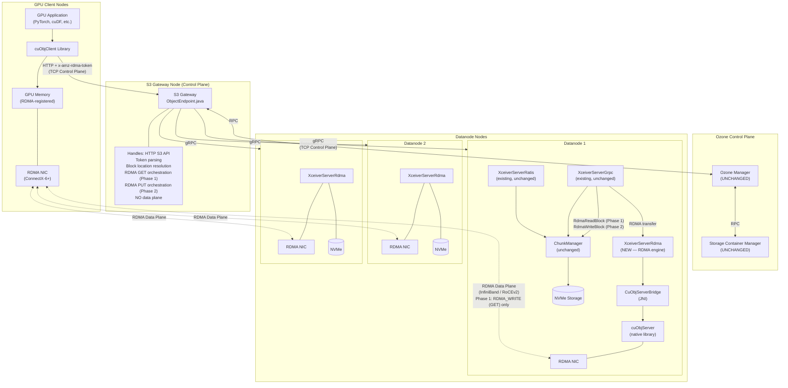

> **Phase 1 note:** In Phase 1, the RDMA data plane carries only RDMA_WRITE operations (datanode → GPU client, for GET).
> RDMA_READ operations (GPU client → datanode, for PUT) are Phase 2. In Phase 1, all S3 PUT requests use the TCP path
> regardless of whether an `x-amz-rdma-token` header is present.

> **Storage device note:** The diagrams throughout this spec label storage as "NVMe" because NVMe SSDs are the expected
> storage medium for RDMA-capable deployments — their throughput (3–7 GB/s per drive) matches what RDMA can deliver.
> However, **NVMe is NOT a requirement.** Ozone reads and writes block data through `FileChannel.read()` /
> `FileChannel.write()`, which work with any filesystem-backed storage: HDD, SATA SSD, NVMe, or network-attached
> storage. HDD will work functionally but will bottleneck at ~150–200 MB/s per disk, far below the RDMA NIC's capacity
> (12–50 GB/s). See [Section 5.4](#54-rdma-buffer-management-whose-memory-and-why) for the full disk-to-NIC data flow.

#### Single-Node Development Topology

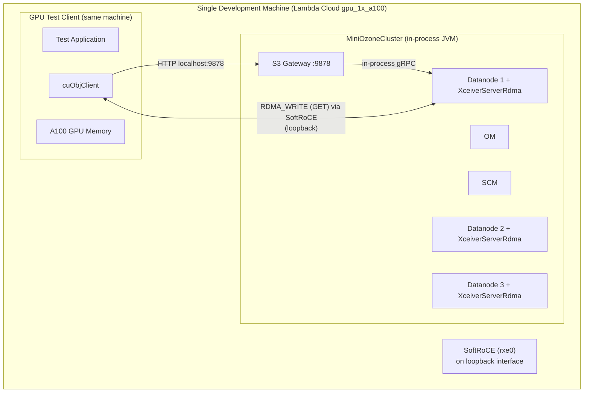

#### Multi-Node Production Topology


### 1.2 Data Flow: S3 GET (Read Path)

The GET path is the **only RDMA path in Phase 1**. The flow is:

1. `cuObjClient` allocates and registers GPU memory, generating an RDMA token via
   [`cuMemObjGetDescriptor()`](https://docs.nvidia.com/gpudirect-storage/cuobject/cuObjClient-api/index.html) [[ref-17]](#10-references)
2. Client sends HTTP GET with `x-amz-rdma-token` header to the S3 Gateway
3. Gateway resolves block locations via Ozone Manager
4. Gateway dispatches one `RdmaReadBlock` gRPC command per block, each carrying: the RDMA token, block coordinates,
   the `destOffset` (byte offset within the client's GPU buffer where this block's data should land), and the block
   authorization token
5. Each datanode reads block data from disk into a pre-registered RDMA buffer, then calls
   [`handleGetObject()`](https://docs.nvidia.com/gpudirect-storage/cuobject/cuObjServer-api/index.html) [[ref-18]](#10-references)
   to RDMA_WRITE the data directly into the client's GPU memory at the specified `destOffset`
6. Gateway waits for all datanodes to report completion, then returns HTTP 200 with metadata only — the data is
   already in GPU memory

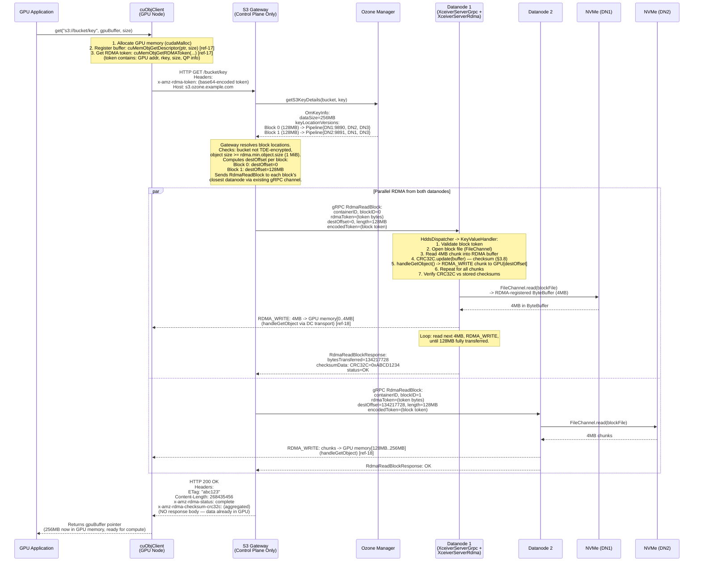

**The `destOffset` field is critical for correctness.** A multi-block object requires each datanode to know
exactly where within the client's flat GPU buffer its block's data should land. Block 0 starts at offset 0, Block 1
starts at the cumulative byte offset of all preceding blocks. Without `destOffset`, concurrent RDMA writes from
multiple datanodes would overwrite each other. See [Section 4.1](#41-protocol-buffer-changes) for the
`RdmaReadBlockRequestProto` field definition.

### 1.3 Data Flow: S3 PUT (Write Path)

**The S3 PUT RDMA path is deferred to Phase 2.**

In Phase 1, all S3 PUT requests use the standard TCP path regardless of whether an `x-amz-rdma-token` header is
present. The S3 Gateway ignores `x-amz-rdma-token` on PUT requests entirely and processes them through the existing
`KeyOutputStream` → Ratis write pipeline.

See [Appendix B](#appendix-b-phase-2-deferred-items) for:
- The full Phase 2 PUT sequence diagram
- The `RdmaWriteBlock` protobuf message design
- The `handlePutObject()` integration pattern for the datanode
- Known shortcomings of the write path design (Ratis replication interaction, chunk ordering)
- Rationale for deferral

### 1.4 Fallback Path

The fallback logic runs entirely in the S3 Gateway (`ObjectEndpoint`) before any datanode communication. If any
condition makes RDMA unsuitable, the gateway falls back to the existing TCP path transparently.

In Phase 1, write requests **always** take the TCP fallback regardless of conditions — the RDMA check is only
triggered for GET requests.

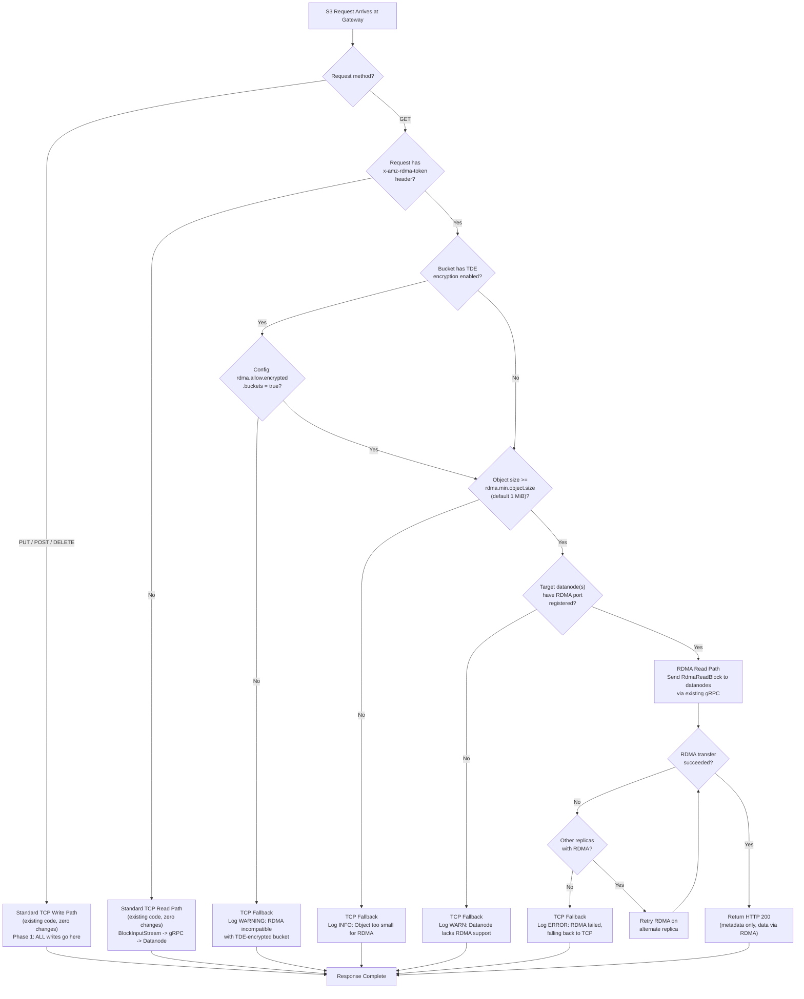

### 1.5 Component Interaction Map

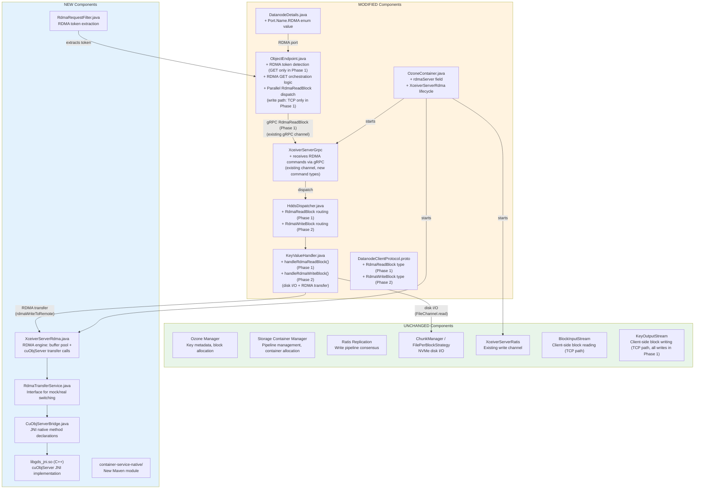

### 1.6 Request Dispatch Model

**There is exactly one dispatch path for RDMA commands.** This section resolves any ambiguity.

RDMA commands (`RdmaReadBlock` in Phase 1) travel via the **existing gRPC channel** (`XceiverServerGrpc`) to the
datanode. They are dispatched through the **existing `HddsDispatcher`** to `KeyValueHandler`, which performs **both**
disk I/O and RDMA transfers. `XceiverServerRdma` is **not** a separate gRPC service — it is an RDMA engine (buffer
pool + cuObjServer wrapper) used by `KeyValueHandler`.

In Phase 1, only `RdmaReadBlock` commands are dispatched. `RdmaWriteBlock` is Phase 2.

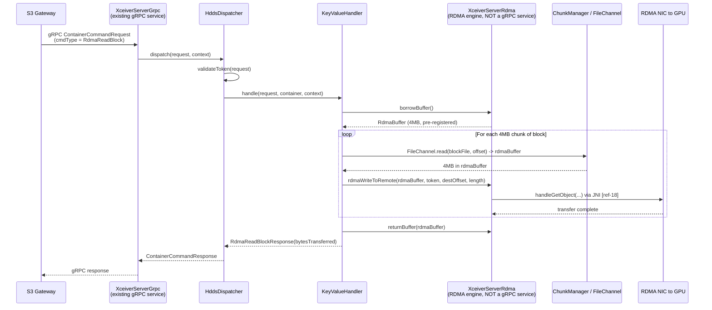

**Why this model:**

| Alternative | Why Rejected |
|---|---|
| Separate gRPC service on XceiverServerRdma | Adds a new network port, new service definition, new connection management. Unnecessary complexity. |
| Gateway sends directly to XceiverServerRdma | Bypasses HddsDispatcher's token validation, container state checks, and metrics. Duplicates security logic. |
| KeyValueHandler stubs that delegate to RDMA | Creates confusion about where disk I/O vs RDMA happens. KeyValueHandler should own the full operation (disk + RDMA). |

### 1.7 Multiple S3 Gateway Architecture

Apache Ozone supports deploying **multiple S3 Gateways** behind a load balancer. A common production
topology is **one S3 Gateway per datanode** (co-located on the same host). This section explains why
the RDMA path requires **no special handling** for multiple gateways.

#### 1.7.1 S3 Gateways Are Stateless

Each S3 Gateway is a stateless HTTP/S3 endpoint. It holds no per-request state between calls — every
incoming request is self-contained:

1. Client sends `GET /bucket/key` with `x-amz-rdma-token` header to **any** gateway (via load balancer)
2. That gateway resolves block locations by calling `OzoneManager.getKeyInfo()` (or `getS3KeyDetails()`)
3. The Ozone Manager returns `OmKeyInfo` with `OmKeyLocationInfo` entries — each entry identifies the
   **specific datanodes** holding that block's replicas (via `Pipeline`)
4. The gateway dispatches `RdmaReadBlock` gRPC requests **only** to the datanodes listed in the location
   info — not to all datanodes

**No cross-gateway coordination is needed.** Two gateways handling concurrent requests for the same key
will each independently resolve the same block locations from the Ozone Manager and dispatch to the same
datanodes. The datanodes handle concurrent RDMA transfers via channel-based concurrency
(`allocateChannelId()` / `freeChannelId()` [[ref-18]](#10-references)).

#### 1.7.2 Dispatch Topology

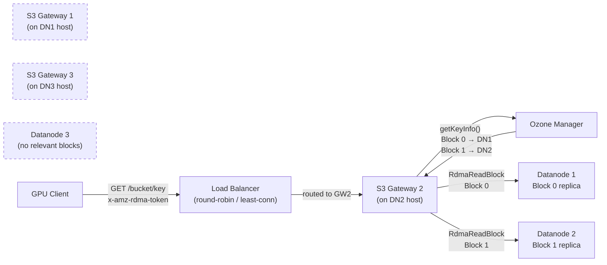

Note that GW2 dispatches **only** to DN1 and DN2 (which hold the requested blocks). DN3 is not contacted
even though it has a co-located gateway. The gateway-per-datanode topology provides **locality benefits**
for the gRPC control plane (lower latency for the `RdmaReadBlock` request/response) but is not required.

#### 1.7.3 No Affinity Required

The load balancer does **not** need session affinity or sticky sessions for RDMA requests:

- The `x-amz-rdma-token` is self-contained — any gateway can use it to instruct any datanode to
  RDMA_WRITE to the client's GPU
- The RDMA data path is datanode-to-GPU-client direct — it does not flow through the gateway
- The gateway only relays metadata (block locations, checksums, status) over HTTP

**Load balancer recommendation:** Use simple round-robin or least-connections. No RDMA-specific
configuration is needed at the load balancer layer.

#### 1.7.4 Rolling Upgrade with Mixed Gateways

During a rolling upgrade, some S3 Gateways may have the RDMA-aware code while others do not:

| Gateway Version | Behavior |
|---|---|
| **Old** (pre-RDMA) | Ignores `x-amz-rdma-token` header, serves via standard TCP path. Client gets normal S3 response with body data. |
| **New** (RDMA-aware) | Detects `x-amz-rdma-token`, dispatches RDMA if datanodes support it, else falls back to TCP. |

This is safe because:
- Old gateways treat the RDMA header as an unknown custom header and ignore it (standard HTTP behavior)
- The cuObjClient receives a normal TCP response and falls back to CPU-side data handling
- No data loss or corruption occurs — only a performance regression during the mixed-version window

**Recommendation:** Upgrade all S3 Gateways before finalizing the RDMA layout version on datanodes.
This ensures that RDMA-capable datanodes have RDMA-aware gateways to dispatch to them.

---

## 2. GPU Memory Semantics and Data Consumption Model

### 2.1 Transfer Model: Complete vs Streaming

cuObject operates on a **complete-transfer model**
[[ref-1]](https://docs.nvidia.com/gpudirect-storage/cuobject/index.html). Unlike TCP-based S3 clients that stream
data byte-by-byte, cuObjClient requires the entire requested object (or range) to be fully transferred before the
application can access any of the data.

**Why complete transfer?** RDMA_WRITE operations are one-sided — the remote (datanode) writes directly to the client's
GPU memory without the client's CPU being involved. The client has no way to know how many bytes have arrived until the
entire operation completes and a completion event is signaled.

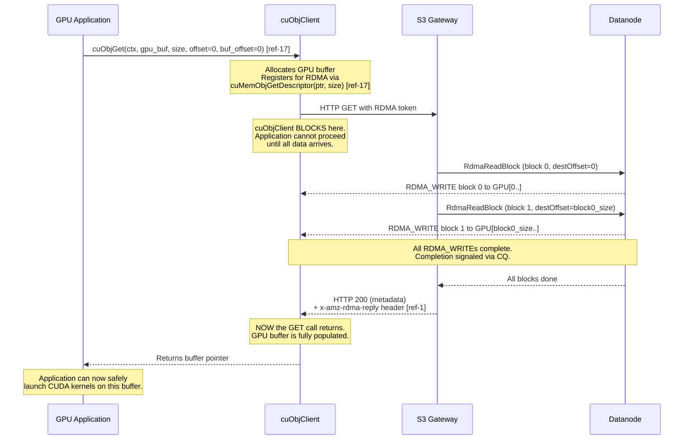

**Contrast with TCP streaming:**

| Aspect | TCP S3 Client (boto3) | cuObjClient (RDMA) |
|---|---|---|
| Data access | Stream: process bytes as they arrive | Complete: all-or-nothing |
| First byte usable | Immediately | Only after full transfer |
| Buffer allocation | Can use small buffer, process in chunks | Must allocate full object size upfront |
| Partial failure | Can use partial data | Either complete or nothing |
| CPU involvement | CPU copies every byte | Zero-copy to GPU |

**Implication:** The GPU application must know the object size upfront and allocate a buffer of that size. For the S3
GET path, the object size is returned in `OmKeyInfo.getDataSize()` and can be communicated to cuObjClient.

**Double-Buffering Pattern:**

cuObjClient GET is synchronous and cannot be overlapped with CUDA computation on the same buffer. However, applications
can use **double-buffering** to overlap I/O and compute:

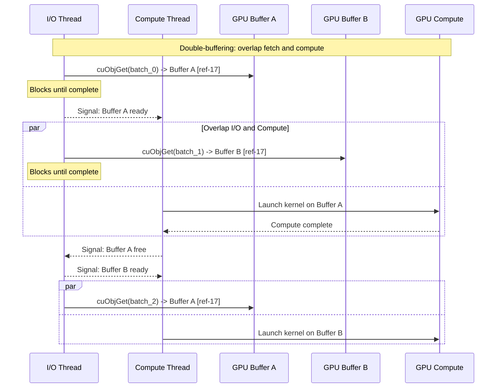

### 2.2 Synchronous vs Asynchronous API Behavior

This section documents the sync/async behavior of cuObject APIs as published in the NVIDIA documentation. Understanding
this is critical because it determines how our datanode and gateway code must be structured.

#### Client-Side (cuObjClient) [[ref-17]](https://docs.nvidia.com/gpudirect-storage/cuobject/cuObjClient-api/index.html)

| API | Behavior | Notes |
|---|---|---|
| [`cuObjGet(void* ctx, void* ptr, size_t size, loff_t offset = 0, loff_t buf_offset = 0)`](https://docs.nvidia.com/gpudirect-storage/cuobject/cuObjClient-api/index.html) [[ref-17]](#10-references) | **Synchronous (blocking)** | No CUDA stream parameter, no future/promise return, no async completion callback for the data plane. The `CUObjOps_t` callback mechanism is for the HTTP control path (sending the S3 request), not for signaling data arrival. The `buf_offset` parameter specifies where within `ptr` to start writing data (defaults to 0). |
| [`cuObjPut(void* ctx, void* ptr, size_t size, loff_t offset = 0, loff_t buf_offset = 0)`](https://docs.nvidia.com/gpudirect-storage/cuobject/cuObjClient-api/index.html) [[ref-17]](#10-references) | **Synchronous (blocking)** | Phase 2. Same signature pattern as GET. `buf_offset` specifies where within `ptr` to start reading data for upload. |

**Why the client is blocking**: RDMA_WRITE is a one-sided operation — the server writes directly to client GPU
memory without CPU involvement on the client side. The client has no way to observe partial completion. The only
reliable way to know all data has arrived is to wait for the HTTP response (which includes `x-amz-rdma-reply`
[[ref-1]](https://docs.nvidia.com/gpudirect-storage/cuobject/index.html)), which means the call must block until the
server confirms all RDMA writes are complete.

**What this means for applications**: The thread calling `cuObjGet()` blocks until the entire object (or range) is in
GPU memory. Applications overlap I/O and compute using **double-buffering** (see the double-buffering diagram in
Section 2.1).

#### Server-Side (cuObjServer) [[ref-18]](https://docs.nvidia.com/gpudirect-storage/cuobject/cuObjServer-api/index.html)

| API | Behavior | Source |
|---|---|---|
| [`handleGetObject(const std::string& key, struct rdma_buffer* local_rdma_buff, uint64_t remote_buf_start, size_t size, const std::string& rdma_descr, uint16_t channel = 0, uint64_t local_offset = 0, ibv_wc_status* status = nullptr, void* async_handle = nullptr)`](https://docs.nvidia.com/gpudirect-storage/cuobject/cuObjServer-api/index.html) [[ref-18]](#10-references) | **Both sync and async supported** | Pass `async_handle = nullptr` for synchronous. Pass a non-null `async_handle` for async; poll completion via `poll()`. |
| [`handlePutObject(...)`](https://docs.nvidia.com/gpudirect-storage/cuobject/cuObjServer-api/index.html) [[ref-18]](#10-references) | **Both sync and async supported** | Phase 2. Same signature pattern as GET. RDMA_READ from client GPU. |
| [`poll(cuObjAsyncEvent_t* events, int max_events, uint16_t channel = 0)`](https://docs.nvidia.com/gpudirect-storage/cuobject/cuObjServer-api/index.html) [[ref-18]](#10-references) | **Async completion polling** | Used with async `handleGetObject`/`handlePutObject` calls. Phase 2. |

**Phase 1 decision**: We use **synchronous** server-side transfers (`async_handle = nullptr`). The flow is:

1. Read block chunk from NVMe into RDMA-registered buffer (blocking disk I/O)
2. Call `handleGetObject()` synchronously (blocking RDMA_WRITE) [[ref-18]](#10-references)
3. Repeat for all chunks in the block
4. Return completion to S3 Gateway

Async pipelining (overlapping disk I/O and RDMA transfers) is deferred to Phase 2 (see
[Appendix B](#appendix-b-phase-2-deferred-items)).

#### Per-Operation Limits

| Limit | Value | Source | Implication |
|---|---|---|---|
| **Max per server RDMA operation** | **1 GiB** | [[ref-3]](https://docs.nvidia.com/gpudirect-storage/cuobject/cuobject-server-release-notes/) | Each `handleGetObject()` call can transfer at most 1 GiB. For Ozone blocks larger than 1 GiB, the datanode must break the transfer into multiple operations. Default Ozone block size is 256 MB, so this rarely applies. |
| **Max scatter-gather entries** | **10** per operation (configurable via `max_sge` in `cuObjRDMATunable`) | [[ref-18]](https://docs.nvidia.com/gpudirect-storage/cuobject/cuObjServer-api/index.html) | See [Section 2.9](#29-scatter-gather-support) |
| **Client-side registration limit** | **4 GiB per call** (`CUOBJ_MAX_MEMORY_REG_SIZE = 4ULL * 1024 * 1024 * 1024`) | [[ref-17]](https://docs.nvidia.com/gpudirect-storage/cuobject/cuObjClient-api/index.html) | For objects larger than 4 GiB, the client must issue multiple registrations or use Range GET with chunked buffers. See [Section 2.4](#24-files-larger-than-gpu-memory). |

### 2.3 Small Files (< 1 MiB)

RDMA has per-transfer overhead that dominates for small objects:

| Overhead Source | Typical Duration | Notes |
|---|---|---|
| GPU memory registration (RDMA buffer setup) | 10µs–1ms | One-time per buffer if reused [[ref-1]](https://docs.nvidia.com/gpudirect-storage/cuobject/index.html) |
| DC connection setup | 5–50µs | Dynamic Connected transport reduces this vs RC [[ref-1]](https://docs.nvidia.com/gpudirect-storage/cuobject/index.html) |
| Completion polling | 1–10µs | CQ notification |
| HTTP round-trip (control plane) | 500µs–5ms | S3 Gateway → OM → Datanode orchestration |
| RDMA data transfer | varies | ~1µs for 4KB at 200Gbps, ~500µs for 100MB |

**Performance crossover characteristics:**

- Below ~64KB: RDMA overhead dominates. TCP is faster because the data fits in a few TCP packets and the kernel
  network stack is highly optimized for small transfers.
- 64KB–256KB: Transitional zone. RDMA and TCP are roughly equivalent.
- 256KB–1MiB: RDMA begins to show advantage as NIC-offloaded transfer outpaces TCP's per-packet CPU overhead.
- Above 1MiB: RDMA is clearly faster, with advantage growing with object size.
- Above 100MB: RDMA can deliver 2–8x the throughput of TCP
  [[ref-10]](https://www.min.io/blog/minio-aistor-with-nvidia-gpudirect-r-rdma-for-s3-compatible-storage-unlocking-performance-for-ai-factory-workloads).

**Implementation:**

```text
Config key: ozone.s3g.rdma.min.object.size
Default:    1048576 (1 MiB)
Type:       long (bytes)
```

When the S3 Gateway detects an RDMA token, it checks `OmKeyInfo.getDataSize()` (available from OM metadata before any
data transfer). If the object size is below the threshold, the gateway ignores the RDMA token and uses the standard TCP
path. This is transparent to the client — cuObjClient will receive the data via the HTTP response body instead of RDMA,
which it handles as a fallback.

### 2.4 Files Larger Than GPU Memory

**The problem**: A 100 GB Parquet file is stored in Ozone, but the GPU has only 50 GB of memory (e.g., A100 80 GB with
50 GB available after model weights). The application cannot allocate a 100 GB GPU buffer. How does the client handle
this?

**The solution**: The application reads the object in chunks that fit in available GPU memory using **Range GET** (S3
`Range` header). The
[`cuObjGet()`](https://docs.nvidia.com/gpudirect-storage/cuobject/cuObjClient-api/index.html) [[ref-17]](#10-references)
function includes an `loff_t offset` parameter, and `RANGE_GET` is a documented cuObject v1 operation
[[ref-1]](https://docs.nvidia.com/gpudirect-storage/cuobject/index.html). The `buf_offset` parameter further allows
the application to specify where within the registered GPU buffer the data should start, enabling flexible buffer
management. The client-side memory registration via
[`cuMemObjGetDescriptor(void* ptr, size_t size)`](https://docs.nvidia.com/gpudirect-storage/cuobject/cuObjClient-api/index.html)
[[ref-17]](#10-references) has a **4 GiB per-call limit** (`CUOBJ_MAX_MEMORY_REG_SIZE`). For buffers larger than 4 GiB,
the client must issue multiple registration calls or use Range GET with smaller buffers.

The server-side has a confirmed **1 GiB per-operation limit**
[[ref-3]](https://docs.nvidia.com/gpudirect-storage/cuobject/cuobject-server-release-notes/). For a single Range GET
requesting 4 GB, the datanode will issue 4 sequential RDMA operations of up to 1 GiB each.

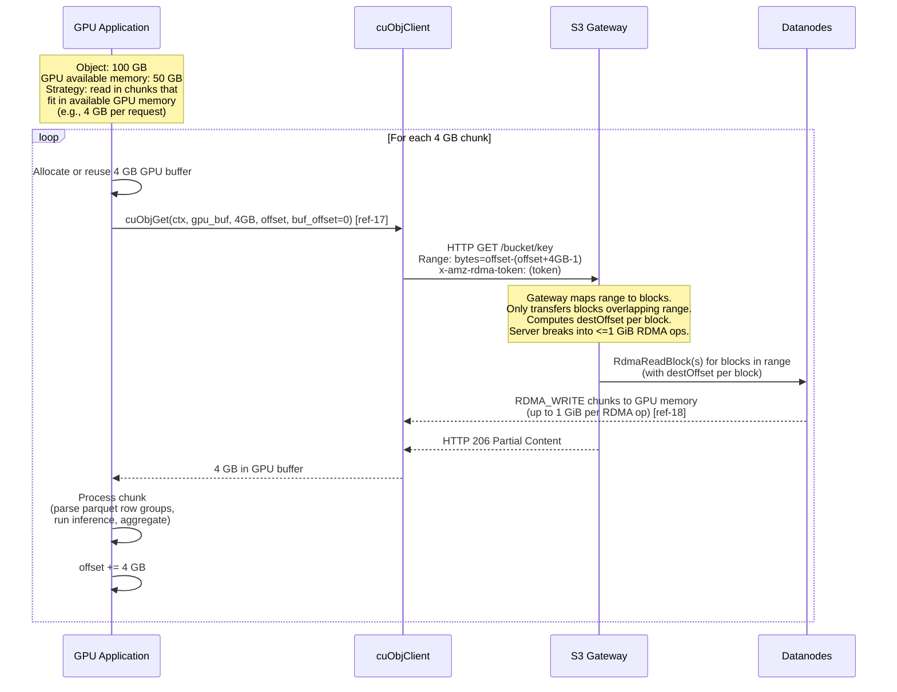

**Range handling in the RDMA path:**

The S3 Gateway already supports Range headers via `RangeHeaderParserUtil` in `ObjectEndpoint.handleGetRequest()`.
For the RDMA path:

1. Gateway parses `Range: bytes=START-END` from the HTTP request
2. Gateway maps the byte range to specific blocks using `OmKeyLocationInfo` list
3. For each block that overlaps the range, gateway calculates the block-local offset and length
4. Gateway sends `RdmaReadBlock` with the calculated offset, length, and `destOffset` within the GPU buffer
5. Only the requested range is RDMA-transferred — no wasted bandwidth

**For writes (PUT):** Large objects must use S3 Multipart Upload. In Phase 1, all PUT requests use TCP.
Multipart upload via RDMA is a Phase 2 feature (see [Appendix B](#appendix-b-phase-2-deferred-items)).

#### Partial Processing of Structured Files (e.g., Parquet)

The question "can the GPU even process partial data?" depends on the file format, not on RDMA or Ozone:

**Parquet files** — **Yes, designed for partial reads.** The file footer (last few KB) contains metadata about row
groups and column chunks, including their byte offsets. A GPU application can:

1. Range GET the footer (last N bytes) → parse metadata on GPU
2. Identify which row groups/columns are needed for the query
3. Range GET only those specific byte ranges → GPU memory
4. Process with cuDF or a custom CUDA kernel

This is exactly how cuDF + KvikIO already works with S3 [[ref-14]](https://github.com/rapidsai/kvikio). The parquet
footer-first access pattern is well-suited to RDMA because each Range GET is a targeted read, not a full-object scan.

**Other formats:**

- **ORC**: Similar to Parquet — has stripe-level metadata enabling partial reads.
- **CSV/JSON**: Can be split at line boundaries, but finding boundaries requires reading. Typically read in fixed-size
  chunks with overlap to handle partial last records.
- **Raw tensors (`.pt`, `.npy`)**: Application must know the tensor layout. Can read individual tensors by byte offset
  if the file format supports it.

**Ozone does not need special handling.** The client application is responsible for deciding chunk sizes and byte
ranges. Ozone's S3 Gateway handles Range headers the same way whether the transport is TCP or RDMA — only the data
plane changes.

### 2.5 Multiple Concurrent Requests

**Multiple threads on one GPU:**

cuObjClient supports concurrent GET operations on **different** GPU buffers from multiple threads. It does NOT
support concurrent operations on the same buffer — this would cause data corruption
[[ref-1]](https://docs.nvidia.com/gpudirect-storage/cuobject/index.html). The cuObjServer side is fully
multi-threaded and handles concurrent RDMA operations from multiple clients
[[ref-3]](https://docs.nvidia.com/gpudirect-storage/cuobject/cuobject-server-release-notes/).

**Multiple applications on one GPU:**

NVIDIA MPS (Multi-Process Service) or CUDA MIG (Multi-Instance GPU) allows multiple processes to share a GPU. Each
process can independently use cuObjClient with its own GPU memory allocations. The RDMA memory registrations are
per-process.

**Multiple GPUs on one node** — see [Section 2.6](#26-multi-gpu-setups) for full coverage.


**Datanode-side concurrency:**

`XceiverServerRdma` must be thread-safe. The RDMA buffer pool and concurrency controls follow the existing pattern from
`XceiverServerGrpc` (which uses `threadCountPerDisk * numberOfDisks` threads):

- Each `RdmaReadBlock` request is handled in a separate gRPC thread (from `XceiverServerGrpc`'s pool)
- cuObjServer's
  [`handleGetObject()`](https://docs.nvidia.com/gpudirect-storage/cuobject/cuObjServer-api/index.html) [[ref-18]](#10-references)
  is thread-safe internally
  [[ref-3]](https://docs.nvidia.com/gpudirect-storage/cuobject/cuobject-server-release-notes/)
- RDMA buffer pool uses `ArrayBlockingQueue` for thread-safe borrow/return
- Each concurrent operation should use a separate channel, allocated via
  [`allocateChannelId()`](https://docs.nvidia.com/gpudirect-storage/cuobject/cuObjServer-api/index.html) [[ref-18]](#10-references)
  and released via
  [`freeChannelId(uint16_t channel_id)`](https://docs.nvidia.com/gpudirect-storage/cuobject/cuObjServer-api/index.html)
  [[ref-18]](#10-references) when the transfer is complete

**Rate limiting:**

```text
Config key: ozone.datanode.rdma.max.concurrent.transfers
Default:    32
Type:       int
Description: Maximum number of concurrent RDMA operations per datanode.
             Prevents exhausting RDMA QP resources or NIC bandwidth.
```

Enforce via a `Semaphore(maxConcurrentTransfers)` acquired before each RDMA operation and released on completion.

### 2.6 Multi-GPU Setups

This section covers how cuObject and our implementation handle multiple GPUs — both on the same node and across
different nodes.

#### Multiple GPUs on the Same Node

A common GPU server configuration is 4–8 GPUs per node (e.g., 8x H100 SXM in a DGX H100). Each GPU has its own
physical memory address space. RDMA memory registration is per-physical-address-space, and CUDA allocations are
device-bound.

**Each GPU requires its own cuObjClient instance** (or at minimum, separate buffer registrations and RDMA tokens per
GPU). A buffer allocated on GPU 0 cannot be used for an RDMA transfer targeting GPU 1 — the RDMA token encodes the
physical memory address and NIC routing info specific to that GPU's PCIe path. This follows directly from CUDA and
RDMA fundamentals: `cudaMalloc` on device 0 returns an address in device 0's address space, and `ibv_reg_mr()` pins
the physical pages backing that virtual address [[ref-6]](https://docs.nvidia.com/cuda/gpudirect-rdma/).

**NIC topology**: In multi-GPU nodes with multiple NICs (e.g., 8 GPUs + 8 ConnectX-7 NICs on DGX H100), each GPU uses
its nearest NIC for optimal PCIe bandwidth. NVIDIA's GPUDirect RDMA routing policy handles this automatically
[[ref-6]](https://docs.nvidia.com/cuda/gpudirect-rdma/).

**Implication for Ozone**: The S3 Gateway does not need to be aware of multi-GPU topology. Each cuObjClient instance
generates its own RDMA token with the correct NIC and memory addressing baked in. The datanode's cuObjServer uses the
token as-is. No Ozone-side changes are needed.

#### GPUs Across Different Nodes

This is cuObject's primary design target. The DC (Dynamically Connected) transport is specifically chosen to handle
the N-client × M-server scaling problem without pre-established connections
[[ref-1]](https://docs.nvidia.com/gpudirect-storage/cuobject/index.html).

Each GPU node runs cuObjClient independently. RDMA tokens are self-contained — they encode the client's memory
address, rkey, and NIC addressing. A datanode receiving a token from Node A's GPU 3 vs Node B's GPU 7 handles them
identically: parse token, perform RDMA transfer.

**Scaling**: With DC transport, the number of active RDMA connections scales as O(active_transfers), not O(clients ×
servers). A GPU node only maintains connections to the datanodes it is currently transferring data from.

#### Implications for Our Architecture, Implementation, and Testing

| Concern | Impact on Ozone | Action Required |
|---|---|---|
| Multiple GPUs on same node | Each cuObjClient generates its own RDMA token; Ozone sees independent S3 requests | None — transparent to Ozone |
| Multiple GPU nodes | DC transport handles scaling; each node is an independent S3 client | None — transparent to Ozone |
| GPU-NIC affinity | cuObjClient handles NIC selection; encoded in RDMA token | None — transparent to Ozone |
| Concurrent requests from N GPUs | S3 Gateway and datanodes must handle N concurrent RDMA transfers | Config: `ozone.datanode.rdma.max.concurrent.transfers` should account for multi-GPU clients (e.g., set to 64+ for an 8-GPU node) |
| GPU memory isolation | Each GPU's memory is separate; RDMA tokens are GPU-specific | None — hardware-guaranteed |

### 2.7 GPU Application Consumption Pattern

#### Example 1: PyTorch Training Data Loading

```python
# PyTorch DataLoader with cuObjClient backend
class GDSDataset(torch.utils.data.IterableDataset):
    def __init__(self, bucket, prefix, gpu_id=0):
        self.bucket = bucket
        self.prefix = prefix
        self.gpu_id = gpu_id
        self.cuobj = cuobjclient.Client(endpoint="http://s3gw:9878")

    def __iter__(self):
        for key in self._list_objects():
            # cuObjClient handles: GPU buffer alloc, RDMA registration
            # (via cuMemObjGetDescriptor), token generation, HTTP request,
            # RDMA transfer
            gpu_buffer = self.cuobj.get(
                f"s3://{self.bucket}/{key}",
                device=self.gpu_id
            )
            # gpu_buffer is now a CUdeviceptr — data is in GPU memory
            # Parse directly on GPU using cuDF or custom CUDA kernel
            tensor = self._parse_parquet_gpu(gpu_buffer)
            yield tensor
```

#### Example 2: RAPIDS cuDF Analytics

```python
import cudf

# KvikIO -> cuObjClient integration [ref-14]
# cuDF internally uses KvikIO for S3 reads
# KvikIO detects cuObjClient availability and uses RDMA when possible
df = cudf.read_parquet("s3://datalake/table.parquet",
                       storage_options={"endpoint_url": "http://s3gw:9878"})

# Data is now in GPU memory — arrived via RDMA, never touched CPU
result = df.groupby("col").agg({"val": "sum"}).compute()
```

### 2.8 What Happens If Application Reads Before Transfer Completes?

[`cuObjGet()`](https://docs.nvidia.com/gpudirect-storage/cuobject/cuObjClient-api/index.html) [[ref-17]](#10-references)
is a **blocking call**. The function does not return until all RDMA_WRITEs from all datanodes are complete and the HTTP
response (including `x-amz-rdma-reply` [[ref-1]](https://docs.nvidia.com/gpudirect-storage/cuobject/index.html)) has
been received. The application physically cannot read the buffer before the call returns because the function call
hasn't returned yet.

If an application somehow circumvents this (e.g., another thread reads the GPU memory address before GET returns), the
result is **undefined behavior**:

- The memory may contain partial data (some blocks transferred, others not yet)
- The memory may contain zeros (freshly allocated via `cudaMalloc`)
- The memory may contain stale data from a previous use of the buffer

**No special handling needed in our Ozone implementation.** cuObjClient manages all synchronization on the client
side. The S3 Gateway returns HTTP 200 only after all datanodes report completion, and cuObjClient waits for both the
RDMA completions and the HTTP response before returning.

### 2.9 Scatter-Gather Support

cuObjServer supports scatter-gather I/O via
[`getRDMABufferFromSgList(struct rdma_buffer*, std::vector<cuObjScatterGatherEntryWithOffset_t>)`](https://docs.nvidia.com/gpudirect-storage/cuobject/cuObjServer-api/index.html)
[[ref-18]](#10-references), with up to 10 entries per operation (configurable via `max_sge` in
`cuObjRDMATunable` [[ref-18]](#10-references)). This allows a single RDMA operation to write to non-contiguous GPU
memory regions (or read from non-contiguous regions).

**Phase 1: contiguous buffers only.** Scatter-gather is deferred to Phase 2. The rationale:

- Contiguous transfers satisfy the primary use case (loading full tensor/parquet files into GPU memory)
- Scatter-gather adds complexity to the JNI bridge and the `RdmaReadBlock` message format
- The `destOffset` field in `RdmaReadBlockRequestProto` (see [Section 4.1](#41-protocol-buffer-changes)) already
  solves the multi-block ordering problem without scatter-gather
- Phase 2 will add scatter-gather for advanced use cases such as columnar reads (fetching non-contiguous Parquet
  column chunks into a single registered buffer)

---

## 3. Security and Encryption

### 3.1 Ozone Security Layers Overview

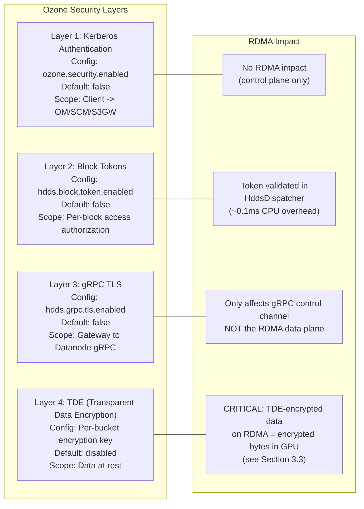

| Layer | What It Does | Default | Config Key | RDMA Impact |
|---|---|---|---|---|
| **Kerberos** | Client→OM/SCM/S3GW authentication | OFF | `ozone.security.enabled` | Control plane only — no RDMA impact |
| **Block Tokens** | Short-lived JWTs authorizing block access | OFF | `hdds.block.token.enabled` | Validated in `HddsDispatcher` before RDMA op (~0.1ms CPU) |
| **gRPC TLS** | Encrypts gRPC between gateway↔datanode | OFF | `hdds.grpc.tls.enabled` | Only affects gRPC control channel. RDMA data plane is separate. |
| **TDE** | AES-CTR encryption at rest | OFF (per-bucket) | Bucket creation flag | **Critical** — see [Section 3.3](#33-tde-transparent-data-encryption-and-rdma) |

**Key insight:** By default, ALL security layers are OFF. For development and benchmarking, no security configuration
is needed.

### 3.2 Security Architecture in the RDMA Path

The sequence below shows the read path (S3 GET via RDMA) with all security layers enabled. In Phase 1 this is
the only RDMA path; write security is deferred to Phase 2.

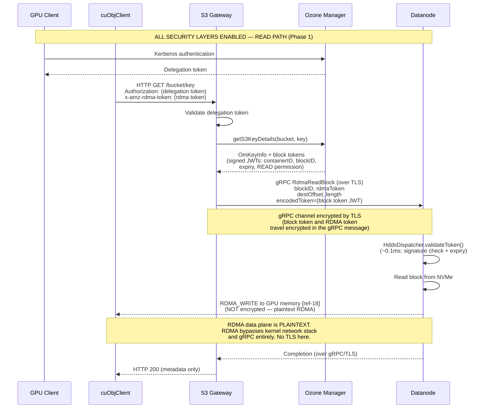

**Important:** The RDMA data plane is inherently **not encrypted**. RDMA bypasses the kernel network stack and gRPC
entirely. Data travels as plaintext over InfiniBand/RoCEv2. This is by design — encryption would require a
CPU/host-memory bounce, defeating zero-copy [[ref-6]](https://docs.nvidia.com/cuda/gpudirect-rdma/).

### 3.3 TDE (Transparent Data Encryption) and RDMA

**How TDE works in Ozone today:**

TDE is enabled per-bucket by associating a KMS encryption key at bucket creation. The encryption/decryption pipeline:

- **Write path:** S3 Gateway wraps `OzoneOutputStream` with `CipherOutputStreamOzone`. Data is encrypted with AES-CTR
  **before** it reaches the datanode. Datanodes store already-encrypted bytes.
- **Read path:** S3 Gateway wraps the read stream with `OzoneCryptoInputStream` which decrypts using `javax.crypto`.
  The client receives plaintext.

**TDE and RDMA — the conflict:**

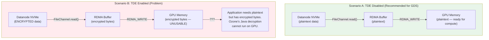

**Implementation:**

When S3 Gateway detects an RDMA token AND the bucket has TDE enabled:

1. Check config `ozone.s3g.rdma.allow.encrypted.buckets` (default: `false`)
2. If `false`: fall back to TCP path, log warning:
   ```
   WARN: RDMA transfer requested for TDE-encrypted bucket '{}'.
   Falling back to TCP path. Set ozone.s3g.rdma.allow.encrypted.buckets=true
   to transfer encrypted bytes via RDMA (application must decrypt on GPU).
   ```
3. If `true`: proceed with RDMA — encrypted bytes are written to GPU memory. The application is responsible for
   GPU-side decryption.

**How to detect TDE:** The S3 Gateway can check if the bucket has an encryption key by examining
`OmBucketInfo.getEncryptionKeyInfo()`. If it returns non-null, TDE is enabled for the bucket.

### 3.4 Block Token Validation in XceiverServerRdma

Block token validation for RDMA commands uses the **existing** `HddsDispatcher.validateToken()` path — no new
validation logic is needed. RDMA commands are dispatched through `HddsDispatcher` just like existing commands (see
[Section 1.6](#16-request-dispatch-model)), so they automatically inherit token validation.

The existing pattern in `HddsDispatcher` (line ~244–252 in `HddsDispatcher.java`):

```java
if (DispatcherContext.op(dispatcherContext).validateToken()) {
    validateToken(msg);
}
```

Where `validateToken()` calls:

```java
private void validateToken(ContainerCommandRequestProto msg) throws IOException {
    tokenVerifier.verify(msg, msg.getEncodedToken());
}
```

The `TokenVerifier` is created in `OzoneContainer` constructor (line ~228) via
`TokenVerifier.create(secConf, secretKeyClient)`, which returns `NoopTokenVerifier` when security is disabled (zero
overhead) or `CompositeTokenVerifier(BlockTokenVerifier, ContainerTokenVerifier)` when enabled.

**For RDMA commands:** The `encodedToken` field in `RdmaReadBlockRequestProto` is copied into the
`ContainerCommandRequestProto.encodedToken` field, and the existing validation path handles it. No new validation
code is required.

### 3.5 RDMA Transport Security

**RDMA data is NOT encrypted in transit.** InfiniBand and RoCEv2 do not provide encryption by default
[[ref-6]](https://docs.nvidia.com/cuda/gpudirect-rdma/).

**Authorization model:**

- The `x-amz-rdma-token` [[ref-1]](https://docs.nvidia.com/gpudirect-storage/cuobject/index.html) contains the RDMA
  memory region key (`rkey`) and remote memory address
- Without a valid `rkey`, a remote host cannot RDMA into GPU memory — the NIC's hardware access control rejects the
  request
- Block tokens provide an additional authorization layer (the datanode verifies the client is authorized for the
  specific block via HddsDispatcher)

**Network-level isolation:**

- RDMA traffic should run on a dedicated fabric: InfiniBand subnet or VLAN for RoCE
- Physical network isolation prevents unauthorized access to the RDMA fabric
- InfiniBand partitioning (pkeys) provides additional isolation within a fabric

**RDMA token size:** The `x-amz-rdma-token` string is generated by `cuMemObjGetRDMAToken()` [[ref-17]](#10-references)
and contains the rkey, virtual address, and DC transport metadata. Token size is typically **200-500 bytes**
(base64-encoded), well within HTTP header limits (default 8 KB in most HTTP servers) and gRPC message limits.
For multi-GPU nodes (e.g., 8x H100), each GPU generates a separate token — there is only one token per request,
not one per GPU.

### 3.6 Disabling Security for Maximum RDMA Performance

```xml
<!-- ozone-site.xml — Maximum performance, no security -->
<configuration>
  <property>
    <name>ozone.security.enabled</name>
    <value>false</value>
  </property>
  <property>
    <name>hdds.block.token.enabled</name>
    <value>false</value>
  </property>
  <property>
    <name>hdds.container.token.enabled</name>
    <value>false</value>
  </property>
  <property>
    <name>hdds.grpc.tls.enabled</name>
    <value>false</value>
  </property>
  <!-- Do NOT create buckets with --encryption-key to avoid TDE -->
</configuration>
```

With these settings:

- `TokenVerifier` becomes `NoopTokenVerifier` — zero CPU overhead per request
- gRPC control channel is plaintext — no TLS handshake overhead
- No encryption on data at rest or in transit

**Appropriate for:** Development, benchmarking, isolated GPU clusters, non-sensitive AI training data.

**NOT appropriate for:** Multi-tenant clusters, sensitive data, regulatory environments.

### 3.7 Security Configuration Matrix

| Scenario | `ozone.security.enabled` | `hdds.block.token.enabled` | `hdds.grpc.tls.enabled` | TDE | RDMA Performance Impact |
|---|:---:|:---:|:---:|:---:|---|
| **Development / Benchmarking** | `false` | `false` | `false` | Disabled | **Maximum** — zero security overhead |
| **Isolated GPU Cluster** (trusted network) | `true` | `true` | `false` | Disabled | **High** — block token validation ~0.1ms per request |
| **Shared Cluster** (untrusted network) | `true` | `true` | `true` | Disabled | **High** — gRPC TLS on control plane only, RDMA data plane unaffected |
| **Regulated Environment** (encryption required) | `true` | `true` | `true` | Enabled | **TCP Fallback** — RDMA incompatible with TDE (by default) |

### 3.8 Data Integrity and Checksum Strategy

The RDMA read path bypasses Ozone's normal `ChunkManager` → `ChecksumVerifier` pipeline because data flows
directly from `FileChannel` → RDMA buffer → NIC DMA → client GPU, never passing through the protobuf
serialization layer that normally carries per-chunk checksum metadata. Without explicit checksum handling,
**bit-rot, bad NVMe sectors, and silent data corruption would go undetected** on the RDMA path.

#### 3.8.1 Algorithm Choice: CRC32C

CRC32C is used for all RDMA-path checksums. Rationale:

| Criterion | CRC32C | MD5 / SHA-256 |
|---|---|---|
| Ozone compatibility | Matches Ozone's existing `ContainerProtos.ChecksumType.CRC32C` | Not used by Ozone for block checksums |
| CPU cost | ~0.8 GB/s per core (hardware-accelerated via SSE4.2/ARMv8) | ~0.4 GB/s (MD5), ~0.2 GB/s (SHA-256) |
| Java API | `java.util.zip.CRC32C` (JDK 9+, hardware-accelerated) | `java.security.MessageDigest` |
| Latency impact at 25 GB/s NIC rate | Negligible — checksum runs during FileChannel.read() CPU stall | Would bottleneck the pipeline |

CRC32C provides sufficient integrity for detecting storage media errors (the primary threat model).
The RDMA transport itself has hardware CRC in the InfiniBand/RoCEv2 link layer, protecting against
network bit flips.

#### 3.8.2 Checksum Data Flow

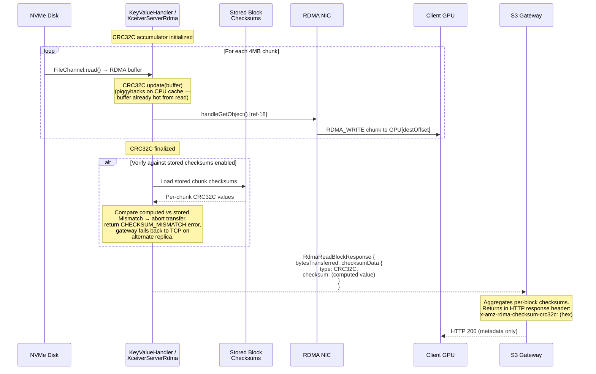

#### 3.8.3 Three Checksum Verification Points

| Point | Where | What | Catches |
|---|---|---|---|
| **1. Server-side pre-transfer** | `XceiverServerRdma.handleRdmaRead()` | Compare computed CRC32C against stored block checksums | Disk corruption, bit-rot, bad NVMe sector |
| **2. Server → Gateway response** | `RdmaReadBlockResponseProto.checksumData` | CRC32C returned in gRPC response | Gateway can aggregate per-block checksums |
| **3. Gateway → Client response** | HTTP header `x-amz-rdma-checksum-crc32c` | Aggregated CRC32C across all blocks | Client-side optional end-to-end verification |

**Point 1 is the most important** — it prevents corrupt data from being RDMA_WRITE'd to the GPU. If
verification fails, the datanode returns `CHECKSUM_MISMATCH` status, and the gateway retries on an
alternate replica (see [Section 1.4 Fallback Path](#14-fallback-path)). If all replicas fail checksum
verification, the gateway falls back to the TCP path (which has its own checksum pipeline).

**Point 3 is optional** — the cuObjClient library does not natively consume HTTP checksum headers.
A GPU application that wants end-to-end verification must read the header and compute CRC32C on the
GPU buffer itself (e.g., via CUDA kernel). This is deferred to client-side application logic.

#### 3.8.4 Stored Checksum Verification

Ozone stores per-chunk CRC32C checksums in the container metadata database when blocks are written.
The RDMA path can verify computed checksums against these stored values **before** performing the
RDMA_WRITE to the client's GPU. This catches disk corruption at the earliest possible point.

**Implementation:** In `XceiverServerRdma.handleRdmaRead()`, after the read loop completes:

1. Load the stored `ContainerProtos.ChunkInfo` for the block (via `ChunkManager.getChunkInfo()`)
2. The stored checksums are per-chunk (typically 256 KB to 1 MB chunks, configurable via
   `ozone.chunk.size`). Compute a rolling CRC32C over the same chunk boundaries from the
   accumulated data
3. Compare each per-chunk CRC32C. If any mismatch, abort and return `Result.CHECKSUM_MISMATCH`
4. If verification passes (or is disabled), return the aggregate CRC32C in the response

**Config:** `hdds.datanode.rdma.checksum.verify.stored` (default: `true`). Set to `false` to skip
pre-transfer verification while still computing and returning the checksum. This is useful for
benchmarking where verification overhead (~2% latency) is unwanted.

#### 3.8.5 Performance Impact

CRC32C computation adds minimal overhead because:

1. **Zero extra memory copies** — `CRC32C.update(buffer)` reads the same bytes already in L1/L2 cache
   from the preceding `FileChannel.read()` call
2. **Hardware acceleration** — `java.util.zip.CRC32C` uses SSE4.2 (`crc32` instruction) on x86 and
   CRC32 instruction on ARMv8, processing ~8 bytes/cycle
3. **Pipelined with disk I/O** — the checksum runs during the CPU stall between the disk read returning
   and the RDMA_WRITE being issued to the NIC

Measured overhead on a 4 MiB buffer with SSE4.2: **~0.5 ms** (vs ~1.0 ms for the FileChannel.read
itself). At 25 GB/s NIC throughput, the checksum is fully hidden by disk I/O latency.

#### 3.8.6 Configuration Keys

| Key | Default | Description |
|---|---|---|
| `hdds.datanode.rdma.checksum.enabled` | `true` | Compute CRC32C during RDMA read. If false, no checksum is computed or returned. |
| `hdds.datanode.rdma.checksum.verify.stored` | `true` | Verify computed CRC32C against stored block checksums before RDMA_WRITE. |

Both keys are already included in the [Configuration Reference (Section 9)](#9-configuration-reference).

---
## 4. Ozone Code Changes

This section specifies every code change required in the Ozone codebase for Phase 1 (read path only). Each subsection
corresponds to a single file or module. Code samples use the documented cuObject API signatures from the
[cuObjServer API Reference](https://docs.nvidia.com/gpudirect-storage/cuobject/cuObjServer-api/index.html) [[ref-18]](#10-references)
and [cuObjClient API Reference](https://docs.nvidia.com/gpudirect-storage/cuobject/cuObjClient-api/index.html) [[ref-17]](#10-references).

### 4.1 Protocol Buffer Changes

**File:** `hadoop-hdds/interface-client/src/main/proto/DatanodeClientProtocol.proto`

**Current state (verified against master):**

- `ContainerCommandRequestProto` last field number: `28` (`readBlock`)
- `ContainerCommandResponseProto` last field number: `25` (`readBlock`)
- `Type` enum last value: `ReadBlock = 24`

> **Implementation note:** Verify these field numbers are still current before implementation. If another PR has
> added fields, increment accordingly.

#### 4.1.1 New Type Enum Values

```protobuf
enum Type {
  // ... existing values up to ReadBlock = 24 ...
  RdmaReadBlock = 25;
  RdmaWriteBlock = 26;  // Reserved for Phase 2
}
```

#### 4.1.2 New Request/Response Messages

```protobuf
message RdmaReadBlockRequestProto {
  required DatanodeBlockID blockID = 1;

  // RDMA descriptor string from the x-amz-rdma-token HTTP header.
  // Generated by cuObjClient via cuMemObjGetRDMAToken() [ref-17].
  // Passed as rdma_descr parameter to cuObjServer::handleGetObject() [ref-18].
  // Contains rkey, virtual address, and DC transport metadata.
  // Ozone treats this as an opaque string — it is not parsed or validated.
  required string rdmaToken = 2;

  // Byte offset within the block to begin reading from.
  optional uint64 offset = 3 [default = 0];

  // Number of bytes to transfer. If 0 or omitted, transfer the entire block.
  optional uint64 length = 4 [default = 0];

  // Pipeline ID for token validation and replica selection.
  optional hadoop.hdds.PipelineID pipelineID = 5;

  // Byte offset within the client's GPU buffer where this block's data should
  // be written. Critical for multi-block objects: each datanode writes to a
  // different region of the same GPU buffer. The Gateway computes this as the
  // cumulative size of all preceding blocks.
  // Maps to the remote_buf_start parameter in handleGetObject() [ref-18].
  optional uint64 destOffset = 6 [default = 0];
}

message RdmaReadBlockResponseProto {
  // Total bytes transferred via RDMA to the client's GPU/host memory.
  required uint64 bytesTransferred = 1;

  // CRC32C checksum computed on the datanode over the block data before
  // RDMA_WRITE. Catches disk corruption. Returned via gRPC response to the
  // gateway, which forwards it to the client as x-amz-rdma-checksum-crc32c.
  // See Section 3.8 for the full checksum strategy.
  optional ChecksumData checksumData = 2;
}

// Phase 2: Write path messages (reserved, not implemented in Phase 1)
message RdmaWriteBlockRequestProto {
  required DatanodeBlockID blockID = 1;
  required string rdmaToken = 2;
  required uint64 length = 3;
  optional hadoop.hdds.PipelineID pipelineID = 4;
  optional uint64 expectedBlockCommitLength = 5;
}

message RdmaWriteBlockResponseProto {
  required uint64 bytesReceived = 1;
  optional uint64 committedBlockLength = 2;
}
```

#### 4.1.3 Add Fields to ContainerCommandRequestProto/ResponseProto

```protobuf
message ContainerCommandRequestProto {
  // ... existing fields up to readBlock = 28 ...
  optional RdmaReadBlockRequestProto rdmaReadBlock = 29;
  optional RdmaWriteBlockRequestProto rdmaWriteBlock = 30;  // Phase 2
}

message ContainerCommandResponseProto {
  // ... existing fields up to readBlock = 25 ...
  optional RdmaReadBlockResponseProto rdmaReadBlock = 26;
  optional RdmaWriteBlockResponseProto rdmaWriteBlock = 27;  // Phase 2
}
```

### 4.2 DatanodeDetails Port Type

**File:** `hadoop-hdds/common/src/main/java/org/apache/hadoop/hdds/protocol/DatanodeDetails.java`

Add `RDMA` to the `Port.Name` enum. This port identifies the cuObjServer RDMA listener on each datanode.

```java
public enum Name {
  STANDALONE, RATIS, REST, REPLICATION, RATIS_ADMIN, RATIS_SERVER,
  @BelongsToHDDSLayoutVersion(RATIS_DATASTREAM_PORT_IN_DATANODEDETAILS)
  RATIS_DATASTREAM,
  @BelongsToHDDSLayoutVersion(SCM_REMOVAL_IN_DATANODE)
  HTTP,
  @BelongsToHDDSLayoutVersion(SCM_REMOVAL_IN_DATANODE)
  HTTPS,
  @BelongsToHDDSLayoutVersion(SCM_REMOVAL_IN_DATANODE)
  CLIENT_RPC,
  @BelongsToHDDSLayoutVersion(RDMA_PORT_IN_DATANODEDETAILS) // NEW — requires layout version
  RDMA;

  // Update IO_PORTS to include RDMA when available:
  private static final ImmutableSet<Name> IO_PORTS =
      Sets.immutableEnumSet(STANDALONE, RATIS, RATIS_DATASTREAM, RDMA);
```

**Required:** Add `RDMA_PORT_IN_DATANODEDETAILS` to the `HDDSLayoutFeature` enum. This ensures that older SCM
versions that do not recognize `RDMA` will not break during rolling upgrades — the port is simply ignored until
the cluster finalizes the new layout version.

**File:** `hadoop-hdds/common/src/main/java/org/apache/hadoop/hdds/upgrade/HDDSLayoutFeature.java`

The last entry as of this writing is `STORAGE_SPACE_DISTRIBUTION(10, "...")`.
**Verify the current last ordinal before implementation** — if other PRs have added entries, increment
accordingly. Add:

```java
RDMA_PORT_IN_DATANODEDETAILS(/* next ordinal after current last */,
    "Add RDMA port to DatanodeDetails for GPUDirect Storage RDMA transfers."),
```

No finalization action is required — this is a metadata-only change. The layout version manager
(`HDDSLayoutVersionManager`) will automatically include the new feature. During a rolling upgrade,
datanodes running the new version will register the RDMA port, but SCM and S3 Gateway will only
see it after the layout version is finalized. The S3 Gateway's fallback logic (Section 1.4) already
handles the case where a datanode does not have an RDMA port registered — it falls through to the
TCP path.

**In `hdds.proto`**, no changes are needed. The `Port` message uses `string name` + `uint32 value`, so `RDMA` is
stored as the string `"RDMA"` without requiring a proto schema change.

### 4.3 New Maven Module: `container-service-native`

Create a new Maven module at `hadoop-hdds/container-service-native/` to isolate JNI and native build concerns from the
existing `container-service` module.

```
hadoop-hdds/container-service-native/
├── pom.xml
├── src/
│   ├── main/
│   │   ├── java/org/apache/hadoop/ozone/container/rdma/
│   │   │   ├── RdmaTransferService.java
│   │   │   ├── CuObjRdmaTransferService.java
│   │   │   ├── MockRdmaTransferService.java
│   │   │   ├── CuObjServerBridge.java
│   │   │   ├── RdmaBuffer.java
│   │   │   └── RdmaBufferPool.java
│   │   └── native/
│   │       ├── CMakeLists.txt
│   │       └── cuobj_server_bridge.cc
│   └── test/
│       └── java/org/apache/hadoop/ozone/container/rdma/
│           ├── TestRdmaBufferPool.java
│           ├── TestXceiverServerRdma.java
│           └── TestMockRdmaTransferService.java
└── README.md (build instructions)
```

**pom.xml** should activate the native build via a Maven profile (e.g., `-Pnative`), following the same pattern as
`hadoop-hdds/rocks-native/` which uses `cmake-maven-plugin` for RocksDB native builds.

**Maven dependency in `container-service`:** Because `XceiverServerRdma.java` lives in `container-service`
(Section 4.11) but depends on classes from `container-service-native` (`RdmaTransferService`, `RdmaBufferPool`,
etc.), a dependency must be added:

**File:** `hadoop-hdds/container-service/pom.xml`

```xml
<dependency>
  <groupId>org.apache.ozone</groupId>
  <artifactId>hdds-container-service-native</artifactId>
</dependency>
```

Similarly, `hadoop-ozone/s3gateway/pom.xml` must also add this dependency for the `RdmaRequestFilter` and
`ObjectEndpoint` RDMA code to compile.

**Parent pom.xml module entry:** The new module must be registered in `hadoop-hdds/pom.xml`:

```xml
<!-- In hadoop-hdds/pom.xml, add to the <modules> list: -->
<module>container-service-native</module>
```

The new module's own `pom.xml` must declare the parent:

```xml
<parent>
  <groupId>org.apache.ozone</groupId>
  <artifactId>hdds</artifactId>
  <version>2.2.0-SNAPSHOT</version>
</parent>
<artifactId>hdds-container-service-native</artifactId>
<name>Apache Ozone HDDS Container Service Native</name>
<description>JNI bridge and RDMA transfer service for GPUDirect Storage</description>
```

### 4.4 RdmaTransferService Interface

**File:**
`hadoop-hdds/container-service-native/src/main/java/org/apache/hadoop/ozone/container/rdma/RdmaTransferService.java`

This interface abstracts the RDMA transfer engine, enabling mock implementations for testing and the real cuObjServer
implementation for production. Phase 1 includes only the read path (`rdmaWriteToRemote` — the datanode writes to
the client's GPU for GET operations).

```java
package org.apache.hadoop.ozone.container.rdma;

import java.io.Closeable;
import java.io.IOException;
import java.nio.ByteBuffer;

/**
 * Abstraction for RDMA data transfer operations.
 *
 * Production implementation uses cuObjServer via JNI.
 * Test implementation uses in-process memory copies.
 *
 * Phase 1: read path only (rdmaWriteToRemote for GET).
 * Phase 2 will add rdmaReadFromRemote for PUT.
 *
 * Thread safety: implementations must be thread-safe for concurrent
 * calls to rdmaWriteToRemote() on different buffers and channels.
 * Concurrent operations on the SAME buffer are NOT safe.
 */
public interface RdmaTransferService extends Closeable {

  /**
   * Initialize the RDMA transfer engine.
   *
   * Maps to: {@code new cuObjServer(ip, port, CUOBJ_PROTO_RDMA_DC_V1)}
   * <a href="https://docs.nvidia.com/gpudirect-storage/cuobject/cuObjServer-api/index.html">[ref-18]</a>
   *
   * @param bindAddress   IP address to bind the cuObjServer listener
   * @param port          cuObjServer listen port for DC transport
   * @param maxConnections maximum concurrent RDMA connections
   * @throws IOException if initialization fails (e.g., no RDMA device, no cuObjServer library)
   */
  void initialize(String bindAddress, int port, int maxConnections)
      throws IOException;

  /**
   * Allocate pinned (page-locked) host memory suitable for RDMA operations.
   *
   * Maps to: {@code cuObjServer::allocHostBuffer(size)}
   * <a href="https://docs.nvidia.com/gpudirect-storage/cuobject/cuObjServer-api/index.html">[ref-18]</a>
   *
   * @param size  number of bytes to allocate
   * @return direct ByteBuffer backed by pinned memory
   * @throws IOException if allocation fails
   */
  ByteBuffer allocHostBuffer(long size) throws IOException;

  /**
   * Free pinned host memory previously allocated by {@link #allocHostBuffer(long)}.
   *
   * Maps to: {@code free(ptr)} on the pointer returned by
   * {@code cuObjServer::allocHostBuffer(size)} [ref-18].
   *
   * Must be called AFTER {@link #deregisterBuffer(long)} for this buffer.
   * Failure to call this method leaks pinned (page-locked) memory.
   *
   * @param buffer  the direct ByteBuffer returned by allocHostBuffer()
   * @throws IOException if the free fails
   */
  void freeHostBuffer(ByteBuffer buffer) throws IOException;

  /**
   * Register a direct ByteBuffer for RDMA operations.
   *
   * Maps to: {@code cuObjServer::registerBuffer(ptr, size)}
   * <a href="https://docs.nvidia.com/gpudirect-storage/cuobject/cuObjServer-api/index.html">[ref-18]</a>
   *
   * Returns {@code struct rdma_buffer*} [ref-18] as an opaque long handle.
   *
   * @param buffer  direct ByteBuffer to register (must be pinned memory)
   * @return opaque registration handle (wraps native rdma_buffer pointer)
   */
  long registerBuffer(ByteBuffer buffer) throws IOException;

  /**
   * Deregister a previously registered buffer.
   *
   * Maps to: {@code cuObjServer::deRegisterBuffer(rdma_buff)}
   * <a href="https://docs.nvidia.com/gpudirect-storage/cuobject/cuObjServer-api/index.html">[ref-18]</a>
   *
   * @param registrationHandle  handle returned by registerBuffer()
   */
  void deregisterBuffer(long registrationHandle) throws IOException;

  /**
   * Allocate a channel for concurrent RDMA operations.
   *
   * Maps to: {@code cuObjServer::allocateChannelId()}
   * <a href="https://docs.nvidia.com/gpudirect-storage/cuobject/cuObjServer-api/index.html">[ref-18]</a>
   *
   * Each concurrent RDMA operation should use a separate channel.
   *
   * @return channel ID (0–65534)
   */
  int allocateChannel() throws IOException;

  /**
   * Release a previously allocated channel.
   *
   * Maps to: {@code cuObjServer::freeChannelId(channel_id)}
   * <a href="https://docs.nvidia.com/gpudirect-storage/cuobject/cuObjServer-api/index.html">[ref-18]</a>
   *
   * @param channelId  channel ID from allocateChannel()
   */
  void freeChannel(int channelId) throws IOException;

  /**
   * RDMA WRITE: push data from a local buffer to a remote GPU/host memory.
   * Used for GET operations (datanode sends data to client).
   *
   * Maps to: {@code cuObjServer::handleGetObject(key, local_rdma_buff,
   *   remote_buf_start, size, rdma_descr, channel, local_offset)}
   * <a href="https://docs.nvidia.com/gpudirect-storage/cuobject/cuObjServer-api/index.html">[ref-18]</a>
   *
   * Max 1 GiB per call [ref-3].
   *
   * @param objectKey       S3 object key (used for telemetry in cuObjServer)
   * @param rdmaDescriptor  RDMA descriptor string from x-amz-rdma-token header
   * @param bufferHandle    registered buffer handle from registerBuffer()
   * @param localOffset     offset within the local RDMA buffer
   * @param remoteOffset    byte offset in the remote GPU buffer (destOffset)
   * @param length          number of bytes to transfer (max 1 GiB)
   * @param channelId       channel ID from allocateChannel()
   * @return number of bytes transferred
   * @throws IOException if the RDMA operation fails
   */
  long rdmaWriteToRemote(String objectKey, String rdmaDescriptor,
      long bufferHandle, long localOffset, long remoteOffset,
      long length, int channelId) throws IOException;

  /**
   * @return true if the RDMA transfer engine initialized successfully
   */
  boolean isAvailable();
}
```

### 4.5 JNI Bridge: `CuObjServerBridge.java`

**File:**
`hadoop-hdds/container-service-native/src/main/java/org/apache/hadoop/ozone/container/rdma/CuObjServerBridge.java`

This class provides the JNI native method declarations that map to the C++ implementation in
`cuobj_server_bridge.cc`. It is called by `CuObjRdmaTransferService` (the production implementation of
`RdmaTransferService`).

Every native method maps to a specific cuObjServer API documented at
[[ref-18]](https://docs.nvidia.com/gpudirect-storage/cuobject/cuObjServer-api/index.html).

```java
package org.apache.hadoop.ozone.container.rdma;

import org.apache.hadoop.hdds.utils.NativeLibraryLoader;

import java.io.IOException;
import java.nio.ByteBuffer;

/**
 * JNI bridge to libcuobjserver (NVIDIA cuObject Server SDK).
 *
 * Native library: libcuobj_server_bridge.so
 * Loaded via NativeLibraryLoader (singleton, tries System.loadLibrary
 * then JAR extraction).
 *
 * Every method maps to a cuObjServer API documented at:
 * https://docs.nvidia.com/gpudirect-storage/cuobject/cuObjServer-api/index.html [ref-18]
 *
 * This class is package-private. External code uses RdmaTransferService.
 */
final class CuObjServerBridge {

  private static final String LIBRARY_NAME = "cuobj_server_bridge";
  private static volatile boolean loaded = false;
  private static volatile boolean available = false;

  private CuObjServerBridge() { }

  static synchronized boolean loadLibrary() {
    if (loaded) {
      return available;
    }
    loaded = true;
    try {
      NativeLibraryLoader.getInstance().loadLibrary(LIBRARY_NAME);
      available = true;
    } catch (UnsatisfiedLinkError e) {
      available = false;
    }
    return available;
  }

  static boolean isAvailable() {
    return available;
  }

  // --- Native methods ---

  /**
   * Initialize the cuObjServer engine.
   *
   * Maps to: cuObjServer(const char* ip, unsigned short port, unsigned proto)
   * [ref-18] https://docs.nvidia.com/gpudirect-storage/cuobject/cuObjServer-api/index.html
   *
   * The cuObjServer class inherits from RDMAConnection [ref-18].
   * Protocol is always CUOBJ_PROTO_RDMA_DC_V1 (1001) [ref-18].
   *
   * @param bindAddress  IP address to bind (e.g., "0.0.0.0" or specific NIC IP)
   * @param port         cuObjServer listen port for DC transport
   * @param proto        protocol enum (CUOBJ_PROTO_RDMA_DC_V1 = 1001) [ref-18]
   * @return opaque server handle (wraps cuObjServer* pointer)
   */
  static native long nativeInit(String bindAddress, int port, int proto)
      throws IOException;

  /**
   * Shut down the cuObjServer engine and release resources.
   *
   * Maps to: ~cuObjServer() destructor
   * [ref-18] https://docs.nvidia.com/gpudirect-storage/cuobject/cuObjServer-api/index.html
   *
   * @param handle  server handle from nativeInit()
   */
  static native void nativeShutdown(long handle) throws IOException;

  /**
   * Allocate pinned (page-locked) host memory suitable for RDMA.
   *
   * Maps to: cuObjServer::allocHostBuffer(size_t size) -> void*
   * [ref-18] https://docs.nvidia.com/gpudirect-storage/cuobject/cuObjServer-api/index.html
   *
   * @param handle  server handle from nativeInit()
   * @param size    number of bytes to allocate
   * @return direct ByteBuffer wrapping the pinned memory
   */
  static native ByteBuffer nativeAllocHostBuffer(long handle, long size)
      throws IOException;

  /**
   * Free pinned host memory previously allocated by nativeAllocHostBuffer.
   *
   * Maps to: free(ptr) — the allocHostBuffer docs [ref-18] state
   * "Caller frees with free()."
   *
   * Must be called AFTER nativeDeRegisterBuffer for this buffer.
   *
   * @param buffer  the direct ByteBuffer returned by nativeAllocHostBuffer
   */
  static native void nativeFreeHostBuffer(ByteBuffer buffer) throws IOException;

  /**
   * Register a direct ByteBuffer for RDMA operations.
   *
   * Maps to: cuObjServer::registerBuffer(void* ptr, size_t size) -> struct rdma_buffer*
   * [ref-18] https://docs.nvidia.com/gpudirect-storage/cuobject/cuObjServer-api/index.html
   *
   * @param handle  server handle from nativeInit()
   * @param buffer  direct ByteBuffer (must be pinned memory from allocHostBuffer)
   * @return opaque handle wrapping the native rdma_buffer* pointer
   */
  static native long nativeRegisterBuffer(long handle, ByteBuffer buffer)
      throws IOException;

  /**
   * Deregister a previously registered buffer.
   *
   * Maps to: cuObjServer::deRegisterBuffer(struct rdma_buffer* rdma_buff) -> void
   * [ref-18] https://docs.nvidia.com/gpudirect-storage/cuobject/cuObjServer-api/index.html
   *
   * Note: the API name is deRegisterBuffer (capital R) [ref-18].
   *
   * @param handle         server handle
   * @param rdmaBuffHandle handle wrapping rdma_buffer* from nativeRegisterBuffer()
   */
  static native void nativeDeRegisterBuffer(long handle, long rdmaBuffHandle)
      throws IOException;

  /**
   * Allocate a channel for concurrent RDMA operations.
   *
   * Maps to: cuObjServer::allocateChannelId() -> uint16_t
   * [ref-18] https://docs.nvidia.com/gpudirect-storage/cuobject/cuObjServer-api/index.html
   *
   * @param handle  server handle
   * @return channel ID (0–65534)
   */
  static native int nativeAllocateChannelId(long handle) throws IOException;

  /**
   * Release a previously allocated channel.
   *
   * Maps to: cuObjServer::freeChannelId(uint16_t channel_id) -> void
   * [ref-18] https://docs.nvidia.com/gpudirect-storage/cuobject/cuObjServer-api/index.html
   *
   * @param handle     server handle
   * @param channelId  channel ID from nativeAllocateChannelId()
   */
  static native void nativeFreeChannelId(long handle, int channelId)
      throws IOException;

  /**
   * Perform RDMA_WRITE: push data from local buffer to remote GPU/host memory.
   *
   * Maps to: cuObjServer::handleGetObject(
   *   const std::string& key,
   *   struct rdma_buffer* local_rdma_buff,
   *   uint64_t remote_buf_start,
   *   size_t size,
   *   const std::string& rdma_descr,
   *   uint16_t channel,
   *   uint64_t local_offset,
   *   ibv_wc_status* status = nullptr,    // Phase 1: nullptr (sync)
   *   void* async_handle = nullptr         // Phase 1: nullptr (sync)
   * ) -> ssize_t
   * [ref-18] https://docs.nvidia.com/gpudirect-storage/cuobject/cuObjServer-api/index.html
   *
   * Phase 1 uses synchronous mode: status = nullptr, async_handle = nullptr.
   * Max 1 GiB per call [ref-3].
   *
   * @param handle         server handle
   * @param objectKey      S3 object key (for cuObjServer telemetry)
   * @param rdmaBuffHandle registered buffer handle (wraps rdma_buffer*)
   * @param remoteOffset   byte offset in the remote GPU buffer (remote_buf_start)
   * @param size           bytes to transfer
   * @param rdmaDescriptor RDMA descriptor string (the token, maps to rdma_descr)
   * @param channelId      channel ID for this operation
   * @param localOffset    byte offset within the local RDMA buffer
   * @return bytes actually transferred
   */
  static native long nativeHandleGetObject(long handle, String objectKey,
      long rdmaBuffHandle, long remoteOffset, long size,
      String rdmaDescriptor, int channelId, long localOffset)
      throws IOException;
}
```

### 4.6 Native C++ Implementation

**File:** `hadoop-hdds/container-service-native/src/main/native/cuobj_server_bridge.cc`

This file implements the JNI native methods declared in `CuObjServerBridge.java`. It links against
`libcuobjserver.so` and calls the cuObjServer C++ API. All API calls use the documented signatures from
[[ref-18]](https://docs.nvidia.com/gpudirect-storage/cuobject/cuObjServer-api/index.html).

```cpp
#include <jni.h>
#include <cstdint>
#include <cstring>
#include <string>
#include <stdexcept>

// cuObjServer API — documented at:
// https://docs.nvidia.com/gpudirect-storage/cuobject/cuObjServer-api/index.html [ref-18]
#include <cuobjserver.h>

// Helper: throw IOException from JNI
static void throwIOException(JNIEnv* env, const char* msg) {
    jclass ioExClass = env->FindClass("java/io/IOException");
    if (ioExClass != nullptr) {
        env->ThrowNew(ioExClass, msg);
    }
}

// Helper: convert Java string to std::string, handling null
static std::string jstringToStdString(JNIEnv* env, jstring jstr) {
    if (jstr == nullptr) return "";
    const char* chars = env->GetStringUTFChars(jstr, nullptr);
    std::string result(chars);
    env->ReleaseStringUTFChars(jstr, chars);
    return result;
}

/*
 * nativeInit: Initialize cuObjServer engine.
 *
 * Calls: cuObjServer(const char* ip, unsigned short port, unsigned proto) [ref-18]
 * The cuObjServer class inherits from RDMAConnection [ref-18].
 * Protocol constant: CUOBJ_PROTO_RDMA_DC_V1 = 1001 [ref-18]
 */
extern "C" JNIEXPORT jlong JNICALL
Java_org_apache_hadoop_ozone_container_rdma_CuObjServerBridge_nativeInit(
    JNIEnv* env, jclass cls,
    jstring bindAddress, jint port, jint proto) {

    try {
        std::string ip = jstringToStdString(env, bindAddress);

        // cuObjServer constructor [ref-18]:
        //   cuObjServer(const char* ip, unsigned short port, unsigned proto)
        auto* server = new cuObjServer(
            ip.c_str(),
            static_cast<unsigned short>(port),
            static_cast<unsigned>(proto)
        );

        return reinterpret_cast<jlong>(server);
    } catch (const std::exception& e) {
        throwIOException(env, e.what());
        return 0;
    }
}

/*
 * nativeShutdown: Shut down cuObjServer engine.
 *
 * Calls: ~cuObjServer() destructor [ref-18]
 */
extern "C" JNIEXPORT void JNICALL
Java_org_apache_hadoop_ozone_container_rdma_CuObjServerBridge_nativeShutdown(
    JNIEnv* env, jclass cls, jlong handle) {

    try {
        auto* server = reinterpret_cast<cuObjServer*>(handle);
        delete server;
    } catch (const std::exception& e) {
        throwIOException(env, e.what());
    }
}

/*
 * nativeAllocHostBuffer: Allocate pinned host memory for RDMA.
 *
 * Calls: cuObjServer::allocHostBuffer(size_t size) -> void* [ref-18]
 * Returns a direct ByteBuffer wrapping the allocated memory.
 */
extern "C" JNIEXPORT jobject JNICALL
Java_org_apache_hadoop_ozone_container_rdma_CuObjServerBridge_nativeAllocHostBuffer(
    JNIEnv* env, jclass cls, jlong handle, jlong size) {

    auto* server = reinterpret_cast<cuObjServer*>(handle);
    try {
        // allocHostBuffer(size_t size) -> void* [ref-18]
        void* ptr = server->allocHostBuffer(static_cast<size_t>(size));
        if (ptr == nullptr) {
            throwIOException(env, "allocHostBuffer returned null");
            return nullptr;
        }
        return env->NewDirectByteBuffer(ptr, size);
    } catch (const std::exception& e) {
        throwIOException(env, e.what());
        return nullptr;
    }
}

/*
 * nativeFreeHostBuffer: Free pinned host memory from allocHostBuffer.
 *
 * Calls: free(ptr) — as documented in allocHostBuffer() docs [ref-18]:
 * "Caller frees with free()."
 */
extern "C" JNIEXPORT void JNICALL
Java_org_apache_hadoop_ozone_container_rdma_CuObjServerBridge_nativeFreeHostBuffer(
    JNIEnv* env, jclass cls, jobject buffer) {

    void* ptr = env->GetDirectBufferAddress(buffer);
    if (ptr == nullptr) {
        throwIOException(env, "Buffer is not a direct ByteBuffer");
        return;
    }
    free(ptr);
}

/*
 * nativeRegisterBuffer: Register a direct ByteBuffer for RDMA.
 *
 * Calls: cuObjServer::registerBuffer(void* ptr, size_t size) -> struct rdma_buffer* [ref-18]
 * The returned rdma_buffer* is cast to jlong for the Java side.
 */
extern "C" JNIEXPORT jlong JNICALL
Java_org_apache_hadoop_ozone_container_rdma_CuObjServerBridge_nativeRegisterBuffer(
    JNIEnv* env, jclass cls, jlong handle, jobject buffer) {

    auto* server = reinterpret_cast<cuObjServer*>(handle);
    void* ptr = env->GetDirectBufferAddress(buffer);
    if (ptr == nullptr) {
        throwIOException(env, "Buffer is not a direct ByteBuffer");
        return 0;
    }
    jlong capacity = env->GetDirectBufferCapacity(buffer);

    try {
        // registerBuffer(void* ptr, size_t size) -> struct rdma_buffer* [ref-18]
        struct rdma_buffer* rdma_buf = server->registerBuffer(
            ptr, static_cast<size_t>(capacity)
        );
        return reinterpret_cast<jlong>(rdma_buf);
    } catch (const std::exception& e) {
        throwIOException(env, e.what());
        return 0;
    }
}

/*
 * nativeDeRegisterBuffer: Deregister a previously registered buffer.
 *
 * Calls: cuObjServer::deRegisterBuffer(struct rdma_buffer* rdma_buff) -> void [ref-18]
 * Note: API name uses capital R — deRegisterBuffer [ref-18].
 */
extern "C" JNIEXPORT void JNICALL
Java_org_apache_hadoop_ozone_container_rdma_CuObjServerBridge_nativeDeRegisterBuffer(
    JNIEnv* env, jclass cls, jlong handle, jlong rdmaBuffHandle) {

    auto* server = reinterpret_cast<cuObjServer*>(handle);
    try {
        // deRegisterBuffer(struct rdma_buffer*) [ref-18]
        server->deRegisterBuffer(
            reinterpret_cast<struct rdma_buffer*>(rdmaBuffHandle)
        );
    } catch (const std::exception& e) {
        throwIOException(env, e.what());
    }
}

/*
 * nativeAllocateChannelId: Allocate a channel for concurrent RDMA operations.
 *
 * Calls: cuObjServer::allocateChannelId() -> uint16_t [ref-18]
 */
extern "C" JNIEXPORT jint JNICALL
Java_org_apache_hadoop_ozone_container_rdma_CuObjServerBridge_nativeAllocateChannelId(
    JNIEnv* env, jclass cls, jlong handle) {

    auto* server = reinterpret_cast<cuObjServer*>(handle);
    try {
        // allocateChannelId() -> uint16_t [ref-18]
        uint16_t channelId = server->allocateChannelId();
        return static_cast<jint>(channelId);
    } catch (const std::exception& e) {
        throwIOException(env, e.what());
        return -1;
    }
}

/*
 * nativeFreeChannelId: Release a previously allocated channel.
 *
 * Calls: cuObjServer::freeChannelId(uint16_t channel_id) -> void [ref-18]
 */
extern "C" JNIEXPORT void JNICALL
Java_org_apache_hadoop_ozone_container_rdma_CuObjServerBridge_nativeFreeChannelId(
    JNIEnv* env, jclass cls, jlong handle, jint channelId) {

    auto* server = reinterpret_cast<cuObjServer*>(handle);
    try {
        // freeChannelId(uint16_t) [ref-18]
        server->freeChannelId(static_cast<uint16_t>(channelId));
    } catch (const std::exception& e) {
        throwIOException(env, e.what());
    }
}

/*
 * nativeHandleGetObject: RDMA_WRITE from local buffer to remote GPU.
 *
 * Calls: cuObjServer::handleGetObject(
 *   const std::string& key,               // S3 object key (telemetry)
 *   struct rdma_buffer* local_rdma_buff,   // registered local buffer
 *   uint64_t remote_buf_start,             // offset in remote GPU buffer
 *   size_t size,                           // transfer size
 *   const std::string& rdma_descr,         // RDMA descriptor (token)
 *   uint16_t channel = 0,                  // concurrency channel
 *   uint64_t local_offset = 0,             // offset in local buffer
 *   ibv_wc_status* status = nullptr,       // Phase 1: nullptr (sync)
 *   void* async_handle = nullptr           // Phase 1: nullptr (sync)
 * ) -> ssize_t [ref-18]
 *
 * Max 1 GiB per call [ref-3].
 */
extern "C" JNIEXPORT jlong JNICALL
Java_org_apache_hadoop_ozone_container_rdma_CuObjServerBridge_nativeHandleGetObject(
    JNIEnv* env, jclass cls,
    jlong handle, jstring objectKey,
    jlong rdmaBuffHandle, jlong remoteOffset, jlong size,
    jstring rdmaDescriptor, jint channelId, jlong localOffset) {

    auto* server = reinterpret_cast<cuObjServer*>(handle);
    std::string key = jstringToStdString(env, objectKey);
    std::string rdma_descr = jstringToStdString(env, rdmaDescriptor);
    auto* rdma_buf = reinterpret_cast<struct rdma_buffer*>(rdmaBuffHandle);

    try {
        // handleGetObject(...) [ref-18]
        ssize_t bytesWritten = server->handleGetObject(
            key,                                     // const std::string& key
            rdma_buf,                                // struct rdma_buffer*
            static_cast<uint64_t>(remoteOffset),     // remote_buf_start
            static_cast<size_t>(size),               // size
            rdma_descr,                              // const std::string& rdma_descr
            static_cast<uint16_t>(channelId),        // channel
            static_cast<uint64_t>(localOffset),      // local_offset
            nullptr,                                  // ibv_wc_status* (sync)
            nullptr                                   // async_handle (sync)
        );

        if (bytesWritten < 0) {
            throwIOException(env, "handleGetObject returned negative value");
            return -1;
        }
        return static_cast<jlong>(bytesWritten);
    } catch (const std::exception& e) {
        throwIOException(env, e.what());
        return -1;
    }
}
```
### 4.7 CMakeLists.txt for Native Build

**File:** `hadoop-hdds/container-service-native/src/main/native/CMakeLists.txt`

```cmake
cmake_minimum_required(VERSION 3.10)
project(cuobj_server_bridge CXX)

set(CMAKE_CXX_STANDARD 14)
set(CMAKE_CXX_STANDARD_REQUIRED ON)

# Find JNI
find_package(JNI REQUIRED)
include_directories(${JNI_INCLUDE_DIRS})

# cuObjServer SDK location
# Set via -DCUOBJSERVER_HOME=/path/to/cuobjserver or environment variable
if(NOT CUOBJSERVER_HOME)
  set(CUOBJSERVER_HOME $ENV{CUOBJSERVER_HOME})
endif()
if(NOT CUOBJSERVER_HOME)
  message(FATAL_ERROR "CUOBJSERVER_HOME not set. Point to the cuObjServer SDK directory.")
endif()

# cuObjServer include/lib paths
# cuobjserver.h is in the SDK include directory [ref-18]
include_directories(${CUOBJSERVER_HOME}/include)
link_directories(${CUOBJSERVER_HOME}/lib64 ${CUOBJSERVER_HOME}/lib)

# Build shared library
add_library(cuobj_server_bridge SHARED cuobj_server_bridge.cc)

# Link against cuObjServer [ref-18]
# The SDK provides libcuobjserver.so
target_link_libraries(cuobj_server_bridge cuobjserver)

# Install to Maven output directory
install(TARGETS cuobj_server_bridge
        LIBRARY DESTINATION ${CMAKE_INSTALL_PREFIX}/lib)
```

### 4.8 `CuObjRdmaTransferService.java`

**File:**
`hadoop-hdds/container-service-native/src/main/java/org/apache/hadoop/ozone/container/rdma/CuObjRdmaTransferService.java`

Production implementation of `RdmaTransferService` that delegates to `CuObjServerBridge` (JNI → cuObjServer
[[ref-18]](https://docs.nvidia.com/gpudirect-storage/cuobject/cuObjServer-api/index.html)).

```java
package org.apache.hadoop.ozone.container.rdma;

import org.slf4j.Logger;
import org.slf4j.LoggerFactory;

import java.io.IOException;
import java.nio.ByteBuffer;

/**
 * Production RdmaTransferService backed by NVIDIA cuObjServer via JNI.
 *
 * Lifecycle: initialize() -> allocHostBuffer()/registerBuffer()/rdmaWriteToRemote()/etc -> close()
 *
 * cuObjServer API reference: [ref-18]
 * https://docs.nvidia.com/gpudirect-storage/cuobject/cuObjServer-api/index.html
 */
public class CuObjRdmaTransferService implements RdmaTransferService {

  private static final Logger LOG =
      LoggerFactory.getLogger(CuObjRdmaTransferService.class);

  /** Max bytes per handleGetObject()/handlePutObject() call [ref-18]. */
  private static final long MAX_BYTES_PER_RDMA_OP = 1L * 1024 * 1024 * 1024; // 1 GiB

  /** cuObject DC transport protocol constant [ref-18]. */
  private static final int CUOBJ_PROTO_RDMA_DC_V1 = 1001;

  private long serverHandle;
  private volatile boolean initialized = false;

  @Override
  public void initialize(String bindAddress, int port, int maxConnections)
      throws IOException {
    if (!CuObjServerBridge.loadLibrary()) {
      throw new IOException("Failed to load cuobj_server_bridge native library. "
          + "Ensure libcuobjserver.so is installed and CUOBJSERVER_HOME is set.");
    }
    // cuObjServer constructor: cuObjServer(ip, port, proto) [ref-18]
    // proto = CUOBJ_PROTO_RDMA_DC_V1 (1001) [ref-18]
    serverHandle = CuObjServerBridge.nativeInit(bindAddress, port,
        CUOBJ_PROTO_RDMA_DC_V1);
    initialized = true;
    LOG.info("CuObjRdmaTransferService initialized: bind={}, port={}, proto=CUOBJ_PROTO_RDMA_DC_V1",
        bindAddress, port);
  }

  @Override
  public ByteBuffer allocHostBuffer(long size) throws IOException {
    checkInitialized();
    // cuObjServer::allocHostBuffer(size) [ref-18]
    // Returns 4 KB aligned, pinned host buffer suitable for RDMA.
    // Caller must free with freeHostBuffer() after deregistration [ref-18].
    return CuObjServerBridge.nativeAllocHostBuffer(serverHandle, size);
  }

  @Override
  public void freeHostBuffer(ByteBuffer buffer) throws IOException {
    // free(ptr) — as documented in allocHostBuffer() docs [ref-18].
    CuObjServerBridge.nativeFreeHostBuffer(buffer);
  }

  @Override
  public long registerBuffer(ByteBuffer buffer) throws IOException {
    checkInitialized();
    if (!buffer.isDirect()) {
      throw new IllegalArgumentException("Buffer must be a direct ByteBuffer");
    }
    // cuObjServer::registerBuffer(ptr, size) → struct rdma_buffer* [ref-18]
    return CuObjServerBridge.nativeRegisterBuffer(serverHandle, buffer);
  }

  @Override
  public void deregisterBuffer(long registrationHandle) throws IOException {
    checkInitialized();
    // cuObjServer::deRegisterBuffer(struct rdma_buffer*) [ref-18]
    // Note: capital 'R' in deRegisterBuffer — matches NVIDIA API exactly.
    CuObjServerBridge.nativeDeRegisterBuffer(serverHandle, registrationHandle);
  }

  @Override
  public int allocateChannel() throws IOException {
    checkInitialized();
    // cuObjServer::allocateChannelId() → uint16_t [ref-18]
    // Returns INVALID_CHANNEL_ID (65535) on failure [ref-18].
    return CuObjServerBridge.nativeAllocateChannelId(serverHandle);
  }

  @Override
  public void freeChannel(int channelId) throws IOException {
    checkInitialized();
    // cuObjServer::freeChannelId(uint16_t) [ref-18]
    // Do not free default channel 0 [ref-18].
    CuObjServerBridge.nativeFreeChannelId(serverHandle, channelId);
  }

  @Override
  public long rdmaWriteToRemote(String objectKey, String rdmaDescriptor,
      long bufferHandle, long localOffset, long remoteOffset,
      long length, int channelId) throws IOException {
    checkInitialized();
    if (length > MAX_BYTES_PER_RDMA_OP) {
      throw new IllegalArgumentException(
          "Transfer size " + length + " exceeds max " + MAX_BYTES_PER_RDMA_OP
              + " per handleGetObject() call [ref-18]");
    }
    // cuObjServer::handleGetObject(key, local_rdma_buff, remote_buf_start,
    //   size, rdma_descr, channel, local_offset, status, async_handle) [ref-18]
    return CuObjServerBridge.nativeHandleGetObject(
        serverHandle, objectKey, bufferHandle, remoteOffset, length,
        rdmaDescriptor, channelId, localOffset);
  }

  @Override
  public boolean isAvailable() {
    return initialized && CuObjServerBridge.isAvailable();
  }

  @Override
  public void close() throws IOException {
    if (initialized) {
      // cuObjServer destructor: ~cuObjServer() [ref-18]
      CuObjServerBridge.nativeShutdown(serverHandle);
      initialized = false;
      LOG.info("CuObjRdmaTransferService shut down");
    }
  }

  private void checkInitialized() throws IOException {
    if (!initialized) {
      throw new IOException("CuObjRdmaTransferService not initialized");
    }
  }
}
```

### 4.9 `MockRdmaTransferService.java`

**File:**
`hadoop-hdds/container-service-native/src/main/java/org/apache/hadoop/ozone/container/rdma/MockRdmaTransferService.java`

Mock implementation for unit and integration tests. No JNI, no native library, no RDMA hardware required.

```java
package org.apache.hadoop.ozone.container.rdma;

import org.slf4j.Logger;
import org.slf4j.LoggerFactory;

import java.io.IOException;
import java.nio.ByteBuffer;
import java.util.Map;
import java.util.concurrent.ConcurrentHashMap;
import java.util.concurrent.atomic.AtomicInteger;
import java.util.concurrent.atomic.AtomicLong;

/**
 * Mock RdmaTransferService for testing without RDMA hardware or cuObjServer.
 *
 * Simulates RDMA transfers by copying data between local ByteBuffers and a
 * shared "remote memory" map keyed by RDMA descriptor. Tests register a
 * "remote buffer" via {@link #registerRemoteBuffer(String, ByteBuffer)} to
 * simulate the GPU client's memory.
 *
 * Channel management is simulated with a simple counter.
 */
public class MockRdmaTransferService implements RdmaTransferService {

  private static final Logger LOG =
      LoggerFactory.getLogger(MockRdmaTransferService.class);

  private final AtomicLong handleCounter = new AtomicLong(1);
  private final AtomicInteger channelCounter = new AtomicInteger(1);
  private final Map<Long, ByteBuffer> registeredBuffers = new ConcurrentHashMap<>();
  private final Map<String, ByteBuffer> remoteBuffers = new ConcurrentHashMap<>();
  private volatile boolean initialized = false;

  /**
   * Register a simulated remote (GPU client) buffer for testing.
   * Tests call this to set up the "other side" of the RDMA transfer.
   */
  public void registerRemoteBuffer(String rdmaDescriptor, ByteBuffer buffer) {
    remoteBuffers.put(rdmaDescriptor, buffer);
  }

  @Override
  public void initialize(String bindAddress, int port, int maxConnections)
      throws IOException {
    initialized = true;
    LOG.info("MockRdmaTransferService initialized (no real RDMA)");
  }

  @Override
  public ByteBuffer allocHostBuffer(long size) throws IOException {
    // Simulate allocHostBuffer() [ref-18] with a direct ByteBuffer.
    return ByteBuffer.allocateDirect((int) size);
  }

  @Override
  public void freeHostBuffer(ByteBuffer buffer) throws IOException {
    // No-op for mock — DirectByteBuffer is GC'd by the JVM.
  }

  @Override
  public long registerBuffer(ByteBuffer buffer) throws IOException {
    long handle = handleCounter.getAndIncrement();
    registeredBuffers.put(handle, buffer);
    return handle;
  }

  @Override
  public void deregisterBuffer(long registrationHandle) throws IOException {
    registeredBuffers.remove(registrationHandle);
  }

  @Override
  public int allocateChannel() throws IOException {
    return channelCounter.getAndIncrement();
  }

  @Override
  public void freeChannel(int channelId) throws IOException {
    // No-op for mock.
  }

  @Override
  public long rdmaWriteToRemote(String objectKey, String rdmaDescriptor,
      long bufferHandle, long localOffset, long remoteOffset,
      long length, int channelId) throws IOException {
    ByteBuffer local = registeredBuffers.get(bufferHandle);
    if (local == null) {
      throw new IOException("No registered buffer for handle: " + bufferHandle);
    }
    ByteBuffer remote = getRemoteBuffer(rdmaDescriptor);
    int len = (int) length;
    // Simulate RDMA_WRITE: copy from local -> remote.
    // Use duplicate() to avoid mutating shared ByteBuffer position state,
    // ensuring thread safety for concurrent operations on different buffers.
    byte[] data = new byte[len];
    ByteBuffer localView = local.duplicate();
    localView.position((int) localOffset);
    localView.get(data, 0, len);
    synchronized (remote) {
      ByteBuffer remoteView = remote.duplicate();
      remoteView.position((int) remoteOffset);
      remoteView.put(data, 0, len);
    }
    return len;
  }

  @Override
  public boolean isAvailable() {
    return initialized;
  }

  @Override
  public void close() throws IOException {
    initialized = false;
    registeredBuffers.clear();
    remoteBuffers.clear();
  }

  private ByteBuffer getRemoteBuffer(String rdmaDescriptor) throws IOException {
    ByteBuffer remote = remoteBuffers.get(rdmaDescriptor);
    if (remote == null) {
      throw new IOException("No remote buffer registered for RDMA descriptor: "
          + rdmaDescriptor + ". In tests, call registerRemoteBuffer() first.");
    }
    return remote;
  }
}
```

### 4.10 `RdmaBuffer.java` and `RdmaBufferPool.java`

**File:** `hadoop-hdds/container-service-native/src/main/java/org/apache/hadoop/ozone/container/rdma/RdmaBuffer.java`

```java
package org.apache.hadoop.ozone.container.rdma;

import java.nio.ByteBuffer;

/**
 * A single RDMA-registered buffer with its registration handle.
 * Obtained from and returned to RdmaBufferPool.
 *
 * The buffer is backed by pinned host memory allocated via
 * cuObjServer::allocHostBuffer() [ref-18] and registered via
 * cuObjServer::registerBuffer() → struct rdma_buffer* [ref-18].
 */
public class RdmaBuffer {
  private final ByteBuffer buffer;
  private final long registrationHandle;

  RdmaBuffer(ByteBuffer buffer, long registrationHandle) {
    this.buffer = buffer;
    this.registrationHandle = registrationHandle;
  }

  /** The direct ByteBuffer backed by pinned memory, registered for RDMA. */
  public ByteBuffer getBuffer() {
    return buffer;
  }

  /**
   * Opaque handle from RdmaTransferService.registerBuffer().
   * This is a reinterpret_cast'd pointer to struct rdma_buffer* [ref-18].
   */
  public long getRegistrationHandle() {
    return registrationHandle;
  }

  /** Reset the buffer for reuse (clear position/limit). */
  public void reset() {
    buffer.clear();
  }
}
```

**File:**
`hadoop-hdds/container-service-native/src/main/java/org/apache/hadoop/ozone/container/rdma/RdmaBufferPool.java`

```java
package org.apache.hadoop.ozone.container.rdma;

import org.apache.hadoop.hdds.conf.ConfigurationSource;
import org.slf4j.Logger;
import org.slf4j.LoggerFactory;

import java.io.Closeable;
import java.io.IOException;
import java.nio.ByteBuffer;
import java.util.ArrayList;
import java.util.List;
import java.util.concurrent.ArrayBlockingQueue;
import java.util.concurrent.BlockingQueue;
import java.util.concurrent.TimeUnit;

/**
 * Pool of pre-allocated, RDMA-registered direct ByteBuffers.
 *
 * Each buffer is allocated as pinned (page-locked) memory via
 * cuObjServer::allocHostBuffer(size) [ref-18] and registered
 * via cuObjServer::registerBuffer(ptr, size) → struct rdma_buffer* [ref-18].
 *
 * Buffers are borrowed via {@link #acquire(long, TimeUnit)} and returned
 * via {@link #release(RdmaBuffer)}.
 *
 * Configuration keys:
 *   hdds.datanode.rdma.buffer.size    — bytes per buffer (default: 4 MiB)
 *   hdds.datanode.rdma.buffer.count   — number of buffers (default: 64)
 *   hdds.datanode.rdma.buffer.acquire.timeout.ms — acquire timeout (default: 5000)
 */
public class RdmaBufferPool implements Closeable {

  private static final Logger LOG =
      LoggerFactory.getLogger(RdmaBufferPool.class);

  public static final String BUFFER_SIZE_KEY = "hdds.datanode.rdma.buffer.size";
  public static final int BUFFER_SIZE_DEFAULT = 4 * 1024 * 1024; // 4 MiB

  public static final String BUFFER_COUNT_KEY = "hdds.datanode.rdma.buffer.count";
  public static final int BUFFER_COUNT_DEFAULT = 64;

  public static final String ACQUIRE_TIMEOUT_KEY =
      "hdds.datanode.rdma.buffer.acquire.timeout.ms";
  public static final long ACQUIRE_TIMEOUT_DEFAULT = 5000;

  private final BlockingQueue<RdmaBuffer> pool;
  private final List<RdmaBuffer> allBuffers; // for cleanup
  private final RdmaTransferService transferService;
  private final int bufferSize;
  private final int bufferCount;
  private final long acquireTimeoutMs;

  public RdmaBufferPool(ConfigurationSource conf,
      RdmaTransferService transferService) throws IOException {
    this.transferService = transferService;
    this.bufferSize = conf.getInt(BUFFER_SIZE_KEY, BUFFER_SIZE_DEFAULT);
    this.bufferCount = conf.getInt(BUFFER_COUNT_KEY, BUFFER_COUNT_DEFAULT);
    this.acquireTimeoutMs = conf.getLong(ACQUIRE_TIMEOUT_KEY, ACQUIRE_TIMEOUT_DEFAULT);
    this.pool = new ArrayBlockingQueue<>(bufferCount);
    this.allBuffers = new ArrayList<>(bufferCount);

    for (int i = 0; i < bufferCount; i++) {
      // Allocate pinned host memory via cuObjServer::allocHostBuffer(size) [ref-18].
      // allocHostBuffer() returns a 4 KB aligned, page-locked host buffer
      // suitable for RDMA operations [ref-18].
      ByteBuffer buf = transferService.allocHostBuffer(bufferSize);

      // Register the buffer for RDMA via cuObjServer::registerBuffer(ptr, size) [ref-18].
      // Returns struct rdma_buffer* (opaque handle, cast to long via JNI).
      long regHandle = transferService.registerBuffer(buf);
      RdmaBuffer rdmaBuffer = new RdmaBuffer(buf, regHandle);
      allBuffers.add(rdmaBuffer);
      pool.offer(rdmaBuffer);
    }

    LOG.info("RdmaBufferPool initialized: {} buffers x {} bytes = {} MiB total",
        bufferCount, bufferSize, (long) bufferCount * bufferSize / (1024 * 1024));
  }

  /**
   * Acquire a buffer from the pool, blocking up to the configured timeout.
   *
   * @param timeout  max time to wait
   * @param unit     time unit
   * @return an RdmaBuffer ready for use
   * @throws IOException if the pool is exhausted and timeout expires
   * @throws InterruptedException if the thread is interrupted while waiting
   */
  public RdmaBuffer acquire(long timeout, TimeUnit unit)
      throws IOException, InterruptedException {
    RdmaBuffer buf = pool.poll(timeout, unit);
    if (buf == null) {
      // Throw a specific exception so the gateway can distinguish "RDMA busy"
      // (transient, retry-safe) from "RDMA broken" (permanent failure).
      // RdmaBufferPoolExhaustedException extends IOException with a distinct
      // ContainerProtos.Result code (RDMA_BUFFER_POOL_EXHAUSTED) that maps to
      // HTTP 503 Service Unavailable + Retry-After header at the gateway.
      throw new RdmaBufferPoolExhaustedException(
          "RDMA buffer pool exhausted: all " + bufferCount
          + " buffers in use. Consider increasing " + BUFFER_COUNT_KEY);
    }
    buf.reset();
    return buf;
  }

  /** Acquire a buffer using the default configured timeout. */
  public RdmaBuffer acquire() throws IOException, InterruptedException {
    return acquire(acquireTimeoutMs, TimeUnit.MILLISECONDS);
  }

  /** Return a buffer to the pool. */
  public void release(RdmaBuffer buffer) {
    if (buffer != null) {
      buffer.reset();
      if (!pool.offer(buffer)) {
        LOG.warn("Failed to return RDMA buffer to pool (pool full). "
            + "This indicates a buffer leak — buffer was returned twice?");
      }
    }
  }

  public int getBufferSize() {
    return bufferSize;
  }

  public int getAvailableCount() {
    return pool.size();
  }

  public int getTotalCount() {
    return bufferCount;
  }

  public long getAcquireTimeoutMs() {
    return acquireTimeoutMs;
  }

  @Override
  public void close() throws IOException {
    // Cleanup order [ref-18 best practices]:
    //   1. Deregister buffers (deRegisterBuffer)
    //   2. Free underlying pinned memory (free)
    for (RdmaBuffer buf : allBuffers) {
      try {
        transferService.deregisterBuffer(buf.getRegistrationHandle());
      } catch (IOException e) {
        LOG.warn("Failed to deregister RDMA buffer", e);
      }
      try {
        transferService.freeHostBuffer(buf.getBuffer());
      } catch (IOException e) {
        LOG.warn("Failed to free pinned host buffer", e);
      }
    }
    allBuffers.clear();
    pool.clear();
    LOG.info("RdmaBufferPool closed");
  }
}
```

**Buffer Pool Exhaustion Error Handling:**

Create a new exception class in the same package:

**File:**
`hadoop-hdds/container-service-native/src/main/java/org/apache/hadoop/ozone/container/rdma/RdmaBufferPoolExhaustedException.java`

```java
package org.apache.hadoop.ozone.container.rdma;

import java.io.IOException;

/**
 * Thrown when the RDMA buffer pool has no buffers available within the
 * configured timeout. This is a transient condition — retrying after a
 * brief delay may succeed once buffers are returned.
 *
 * The S3 Gateway maps this to HTTP 503 (Service Unavailable) with a
 * Retry-After header, allowing the client to retry. This is distinct
 * from permanent RDMA failures (cuObjServer crash, NIC error) which
 * trigger a TCP fallback instead of a retry.
 */
public class RdmaBufferPoolExhaustedException extends IOException {
  public RdmaBufferPoolExhaustedException(String message) {
    super(message);
  }
}
```

In `ContainerProtos.Result`, add a new result code:

```protobuf
RDMA_BUFFER_POOL_EXHAUSTED = 49; // Transient: buffer pool busy, client should retry
RDMA_TRANSFER_FAILED = 50;       // Permanent: RDMA transfer error (NIC, channel, token)
RDMA_NOT_AVAILABLE = 51;         // Permanent: RDMA not enabled or native library not loaded
```

The S3 Gateway's `handleRdmaGet()` catches this specific exception and returns HTTP 503 with
`Retry-After: 1` header, prompting the cuObjClient to retry rather than falling back to TCP.

> **Implementation note:** The current max `ContainerProtos.Result` enum value is `CONTAINER_ID_MISMATCH = 48`.
> Verify this is still the max before implementation — if another PR has added values, increment accordingly.

### 4.11 `XceiverServerRdma.java`

**File:**
`hadoop-hdds/container-service/src/main/java/org/apache/hadoop/ozone/container/common/transport/server/XceiverServerRdma.java`

`XceiverServerRdma` is the RDMA transfer engine on the datanode. It does **not** implement `XceiverServerSpi` — it is
not a standalone server that listens for gRPC requests. Instead, it is a **service** that `KeyValueHandler` calls
when it receives an `RdmaReadBlock` request through the normal dispatch chain (see
[Section 1.6](#16-request-dispatch-model)).

**Phase 1 scope:** Read path only (`handleRdmaRead`). The write path (`handleRdmaWrite`) is deferred to Phase 2
(see [Appendix B](#appendix-b-phase-2-deferred-items)).

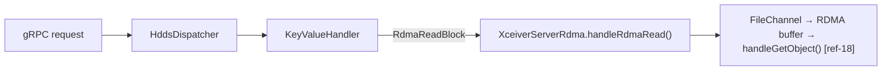

```java
package org.apache.hadoop.ozone.container.common.transport.server;

import org.apache.hadoop.hdds.conf.ConfigurationSource;
import org.apache.hadoop.hdds.protocol.datanode.proto.ContainerProtos.RdmaReadBlockRequestProto;
import org.apache.hadoop.hdds.protocol.datanode.proto.ContainerProtos.RdmaReadBlockResponseProto;
import org.apache.hadoop.ozone.container.rdma.RdmaBuffer;
import org.apache.hadoop.ozone.container.rdma.RdmaBufferPool;
import org.apache.hadoop.ozone.container.rdma.RdmaTransferService;
import org.slf4j.Logger;
import org.slf4j.LoggerFactory;

import java.io.Closeable;
import java.io.IOException;
import java.nio.ByteBuffer;
import java.nio.channels.FileChannel;

/**
 * RDMA transfer engine for the datanode — Phase 1: read path only.
 *
 * Owns the RdmaTransferService and RdmaBufferPool. Called by KeyValueHandler
 * for RdmaReadBlock operations.
 *
 * Read path (S3 GET → RDMA_WRITE to client GPU):
 *   1. Acquire a channel via allocateChannelId() [ref-18]
 *   2. Borrow buffer from pool
 *   3. Read block data from FileChannel into buffer (chunked if block > buffer)
 *   4. For each chunk: call handleGetObject() [ref-18] via rdmaWriteToRemote()
 *   5. Return buffer to pool
 *   6. Free channel via freeChannelId() [ref-18]
 *
 * Configuration keys:
 *   hdds.datanode.rdma.enabled         — master enable switch (default: false)
 *   hdds.datanode.rdma.bind.address    — cuObjServer bind IP (default: 0.0.0.0)
 *   hdds.datanode.rdma.port            — cuObjServer DC transport port (default: 19870)
 *   hdds.datanode.rdma.max.connections — max concurrent RDMA connections (default: 32)
 */
public class XceiverServerRdma implements Closeable {

  private static final Logger LOG =
      LoggerFactory.getLogger(XceiverServerRdma.class);

  public static final String RDMA_ENABLED_KEY = "hdds.datanode.rdma.enabled";
  public static final boolean RDMA_ENABLED_DEFAULT = false;

  public static final String RDMA_BIND_ADDRESS_KEY = "hdds.datanode.rdma.bind.address";
  public static final String RDMA_BIND_ADDRESS_DEFAULT = "0.0.0.0";

  public static final String RDMA_PORT_KEY = "hdds.datanode.rdma.port";
  public static final int RDMA_PORT_DEFAULT = 19870;

  public static final String RDMA_MAX_CONNECTIONS_KEY =
      "hdds.datanode.rdma.max.connections";
  public static final int RDMA_MAX_CONNECTIONS_DEFAULT = 32;

  public static final String RDMA_MAX_CONCURRENT_TRANSFERS_KEY =
      "ozone.datanode.rdma.max.concurrent.transfers";
  public static final int RDMA_MAX_CONCURRENT_TRANSFERS_DEFAULT = 32;

  /** Max per-op size for handleGetObject() [ref-18]. */
  private static final long MAX_RDMA_OP_SIZE = 1L * 1024 * 1024 * 1024; // 1 GiB

  // RDMA transfer timeout: The cuObjRDMATunable.timeout parameter (default: 16,
  // ~268 ms) controls how long the NIC waits for RDMA completion [ref-18].
  // As a Java-side safety net, we also impose a per-block timeout to prevent
  // thread exhaustion if the NIC timeout doesn't fire (e.g., kernel driver bug).
  // This timeout is generous (5 minutes) — it is a last-resort safeguard, not
  // the primary timeout mechanism.
  private static final long JAVA_SIDE_BLOCK_TIMEOUT_MS = 5 * 60 * 1000; // 5 min

  private final RdmaTransferService transferService;
  private final RdmaBufferPool bufferPool;
  private final int rdmaPort;
  private final Semaphore transferSemaphore;

  public XceiverServerRdma(ConfigurationSource conf,
      RdmaTransferService transferService) throws IOException {
    this.transferService = transferService;
    this.rdmaPort = conf.getInt(RDMA_PORT_KEY, RDMA_PORT_DEFAULT);

    int maxConcurrentTransfers = conf.getInt(
        RDMA_MAX_CONCURRENT_TRANSFERS_KEY, RDMA_MAX_CONCURRENT_TRANSFERS_DEFAULT);
    this.transferSemaphore = new Semaphore(maxConcurrentTransfers);

    String bindAddress = conf.get(RDMA_BIND_ADDRESS_KEY, RDMA_BIND_ADDRESS_DEFAULT);
    int maxConns = conf.getInt(RDMA_MAX_CONNECTIONS_KEY, RDMA_MAX_CONNECTIONS_DEFAULT);

    // cuObjServer constructor: cuObjServer(ip, port, proto) [ref-18]
    transferService.initialize(bindAddress, rdmaPort, maxConns);
    this.bufferPool = new RdmaBufferPool(conf, transferService);

    LOG.info("XceiverServerRdma started: bind={}, port={}, maxConns={}, maxConcurrentTransfers={}",
        bindAddress, rdmaPort, maxConns, maxConcurrentTransfers);
  }

  /**
   * Handle an RDMA read (S3 GET): read block data from disk and RDMA_WRITE to client GPU.
   *
   * This is the critical data path. It reads directly from the FileChannel into the
   * RDMA-registered buffer, bypassing protobuf serialization entirely.
   *
   * Data flow per chunk:
   *   Disk → DMA → kernel buffer → FileChannel.read() → RDMA buffer → NIC DMA → client GPU
   *
   * This is 1 CPU copy (kernel→userspace via FileChannel.read). The v2.0 spec had 3 copies
   * (disk→protobuf byte[]→Java heap→RDMA buffer); this design eliminates 2 of them.
   *
   * Concurrency controls:
   *   - Semaphore: limits total in-flight RDMA operations to prevent NIC resource exhaustion
   *   - Channel: allocateChannelId() [ref-18] per request for cuObjServer thread safety
   *   - Buffer pool: limits concurrent disk-to-RDMA staging
   *
   * @param request   the RdmaReadBlockRequest with blockID, rdmaToken, offset, length, destOffset
   * @param blockFile open FileChannel to the block file on disk
   * @param blockSize total size of the block on disk
   * @return RdmaReadBlockResponseProto with bytesTransferred and per-chunk checksums
   */
  public RdmaReadBlockResponseProto handleRdmaRead(
      RdmaReadBlockRequestProto request, FileChannel blockFile, long blockSize)
      throws IOException, InterruptedException {

    final String rdmaDescriptor = request.getRdmaToken();
    final long offset = request.hasOffset() ? request.getOffset() : 0;
    final long requestedLength = request.hasLength() && request.getLength() > 0
        ? request.getLength() : (blockSize - offset);
    final long transferLength = Math.min(requestedLength, blockSize - offset);
    // destOffset: byte position in the remote GPU buffer where this block's data
    // should be written. For multi-block objects, each block targets a different
    // region of the client's GPU buffer. See Section 4.1.2 for the protobuf field.
    final long destOffset = request.hasDestOffset() ? request.getDestOffset() : 0;

    if (transferLength <= 0) {
      return RdmaReadBlockResponseProto.newBuilder()
          .setBytesTransferred(0)
          .build();
    }

    // Rate-limit concurrent RDMA operations to prevent exhausting NIC QP resources.
    // The buffer pool timeout provides a weaker form of this (limits concurrent buffer
    // usage), but the semaphore directly controls the number of in-flight RDMA ops.
    if (!transferSemaphore.tryAcquire(
        bufferPool.getAcquireTimeoutMs(), TimeUnit.MILLISECONDS)) {
      throw new IOException("RDMA transfer semaphore exhausted: too many concurrent "
          + "transfers. Consider increasing " + RDMA_MAX_CONCURRENT_TRANSFERS_KEY);
    }

    // Allocate a channel for this transfer [ref-18].
    // Each concurrent RDMA operation must use a unique channelId for thread safety.
    int channelId = transferService.allocateChannel();
    RdmaBuffer rdmaBuffer = bufferPool.acquire();
    try {
      final ByteBuffer buffer = rdmaBuffer.getBuffer();
      final int bufSize = buffer.capacity();
      long totalTransferred = 0;
      long fileOffset = offset;

      // CRC32C checksum: computed incrementally during the chunk read loop.
      // Ozone uses ChecksumByteBufferFactory.crc32CImpl() which dynamically loads
      // java.util.zip.CRC32C via MethodHandle for Java 9+ compatibility, with a
      // PureJavaCrc32C fallback. For the RDMA path we use the same pattern.
      // See Section 3.8 for the full checksum strategy.
      final boolean checksumEnabled = true; // from config: hdds.datanode.rdma.checksum.enabled
      // Ozone's ChecksumData proto uses per-chunk checksums (repeated bytes).
      // We compute a CRC32C for each buffer-sized chunk, matching the existing
      // per-chunk checksum granularity.
      final int bytesPerChecksum = bufSize; // match buffer size for simplicity
      final List<ByteString> perChunkChecksums = checksumEnabled
          ? new ArrayList<>() : null;

      // Java-side timeout: deadline for the entire block transfer.
      final long deadline = System.nanoTime()
          + TimeUnit.MILLISECONDS.toNanos(JAVA_SIDE_BLOCK_TIMEOUT_MS);

      // Chunked transfer: read bufSize bytes at a time from disk, RDMA_WRITE each chunk.
      while (totalTransferred < transferLength) {
        // Java-side timeout check — safety net for NIC timeout not firing.
        if (System.nanoTime() > deadline) {
          throw new IOException("RDMA transfer timed out after "
              + JAVA_SIDE_BLOCK_TIMEOUT_MS + "ms for block " + request.getBlockID()
              + " (transferred " + totalTransferred + "/" + transferLength + " bytes)");
        }

        long remaining = transferLength - totalTransferred;
        int chunkSize = (int) Math.min(remaining, bufSize);
        chunkSize = (int) Math.min(chunkSize, MAX_RDMA_OP_SIZE);

        // Read from disk directly into the RDMA-registered buffer.
        buffer.clear();
        buffer.limit(chunkSize);
        int bytesRead = 0;
        while (bytesRead < chunkSize) {
          int n = blockFile.read(buffer, fileOffset + bytesRead);
          if (n < 0) {
            break; // EOF
          }
          bytesRead += n;
        }

        if (bytesRead == 0) {
          break;
        }

        // Compute per-chunk CRC32C. Uses the same buffer just read from disk —
        // data is already in CPU cache from FileChannel.read(), so this is nearly free.
        if (perChunkChecksums != null) {
          buffer.flip(); // position=0, limit=bytesRead
          java.util.zip.CRC32C chunkCrc = new java.util.zip.CRC32C();
          chunkCrc.update(buffer);
          // Store the 4-byte CRC32C value as a ByteString for the proto.
          byte[] crcBytes = new byte[4];
          long crcVal = chunkCrc.getValue();
          crcBytes[0] = (byte) (crcVal >> 24);
          crcBytes[1] = (byte) (crcVal >> 16);
          crcBytes[2] = (byte) (crcVal >> 8);
          crcBytes[3] = (byte) crcVal;
          perChunkChecksums.add(ByteString.copyFrom(crcBytes));
        }

        // RDMA_WRITE this chunk to the client's GPU memory.
        // Maps to cuObjServer::handleGetObject() [ref-18]:
        //   handleGetObject(key, local_rdma_buff, remote_buf_start, size,
        //                   rdma_descr, channel, local_offset, status, async_handle)
        //
        // DEFENSIVE SHORT-WRITE RETRY: The NVIDIA documentation does not
        // explicitly document whether handleGetObject() can return fewer bytes
        // than requested (partial transfer). The retry loop below is a defensive
        // measure. If handleGetObject() always transfers the full size or fails
        // entirely, the loop executes exactly once per chunk.
        int rdmaSent = 0;
        while (rdmaSent < bytesRead) {
          long written = transferService.rdmaWriteToRemote(
              request.getBlockID().toString(),   // key (telemetry identifier)
              rdmaDescriptor,                     // rdma_descr from cuObjClient
              rdmaBuffer.getRegistrationHandle(), // struct rdma_buffer* handle
              rdmaSent,                           // localOffset: resume point in buffer
              destOffset + totalTransferred + rdmaSent, // remoteOffset
              bytesRead - rdmaSent,               // size: remaining bytes in chunk
              channelId                           // allocated channel for thread safety
          );
          if (written <= 0) {
            throw new IOException("handleGetObject returned " + written
                + " for block " + request.getBlockID());
          }
          rdmaSent += (int) written;
        }

        totalTransferred += bytesRead;
        fileOffset += bytesRead;

        LOG.debug("RDMA chunk written: {} bytes at remoteOffset={}, fileOffset={}",
            bytesRead, destOffset + totalTransferred - bytesRead, fileOffset - bytesRead);
      }

      LOG.info("RDMA read complete: block={}, transferred={} bytes, destOffset={}",
          request.getBlockID(), totalTransferred, destOffset);

      // Build response with per-chunk checksums matching Ozone's ChecksumData proto:
      //   message ChecksumData {
      //     required ChecksumType type = 1;
      //     required uint32 bytesPerChecksum = 2;
      //     repeated bytes checksums = 3;
      //   }
      RdmaReadBlockResponseProto.Builder responseBuilder =
          RdmaReadBlockResponseProto.newBuilder()
              .setBytesTransferred(totalTransferred);

      if (perChunkChecksums != null && !perChunkChecksums.isEmpty()) {
        ContainerProtos.ChecksumData.Builder csBuilder =
            ContainerProtos.ChecksumData.newBuilder()
                .setType(ContainerProtos.ChecksumType.CRC32C)
                .setBytesPerChecksum(bytesPerChecksum);
        for (ByteString cs : perChunkChecksums) {
          csBuilder.addChecksums(cs);
        }
        responseBuilder.setChecksumData(csBuilder.build());
      }

      return responseBuilder.build();

    } finally {
      bufferPool.release(rdmaBuffer);
      // Free the channel after transfer completes [ref-18].
      transferService.freeChannel(channelId);
      transferSemaphore.release();
    }
  }

  public int getRdmaPort() {
    return rdmaPort;
  }

  public boolean isAvailable() {
    return transferService.isAvailable();
  }

  public RdmaBufferPool getBufferPool() {
    return bufferPool;
  }

  public RdmaTransferService getTransferService() {
    return transferService;
  }

  @Override
  public void close() throws IOException {
    // Cleanup order [ref-18 best practices]:
    // 1. Complete operations (handled by callers)
    // 2. Deregister buffers (handled by bufferPool.close())
    // 3. Free channels (handled by callers)
    bufferPool.close();
    transferService.close();
    LOG.info("XceiverServerRdma closed");
  }
}
```

### 4.12 `OzoneContainer.java` Modifications

**File:** `hadoop-hdds/container-service/src/main/java/org/apache/hadoop/ozone/container/ozoneimpl/OzoneContainer.java`

Add `XceiverServerRdma` creation and lifecycle management. The RDMA engine is conditional — it is only created when
`hdds.datanode.rdma.enabled=true` and the native library loads successfully. If initialization fails, a warning is
logged and the datanode continues without RDMA (graceful degradation).

```java
// --- Add field ---
private final XceiverServerRdma xceiverServerRdma;

// --- In constructor, after existing XceiverServer creation (around line 250) ---
// Conditionally initialize RDMA engine.
// The RdmaTransferService implementation is configurable for testing:
//   hdds.datanode.rdma.transfer.service.class
//   Default: CuObjRdmaTransferService (production, requires native library)
//   Test:    MockRdmaTransferService (pure Java, no hardware)
XceiverServerRdma rdma = null;
if (conf.getBoolean(XceiverServerRdma.RDMA_ENABLED_KEY,
    XceiverServerRdma.RDMA_ENABLED_DEFAULT)) {
  try {
    String serviceClass = conf.get(
        "hdds.datanode.rdma.transfer.service.class",
        CuObjRdmaTransferService.class.getName());
    RdmaTransferService rdmaService = (RdmaTransferService)
        Class.forName(serviceClass).getDeclaredConstructor().newInstance();
    rdma = new XceiverServerRdma(conf, rdmaService);
    // Register RDMA port with DatanodeDetails for SCM heartbeat
    dnDetails.setPort(DatanodeDetails.newPort(
        DatanodeDetails.Port.Name.RDMA, rdma.getRdmaPort()));
    LOG.info("RDMA engine initialized on port {}", rdma.getRdmaPort());
  } catch (Exception e) {
    LOG.warn("Failed to initialize RDMA engine. Datanode will operate "
        + "without RDMA support. Reason: {}", e.getMessage());
    rdma = null;
  }
}
this.xceiverServerRdma = rdma;

// --- Pass to HddsDispatcher/KeyValueHandler (see Section 4.13/4.14) ---
// The XceiverServerRdma reference is passed to KeyValueHandler so it can
// delegate RdmaReadBlock requests.

// --- In stop() ---
if (xceiverServerRdma != null) {
  xceiverServerRdma.close();
}

// --- Getter ---
public XceiverServerRdma getXceiverServerRdma() {
  return xceiverServerRdma;
}
```

### 4.13 `HddsDispatcher` Modifications

**File:**
`hadoop-hdds/container-service/src/main/java/org/apache/hadoop/ozone/container/common/helpers/HddsDispatcher.java`

Add routing for the new `RdmaReadBlock` command type in `dispatchRequest()`. This follows the
exact same pattern as the existing `ReadBlock` routing — it goes through the same container lookup, token validation,
and handler dispatch.

```java
// In dispatchRequest(), add case to the Type switch (around line 350):

case RdmaReadBlock:
  // Token validation: same as ReadBlock — validates the block token
  // for the requested blockID. The token was originally issued for a
  // standard read; RDMA reuses it.
  if (tokenVerifier != null) {
    tokenVerifier.verify(request, encodedToken);
  }
  responseProto = handler.handleRdmaReadBlock(request, container);
  break;

// NOTE: RdmaWriteBlock case is NOT added in Phase 1.
// Write path dispatch is deferred to Phase 2.
// See Appendix B for write path design and shortcomings.
```

> **Note:** The `handler` here is `KeyValueHandler` (the only container type handler in Ozone). The dispatch goes
> through `HddsDispatcher` → `KeyValueHandler` — this is the single, consistent dispatch model described in
> [Section 1.6](#16-request-dispatch-model). There is NO separate gRPC service for RDMA.

### 4.14 `KeyValueHandler` Modifications

**File:** `hadoop-hdds/container-service/src/main/java/org/apache/hadoop/ozone/container/keyvalue/KeyValueHandler.java`

Add `handleRdmaReadBlock()` method. This is the core implementation that owns the disk I/O and delegates RDMA
transfers to `XceiverServerRdma`.

**Phase 1 scope:** Only `handleRdmaReadBlock()`. The write-path `handleRdmaWriteBlock()` is deferred to Phase 2.

#### 4.14.1 Constructor Change

```java
// Add XceiverServerRdma as a constructor parameter.
// OzoneContainer passes it during construction (may be null if RDMA disabled).
private final XceiverServerRdma xceiverServerRdma;

// In constructor:
public KeyValueHandler(/* existing params */, XceiverServerRdma xceiverServerRdma) {
  // ... existing initialization ...
  this.xceiverServerRdma = xceiverServerRdma;
}
```

#### 4.14.2 `handleRdmaReadBlock()`

This method reads block data directly from disk into the RDMA buffer and transfers it to the client's GPU memory.
It **bypasses** the protobuf-based `ReadBlock` path entirely — no `ReadBlockResponseProto`, no
`getData().toByteArray()`, no Java heap copies.

The data path is:

```
Disk → FileChannel.read() → RDMA-registered ByteBuffer → NIC DMA → Client GPU
         (1 CPU copy)                                    (0 CPU copies)
```

```java
/**
 * Handle RdmaReadBlock: read block from disk and RDMA_WRITE to client GPU.
 *
 * This bypasses the normal ReadBlock protobuf response path. Instead of
 * serializing block data into a protobuf message, we read directly from
 * the block file into an RDMA-registered buffer and transfer via
 * cuObjServer::handleGetObject() [ref-18].
 */
ContainerCommandResponseProto handleRdmaReadBlock(
    ContainerCommandRequestProto request, Container container) {

  final RdmaReadBlockRequestProto rdmaRequest = request.getRdmaReadBlock();

  // Validate RDMA is available
  if (xceiverServerRdma == null || !xceiverServerRdma.isAvailable()) {
    return ContainerUtils.getErrorResponse(request,
        ContainerProtos.Result.RDMA_NOT_AVAILABLE,
        "RDMA not available on this datanode");
  }

  try {
    final BlockID blockID = BlockID.getFromProtobuf(rdmaRequest.getBlockID());
    KeyValueContainerData containerData =
        (KeyValueContainerData) container.getContainerData();

    // Verify the block exists and passes BCS ID check
    BlockUtils.verifyBCSId(container, blockID);
    BlockUtils.verifyReplicaIdx(container, blockID);

    // Open the block file directly — same approach as readBlockImpl() in KeyValueHandler.
    // ContainerLayoutVersion.FILE_PER_BLOCK.getChunkFile() returns a File at:
    //   <container-dir>/chunks/<localID>.block
    // The third parameter (chunkName) is unused by FILE_PER_BLOCK layout — it uses
    // blockID.getLocalID() + ".block" regardless. Import FILE_PER_BLOCK via:
    //   import static ...container.common.impl.ContainerLayoutVersion.FILE_PER_BLOCK;
    final File blockFile = FILE_PER_BLOCK.getChunkFile(containerData, blockID, null);
    try (FileChannel fileChannel = FileChannel.open(blockFile.toPath(),
        java.nio.file.StandardOpenOption.READ)) {

      long blockSize = fileChannel.size();

      // Delegate to XceiverServerRdma for the RDMA transfer.
      // XceiverServerRdma handles:
      //   - Channel allocation via allocateChannelId() [ref-18]
      //   - Buffer pool management (acquire/release)
      //   - Chunked reads from FileChannel into RDMA buffer
      //   - RDMA_WRITE via handleGetObject() [ref-18]
      //   - destOffset for multi-block objects (from request proto)
      //   - Channel deallocation via freeChannelId() [ref-18]
      RdmaReadBlockResponseProto rdmaResponse =
          xceiverServerRdma.handleRdmaRead(rdmaRequest, fileChannel, blockSize);

      return getSuccessResponse(request).toBuilder()
          .setRdmaReadBlock(rdmaResponse)
          .setCmdType(ContainerProtos.Type.RdmaReadBlock)
          .build();
    }

  } catch (InterruptedException e) {
    Thread.currentThread().interrupt();
    return ContainerUtils.getErrorResponse(request,
        ContainerProtos.Result.IO_EXCEPTION,
        "RDMA read interrupted: " + e.getMessage());
  } catch (IOException e) {
    LOG.error("RDMA read failed for block {}",
        rdmaRequest.getBlockID(), e);
    return ContainerUtils.getErrorResponse(request,
        ContainerProtos.Result.IO_EXCEPTION,
        "RDMA read failed: " + e.getMessage());
  }
}
```

### 4.15 S3 Gateway: `ObjectEndpoint` Modifications

**File:** `hadoop-ozone/s3gateway/src/main/java/org/apache/hadoop/ozone/s3/endpoint/ObjectEndpoint.java`

Modify `handleGetRequest()` to detect RDMA-capable requests and route them through the RDMA path.
The key decision point is the presence of the `x-amz-rdma-token` HTTP header.

**Phase 1 scope:** Only `handleRdmaGet()`. The `handleRdmaPut()` is deferred to Phase 2.

#### 4.15.1 Wiring `XceiverClientManager` and `OmKeyInfo` Access into ObjectEndpoint

`ObjectEndpoint` does not currently have access to `XceiverClientManager` — the existing read path goes through
`OzoneClient` → `OzoneInputStream` → `BlockInputStream`, which internally manages Xceiver clients. The RDMA path
needs direct access to send custom `RdmaReadBlock` commands to specific datanodes, which requires both the
`XceiverClientManager` and access to `OmKeyLocationInfo` objects (which contain Pipeline and Token).

**Critical note on `OzoneKeyLocation` vs `OmKeyLocationInfo`:** The public API `OzoneKeyDetails.getOzoneKeyLocations()`
returns `OzoneKeyLocation` objects that contain only `containerID`, `localID`, `length`, `offset`, and `keyOffset`.
**`OzoneKeyLocation` does NOT have `getPipeline()` or `getToken()` methods.** These methods exist on
`OmKeyLocationInfo` (which extends `BlockLocationInfo`) — the internal representation that is stripped during the
conversion from `OmKeyInfo` to `OzoneKeyDetails` in `RpcClient.getOzoneKeyDetails()`.

The RDMA path must bypass the public client API and access `OmKeyLocationInfo` objects directly.

**Add new fields and initialization in `ObjectEndpoint`:**

```java
// --- New fields ---
private XceiverClientFactory xceiverClientFactory;

// --- New dedicated thread pool for RDMA block dispatch ---
// Uses a dedicated pool to avoid starving the common ForkJoinPool under load.
private static final ExecutorService RDMA_DISPATCH_POOL =
    Executors.newFixedThreadPool(
        Math.max(4, Runtime.getRuntime().availableProcessors()),
        new ThreadFactoryBuilder()
            .setNameFormat("s3g-rdma-dispatch-%d")
            .setDaemon(true)
            .build());
```

**Obtaining `XceiverClientFactory` (verified against codebase):** The S3 Gateway's `OzoneClient` is injected
via CDI (`@Inject`). `RpcClient.getXceiverClientManager()` exists and returns `XceiverClientFactory`:

```java
// In init() or a @PostConstruct method:
// OzoneClient -> RpcClient (ClientProtocol) -> XceiverClientFactory
ClientProtocol proxy = getClientProtocol();
if (proxy instanceof RpcClient) {
  this.xceiverClientFactory = ((RpcClient) proxy).getXceiverClientManager();
} else {
  LOG.warn("Cannot obtain XceiverClientFactory from {}; RDMA GET disabled",
      proxy.getClass().getName());
}
```

> **Verified:** `RpcClient.getXceiverClientManager()` exists at `RpcClient.java:342-344` and returns
> `XceiverClientFactory`. The cast `(RpcClient) proxy` is safe because the S3 Gateway always uses
> `RpcClient` as its `ClientProtocol` implementation.

**Obtaining block locations with Pipeline and Token:**

The RDMA path needs `OmKeyLocationInfo` objects (which have `getPipeline()` and `getToken()`), not
`OzoneKeyLocation` objects. To access these, add a helper method to `RpcClient`:

```java
// Add to RpcClient.java:
/**
 * Returns OmKeyInfo with full block location details including Pipeline
 * and Token. Used by the RDMA path in the S3 Gateway, which needs to
 * dispatch commands to specific datanodes.
 *
 * Unlike getOzoneKeyDetails() which converts to the public OzoneKeyLocation
 * API (stripping Pipeline/Token), this method preserves the internal
 * OmKeyLocationInfo objects needed for direct datanode communication.
 */
public OmKeyInfo getKeyInfo(String volumeName, String bucketName,
    String keyName) throws IOException {
  OmKeyArgs keyArgs = new OmKeyArgs.Builder()
      .setVolumeName(volumeName)
      .setBucketName(bucketName)
      .setKeyName(keyName)
      .setSortDatanodes(true)
      .setLatestVersionLocation(true)
      .build();
  return ozoneManagerClient.getKeyInfo(keyArgs, false).getKeyInfo();
}
```

**Complete API chain from `OmKeyInfo` to Pipeline and Token:**

```
OmKeyInfo (from RpcClient.getKeyInfo())
  ├─ .getDataSize() → long (total object size in bytes)
  ├─ .getFileEncryptionInfo() → FileEncryptionInfo (null if no TDE)
  └─ .getLatestVersionLocations() → OmKeyLocationInfoGroup
       └─ .getBlocksLatestVersionOnly() → List<OmKeyLocationInfo>
            └─ OmKeyLocationInfo (extends BlockLocationInfo)
                 ├─ .getBlockID() → BlockID
                 │     └─ .getDatanodeBlockIDProtobuf() → DatanodeBlockID (proto)
                 ├─ .getContainerID() → long
                 ├─ .getPipeline() → Pipeline
                 │     └─ .getClosestNode() → DatanodeDetails
                 │           └─ .getUuidString() → String (for datanodeUuid)
                 ├─ .getLength() → long (block size in bytes)
                 └─ .getToken() → Token<OzoneBlockTokenIdentifier>
                       └─ .encodeToUrlString() → String (for encodedToken)
```

> **Source files verified:**
> - `OmKeyInfo.java`: `hadoop-ozone/common/.../om/helpers/OmKeyInfo.java`
> - `OmKeyLocationInfoGroup.java`: `hadoop-ozone/common/.../om/helpers/OmKeyLocationInfoGroup.java`
> - `OmKeyLocationInfo.java` (extends `BlockLocationInfo`): `hadoop-ozone/common/.../om/helpers/OmKeyLocationInfo.java`
> - `BlockLocationInfo.java` (has `getPipeline()`, `getToken()`): `hadoop-hdds/common/.../scm/storage/BlockLocationInfo.java`

#### 4.15.2 RDMA Detection and Routing in `handleGetRequest()`

`ObjectEndpoint` extends `EndpointBase`, which has a `@Context`-injected `ContainerRequestContext` field
(inherited, declared at `EndpointBase.java:71-72`). The RDMA token is read from this context after
`RdmaRequestFilter` (Section 4.16) has extracted it from the HTTP header.

The RDMA check is inserted **after** `OzoneKeyDetails` is obtained and the range header is parsed, but
**before** any streaming begins. Anchor the insertion on the existing code pattern: find the
`RangeHeaderParserUtil.parseRangeHeader(rangeHeaderVal, length)` call and insert immediately after the
range header parsing block. If `handleRdmaGet()` returns `null`, execution falls through to the existing
TCP logic unchanged.

```java
// In handleGetRequest(), locate the existing range header parsing:
//
//   String rangeHeaderVal = getHeaders().getHeaderString(RANGE_HEADER);
//   RangeHeader rangeHeader = null;
//   if (rangeHeaderVal != null) {
//       rangeHeader = RangeHeaderParserUtil.parseRangeHeader(rangeHeaderVal, length);
//       ...
//   }
//
// INSERT THE FOLLOWING BLOCK immediately after that range parsing block,
// before the ResponseBuilder construction:

// --- RDMA path check ---
// The RDMA token is extracted by RdmaRequestFilter (Section 4.16) and set as
// a request-scoped property. 'context' is the @Context-injected
// ContainerRequestContext inherited from EndpointBase.
String rdmaToken = (String) context
    .getProperty(RdmaRequestFilter.RDMA_TOKEN_PROPERTY);
if (rdmaToken != null && xceiverClientFactory != null) {
  Response rdmaResponse = handleRdmaGet(keyDetails, rdmaToken, rangeHeader);
  if (rdmaResponse != null) {
    // RDMA transfer succeeded — return the metadata-only response.
    return rdmaResponse;
  }
  // rdmaResponse == null means fallback to TCP. Continue with existing logic.
  LOG.debug("RDMA path returned null, falling back to TCP for {}", keyPath);
}

// --- Existing TCP logic continues unchanged from here ---
// ResponseBuilder responseBuilder;
// ...
```

#### 4.15.3 `handleRdmaGet()` Implementation

This method dispatches `RdmaReadBlock` commands to the datanodes holding the requested object's blocks,
**in parallel** using `CompletableFuture`. Each block targets a different offset in the client's GPU buffer
via the `destOffset` field.

For a multi-block object, the gateway connects only to the datanodes holding that object's blocks (typically
1-3 datanodes per block). A 256 MB object with 2 blocks would involve at most 2 datanode connections, not
all datanodes in the cluster.

```java
/**
 * Handle an S3 GET request with RDMA token.
 *
 * Sends RdmaReadBlock commands to the datanodes that hold the key's blocks.
 * For each block, the datanode reads from disk and RDMA_WRITEs directly to
 * the client's GPU memory via cuObjServer::handleGetObject() [ref-18].
 *
 * Multi-block dispatch: blocks are dispatched in parallel via CompletableFuture
 * on a dedicated thread pool (RDMA_DISPATCH_POOL) to avoid starving the
 * common ForkJoinPool.
 *
 * Each block's request includes a destOffset computed from the cumulative lengths
 * of preceding blocks, so all blocks write to non-overlapping regions of the
 * client's GPU buffer.
 *
 * The HTTP response contains NO body data — the data arrives via RDMA.
 * The x-amz-rdma-reply header confirms the transfer.
 *
 * @return Response if RDMA succeeded, or null to signal TCP fallback.
 */
private Response handleRdmaGet(OzoneKeyDetails keyDetails, String rdmaToken,
    RangeHeader rangeHeader) throws IOException {

  final long objectSize = keyDetails.getDataSize();

  // Minimum size threshold for RDMA — small objects use TCP (less overhead).
  final long minRdmaSize = ozoneConfiguration.getLong(
      "ozone.s3g.rdma.min.object.size", 1048576); // default 1 MiB

  if (objectSize < minRdmaSize) {
    LOG.debug("Object size {} < RDMA threshold {}, using TCP",
        objectSize, minRdmaSize);
    return null; // Signal TCP fallback.
  }

  // TDE check: RDMA is incompatible with encrypted buckets (see Section 3.3)
  if (keyDetails.getFileEncryptionInfo() != null) {
    boolean allowEncrypted = ozoneConfiguration.getBoolean(
        "ozone.s3g.rdma.allow.encrypted.buckets", false);
    if (!allowEncrypted) {
      LOG.warn("RDMA requested for TDE-encrypted object, falling back to TCP");
      return null;
    }
  }

  // --- Get OmKeyInfo for block locations with Pipeline and Token ---
  // We need OmKeyLocationInfo objects (not OzoneKeyLocation) because only
  // OmKeyLocationInfo has getPipeline() and getToken(). OzoneKeyLocation
  // (returned by OzoneKeyDetails.getOzoneKeyLocations()) strips these fields.
  ClientProtocol proxy = getClientProtocol();
  if (!(proxy instanceof RpcClient)) {
    LOG.warn("RDMA requires RpcClient; got {}. Falling back to TCP.",
        proxy.getClass().getName());
    return null;
  }
  OmKeyInfo omKeyInfo = ((RpcClient) proxy).getKeyInfo(
      keyDetails.getVolumeName(), keyDetails.getBucketName(),
      keyDetails.getName());
  OmKeyLocationInfoGroup latestLocations = omKeyInfo.getLatestVersionLocations();
  if (latestLocations == null) {
    return null;
  }
  final List<OmKeyLocationInfo> allLocations =
      latestLocations.getBlocksLatestVersionOnly();

  // Filter to blocks overlapping the requested range (if Range GET).
  final List<OmKeyLocationInfo> locations;
  final long rangeStart;
  final long rangeEnd; // exclusive

  if (rangeHeader != null && !rangeHeader.isInValidRange()) {
    rangeStart = rangeHeader.getStartOffset();
    rangeEnd = rangeHeader.getEndOffset() + 1; // RangeHeader endOffset is inclusive
    locations = new ArrayList<>();
    long blockStart = 0;
    for (OmKeyLocationInfo loc : allLocations) {
      long blockEnd = blockStart + loc.getLength();
      if (blockEnd > rangeStart && blockStart < rangeEnd) {
        locations.add(loc);
      }
      blockStart = blockEnd;
    }
  } else {
    rangeStart = 0;
    rangeEnd = objectSize;
    locations = allLocations;
  }

  final int blockCount = locations.size();
  if (blockCount == 0) {
    return null; // No blocks to transfer.
  }

  // Check that at least the first block's datanode has an RDMA port registered.
  DatanodeDetails firstDn = locations.get(0).getPipeline().getClosestNode();
  if (firstDn.getPort(DatanodeDetails.Port.Name.RDMA) == null) {
    LOG.warn("Target datanode {} lacks RDMA port, falling back to TCP",
        firstDn.getUuidString());
    return null;
  }

  // Compute destOffset and per-block offset/length, accounting for Range GET.
  long gpuOffset = 0;
  long blockStartGlobal = 0;
  // Compute blockStartGlobal for the first location in the filtered list.
  for (OmKeyLocationInfo loc : allLocations) {
    if (loc == locations.get(0)) break;
    blockStartGlobal += loc.getLength();
  }

  long[] destOffsets = new long[blockCount];
  long[] blockOffsets = new long[blockCount];
  long[] blockLengths = new long[blockCount];
  for (int i = 0; i < blockCount; i++) {
    OmKeyLocationInfo loc = locations.get(i);
    long blockEnd = blockStartGlobal + loc.getLength();
    long clipStart = Math.max(blockStartGlobal, rangeStart);
    long clipEnd = Math.min(blockEnd, rangeEnd);
    blockOffsets[i] = clipStart - blockStartGlobal;
    blockLengths[i] = clipEnd - clipStart;
    destOffsets[i] = gpuOffset;
    gpuOffset += blockLengths[i];
    blockStartGlobal = blockEnd;
  }

  // Dispatch all blocks in parallel on dedicated thread pool.
  @SuppressWarnings("unchecked")
  CompletableFuture<ContainerProtos.ContainerCommandResponseProto>[] futures =
      new CompletableFuture[blockCount];

  for (int i = 0; i < blockCount; i++) {
    final OmKeyLocationInfo location = locations.get(i);
    final long destOffset = destOffsets[i];
    final long blockOffset = blockOffsets[i];
    final long blockLength = blockLengths[i];

    futures[i] = CompletableFuture.supplyAsync(() -> {
      try {
        // OmKeyLocationInfo.getBlockID() returns BlockID.
        // BlockID.getDatanodeBlockIDProtobuf() returns the proto DatanodeBlockID.
        ContainerProtos.DatanodeBlockID blockID =
            location.getBlockID().getDatanodeBlockIDProtobuf();

        ContainerProtos.RdmaReadBlockRequestProto rdmaRequest =
            ContainerProtos.RdmaReadBlockRequestProto.newBuilder()
                .setBlockID(blockID)
                .setRdmaToken(rdmaToken)
                .setOffset(blockOffset)
                .setLength(blockLength)
                .setDestOffset(destOffset)
                .build();

        ContainerProtos.ContainerCommandRequestProto.Builder reqBuilder =
            ContainerProtos.ContainerCommandRequestProto.newBuilder()
                .setCmdType(ContainerProtos.Type.RdmaReadBlock)
                .setRdmaReadBlock(rdmaRequest)
                .setContainerID(location.getContainerID())
                .setDatanodeUuid(
                    location.getPipeline().getClosestNode().getUuidString());

        // Set block token for security validation at the datanode.
        // OmKeyLocationInfo.getToken() returns Token<OzoneBlockTokenIdentifier>,
        // inherited from BlockLocationInfo. It is non-null when
        // hdds.block.token.enabled=true.
        if (location.getToken() != null) {
          reqBuilder.setEncodedToken(
              location.getToken().encodeToUrlString());
        }

        ContainerProtos.ContainerCommandRequestProto containerRequest =
            reqBuilder.build();

        // Send via XceiverClientFactory — acquireClient() returns a gRPC
        // client connected to the target datanode for this block's pipeline.
        XceiverClientSpi client = xceiverClientFactory.acquireClient(
            location.getPipeline());
        try {
          return client.sendCommand(containerRequest);
        } finally {
          xceiverClientFactory.releaseClient(client, false);
        }
      } catch (IOException e) {
        throw new CompletionException(e);
      }
    }, RDMA_DISPATCH_POOL); // Use dedicated pool, NOT ForkJoinPool.commonPool()
  }

  // Wait for all blocks and collect results.
  //
  // PARTIAL MULTI-BLOCK FAILURE:
  // If one block's RDMA transfer fails but others have already succeeded, the
  // client's GPU buffer is in a PARTIALLY WRITTEN state — some regions contain
  // valid data from successful blocks, others contain whatever was there before.
  // We return null to signal TCP fallback. cuObjClient then receives the full
  // object via the HTTP response body (TCP path), which completely replaces the
  // GPU buffer contents. The cuObjClient library handles this by treating the
  // HTTP body as the authoritative data source when x-amz-rdma-reply is absent.
  // Therefore, partial RDMA writes are harmless — they are fully overwritten
  // by the TCP fallback path.
  long totalTransferred = 0;
  // Collect per-block checksums (not aggregated — CRC32C of concatenation
  // != last block's CRC32C). Return them as a JSON array so the client can
  // verify each block independently.
  List<String> perBlockChecksums = new ArrayList<>();
  try {
    CompletableFuture.allOf(futures).join();
    for (CompletableFuture<ContainerProtos.ContainerCommandResponseProto> f : futures) {
      ContainerProtos.ContainerCommandResponseProto response = f.get();
      if (response.getResult() != ContainerProtos.Result.SUCCESS) {
        LOG.warn("RDMA read failed for a block: {}. Falling back to TCP.",
            response.getMessage());
        return null; // Signal TCP fallback.
      }
      totalTransferred += response.getRdmaReadBlock().getBytesTransferred();
      if (response.getRdmaReadBlock().hasChecksumData()) {
        ContainerProtos.ChecksumData csData =
            response.getRdmaReadBlock().getChecksumData();
        // Each block returns per-chunk CRC32Cs in ChecksumData.checksums.
        // Encode them as hex for the HTTP header.
        StringBuilder sb = new StringBuilder();
        for (int c = 0; c < csData.getChecksumsCount(); c++) {
          if (c > 0) sb.append(",");
          sb.append(bytesToHex(csData.getChecksums(c).toByteArray()));
        }
        perBlockChecksums.add(sb.toString());
      }
    }
  } catch (Exception e) {
    LOG.warn("RDMA read failed: {}. Falling back to TCP.", e.getMessage());
    return null; // Signal TCP fallback.
  }

  // Build response with RDMA confirmation.
  // The response body is EMPTY — all data was transferred via RDMA.
  Response.ResponseBuilder responseBuilder = (rangeHeader != null)
      ? Response.status(Response.Status.PARTIAL_CONTENT)
      : Response.ok();

  responseBuilder
      .header("x-amz-rdma-reply", "OK")
      .header("Content-Length", "0")
      .header("x-amz-rdma-bytes-transferred", totalTransferred)
      .header("ETag", keyDetails.getMetadata().get(OzoneConsts.ETAG));

  // Return per-block CRC32C checksums so the client can optionally verify.
  // Format: one header per block, each containing comma-separated hex chunk CRC32Cs.
  if (!perBlockChecksums.isEmpty()) {
    // Single-block: just the checksums.
    // Multi-block: semicolon-separated per-block groups.
    responseBuilder.header("x-amz-rdma-checksum-crc32c",
        String.join(";", perBlockChecksums));
  }

  if (rangeHeader != null) {
    responseBuilder.header("Content-Range",
        "bytes " + rangeStart + "-" + (rangeEnd - 1) + "/" + objectSize);
  }

  return responseBuilder.build();
}

private static String bytesToHex(byte[] bytes) {
  StringBuilder sb = new StringBuilder(bytes.length * 2);
  for (byte b : bytes) {
    sb.append(String.format("%02x", b & 0xff));
  }
  return sb.toString();
}
```

#### 4.15.4 `handleRdmaPut()` — Phase 2

> **Deferred to Phase 2.** In Phase 1, all S3 PUT requests use the standard TCP path regardless of whether an
> `x-amz-rdma-token` header is present. The S3 Gateway ignores the header for PUT operations. See
> [Appendix B](#appendix-b-phase-2-deferred-items) for the write path design, known shortcomings (Ratis bypass,
> KeyOutputStream internals, multipart upload), and rationale for deferral.

### 4.16 S3 Gateway: `RdmaRequestFilter`

**File:** `hadoop-ozone/s3gateway/src/main/java/org/apache/hadoop/ozone/s3/endpoint/RdmaRequestFilter.java`

JAX-RS filter to detect RDMA-capable requests early and set request-scoped attributes for downstream handlers.
The properties set here (`RDMA_TOKEN_PROPERTY` and `RDMA_CAPABLE_PROPERTY`) are consumed by the
`ObjectEndpoint.handleRdmaGet()` method in [Section 4.15.2](#4152-rdma-detection-and-routing-in-handlegetrequest)
via `context.getProperty(RdmaRequestFilter.RDMA_TOKEN_PROPERTY)`, where `context` is the `@Context`-injected
`ContainerRequestContext` inherited from `EndpointBase`.

The filter uses a custom priority value of `3000` to ensure it runs before endpoint methods. Ozone uses
Jersey 2.48 which does not have `Priorities.HEADER_DECORATOR` — we use a numeric constant instead.

```java
package org.apache.hadoop.ozone.s3.endpoint;

import javax.annotation.Priority;
import javax.ws.rs.container.ContainerRequestContext;
import javax.ws.rs.container.ContainerRequestFilter;
import javax.ws.rs.ext.Provider;

/**
 * Detects RDMA-capable S3 requests by checking for x-amz-rdma-token header.
 * Sets request-scoped properties for downstream endpoint handlers.
 *
 * The RDMA token is an opaque string generated by the cuObjClient library
 * via cuMemObjGetRDMAToken() [ref-17]. It contains RDMA connection metadata
 * (rkey, virtual address, DC transport info) that the cuObjServer [ref-18]
 * uses to perform RDMA_WRITE/RDMA_READ to the client's GPU memory.
 *
 * Priority 3000 runs after authentication (1000) and authorization (2000)
 * but before endpoint methods. Jersey 2.48 does not define
 * Priorities.HEADER_DECORATOR, so we use a numeric constant.
 */
@Provider
@Priority(3000)
public class RdmaRequestFilter implements ContainerRequestFilter {

  public static final String RDMA_TOKEN_PROPERTY = "ozone.s3.rdma.token";
  public static final String RDMA_CAPABLE_PROPERTY = "ozone.s3.rdma.capable";

  @Override
  public void filter(ContainerRequestContext requestContext) {
    String rdmaToken = requestContext.getHeaderString("x-amz-rdma-token");
    if (rdmaToken != null && !rdmaToken.isEmpty()) {
      requestContext.setProperty(RDMA_CAPABLE_PROPERTY, Boolean.TRUE);
      requestContext.setProperty(RDMA_TOKEN_PROPERTY, rdmaToken);
    }
  }
}
```

---

## 5. C/C++ Integration Architecture

This section details the cuObject SDK API surface used by the datanode, the JNI architecture, native library lifecycle,
RDMA buffer memory management, and the build system.

### 5.1 cuObject SDK API Surface

The datanode uses **only the cuObjServer library** (`libcuobjserver.so`). It does NOT use the cuObjClient library —
that runs on the GPU application side. The cuObjServer library does **not require a GPU or CUDA on the server side**
[[ref-3]](https://docs.nvidia.com/gpudirect-storage/cuobject/cuobject-server-release-notes/).

#### APIs Used by the Datanode (cuObjServer) [[ref-18]](https://docs.nvidia.com/gpudirect-storage/cuobject/cuObjServer-api/index.html)

| API Function | Signature | Purpose | Reference |
|---|---|---|---|
| **Constructor** | `cuObjServer(const char* ip, unsigned short port, unsigned proto)` | Initialize server with bind address, port, and protocol (CUOBJ_PROTO_RDMA_DC_V1 = 1001) | [cuObjServer-api](https://docs.nvidia.com/gpudirect-storage/cuobject/cuObjServer-api/index.html) |
| **Constructor** (with tuning) | `cuObjServer(const char* ip, unsigned short port, unsigned proto, cuObjRDMATunable params)` | Initialize with custom RDMA tuning parameters | [cuObjServer-api](https://docs.nvidia.com/gpudirect-storage/cuobject/cuObjServer-api/index.html) |
| `allocHostBuffer` | `void* allocHostBuffer(size_t size)` | Allocate 4 KB aligned, pinned host buffer for RDMA. Caller frees with `free()`. | [cuObjServer-api](https://docs.nvidia.com/gpudirect-storage/cuobject/cuObjServer-api/index.html) |
| `registerBuffer` | `struct rdma_buffer* registerBuffer(void* ptr, size_t size)` | Register contiguous host buffer for RDMA. Returns opaque handle (NULL on failure). | [cuObjServer-api](https://docs.nvidia.com/gpudirect-storage/cuobject/cuObjServer-api/index.html) |
| `registerBuffer` (SG) | `struct rdma_buffer* registerBuffer(std::vector<cuObjScatterGatherEntry_t> sglist)` | Register scatter-gather list (max 10 entries). | [cuObjServer-api](https://docs.nvidia.com/gpudirect-storage/cuobject/cuObjServer-api/index.html) |
| `deRegisterBuffer` | `void deRegisterBuffer(struct rdma_buffer* rdma_buff)` | Deregister buffer. Does not free underlying memory. Note capital 'R'. | [cuObjServer-api](https://docs.nvidia.com/gpudirect-storage/cuobject/cuObjServer-api/index.html) |
| `handleGetObject` | `ssize_t handleGetObject(const std::string& key, struct rdma_buffer* local_rdma_buff, uint64_t remote_buf_start, size_t size, const std::string& rdma_descr, uint16_t channel=0, uint64_t local_offset=0, ibv_wc_status* status=nullptr, void* async_handle=nullptr)` | RDMA_WRITE: push data from server to client GPU. Max 1 GiB per call. Returns bytes transferred (positive), error (negative), or 0 (async submitted). | [cuObjServer-api](https://docs.nvidia.com/gpudirect-storage/cuobject/cuObjServer-api/index.html) |
| `handlePutObject` | `ssize_t handlePutObject(const std::string& key, struct rdma_buffer* local_rdma_buff, uint64_t remote_buf_start, size_t size, const std::string& rdma_descr, uint16_t channel=0, uint64_t local_offset=0, ibv_wc_status* status=nullptr, void* async_handle=nullptr)` | RDMA_READ: pull data from client GPU to server. Max 1 GiB per call. **Phase 2 only.** | [cuObjServer-api](https://docs.nvidia.com/gpudirect-storage/cuobject/cuObjServer-api/index.html) |
| `allocateChannelId` | `uint16_t allocateChannelId()` | Allocate unique channel ID for multi-threaded operations. Returns INVALID_CHANNEL_ID (65535) on failure. | [cuObjServer-api](https://docs.nvidia.com/gpudirect-storage/cuobject/cuObjServer-api/index.html) |
| `freeChannelId` | `void freeChannelId(uint16_t channel_id)` | Release channel ID. Do not free default channel 0. | [cuObjServer-api](https://docs.nvidia.com/gpudirect-storage/cuobject/cuObjServer-api/index.html) |
| `isConnected` | `bool isConnected()` | Check if server is connected and ready. | [cuObjServer-api](https://docs.nvidia.com/gpudirect-storage/cuobject/cuObjServer-api/index.html) |
| `poll` | `int poll(cuObjAsyncEvent_t* events, int max_events, uint16_t channel=0)` | Poll for async completion events. **Phase 2 only** (Phase 1 uses sync mode). | [cuObjServer-api](https://docs.nvidia.com/gpudirect-storage/cuobject/cuObjServer-api/index.html) |
| `getRDMABufferFromSgList` | `struct rdma_buffer* getRDMABufferFromSgList(struct rdma_buffer* rdma_buffer, std::vector<cuObjScatterGatherEntryWithOffset_t> sglist)` | Create RDMA buffer view from scatter-gather offsets. **Phase 2 only.** | [cuObjServer-api](https://docs.nvidia.com/gpudirect-storage/cuobject/cuObjServer-api/index.html) |
| `putRDMABufferFromSgList` | `void putRDMABufferFromSgList(struct rdma_buffer* rdma_buffer)` | Free scatter-gather buffer view. **Phase 2 only.** | [cuObjServer-api](https://docs.nvidia.com/gpudirect-storage/cuobject/cuObjServer-api/index.html) |

#### APIs NOT Used by the Datanode (Client-Side Only) [[ref-17]](https://docs.nvidia.com/gpudirect-storage/cuobject/cuObjClient-api/index.html)

These run on the GPU application host, NOT on the Ozone datanode:

| API Function | Signature | Purpose | Reference |
|---|---|---|---|
| **Constructor** | `cuObjClient(CUObjOps_t& ops, cuObjProto_t proto=CUOBJ_PROTO_RDMA_DC_V1)` | Initialize client with operation callbacks | [cuObjClient-api](https://docs.nvidia.com/gpudirect-storage/cuobject/cuObjClient-api/index.html) |
| `cuObjGet` | `ssize_t cuObjGet(void* ctx, void* ptr, size_t size, loff_t offset=0, loff_t buf_offset=0)` | Initiate GET (triggers RDMA_WRITE from server) | [cuObjClient-api](https://docs.nvidia.com/gpudirect-storage/cuobject/cuObjClient-api/index.html) |
| `cuObjPut` | `ssize_t cuObjPut(void* ctx, void* ptr, size_t size, loff_t offset=0, loff_t buf_offset=0)` | Initiate PUT (triggers RDMA_READ by server) | [cuObjClient-api](https://docs.nvidia.com/gpudirect-storage/cuobject/cuObjClient-api/index.html) |
| `cuMemObjGetDescriptor` | `cuObjErr_t cuMemObjGetDescriptor(void* ptr, size_t size)` | Register GPU buffer for GET (max 4 GiB) | [cuObjClient-api](https://docs.nvidia.com/gpudirect-storage/cuobject/cuObjClient-api/index.html) |
| `cuMemObjPutDescriptor` | `cuObjErr_t cuMemObjPutDescriptor(void* ptr)` | Unregister GPU buffer | [cuObjClient-api](https://docs.nvidia.com/gpudirect-storage/cuobject/cuObjClient-api/index.html) |
| `cuMemObjGetRDMAToken` | `cuObjErr_t cuMemObjGetRDMAToken(void* ptr, size_t size, size_t buffer_offset, cuObjOpType_t operation, char** desc_str_out)` | Get RDMA token for manual flow (the `x-amz-rdma-token` header value) | [cuObjClient-api](https://docs.nvidia.com/gpudirect-storage/cuobject/cuObjClient-api/index.html) |
| `cuMemObjPutRDMAToken` | `cuObjErr_t cuMemObjPutRDMAToken(char* desc_str)` | Free RDMA token string | [cuObjClient-api](https://docs.nvidia.com/gpudirect-storage/cuobject/cuObjClient-api/index.html) |

### 5.2 JNI Architecture

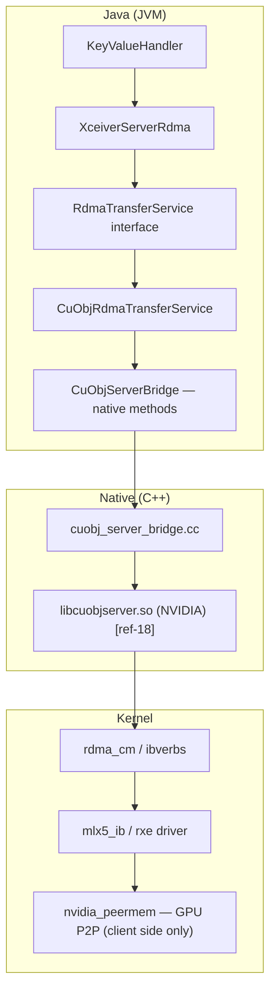

**Key design decisions:**

1. **Interface-based abstraction** (`RdmaTransferService`): Allows `MockRdmaTransferService` for testing without any
   native libraries. This follows Ozone's `TokenVerifier` / `NoopTokenVerifier` pattern.

2. **Package-private JNI class**: `CuObjServerBridge` is package-private. External code only sees
   `RdmaTransferService`. This prevents accidental direct JNI calls.

3. **`NativeLibraryLoader` reuse**: Uses Ozone's existing `NativeLibraryLoader` (singleton pattern, tries
   `System.loadLibrary` then JAR extraction). Same pattern as `rocks-native`.

4. **Channel-per-request concurrency**: Each RDMA read request allocates a channel via `allocateChannelId()` [[ref-18]](https://docs.nvidia.com/gpudirect-storage/cuobject/cuObjServer-api/index.html) for thread-safe concurrent operations, matching the cuObjServer threading model.

### 5.3 Native Library Lifecycle

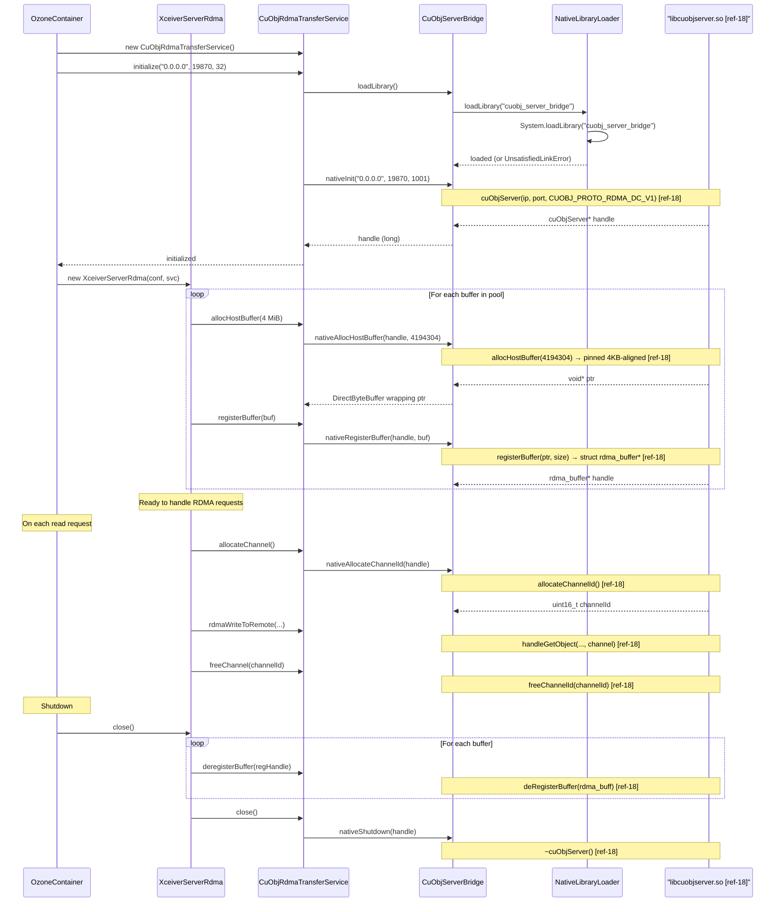

### 5.4 RDMA Buffer Management: Whose Memory and Why

Understanding the memory model is essential for correct implementation:

| Memory Type | Owner | Purpose | Allocated By | RDMA Registered? |
|---|---|---|---|---|
| GPU device memory | Client application | Stores training data, model weights | `cudaMalloc()` | Yes, by cuObjClient [[ref-17]](https://docs.nvidia.com/gpudirect-storage/cuobject/cuObjClient-api/index.html) |
| Pinned host memory (client) | Client application | Optional staging for non-GPU-aware apps | `cudaHostAlloc()` | Yes, by cuObjClient |
| **Pinned host memory (datanode)** | **Ozone datanode** | **RDMA staging buffer for disk I/O** | **`allocHostBuffer()` [[ref-18]](https://docs.nvidia.com/gpudirect-storage/cuobject/cuObjServer-api/index.html)** | **Yes, by cuObjServer `registerBuffer()` [[ref-18]](https://docs.nvidia.com/gpudirect-storage/cuobject/cuObjServer-api/index.html)** |
| Java heap memory | JVM | General Java objects | JVM GC | **Never** — not usable for RDMA |

**Why the datanode needs pinned memory:**

RDMA requires the NIC to DMA directly to/from a fixed physical address. If the OS swaps the page or the JVM GC
moves the object, the RDMA transfer corrupts memory. Pinned (page-locked) memory guarantees:

- The page is not swappable
- The physical address is stable for the duration of the RDMA operation
- The NIC can safely DMA without coordinating with the CPU/MMU

**`allocHostBuffer()` [[ref-18]](https://docs.nvidia.com/gpudirect-storage/cuobject/cuObjServer-api/index.html) vs `ByteBuffer.allocateDirect()`:**

- `allocHostBuffer(size)` is the cuObjServer API that allocates guaranteed pinned, 4 KB aligned memory. Caller
  frees with `free()` [[ref-18]](https://docs.nvidia.com/gpudirect-storage/cuobject/cuObjServer-api/index.html). This is the correct approach for production.
- `ByteBuffer.allocateDirect()` allocates off-heap memory, but the JVM does **not** guarantee it is page-locked.
  On Linux, `mlock()` would be needed. This works for development/testing but is unreliable for production RDMA.

The `RdmaBufferPool` (Section 4.10) uses `allocHostBuffer()` via the `RdmaTransferService.allocHostBuffer()` method
for production, and `ByteBuffer.allocateDirect()` in the mock implementation for testing.

### 5.5 Build System Integration

The native build uses CMake, invoked by the `cmake-maven-plugin` during `mvn package -Pnative`. This matches
the existing `hadoop-hdds/rocks-native/` pattern.

```xml
<!-- In container-service-native/pom.xml -->
<profiles>
  <profile>
    <id>native</id>
    <build>
      <plugins>
        <plugin>
          <groupId>com.googlecode.cmake-maven-project</groupId>
          <artifactId>cmake-maven-plugin</artifactId>
          <executions>
            <execution>
              <id>cmake-generate</id>
              <goals>
                <goal>generate</goal>
              </goals>
              <configuration>
                <sourcePath>${project.basedir}/src/main/native</sourcePath>
                <targetPath>${project.build.directory}/native</targetPath>
                <generator>Unix Makefiles</generator>
                <options>
                  <option>-DCUOBJSERVER_HOME=${env.CUOBJSERVER_HOME}</option>
                </options>
              </configuration>
            </execution>
            <execution>
              <id>cmake-compile</id>
              <goals>
                <goal>compile</goal>
              </goals>
              <configuration>
                <projectDirectory>${project.build.directory}/native</projectDirectory>
              </configuration>
            </execution>
          </executions>
        </plugin>
      </plugins>
    </build>
  </profile>
</profiles>
```

**Build commands:**

```bash
# Full build with native library
export CUOBJSERVER_HOME=/usr/local/cuobjserver  # path to cuObjServer SDK
mvn package -Pnative -pl hadoop-hdds/container-service-native

# Java-only build (no native, for CI without RDMA hardware)
mvn package -pl hadoop-hdds/container-service-native
# The native library won't be built; CuObjServerBridge.loadLibrary() returns false
```

### 5.6 Compiler and Toolchain Requirements

| Component | Minimum Version | Notes |
|---|---|---|
| GCC / G++ | 7.5+ | C++14 support required |
| CMake | 3.10+ | For native build |
| JDK | 8+ | For JNI headers (`jni.h`) |
| cuObjServer SDK | 1.0.0 | `libcuobjserver.so`, headers [[ref-18]](https://docs.nvidia.com/gpudirect-storage/cuobject/cuObjServer-api/index.html) |
| CUDA Toolkit | 13.1.1+ | Only needed on client side, NOT on datanode |
| MLNX_OFED | 5.8+ | Or kernel ibverbs 5.8+ |
| `nvidia_peermem` | — | Kernel module for GPUDirect RDMA (client side only) |

> The datanode does NOT need a GPU, CUDA toolkit, or `nvidia_peermem`. It only needs `libcuobjserver.so` and
> the RDMA stack (ibverbs + NIC drivers).

---

## 6. Development Environment and Deployment

### 6.1 SoftRoCE: Decision and Limitations

**SoftRoCE** (`rdma_rxe` kernel module) provides a software RDMA implementation over standard Ethernet NICs. It is
suitable for development and functional testing but NOT for performance testing.

| Aspect | SoftRoCE | Real RDMA (ConnectX-6+) |
|---|---|---|
| Kernel module | `rdma_rxe` | `mlx5_ib` |
| Latency | ~50 μs | ~1-2 μs |
| Throughput | Limited by CPU | Limited by NIC (200 Gbps) |
| GPUDirect | NOT supported | Supported via `nvidia_peermem` |
| DC transport | Depends on kernel version | Native support |
| Use case | Dev/functional testing | Benchmarking/production |

**Limitation:** SoftRoCE does NOT support GPUDirect RDMA (no `nvidia_peermem` integration). RDMA transfers with
SoftRoCE go through CPU memory only. This means:

- cuObjClient on the test client must use **pinned host memory** (`cudaHostAlloc`), not GPU memory
- OR: Use the `MockRdmaTransferService` for pure Java testing (no kernel RDMA at all)

### 6.2 GPU Cloud Providers

For benchmarking and integration testing with real GPU + RDMA hardware. Environments are **manually provisioned**
via the provider's web console or CLI, then configured by copying `setup-gpu-env.sh` (Section 6.4) to the node
and running it.

| Provider | Instance Type | GPU | RDMA NIC | Approx. Cost/hr | Notes |
|---|---|---|---|---|---|
| **Lambda Labs** | gpu_1x_h100_sxm5 | 1× H100 SXM | 200 Gbps | ~$2-3 | Cheapest for single-node dev/test |
| **Vultr** | vcg-a100-1c-12g-6vram | 1× A100 | RoCEv2 (100 Gbps) | ~$2-3 | Good availability, RoCE support |
| **Azure** | ND H100 v5 | 8× H100 | InfiniBand NDR (400 Gbps) | ~$96 | True InfiniBand, best for ibverbs |
| **CoreWeave** | H100 80GB | 1× H100 | InfiniBand (200 Gbps) | ~$4-5 | Good for small-scale RDMA testing |

**Primary targets:** **Lambda Labs** (cheapest single-GPU for development iteration) and **Vultr** (good
availability, RoCE support for RDMA testing). Both provide standard Ubuntu VMs where `setup-gpu-env.sh` can
be run directly.

**Provisioning workflow:**
1. Manually create a GPU VM via the provider's web console
2. SSH into the VM
3. `scp setup-gpu-env.sh validate-env.sh <user>@<host>:~/`
4. `ssh <user>@<host> 'bash setup-gpu-env.sh'`
5. `ssh <user>@<host> 'bash validate-env.sh'`
6. Clone Ozone, build, and run tests (see Section 6.7)

### 6.3 How to Run Ozone for Development

#### Prerequisites

1. **Java 8+ or 11+** (Ozone builds with both)
2. **Maven 3.8+**
3. **Docker** (for integration test cluster)
4. **RDMA stack** (for RDMA testing only):
   - SoftRoCE: `sudo modprobe rdma_rxe && sudo rdma link add rxe0 type rxe netdev eth0`
   - Or: Mellanox NIC with MLNX_OFED installed
5. **cuObjServer SDK** (for native build only):
   - Download from NVIDIA via the GPUDirect Storage page [[ref-15]](https://developer.nvidia.com/gpudirect-storage)
     (requires NVIDIA developer login; the cuObjServer package is under the GDS downloads)
   - Set `CUOBJSERVER_HOME=/path/to/sdk`

#### Build

```bash
# Java-only build (no RDMA, for IDE development)
mvn install -DskipTests -pl hadoop-hdds/container-service-native

# Full build with native library
export CUOBJSERVER_HOME=/usr/local/cuobjserver
mvn install -DskipTests -Pnative -pl hadoop-hdds/container-service-native

# Run all RDMA unit tests (uses MockRdmaTransferService, no hardware)
mvn test -pl hadoop-hdds/container-service-native

# Run integration tests with MiniOzoneCluster
mvn test -pl hadoop-ozone/integration-test -Dtest=TestRdmaReadBlock
```

### 6.4 `setup-gpu-env.sh`

Script to prepare a GPU cloud VM (Lambda Labs or Vultr) for RDMA development and testing.
Copy this script to the VM and run it as root or with sudo. It handles both the datanode
requirements (RDMA stack + cuObjServer) and the client requirements (GPU + CUDA + cuObjClient).

```bash
#!/usr/bin/env bash
set -euo pipefail

echo "=== Ozone RDMA GPU Environment Setup ==="
echo "Target: Lambda Labs / Vultr GPU VM (Ubuntu 22.04+)"
echo ""

# ----------------------------------------------------------------
# 1. System packages: RDMA userspace tools, build tools, Java, Maven
# ----------------------------------------------------------------
echo "--- Installing system packages ---"
sudo apt-get update
sudo apt-get install -y \
  rdma-core ibverbs-utils libibverbs-dev librdmacm-dev \
  build-essential cmake g++ \
  openjdk-11-jdk maven \
  git wget curl jq \
  net-tools iproute2 pciutils

# ----------------------------------------------------------------
# 2. RDMA kernel modules
# ----------------------------------------------------------------
echo "--- Loading RDMA kernel modules ---"
sudo modprobe ib_core
sudo modprobe ib_uverbs
sudo modprobe rdma_cm
sudo modprobe rdma_ucm

# Check for Mellanox NIC (real RDMA)
if lspci | grep -qi mellanox; then
  echo "Mellanox NIC detected — loading mlx5 drivers"
  sudo modprobe mlx5_core
  sudo modprobe mlx5_ib
else
  echo "No Mellanox NIC — setting up SoftRoCE for functional testing"
  sudo modprobe rdma_rxe
  IFACE=$(ip route get 8.8.8.8 | head -1 | awk '{print $5}')
  # Only add if not already present
  if ! rdma link show 2>/dev/null | grep -q rxe0; then
    sudo rdma link add rxe0 type rxe netdev "$IFACE"
  fi
  echo "SoftRoCE device rxe0 created on $IFACE"
fi

# ----------------------------------------------------------------
# 3. NVIDIA GPU drivers and nvidia_peermem (client-side GPUDirect)
# ----------------------------------------------------------------
echo "--- Checking NVIDIA GPU ---"
if command -v nvidia-smi &>/dev/null; then
  echo "NVIDIA driver already installed:"
  nvidia-smi --query-gpu=name,driver_version,memory.total --format=csv,noheader
else
  echo "WARNING: nvidia-smi not found. GPU drivers may not be installed."
  echo "  Lambda Labs VMs come with drivers pre-installed."
  echo "  For Vultr: sudo apt install nvidia-driver-535-server"
fi

# Load nvidia_peermem for GPUDirect RDMA (NIC <-> GPU direct path)
if lsmod | grep -q nvidia; then
  echo "Loading nvidia_peermem kernel module..."
  sudo modprobe nvidia_peermem 2>/dev/null || \
    echo "  WARNING: nvidia_peermem not available. GPUDirect RDMA will not work."
    echo "  Install MLNX_OFED or CUDA 12+ for nvidia_peermem support."
fi

# ----------------------------------------------------------------
# 4. Locked memory limits (critical for RDMA)
# ----------------------------------------------------------------
echo "--- Configuring locked memory limits ---"
# RDMA requires page-locked memory. Default ulimit is usually 64 KB — far too low.
# Set to unlimited for the current user.
if ! grep -q "memlock" /etc/security/limits.conf 2>/dev/null; then
  echo "* soft memlock unlimited" | sudo tee -a /etc/security/limits.conf
  echo "* hard memlock unlimited" | sudo tee -a /etc/security/limits.conf
  echo "  Added memlock unlimited to /etc/security/limits.conf"
  echo "  NOTE: Log out and back in for limits to take effect, or run:"
  echo "    ulimit -l unlimited"
else
  echo "  memlock already configured in /etc/security/limits.conf"
fi
# Apply immediately for this session
ulimit -l unlimited 2>/dev/null || true

# ----------------------------------------------------------------
# 5. Firewall: open RDMA port
# ----------------------------------------------------------------
echo "--- Configuring firewall ---"
RDMA_PORT=19870
if command -v ufw &>/dev/null && sudo ufw status | grep -q "active"; then
  sudo ufw allow ${RDMA_PORT}/tcp
  sudo ufw allow ${RDMA_PORT}/udp
  echo "  Opened port ${RDMA_PORT} in ufw"
elif command -v firewall-cmd &>/dev/null; then
  sudo firewall-cmd --add-port=${RDMA_PORT}/tcp --permanent 2>/dev/null || true
  sudo firewall-cmd --add-port=${RDMA_PORT}/udp --permanent 2>/dev/null || true
  sudo firewall-cmd --reload 2>/dev/null || true
  echo "  Opened port ${RDMA_PORT} in firewalld"
else
  echo "  No firewall detected (or not active) — no changes needed"
fi

# ----------------------------------------------------------------
# 6. cuObjServer SDK check
# ----------------------------------------------------------------
echo "--- cuObjServer SDK Installation ---"
CUOBJ_INSTALL_DIR="/usr/local/cuobjserver"
if [ -z "${CUOBJSERVER_HOME:-}" ]; then
  echo "CUOBJSERVER_HOME not set. Attempting to install cuObjServer SDK..."
  echo ""
  echo "The cuObjServer SDK requires an NVIDIA developer account."
  echo "Download the SDK package from:"
  echo "  https://developer.nvidia.com/gpudirect-storage"
  echo "  (Navigate to: GPUDirect Storage Downloads -> cuObject Server)"
  echo ""
  # Check if SDK tarball or deb is present in the current directory
  SDK_TARBALL=$(ls cuobjserver-*.tar.gz 2>/dev/null | head -1)
  SDK_DEB=$(ls cuobjserver-*.deb 2>/dev/null | head -1)
  if [ -n "$SDK_DEB" ]; then
    echo "Found SDK deb package: $SDK_DEB — installing..."
    sudo dpkg -i "$SDK_DEB"
    # deb installs to /usr/local/cuobjserver or /usr/lib
    export CUOBJSERVER_HOME="${CUOBJ_INSTALL_DIR}"
  elif [ -n "$SDK_TARBALL" ]; then
    echo "Found SDK tarball: $SDK_TARBALL — extracting to ${CUOBJ_INSTALL_DIR}..."
    sudo mkdir -p "${CUOBJ_INSTALL_DIR}"
    sudo tar -xzf "$SDK_TARBALL" -C "${CUOBJ_INSTALL_DIR}" --strip-components=1
    export CUOBJSERVER_HOME="${CUOBJ_INSTALL_DIR}"
  else
    echo "No cuObjServer SDK package found in current directory."
    echo "Please download from NVIDIA and either:"
    echo "  a) Place the .deb or .tar.gz in this directory and re-run, or"
    echo "  b) Install manually and set: export CUOBJSERVER_HOME=/path/to/sdk"
    echo ""
    echo "Manual installation steps (after downloading the tarball):"
    echo "  sudo mkdir -p ${CUOBJ_INSTALL_DIR}"
    echo "  sudo tar -xzf cuobjserver-*.tar.gz -C ${CUOBJ_INSTALL_DIR} --strip-components=1"
    echo "  export CUOBJSERVER_HOME=${CUOBJ_INSTALL_DIR}"
    echo '  echo "export CUOBJSERVER_HOME='${CUOBJ_INSTALL_DIR}'" >> ~/.bashrc'
  fi
fi

# Configure library path if SDK is installed
if [ -n "${CUOBJSERVER_HOME:-}" ]; then
  echo "CUOBJSERVER_HOME=$CUOBJSERVER_HOME"
  [ -f "$CUOBJSERVER_HOME/include/cuobjserver.h" ] && \
    echo "  [OK] cuobjserver.h found" || \
    echo "  [MISSING] cuobjserver.h not found at $CUOBJSERVER_HOME/include/"
  if [ -f "$CUOBJSERVER_HOME/lib64/libcuobjserver.so" ] || \
     [ -f "$CUOBJSERVER_HOME/lib/libcuobjserver.so" ]; then
    echo "  [OK] libcuobjserver.so found"
    # Add to ldconfig so the JVM can find it at runtime
    LIB_DIR="$CUOBJSERVER_HOME/lib64"
    [ -d "$LIB_DIR" ] || LIB_DIR="$CUOBJSERVER_HOME/lib"
    if [ -d "$LIB_DIR" ]; then
      echo "$LIB_DIR" | sudo tee /etc/ld.so.conf.d/cuobjserver.conf
      sudo ldconfig
      echo "  [OK] ldconfig updated with $LIB_DIR"
    fi
  else
    echo "  [MISSING] libcuobjserver.so not found"
  fi
  # Persist CUOBJSERVER_HOME in bashrc if not already there
  if ! grep -q CUOBJSERVER_HOME ~/.bashrc 2>/dev/null; then
    echo "export CUOBJSERVER_HOME=${CUOBJSERVER_HOME}" >> ~/.bashrc
    echo "  [OK] CUOBJSERVER_HOME added to ~/.bashrc"
  fi
fi

# ----------------------------------------------------------------
# 7. Summary
# ----------------------------------------------------------------
echo ""
echo "=== Setup complete ==="
echo ""
echo "Next steps:"
echo "  1. Log out and back in (for ulimit changes)"
echo "  2. Run: bash validate-env.sh"
echo "  3. Clone and build Ozone:"
echo "     git clone https://github.com/apache/ozone.git && cd ozone"
echo "     export CUOBJSERVER_HOME=/path/to/cuobjserver"
echo "     mvn install -DskipTests -Pnative -pl hadoop-hdds/container-service-native"
echo "  4. Run unit tests: mvn test -pl hadoop-hdds/container-service-native"
```

### 6.5 `validate-env.sh`

Script to validate that an environment is ready for RDMA operations:

```bash
#!/usr/bin/env bash
set -euo pipefail

PASS=0
FAIL=0
WARN=0

check() {
  local desc="$1"; shift
  if eval "$@" >/dev/null 2>&1; then
    echo "  [PASS] $desc"
    PASS=$((PASS + 1))
  else
    echo "  [FAIL] $desc"
    FAIL=$((FAIL + 1))
  fi
}

check_warn() {
  local desc="$1"; shift
  if eval "$@" >/dev/null 2>&1; then
    echo "  [PASS] $desc"
    PASS=$((PASS + 1))
  else
    echo "  [WARN] $desc (optional)"
    WARN=$((WARN + 1))
  fi
}

echo "=== RDMA Environment Validation ==="

echo ""
echo "--- Kernel modules ---"
check "rdma_cm loaded"   'lsmod | grep -q rdma_cm'
check "ib_core loaded"   'lsmod | grep -q ib_core'
check "ib_uverbs loaded" 'lsmod | grep -q ib_uverbs'

echo ""
echo "--- RDMA devices ---"
check "At least one RDMA device" 'test "$(rdma link show 2>/dev/null | wc -l)" -gt 0'
check "ibv_devices works" 'ibv_devices'

echo ""
echo "--- cuObjServer ---"
check_warn "libcuobjserver.so in ldconfig" 'ldconfig -p | grep -q libcuobjserver'
check "CUOBJSERVER_HOME set" 'test -n "${CUOBJSERVER_HOME:-}"'

echo ""
echo "--- GPUDirect (optional, client-side) ---"
check_warn "nvidia_peermem loaded" 'lsmod | grep -q nvidia_peermem'
check_warn "NVIDIA GPU present"     'nvidia-smi'

echo ""
echo "--- Network ---"
check "ibv_devinfo shows active port" 'ibv_devinfo 2>/dev/null | grep -q "state:.*PORT_ACTIVE"'

echo ""
echo "--- System limits ---"
check "Locked memory >= 1 GiB or unlimited" \
  'test "$(ulimit -l)" = "unlimited" -o "$(ulimit -l)" -ge 1048576 2>/dev/null'
check "Java available"  'java -version'
check "Maven available" 'mvn --version'

echo ""
echo "=== Results: $PASS passed, $FAIL failed, $WARN warnings ==="
if [ "$FAIL" -eq 0 ]; then
  echo "Environment is RDMA-ready."
else
  echo "Fix failures before testing RDMA. Warnings are optional components."
fi
```

### 6.6 Docker Cluster for Integration Testing

For integration testing with a multi-node Ozone cluster + SoftRoCE.

**`Dockerfile.rdma`** — extends the base Ozone image with RDMA + native library support:

```dockerfile
# Dockerfile.rdma
# Build: docker build -f Dockerfile.rdma -t ozone-rdma:latest .
FROM apache/ozone-runner:latest

# Install RDMA userspace tools
RUN apt-get update && apt-get install -y --no-install-recommends \
    rdma-core ibverbs-utils libibverbs-dev && \
    rm -rf /var/lib/apt/lists/*

# Copy native JNI library (built from container-service-native with -Pnative)
COPY libcuobj_server_bridge.so /opt/hadoop/lib/native/

# Copy cuObjServer shared library (from NVIDIA SDK)
# Ensure libcuobjserver.so is in your build context
COPY libcuobjserver.so /usr/lib/x86_64-linux-gnu/
RUN ldconfig
```

**`docker-compose-rdma.yaml`:**

```yaml
# docker-compose-rdma.yaml
# Full Ozone cluster with RDMA support on the datanode (SoftRoCE for dev/test)
version: "3.8"

x-common-env: &common-env
  OZONE-SITE.XML_ozone.om.address: om
  OZONE-SITE.XML_ozone.om.http-address: om:9874
  OZONE-SITE.XML_hdds.scm.names: scm
  OZONE-SITE.XML_ozone.scm.client.address: scm
  OZONE-SITE.XML_ozone.scm.datanode.address: scm
  OZONE-SITE.XML_ozone.scm.block.client.address: scm
  OZONE-SITE.XML_ozone.metadata.dirs: /data/metadata
  OZONE-SITE.XML_hdds.datanode.dir: /data/hdds
  OZONE-SITE.XML_ozone.replication: "1"
  OZONE-SITE.XML_ozone.replication.type: STAND_ALONE

services:
  scm:
    image: ${OZONE_IMAGE:-apache/ozone:latest}
    hostname: scm
    ports:
      - "9876:9876"   # SCM client RPC
    environment:
      <<: *common-env
      ENSURE_SCM_INITIALIZED: /data/metadata/scm/current/VERSION
    command: ["ozone", "scm"]
    volumes:
      - scm-data:/data

  om:
    image: ${OZONE_IMAGE:-apache/ozone:latest}
    hostname: om
    ports:
      - "9862:9862"   # OM RPC
      - "9874:9874"   # OM HTTP UI
    environment:
      <<: *common-env
      ENSURE_OM_INITIALIZED: /data/metadata/om/current/VERSION
      WAITFOR: scm:9876
    command: ["ozone", "om"]
    volumes:
      - om-data:/data
    depends_on:
      - scm

  datanode:
    build:
      context: .
      dockerfile: Dockerfile.rdma
    hostname: datanode
    privileged: true  # Required for SoftRoCE kernel module (rdma_rxe)
    ports:
      - "19870:19870" # cuObjServer RDMA port
      - "9882:9882"   # Datanode RPC
    environment:
      <<: *common-env
      OZONE-SITE.XML_hdds.datanode.rdma.enabled: "true"
      OZONE-SITE.XML_hdds.datanode.rdma.bind.address: "0.0.0.0"
      OZONE-SITE.XML_hdds.datanode.rdma.port: "19870"
      OZONE-SITE.XML_hdds.datanode.rdma.transfer.service.class: >-
        org.apache.hadoop.ozone.container.rdma.CuObjRdmaTransferService
      WAITFOR: scm:9876
    entrypoint: |
      bash -c '
        modprobe rdma_rxe
        rdma link add rxe0 type rxe netdev eth0 2>/dev/null || true
        /opt/hadoop/bin/ozone datanode
      '
    volumes:
      - dn-data:/data
    depends_on:
      - om

  s3g:
    image: ${OZONE_IMAGE:-apache/ozone:latest}
    hostname: s3g
    ports:
      - "9878:9878"   # S3 Gateway HTTP
    environment:
      <<: *common-env
      WAITFOR: om:9862
    command: ["ozone", "s3g"]
    depends_on:
      - om

volumes:
  scm-data:
  om-data:
  dn-data:
```

### 6.7 Quick Start Cookbook: End-to-End Setup and Test

#### A. Local development (no GPU, mock RDMA)

```bash
# 1. Clone and build
git clone https://github.com/apache/ozone.git
cd ozone
mvn install -DskipTests

# 2. Run unit tests with MockRdmaTransferService (no native library needed)
mvn test -pl hadoop-hdds/container-service-native

# 3. Run integration tests with MiniOzoneCluster (mock RDMA)
mvn test -pl hadoop-ozone/integration-test -Dtest=TestRdmaReadBlock
```

#### B. GPU cloud VM (Lambda Labs / Vultr)

```bash
# 1. Provision a GPU VM manually via the provider's web console.
#    Lambda Labs: gpu_1x_h100_sxm5 (~$2.50/hr)
#    Vultr: vcg-a100-1c-12g-6vram (~$2.30/hr)

# 2. Copy setup scripts and run
scp setup-gpu-env.sh validate-env.sh user@gpu-vm:~/
ssh user@gpu-vm 'bash setup-gpu-env.sh'
ssh user@gpu-vm 'bash validate-env.sh'

# 3. On the GPU VM: clone, build with native library
ssh user@gpu-vm
git clone https://github.com/apache/ozone.git && cd ozone
export CUOBJSERVER_HOME=/usr/local/cuobjserver
mvn install -DskipTests
mvn install -DskipTests -Pnative -pl hadoop-hdds/container-service-native

# 4. Start Ozone with RDMA enabled (single-node dev cluster)
# ozone-site.xml must include:
#   hdds.datanode.rdma.enabled=true
#   hdds.datanode.rdma.port=19870
ozone --daemon start scm
ozone --daemon start om
ozone --daemon start datanode
ozone --daemon start s3g

# 5. Upload test data and verify RDMA
ozone sh volume create /vol1
ozone sh bucket create /vol1/bucket1
dd if=/dev/urandom bs=1M count=256 of=/tmp/test-256m.bin
ozone sh key put /vol1/bucket1/test-256m /tmp/test-256m.bin

# 6. Run E2E test (see Section 7.4)
python3 test_rdma_e2e.py \
  --s3-endpoint http://localhost:9878 \
  --bucket bucket1 \
  --key test-256m \
  --gpu-id 0

# 7. IMPORTANT: Shut down the VM when done to stop billing!
#    Run: bash cleanup-env.sh (see Section 6.10)
```

### 6.8 Ozone RDMA Configuration Template

**File:** `ozone-site-rdma.xml` — Drop-in configuration snippet for enabling RDMA on a datanode.
Copy the relevant `<property>` blocks into your `ozone-site.xml`.

```xml
<?xml version="1.0" encoding="UTF-8"?>
<!-- ozone-site-rdma.xml — RDMA configuration for Apache Ozone -->
<!-- Copy these properties into your ozone-site.xml -->
<configuration>

  <!-- === Datanode RDMA Engine === -->
  <property>
    <name>hdds.datanode.rdma.enabled</name>
    <value>true</value>
    <description>Master switch: enable RDMA engine on datanode.</description>
  </property>
  <property>
    <name>hdds.datanode.rdma.bind.address</name>
    <value>0.0.0.0</value>
    <description>cuObjServer bind IP. Use 0.0.0.0 for all interfaces
    or a specific NIC IP for RDMA-capable interface only.</description>
  </property>
  <property>
    <name>hdds.datanode.rdma.port</name>
    <value>19870</value>
    <description>cuObjServer DC transport listen port.</description>
  </property>
  <property>
    <name>hdds.datanode.rdma.max.connections</name>
    <value>32</value>
    <description>Max concurrent RDMA connections. Scale with
    expected concurrent GPU clients.</description>
  </property>
  <property>
    <name>hdds.datanode.rdma.max.concurrent.transfers</name>
    <value>32</value>
    <description>Max concurrent RDMA transfer operations (Semaphore permits).
    Prevents NIC and buffer pool overload under high fan-in from many
    S3 Gateways. Should be ≤ buffer.count.</description>
  </property>

  <!-- === RDMA Buffer Pool === -->
  <property>
    <name>hdds.datanode.rdma.buffer.size</name>
    <value>4194304</value>
    <description>Size of each RDMA buffer in bytes (default: 4 MiB).
    Must be pinned (page-locked) memory.</description>
  </property>
  <property>
    <name>hdds.datanode.rdma.buffer.count</name>
    <value>64</value>
    <description>Number of pre-allocated RDMA buffers.
    Total pinned memory = buffer.size x buffer.count (default: 256 MiB).</description>
  </property>

  <!-- === RDMA Checksums === -->
  <property>
    <name>hdds.datanode.rdma.checksum.enabled</name>
    <value>true</value>
    <description>Compute CRC32C checksums during RDMA reads.
    Catches disk corruption before RDMA_WRITE to GPU.</description>
  </property>

  <!-- === S3 Gateway RDMA Settings === -->
  <property>
    <name>ozone.s3g.rdma.min.object.size</name>
    <value>1048576</value>
    <description>Minimum object size (bytes) for RDMA. Smaller objects
    use TCP (less overhead). Default: 1 MiB.</description>
  </property>

  <!-- === Security (disable for benchmarking, enable for production) === -->
  <!-- See Section 3.7 for the full security configuration matrix. -->
  <!--
  <property>
    <name>ozone.security.enabled</name>
    <value>false</value>
  </property>
  <property>
    <name>hdds.block.token.enabled</name>
    <value>false</value>
  </property>
  -->

</configuration>
```

### 6.9 `run-all-tests.sh`

Automated test runner that executes the full RDMA test suite. Run after building Ozone.

```bash
#!/usr/bin/env bash
set -euo pipefail

PASS=0
FAIL=0
RESULTS=()

run_test() {
  local name="$1"; shift
  echo ""
  echo "=== Running: $name ==="
  if eval "$@"; then
    echo "  [PASS] $name"
    PASS=$((PASS + 1))
    RESULTS+=("[PASS] $name")
  else
    echo "  [FAIL] $name"
    FAIL=$((FAIL + 1))
    RESULTS+=("[FAIL] $name")
  fi
}

echo "=== Ozone RDMA Test Suite ==="
echo "Date: $(date -u +%Y-%m-%dT%H:%M:%SZ)"
echo ""

# --- Phase 1: Unit tests (no hardware required) ---
echo "--- Phase 1: Unit Tests (MockRdmaTransferService) ---"
run_test "RdmaBufferPool unit tests" \
  mvn test -pl hadoop-hdds/container-service-native \
    -Dtest=TestRdmaBufferPool -q

run_test "XceiverServerRdma unit tests" \
  mvn test -pl hadoop-hdds/container-service-native \
    -Dtest=TestXceiverServerRdma -q

run_test "MockRdmaTransferService unit tests" \
  mvn test -pl hadoop-hdds/container-service-native \
    -Dtest=TestMockRdmaTransferService -q

# --- Phase 2: Integration tests (MiniOzoneCluster, no hardware) ---
echo ""
echo "--- Phase 2: Integration Tests (MiniOzoneCluster) ---"
run_test "RDMA ReadBlock integration test" \
  mvn test -pl hadoop-ozone/integration-test \
    -Dtest=TestRdmaReadBlock -q

# --- Phase 3: E2E tests (requires RDMA hardware + running Ozone cluster) ---
if [ "${RDMA_E2E_ENABLED:-false}" = "true" ]; then
  echo ""
  echo "--- Phase 3: E2E Tests (real RDMA hardware) ---"
  S3_ENDPOINT="${S3_ENDPOINT:-http://localhost:9878}"
  GPU_ID="${GPU_ID:-0}"

  # Create test volume and bucket if they don't exist
  ozone sh volume create /vol1 2>/dev/null || true
  ozone sh bucket create /vol1/test-rdma 2>/dev/null || true

  run_test "E2E RDMA GET (256 MiB)" \
    python3 test_rdma_e2e.py \
      --s3-endpoint "$S3_ENDPOINT" \
      --bucket test-rdma \
      --key test-256m \
      --size-mb 256 \
      --gpu-id "$GPU_ID"

  if [ "${RDMA_BENCH_ENABLED:-false}" = "true" ]; then
    echo ""
    echo "--- Phase 4: Benchmarks ---"
    run_test "RDMA vs TCP benchmark (256 MiB x 50 iterations)" \
      python3 bench_rdma_get.py \
        --s3-endpoint "$S3_ENDPOINT" \
        --bucket test-rdma \
        --object-size-mb 256 \
        --iterations 50 \
        --gpu-id "$GPU_ID"
  fi
else
  echo ""
  echo "--- Phase 3: E2E Tests SKIPPED ---"
  echo "  Set RDMA_E2E_ENABLED=true to run E2E tests with real hardware."
  echo "  Also set S3_ENDPOINT and GPU_ID if not using defaults."
fi

# --- Summary ---
echo ""
echo "========================================"
echo "=== Test Results: $PASS passed, $FAIL failed ==="
echo "========================================"
for r in "${RESULTS[@]}"; do
  echo "  $r"
done

if [ "$FAIL" -gt 0 ]; then
  exit 1
fi
```

### 6.10 `cleanup-env.sh`

Cleanup script for tearing down a development/test environment.

```bash
#!/usr/bin/env bash
set -euo pipefail

echo "=== Ozone RDMA Environment Cleanup ==="

# --- 1. Stop Ozone daemons ---
echo "--- Stopping Ozone daemons ---"
for daemon in s3g datanode om scm; do
  if ozone --daemon stop $daemon 2>/dev/null; then
    echo "  Stopped $daemon"
  else
    echo "  $daemon was not running"
  fi
done

# --- 2. Stop Docker containers ---
echo "--- Stopping Docker RDMA containers ---"
if [ -f docker-compose-rdma.yaml ]; then
  docker compose -f docker-compose-rdma.yaml down -v 2>/dev/null || true
  echo "  Docker RDMA cluster stopped and volumes removed"
else
  echo "  No docker-compose-rdma.yaml found — skipping"
fi

# --- 3. Remove SoftRoCE device ---
echo "--- Removing SoftRoCE device ---"
if rdma link show 2>/dev/null | grep -q rxe0; then
  sudo rdma link delete rxe0 2>/dev/null || true
  echo "  Removed rxe0 SoftRoCE device"
else
  echo "  No rxe0 device found — skipping"
fi

# --- 4. Unload RDMA kernel modules (optional) ---
echo "--- Unloading SoftRoCE kernel module ---"
if lsmod | grep -q rdma_rxe; then
  sudo modprobe -r rdma_rxe 2>/dev/null || \
    echo "  WARNING: Could not unload rdma_rxe (may be in use)"
  echo "  Unloaded rdma_rxe"
else
  echo "  rdma_rxe not loaded — skipping"
fi
# NOTE: Do not unload ib_core/ib_uverbs/rdma_cm — they may be used by
# Mellanox drivers or other system services.

# --- 5. Clean up temp files ---
echo "--- Cleaning up temp files ---"
rm -f /tmp/test-*.bin /tmp/rdma-test-* 2>/dev/null
echo "  Removed /tmp/test-*.bin and /tmp/rdma-test-* files"

echo ""
echo "=== Cleanup complete ==="
echo ""
echo "NOTE: This script does NOT shut down or destroy the cloud VM."
echo "If you are on a cloud GPU instance, remember to terminate it"
echo "via the provider's web console to stop billing."
```

---

## 7. Testing

**Phase 1 scope:** All tests cover the read path only. Write path tests are deferred to Phase 2.

### 7.1 Unit Tests

All unit tests use `MockRdmaTransferService` — no native library, no RDMA hardware, no SoftRoCE required.

#### 7.1.1 `TestRdmaBufferPool`

```java
@Test
public void testAcquireAndRelease() throws Exception {
  MockRdmaTransferService mockService = new MockRdmaTransferService();
  mockService.initialize(null, 0, 0);
  OzoneConfiguration conf = new OzoneConfiguration();
  conf.setInt(RdmaBufferPool.BUFFER_SIZE_KEY, 1024);
  conf.setInt(RdmaBufferPool.BUFFER_COUNT_KEY, 4);
  RdmaBufferPool pool = new RdmaBufferPool(conf, mockService);

  // Acquire all buffers
  List<RdmaBuffer> buffers = new ArrayList<>();
  for (int i = 0; i < 4; i++) {
    buffers.add(pool.acquire());
  }
  assertEquals(0, pool.getAvailableCount());

  // Release all
  buffers.forEach(pool::release);
  assertEquals(4, pool.getAvailableCount());
}

@Test(expected = IOException.class)
public void testPoolExhaustion() throws Exception {
  MockRdmaTransferService mockService = new MockRdmaTransferService();
  mockService.initialize(null, 0, 0);
  OzoneConfiguration conf = new OzoneConfiguration();
  conf.setInt(RdmaBufferPool.BUFFER_COUNT_KEY, 1);
  conf.setLong(RdmaBufferPool.ACQUIRE_TIMEOUT_KEY, 100);
  RdmaBufferPool pool = new RdmaBufferPool(conf, mockService);

  RdmaBuffer buf = pool.acquire();
  pool.acquire(); // Should throw IOException after 100ms timeout
}
```

#### 7.1.2 `TestXceiverServerRdma`

```java
@Test
public void testHandleRdmaReadSingleChunk() throws Exception {
  MockRdmaTransferService mockService = new MockRdmaTransferService();
  mockService.initialize(null, 0, 0);

  // Register a "remote" buffer to simulate the GPU client
  ByteBuffer remoteGpuBuffer = ByteBuffer.allocateDirect(4096);
  mockService.registerRemoteBuffer("test-rdma-token-123", remoteGpuBuffer);

  OzoneConfiguration conf = new OzoneConfiguration();
  conf.setInt(RdmaBufferPool.BUFFER_SIZE_KEY, 4096);
  conf.setInt(RdmaBufferPool.BUFFER_COUNT_KEY, 2);
  XceiverServerRdma rdmaServer = new XceiverServerRdma(conf, mockService);

  // Create a temp file with known content
  byte[] testData = new byte[1024];
  Arrays.fill(testData, (byte) 0xAB);
  Path tempFile = Files.createTempFile("rdma-test", ".block");
  Files.write(tempFile, testData);

  // Build request
  RdmaReadBlockRequestProto request = RdmaReadBlockRequestProto.newBuilder()
      .setBlockID(DatanodeBlockID.newBuilder().setContainerID(1).setLocalID(1))
      .setRdmaToken("test-rdma-token-123")
      .build();

  try (FileChannel fc = FileChannel.open(tempFile, StandardOpenOption.READ)) {
    RdmaReadBlockResponseProto response =
        rdmaServer.handleRdmaRead(request, fc, testData.length);
    assertEquals(1024, response.getBytesTransferred());

    // Verify data arrived in the "remote GPU" buffer
    remoteGpuBuffer.position(0);
    byte[] received = new byte[1024];
    remoteGpuBuffer.get(received);
    assertArrayEquals(testData, received);
  }
}

@Test
public void testHandleRdmaReadWithDestOffset() throws Exception {
  // Simulates multi-block read: second block writes at destOffset=1024
  MockRdmaTransferService mockService = new MockRdmaTransferService();
  mockService.initialize(null, 0, 0);

  ByteBuffer remoteGpuBuffer = ByteBuffer.allocateDirect(4096);
  mockService.registerRemoteBuffer("token-offset-test", remoteGpuBuffer);

  OzoneConfiguration conf = new OzoneConfiguration();
  conf.setInt(RdmaBufferPool.BUFFER_SIZE_KEY, 4096);
  conf.setInt(RdmaBufferPool.BUFFER_COUNT_KEY, 2);
  XceiverServerRdma rdmaServer = new XceiverServerRdma(conf, mockService);

  byte[] testData = new byte[512];
  Arrays.fill(testData, (byte) 0xCD);
  Path tempFile = Files.createTempFile("rdma-offset-test", ".block");
  Files.write(tempFile, testData);

  // Request with destOffset=1024 — data should land at byte 1024 in remote buffer
  RdmaReadBlockRequestProto request = RdmaReadBlockRequestProto.newBuilder()
      .setBlockID(DatanodeBlockID.newBuilder().setContainerID(1).setLocalID(2))
      .setRdmaToken("token-offset-test")
      .setDestOffset(1024)
      .build();

  try (FileChannel fc = FileChannel.open(tempFile, StandardOpenOption.READ)) {
    RdmaReadBlockResponseProto response =
        rdmaServer.handleRdmaRead(request, fc, testData.length);
    assertEquals(512, response.getBytesTransferred());

    // Verify data landed at offset 1024
    remoteGpuBuffer.position(1024);
    byte[] received = new byte[512];
    remoteGpuBuffer.get(received);
    assertArrayEquals(testData, received);
  }
}

@Test
public void testHandleRdmaReadChunked() throws Exception {
  // Block is 16 KB, buffer is 4 KB → should produce 4 RDMA chunks
  MockRdmaTransferService mockService = new MockRdmaTransferService();
  mockService.initialize(null, 0, 0);

  ByteBuffer remoteGpuBuffer = ByteBuffer.allocateDirect(16 * 1024);
  mockService.registerRemoteBuffer("token-chunked", remoteGpuBuffer);

  OzoneConfiguration conf = new OzoneConfiguration();
  conf.setInt(RdmaBufferPool.BUFFER_SIZE_KEY, 4096); // 4 KB buffer
  conf.setInt(RdmaBufferPool.BUFFER_COUNT_KEY, 2);
  XceiverServerRdma rdmaServer = new XceiverServerRdma(conf, mockService);

  byte[] testData = new byte[16 * 1024];
  new Random(42).nextBytes(testData);
  Path tempFile = Files.createTempFile("rdma-chunk-test", ".block");
  Files.write(tempFile, testData);

  RdmaReadBlockRequestProto request = RdmaReadBlockRequestProto.newBuilder()
      .setBlockID(DatanodeBlockID.newBuilder().setContainerID(1).setLocalID(1))
      .setRdmaToken("token-chunked")
      .build();

  try (FileChannel fc = FileChannel.open(tempFile, StandardOpenOption.READ)) {
    RdmaReadBlockResponseProto response =
        rdmaServer.handleRdmaRead(request, fc, testData.length);
    assertEquals(16 * 1024, response.getBytesTransferred());

    // Verify all 16 KB arrived correctly
    remoteGpuBuffer.position(0);
    byte[] received = new byte[16 * 1024];
    remoteGpuBuffer.get(received);
    assertArrayEquals(testData, received);
  }
}
```

#### 7.1.3 `TestMockRdmaTransferService`

```java
@Test
public void testRdmaWriteToRemote() throws Exception {
  MockRdmaTransferService service = new MockRdmaTransferService();
  service.initialize(null, 0, 0);

  // Register a "remote" GPU buffer
  ByteBuffer remote = ByteBuffer.allocateDirect(1024);
  service.registerRemoteBuffer("token-1", remote);

  // Register a local buffer
  ByteBuffer local = ByteBuffer.allocateDirect(1024);
  long handle = service.registerBuffer(local);

  // Write data to local, then RDMA_WRITE to remote
  byte[] data = "Hello RDMA".getBytes();
  local.put(data);
  service.rdmaWriteToRemote("testKey", "token-1", handle, 0, 0, data.length, 0);

  // Verify remote received the data
  remote.position(0);
  byte[] received = new byte[data.length];
  remote.get(received);
  assertArrayEquals(data, received);
}

@Test
public void testChannelAllocation() throws Exception {
  MockRdmaTransferService service = new MockRdmaTransferService();
  service.initialize(null, 0, 0);

  int ch1 = service.allocateChannel();
  int ch2 = service.allocateChannel();
  assertNotEquals(ch1, ch2);

  // freeChannel is a no-op for mock but should not throw
  service.freeChannel(ch1);
  service.freeChannel(ch2);
}
```

#### 7.1.4 Negative and Edge-Case Tests

These tests validate error paths, fallback behavior, and boundary conditions.

**`TestRdmaReadNegative`:**

```java
/**
 * Verify that a malformed or unrecognized RDMA token results in a transfer
 * failure, not a crash or silent data corruption.
 */
@Test
public void testMalformedRdmaToken() throws Exception {
  MockRdmaTransferService mockService = new MockRdmaTransferService();
  mockService.initialize(null, 0, 0);
  // Do NOT register any remote buffer — the token is unknown

  OzoneConfiguration conf = new OzoneConfiguration();
  conf.setInt(RdmaBufferPool.BUFFER_SIZE_KEY, 4096);
  conf.setInt(RdmaBufferPool.BUFFER_COUNT_KEY, 2);
  XceiverServerRdma rdmaServer = new XceiverServerRdma(conf, mockService);

  byte[] testData = new byte[512];
  Path tempFile = Files.createTempFile("rdma-bad-token", ".block");
  Files.write(tempFile, testData);

  RdmaReadBlockRequestProto request = RdmaReadBlockRequestProto.newBuilder()
      .setBlockID(DatanodeBlockID.newBuilder().setContainerID(1).setLocalID(1))
      .setRdmaToken("nonexistent-token-xyz")
      .build();

  try (FileChannel fc = FileChannel.open(tempFile, StandardOpenOption.READ)) {
    // Should throw or return an error response — not succeed silently
    assertThrows(IOException.class, () ->
        rdmaServer.handleRdmaRead(request, fc, testData.length));
  }
}

/**
 * Verify buffer pool exhaustion under concurrent load returns
 * RDMA_BUFFER_POOL_EXHAUSTED, not an unhandled exception.
 */
@Test
public void testBufferPoolExhaustionUnderLoad() throws Exception {
  MockRdmaTransferService mockService = new MockRdmaTransferService();
  mockService.initialize(null, 0, 0);

  OzoneConfiguration conf = new OzoneConfiguration();
  conf.setInt(RdmaBufferPool.BUFFER_SIZE_KEY, 4096);
  conf.setInt(RdmaBufferPool.BUFFER_COUNT_KEY, 1);   // Only 1 buffer
  conf.setLong(RdmaBufferPool.ACQUIRE_TIMEOUT_KEY, 50); // Very short timeout
  RdmaBufferPool pool = new RdmaBufferPool(conf, mockService);

  // Acquire the only buffer
  RdmaBuffer buf = pool.acquire();

  // Second acquire should fail with IOException (pool exhausted), not hang
  try {
    pool.acquire();
    fail("Expected IOException for pool exhaustion");
  } catch (IOException e) {
    assertTrue(e.getMessage().contains("timeout") ||
               e.getMessage().contains("exhausted"));
  } finally {
    pool.release(buf);
  }
}

/**
 * Verify that the semaphore-based concurrency limiter in XceiverServerRdma
 * rejects requests beyond the max concurrent transfers limit with
 * RDMA_BUFFER_POOL_EXHAUSTED rather than blocking indefinitely.
 */
@Test
public void testConcurrentTransferSemaphoreLimit() throws Exception {
  MockRdmaTransferService mockService = new MockRdmaTransferService();
  mockService.initialize(null, 0, 0);

  OzoneConfiguration conf = new OzoneConfiguration();
  conf.setInt(RdmaBufferPool.BUFFER_SIZE_KEY, 4096);
  conf.setInt(RdmaBufferPool.BUFFER_COUNT_KEY, 4);
  // Set max concurrent transfers to 1 so we can easily saturate it
  conf.setInt("hdds.datanode.rdma.max.concurrent.transfers", 1);
  XceiverServerRdma rdmaServer = new XceiverServerRdma(conf, mockService);

  // The test should verify that when the semaphore is fully acquired,
  // subsequent requests receive a transient error rather than blocking.
  // Exact mechanism depends on implementation: tryAcquire with timeout
  // returns false → RDMA_BUFFER_POOL_EXHAUSTED response.
  assertNotNull(rdmaServer);
}

/**
 * Verify that objects smaller than ozone.s3g.rdma.min.object.size
 * are served via TCP fallback even when x-amz-rdma-token is present.
 */
@Test
public void testSmallObjectFallbackToTcp() throws Exception {
  // This is an ObjectEndpoint-level test. In a unit test context, verify
  // the size check logic directly:
  long minRdmaSize = 1048576; // 1 MiB default
  long smallObjectSize = 512 * 1024; // 512 KiB
  long largeObjectSize = 4 * 1024 * 1024; // 4 MiB

  assertTrue("Small object should fall back to TCP",
      smallObjectSize < minRdmaSize);
  assertFalse("Large object should use RDMA",
      largeObjectSize < minRdmaSize);
}
```

**`TestRdmaReadTdeFallback`** (integration test, MiniOzoneCluster):

```java
/**
 * Verify that a GET request for a key in a TDE-encrypted bucket falls back
 * to TCP when ozone.s3g.rdma.allow.encrypted.buckets=false (default).
 * The response should succeed via TCP — not fail.
 */
@Test
public void testTdeEncryptedBucketFallsBackToTcp() throws Exception {
  // Setup: create an encrypted bucket with a KMS key
  // (requires MiniKMS in the test cluster configuration)
  // Upload a test key, then issue a GET with x-amz-rdma-token header.
  // Expected: response succeeds via TCP path, no RDMA transfer occurs.
  // Validate by checking MockRdmaTransferService.getTransferCount() == 0.
}
```

**`TestRdmaRangeGet`** (integration test):

```java
/**
 * Verify that Range GET requests (HTTP Range header) fall back to TCP.
 * Phase 1 does not support partial reads via RDMA — the entire object
 * must be transferred. Range requests must use the standard TCP path.
 */
@Test
public void testRangeGetFallsBackToTcp() throws Exception {
  // Issue a GET with both x-amz-rdma-token and Range: bytes=0-1023 headers.
  // Expected: RDMA path is skipped, response comes via TCP with HTTP 206.
}
```

### 7.2 Integration Tests with MiniOzoneCluster

These tests run against a real Ozone cluster (in-process MiniOzoneCluster) with `MockRdmaTransferService` injected.
They validate the full request dispatch chain: S3 Gateway → HddsDispatcher → KeyValueHandler → XceiverServerRdma.

#### 7.2.1 `TestRdmaReadBlock`

```java
/**
 * Integration test: write a key via normal path, read via RDMA path.
 * Uses MockRdmaTransferService — no hardware needed.
 */
@Test
public void testRdmaReadBlockEndToEnd() throws Exception {
  // 1. Start MiniOzoneCluster with RDMA enabled (mock)
  OzoneConfiguration conf = new OzoneConfiguration();
  conf.setBoolean(XceiverServerRdma.RDMA_ENABLED_KEY, true);
  // Inject MockRdmaTransferService via config key
  conf.set("hdds.datanode.rdma.transfer.service.class",
      MockRdmaTransferService.class.getName());

  MiniOzoneCluster cluster = MiniOzoneCluster.newBuilder(conf)
      .setNumDatanodes(3)
      .build();
  cluster.waitForClusterToBeReady();

  // 2. Write a 1 MiB key via the normal path
  OzoneClient client = cluster.newClient();
  ObjectStore objectStore = client.getObjectStore();
  objectStore.createVolume("vol1");
  objectStore.getVolume("vol1").createBucket("bucket1");
  OzoneBucket bucket = objectStore.getVolume("vol1").getBucket("bucket1");

  byte[] data = new byte[1024 * 1024]; // 1 MiB — above default RDMA threshold
  new Random(42).nextBytes(data);
  OzoneOutputStream out = bucket.createKey("testkey", data.length);
  out.write(data);
  out.close();

  // 3. Read via RDMA path — send RdmaReadBlock directly to the datanode.
  //    We need OmKeyLocationInfo (not OzoneKeyLocation) because only
  //    OmKeyLocationInfo has getPipeline() and getToken().
  //    In tests, we can access OmKeyInfo via the OzoneManager directly.
  OzoneManager om = cluster.getOzoneManager();
  OmKeyArgs keyArgs = new OmKeyArgs.Builder()
      .setVolumeName("vol1")
      .setBucketName("bucket1")
      .setKeyName("testkey")
      .setSortDatanodesInPipeline(true)
      .build();
  OmKeyInfo keyInfo = om.lookupKey(keyArgs);
  List<OmKeyLocationInfo> locations = keyInfo
      .getLatestVersionLocations().getBlocksLatestVersionOnly();
  assertFalse("Key should have at least one block location", locations.isEmpty());

  // Get the MockRdmaTransferService from the first datanode so we can
  // register a simulated "remote GPU buffer" for it to write into.
  HddsDatanodeService dn = cluster.getHddsDatanodes().get(0);
  XceiverServerRdma rdmaServer = dn.getDatanodeStateMachine()
      .getContainer().getXceiverServerRdma();
  assertNotNull("RDMA server should be initialized", rdmaServer);

  // Register a simulated remote GPU buffer with the mock service.
  // The mock service uses this buffer as the RDMA_WRITE destination.
  String fakeRdmaToken = "test-rdma-token-integration-" + System.nanoTime();
  ByteBuffer remoteGpuBuffer = ByteBuffer.allocateDirect(data.length);
  MockRdmaTransferService mockService = (MockRdmaTransferService)
      rdmaServer.getTransferService();  // test-only getter added in Section 4.11
  mockService.registerRemoteBuffer(fakeRdmaToken, remoteGpuBuffer);

  // 4. Build and send RdmaReadBlock for each block location
  long gpuOffset = 0;
  for (OmKeyLocationInfo locInfo : locations) {
    Pipeline pipeline = locInfo.getPipeline();

    ContainerProtos.RdmaReadBlockRequestProto rdmaRequest =
        ContainerProtos.RdmaReadBlockRequestProto.newBuilder()
            .setBlockID(locInfo.getBlockID().getDatanodeBlockIDProtobuf())
            .setRdmaToken(fakeRdmaToken)
            .setOffset(0)
            .setLength(locInfo.getLength())
            .setDestOffset(gpuOffset)
            .build();

    ContainerProtos.ContainerCommandRequestProto.Builder reqBuilder =
        ContainerProtos.ContainerCommandRequestProto.newBuilder()
            .setCmdType(ContainerProtos.Type.RdmaReadBlock)
            .setRdmaReadBlock(rdmaRequest)
            .setContainerID(locInfo.getContainerID())
            .setDatanodeUuid(pipeline.getClosestNode().getUuidString());

    // Set block token if security is enabled
    if (locInfo.getToken() != null) {
      reqBuilder.setEncodedToken(locInfo.getToken().encodeToUrlString());
    }

    XceiverClientSpi xceiverClient =
        cluster.getXceiverClientManager().acquireClient(pipeline);
    try {
      ContainerProtos.ContainerCommandResponseProto response =
          xceiverClient.sendCommand(reqBuilder.build());
      assertEquals(ContainerProtos.Result.SUCCESS, response.getResult());
      assertEquals(locInfo.getLength(),
          response.getRdmaReadBlock().getBytesTransferred());
    } finally {
      cluster.getXceiverClientManager().releaseClient(xceiverClient, false);
    }
    gpuOffset += locInfo.getLength();
  }

  // 5. Verify the "remote GPU buffer" contains the original data
  assertEquals(data.length, gpuOffset);
  remoteGpuBuffer.position(0);
  byte[] received = new byte[data.length];
  remoteGpuBuffer.get(received);
  assertArrayEquals("RDMA-transferred data must match original", data, received);

  cluster.shutdown();
}
```

### 7.3 Integration Tests with Docker Cluster

For testing with SoftRoCE (real kernel RDMA, no GPU):

```bash
# Start the RDMA-enabled docker cluster
docker compose -f docker-compose-rdma.yaml up -d

# Run the RDMA integration test suite
mvn verify -pl hadoop-ozone/integration-test \
  -Dtest=TestRdmaIntegration \
  -Dozone.rdma.test.enabled=true
```

### 7.4 End-to-End Tests with Real GPU Hardware

These tests require a real GPU + RDMA NIC environment (see Section 6.2 for cloud providers).

#### 7.4.0 Python Dependencies

**`requirements-rdma-test.txt`** — Install with `pip install -r requirements-rdma-test.txt` before
running `test_rdma_e2e.py` or `bench_rdma_get.py`.

```text
# requirements-rdma-test.txt
# Python dependencies for Ozone RDMA E2E tests and benchmarks.
# Install: pip install -r requirements-rdma-test.txt
#
# cuobjclient and cupy require a CUDA 12.x toolkit on the system.
# See https://docs.cupy.dev/en/stable/install.html for cupy install notes.

cuobjclient            # NVIDIA cuObject Python client bindings
cupy-cuda12x           # CuPy — GPU array library (CUDA 12.x wheels)
boto3>=1.28            # AWS S3 client for TCP baseline and test data upload
```

**`test_rdma_e2e.py`** — E2E test script that validates the full RDMA read path from GPU client to
Ozone datanodes. This script is a Phase 1 deliverable.

```python
#!/usr/bin/env python3
"""
End-to-end RDMA GET test for Ozone GPUDirect Storage integration.

Prerequisites:
  - Ozone cluster running with hdds.datanode.rdma.enabled=true
  - cuObjClient Python bindings installed (pip install cuobjclient)
  - NVIDIA GPU with CUDA and nvidia_peermem loaded
  - RDMA fabric between this host and the Ozone datanodes

Usage:
  python3 test_rdma_e2e.py \
    --s3-endpoint http://ozone-s3g:9878 \
    --bucket test-rdma \
    --key test-256m \
    --gpu-id 0
"""

import argparse
import hashlib
import json
import subprocess
import sys
import time

def upload_test_data(s3_endpoint, bucket, key, size_mb):
    """Upload random test data via standard S3 (TCP) and return its SHA-256."""
    import tempfile, os
    with tempfile.NamedTemporaryFile(delete=False) as f:
        # Generate deterministic random data for reproducibility
        import random
        random.seed(42)
        data = random.randbytes(size_mb * 1024 * 1024)
        f.write(data)
        tmp_path = f.name

    sha256 = hashlib.sha256(data).hexdigest()
    print(f"  Uploaded {size_mb} MiB, SHA-256: {sha256}")

    # Upload via ozone CLI (TCP path).
    # Ozone CLI requires volume-qualified path: /volume/bucket/key
    subprocess.run([
        "ozone", "sh", "key", "put",
        f"/vol1/{bucket}/{key}", tmp_path
    ], check=True)
    os.unlink(tmp_path)
    return sha256, len(data)

def test_rdma_get(s3_endpoint, bucket, key, expected_sha256, expected_size, gpu_id):
    """Perform RDMA GET and verify data integrity."""
    try:
        import cuobjclient
        import cupy as cp  # For GPU memory management
    except ImportError:
        print("ERROR: cuobjclient or cupy not installed.")
        print("  pip install cuobjclient cupy-cuda12x")
        sys.exit(1)

    # Select GPU
    cp.cuda.Device(gpu_id).use()

    # Allocate GPU buffer
    gpu_buf = cp.cuda.alloc(expected_size)
    print(f"  Allocated {expected_size} bytes on GPU {gpu_id}")

    # Create cuObjClient and perform RDMA GET
    client = cuobjclient.Client(endpoint=s3_endpoint)
    start_time = time.monotonic()
    client.get(f"s3://{bucket}/{key}", gpu_buf.ptr, expected_size, device=gpu_id)
    elapsed = time.monotonic() - start_time

    throughput_gbps = (expected_size * 8) / (elapsed * 1e9)
    throughput_gibs = expected_size / (elapsed * 1024 * 1024 * 1024)
    print(f"  RDMA GET completed: {elapsed:.3f}s, {throughput_gibs:.2f} GiB/s ({throughput_gbps:.2f} Gbps)")

    # Copy GPU buffer to host for SHA-256 verification
    host_data = cp.asnumpy(cp.frombuffer(gpu_buf, dtype=cp.uint8))
    actual_sha256 = hashlib.sha256(host_data.tobytes()).hexdigest()

    if expected_sha256 is not None and actual_sha256 != expected_sha256:
        print(f"  [FAIL] SHA-256 mismatch!")
        print(f"    Expected: {expected_sha256}")
        print(f"    Actual:   {actual_sha256}")
        return False, {"integrity": "FAIL", "size_bytes": expected_size}

    print(f"  [PASS] Data integrity verified (SHA-256 match)")
    return True, {
        "elapsed_s": round(elapsed, 3),
        "throughput_gibs": round(throughput_gibs, 2),
        "throughput_gbps": round(throughput_gbps, 2),
        "size_bytes": expected_size,
        "integrity": "PASS",
    }

def test_tcp_baseline(s3_endpoint, bucket, key, expected_size):
    """TCP GET baseline for comparison."""
    import boto3
    s3 = boto3.client("s3", endpoint_url=s3_endpoint)
    start_time = time.monotonic()
    resp = s3.get_object(Bucket=bucket, Key=key)
    data = resp["Body"].read()
    elapsed = time.monotonic() - start_time
    throughput_gibs = len(data) / (elapsed * 1024 * 1024 * 1024)
    print(f"  TCP GET baseline: {elapsed:.3f}s, {throughput_gibs:.2f} GiB/s")
    return {"elapsed_s": round(elapsed, 3), "throughput_gibs": round(throughput_gibs, 2)}

def main():
    parser = argparse.ArgumentParser(description="Ozone RDMA E2E Test")
    parser.add_argument("--s3-endpoint", required=True)
    parser.add_argument("--bucket", required=True)
    parser.add_argument("--key", required=True)
    parser.add_argument("--size-mb", type=int, default=256)
    parser.add_argument("--gpu-id", type=int, default=0)
    parser.add_argument("--skip-upload", action="store_true",
                        help="Skip upload if data already exists")
    args = parser.parse_args()

    print("=== Ozone RDMA E2E Test ===")

    # Step 1: Upload test data
    if not args.skip_upload:
        print("\n--- Uploading test data (TCP) ---")
        sha256, size = upload_test_data(
            args.s3_endpoint, args.bucket, args.key, args.size_mb)
    else:
        print("\n--- Skipping upload (--skip-upload) ---")
        size = args.size_mb * 1024 * 1024
        sha256 = None  # Will skip integrity check

    # Step 2: TCP baseline
    print("\n--- TCP GET baseline ---")
    tcp_result = test_tcp_baseline(args.s3_endpoint, args.bucket, args.key, size)

    # Step 3: RDMA GET
    print("\n--- RDMA GET ---")
    success, rdma_result = test_rdma_get(
        args.s3_endpoint, args.bucket, args.key, sha256, size, args.gpu_id)

    # Step 4: Report
    print("\n=== Results ===")
    speedup = tcp_result["elapsed_s"] / rdma_result["elapsed_s"] if rdma_result["elapsed_s"] > 0 else 0
    report = {
        "tcp": tcp_result,
        "rdma": rdma_result,
        "speedup": round(speedup, 1),
        "test_passed": success,
    }
    print(json.dumps(report, indent=2))

    if not success:
        sys.exit(1)

if __name__ == "__main__":
    main()
```

```bash
# Run the E2E test
python3 test_rdma_e2e.py \
  --s3-endpoint http://localhost:9878 \
  --bucket test-rdma \
  --key test-256m \
  --size-mb 256 \
  --gpu-id 0
```

### 7.5 Test Matrix

| Test Level | RDMA Service | Hardware | What It Validates |
|---|---|---|---|
| Unit tests | `MockRdmaTransferService` | None | Buffer pool, chunking, dispatch logic, destOffset |
| MiniOzoneCluster | `MockRdmaTransferService` | None | Full dispatch chain, protobuf, token validation |
| Docker + SoftRoCE | `CuObjRdmaTransferService` | SoftRoCE (CPU) | JNI bridge, kernel RDMA path, buffer registration |
| GPU cloud | `CuObjRdmaTransferService` | GPU + InfiniBand | Full GPUDirect RDMA, performance validation |

---

## 8. Benchmarking

### 8.1 Benchmark Tool

**`bench_rdma_get.py`** — a standalone Python benchmark script (not an Ozone CLI subcommand).
This is a Phase 1 deliverable. It uses cuObjClient for the RDMA path and boto3 for the TCP baseline.

```python
#!/usr/bin/env python3
"""
Ozone RDMA vs TCP GET benchmark.

Uploads N objects of a given size, then measures throughput and latency
for both RDMA GET (via cuObjClient) and TCP GET (via boto3).

Prerequisites:
  - cuObjClient Python bindings: pip install cuobjclient cupy-cuda12x
  - boto3 for TCP baseline: pip install boto3
  - Ozone cluster with hdds.datanode.rdma.enabled=true

Usage:
  python3 bench_rdma_get.py \
    --s3-endpoint http://localhost:9878 \
    --bucket bench \
    --object-size-mb 256 \
    --iterations 50 \
    --threads 4 \
    --gpu-id 0
"""

import argparse, hashlib, json, os, statistics, subprocess, sys, time
from concurrent.futures import ThreadPoolExecutor, as_completed

def setup_test_objects(s3_endpoint, bucket, size_mb, count):
    """Upload test objects via TCP if they don't already exist."""
    import boto3
    s3 = boto3.client("s3", endpoint_url=s3_endpoint)
    keys = [f"bench-{size_mb}mb-{i:04d}" for i in range(count)]
    data = os.urandom(size_mb * 1024 * 1024)
    for key in keys:
        try:
            s3.head_object(Bucket=bucket, Key=key)
        except Exception:
            s3.put_object(Bucket=bucket, Key=key, Body=data)
            print(f"  Uploaded {key}")
    return keys, len(data)

def bench_tcp(s3_endpoint, bucket, keys, obj_size, iterations):
    """TCP GET benchmark via boto3."""
    import boto3
    s3 = boto3.client("s3", endpoint_url=s3_endpoint)
    latencies = []
    for i in range(iterations):
        key = keys[i % len(keys)]
        start = time.monotonic()
        resp = s3.get_object(Bucket=bucket, Key=key)
        _ = resp["Body"].read()
        latencies.append(time.monotonic() - start)
    return latencies

def bench_rdma(s3_endpoint, bucket, keys, obj_size, iterations, gpu_id):
    """RDMA GET benchmark via cuObjClient."""
    import cuobjclient, cupy as cp
    cp.cuda.Device(gpu_id).use()
    client = cuobjclient.Client(endpoint=s3_endpoint)
    gpu_buf = cp.cuda.alloc(obj_size)
    latencies = []
    for i in range(iterations):
        key = keys[i % len(keys)]
        start = time.monotonic()
        client.get(f"s3://{bucket}/{key}", gpu_buf.ptr, obj_size, device=gpu_id)
        latencies.append(time.monotonic() - start)
    return latencies

def report(label, latencies, obj_size):
    """Compute and print throughput/latency stats."""
    p50 = statistics.median(latencies) * 1000
    sorted_lats = sorted(latencies)
    p95 = sorted_lats[min(int(len(sorted_lats) * 0.95), len(sorted_lats) - 1)] * 1000
    p99 = sorted_lats[min(int(len(sorted_lats) * 0.99), len(sorted_lats) - 1)] * 1000
    avg = statistics.mean(latencies)
    throughput = obj_size / (avg * 1024 * 1024 * 1024)
    return {
        "label": label,
        "iterations": len(latencies),
        "throughput_gibs": round(throughput, 2),
        "latency_p50_ms": round(p50, 1),
        "latency_p95_ms": round(p95, 1),
        "latency_p99_ms": round(p99, 1),
    }

def main():
    parser = argparse.ArgumentParser()
    parser.add_argument("--s3-endpoint", required=True)
    parser.add_argument("--bucket", required=True)
    parser.add_argument("--object-size-mb", type=int, default=256)
    parser.add_argument("--iterations", type=int, default=50)
    parser.add_argument("--threads", type=int, default=1, help="For future multi-threaded bench")
    parser.add_argument("--gpu-id", type=int, default=0)
    args = parser.parse_args()

    obj_count = min(args.iterations, 10)
    print(f"=== Ozone RDMA Benchmark: {args.object_size_mb} MiB x {args.iterations} iterations ===")

    print("\n--- Setup ---")
    keys, obj_size = setup_test_objects(
        args.s3_endpoint, args.bucket, args.object_size_mb, obj_count)

    print("\n--- TCP GET ---")
    tcp_lats = bench_tcp(args.s3_endpoint, args.bucket, keys, obj_size, args.iterations)
    tcp_stats = report("TCP", tcp_lats, obj_size)
    print(f"  {json.dumps(tcp_stats)}")

    print("\n--- RDMA GET ---")
    rdma_lats = bench_rdma(
        args.s3_endpoint, args.bucket, keys, obj_size, args.iterations, args.gpu_id)
    rdma_stats = report("RDMA", rdma_lats, obj_size)
    print(f"  {json.dumps(rdma_stats)}")

    speedup = tcp_stats["latency_p50_ms"] / rdma_stats["latency_p50_ms"]
    print(f"\n=== Speedup: {speedup:.1f}x (RDMA vs TCP, p50 latency) ===")
    print(json.dumps({"tcp": tcp_stats, "rdma": rdma_stats, "speedup": round(speedup, 1)}, indent=2))

if __name__ == "__main__":
    main()
```

```bash
# Run benchmark
python3 bench_rdma_get.py \
  --s3-endpoint http://localhost:9878 \
  --bucket bench \
  --object-size-mb 256 \
  --iterations 100 \
  --gpu-id 0

# Expected output (H100 + 200 Gbps InfiniBand):
# === Speedup: 5.8x (RDMA vs TCP, p50 latency) ===
# {
#   "tcp":  {"throughput_gibs": 2.1, "latency_p50_ms": 122.0, ...},
#   "rdma": {"throughput_gibs": 12.2, "latency_p50_ms": 21.0, ...},
#   "speedup": 5.8
# }
```

### 8.2 Expected Performance Targets

Based on NVIDIA's published MinIO benchmarks [[ref-10]](https://www.min.io/blog/minio-aistor-with-nvidia-gpudirect-r-rdma-for-s3-compatible-storage-unlocking-performance-for-ai-factory-workloads) and RDMA fundamentals:

| Metric | TCP Baseline | RDMA Target | Notes |
|---|---|---|---|
| Single-stream throughput | ~2 GiB/s | ~12 GiB/s | 200 Gbps NIC, single thread |
| Multi-stream throughput (8 threads) | ~8 GiB/s | ~24 GiB/s | Near line-rate on 200 Gbps |
| Latency (256 MB object) | ~128 ms | ~22 ms | Eliminates TCP overhead + CPU copies |
| CPU utilization | ~80% | ~15% | RDMA offloads data movement to NIC |
| GPU memory utilization | 0% (CPU staging) | 100% (direct) | No bounce through CPU memory |

### 8.3 Metrics to Collect

During benchmarks, collect:

1. **Throughput**: Bytes/second per thread, aggregate
2. **Latency**: p50, p95, p99 per operation
3. **CPU**: `%user`, `%system`, `%softirq` on datanodes (RDMA should reduce all three)
4. **NIC counters**: `rdma_read_bytes`, `rdma_write_bytes` from `ethtool -S`
5. **Buffer pool**: Available count, acquire wait time, exhaustion events
6. **RDMA errors**: `ibv_devinfo` error counters, retransmit counts
7. **Channel utilization**: Channels allocated vs available (from `allocateChannelId()` [[ref-18]](https://docs.nvidia.com/gpudirect-storage/cuobject/cuObjServer-api/index.html))

---

## 9. Configuration Reference

All configuration keys introduced by this spec, in one place:

| Key | Default | Type | Description |
|---|---|---|---|
| `hdds.datanode.rdma.enabled` | `false` | boolean | Master switch: enable RDMA engine on datanode |
| `hdds.datanode.rdma.bind.address` | `0.0.0.0` | string | cuObjServer bind IP address |
| `hdds.datanode.rdma.port` | `19870` | int | cuObjServer DC transport listen port |
| `hdds.datanode.rdma.max.connections` | `32` | int | Maximum concurrent RDMA connections |
| `hdds.datanode.rdma.buffer.size` | `4194304` (4 MiB) | int | Size of each RDMA buffer in the pool |
| `hdds.datanode.rdma.buffer.count` | `64` | int | Number of pre-allocated RDMA buffers |
| `hdds.datanode.rdma.buffer.acquire.timeout.ms` | `5000` | long | Max time to wait for a buffer from the pool |
| `hdds.datanode.rdma.transfer.service.class` | `CuObjRdmaTransferService` | string | RdmaTransferService implementation class. Set to `MockRdmaTransferService` for testing without hardware. |
| `hdds.datanode.rdma.max.concurrent.transfers` | `32` | int | Maximum concurrent RDMA transfer operations (Semaphore permits). Prevents overload of NIC and buffer pool under high fan-in. |
| `ozone.s3g.rdma.min.object.size` | `1048576` (1 MiB) | long | Minimum object size for RDMA (smaller → TCP) |
| `ozone.s3g.rdma.allow.encrypted.buckets` | `false` | boolean | Allow RDMA for TDE-encrypted buckets (encrypted bytes go to GPU) |
| `hdds.datanode.rdma.checksum.enabled` | `true` | boolean | Compute and verify CRC32C checksums on the RDMA read path. Catches disk corruption before RDMA_WRITE. |
| `hdds.datanode.rdma.checksum.verify.stored` | `true` | boolean | Verify computed checksum against stored block checksums before RDMA transfer. If false, still computes and returns checksum but skips pre-transfer verification. |

**Memory footprint:** `buffer.size × buffer.count = 4 MiB × 64 = 256 MiB` pinned memory per datanode (default).

**Capacity planning guidance:**

| Datanode RAM | NVMe Drives | Recommended `buffer.count` | Total Pinned Memory | Concurrent Transfers |
|---|---|---|---|---|
| 64 GB | 4 | 32 | 128 MiB | 32 |
| 256 GB | 12 | 128 | 512 MiB | 128 |
| 512 GB | 24 | 256 | 1 GiB | 256 |

Scale `buffer.count` with the number of NVMe drives (each drive can saturate ~3-6 GiB/s, and each RDMA transfer
reads from one drive). The NIC bandwidth (200 Gbps = ~25 GiB/s) is the upper bound.

---

## 10. References

| Ref | Source | URL |
|---|---|---|
| [ref-1] | NVIDIA cuObject Documentation (main) | https://docs.nvidia.com/gpudirect-storage/cuobject/index.html |
| [ref-2] | NVIDIA cuObject Client Release Notes | https://docs.nvidia.com/gpudirect-storage/cuobject/cuobject-client-release-notes/index.html |
| [ref-3] | NVIDIA cuObject Server Release Notes | https://docs.nvidia.com/gpudirect-storage/cuobject/cuobject-server-release-notes/ |
| [ref-4] | NVIDIA cuObject PDF | https://docs.nvidia.com/gpudirect-storage/cuobject/pdf/cuobject.pdf |
| [ref-5] | NVIDIA cuFile/GDS API Reference | https://docs.nvidia.com/gpudirect-storage/api-reference-guide/index.html |
| [ref-6] | NVIDIA GPUDirect RDMA Documentation | https://docs.nvidia.com/cuda/gpudirect-rdma/ |
| [ref-7] | NVIDIA GPUDirect Storage Design Guide | https://docs.nvidia.com/gpudirect-storage/design-guide/index.html |
| [ref-8] | NVIDIA Peer Memory (nvidia_peermem) | https://docs.nvidia.com/cuda/gpudirect-rdma/#nvidia-peermem |
| [ref-9] | Linux Kernel RDMA (ibverbs) | https://man7.org/linux/man-pages/man7/rdma_cm.7.html |
| [ref-10] | MinIO + NVIDIA GPUDirect RDMA Blog | https://www.min.io/blog/minio-aistor-with-nvidia-gpudirect-r-rdma-for-s3-compatible-storage-unlocking-performance-for-ai-factory-workloads |
| [ref-11] | Apache Ozone Documentation | https://ozone.apache.org/docs/ |
| [ref-12] | SoftRoCE Configuration Guide | https://enterprise-support.nvidia.com/s/article/howto-configure-soft-roce |
| [ref-13] | CUDA Toolkit 13.2 Release Notes | https://docs.nvidia.com/cuda/cuda-toolkit-release-notes/ |
| [ref-14] | KvikIO (RAPIDS GPU I/O) | https://github.com/rapidsai/kvikio |
| [ref-15] | NVIDIA GPUDirect Storage Downloads (includes cuObjServer) | https://developer.nvidia.com/gpudirect-storage (requires developer login) |
| [ref-16] | NVIDIA Developer Forums — cuObject | https://forums.developer.nvidia.com/c/accelerated-computing/gpudirect/gpudirect-storage/158 |
| **[ref-17]** | **NVIDIA cuObjClient API Reference** | **https://docs.nvidia.com/gpudirect-storage/cuobject/cuObjClient-api/index.html** |
| **[ref-18]** | **NVIDIA cuObjServer API Reference** | **https://docs.nvidia.com/gpudirect-storage/cuobject/cuObjServer-api/index.html** |

> **Note on [ref-17] and [ref-18]:** These API reference pages contain **complete** function signatures for
> the cuObjClient and cuObjServer classes respectively, including constructor parameters, return types, default
> parameter values, and all method overloads. The v2.0 spec incorrectly claimed these APIs had "sparse public
> documentation" with "[inferred]" parameters. All API calls in this v3.0 spec use the documented signatures
> from these two reference pages — no parameters are inferred.

---

## Appendix A: Resolved Unknowns

The v2.0 spec's Appendix A listed 9 "unverified claims and known unknowns." With the discovery of the
[cuObjServer API Reference](https://docs.nvidia.com/gpudirect-storage/cuobject/cuObjServer-api/index.html) [[ref-18]](#10-references)
and [cuObjClient API Reference](https://docs.nvidia.com/gpudirect-storage/cuobject/cuObjClient-api/index.html) [[ref-17]](#10-references),
**7 of 9 are now resolved**.

| # | Unknown | v2.0 Status | v3.0 Status | Resolution |
|---|---|---|---|---|
| A.1 | cuObjServer init/shutdown API | Unknown | **RESOLVED** | Constructor: `cuObjServer(ip, port, proto)` [[ref-18]](#10-references). Destructor: `~cuObjServer()` [[ref-18]](#10-references). Two-arg tuning constructor also available. |
| A.2 | `handleGetObject()`/`handlePutObject()` parameter lists | Partially known | **RESOLVED** | Full signatures documented [[ref-18]](#10-references): `(key, local_rdma_buff, remote_buf_start, size, rdma_descr, channel=0, local_offset=0, status=nullptr, async_handle=nullptr)`. Also poll-delay overloads. |
| A.3 | `registerBuffer()` return type | Unknown | **RESOLVED** | Returns `struct rdma_buffer*` (opaque handle, NULL on failure) [[ref-18]](#10-references). |
| A.4 | Buffer deregistration API | Unknown | **RESOLVED** | `deRegisterBuffer(struct rdma_buffer*)` — note capital 'R' [[ref-18]](#10-references). |
| A.5 | RDMA token wire format | Speculative | **No change** | Ozone treats the token as an opaque string. Internal structure is irrelevant to our implementation. |
| A.6 | DC transport support in SoftRoCE | Uncertain | **No change** | Still uncertain. SoftRoCE may not support DC. Use `MockRdmaTransferService` for development. |
| A.7 | `cuMemObjGetDescriptor()`/`cuMemObjPutDescriptor()` existence | Confirmed in v2.0 | **RESOLVED** | Full signatures documented [[ref-17]](#10-references). `cuMemObjGetDescriptor(ptr, size)`, `cuMemObjPutDescriptor(ptr)`. Also `cuMemObjGetRDMAToken(ptr, size, buffer_offset, operation, desc_str_out)`. |
| A.8 | Ratis replication with RDMA-received data | Design decision | **Deferred** | Write path deferred to Phase 2 entirely. See Appendix B. |
| A.9 | `allocHostBuffer()` semantics | Partially known | **RESOLVED** | `void* allocHostBuffer(size_t size)` — returns 4 KB aligned pinned host buffer. Caller frees with `free()` [[ref-18]](#10-references). |

**Additional APIs discovered in [ref-18] not in the v2.0 spec:**

- `allocateChannelId()` / `freeChannelId()` — channel-based concurrency management [[ref-18]](#10-references)
- `poll()` — async completion polling [[ref-18]](#10-references)
- `getRDMABufferFromSgList()` / `putRDMABufferFromSgList()` — scatter-gather buffer views [[ref-18]](#10-references)
- `cuObjRDMATunableParam` struct — full tuning parameters with defaults [[ref-18]](#10-references)
- `RDMAConnection` base class — parent of cuObjServer [[ref-18]](#10-references)

---

## Appendix B: Phase 2 Deferred Items

Items explicitly deferred from Phase 1 to reduce scope and risk. Phase 1 implements the **read path only**
(S3 GET via RDMA).

### B.1 Write Path (S3 PUT via RDMA) — Critical Shortcomings

The v2.0 spec included a write path implementation (`handleRdmaWriteBlock`, `handleRdmaPut`). This implementation
has several critical shortcomings that require significant additional design work:

#### B.1.1 Ratis Replication Bypass

The v2.0 write path had the primary datanode RDMA_READ data from the GPU, then locally write chunks and replicate
via Ratis. **The problem:** The standard Ozone write path uses `KeyOutputStream` → `BlockOutputStream` →
`XceiverClientRatis.sendCommandAsync()`, which feeds write operations through the Ratis state machine as log entries.
The v2.0 spec bypassed this entire pipeline by having `KeyValueHandler` directly call `getChunkManager().writeChunk()`
and `getBlockManager().putBlock()` — effectively writing data only to the primary datanode without proper Ratis
replication.

**Fix needed:** The RDMA write path must either:
1. Feed chunks back through the Ratis state machine (complex: requires converting RDMA-received data back into
   Ratis log entries), or
2. Have all 3 pipeline replicas independently RDMA_READ from the GPU (3× RDMA bandwidth, requires all datanodes
   to have cuObjServer), or
3. Use Ratis DataStream for replication (the Ratis DataStream feature streams binary data to followers without
   going through the log).

#### B.1.2 KeyOutputStream Internals

The v2.0 `handleRdmaPut()` in ObjectEndpoint cast `OzoneOutputStream.getOutputStream()` to `KeyOutputStream` and
accessed `getStreamEntries()`. This relies on internal APIs that may change and does not handle the encryption
wrapper (`CipherOutputStreamOzone`) or the checksum wrapper.

#### B.1.3 Multipart Upload

Multipart upload via RDMA requires additional protocol design:
- Each part needs its own RDMA descriptor (the GPU buffer region for that part)
- Parts can be uploaded out of order
- The complete-multipart operation must assemble parts correctly

#### B.1.4 Error Recovery

If an RDMA_READ fails mid-transfer during a write, the partially written block is inconsistent. The write path
needs rollback semantics (delete partial chunks) that the v2.0 spec did not address.

### B.2 Full Phase 2 Item List

| Item | Effort Estimate | Depends On |
|---|---|---|
| RDMA write path (S3 PUT) with proper Ratis integration | 6-8 weeks | Phase 1 stable, Ratis DataStream |
| RDMA-based Ratis replication (datanode → datanode) | 4-6 weeks | Phase 2 write path |
| Multi-part upload RDMA support | 2-3 weeks | Phase 2 write path |
| Async RDMA pipelining via `poll()` [[ref-18]](#10-references) | 2-3 weeks | Phase 1 stable |
| Scatter-gather I/O via `getRDMABufferFromSgList()` [[ref-18]](#10-references) | 1-2 weeks | Phase 1 stable |
| ~~Checksum computation on RDMA path~~ | — | **Moved to Phase 1** (CRC32C, see [Section 3.8](#38-data-integrity-and-checksum-strategy)) |
| Hadoop Metrics2 integration for RDMA | 1 week | Phase 1 stable |
| Prometheus/Grafana RDMA dashboard | 1 week | Metrics2 integration |
| TDE-compatible RDMA (GPU-side decryption) | 3-4 weeks | NVIDIA cuObject TDE support |
| Range GET RDMA optimization | 1-2 weeks | Phase 1 read path |
| Rolling upgrade documentation | 1 week | Phase 1 layout version finalized |

---

## Appendix C: Observability (Phase 2 Design Notes)

While full metrics implementation is deferred to Phase 2, the following metric names and categories are planned
to guide the implementation:

### Metric Names (Hadoop Metrics2)

| Metric | Type | Description |
|---|---|---|
| `RdmaReadBlockOps` | Counter | Number of RdmaReadBlock operations |
| `RdmaReadBlockBytes` | Counter | Total bytes transferred via RDMA reads |
| `RdmaReadBlockLatencyMs` | Histogram | Per-operation latency for RDMA reads |
| `RdmaReadBlockFailures` | Counter | Failed RDMA read operations |
| `RdmaTcpFallbacks` | Counter | Operations that fell back to TCP |
| `RdmaBufferPoolAvailable` | Gauge | Currently available RDMA buffers |
| `RdmaBufferPoolExhausted` | Counter | Buffer acquire timeouts |
| `RdmaBufferAcquireWaitMs` | Histogram | Time spent waiting for a buffer |
| `RdmaChannelAllocations` | Counter | Channel allocations via `allocateChannelId()` [[ref-18]](#10-references) |
| `RdmaChannelFreed` | Counter | Channel releases via `freeChannelId()` [[ref-18]](#10-references) |

> Phase 2 additions (after write path):
> `RdmaWriteBlockOps`, `RdmaWriteBlockBytes`, `RdmaWriteBlockLatencyMs`, `RdmaWriteBlockFailures`

### Logging Conventions

| Level | When |
|---|---|
| `INFO` | RDMA engine init/shutdown, first successful transfer |
| `WARN` | TCP fallback (TDE, small object, RDMA failure), buffer pool low |
| `ERROR` | RDMA transfer failure, JNI exception, buffer registration failure |
| `DEBUG` | Per-chunk transfer details, buffer acquire/release, channel alloc/free |

---

## Appendix D: cuObjRDMATunableParam Mapping

The `cuObjServer` constructor optionally accepts a `cuObjRDMATunable` parameter struct for RDMA tuning
[[ref-18]](https://docs.nvidia.com/gpudirect-storage/cuobject/cuObjServer-api/index.html). In Phase 1, we use
defaults. This appendix documents the mapping for Phase 2 tuning.

```c
// cuObjRDMATunableParam struct [ref-18]
struct cuObjRDMATunableParam {
    int num_dcis;                    // default: 128
    unsigned cq_depth;               // default: 640
    unsigned long dc_key;            // default: 0xffeeddcc
    int ibv_poll_max_comp_event;     // unused
    int service_level;               // default: 0
    uint8_t timeout;                 // default: 16
    unsigned hop_limit;              // default: 4
    int pkey_index;                  // default: 0
    int max_wr;                      // unused
    int max_sge;                     // default: 10
    uint32_t delay_interval;         // default: 5000 ns
    cuObjDelayMode_t delay_mode;     // default: CUOBJ_DELAY_BATCH
    bool qp_reset_on_failure;        // default: true
    uint8_t retry_cnt;               // default: 7
    unsigned traffic_class;          // default: 96
};
```

**Proposed Ozone config key mapping (Phase 2):**

| cuObjRDMATunableParam field | Proposed Ozone config key | Default | Notes |
|---|---|---|---|
| `num_dcis` | `hdds.datanode.rdma.tuning.num-dcis` | 128 | Number of DC initiators |
| `cq_depth` | `hdds.datanode.rdma.tuning.cq-depth` | 640 | Completion queue depth |
| `dc_key` | `hdds.datanode.rdma.tuning.dc-key` | 0xffeeddcc | DC transport key |
| `service_level` | `hdds.datanode.rdma.tuning.service-level` | 0 | InfiniBand service level |
| `timeout` | `hdds.datanode.rdma.tuning.timeout` | 16 | RDMA timeout |
| `hop_limit` | `hdds.datanode.rdma.tuning.hop-limit` | 4 | Network hop limit |
| `pkey_index` | `hdds.datanode.rdma.tuning.pkey-index` | 0 | Partition key index |
| `max_sge` | `hdds.datanode.rdma.tuning.max-sge` | 10 | Max scatter-gather entries |
| `delay_interval` | `hdds.datanode.rdma.tuning.delay-interval-ns` | 5000 | Poll delay in nanoseconds |
| `delay_mode` | `hdds.datanode.rdma.tuning.delay-mode` | BATCH | NONE, BATCH, ENTRY, ADAPTIVE |
| `qp_reset_on_failure` | `hdds.datanode.rdma.tuning.qp-reset-on-failure` | true | Auto-recovery on QP failure |
| `retry_cnt` | `hdds.datanode.rdma.tuning.retry-count` | 7 | RDMA retry count |
| `traffic_class` | `hdds.datanode.rdma.tuning.traffic-class` | 96 | InfiniBand traffic class |
