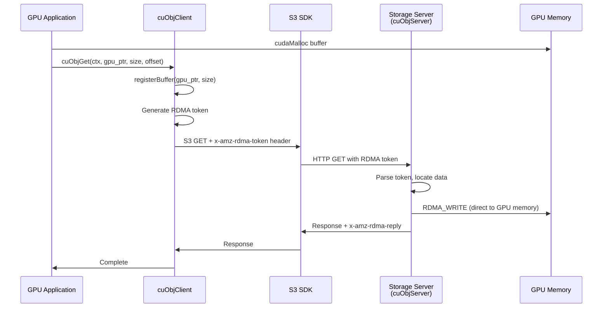

# NVIDIA GPUDirect Storage & cuObject - Technical Reference

Extracted 2026-04-03 from NVIDIA documentation.

---

## 1. cuObject Library (from cuObject docs)

### Overview

cuObject enables RDMA-based data transfers between GPU memory and remote object storage
servers, using a control/data plane split layered on top of standard S3 HTTP requests.

- **Control plane**: Standard S3 GET/PUT requests sent via a storage partner S3 SDK, modified
  to include RDMA metadata tags in HTTP headers.
- **Data plane**: Actual data payloads transferred directly between the storage node and GPU
  memory using RDMA operations, bypassing the host CPU.

**Availability**: CUDA Toolkit 13.1.1 and later (client library). Server library is a
separate downloadable package. Documentation version: v1.16.

**Transport**: Dynamic Connection (DC) protocol over InfiniBand and RoCEv2. DC provides
resource efficiency via on-demand connection establishment rather than pre-established
connections.

### cuObjClient API

| Function    | Signature                                                    | Description                                                                   |
|-------------|--------------------------------------------------------------|-------------------------------------------------------------------------------|
| Constructor | `cuObjClient(CUObjOps_t& ops, cuObjProto_t proto)`           | Initialize the client library with callback operations and protocol selection |
| GET         | `cuObjGet(void *ctx, void *ptr, size_t size, loff_t offset)` | Initiate GET; inserts `x-amz-rdma-token` header into the S3 request           |
| PUT         | `cuObjPut(void *ctx, void *ptr, size_t size, loff_t offset)` | Initiate PUT; inserts `x-amz-rdma-token` header into the S3 request           |

**Parameters**:

- `ctx` - opaque context pointer (application-defined)
- `ptr` - pointer to GPU or host memory buffer
- `size` - transfer size in bytes
- `offset` - file/object offset

**Types** (details not fully documented publicly):

- `CUObjOps_t` - struct of callback functions the application must provide
- `cuObjProto_t` - enum selecting the protocol (e.g., S3)

### cuObjServer API

| Function          | Signature                                      | Description                                                        |
|-------------------|------------------------------------------------|--------------------------------------------------------------------|
| Register buffer   | `registerBuffer(const void *ptr, size_t size)` | Register a memory region for RDMA operations                       |
| Alloc host buffer | `allocHostBuffer(size_t size)`                 | Allocate pinned (page-locked) CPU memory for RDMA                  |
| Handle GET        | `handleGetObject(...)`                         | Execute RDMA_WRITE to push data to the client's registered buffer  |
| Handle PUT        | `handlePutObject(...)`                         | Execute RDMA_READ to pull data from the client's registered buffer |
| SG list           | `getRDMABufferFromSgList(...)`                 | Get RDMA buffer descriptors from a scatter-gather list             |

**Data flow**:

- GET: Server performs `RDMA_WRITE` (server pushes data into client GPU memory)
- PUT: Server performs `RDMA_READ` (server pulls data from client GPU memory)

### RDMA Token Handling

| Header Name        | Direction                   | Purpose                                                                  |
|--------------------|-----------------------------|--------------------------------------------------------------------------|
| `x-amz-rdma-token` | Client -> Server (request)  | Contains RDMA metadata (memory key, address, size) for the target buffer |
| `x-amz-rdma-reply` | Server -> Client (response) | Confirms successful RDMA data transfer                                   |

**Token format**: Opaque hex-encoded blob (example prefix: `00007f7c...`). Exact field
structure (rkey, virtual address, length) is not publicly documented in the overview docs -
the actual header files are needed for the wire format.

**Flow**:

1. Client registers GPU buffer, generates RDMA token
2. Client sends S3 request with `x-amz-rdma-token` header
3. Token flows through S3 SDK to storage gateway/endpoint
4. Server extracts token, uses it to perform RDMA_READ (PUT) or RDMA_WRITE (GET)
5. Server sends response with `x-amz-rdma-reply` confirming transfer

### Supported S3 Operations (Version 1)

| Operation     | RDMA Direction                       | Description             |
|---------------|--------------------------------------|-------------------------|
| PUT / PUTFILE | RDMA_READ (server reads from client) | Upload object           |
| GET / GETFILE | RDMA_WRITE (server writes to client) | Download object         |
| UPLOAD_PART   | RDMA_READ (server reads from client) | Multipart upload part   |
| RANGE_GET     | RDMA_WRITE (server writes to client) | Partial object download |

### Architecture Diagram



---

## 2. GPUDirect Storage (GDS) Overview (from overview guide)

### Architecture

GDS enables a direct DMA transfer path between GPU memory and storage, avoiding the
traditional CPU bounce buffer. Key characteristics:

- **Explicit, proactive transfers** (not reactive/page-fault-driven)
- **Zero-copy** where possible
- Files must be opened in `O_DIRECT` mode (from CUDA 12.2+, the library auto-uses
  O_DIRECT for page-aligned GPU buffers even without the flag)
- All APIs are **thread safe**

### Software Stack

| Layer              | Component                     | Notes                                        |
|--------------------|-------------------------------|----------------------------------------------|
| User-space library | `libcufile.so`                | Primary API library; depends on `libcuda.so` |
| Header             | `cufile.h`                    | Application include                          |
| Kernel module      | `nvidia-fs.ko`                | GPLv2; NOT required for NVMe on CUDA 12.8+   |
| Build deps         | `libmount-dev`, `libnuma-dev` | External dependencies                        |

### Hardware Requirements

**GPU memory types supported**:

- `cudaMalloc` / `cuMemAlloc`
- `cuMemCreate` / `cuMemMap`
- `cudaHostAlloc` / `cudaMallocHost` (CPU pinned memory)

**NOT supported** (falls back to compatibility mode with bounce buffers):

- `cudaMallocManaged` (migratable/unified memory)
- `malloc` / stack memory on UVM-capable systems (e.g., Grace-Hopper)

**Storage hardware**:

- NVMe drives (local or with NVIDIA DOCA SNAP)
- Network-attached storage via NICs
- Block and distributed filesystems

**CUDA / driver versions**:

- CUDA Toolkit 12.2+ (GDS 1.7.x) for enhanced O_DIRECT support
- CUDA 12.8+: NVMe support no longer requires `nvidia-fs.ko`
- OpenRM driver 570.x+ for PCI P2PDMA support
- Linux kernel 4.15+ (6.2+ for PCI P2PDMA with NVMe)
- Mellanox OFED 5.1+ for RDMA-based filesystems

**NIC requirements**:

- Mellanox ConnectX-5 or later recommended
- Must support P2P DMA with GPUs

### cuFile API Summary

**Synchronous I/O**:
| Function | Purpose |
|----------|---------|
| `cuFileHandleRegister` | Register a file handle for GDS |
| `cuFileHandleDeregister` | Deregister a file handle |
| `cuFileBufRegister` | Register a GPU buffer for DMA |
| `cuFileBufDeregister` | Deregister a GPU buffer |
| `cuFileRead` | Direct read: storage -> GPU memory |
| `cuFileWrite` | Direct write: GPU memory -> storage |

**Asynchronous (Stream) I/O**:
| Function | Purpose |
|----------|---------|
| `cuFileReadAsync` | Async read ordered with CUDA stream |
| `cuFileWriteAsync` | Async write ordered with CUDA stream |
| `cuFileStreamRegister` | Register a CUDA stream |
| `cuFileStreamDeregister` | Deregister a CUDA stream |

**Batch I/O**:
| Function | Purpose |
|----------|---------|
| `cuFileBatchIOSetUp` | Set up a batch of I/O operations |
| `cuFileBatchIOSubmit` | Submit the batch |
| `cuFileBatchIOGetStatus` | Poll batch completion status |
| `cuFileBatchIOCancel` | Cancel a pending batch |
| `cuFileBatchIODestroy` | Clean up batch resources |

**Driver control**:
| Function | Purpose |
|----------|---------|
| `cuFileDriverOpen` | Initialize GDS driver |
| `cuFileDriverClose` | Shut down GDS driver |
| `cuFileDriverGetProperties` | Query driver properties |
| `cuFileDriverSet*` | Configure driver parameters |

API signatures are compatible with POSIX `pread`/`pwrite` but operate on GPU memory addresses.

### Configuration

**Configuration file**: `cufile.json`

**Key settings**:

| Property                                            | Description                               | Default |
|-----------------------------------------------------|-------------------------------------------|---------|
| `properties.rdma_dynamic_routing`                   | Enable topology-aware RDMA routing        | off     |
| `property.rdma_dev_addr_list`                       | Global list of RDMA NIC IP addresses      | -       |
| `fs.[fstype].rdma_dev_addr_list`                    | Per-filesystem RDMA NIC addresses         | -       |
| `fs.[fstype].mount_table.[path].rdma_dev_addr_list` | Per-mount-point RDMA NIC addresses        | -       |
| `fs.[fstype].rdma_write_support`                    | Enable/disable RDMA writes per filesystem | varies  |

**Logging levels**: ERROR, WARN, INFO, DEBUG, TRACE

**Routing policy priority** (when dynamic routing enabled):

1. `GPU_MEM_NVLINKS` - GPU memory with NVLink (best)
2. `GPU_MEM` - GPU memory with PCIe
3. `SYS_MEM` - System memory with PCIe
4. `P2P` - Direct PCIe peer-to-peer

**Validation tool**: `gdscheck -p` validates dynamic routing configuration.

### Supported Filesystems

- DDN EXAScaler
- VAST NFS
- WekaFS
- Lustre
- Standard Linux NFS
- Local filesystems (ext4, XFS)
- NVMe and NVMe-oF
- Raw block devices

All must be GDS-enabled (vendor patches or NVIDIA modifications).

### Performance Characteristics

- Direct paths offer **at least 2x peak bandwidth** compared to CPU-staged paths
- Latency improvements are most apparent with **small transfers**
- Saturating bandwidth requires **multiple concurrent transfers** (e.g., 4x4 NVMe PCIe
  device needs concurrent transfers to saturate an x16 PCIe link)
- Batch APIs reduce per-transaction overhead

### Limitations and Caveats

1. **Coarse-grained only**: Designed for streaming transfers, not fine-grained random access
2. **PCI P2PDMA**: RAID0 and NVMe Multipathing not supported without specialized patches
3. **Dynamic routing**: Cannot distinguish multiple mount points sharing the same filesystem
   share; configure only for unique shares
4. **Containers**: Only user-level code included; `nvidia-fs.ko` must be on the host.
   Without proper drivers, GDS falls back to compatibility mode
5. **Compatibility mode**: Performance is "generally at least the same or better than
   CPU-based APIs" - so fallback is safe but not optimal

### RDMA Configuration Example (Lustre)

```json
{
  "fs": {
    "lustre": {
      "rdma_dev_addr_list": [
        "172.172.1.40"
      ],
      "rdma_write_support": true
    }
  }
}
```

---

## Summary: What Matters for Storage System Integration

### For implementing an Ozone DataNode with cuObject support:

1. **Server-side** (DataNode): Integrate `cuObjServer` library
  - Call `registerBuffer()` to register storage buffers for RDMA
  - Implement `handleGetObject()` / `handlePutObject()` for RDMA transfers
  - Parse `x-amz-rdma-token` from incoming S3 requests
  - Send `x-amz-rdma-reply` in responses

2. **Client-side** (GPU application): Uses `cuObjClient` library (not our concern for DataNode)

3. **Transport**: DC (Dynamic Connection) over InfiniBand or RoCEv2
  - ConnectX-5+ NICs required
  - CUDA 13.1.1+ for cuObject

4. **Key header files needed**: The public docs lack exact struct/enum definitions.
   The actual `cuobject.h` (or similar) header from the CUDA Toolkit 13.1.1+ package
   is required for implementation.

5. **Protocol compatibility**: Standard S3 HTTP with custom headers - fits naturally
   into Ozone's existing S3 gateway architecture.
