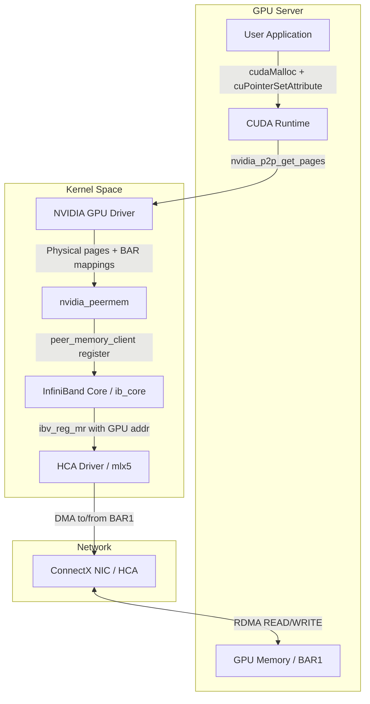
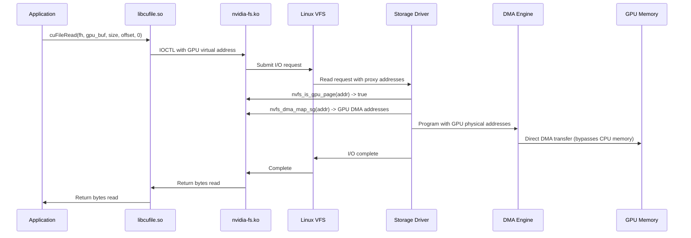
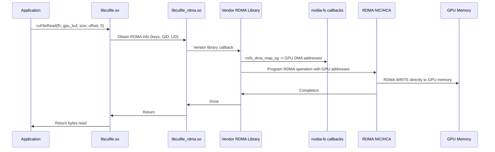

# NVIDIA GPUDirect RDMA, GDS cuFile, and cuObject API Reference

Extracted 2026-04-03 from NVIDIA official documentation:
- https://docs.nvidia.com/cuda/gpudirect-rdma/ (v13.2)
- https://docs.nvidia.com/gpudirect-storage/overview-guide/index.html
- https://docs.nvidia.com/gpudirect-storage/api-reference-guide/index.html
- Supplemented with ibverbs man pages and existing cuObject research

---

## Table of Contents

1. [GPUDirect RDMA Architecture and Data Flow](#1-gpudirect-rdma-architecture-and-data-flow)
2. [Kernel P2P API (nvidia_p2p_*)](#2-kernel-p2p-api)
3. [CUDA Userspace Registration API](#3-cuda-userspace-registration-api)
4. [nvidia_peermem and ibverbs Integration](#4-nvidia_peermem-and-ibverbs-integration)
5. [ibv_reg_mr and RDMA Memory Registration](#5-ibv_reg_mr-and-rdma-memory-registration)
6. [GDS cuFile API Reference](#6-gds-cufile-api-reference)
7. [cuObject SDK and its Relationship to cuFile/GDS](#7-cuobject-sdk-and-its-relationship-to-cufilegds)
8. [Code Examples](#8-code-examples)

---

## 1. GPUDirect RDMA Architecture and Data Flow

### What GPUDirect RDMA Is

GPUDirect RDMA enables third-party PCI Express devices (NICs, storage adapters) to directly
access NVIDIA GPU memory via DMA, without routing data through CPU system memory. The GPU's
video memory is exposed through PCI BAR (Base Address Register) mappings.

### BAR Mapping Mechanism

- All physical addresses are the same from PCI Express devices' perspective
- GPU BARs are PCI regions allowing direct device access to GPU memory
- Kepler-class GPUs: minimum 256 MB BAR1 available, 32 MB reserved for driver
- Memory mapped in 64 KB chunks for caching efficiency
- Monitor with: `nvidia-smi -q` (shows BAR1 Memory Usage: Total/Used/Free)

Because operating systems lack sufficient mechanisms for exchanging MMIO regions between
drivers, the NVIDIA kernel driver exports functions (`nvidia_p2p_*`) to perform the necessary
address translations and mappings.

### CUDA Virtual Address Layout (UVA)

CUDA manages virtual address space partitioned into CUDA-managed and OS-managed ranges.
Memory addresses subdivide into three page-granular types:

- **GPU**: Backed by GPU memory, inaccessible from host
- **CPU**: Backed by CPU memory, accessible from both GPU and host
- **FREE**: Reserved for future allocations

GPUDirect RDMA operates exclusively on GPU pages (created by `cudaMalloc()`) within CUDA VA
space.

### Standard Transfer Sequence

1. Userspace application requests transfer with virtual address and size
2. Communication library ensures memory is ready (sync memops)
3. Kernel driver calls `nvidia_p2p_get_pages()` to pin GPU memory and get physical addresses
4. `nvidia_p2p_dma_map_pages()` maps physical pages into the third-party device's I/O address space
5. Device DMA engine is programmed using the DMA addresses from the mapping
6. Transfer initiates (RDMA READ or WRITE)
7. Eventually, lazy unpinning via `nvidia_p2p_put_pages()`

**Performance note**: "Lazily unpinning memory is key to high performance RDMA implementation.
Keeping memory pinned after transfer completes avoids expensive pin/unpin operations."

### Architecture Diagram



---

## 2. Kernel P2P API

These are kernel-mode functions exported by the NVIDIA driver (`nv-p2p.h`). They are used by
kernel modules (like `nvidia_peermem`) to pin GPU memory and obtain physical/DMA addresses.

### nvidia_p2p_get_pages()

**Desktop Signature (CUDA 6.0+):**
```c
int nvidia_p2p_get_pages(uint64_t p2p_token, uint32_t va_space_token,
                uint64_t virtual_address,
                uint64_t length,
                struct nvidia_p2p_page_table **page_table,
                void (*free_callback)(void *data),
                void *data);
```

**Parameters:**
| Parameter | Type | Description |
|-----------|------|-------------|
| `p2p_token` | `uint64_t` | P2P authentication token (use 0 for CUDA 6.0+) |
| `va_space_token` | `uint32_t` | Virtual address space token (use 0 for CUDA 6.0+) |
| `virtual_address` | `uint64_t` | GPU virtual address, **must align to 64KB boundary** |
| `length` | `uint64_t` | Memory region size in bytes |
| `page_table` | `nvidia_p2p_page_table **` | Output: populated page table |
| `free_callback` | `void (*)(void *)` | Invalidation callback (mandatory since CUDA 12.2) |
| `data` | `void *` | Opaque context pointer passed to callback |

**Returns:** 0 on success, negative errno on failure.

**Critical notes:**
- This is an expensive operation; should be called infrequently (pin once, reuse)
- Since CUDA 12.2: NULL callback pointer is no longer accepted
- For persistent mappings (no callback), use `nvidia_p2p_get_pages_persistent` / `nvidia_p2p_put_pages_persistent` instead
- Virtual address and length must be 64KB-aligned

**Tegra Signature (CUDA 10.1+):**
```c
int nvidia_p2p_get_pages(u64 virtual_address, u64 length,
                struct nvidia_p2p_page_table **page_table,
                void (*free_callback)(void *data),
                void *data);
```

### nvidia_p2p_put_pages()

**Desktop Signature:**
```c
int nvidia_p2p_put_pages(uint64_t p2p_token, uint32_t va_space_token,
        uint64_t virtual_address,
        struct nvidia_p2p_page_table *page_table);
```

**Constraints:**
- Must be called from the same process context as the corresponding `nvidia_p2p_get_pages()`
- Cannot be invoked from within the free_callback
- On Tegra: callback is always triggered when `put_pages` is invoked

**Tegra Signature:**
```c
int nvidia_p2p_put_pages(struct nvidia_p2p_page_table *page_table);
```

### nvidia_p2p_free_page_table()

```c
int nvidia_p2p_free_page_table(struct nvidia_p2p_page_table *page_table);
```

Frees the page table structure. **Must be called from within the free_callback**, not from
normal code paths (use `nvidia_p2p_put_pages` for normal cleanup).

### nvidia_p2p_dma_map_pages()

**Desktop Signature:**
```c
int nvidia_p2p_dma_map_pages(struct pci_dev *peer,
        struct nvidia_p2p_page_table *page_table,
        struct nvidia_p2p_dma_mapping **dma_mapping);
```

**Parameters:**
| Parameter | Type | Description |
|-----------|------|-------------|
| `peer` | `struct pci_dev *` | PCI device that will perform DMA (e.g., the NIC) |
| `page_table` | `nvidia_p2p_page_table *` | Page table from `get_pages` |
| `dma_mapping` | `nvidia_p2p_dma_mapping **` | Output: DMA address mapping |

Maps the GPU physical pages into the third-party device's I/O address space. Required on
platforms where I/O addresses differ from CPU physical addresses (IOMMU, etc.).

**Tegra Signature:**
```c
int nvidia_p2p_dma_map_pages(struct device *dev,
        struct nvidia_p2p_page_table *page_table,
        struct nvidia_p2p_dma_mapping **dma_mapping,
        enum dma_data_direction direction);
```

### nvidia_p2p_dma_unmap_pages()

**Desktop:**
```c
int nvidia_p2p_dma_unmap_pages(struct pci_dev *peer,
        struct nvidia_p2p_page_table *page_table,
        struct nvidia_p2p_dma_mapping *dma_mapping);
```

**Not intended for use within the invalidation callback.** Use `nvidia_p2p_free_dma_mapping()`
from within the callback instead.

### nvidia_p2p_free_dma_mapping()

```c
int nvidia_p2p_free_dma_mapping(struct nvidia_p2p_dma_mapping *dma_mapping);
```

For use within the `free_callback` to release DMA mappings. The normal-path equivalent is
`nvidia_p2p_dma_unmap_pages()`.

### Data Structures

```c
typedef struct nvidia_p2p_page {
    uint64_t physical_address;
    union nvidia_p2p_request_registers {
        struct {
            uint32_t wreqmb_h;
            uint32_t rreqmb_h;
            uint32_t rreqmb_0;
            uint32_t reserved[3];
        } fermi;
    } registers;
} nvidia_p2p_page_t;
// Only physical_address is relevant for GPUDirect RDMA

typedef struct nvidia_p2p_page_table {
    uint32_t version;
    uint32_t page_size;       // Encoded per nvidia_p2p_page_size_type enum
    struct nvidia_p2p_page **pages;  // Array of page pointers
    uint32_t entries;          // Number of entries
    uint8_t *gpu_uuid;         // GPU identifier
} nvidia_p2p_page_table_t;
// Check version with NVIDIA_P2P_PAGE_TABLE_VERSION_COMPATIBLE()

typedef struct nvidia_p2p_dma_mapping {
    uint32_t  version;
    enum nvidia_p2p_page_size_type page_size_type;
    uint32_t  entries;
    uint64_t *dma_addresses;   // Array of DMA-able addresses for the peer device
} nvidia_p2p_dma_mapping_t;
```

### Invalidation Callback Mechanism

The callback is invoked when:
1. Userspace calls `cuMemFree()` or `cuCtxDestroy()`
2. Process exits unexpectedly

```c
void free_callback(void *data)
{
   my_state *state = data;
   // Stop any in-flight DMA using these pages
   wait_for_pending_transfers(state);
   // Free DMA mappings if created
   nvidia_p2p_free_dma_mapping(state->dma_mapping);
   // Free the page table (MUST be called from callback)
   nvidia_p2p_free_page_table(state->page_table);
}
```

**Restrictions:**
- Callback executes synchronously; may block for a few milliseconds
- Waiting for GPU operations within the callback is NOT safe
- Must NOT call `nvidia_p2p_put_pages()` from within the callback
- Must call `nvidia_p2p_free_page_table()` (not `put_pages`) to release resources

---

## 3. CUDA Userspace Registration API

Before a third-party device can access GPU memory via RDMA, the memory must be properly
registered to ensure consistency.

### cuPointerSetAttribute() -- Enable Sync Memops

```c
CUresult cuPointerSetAttribute(void *data, CUpointer_attribute attribute,
                               CUdeviceptr pointer);
```

**Critical usage for RDMA:**
```c
unsigned int flag = 1;
cuPointerSetAttribute(&flag, CU_POINTER_ATTRIBUTE_SYNC_MEMOPS, pointer);
```

This enables strict synchronizing behavior, disabling CUDA optimizations that conflict with
concurrent RDMA operations. "Registration is necessary to ensure the CUDA API memory
operations visible to a BAR mapping happen before the API call returns."

**Must be called before any RDMA operations on the buffer.**

### cuPointerGetAttribute() -- Get Buffer ID

```c
CUresult cuPointerGetAttribute(const void *data, CUpointer_attribute attribute,
                               CUdeviceptr pointer);
```

**Get buffer ID (for registration cache validation):**
```c
uint64_t buf_id;
cuPointerGetAttribute(&buf_id, CU_POINTER_ATTRIBUTE_BUFFER_ID, pointer);
```

Buffer IDs detect reallocations: if the ID changes, the original buffer was deallocated and
the virtual address remapped. Returns `CUDA_ERROR_INVALID_VALUE` if memory is no longer valid.

**Get P2P tokens (deprecated, use 0 for CUDA 6.0+):**
```c
typedef struct CUDA_POINTER_ATTRIBUTE_P2P_TOKENS_st {
    unsigned long long p2pToken;
    unsigned int vaSpaceToken;
} CUDA_POINTER_ATTRIBUTE_P2P_TOKENS;

CUDA_POINTER_ATTRIBUTE_P2P_TOKENS tokens;
cuPointerGetAttribute(&tokens, CU_POINTER_ATTRIBUTE_P2P_TOKENS, pointer);
```

### cuPointerGetAttributes() -- Batch Query

```c
CUresult cuPointerGetAttributes(unsigned int numAttributes,
                                CUpointer_attribute *attributes,
                                void **data, CUdeviceptr ptr);
```

Efficiently retrieves multiple attributes simultaneously:
- `CU_POINTER_ATTRIBUTE_BUFFER_ID`
- `CU_POINTER_ATTRIBUTE_MEMORY_TYPE`
- `CU_POINTER_ATTRIBUTE_IS_MANAGED`

---

## 4. nvidia_peermem and ibverbs Integration

### How nvidia_peermem Works

`nvidia_peermem` is a kernel module shipped with the NVIDIA GPU driver that bridges the NVIDIA
GPU driver and the InfiniBand/RDMA subsystem.

**Loading:**
```bash
modprobe nvidia-peermem
```

**Prerequisites:**
- MLNX_OFED must be installed before the GPU driver
- If GPU driver was installed first, uninstall and reinstall after MLNX_OFED
- Disable legacy `nv_peer_mem` module if present

**What it does:**
1. Registers as a `peer_memory_client` with the InfiniBand core (`ib_core`)
2. When `ibv_reg_mr()` is called with a GPU virtual address, `ib_core` iterates registered
   peer memory clients
3. `nvidia_peermem` recognizes the address as GPU memory (via CUDA driver internals)
4. Internally calls `nvidia_p2p_get_pages()` to pin the GPU memory
5. Calls `nvidia_p2p_dma_map_pages()` to get DMA addresses for the HCA
6. Returns these DMA addresses to `ib_core`, which programs them into the HCA's memory
   translation tables
7. The HCA can now DMA directly to/from GPU BAR1 memory

### The peer_memory_client Interface

NVIDIA OFED (MLNX_OFED) introduces an API between the InfiniBand Core and peer memory clients.
The kernel must have "required support for RDMA peer memory either through additional patches
to the kernel or via MLNX_OFED."

The `nvidia_peermem` module registers callbacks with `ib_core`:
- `acquire`: Check if a virtual address range belongs to this peer (GPU)
- `get_pages`: Pin the peer memory and return scatter-gather list
- `dma_map`: Map pinned pages for DMA by the HCA
- `dma_unmap`: Unmap DMA mappings
- `put_pages`: Unpin the peer memory
- `release`: Release the peer context

### What This Means for Applications

**From userspace, the integration is transparent.** An application using libibverbs simply
calls `ibv_reg_mr()` with a CUDA device pointer, and the kernel stack handles everything:

```c
// 1. Allocate GPU memory
CUdeviceptr gpu_buf;
cuMemAlloc(&gpu_buf, size);

// 2. Enable sync memops for RDMA safety
unsigned int flag = 1;
cuPointerSetAttribute(&flag, CU_POINTER_ATTRIBUTE_SYNC_MEMOPS, gpu_buf);

// 3. Register with ibverbs -- nvidia_peermem handles the rest in kernel
struct ibv_mr *mr = ibv_reg_mr(pd, (void *)gpu_buf, size,
    IBV_ACCESS_LOCAL_WRITE | IBV_ACCESS_REMOTE_WRITE | IBV_ACCESS_REMOTE_READ);

// 4. Use mr->lkey / mr->rkey for RDMA operations as normal
// Post RDMA WRITE/READ work requests using the GPU buffer address and keys
```

The key insight: **no special userspace API is needed beyond `ibv_reg_mr()`.** The entire
GPU memory pinning and DMA mapping chain happens automatically in kernel space via
`nvidia_peermem`.

---

## 5. ibv_reg_mr and RDMA Memory Registration

### Function Signatures

```c
// Basic registration
struct ibv_mr *ibv_reg_mr(struct ibv_pd *pd, void *addr,
                          size_t length, int access);

// Registration with custom HCA virtual address
struct ibv_mr *ibv_reg_mr_iova(struct ibv_pd *pd, void *addr,
                               size_t length, uint64_t hca_va, int access);

// DMA-buf based registration (for GPU memory via dmabuf export)
struct ibv_mr *ibv_reg_dmabuf_mr(struct ibv_pd *pd, uint64_t offset,
                                 size_t length, uint64_t iova,
                                 int fd, int access);

// Deregistration
int ibv_dereg_mr(struct ibv_mr *mr);
```

### Access Flags

| Flag | Value | Description |
|------|-------|-------------|
| `IBV_ACCESS_LOCAL_WRITE` | | Allow local HCA to write to this MR |
| `IBV_ACCESS_REMOTE_WRITE` | | Allow remote HCA to write (requires LOCAL_WRITE) |
| `IBV_ACCESS_REMOTE_READ` | | Allow remote HCA to read |
| `IBV_ACCESS_REMOTE_ATOMIC` | | Allow remote atomic operations |
| `IBV_ACCESS_FLUSH_GLOBAL` | | Allow global flush |
| `IBV_ACCESS_FLUSH_PERSISTENT` | | Allow persistent flush |
| `IBV_ACCESS_MW_BIND` | | Allow memory window binding |
| `IBV_ACCESS_ZERO_BASED` | | Zero-based addressing for this MR |
| `IBV_ACCESS_ON_DEMAND` | | On-demand paging MR |
| `IBV_ACCESS_HUGETLB` | | Require hugepage backing |
| `IBV_ACCESS_RELAXED_ORDERING` | | Allow relaxed ordering |

### Return Value

Returns a pointer to `struct ibv_mr` on success, containing:
- `lkey`: Local key for local HCA operations
- `rkey`: Remote key for remote HCA operations (shared with peer for RDMA)

Returns NULL on failure with errno set.

### GPU Memory Registration Pattern

When `ibv_reg_mr()` is called with a GPU device pointer (and `nvidia_peermem` is loaded):

1. `ib_core` calls each registered `peer_memory_client->acquire()` with the address
2. `nvidia_peermem` recognizes it as a CUDA allocation
3. `nvidia_peermem` calls `nvidia_p2p_get_pages()` to pin GPU memory
4. `nvidia_peermem` calls `nvidia_p2p_dma_map_pages()` for the HCA's PCI device
5. DMA addresses are installed in the HCA's memory translation table
6. `ibv_mr` is returned with valid `lkey`/`rkey`
7. On `ibv_dereg_mr()`, the reverse path unpins and unmaps

---

## 6. GDS cuFile API Reference

### Driver Lifecycle

#### cuFileDriverOpen
```c
CUfileError_t cuFileDriverOpen();
```
Initializes GDS driver session. Loads `/etc/cufile.json` configuration. Establishes kernel
communication channel.

**Returns:**
- `CU_FILE_SUCCESS` (0): Success or already open
- `CU_FILE_DRIVER_NOT_INITIALIZED` (5001): Open failure
- `CU_FILE_PERMISSION_DENIED`: Character device access restricted
- `CU_FILE_DRIVER_VERSION_MISMATCH`: Library/kernel version mismatch
- `CU_FILE_PLATFORM_NOT_SUPPORTED`: Unsupported platform

#### cuFileDriverClose
```c
CUfileError_t cuFileDriverClose();
```
Frees driver resources. Implicitly deregisters all buffers. Called automatically at process
exit.

#### cuFileDriverGetProperties
```c
CUfileError_t cuFileDriverGetProperties(CUfileDrvProps_t *props);
```
Queries driver capabilities, version, feature flags, performance thresholds.

#### cuFileDriverSetPollMode
```c
CUfileError_t cuFileDriverSetPollMode(bool poll, size_t poll_threshold_size);
```
- `poll`: Enable/disable polling mode
- `poll_threshold_size`: Max I/O size (KB, 4K-aligned) for polling

#### cuFileDriverSetMaxDirectIOSize
```c
CUfileError_t cuFileDriverSetMaxDirectIOSize(size_t max_direct_io_size);
```
Sets max chunk size in KB (4K-aligned, default 16384 KB).

#### cuFileDriverSetMaxCacheSize
```c
CUfileError_t cuFileDriverSetMaxCacheSize(size_t max_cache_size);
```
GPU internal buffer space per device (KB, 4K-aligned, default 131072 KB).

#### cuFileDriverSetMaxPinnedMemSize
```c
CUfileError_t cuFileDriverSetMaxPinnedMemSize(size_t max_pinned_mem_size);
```
Limits pinned/mapped GPU memory (KB, 4K-aligned; UINT64_MAX for unlimited).

### File Handle Management

#### cuFileHandleRegister
```c
CUfileError_t cuFileHandleRegister(CUfileHandle_t *fh, CUfileDescr_t *descr);
```

**Parameters:**
| Parameter | Type | Description |
|-----------|------|-------------|
| `fh` | `CUfileHandle_t *` | Output: cuFile handle |
| `descr` | `CUfileDescr_t *` | OS-neutral file descriptor wrapper |

**Returns:**
- `CU_FILE_SUCCESS`: Success
- `CU_FILE_DRIVER_NOT_INITIALIZED`: Driver not open
- `CU_FILE_IO_NOT_SUPPORTED`: Unsupported filesystem
- `CU_FILE_INVALID_VALUE`: Bad arguments
- `CU_FILE_INVALID_FILE_OPEN_FLAG`: Unsupported open modes
- `CU_FILE_INVALID_FILE_TYPE`: Not a regular file/symlink/device
- `CU_FILE_HANDLE_ALREADY_REGISTERED`: Duplicate registration

Accepts both `O_DIRECT` and non-`O_DIRECT` files.

#### cuFileHandleDeregister
```c
void cuFileHandleDeregister(CUfileHandle_t fh);
```
Releases cuFile resources. Must ensure no in-flight I/O. User still calls `close(fd)`
separately.

### Buffer Registration

#### cuFileBufRegister
```c
CUfileError_t cuFileBufRegister(const void *bufPtr_base, size_t size, int flags);
```

**Parameters:**
| Parameter | Type | Description |
|-----------|------|-------------|
| `bufPtr_base` | `const void *` | Device or host memory address |
| `size` | `size_t` | Size in bytes |
| `flags` | `int` | Reserved, set to 0 |

**Returns:**
- `CU_FILE_SUCCESS`: Success
- `CU_FILE_NVFS_DRIVER_ERROR`: Kernel driver error
- `CU_FILE_INVALID_VALUE`: Invalid input
- `CU_FILE_CUDA_DRIVER_ERROR`: CUDA issue (check `cu_err` field)
- `CU_FILE_MEMORY_ALREADY_REGISTERED`: Duplicate
- `CU_FILE_CUDA_MEMORY_TYPE_INVALID`: Not from `cudaMalloc`
- `CU_FILE_CUDA_POINTER_RANGE_ERROR`: Size exceeds allocation
- `CU_FILE_INVALID_MAPPING_SIZE`: Exceeds GPU limits
- `CU_FILE_GPU_MEMORY_PINNING_FAILED`: Insufficient pinned memory

Registration amortizes GPU memory pinning cost. Register once, use many times.

#### cuFileBufDeregister
```c
CUfileError_t cuFileBufDeregister(const void *bufPtr_base);
```

### Synchronous I/O

#### cuFileRead
```c
ssize_t cuFileRead(CUfileHandle_t fh, void *bufPtr_base, size_t size,
                   off_t file_offset, off_t bufPtr_offset);
```

**Parameters:**
| Parameter | Type | Description |
|-----------|------|-------------|
| `fh` | `CUfileHandle_t` | Registered file handle |
| `bufPtr_base` | `void *` | GPU or host buffer base address |
| `size` | `size_t` | Bytes to read |
| `file_offset` | `off_t` | Starting position in file |
| `bufPtr_offset` | `off_t` | Offset relative to bufPtr_base |

**Returns:**
- Positive value: number of bytes successfully read
- `-1`: Filesystem error (errno set)
- Negative `CUfileOpError` enum: cuFile-specific error

For registered buffers, `bufPtr_base` must match the registration address. The `bufPtr_offset`
allows reading into different positions within the registered region. Synchronous -- blocks
until complete.

#### cuFileWrite
```c
ssize_t cuFileWrite(CUfileHandle_t fh, const void *bufPtr_base, size_t size,
                    off_t file_offset, off_t bufPtr_offset);
```

Same parameter structure as `cuFileRead`. Data is NOT guaranteed persistent after system crash
unless `fsync(2)` is called or the file was opened with `O_SYNC`.

### Asynchronous Stream I/O

#### cuFileReadAsync
```c
CUfileError_t cuFileReadAsync(CUfileHandle_t fh, void *bufPtr_base,
                              size_t *size_p, off_t *file_offset_p,
                              off_t *bufPtr_offset_p, ssize_t *bytes_read_p,
                              CUstream stream);
```

**Parameters:**
| Parameter | Type | Description |
|-----------|------|-------------|
| `fh` | `CUfileHandle_t` | File handle |
| `bufPtr_base` | `void *` | GPU/host buffer base |
| `size_p` | `size_t *` | Pointer to read size |
| `file_offset_p` | `off_t *` | Pointer to file offset |
| `bufPtr_offset_p` | `off_t *` | Pointer to buffer offset |
| `bytes_read_p` | `ssize_t *` | Pointer to result (initialize to 0) |
| `stream` | `CUstream` | CUDA stream (NULL = synchronous) |

Enqueues asynchronously into the CUDA stream. Wait with `cuStreamSynchronize()`. All pointer
parameters must be host-accessible memory. FIFO ordering within stream.

#### cuFileWriteAsync
```c
CUfileError_t cuFileWriteAsync(CUfileHandle_t fh, void *bufPtr_base,
                               size_t *size_p, off_t *file_offset_p,
                               off_t *bufPtr_offset_p, ssize_t *bytes_written_p,
                               CUstream stream);
```
Identical structure to `cuFileReadAsync`.

### Batch I/O

#### cuFileBatchIOSetUp
```c
CUfileError_t cuFileBatchIOSetUp(CUfileBatchHandle_t *batch_idp, int max_nr);
```
- `max_nr`: Maximum batch entries (1 to `properties.io_batch_size`)
- `batch_idp`: Output batch handle

#### cuFileBatchIOSubmit
```c
CUfileError_t cuFileBatchIOSubmit(CUfileBatchHandle_t batch_idp, unsigned nr,
                                  CUfileIOParams_t *iocbp, unsigned int flags);
```
- `nr`: Number of requests (1 to `max_nr`)
- `iocbp`: Array of I/O parameter structures
- `flags`: Reserved (0)

#### cuFileBatchIOGetStatus
```c
CUfileError_t cuFileBatchIOGetStatus(CUfileBatchHandle_t batch_idp,
                                     unsigned min_nr, unsigned *nr,
                                     CUfileIOEvents_t *iocbp,
                                     struct timespec *timeout);
```
- `min_nr`: Minimum completed entries before returning
- `nr`: Input: max to return, Output: actual returned
- `timeout`: Max wait time (NULL = block indefinitely)

#### cuFileBatchIOCancel
```c
CUfileError_t cuFileBatchIOCancel(CUfileBatchHandle_t batch_idp);
```
Attempts cancellation; no guarantee for in-flight operations.

#### cuFileBatchIODestroy
```c
void cuFileBatchIODestroy(CUfileBatchHandle_t batch_idp);
```

### Data Types

#### CUfileDescr_t
```c
typedef struct CUfileDescr_t {
    CUfileFileHandleType type;  // CU_FILE_HANDLE_TYPE_OPAQUE_FD (Linux)
    union {
        int fd;
        void *handle;
    } handle;
    const CUfileFSOps_t *fs_ops;  // Filesystem ops (optional)
} CUfileDescr_t;
```

#### CUfileIOParams_t (for batch I/O)
```c
typedef struct CUfileIOParams {
    CUfileBatchMode_t mode;     // CUFILE_BATCH
    union {
        struct {
            void *devPtr_base;
            off_t file_offset;
            off_t devPtr_offset;
            size_t size;
        } batch;
    } u;
    CUfileHandle_t fh;
    CUfileOpcode_t opcode;      // CU_FILE_READ or CU_FILE_WRITE
    void *cookie;               // User-defined context
} CUfileIOParams_t;
```

#### CUfileIOEvents_t (batch status)
```c
typedef struct CUfileIOEvents {
    void *cookie;               // Matches submitted cookie
    CUfileStatus_t status;      // Completion status
    size_t ret;                 // Bytes transferred or negative error
} CUfileIOEvents_t;
```

### Enumerations

#### CUfileOpcode_t
```c
enum CUfileOpcode_t {
    CU_FILE_READ  = 0,
    CU_FILE_WRITE = 1
};
```

#### CUfileStatus_t
```c
enum CUfileStatus_t {
    CUFILE_WAITING  = 0x01,
    CUFILE_PENDING  = 0x02,
    CUFILE_INVALID  = 0x04,
    CUFILE_CANCELED = 0x08,
    CUFILE_COMPLETE = 0x10,
    CUFILE_TIMEOUT  = 0x20,
    CUFILE_FAILED   = 0x40
};
```

#### Key Error Codes (CUfileOpError)
| Code | Value | Description |
|------|-------|-------------|
| `CU_FILE_SUCCESS` | 0 | Success |
| `CU_FILE_DRIVER_NOT_INITIALIZED` | 5001 | Driver not open |
| `CU_FILE_IO_NOT_SUPPORTED` | 5008 | Unsupported filesystem |
| `CU_FILE_HANDLE_ALREADY_REGISTERED` | 5028 | Duplicate handle registration |
| `CU_FILE_MEMORY_ALREADY_REGISTERED` | 5023 | Duplicate buffer registration |
| `CU_FILE_MEMORY_NOT_REGISTERED` | 5024 | Buffer not registered |
| `CU_FILE_INVALID_FILE_OPEN_FLAG` | | Unsupported open mode |
| `CU_FILE_CUDA_MEMORY_TYPE_INVALID` | | Memory not from cudaMalloc |
| `CU_FILE_GPU_MEMORY_PINNING_FAILED` | | Insufficient pinned memory |

#### CUfileDriverStatusFlags_t (feature flags from GetProperties)
```
CU_FILE_LUSTRE_SUPPORTED
CU_FILE_WEKAFS_SUPPORTED
CU_FILE_NFS_SUPPORTED
CU_FILE_GPFS_SUPPORTED
CU_FILE_NVME_SUPPORTED
```

### Statistics APIs
```c
CUfileError_t cuFileSetStatsLevel(int level);    // 0-3
CUfileError_t cuFileGetStatsLevel(int *level);
CUfileError_t cuFileStatsStart(void);
CUfileError_t cuFileStatsStop(void);
CUfileError_t cuFileStatsReset(void);
CUfileError_t cuFileGetStatsL1(CUfileStatsLevel1_t *stats);  // counts + throughput
CUfileError_t cuFileGetStatsL2(CUfileStatsLevel2_t *stats);  // + histograms
CUfileError_t cuFileGetStatsL3(CUfileStatsLevel3_t *stats);  // + per-GPU detail
```

---

## 7. cuObject SDK and its Relationship to cuFile/GDS

### Overview

cuObject is a **separate** library from cuFile/GDS, focused on **object storage** (S3-compatible)
rather than file/block storage. It enables RDMA-based data transfers between GPU memory and
remote object storage servers.

**Availability**: CUDA Toolkit 13.1.1+ (client library). Server library is a separate package.

**Key distinction:**
- **cuFile/GDS**: File-based I/O (POSIX-like) -- `open()`, `read()`, `write()` semantics with
  GPU memory. Works with local NVMe, distributed filesystems (Lustre, NFS, WekaFS).
- **cuObject**: Object-based I/O (S3-like) -- GET/PUT semantics with RDMA transport. Works with
  S3-compatible object stores.

Both bypass the CPU for data movement, but they target different storage paradigms and use
different mechanisms:
- cuFile uses `nvidia-fs.ko` kernel driver and DMA engine callbacks
- cuObject uses RDMA verbs directly (DC transport over InfiniBand/RoCEv2) with an HTTP
  control plane carrying RDMA tokens

### cuObject Architecture: Control/Data Plane Split

- **Control plane**: Standard S3 GET/PUT requests via any S3 SDK, modified to include RDMA
  metadata in HTTP headers (`x-amz-rdma-token`, `x-amz-rdma-reply`)
- **Data plane**: Direct RDMA transfers between storage server and GPU memory, bypassing CPU

**Transport**: Dynamic Connection (DC) protocol over InfiniBand/RoCEv2. DC provides resource
efficiency via on-demand connection establishment.

### cuObject Client API

```c
// Initialize client with callbacks and protocol selection
cuObjClient(CUObjOps_t& ops, cuObjProto_t proto);

// Initiate GET -- inserts x-amz-rdma-token header into S3 request
cuObjGet(void *ctx, void *ptr, size_t size, loff_t offset);

// Initiate PUT -- inserts x-amz-rdma-token header into S3 request
cuObjPut(void *ctx, void *ptr, size_t size, loff_t offset);
```

**Parameters:**
- `ctx`: Opaque application-defined context
- `ptr`: GPU or host memory buffer pointer
- `size`: Transfer size in bytes
- `offset`: Object offset

### cuObject Server API

```c
// Register memory region for RDMA operations
registerBuffer(const void *ptr, size_t size);

// Allocate pinned (page-locked) CPU memory for RDMA
allocHostBuffer(size_t size);

// Execute RDMA_WRITE to push data to client's registered buffer
handleGetObject(...);

// Execute RDMA_READ to pull data from client's registered buffer
handlePutObject(...);

// Get RDMA buffer descriptors from scatter-gather list
getRDMABufferFromSgList(...);
```

### RDMA Token Protocol

| Header | Direction | Purpose |
|--------|-----------|---------|
| `x-amz-rdma-token` | Client -> Server (request) | RDMA metadata: memory key, address, size |
| `x-amz-rdma-reply` | Server -> Client (response) | Confirms RDMA transfer completion |

**Flow:**
1. Client registers GPU buffer, generates RDMA token
2. Client sends S3 request with `x-amz-rdma-token` header
3. Token flows through S3 SDK to storage gateway
4. Server extracts token, performs `RDMA_READ` (PUT) or `RDMA_WRITE` (GET)
5. Server sends response with `x-amz-rdma-reply`

### Supported Operations

| Operation | RDMA Direction | Description |
|-----------|----------------|-------------|
| PUT / PUTFILE | `RDMA_READ` (server reads from client GPU) | Upload object |
| GET / GETFILE | `RDMA_WRITE` (server writes to client GPU) | Download object |
| UPLOAD_PART | `RDMA_READ` | Multipart upload part |
| RANGE_GET | `RDMA_WRITE` | Partial object download |

---

## 8. Code Examples

### Example 1: Kernel Module -- Pin GPU Memory and Set Up DMA

```c
#define GPU_BOUND_SHIFT   16
#define GPU_BOUND_SIZE    ((u64)1 << GPU_BOUND_SHIFT)   // 64KB
#define GPU_BOUND_OFFSET  (GPU_BOUND_SIZE - 1)
#define GPU_BOUND_MASK    (~GPU_BOUND_OFFSET)

struct my_state {
    struct nvidia_p2p_page_table *page_table;
    struct nvidia_p2p_dma_mapping *dma_mapping;
    struct pci_dev *peer_dev;  // The NIC or storage device
};

static void free_callback(void *data)
{
    struct my_state *state = data;
    // Clean up DMA mapping
    nvidia_p2p_free_dma_mapping(state->dma_mapping);
    // Free page table (MUST use this, not put_pages, in callback)
    nvidia_p2p_free_page_table(state->page_table);
}

int pin_gpu_memory(struct my_state *state, uint64_t gpu_va, size_t size)
{
    int ret;
    // Align to 64KB boundary
    uint64_t virt_start = gpu_va & GPU_BOUND_MASK;
    size_t pin_size = (gpu_va + size - virt_start + GPU_BOUND_SIZE - 1)
                      & GPU_BOUND_MASK;

    // Step 1: Pin GPU memory, get physical page addresses
    ret = nvidia_p2p_get_pages(0, 0, virt_start, pin_size,
                               &state->page_table,
                               free_callback, state);
    if (ret) return ret;

    // Step 2: Map pages into the peer device's DMA address space
    ret = nvidia_p2p_dma_map_pages(state->peer_dev,
                                    state->page_table,
                                    &state->dma_mapping);
    if (ret) {
        nvidia_p2p_put_pages(0, 0, virt_start, state->page_table);
        return ret;
    }

    // Now state->dma_mapping->dma_addresses[] contains the DMA addresses
    // Program these into the device's DMA engine for transfer
    return 0;
}
```

### Example 2: Userspace -- ibverbs RDMA with GPU Memory

```c
#include <cuda.h>
#include <infiniband/verbs.h>

int setup_gpu_rdma(struct ibv_pd *pd, size_t size,
                   CUdeviceptr *gpu_buf, struct ibv_mr **mr)
{
    CUresult cu_ret;
    unsigned int flag = 1;

    // Step 1: Allocate GPU memory
    cu_ret = cuMemAlloc(gpu_buf, size);
    if (cu_ret != CUDA_SUCCESS) return -1;

    // Step 2: Enable sync memops (REQUIRED for RDMA correctness)
    cu_ret = cuPointerSetAttribute(&flag,
                CU_POINTER_ATTRIBUTE_SYNC_MEMOPS, *gpu_buf);
    if (cu_ret != CUDA_SUCCESS) {
        cuMemFree(*gpu_buf);
        return -1;
    }

    // Step 3: Register GPU memory with ibverbs
    // nvidia_peermem kernel module handles the GPU-specific pinning
    *mr = ibv_reg_mr(pd, (void *)*gpu_buf, size,
                     IBV_ACCESS_LOCAL_WRITE |
                     IBV_ACCESS_REMOTE_WRITE |
                     IBV_ACCESS_REMOTE_READ);
    if (!*mr) {
        cuMemFree(*gpu_buf);
        return -1;
    }

    // mr->lkey for local operations, mr->rkey to share with remote peer
    return 0;
}

// Post an RDMA WRITE to send data from local GPU to remote GPU
int rdma_write_gpu_to_remote(struct ibv_qp *qp,
                              CUdeviceptr local_gpu_buf,
                              struct ibv_mr *local_mr,
                              uint64_t remote_addr,
                              uint32_t remote_rkey,
                              size_t size)
{
    struct ibv_sge sge = {
        .addr   = (uint64_t)local_gpu_buf,
        .length = size,
        .lkey   = local_mr->lkey
    };

    struct ibv_send_wr wr = {
        .wr_id      = 0,
        .sg_list    = &sge,
        .num_sge    = 1,
        .opcode     = IBV_WR_RDMA_WRITE,
        .send_flags = IBV_SEND_SIGNALED,
        .wr.rdma = {
            .remote_addr = remote_addr,
            .rkey        = remote_rkey
        }
    };

    struct ibv_send_wr *bad_wr;
    return ibv_post_send(qp, &wr, &bad_wr);
}
```

### Example 3: Registration Cache Pattern

```c
struct reg_cache_entry {
    CUdeviceptr pointer;
    size_t      size;
    CUdeviceptr aligned_pointer;
    size_t      aligned_size;
    int         is_pinned;
    uint64_t    buffer_id;    // From cuPointerGetAttribute
    struct ibv_mr *mr;
};

// Check if a cached registration is still valid
int is_registration_valid(struct reg_cache_entry *entry)
{
    uint64_t current_id;
    CUresult ret = cuPointerGetAttribute(&current_id,
                       CU_POINTER_ATTRIBUTE_BUFFER_ID,
                       entry->pointer);

    if (ret == CUDA_ERROR_INVALID_VALUE) {
        return 0;  // Memory was deallocated
    }
    if (ret != CUDA_SUCCESS) {
        return -1; // Serious error
    }
    if (entry->buffer_id != current_id) {
        return 0;  // Memory was reallocated (different buffer at same VA)
    }
    return 1;  // Still valid
}

// Usage pattern for lazy pin/unpin
struct ibv_mr *get_or_register(struct ibv_pd *pd,
                                CUdeviceptr gpu_buf, size_t size)
{
    struct reg_cache_entry *entry = cache_lookup(gpu_buf, size);
    if (entry && is_registration_valid(entry) == 1) {
        return entry->mr;  // Reuse cached registration
    }

    // Cache miss or invalidated -- register fresh
    if (entry) {
        ibv_dereg_mr(entry->mr);
        cache_remove(entry);
    }

    unsigned int flag = 1;
    cuPointerSetAttribute(&flag, CU_POINTER_ATTRIBUTE_SYNC_MEMOPS, gpu_buf);

    uint64_t buf_id;
    cuPointerGetAttribute(&buf_id, CU_POINTER_ATTRIBUTE_BUFFER_ID, gpu_buf);

    struct ibv_mr *mr = ibv_reg_mr(pd, (void *)gpu_buf, size,
                            IBV_ACCESS_LOCAL_WRITE |
                            IBV_ACCESS_REMOTE_WRITE |
                            IBV_ACCESS_REMOTE_READ);

    cache_insert(gpu_buf, size, buf_id, mr);
    return mr;
}
```

### Example 4: cuFile GDS Read/Write

```c
#include <cuda_runtime.h>
#include <cufile.h>
#include <fcntl.h>

int gds_read_example(const char *filename, size_t size)
{
    // Step 1: Initialize GDS driver
    CUfileError_t status = cuFileDriverOpen();
    if (status.err != CU_FILE_SUCCESS) return -1;

    // Step 2: Open file with O_DIRECT
    int fd = open(filename, O_RDONLY | O_DIRECT);
    if (fd < 0) return -1;

    // Step 3: Register file handle
    CUfileDescr_t desc;
    CUfileHandle_t fh;
    memset(&desc, 0, sizeof(desc));
    desc.type = CU_FILE_HANDLE_TYPE_OPAQUE_FD;
    desc.handle.fd = fd;
    status = cuFileHandleRegister(&fh, &desc);
    if (status.err != CU_FILE_SUCCESS) { close(fd); return -1; }

    // Step 4: Allocate GPU memory
    void *gpu_buf;
    cudaMalloc(&gpu_buf, size);

    // Step 5: Register GPU buffer (optional but improves performance)
    status = cuFileBufRegister(gpu_buf, size, 0);

    // Step 6: Direct read from storage to GPU memory
    ssize_t bytes_read = cuFileRead(fh, gpu_buf, size,
                                     /*file_offset=*/0,
                                     /*buf_offset=*/0);

    // Step 7: Cleanup
    cuFileBufDeregister(gpu_buf);
    cuFileHandleDeregister(fh);
    close(fd);
    cudaFree(gpu_buf);
    cuFileDriverClose();

    return (bytes_read == (ssize_t)size) ? 0 : -1;
}
```

### Example 5: cuFile Batch I/O

```c
int gds_batch_read(CUfileHandle_t *handles, void **gpu_bufs,
                   size_t *sizes, off_t *offsets, int count)
{
    CUfileBatchHandle_t batch;
    CUfileError_t status;

    // Setup batch
    status = cuFileBatchIOSetUp(&batch, count);
    if (status.err != CU_FILE_SUCCESS) return -1;

    // Prepare I/O parameters
    CUfileIOParams_t *params = calloc(count, sizeof(CUfileIOParams_t));
    for (int i = 0; i < count; i++) {
        params[i].mode = CUFILE_BATCH;
        params[i].fh = handles[i];
        params[i].opcode = CU_FILE_READ;
        params[i].u.batch.devPtr_base = gpu_bufs[i];
        params[i].u.batch.file_offset = offsets[i];
        params[i].u.batch.devPtr_offset = 0;
        params[i].u.batch.size = sizes[i];
        params[i].cookie = (void *)(uintptr_t)i;
    }

    // Submit batch
    status = cuFileBatchIOSubmit(batch, count, params, 0);
    if (status.err != CU_FILE_SUCCESS) goto cleanup;

    // Poll for completion
    CUfileIOEvents_t *events = calloc(count, sizeof(CUfileIOEvents_t));
    unsigned nr = count;
    status = cuFileBatchIOGetStatus(batch, count, &nr, events, NULL);

    // Check results
    for (unsigned i = 0; i < nr; i++) {
        if (events[i].status != CUFILE_COMPLETE) {
            // Handle error for this I/O
        }
    }

cleanup:
    cuFileBatchIODestroy(batch);
    free(params);
    free(events);
    return 0;
}
```

---

## Appendix: GDS Workflow Details

### Workflow 1: VFS-based Filesystems (Local NVMe, ext4, XFS)



### Workflow 2: RDMA-based Distributed Filesystems


