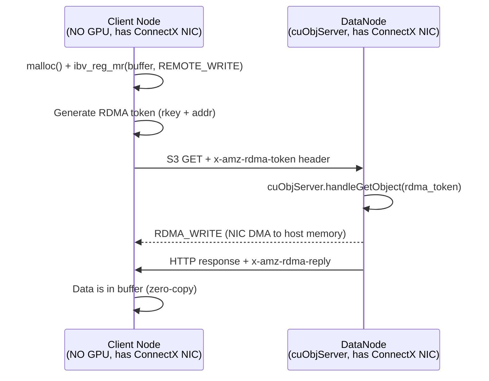

# RDMA Host Memory & CPU-Only Operation: Research Findings

**Research Date:** 2026-04-13
**Context:** Apache Ozone GPUDirect integration -- can we use cuObjServer RDMA_WRITE to target host (CPU) memory on client nodes without GPUs?

---

## Question 1: Can cuObjClient Register HOST Memory Instead of GPU Memory?

### Finding: YES -- Confirmed

The cuObjClient API explicitly supports system (host) memory through the `CUOBJ_MEMORY_SYSTEM` enum value.

**Evidence from NVIDIA cuObjClient API docs** (https://docs.nvidia.com/gpudirect-storage/cuobject/cuObjClient-api/index.html):

The `cuObjMemoryType_t` enumeration defines three valid memory types:
- `CUOBJ_MEMORY_SYSTEM = 0` -- System (host) memory
- `CUOBJ_MEMORY_CUDA_MANAGED = 1` -- CUDA unified/managed memory
- `CUOBJ_MEMORY_CUDA_DEVICE = 2` -- CUDA device memory

The `cuMemObjGetDescriptor()` function documentation states it works with "system memory, CUDA managed memory, and CUDA device memory." The static method `getMemoryType()` can identify host memory allocations, returning `CUOBJ_MEMORY_SYSTEM` for CPU-allocated buffers.

**Evidence from cuObject overview** (https://docs.nvidia.com/gpudirect-storage/cuobject/index.html):

The overview states cuObject enables "direct data transfers between GPU memory **or system memory** and S3 compatible object storage using RDMA."

### What Remains Uncertain

- The docs say "system memory" but do not explicitly say `cudaHostAlloc`-allocated memory vs plain `malloc`-allocated memory. The term "system memory" in NVIDIA's context typically means any host RAM.
- Whether `CUOBJ_MEMORY_SYSTEM` memory goes through a different RDMA registration path internally (e.g., whether it uses `ibv_reg_mr` directly vs GPUDirect RDMA peer mapping) is not documented publicly.

---

## Question 2: Can CUDA Runtime (`cudaHostAlloc`) Work Without a Physical GPU?

### Finding: NO -- cudaHostAlloc Requires a GPU

**Evidence from NVIDIA Developer Forums:**

1. **"CUDA without a GPU?"** (https://forums.developer.nvidia.com/t/cuda-without-a-gpu/19409): An experienced developer states: "If you don't have a card, you can't use any current version of CUDA." Device emulation mode was removed after CUDA 3.0/3.1. There is no CPU-only mode in modern CUDA.

2. **"How to run optional CUDA app on a machine with no GPU/CUDA runtime/drivers?"** (https://forums.developer.nvidia.com/t/how-to-run-optional-cuda-app-on-a-machine-with-no-gpu-cuda-runtime-drivers/284814): If the CUDA runtime is dynamically linked and the library is not present, the application fails at launch. If statically linked, all CUDA API calls (including `cudaHostAlloc`) return errors like `cudaErrorNoDevice`.

**Confirmed behavior:**
- `cudaGetDeviceCount()` returns 0 or errors with `cudaErrorNoDevice` on systems without a GPU
- `cudaHostAlloc()` requires CUDA runtime initialization, which requires a GPU device
- The CUDA driver and runtime both require a physical NVIDIA GPU to initialize
- There is no CPU emulation mode in CUDA 4.0+

**Implication for our architecture:** A client node that has NO GPU cannot use `cudaHostAlloc`. However, this may not matter because cuObjClient accepts `CUOBJ_MEMORY_SYSTEM` (plain host memory), which does NOT need to be allocated via `cudaHostAlloc` -- it can be regular `malloc`/`mmap` memory registered with the RDMA NIC via `ibv_reg_mr`.

### The Real Question

The question is not whether `cudaHostAlloc` works without a GPU. The question is whether cuObjClient itself requires the CUDA runtime to initialize. Based on the release notes:

**cuObject Client v1.0.0 Release Notes** (https://docs.nvidia.com/gpudirect-storage/cuobject/cuobject-client-release-notes/index.html):
- Requires "CUDA Toolkit 13.1.1 or later"
- Requires "NVIDIA GPU Driver compatible with CUDA 13.1.1"
- BUT lists GPU as optional: "NVIDIA GPU with CUDA Compute Capability 6.0 or higher **(for GPU memory operations)**"

This suggests cuObjClient MAY work on a node with ConnectX NICs and CUDA libraries installed but no physical GPU, as long as you only use `CUOBJ_MEMORY_SYSTEM`. However, the requirement for "NVIDIA GPU Driver" is ambiguous -- the driver may refuse to install or initialize without a GPU present. This needs empirical testing.

---

## Question 3: Can RDMA_WRITE Target Host Memory Registered with ibv_reg_mr()?

### Finding: YES -- This is Fundamental RDMA Behavior, Fully Confirmed

RDMA was designed for host-to-host memory transfers long before GPU memory was involved. GPU memory support (GPUDirect RDMA) is an **extension** of the base RDMA functionality, not the default.

**Evidence from ibv_reg_mr man page** (https://github.com/linux-rdma/rdma-core/blob/master/libibverbs/man/ibv_reg_mr.3):
- `ibv_reg_mr()` registers a memory region associated with a protection domain
- Accepts a virtual address pointer and length -- standard `malloc`/`mmap` host memory
- No GPU-specific restrictions mentioned
- To enable remote writes: set `IBV_ACCESS_REMOTE_WRITE | IBV_ACCESS_LOCAL_WRITE`

**Evidence from RDMA programming tutorials:**

1. **"Introduction to Programming InfiniBand RDMA"** (https://insujang.github.io/2020-02-09/introduction-to-programming-infiniband/): All examples use host memory. RDMA_WRITE posts a send request with `IBV_WR_RDMA_WRITE` targeting a remote memory region's address and rkey. The remote side is not even aware the write is happening.

2. **"RDMA Read and Write with IB Verbs"** (https://thegeekinthecorner.wordpress.com/2010/09/28/rdma-read-and-write-with-ib-verbs/): The standard flow is: (1) register host memory with `ibv_reg_mr`, (2) exchange rkey and address with peer, (3) post RDMA_WRITE work requests. All memory in these examples is regular host RAM.

3. **NVIDIA RDMA Programming Guide** (https://docs.nvidia.com/networking/display/RDMAAwareProgrammingv17/Programming+Examples+Using+IBV+Verbs): Programming examples use `ibv_reg_mr` with standard host buffers.

### The RDMA_WRITE Flow

```
Sender (cuObjServer on datanode):                    Receiver (client node):
1. Has data in registered local buffer          1. malloc() host buffer
2. Receives RDMA token (rkey + addr)            2. ibv_reg_mr(buffer, IBV_ACCESS_REMOTE_WRITE)
   from client                                  3. Sends rkey + addr to server (RDMA token)
3. Posts IBV_WR_RDMA_WRITE with                 4. Data appears in buffer -- no CPU involvement
   remote rkey and addr                            on receiver side
```

**Conclusion:** RDMA_WRITE to host memory is the ORIGINAL and most basic RDMA use case. It does not require GPU memory at either end. The NIC's DMA engine writes directly to pinned host memory.

---

## Question 4: Cloud Instances with RDMA/RoCE NICs but NO GPUs

### Finding: Many Options Exist Across All Major Clouds

#### AWS (EFA -- Elastic Fabric Adapter)

EFA provides RDMA-like capabilities via a custom protocol (not InfiniBand). Supports `ibv_reg_mr` via the `efa` provider in rdma-core. Key non-GPU EFA instances:

| Instance Family | Example Sizes | vCPUs | Network | Notes |
|----------------|---------------|-------|---------|-------|
| **hpc6a** | hpc6a.48xlarge | 96 | 100 Gbps EFA | AMD EPYC, designed for HPC |
| **hpc7a** | hpc7a.96xlarge | 192 | 300 Gbps EFA | AMD EPYC 4th gen |
| **hpc7g** | hpc7g.16xlarge | 64 | 200 Gbps EFA | ARM Graviton3 |
| **hpc8a** | hpc8a.96xlarge | 96 | EFA v2 | Latest HPC |
| **c5n** | c5n.18xlarge | 72 | 100 Gbps EFA | Compute-optimized |
| **c6in** | c6in.32xlarge | 128 | 200 Gbps EFA | Compute + networking |
| **c7gn** | c7gn.16xlarge | 64 | 200 Gbps EFA | ARM + networking |
| **r6in** | r6in.32xlarge | 128 | 200 Gbps EFA | Memory-optimized |
| **m6in** | m6in.32xlarge | 128 | 200 Gbps EFA | General purpose |

**EFA Caveat:** EFA is NOT InfiniBand. It provides `ibv_reg_mr` via the `efa` rdma-core provider, and supports RDMA read/write on Nitro v4+ instances. However, cuObjServer/cuObjClient expect ConnectX-5+ NICs with native IB/RoCE. EFA may not be compatible with cuObject without modification.

Source: https://docs.aws.amazon.com/AWSEC2/latest/UserGuide/efa.html

#### Azure (Native InfiniBand -- Best Option for RDMA without GPU)

Azure is the standout here. Their HPC VM families provide **real InfiniBand with ibverbs** and NO GPU:

| VM Series | Example Size | vCPUs | RAM | InfiniBand Speed | Price/hr (approx) |
|-----------|-------------|-------|-----|------------------|-------------------|
| **HBv3** | HB120rs_v3 | 120 | 456 GB | 200 Gb/s HDR IB | ~$3.60 |
| **HBv4** | HB176rs_v4 | 176 | 768 GB | 400 Gb/s NDR IB | TBD |
| **HC** | HC44rs | 44 | 352 GB | 100 Gb/s EDR IB | ~$3.17 |
| **HX** | HX176rs | 176 | 1.4 TB | 400 Gb/s NDR IB | TBD |

These use real Mellanox ConnectX InfiniBand HCAs with full ibverbs support. They run `ibv_devinfo`, `ib_write_bw`, and all standard RDMA tools. They use ConnectX NICs (the same hardware cuObject expects).

Source: https://learn.microsoft.com/en-us/azure/virtual-machines/sizes-hpc

#### GCP (Cloud RDMA -- H4D Instances)

GCP offers the **H4D** machine series with Cloud RDMA support and no GPU:

| Machine Type | vCPUs | RAM | RDMA Speed | Notes |
|-------------|-------|-----|------------|-------|
| **h4d-standard-192** | 192 | 720 GB DDR5 | 200 Gbps Cloud RDMA | AMD EPYC Turin |

H4D instances explicitly **cannot** use GPUs. They require a Falcon RDMA network profile and use the IRDMA driver. This is GCP's own RDMA implementation, not InfiniBand -- unclear whether cuObject would recognize it.

Source: https://docs.google.com/compute/docs/instances/create-vm-with-rdma

#### Oracle Cloud Infrastructure

OCI offers bare metal HPC shapes with RoCEv2 and no GPU, though most documented RDMA instances are GPU-equipped. The BM.Optimized3.36 shape provides RDMA networking for HPC without GPUs.

### Summary for RDMA-without-GPU

**Best option: Azure HB-series** -- real InfiniBand, ConnectX NICs, full ibverbs, no GPU, well-documented, ~$3.60/hr. These use the exact same NIC hardware that cuObject expects.

---

## Question 5: Does cuObjServer Care Whether the RDMA Target is GPU or Host Memory?

### Finding: NO -- cuObjServer Does NOT Distinguish Between GPU and Host Memory Targets

**Evidence from cuObjServer API docs** (https://docs.nvidia.com/gpudirect-storage/cuobject/cuObjServer-api/index.html):

1. **Server-side memory is explicitly host-only:** The `registerBuffer()` documentation states: "Buffer must remain valid until deRegisterBuffer() is called. Must be host memory (system RAM)." The `allocHostBuffer()` function allocates "pinned memory on the CPU." cuObjServer itself runs entirely on host memory.

2. **No validation of remote memory type:** The `handleGetObject()` function accepts:
   - `rdma_descr`: An opaque RDMA descriptor string from the client
   - `remote_buf_start`: A remote buffer address

   These are treated as opaque values. There is no parameter for memory type, no validation of whether the remote target is GPU or host memory, and no GPU-related APIs in the entire cuObjServer specification.

3. **The RDMA token is opaque:** cuObjServer receives the RDMA descriptor string and uses it to perform the RDMA_WRITE. The descriptor contains the rkey and virtual address. At the RDMA hardware level, the NIC performs a DMA write to whatever physical address the rkey resolves to -- it does not distinguish between GPU BAR memory and host RAM.

**Conclusion:** cuObjServer performs RDMA_WRITE using the descriptor/token provided by the client. Whether that token points to GPU memory or host memory is entirely the client's concern. The server never checks, and the RDMA hardware does not care.

---

## Question 6: What is jVerbs/DiSNI? Can Java Applications Do RDMA?

### Finding: YES -- Java Can Do RDMA via DiSNI (and historically jVerbs)

#### DiSNI (Direct Storage and Networking Interface)

**Repository:** https://github.com/zrlio/disni
**Origin:** IBM Research Zurich
**License:** Apache 2.0
**Latest Release:** v2.1 (June 2019)
**Java Version:** 8+
**Status:** Functionally complete but not actively maintained (last release 2019)

DiSNI provides a Java API that wraps libibverbs via JNI. It supports:

- **Full RDMA verbs:** `ibv_reg_mr`, `ibv_post_send`, `ibv_post_recv`, `ibv_poll_cq`
- **RDMA operations:** RDMA_READ, RDMA_WRITE, SEND, RECV
- **Network transports:** InfiniBand, RoCEv2, iWARP
- **Memory registration:** Uses Java `ByteBuffer.allocateDirect()` (which IS host memory)

**Memory registration example from DiSNI source code:**

```java
// Allocate host memory via Java DirectByteBuffer
ByteBuffer buffer = ByteBuffer.allocateDirect(bufferSize);

// Register with RDMA protection domain (equivalent to ibv_reg_mr)
IbvMr mr = pd.regMr(buffer, 
    IbvMr.IBV_ACCESS_LOCAL_WRITE | 
    IbvMr.IBV_ACCESS_REMOTE_WRITE | 
    IbvMr.IBV_ACCESS_REMOTE_READ)
    .execute().free().getMr();

// Now mr.getLkey(), mr.getRkey(), mr.getAddr() can be used for RDMA operations
```

Source: https://github.com/zrlio/disni/blob/master/src/test/java/com/ibm/disni/examples/VerbsClient.java

**Key point:** DiSNI registers **Java DirectByteBuffer memory** -- this is host/CPU memory allocated off-heap. It is NOT GPU memory. This is the standard way to do RDMA from Java.

#### jVerbs (IBM JDK Only)

**Origin:** IBM, integrated into IBM SDK for Java 7 and 8
**Availability:** IBM JDK only (not OpenJDK, not Oracle JDK)
**Platform:** Linux only
**Status:** Part of IBM JDK, still supported within IBM's Java distribution

jVerbs provides similar RDMA functionality but is proprietary to IBM's JDK. It maps directly to OFED RDMA user libraries.

Source: https://www.ibm.com/docs/en/sdk-java-technology/8?topic=rdma-jverbs-library-linux-only

#### Performance (Java RDMA vs Native C)

From academic benchmarks (SoCC 2013 paper + ResearchGate 2020 paper):
- **Latency:** DiSNI and native ibverbs achieve ~2 microseconds for small messages. jVerbs is slightly higher at ~2+ microseconds.
- **Throughput:** C ibverbs RDMA_WRITE achieves 7.9-9.3 million messages/sec for small payloads; jVerbs achieves 4.3-4.6 mmps (~50% of native). For large transfers (bulk data), throughput difference narrows as it becomes bandwidth-bound.
- **Practical impact:** For Ozone's use case (large block transfers), the throughput gap is negligible since we are bandwidth-limited by the NIC, not message-rate-limited.

Sources:
- https://animeshtrivedi.github.io/files/papers/2013-socc-jVerbs:%20Ultra-Low%20Latency%20for%20Data%20Center%20Applications.pdf
- https://www.researchgate.net/publication/344471117_Performance_analysis_and_evaluation_of_Java-based_InfiniBand_Solutions

#### Relevance to Ozone

DiSNI could allow Ozone's Java-based datanode to:
1. Allocate host memory via `ByteBuffer.allocateDirect()`
2. Register it for RDMA via `pd.regMr()` (equivalent to `ibv_reg_mr`)
3. Perform RDMA_WRITE/RDMA_READ operations directly from Java
4. This would be an **alternative** to using cuObjServer (which is a C++ library requiring JNI)

However, DiSNI has not been actively maintained since 2019. For production use, the options are:
- **Use DiSNI** and accept the maintenance burden (fork and maintain)
- **Use cuObjServer via JNI** from Ozone's Java datanode process
- **Write a thin JNI wrapper** around raw libibverbs (less code than DiSNI, more targeted)

---

## Summary: Architectural Implications

### The Key Insight

**cuObjServer does not care what memory type the RDMA target is.** It performs RDMA_WRITE to whatever address the client's RDMA token specifies. The RDMA hardware (NIC) handles the DMA to physical memory regardless of whether it is GPU BAR memory or host RAM.

### Viable Architecture: RDMA to Host Memory Without GPUs



### What Works Without a GPU on the Client

| Component | Works Without GPU? | Notes |
|-----------|-------------------|-------|
| ibv_reg_mr (host memory) | YES | Fundamental RDMA -- no GPU needed |
| RDMA_WRITE to host memory | YES | Standard RDMA behavior |
| cuObjClient with CUOBJ_MEMORY_SYSTEM | UNCERTAIN | Requires CUDA toolkit; GPU listed as optional "for GPU memory operations" but driver may need GPU |
| cudaHostAlloc | NO | Requires a physical GPU device |
| DiSNI (Java RDMA) | YES | Uses Java ByteBuffer (host memory), no GPU dependency |
| cuObjServer (datanode side) | YES | Operates on host memory; does not validate remote target type |

### Recommended Path

1. **Datanode (server) side:** Use cuObjServer as planned. It works with host memory. It does not care about the client's memory type.

2. **Client side -- GPU nodes:** Use cuObjClient with `CUOBJ_MEMORY_CUDA_DEVICE` for GPU-direct transfers. This is the primary use case.

3. **Client side -- CPU-only nodes:** Two options:
   - **Option A:** Use cuObjClient with `CUOBJ_MEMORY_SYSTEM` if it can initialize without a GPU (needs testing)
   - **Option B:** Build a lightweight RDMA client using raw ibverbs (via DiSNI in Java, or a thin JNI wrapper around libibverbs in C). Register host memory with `ibv_reg_mr`, generate an RDMA token compatible with cuObjServer's expected format, and send it in the `x-amz-rdma-token` header. This bypasses all CUDA dependencies.

4. **Cloud deployment for CPU-only RDMA nodes:** Azure HB-series (HB120rs_v3 at ~$3.60/hr) provides real InfiniBand with ConnectX NICs and no GPU. This is the most compatible option for cuObject.

---

## Sources

### NVIDIA Documentation
- [cuObjClient API Reference](https://docs.nvidia.com/gpudirect-storage/cuobject/cuObjClient-api/index.html)
- [cuObjServer API Reference](https://docs.nvidia.com/gpudirect-storage/cuobject/cuObjServer-api/index.html)
- [cuObject Overview](https://docs.nvidia.com/gpudirect-storage/cuobject/index.html)
- [cuObject Client Release Notes](https://docs.nvidia.com/gpudirect-storage/cuobject/cuobject-client-release-notes/index.html)
- [NVIDIA RDMA Programming Guide](https://docs.nvidia.com/networking/display/RDMAAwareProgrammingv17/Programming+Examples+Using+IBV+Verbs)

### NVIDIA Developer Forums
- [CUDA without a GPU?](https://forums.developer.nvidia.com/t/cuda-without-a-gpu/19409)
- [How to run optional CUDA app on machine with no GPU](https://forums.developer.nvidia.com/t/how-to-run-optional-cuda-app-on-a-machine-with-no-gpu-cuda-runtime-drivers/284814)
- [Unable to reproduce cuObject example](https://forums.developer.nvidia.com/t/unable-to-reproduce-cuobject-example/360539)

### RDMA / ibverbs
- [ibv_reg_mr man page (rdma-core)](https://github.com/linux-rdma/rdma-core/blob/master/libibverbs/man/ibv_reg_mr.3)
- [Introduction to Programming InfiniBand RDMA](https://insujang.github.io/2020-02-09/introduction-to-programming-infiniband/)
- [RDMA Read and Write with IB Verbs](https://thegeekinthecorner.wordpress.com/2010/09/28/rdma-read-and-write-with-ib-verbs/)

### Cloud RDMA Without GPU
- [AWS EFA Documentation](https://docs.aws.amazon.com/AWSEC2/latest/UserGuide/efa.html)
- [AWS Hpc6a Instances](https://aws.amazon.com/ec2/instance-types/hpc6a/)
- [Azure HPC VMs Overview](https://learn.microsoft.com/en-us/azure/virtual-machines/overview-hb-hc)
- [Azure HPC VM Sizes](https://learn.microsoft.com/en-us/azure/virtual-machines/sizes-hpc)
- [Azure InfiniBand Setup](https://learn.microsoft.com/en-us/azure/virtual-machines/setup-infiniband)
- [GCP Cloud RDMA (H4D)](https://docs.google.com/compute/docs/instances/create-vm-with-rdma)
- [GCP H4D for HPC](https://www.hpcwire.com/off-the-wire/google-cloud-launches-h4d-vms-to-accelerate-hpc-workloads-with-amd-epyc-and-cloud-rdma/)

### Java RDMA
- [DiSNI GitHub Repository](https://github.com/zrlio/disni)
- [jVerbs: Ultra-Low Latency for Data Center Applications (SoCC 2013)](https://animeshtrivedi.github.io/files/papers/2013-socc-jVerbs:%20Ultra-Low%20Latency%20for%20Data%20Center%20Applications.pdf)
- [Performance Analysis of Java-based InfiniBand Solutions](https://www.researchgate.net/publication/344471117_Performance_analysis_and_evaluation_of_Java-based_InfiniBand_Solutions)
- [DiSNI VerbsClient Example](https://github.com/zrlio/disni/blob/master/src/test/java/com/ibm/disni/examples/VerbsClient.java)
- [jVerbs Overview (OFA Workshop 2012)](https://downloads.openfabrics.org/Media/Monterey_2012/2012_Workshop_Tues_jVerbs-1.pdf)
